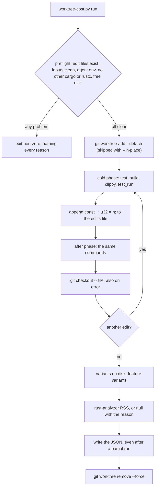
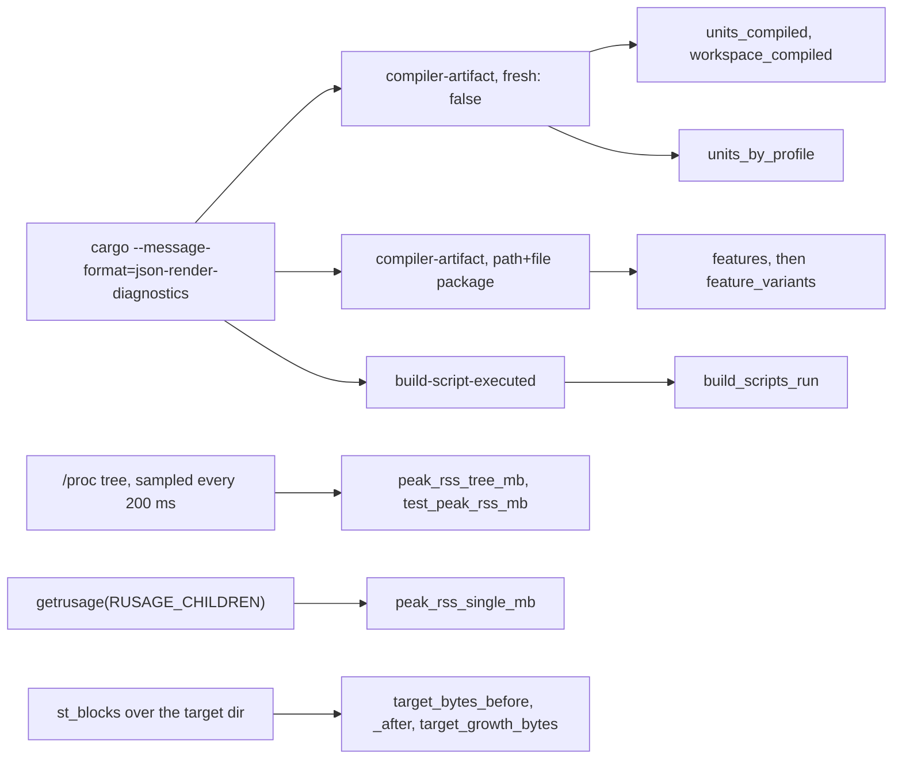

# Worktree cost of an isolated edit: `scripts/dev/worktree-cost.py`

Status: plan item 259, the baseline measurement for item 90's crate split.
Nothing before it. Every later build-time step reports against it: step 0
(items 246, 269–272, [design](269-272-dev-dependency-cascades.md)), the shared
cache (260, [design](260-shared-cache.md)), the build levers (296–300,
[design](296-300-build-levers.md)), and each crate-split step that changes a
cone. This document specifies the script. The script landed in `18040b3b`
(`scripts/dev/worktree-cost.py`, its tests in
`scripts/dev/test_worktree_cost.py`, `make check-worktree-cost-script`, and
the AGENTS.md pointer); the baseline section in build-test-cost is not
recorded yet.

## Problem

Nobody can say today what one isolated edit costs a worktree. The numbers in
hand are scattered and were taken by different methods:

- the failset logs show 9 crates and 2–6 minutes after a `tcl-compiler` edit
  ([step 0](../compiler/crate-split/00-test-dependencies.md));
- the crate-split overview quotes cones of 54, 80 and 179 crates for
  `tcl-registry`, `tcl-compiler` and `tcl-lsp-core`, with no method given.
  `cargo tree -e normal,build` (26 November 2026, unique package names) gives
  42, 64 and 130; with dev-dependencies, 144, 155 and 194. Counting a
  package once per version, as [295](../workspace/295-hub-crates.md) does,
  `tcl-lsp-core`'s figures are 134 and 199;
- this checkout's target directory is 34 GB: 23 GB in `target/debug/build`
  and 11 GB of incremental state, of which `tcl-compiler` holds three
  directories (3.8, 1.5 and 1.5 GB), one per build variant.

Item 259 asks for one script, one method and one recorded baseline, so the
split's per-edit targets are set from measurements.

Two facts about this machine shape the script:

- `/usr/bin/time` is not installed, so the plan's `time -v` cannot be the only
  source of peak RSS.
- The cgroup hierarchy is v1 (`/sys/fs/cgroup/memory`, no `memory.peak`).

Cargo 1.100 uses the new build-dir layout by default: every unit has its own
`target/debug/build/<package>/<unit-hash>/` directory. The number of unit
hashes per package is the number of build variants, which items 296 and 297
need.

## Design

### Invocation

```sh
scripts/dev/worktree-cost.py run [--edits lexer,registry,analyser,lsp]
                                 [--no-test-run] [--no-ra] [--jobs N]
                                 [--commands test_build,clippy,test_run]
                                 [--phases cold,after] [--in-place]
                                 [--out target/worktree-cost/<commit>.json] [--merge]
scripts/dev/worktree-cost.py table  <run.json>             # Markdown rows
scripts/dev/worktree-cost.py compare <before.json> <after.json>
```

**Result:**

```text
$ scripts/dev/worktree-cost.py run --help | head -3
usage: worktree-cost.py run [-h] [--edits EDITS] [--no-test-run]
                            [--commands COMMANDS] [--phases PHASES] [--no-ra]
                            [--jobs JOBS] [--in-place] [--merge] [--out OUT]
```

The script adds four options to this design. `--commands` and `--phases`
pick a subset. `--merge` adds a run's edits to an existing `--out` document,
so a long baseline can be taken one edit at a time; it refuses a document
measured on other build inputs. `--in-place` measures the current checkout
and its warm target instead of a fresh worktree, and records
`"cold_means": "warm target of the checkout"`.

`run` refuses to start unless:

- the tree is clean;
- `CARGO_TARGET_DIR` is the worktree's own `target/`;
- the variables `agent-build-env.sh --print` emits are set to its values.

If `CARGO_TARGET_DIR` is shared or the environment differs, the numbers are
not the agents' numbers. It creates a fresh worktree with
`git worktree add --detach <scratch>/wt HEAD`. It runs every command there with
an empty target directory, and removes the worktree at the end. It never runs
two cargo commands at once.

One run, as the script does it:



The edits of one run share the worktree and its target, so only the first
edit's cold phase starts from an empty target; a later edit's "cold" is warm
from the earlier builds. For a cold phase per edit, run one edit at a time
with `--edits <key> --merge`; each run gets its own fresh worktree.

### The four edits

Each edit appends one line to one file: an anonymous constant,
`const _: u32 = <n>;`, where `n` is the run's sequence number. This edit:

- changes the crate's source, so cargo rebuilds that crate and every crate
  above it in the build (cargo has no early cut-off);
- changes no behaviour, raises no lint, and is valid in any module;
- is the cheapest edit possible for rustc's incremental cache, so it measures
  the cone, not the edit. A body edit costs more inside the crate. The cone
  is the part the split changes.

After each edit the script restores the file with `git checkout -- <file>`.
The `lexer` edit, for example:

**Before:**

```rust
// rust/tcl-syntax/src/glob.rs, last lines
        assert_eq!(glob(""), Some(("*".into(), false)));
    }
}
```

**After:**

```rust
// rust/tcl-syntax/src/glob.rs, last lines, first edit of the run
        assert_eq!(glob(""), Some(("*".into(), false)));
    }
}
const _: u32 = 1;
```

| Key | File (today) | Crate tested | After the split |
|---|---|---|---|
| `lexer` | `rust/tcl-syntax/src/glob.rs` | `tcl-syntax` | unchanged |
| `registry` | `rust/tcl-registry/src/commands/irules/active_members.rs` (one iRules command spec, `const fn spec()`) | `tcl-registry` | `rust/tcl-lib-irules/src/…` after item 264 |
| `analyser` | `rust/tcl-compiler/src/analyser/diagnostics/widget_command.rs` (one diagnostic rule, 11 tests) | `tcl-compiler` | `rust/tcl-diagnostics/src/…` after item 257 |
| `lsp` | `rust/tcl-lsp-core/src/folding.rs` (one LSP feature) | `tcl-lsp-core` | unchanged until item 289 |

The table lives in the script as data, keyed by commit range. When a step moves
one of these files, the step updates the row in the same change. The script
fails if a row's file is missing.

### Commands measured per edit

For each edit, three commands run in order, first cold (empty target) and then
after the edit:

1. `cargo test -p <crate> --no-run`, the test build (test profile, opt-level 1,
   incremental).
2. `cargo clippy -p <crate> --all-targets`, the lint build (dev profile, check
   mode, not incremental).
3. `cargo test -p <crate>`, the test run, unless `--no-test-run` is given.

All three run with `--message-format=json-render-diagnostics`. Items 296 and 297
read the first two together: they show what a worktree compiles when it does
both.

### Measurements

| Field | How |
|---|---|
| `units_compiled` | `compiler-artifact` messages with `"fresh": false`, split into workspace and third-party by `package_id` (`path+file://` against registry). |
| `units_by_profile` | the same messages grouped by `profile.opt_level`, `profile.test` and check mode, where check mode means the filenames are `.rmeta` only. This also settles whether `cargo test` builds dependencies under the test profile (see Open questions). |
| `units_by_features` | per workspace package, the distinct `features` lists seen across all commands of the run; more than one list is a variant (item 296). |
| `variants_on_disk` | per workspace package, the count of `target/debug/build/<pkg>/*/` unit directories at the end of the run. |
| `build_scripts_run` | `build-script-executed` messages, per package. |
| `wall_s` | `time.monotonic()` around each command. |
| `peak_rss_tree_mb` | the sum of `VmRSS` over the command's process tree, sampled every 200 ms. Children are found through `/proc/<pid>/task/*/children`, or by a `/proc` scan by parent id where the kernel lacks that file. This is the concurrent peak, which is what fills memory. |
| `peak_rss_single_mb` | `resource.getrusage(RUSAGE_CHILDREN).ru_maxrss` after the command: the largest single process, normally one rustc. Under `/usr/bin/time -v` when it exists, the script records its "Maximum resident set size" too, so the two can be compared. |
| `test_peak_rss_mb` | for command 3, the same tree sampling restricted to the test harness processes (`target/debug/deps/<crate>-*` executables), so the test run's memory is separated from cargo's. |
| `target_bytes` | the target directory's allocated size (`st_blocks * 512`, hard links counted once) before and after each command. The script also records the split into `build/`, `incremental/`, `deps`-style outputs and test executables. |
| `ra_rss_mb` | see below. |
| `machine` | `nproc`, total memory, `-j`, rustc and cargo versions, the commit, and the cargo environment. |

Cargo emits `build-script-executed` for a fresh build script too, replaying
its saved output. So `build_scripts_run` counts the build scripts in the
graph, not the reruns: the in-place analyser run below lists 23, `serde` and
`libc` among them, while compiling no third-party unit. Item 299 needs reruns;
the script must tell them apart by another signal before 299 is measured (see
Open questions).

Where each field comes from:



### rust-analyzer memory

rust-analyzer is not installed in this container (`rustup` reports no
`rust-analyzer` component). When the binary is missing, the script records
`ra_rss_mb: null` with the reason. When it is present, the script:

1. starts it as an LSP server on the fresh worktree with
   `checkOnSave: false` and `cargo.targetDir: true`, so its build-script run
   goes to `target/rust-analyzer/` and does not touch the build being measured;
2. sends `initialize` and waits until every `$/progress` token has ended,
   with a 20-minute cap;
3. records `VmRSS` of the server process and the size of
   `target/rust-analyzer/`. The second build is a cost of the worktree too:
   rust-analyzer runs `cargo check` for build scripts and proc macros.

### Output

One JSON document per run, written to `target/worktree-cost/<commit>.json`.
It lives in the target directory and is never committed: the repository rules
forbid run receipts. Its shape:

```json
{"commit": "…", "machine": {…}, "env": {…},
 "edits": {"registry": {"crate": "tcl-registry",
   "cold":  {"test_build": {…}, "clippy": {…}, "test_run": {…}},
   "after": {"test_build": {…}, "clippy": {…}, "test_run": {…}}}},
 "variants": {"tcl-compiler": 3, …}, "ra": {…}}
```

`table` prints one Markdown row per edit and command: units compiled
(workspace / total), wall time, peak RSS (tree / single), target growth and
the test run's peak RSS. `compare` prints the same rows as deltas.

The first real run was the analyser edit alone, in place on this checkout's
warm target at `18040b3b`, without the test run (`--edits analyser --in-place
--no-test-run --no-ra`). Its table:

```sh
$ scripts/dev/worktree-cost.py table target/worktree-cost/baseline.json
```

```text
| Edit | Crate | Phase | Command | Workspace units | Total units | Wall (s) | Peak RSS tree (MB) | Peak RSS single (MB) | Target growth (MB) | Test run RSS (MB) |
|---|---|---|---|---:|---:|---:|---:|---:|---:|---:|
| analyser | `tcl-compiler` | cold | clippy | 32 | 32 | 143.5 | 5058 | 4976 | 0 | – |
| analyser | `tcl-compiler` | cold | test_build | 0 | 0 | 0.4 | 79 | 79 | 0 | – |
| analyser | `tcl-compiler` | after | clippy | 32 | 32 | 147.5 | 5059 | 4977 | 0 | – |
| analyser | `tcl-compiler` | after | test_build | 31 | 31 | 338.4 | 6232 | 5405 | 2135 | – |
```

The file has since had the lexer, lsp and registry edits merged in
(`--merge`); `table` now prints their rows too, and the analyser rows above
are unchanged.

Read with the document behind it:

- The warm "cold" test build compiles nothing. Clippy, before the edit,
  already rechecks the same 9 crates it rechecks after it. An in-place cold
  row measures whatever the warm target lacks, which is why the baseline
  needs a fresh worktree.
- The after-edit test build's 31 units are 9 crates (`workspace_compiled`):
  `tcl-compiler` and the 8 above it in its test build, `tcl-lsp-core`,
  `tcl-spectcl`, `tcl-spec-hooks`, `tcl-engine-tclvm`, `tcl-codegen`,
  `tcl-bigip`, `tcl-irules` and `tcl-sslictcl`. That is the failset logs' "9
  crates", now with a method. `units_by_profile` is `{"opt1": 19,
  "opt1-test": 12}`: the dependencies were built at opt-level 1, which
  answers the first open question below for this run.
- `variants` counts 134 unit directories for `tcl-compiler` and 87 for
  `tcl-vm` on this long-lived target; on a fresh worktree it is the live
  variant count.

### Where the baseline is recorded

A new section, "Worktree cost baseline (item 259)", in
[build-test-cost](../../work/build-test-cost/current-state.md). It holds:

- the commit and the machine;
- the table;
- the variant counts;
- rust-analyzer's memory.

Each item-90 step that changes a cone re-runs the script on its first green
build and adds one row of deltas under that section. Because the file is a
current snapshot, earlier rows are replaced by a single "before → after" line
per step.

### Decisions

- **Fresh worktree, not the current checkout.** A warm target directory hides
  the cone; the cold build is part of what a new worktree pays.
- **One edit kind for all four.** It is comparable across crates and steps, and
  a body-edit mode can be added later behind `--edit-kind body` if the
  incremental share inside a crate is wanted.
- **Tree-summed RSS as the headline.** A machine runs out of memory on the sum
  of concurrent rustc processes, not on the largest one.
- **Counts from cargo's JSON, not from timings HTML.** The JSON is
  machine-readable and carries profile and features per unit.

### Open questions

- Does `cargo test` build a test's dependencies under the test profile, or
  under dev? The Cargo book says the selected profile applies to all targets.
  The comment in `.github/workflows/ci.yml` (above `env:`) assumes dependency
  rlibs use dev. The `profile.opt_level` of dependency artifacts in command 1
  settles it, and items 260 and 297 depend on the answer. The in-place
  analyser run built all 31 units at opt-level 1, so the Cargo book is right
  for workspace dependencies; a fresh run confirms it for third-party ones.
- How does the script tell a build-script rerun from a replay? Cargo sends
  `build-script-executed` for both. One signal is the modification time of
  the unit's `output` file under `target/debug/build/<pkg>/<hash>/`, taken
  before and after the command.
- Is 200 ms sampling fine enough? Compare it with `time -v` on a machine that
  has it; if the two differ by more than 5% for the largest unit, sample at
  50 ms.

## Work list

1. `scripts/dev/worktree-cost.py`:
   - the edit table;
   - the environment guard;
   - the worktree lifecycle;
   - the three commands per edit;
   - the JSON parser;
   - the RSS sampler;
   - the target sizer;
   - the rust-analyzer driver;
   - `table` and `compare`.
2. `scripts/dev/test_worktree_cost.py` (below), with a Makefile target
   `check-worktree-cost-script` beside `check-tracked-size`, which runs the
   unit tests only (no cargo).
3. Run on `work`'s tip, then record the baseline section in build-test-cost.
4. Add one line to AGENTS.md's build environment paragraph that points to the
   script.

## Tests

`scripts/dev/test_worktree_cost.py`, written in the `unittest` style of
`test_tracked_size.py` (pytest runs it as well). It uses no cargo and no network:

- **artifact parsing:** a canned JSON stream with fresh and non-fresh units,
  workspace and registry packages, check-mode `.rmeta`-only units and two
  feature lists for one package gives the expected counts and one variant;
- **environment guard:** a missing or different `CARGO_PROFILE_TEST_OPT_LEVEL`,
  a shared `CARGO_TARGET_DIR` and a dirty tree each refuse to run (non-zero
  exit with the reason);
- **edit and restore:** in a temporary git repository, applying an edit appends
  exactly one line and restoring leaves `git status` clean, including after an
  exception mid-run;
- **missing edit file:** a table row naming an absent file fails before any
  build;
- **sizer:** hard-linked files are counted once;
- **sampler:** a fake `/proc` tree, with a parent and two children whose RSS
  changes over three samples, gives the summed peak, and a process that exits
  mid-sample is skipped;
- **variants on disk:** a fake `target/debug/build/<pkg>/<hash>/` layout gives
  the per-package count;
- **`table` and `compare`:** two small run documents give the expected Markdown
  rows and signed deltas;
- **rust-analyzer absent:** with no binary on `PATH`, the result records `null`
  and the reason, and the run still succeeds.

## Verification

Done when (item 259's own, tightened):

- the baseline section exists in build-test-cost on the current tree, with
  all four edits, all three commands, cold and after-edit, and the variant
  counts;
- `make check-worktree-cost-script` passes;
- a second run on the same commit reproduces every unit count exactly and wall
  times within 15%. If it does not, the noise is recorded beside the table.

Measurements recorded: the build cone per edit (workspace and total units), the
rebuild count after the edit, wall time, both peak RSS figures, the test run's
peak RSS, target growth, variants per package, and rust-analyzer's resident memory.

## Risks

- **Machine load.** Another agent's build on the same container skews wall
  time and RSS. The script refuses to start while another `cargo` or `rustc`
  process runs, and it records the 1-minute load average.
- **Cost of a run.** Four cold test builds and the test runs are hours on 4
  vCPUs; `tcl-compiler`'s lib tests alone take about 439 s at opt-level 1.
  `--no-test-run` gives a build-only baseline when time is short, and the
  record says which was run.
- **Disk.** A fresh worktree's cold builds need tens of GB. The script checks
  free space first and needs 40 GB.
- **Moving files.** The edit table breaks as crates split; the missing-file
  check makes that loud.
