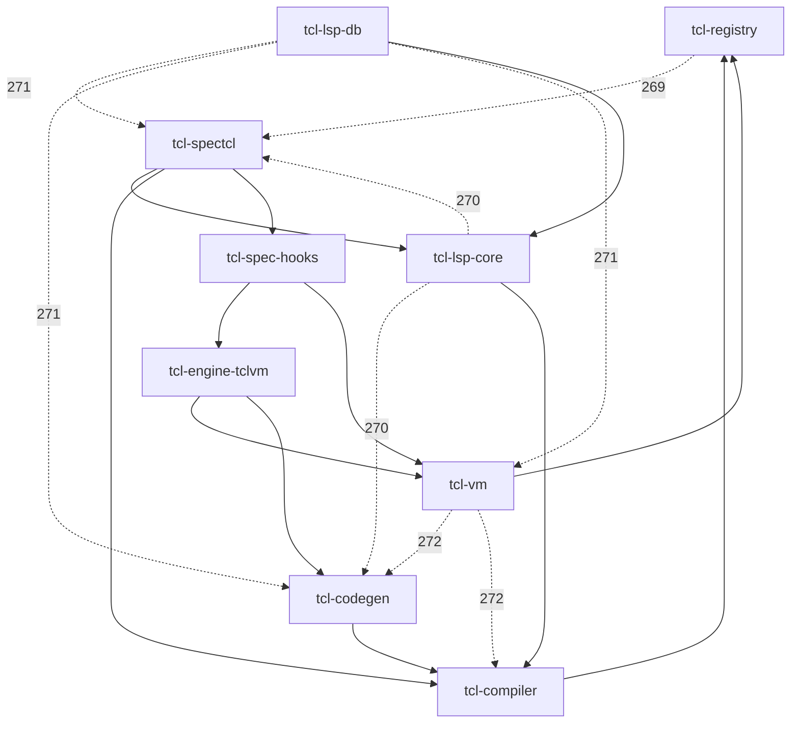
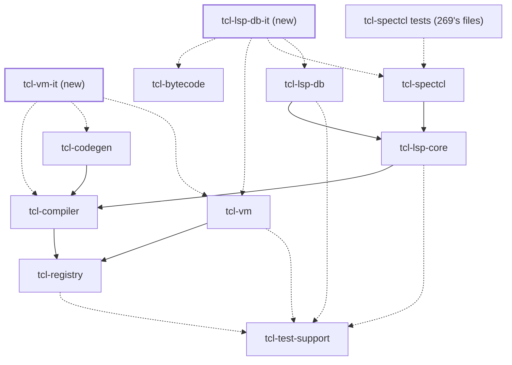

# Step 0b–0e: the other crates' dev-dependency cascades

Status: plan items 269 (`tcl-registry`), 270 (`tcl-lsp-core`), 271
(`tcl-lsp-db`) and 272 (`tcl-vm`), steps 0b–0e of item 90. Built on
[step 0a](../compiler/crate-split/00-test-dependencies.md) (item 246, the same
fault in `tcl-compiler`), whose pattern this follows. It reports against
[item 259's baseline](259-worktree-cost.md). The `module-layers` gate (item
247) carries these edges as a known list that may only shrink. Item 254 depends
on 272's test crate, and item 286 on 271's.

## Problem

Cargo builds every dev-dependency for every test target, `--lib` included.
When a crate's dev-dependency sits above it, two things follow:

- testing the crate compiles the upper stack;
- an edit anywhere in that stack relinks or recompiles the crate's tests.

Each edge was checked in its `Cargo.toml` on 26 November 2026. Cone sizes are
unique package names from `cargo tree -e normal,build`, then with `dev` added,
as workspace / all packages:

| Item | Crate | Upper-stack dev-dependencies | Cone without dev | With dev | After this step |
|---|---|---|---|---|---|
| 269 | `tcl-registry` | `tcl-spectcl` (`Cargo.toml:53`) | 12 / 42 | 29 / 144 | 15 workspace |
| 270 | `tcl-lsp-core` | `tcl-codegen` (`:66`), `tcl-spectcl` (`:71`) | 18 / 130 | 29 / 194 | 21 |
| 271 | `tcl-lsp-db` | `tcl-codegen` (`:49`), `tcl-vm` (`:52`), `tcl-spectcl` (`:58`) | 19 / 151 | 30 / 170 | 22 |
| 272 | `tcl-vm` | `tcl-codegen` (`:100`), `tcl-compiler` (`:103`) | 16 / 56 | 19 / 78 | 17 |

The "after" column is the normal cone joined with the cones of the remaining
dev-dependencies (`tcl-test-support`, which adds the host crates).
`tcl-lsp-db`'s `tcl-runtime-api` dev-dependency moves out with its only user,
the VM test below; the crate stays in `tcl-lsp-db`'s normal cone through
`tcl-registry`.

`tcl-spectcl` is the worst edge. Its normal cone is 28 workspace crates. It
includes `tcl-compiler`, `tcl-lsp-core`, and, through `tcl-spec-hooks` →
`tcl-engine-tclvm`, both `tcl-vm` and `tcl-codegen`. So for `tcl-registry`,
the crate at the bottom of everything, `cargo test -p tcl-registry` builds 17
more workspace crates than the registry needs. Among them are the whole
compiler and the LSP core.

The four crates' dev edges today (dotted), over the normal edges they reach
(solid). Every dotted edge lands on `tcl-spectcl`, `tcl-codegen`, `tcl-vm` or
`tcl-compiler`, and from `tcl-spectcl` the normal edges reach all the rest:



After the four steps no dotted edge points up. The tests that need the upper
stack live in two new test crates and in `tcl-spectcl`'s own tests:



## Design

### 269: `tcl-registry` → `tcl-spectcl`

**Uses.**
- **`src`:** 7 files name `tcl_spectcl`, all in doc comments in plain
  backticks, with no intra-doc links: `codegen_stamp.rs`, `commands/mod.rs`,
  `model/capability.rs`, `model/registration.rs`,
  `pack_hooks/native_catalogues.rs`, `pack_origin.rs` and `spec.rs`. They need
  no change.
- **Tests:** 4 files call it directly, all integration tests that use the
  public API only:

| File | Tests | Use |
|---|---|---|
| `tests/it_4/analyser_hooks.rs` | 4 | `bundled::load_from` the repository's `specs/`, merged into `full_registry()` |
| `tests/it_4/value_transfers.rs` | 1 (+ its `full_registry()`, used by `cell_updates.rs`, `derived_transfers.rs` and `route_identity.rs`) | the same, plus an in-memory workspace pack (`pack::load_in_memory`) |
| `tests/it_4/value_transfers/declared_implementations.rs` | 3 | in-memory packs and `loader::HookSource` |
| `tests/it_5/registry_sweep.rs` | its `registry_for_dialect()` serves 8 of the 10 `registry_sweep/` files, 44 tests | `bundled::registry_for_dialect_from` with the shipped EDA packs |

**Decision: move them into `tcl-spectcl`'s own tests.** Do not create a new
crate.
- The sweep's own comment says routing through the pack loader "tests the
  loader's output as well as the registry's". `tcl-spectcl` is above both
  crates and already depends on everything these tests name.
- After the registry split, the EDA vendor libraries stay SpecTcl packs loaded
  by `tcl-spectcl` ([registry split](../registry/registry-split-design.md)).
  `tcl-catalogue` cannot host the tests: they need `tcl-spectcl`, and a
  catalogue dev-dependency on it would put the loader's cone in the
  catalogue's test target. `registry_for_dialect_from` takes its `&SurfaceSet`
  from the caller and never depends on the catalogue (integration § 1, row 5),
  because `tcl-sslictcl` → `tcl-bigip` → `tcl-lsp-core` would carry a
  catalogue edge up the stack.

**What moves.**
- The four files.
- The `full_registry()` helper.
- Only the test functions in `cell_updates.rs`, `derived_transfers.rs` and
  `route_identity.rs` that call `full_registry()`; the rest stay.
- The `registry_sweep/` directory moves whole, because its shared helper is
  the SpecTcl one.

The `include_str!("../../../tcl-compiler/tests/fixtures/…")` paths are
rewritten for the new depth. Because no visibility changes, this is the
cheapest of the four.

### 270: `tcl-lsp-core` → `tcl-spectcl`, `tcl-codegen`

**Uses.**
- `tcl_codegen`: one file,
  `tests/it_5/issue_2507.rs` (7 tests), which calls
  `tcl_codegen::codegen::helpers::tcl_list_element` twice. That path is a
  re-export (`tcl-codegen/src/codegen/mod.rs:42–43`) of
  `tcl_compiler::codegen_helpers::tcl_list_element`, which is one line:
  `tcl_syntax::list::list_element(s)`.
- `tcl_spectcl`: one test,
  `src/completion/inherited_registry_roster_completion_tests.rs:43`, calls
  `tcl_spectcl::core_surfaces::ensure()` to seed Jim's inherited Tcl roster.
  The test then asserts that completion does not borrow `coroutine`, which Jim's
  roster excludes. `vfs.rs` names it only in doc comments.

**Decision: the need goes away now; no test crate.**
- `issue_2507.rs` calls `tcl_syntax::list::list_element`, which is already a
  normal dependency (`Cargo.toml:43`). At its two call sites (`:84`, `:295`):

**Before:**

```rust
let word = tcl_codegen::codegen::helpers::tcl_list_element(source);
```

**After:**

```rust
let word = tcl_syntax::list::list_element(source);
```

  The word is the same: `tcl_list_element` is that call. It quotes a value
  as `tclsh`'s `list` does. The test's three values need no quoting; a space
  or an empty value does:

**Source:**

```tcl
puts [list -ff]; puts [list ff+1]; puts [list zz]; puts [list {a b}]; puts [list {}]
```

**Result:**

```text
$ echo '…' | tclsh9.0     # tclsh8.4 and tclsh9.1 print the same
-ff
ff+1
zz
{a b}
{}
$ ./target/debug/tclvm -c '…'
-ff
ff+1
zz
{a b}
{}
```

- The roster test registers a fixture roster through
  `tcl_dialect::model::register_inherited_surfaces`, the call that
  `core_surfaces::seed` itself makes. The fixture is Jim, sourced from Tcl,
  with a short name list that leaves out `coroutine`. The test asserts exactly
  that exclusion. Whether the *shipped* roster excludes `coroutine` becomes an
  assertion in `tcl-spectcl`'s own
  `core_surfaces::tests::the_compiled_in_jim_roster_loads_and_is_not_empty`.
- After item 264, Jim's roster moves to `tcl-dialect-jim`, and the test can
  take that crate as a dev-dependency instead. The registry split lists no
  dependency from a dialect crate on a generic crate, so that adds no cascade.

Then drop both dev-dependencies, and the `Cargo.toml` comment describing the
dev cycle:

**Before:**

```toml
[dev-dependencies]
tcl-codegen = { path = "../tcl-codegen" }
# A dev-dependency cycle (`tcl-spectcl` depends on this crate), which Cargo
# permits and `tcl-registry` / `tcl-compiler` already use: the inherited-roster
# completion test seeds the shipped core surfaces exactly as the server's
# `initialize` does.
tcl-spectcl = { path = "../tcl-spectcl" }
# Pinned C Tcl provider validation and byte-preserving oracle invocation for differential tests.
tcl-test-support = { path = "../tcl-test-support" }
```

**After:**

```toml
[dev-dependencies]
# Pinned C Tcl provider validation and byte-preserving oracle invocation for differential tests.
tcl-test-support = { path = "../tcl-test-support" }
```

### 271: `tcl-lsp-db` → `tcl-vm`, `tcl-spectcl`, `tcl-codegen`

**Uses.**
- `tcl_vm`, `tcl_codegen` and `tcl_runtime_api` appear in one file,
  `src/tests/function_lattices.rs`, in one of its 10 tests
  (`function_lattice_retains_supplied_availability_and_refuses_missing_or_foreign_input`).
  The test builds a real `tcl_vm::Vm` to capture the `NativeCompilationEntry`
  the VM hands its compiler. `tcl_codegen` is named only for the associated
  type `<BytecodeCompileService as CompileService>::Module`, which is
  `tcl_bytecode::ModuleAsm` (`tcl-codegen/src/compile_service.rs:777`).
- `tcl_spectcl` appears in 6 files with 60 tests in all. Each loads a workspace
  pack from SpecTcl text and checks that the database invalidates, or keeps,
  tracked state when the pack changes:

| File | Tests | SpecTcl calls |
|---|---|---|
| `src/original_tracked_metadata_tests.rs` | 4 | `pack::load_in_memory`, `install::registry_for_dialect_with_packs` |
| `src/project_source_inputs/tests.rs` | 12 | the same |
| `src/project_call_inputs/tests.rs` | 5 | the same |
| `src/project_token_inputs/tests.rs` | 17 | the same |
| `src/value_transfer_parity.rs` | 17 | also `hooks::publish` and `hooks::ensure_thread_host`, so SpecTcl hook bodies run |
| `tests/it_2/dialect_seam.rs` | 5 | public API only |

The five `src` files use `use super::*;` and name crate items such as
`crate::document_analyser`, `crate::declared_command_surface` and
`crate::world_preserving_procedure_declarations`.

**Decision: a test crate, `tcl-lsp-db-it`, above `tcl-lsp-db` and
`tcl-spectcl`.**
- The need does not go away after the registry or compiler split. Pack loading
  and hook evaluation stay in `tcl-spectcl`. `tcl-spectcl` still reaches
  `tcl-vm` and `tcl-codegen` through `tcl-spec-hooks` even after item 288
  removes its `tcl-lsp-core` edge.
- The crate's dev-dependencies are:
  - `tcl-lsp-db`, through its public API;
  - `tcl-spectcl`;
  - `tcl-vm`;
  - `tcl-bytecode`;
  - `tcl-runtime-api` (the VM test's `NativeCompilationEntry` and
    `ScriptCompileTarget`);
  - `tcl-test-support`.
- Into it move:
  - the 60 SpecTcl tests, keeping their module paths as directories;
  - the one VM test, with its `Module` type rewritten to
    `tcl_bytecode::ModuleAsm`, so no `tcl-codegen` dependency remains.
- Moved tests go through `tcl-lsp-db`'s public API, or become an oracle or
  conformance row. A test that only pins internals stays `#[cfg(test)]` in
  `tcl-lsp-db`, or is listed for deletion. No test body or fixture goes into
  `src` behind a `test-support` feature, and nothing is widened for a test.
- Item 286 renames the database crate to `tcl-db`. It renames this crate to
  `tcl-db-it` in the same change.

**An alternative to test first.** The 38 tests that only *install* a pack
(every file except `value_transfer_parity.rs` and `dialect_seam.rs`) may not
need SpecTcl at all. They might install the same surface as a Rust-built
`CommandSpec` through the registry API, as `tcl-registry`'s `full_registry()`
does with `reg.insert`. Rewrite one test of `project_source_inputs/tests.rs`
that way and compare outcomes. If the database's behaviour depends only on the
registry generation, and not on the pack's provenance, those 38 tests stay in
`tcl-lsp-db`. Only 22 then move.

### 272: `tcl-vm` → `tcl-compiler`, `tcl-codegen`

**Uses.** 117 files name one or both crates:

| Where | Files | Tests in those files | Main use |
|---|---|---|---|
| `tests/` | 74 of 143 | 994 | `tcl_codegen::compile_service::BytecodeCompileService` (166 uses in the crate), `codegen::codegen_module` (23) |
| `src`, code (not comments) | 41 of 481 | up to 307 (whole-file count) | the same, inside `#[cfg(test)]` blocks, for example `embed.rs:1481` |
| `examples/` | 2 (`eval.rs`, `run_test.rs`) | — | `cargo test` builds examples |

`tcl_compiler` is named in 28 `tests/` files and one example: `lowering` (32
uses), `cfg_builder` (23), and a few `segmenter`, `ir` and `const_subst`. These
tests lower Tcl to IR and then emit bytecode.

**Decision: a test crate, `tcl-vm-it`, above `tcl-vm` and `tcl-codegen`.**
Its dev-dependencies are `tcl-vm` with `test-support`, `tcl-codegen`,
`tcl-compiler` (28 of the moving files name it) and `tcl-test-support`.
- The need does not go away after the compiler split. The VM has no compiler of
  its own; every test that runs a script needs `tcl-codegen`'s compile service.
- After item 292, `tcl-codegen` still sits above binding, lowering and
  analysis, so an edit there would still reach `tcl-vm`'s tests.
- Item 254 already names "item 272's VM test crate" as a `tcl-lowering`
  consumer.

**What moves.**
- **The 74 `tests/` files.** They move unchanged. They use the public API and
  the existing `tcl_vm::test_support` constructors, which `tcl-vm-it` gets
  through the feature that already exists; no new item joins it.
- **The two examples.** They move to `tcl-vm-cli`, which already depends on
  `tcl-compiler` and `tcl-codegen`.
- **The 41 `src` test blocks.** An inventory comes first (work list item 4).
  A block that reaches only public items moves as it is. A block that asserts
  internal state is rewritten to assert the public behaviour or contract it
  guards, through the public API or an oracle or conformance row against real
  tclsh. A block that only pins an implementation detail stays
  `#[cfg(test)]` in `tcl-vm` if it guards a real invariant, or is listed for
  deletion. No test body or fixture goes into `src` behind `test-support`,
  and no item is widened for a test.
- **What stays.** The 69 `tests/` files and 440 `src` files that name neither
  crate.

### Common decisions

- **Moved tests keep their names**, as module paths under the new crate. That
  lets `failset.py compare` match them by name.
- **The `module-layers` known list** loses each edge as its step lands. The list
  may only shrink.
- **CI.** Each new crate gets rows in `scripts/dev/rust-test-binary-shards.tsv`
  and `scripts/dev/rust-heavy-tests.tsv`, and the test roots of
  `walker-ownership`, `retired_api_gate` and `diag-emission` cover it, as item
  268 does for `tcl-compiler-it`.

### Open questions

- 271: do the 38 install-only tests need SpecTcl? Rewrite one, as described
  above, and compare.
- 272: how many of the 41 `src` blocks name crate-private items? The inventory
  (`rg 'crate::|super::'` in each block that names `tcl_codegen`) settles how
  much is widened.

## Work list

1. **269.** Move the four files, the `full_registry()` helper and the callers of
   `full_registry()` from the `value_transfers` submodules into
   `rust/tcl-spectcl/tests/`. Then drop `tcl-spectcl` from `tcl-registry`'s
   `[dev-dependencies]`.
2. **270.**
   - In `issue_2507.rs`, call `tcl_syntax::list::list_element`.
   - Give the roster test its fixture roster.
   - Add the `coroutine` assertion to `tcl-spectcl`'s roster test.
   - Drop both dev-dependencies.
3. **271.**
   - Run the one-test experiment.
   - Create `rust/tcl-lsp-db-it`.
   - Move the SpecTcl tests that need it and the VM test.
   - Move them through `tcl-lsp-db`'s public API; widen nothing.
   - Drop the three dev-dependencies, and `tcl-runtime-api`, whose only
     user moved.
4. **272.**
   - Inventory the 41 `src` blocks.
   - Create `rust/tcl-vm-it`.
   - Move the 74 `tests/` files and the `src` blocks.
   - Move the examples to `tcl-vm-cli`.
   - Drop both dev-dependencies.
5. Re-key the shard and heavy-test tables and the gates' test roots for the two new
   crates.

## Verification

Done when, for each item:

- `cargo tree -p <crate> -e dev --depth 1` lists none of the dropped crates;
- the moved tests give the same outcomes by name on the base and on the move
  (`failset.py compare`);
- item 259's script, run after the step, shows the edited crate's test build
  cone at its "after" size in the table above (15, 21, 22 and 17 workspace
  crates).

Rebuild counts to record with item 259:

- `cargo test -p tcl-registry --no-run` after its registry edit: no
  `tcl-compiler`, `tcl-lsp-core` or `tcl-spectcl` units;
- `cargo test -p tcl-vm --no-run` after the analyser edit: zero units rebuilt;
- `cargo test -p tcl-lsp-core --no-run` after its LSP edit: no `tcl-spectcl`,
  `tcl-spec-hooks`, `tcl-engine-tclvm`, `tcl-vm` or `tcl-codegen` units.

## Risks

- **Test-only surface.** A `test-support` feature adds a build variant
  ([item 296](296-300-build-levers.md#296-test-support-feature-unification)),
  and item 247's gate holds the `test-support` modules in `src` to today's
  known list. These steps add none: a test that cannot move through the
  public API stays `#[cfg(test)]` where it is, or is listed.
- **Global state in moved tests.** The roster store and the hook host are
  process-wide. A test that seeded them alone in one binary may meet another
  test's state in the new binary. The failset comparison catches it.
- **Work in flight.** `tcl-lsp-db/src/tests/callback_arity.rs` and
  `tcl-registry`'s `channel_protocols` files are being edited on `work` today.
  Moves wait for a clean point.

## Corrections to the overview

- Step 0a's list of sibling cascades is right. Two of the four turn out to be
  cheap: 270 needs no test crate, and 269 moves into an existing crate with no
  visibility changes.
- `tcl-codegen::codegen::helpers` is a façade re-export of
  `tcl_compiler::codegen_helpers`. That is against item 90's no-façade rule;
  item 292 removes it.

## As built (26 November 2026)

Owner decision, 26 November 2026: a test that leaves a crate goes through
that crate's public API only. Nothing is widened for it and no test body
stays in `src` behind a `test-support` feature (step 0a's as-built route,
which item 267 is reworked to match). An assertion the public API cannot
express is listed, not moved.

### 269 as built

As designed. The 55 tests (`it_4`'s `analyser_hooks` and seven
`value_transfers` tests; `it_5`'s `registry_sweep`, whole) are in
`rust/tcl-spectcl/tests/`, under their old module paths. In
`value_transfers`, `pinned_route_stamps.rs` and `declared_implementations.rs`
moved whole; `route_identity.rs` kept only
`the_capability_is_part_of_the_route_identity`, and `cell_updates.rs` and
`derived_transfers.rs` each gave up their one `full_registry()` caller. The
heavy-test rows of the moved tests name `tcl-spectcl::it_4` and `::it_5`
with their full module paths, and the `catalogue-callers` allowlist and the
design and KCS references follow the files.

### 270 as built

As designed, with one fixture choice and one fix it exposed.

- The roster fixture admits every name the default registry knows except
  `coroutine`, not a short list. The roster store is process-wide and the
  lib's other tests run beside this one; a short roster would withdraw Tcl's
  surface from a concurrent Jim test, where the broad one answers as the
  fail-open empty store does. It registers once, as the shipped seed did.
- The `coroutine` assertion for the shipped roster already exists:
  `core_surfaces::tests::the_roster_carries_what_jimsh_has_and_not_what_it_lacks`.
- The shipped seed had also registered Jim's compiled-in commands, which moved
  the core-surface generation. Without it, a roster-only change showed a
  mismatch in `tcl-registry`: the assembly cache keyed on the roster
  generation for every environment, while `static_context_for`'s promotion
  key carries it only for a reimplementing family. After a Jim roster change,
  `tcl9.1` got a new assembly behind its old `&'static` view, and
  `references::configured_callback_variable_tests` (which asserts the two are
  one allocation) failed. Both keys now read `model::assembly::roster_axis`,
  so a roster change rebuilds only the assemblies it can change.
- `deny.toml` no longer lists `tcl-lsp-core` as a `tcl-codegen` wrapper.

### 271 as built

The experiment came first and settled most of the item.

- **38 tests stay in `tcl-lsp-db`.** They installed a pack only to give the
  database a command to read; the database reads the installed registry by
  its overlay key, never the pack. `src/test_overlays.rs` installs the same
  commands, built as `CommandSpec`s, through the public
  `tcl_registry::model::profile_store_with_overlay`, with the plain
  invocation and pack origin a pack install records. Outcomes match test by
  test, and the 12 that already failed fail with the same message.
- **13 of `value_transfer_parity`'s 17 tests never named SpecTcl** and stay.
- **What moved to `tcl-lsp-db-it`:** the 4 parity tests whose pack bodies must
  run (hook plan publication), the VM entry test, and `dialect_seam`'s 5
  tests. All go through `tcl-lsp-db`'s public API; no `test-support` feature
  was added and nothing was widened. The VM test's `Module` is
  `tcl_bytecode::ModuleAsm`. Helpers the moved tests share with tests that
  stayed (`fixture_function`, `value_at`, `answers_for`,
  `supplied_cfg_lattice_key`) are copied.
- `tcl-lsp-db` drops `tcl-codegen`, `tcl-vm`, `tcl-spectcl` and
  `tcl-runtime-api`. `deny.toml` lists `tcl-lsp-db-it` as a wrapper of
  `tcl-lsp-db`, `tcl-lsp-core` and `tcl-compiler`, and no longer lists
  `tcl-lsp-db` as a `tcl-codegen` wrapper. The shard map gives the crate's
  lib and `it_2` to shard 2.

### 272 inventory

Not built: the inventory (work list item 4) decided it. Each of the 41 `src`
blocks was compiled as a module of a probe test crate against `tcl_vm`'s
public API, with `crate::` and `super::` rewritten to `tcl_vm::`, include
paths fixed, and `native_fixture` copied with public constructors (it needs
none of the private API). The probe was not kept.

- The blocks need `tcl-codegen` only for a compiler: `native_fixture`'s
  `interpreter*` constructors and a few direct `BytecodeCompileService`
  calls. What they assert is internal VM state: 832 private-method (E0624),
  242 private-field (E0616) and 163 private-item (E0603) errors, beside
  imports that `use super::*` supplied. The most-used private names are
  `NativeOperationScope`, `ROOT_NS`, `eval_value`, `NameBytes`,
  `GuardDomain`, `guarded_builtin` and `GLOBAL_FRAME`.
- Three files (4 tests) compile with import changes alone: `cmd_lseq`,
  `interp::commands::command_tokens`, `cmd_try`.
- Cargo builds every dev-dependency for every test target, `--lib` included.
  While one block needs `tcl-codegen`, both dev-dependencies stay and a
  `tcl-compiler` edit still rebuilds `tcl-vm`'s tests. Moving the 74
  `tests/` files and the examples first changes no cone, so it waits.
- What 272 now needs is a decision per block: rewrite it to assert the public
  behaviour it guards (through `Vm`'s public API, or a conformance row
  against real tclsh), keep it `#[cfg(test)]` as a unit test if it guards a
  real invariant (which keeps the dev-dependency, so 272 cannot finish while
  any does), or list it for deletion.

| Block | Tests | Privacy errors | Other errors |
|---|---:|---:|---:|
| `cmd_lseq` | 1 | 0 | 1 |
| `interp::commands::command_tokens` | 1 | 0 | 1 |
| `cmd_try` | 2 | 0 | 2 |
| `interp::native_compiled_locals::namespace_upvar_tests` | 1 | 1 | 0 |
| `exec::native_try_tests` | 1 | 1 | 1 |
| `interp::native_compiled_append` | 2 | 1 | 1 |
| `native_return_merge` | 3 | 1 | 5 |
| `command::native_catch_formal_alias_tests` | 1 | 3 | 0 |
| `native_switch` | 2 | 3 | 0 |
| `interp::closed_native_execution::owned_application` | 5 | 3 | 50 |
| `exec::native_child_completion_tests` | 4 | 5 | 0 |
| `interp::native_rename` | 1 | 5 | 1 |
| `interp::definition_compiler_registration_tests` | 1 | 6 | 9 |
| `cmd_trace::native_original_tests` | 7 | 7 | 6 |
| `interp::logical_uplevel_source` | 3 | 9 | 3 |
| `interp::native_substitution_entry_tests` | 1 | 10 | 3 |
| `cmd_oo::original_call_argv_tests` | 2 | 10 | 9 |
| `interp::authored_math` | 6 | 12 | 15 |
| `interp::authored_package` | 5 | 13 | 8 |
| `cmd_oo::native_method_cache` | 3 | 14 | 10 |
| `interp::object_materialization` | 6 | 16 | 11 |
| `error` | 13 | 19 | 20 |
| `cmd_info::native_oo` | 4 | 19 | 5 |
| `cmd_oo::native_properties` | 4 | 19 | 8 |
| `embed` | 9 | 20 | 6 |
| `interp::execution_name_policy::original_event_transition_tests` | 3 | 24 | 7 |
| `cmd_info` | 11 | 25 | 7 |
| `interp::native_jim_interpreter_crossing` | 3 | 26 | 10 |
| `retained_activation` | 9 | 27 | 29 |
| `interp::native_child_constructor_tests` | 6 | 29 | 18 |
| `command::tests` | 30 | 32 | 28 |
| `interp::logical_eval_source::tests` | 7 | 33 | 31 |
| `cmd_package::tests` | 30 | 38 | 16 |
| `interp::authored_tmm_static` | 12 | 62 | 14 |
| `interp::jim_local` | 11 | 65 | 26 |
| `interp::native_cache_tests` | 14 | 104 | 69 |
| `interp::family_b_tests` | 9 | 105 | 523 |
| `interp::native_error_variables` | 16 | 130 | 25 |
| `interp::native_variable_names::tests` | 28 | 137 | 34 |
| `interp::native_operation_currency` | 30 | 201 | 138 |

### 272 as built

**Structural move.**
- `rust/tcl-vm-it` (no library code) holds every `tests/` file that compiles
  Tcl, under its old harness and module path, so `tcl-vm-it::it_3` is the old
  `tcl-vm::it_3`. Its dev-dependencies are `tcl-vm` with `test-support`,
  `tcl-codegen`, `tcl-compiler`, `tcl-test-support` and the lower crates the
  tests name.
- Five files that need no compiler stay in `tcl-vm` as `tests/it_5`:
  `expr_surface_e2e`, `library_bootstrap_presence`, `native_byte_literals`,
  `native_variable_declaration` and `thread_exit_retirement`. The design's
  "69 files that name neither crate" were mostly nested modules of files that
  do, or top-level files that reach the compiler through `tests/common`.
- `tests/data` and `tests/fixtures` stay in `tcl-vm`. `runtime/rust` and the
  VM's own unit tests read them, and the moved tests reach them through
  `../tcl-vm/tests/data`.
- The examples are in `tcl-vm-cli`
  (`cargo run -p tcl-vm-cli --example run_test`), and `xtask tcltest-sweep`
  builds them there.
- The 4 import-only `src` tests are in `tcl-vm-it/tests/it_5` under their old
  module paths (`cmd_lseq::tests`, `cmd_try::native_fixture_tests`,
  `interp::commands::command_tokens::semantic_identity_tests`). Their
  interpreter is built through `Vm::with_native_core` and `set_compiler`
  (`it_5/fixture.rs`).
- The shard map, the heavy-test rows, the package path list and `deny.toml`
  name `tcl-vm-it`.

**Parity.** `cargo test -p tcl-vm --no-fail-fast` before, and
`-p tcl-vm -p tcl-vm-it --no-fail-fast` after: 3152 passed and 82 failed on
both sides, and `failset.py compare` finds no new or fixed failure.

**The `src` tests are larger than the inventory.** The inventory compiled the
41 blocks that name `tcl_codegen` or `tcl_compiler`. Many more reach the
compiler only through `native_fixture::interpreter*`: counting test functions
whose body, or a same-file helper, reaches it, 653 tests in 172 files (940
tests in those files in all). While any of them stays, both dev-dependencies
stay and a `tcl-compiler` edit still rebuilds `tcl-vm`'s tests.

**Rewrite, batch 1: the 42 blocks that name no private type.** 80 tests in
42 files now run in `tcl-vm-it/tests/it_5` under their old module paths
(`exec::native_list_index_tests::…` and so on), through
`it_5/fixture.rs` (native core, release compiler, full scripted
distribution, and the global-level compilation entry captured through the
public `CompileService` seam). What changed in them:
- Calls to private entry points became their public forms:
  `try_invoke_command` for the object-vector entry and its refusal check,
  `ValueOps` for counted string bytes,
  `InvocationDialect::of_static_profile(vm.dialect_profile())` for the
  selected dialect and its protocols, `fixture::distribution` for a VM with
  its scripted libraries, `namespace current`, `interp exists`,
  `info commands`, `namespace which` and `namespace parent` for the state
  they read.
- Assertions on object headers, reference counts, object identity, cached
  internal representations and interpreter fields were deleted. The rows'
  completion codes and result bytes, which the tclsh and jimsh captures
  record, stay.
- `native_limit_error_tests` now drives the limit through `interp limit`
  on a child, and compares `-errorinfo` with tclsh 8.6.18 and 9.0.4. The VM
  omits tclsh's last frame (`invoked from within "c eval budget_loop"`);
  the test checks the frames both report.
- 4 tests were deleted as pure implementation detail:
  `exec::native_list_index_tests::original_objects::original_index_list_and_returned_child_have_independent_real_owners`
  (reference counts of a private call),
  `interp::native_execution_constants::tests::array_existence_results_share_only_the_selected_native_environment_constant`
  and `…::compiled_match_results_keep_native_constant_and_c84_pattern_owners`
  (shared-constant object identity; the values stay covered by the match-order
  test beside them and the e2e suites), and
  `interp::native_namespace_names::jim_parent::tests::unchanged_parent_retains_the_result_published_during_the_original_getter`
  (a private getter callback).
- `tcl-registry/tests/data/native_string_trim_compilation/header.rs` now
  holds the header formatter that only `runtime/rust` still asserts.

Parity: `-p tcl-vm -p tcl-vm-it --no-fail-fast` gives 3150 passed and 80
failed. No new failure; the two `native_list_operations_tests` C rows now
pass, having failed only on object headers. Left: 575 tests in 130 files,
which name private types (`NativeOperationScope`, `Command`, `BinOp`,
`OriginalNameConsumerScope` and others) and need rewriting by hand.

**Known VM gap (found in batch 1).** An exceeded `interp limit` reports one
frame fewer in `-errorinfo` than tclsh 8.6.18 and 9.0.4: the last
`invoked from within "c eval budget_loop"`. `exec::native_limit_error_tests`
checks the frames both report.

**Batch 2, `exec` (26 November 2026).** 25 tests in 7 files.
- Moved to `tcl-vm-it` against the public API: `native_scalar` (1),
  `native_namespace_string_tests`'s tail and qualifiers rows (2),
  `native_uplevel_tests`'s uplevel rows (1), `native_child_completion_tests`
  (4), `original_name_dispatch_tests` (7 of 11), and one trace test from
  `exec::tests`, whose result is now checked against tclsh 9.0.4.
- Stay in `tcl-vm` on the compiler-free core: the two empty-append tests of
  `native_namespace_string_tests` and the invocation-reference test of
  `exec::tests`, which needed only a dialect or a placeholder unit.
- Cut from rows: object headers and identity. The uplevel test drops rows
  3-9, which handed a C probe a non-level word; `uplevel`'s level is
  optional, so there that word starts the script. The Jim rows of
  `native_child_completion_tests` that call `binary` are skipped: jimsh's
  `binary` is a C extension the VM installs only through a private
  registration.
- Deleted, with no script-visible behaviour: all 6 of
  `original_activation_cleanup_tests` (native callbacks switching the
  selected interpreter and seeding pending leave records through private
  hooks); `original_name_dispatch_tests`' retired-head test and two
  hand-built-bytecode return-code tests (return-code branching stays covered
  by `tcl-vm-it::it_3::return_code_boundary_e2e`); and
  `native_uplevel_tests::uplevel_opcode_keeps_nonlevel_operand_out_of_the_original_script`
  (it ticks the `UPLEVEL` opcode on a hand-built frame).
- Parity: 3140 passed, 80 failed; no new or fixed failure against batch 1.
- `scripts/dev/rust-test-binary-shards.tsv` gains the `xtask-backing` binary
  that item 298 left out.

**Batch 3, tests that never compiled source (26 November 2026).** 65 `src`
tests built their VM with `native_fixture::interpreter*` but never evaluate,
compile or define source: they drive commands, values and frames directly.
They now build it with `native_fixture::core*` and stay as unit tests, which
needs no compiler. A trial switched every candidate and kept only those whose
outcome did not change; the rest went back to the compiler. No new or fixed
failure in the lib suite.

**Batch 4, `expr` (26 November 2026).** 15 tests in 3 files. The two that
evaluate `expr` source per release (`native_integer_arithmetic_uses_the_selected_engine_on_both_paths`,
`native_literal_and_final_string_conversion_are_distinct`) moved to
`tcl-vm-it` unchanged in substance. The other 13 call `eval_expr` or the
expression workers directly, which needs no source compiler, and stay in
`tcl-vm` on the core. Nothing deleted; no new or fixed failure.

**Batch 5, `cmd_package` (26 November 2026).** Of 34 tests in 2 files, 30 move to
`tcl-vm-it` under their old module paths and 4 are deleted.
- `package` is called as a command (`try_invoke_command`); provided and
  registered versions are read back with `package provide` and
  `package versions`; the embedding-host tests keep their software
  formatter and read the refusal from `try_invoke_command`'s error.
- `malformed_requirements_precede_an_active_loader_cycle` now builds the
  cycle with `package ifneeded` and compares both messages with tclsh
  8.6.18 and 9.0.4.
- Deleted, with no script-visible behaviour: `package_files_headers_match_all_native_10_windows_and_scope_lifetimes`
  and `shared_package_files_append_is_an_outer_native_fatal_condition`
  (private package-file scopes), `original::tests::original_package_unknown_and_loader_restore_before_original_currency_settlement`
  and `…::original_package_pending_host_precedes_operand_materialisation_and_table_effects`
  (private loader state and refusal fields read from inside a callback), and
  the two `selected_loader` probes inside `package_commands_apply_the_pinned_plus_suffix_policy`.
- Also: a further core trial moved 3 more tests off the compiler, and batch
  3's count is corrected to 65 (measured as the drop in tests that reach a
  compiler, 547 to 482). No new failure in the lib and `it_5` suites.

**Batch 6, the single-file tail (27 November 2026).** 64 tests in 21 files:
54 move to `tcl-vm-it` under their old module paths, 1 stays on the core, 5
are deleted, and 4 that the count listed only through a same-named helper
needed nothing. Tests that reach a compiler drop from 445 to 381.
- Frames and namespaces the tests pushed by hand are now procedures and
  `namespace eval`; child interpreters are `interp create`/`eval`/`delete`,
  with `register_child_native_command` for a host command in the child.
  Commands go through `try_invoke_command`; byte-exact command names are
  given by `rename` to a byte word and resumed through `eval` of a one-word
  list. `fixture::eval` evaluates a script and fails on a host refusal.
- Store confinement (`cmd_dict::tests`) is switched on from inside the
  procedure by a host command that calls `set_stores_confined`.
- Jim rows that needed `cmd_mathop`'s or `cmd_try`'s `NamespaceInfo` or
  `NamespaceHelpers` library alone load the whole distribution: installing
  one library is private. The two `cmd_info::native_jim_inventory_tests`
  tests that need jimsh's `binary` skip their Jim rows (12 to 10 and 24 to
  20 compared), as batch 2 did.
- `error::tests::typed_access_refusal_bypasses_catch_and_finally` raises a
  host-command refusal: the value-access refusal it raised is built through a
  private adapter. Both are host refusals that `catch`, `try` and `after`
  must not intercept.
- Cut from rows: object types, reference counts, residency and identity
  (`cmd_switch::native_jim`, `native_concat_tests`' expansion test,
  `cmd_try`'s Jim message test, `cmd_array::original_argument_tests`), the
  canonical return-options snapshot (`error::tests`), namespace and command
  tokens (`embed::procedure_definition_tests`, now `namespace which`,
  `namespace exists` and `info commands`), the timer-installed flag, the
  queued script's identity and the compiler-policy value
  (`retained_activation::tests`; the `ChangedPolicy` refusal stays), the
  bytecode cache's context (`native_each_loop_tests`; the procedure and
  `eval` outcomes stay), and in `cmd_array` the byte-only key half (written
  through a private byte-key setter), the variable operation-reference probe
  and the second refusal-latch probe.
- Stays on the core: `subst::tests`' Jim scanner test. Its hex-escape and
  continuation tests now call `subst -nocommands -novariables`.
- `native_concat_tests`' compiled-body test keeps each capture's completion
  code; its bodies and rows move from `native_concat/cases.rs` to
  `compiled_cases.rs`, which `runtime/rust` and `tcl-vm-it` include.
- Deleted, with no script-visible behaviour:
  `cmd_control::native_each_loop_tests::generic_each_loops_match_all_406_original_native_physical_windows`
  (object state at each physical window; the 120 completions stay),
  `cmd_try::jim_reached_message_tests::software_stage_message_binding_observes_the_actual_result_after_clause_work`,
  `…::software_stage_selected_names_keep_their_actual_headers_after_parent_shimmer`
  and `…::software_stage_empty_selected_names_still_require_the_original_caller`
  (the private clause parser and handler binder), and
  `retained_activation::tests::retained_host_source_requires_the_original_explicit_activation`
  (a private active-profile field and the receipt's private source policy).

**Batch 7, `cmd_namespace` (27 November 2026).** 23 tests in 6 files: 22 move
to `tcl-vm-it` under their old module paths and 1 is deleted. Tests that
reach a compiler drop from 381 to 358.
- Namespace frames pushed by hand are now `namespace eval`; the frame a
  `namespace eval` body sees is read by a host command through
  `Introspect::level_argv`, and compared by bytes. Byte-named commands are
  called through `eval` of a one-word list built from object words.
- Jim's helpers are read with `info body`; `namespace upvar` is invoked from
  a procedure (`probe`) and compared with the jimsh rows' codes and bytes.
  The Jim import and alias tests run on the distribution and compare with
  jimsh 0.84 captures. `auto_import` is a scripted procedure that records its
  pattern and makes the nested calls.
- Cut from rows: helper install order and repeat-install command tokens
  (`native_jim_helpers`), the Jim import-traversal flag and body object types,
  object headers and argument identity, whether a later operand was ever
  converted to a string (`original_c_import_tests`), the private imported-tail
  list (now `namespace origin`), the preload's invocation vector, reference
  counts and cache, alias-prefix object identity and the query against an
  invalid namespace id (`original_jim_import_tests`), and the context
  pin-and-restore half of `original_vm_jim_import_keeps_first_host_and_restored_context_terminal`,
  whose refusal half is now a host-command refusal inside `namespace eval`.
- Deleted, with no script-visible behaviour the VM supports:
  `cmd_namespace::native_jim_helpers::tests::installed_namespace_helpers_retain_actual_static_sources_and_one_filename`
  (object type, reference count and a shared filename object). The source
  location is visible in jimsh through `info source` (`nshelper.tcl 32` for
  `namespace which`); the VM refuses Jim's `info source`
  ("selected Jim info handler is unavailable").
- The test-only `next_original_pair` lost its last caller and is removed.

**Batch 8, `command` (27 November 2026).** 50 tests in 10 files: 38 move to
`tcl-vm-it` under their old module paths, 12 stay on the core, none is
deleted. Tests that reach a compiler drop from 358 to 308.
- Stay on the core: all 7 `native_encoding_source::logical_file_tests` and 5
  of `native_encoding_source::tests`, which open, read or refuse a supplied
  file but never evaluate it. The 4 that evaluate the sourced script move,
  over the same `EncodingHost` wrapped around a fresh `NativeHost`.
- `proc`, `time`, `subst`, `apply`, `coroutine` and `source` are called
  through `try_invoke_command`; `::errorInfo` and `::errorCode` are read with
  `set`. A procedure whose name is not UTF-8 is called through `eval` of a
  one-command list.
- Cut from rows: result identity (`native_apply_original_tests`,
  `tests::original_list_eval_retains_member_identity_without_materialising_source`),
  object types, residency and the substitution cache
  (`native_substitution_tests`; the completion codes and result bytes
  stay), the parked lambda registration (now `info commands`), Jim's
  namespace-object residency before and after `apply` and the prepared
  script's namespace token, the temporary lambda declaration, its sidecar key
  and lifecycle retirement (now `apply`'s result and an unchanged
  `info commands`), formal and body residency in
  `native_definition_order_tests` and `native_procedure_name_tests`, the
  interpreter-result owner in `catch_epilogue_publishes_status_in_the_actual_interpreter_result_owner`
  (now `catch`'s result), the body-compiled flag after a failed definition,
  the interpreter owner nonce in the expression refusal (its other fields
  stay), and the private execution profile, expression policy and eval
  protocol in `original_absent_f5_expression_and_eval_providers_do_not_borrow_native_core_receipts`.
- `original_definition_guards_do_not_read_later_unselected_name_or_body_objects`
  defines from script words: the public entry refuses a list built under
  another release's string protocol, which the private worker accepted.
- `native_catch_formal_alias_tests` no longer compares the Jim capture: its
  script reports through `binary scan`.
- `legacy_name_rejection_precedes_original_formal_default_and_body_access`
  compares the message with tclsh 8.4.20 and 8.5.19.
- Test-only accessors left without a caller are removed:
  `build_lambda_proc`'s re-export, `CoroSystem::parked_lambda_registrations`
  and `Frame::lambda_registration`.

**Known VM gap (found in batch 8).** Under 8.4, a procedure error raised
through `eval` of a list keeps tclsh 8.4.20's `invoked from within "p"` frame
above `("eval" body line 1)`; the VM omits it.
`command::tests::c84_procedure_parse_failures_match_7_native_original_object_completions`
checks the frames both report for its non-UTF-8 name.

**Batch 9, `cmd_oo` reflection, byte names, frames and role reports (27 November 2026).**
8 tests in 4 files: 7 move to `tcl-vm-it` under their old module paths and 1
is deleted. Tests that reach a compiler drop from 308 to 300.
- `native_method_info_tests` calls `info object methods` and
  `info class methods` through `info`; `native_byte_name_tests` creates
  classes with `oo::class create` and calls byte-named objects through `eval`
  of a list; `original_call_argv_tests` reads the frame's words through
  `Introspect::level_argv` and the call frames through `info errorstack`;
  `native_method_report_tests` records `self method` from a procedure and
  compares with tclsh 8.6.18 and 9.0.4.
- Cut from rows: the declared variable's object identity and the private
  method-key table (`native_byte_name_tests`), word and error-stack object
  identity (now bytes), and the report objects' identity and roles (now the
  role names a script sees).
- Deleted, with no script-visible behaviour:
  `cmd_oo::native_method_report_tests::original_foundation_value_report_refuses_missing_and_unsupported_owners`
  (it removes the interpreter's private report table and reads the refusal
  that follows).

**Batch 10, the rest of `cmd_oo` (27 November 2026).** 67 tests in 13 files:
18 move to `tcl-vm-it` under their old module paths and 49 are deleted.
`cmd_oo` has no test left that reaches a compiler; the count drops from 300
to 233, all in `interp`.
- Moved, as scripts compared with tclsh 8.6.18 and 9.0.4: class and object
  destruction (`info commands`, `namespace exists`), destructors that return,
  raise a guest error or refuse through a host command, a child
  interpreter's objects surviving the parent's cleanup, a class destroy whose
  first destructor refuses, method recompilation after `rename expr` and
  redefinition, dispatch after rename, redefinition, object methods, mixins,
  deletion and `next`, a method that replaces itself while running, failed
  class definitions and constructors, `renamemethod` to an integer name, a
  failed `oo::define` keeping the method it defined first, and the retained
  `configure` captures.
- Cut from rows: object, class and namespace records and tokens, retained
  name leases, method-name chains, cache stamps, compiled-body identity,
  property epochs and the destructor's dialect-swap mode (currency builds
  only).
- Deleted, with no script-visible behaviour: they drive private method
  chains, preparation and definition-exit scopes, operation scopes, records,
  epochs, string-stage formatters, receipts and frame captures, or inject a
  refusal or a context change between private steps:
  - `cmd_oo::lifecycle_tests`: `original_oo_cleanup_after_entry_refusal_skips_destructor_and_completes_owned_retirement`, `original_oo_rename_continuation_keeps_record_and_refuses_withdrawn_or_restored_context`
  - `cmd_oo::method_preparation::tests`: `original_method_preparation_checks_genuine_caller_frame_before_new_activation`, `original_method_preparation_formats_an_integer_body_without_the_host`, `original_method_preparation_requires_original_receiver_and_declaring_facet_after_reached_work`, `original_method_preparation_retains_reached_host_before_later_facet_or_context_refusal`
  - `cmd_oo::native_context::definition_exit::tests`: `original_definition_error_frame_retains_retired_result_storage_refusal_through_cleanup`, `original_definition_exit_preserves_genuine_replacement_row_and_usage_birth`, `original_definition_exit_restores_real_row_usage_and_frame_after_public_callback`, `original_definition_namespace_lookup_keeps_full_intrinsic_refusal_through_cleanup`, `original_definition_rewrite_keeps_full_first_cause_through_physical_restoration`, `original_definition_worker_and_self_rewrite_restore_the_same_selected_row`
  - `cmd_oo::native_context::self_frame_tests`: `original_self_report_reacquires_the_same_entered_frame_without_method_payload_holds`, `original_self_report_refuses_chain_or_index_withdrawal_and_keeps_the_first_host_cause`
  - `cmd_oo::native_method_cache::owner_tests`: `original_constructor_and_destructor_replace_actual_slot_roles_before_epoch_continuation`, `original_method_creation_epoch_refuses_after_actual_same_record_payload_retirement`, `original_oo_cleanup_epoch_exhaustion_retains_first_cause_and_retires_whole_payload`, `original_vm_method_callback_context_restore_keeps_first_host_and_reached_cache`, `original_vm_method_key_refuses_inherited_context_before_string_and_cache`
  - `cmd_oo::native_method_cache::rename_tests`: `original_vm_rename_record_receipt_keeps_context_aba_first_cause`, `original_vm_rename_source_receipt_refuses_deleted_and_reborn_slot`
  - `cmd_oo::native_method_cache::string_stage_tests`: `original_method_cache_string_formats_an_integer_key_without_the_host`, `original_method_cache_string_never_reaches_a_failing_or_retiring_formatter`
  - `cmd_oo::native_properties::tests`: `default_property_methods_retain_original_clientdata_and_leave_its_primary`, `opaque_property_lookup_uses_original_accessor_members`, `property_headers_and_temporary_tables_retain_original_members`
  - `cmd_oo::native_properties::mutation::tests`: `original_property_epoch_refusal_stops_later_publishers_with_full_first_cause`, `original_property_facet_and_restored_context_refuse_before_setter_effects`, `original_property_registration_compares_before_acquiring_working_list_member`, `original_property_setter_acquires_all_incoming_roles_and_keeps_first_duplicate_header`, `original_property_setter_retires_cache_and_members_and_formats_integers_without_the_host`, `original_property_slot_composition_keeps_original_headers_and_empty_append_is_noop`
  - `cmd_oo::native_properties::stage_tests`: `original_cached_accessor_reaches_success_without_a_property_string_getter`, `original_dictionary_constructor_spells_integer_keys_without_the_host`, `original_property_derivation_cannot_adopt_a_changed_roster_or_class_facet`, `original_property_report_sort_uses_canonical_string_and_actual_member_roles`, `original_property_temporary_table_does_not_reread_its_frozen_member_strings`, `private_property_inventory_replacement_is_independent_of_method_epochs`, `property_output_key_refusal_stops_before_the_next_original_getter`
  - `cmd_oo::original_method_retirement_tests`: `original_method_table_replacement_preserves_record_and_retires_original_payload`, `original_missing_method_role_never_revives_a_present_table_record`, `original_unnamed_slot_replacement_keeps_only_genuine_entered_original_owner`
  - `cmd_oo::original_name_operands::tests`: `original_oo_definition_name_spells_an_integer_without_the_host_and_restores_activation`, `original_oo_method_name_spells_an_integer_without_the_host_before_body`, `original_oo_name_declaring_facet_comes_from_the_genuine_entered_method_chain`, `original_oo_name_facet_replacement_keeps_object_and_namespace_guards_independent`, `original_oo_name_present_method_requires_its_actual_declaring_step`, `original_oo_name_target_keeps_rename_and_ordinary_method_mutation_without_reference_roles`, `original_oo_name_withdrawal_refuses_recreated_written_object_before_later_getter`
- Test-only helpers left without a caller are removed: `cmd_oo`'s
  `#[cfg(test)]` imports, `destruction::teardown` and `teardown_checked`, and
  `oo_cleanup::withdraw_cleanup_fixture_name_world`.

**Known VM gap (found in batch 10).** `oo::define C renamemethod absent 42`
fails with `method does not exist`; tclsh 8.6.18 and 9.0.4 say
`method absent does not exist`.
`cmd_oo::native_method_cache::rename_tests::original_vm_rename_missing_source_does_not_reach_destination_string`
checks the code and the message's shape.
