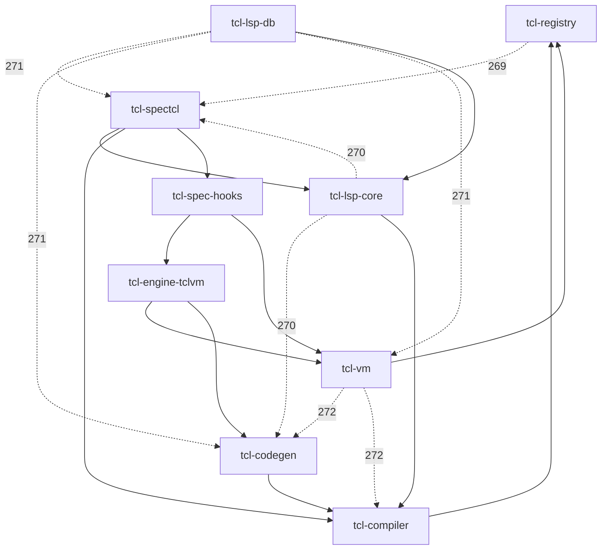
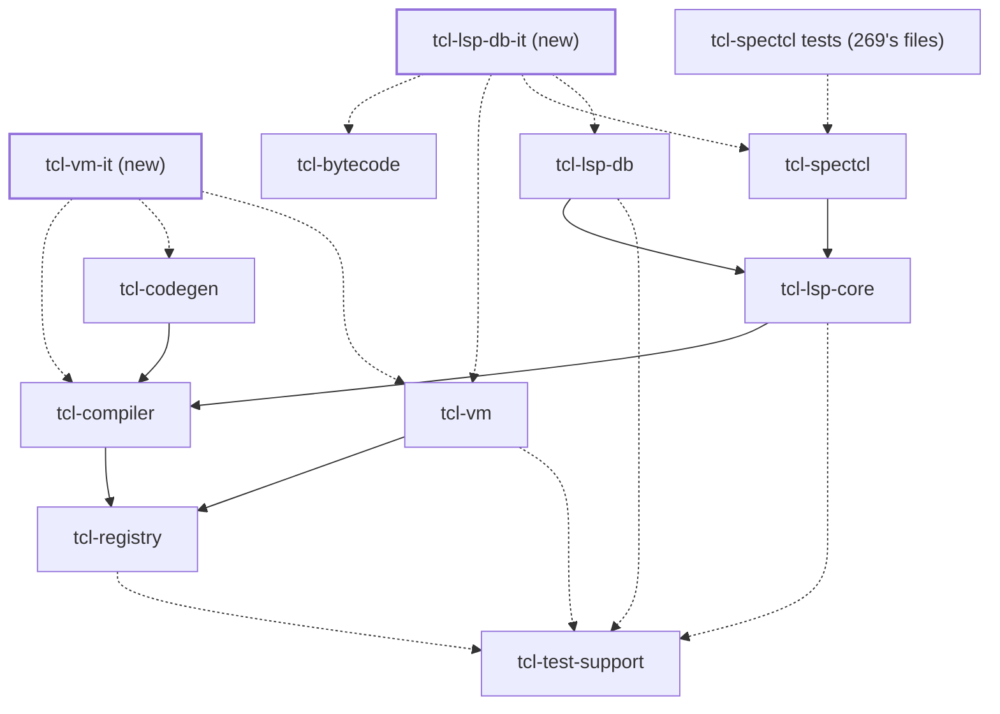

# Step 0b–0e: the other crates' dev-dependency cascades

Status: plan items 269 (`tcl-registry`), 270 (`tcl-lsp-core`), 271
(`tcl-lsp-db`) and 272 (`tcl-vm`), steps 0b–0e of item 90. Built on
[step 0a](../compiler/crate-split/00-test-dependencies.md) (item 246, the same
fault in `tcl-compiler`), whose pattern this follows. It reports against
[item 259's baseline](259-worktree-cost.md). The `module-layers` gate (item
247) carries these edges as a known list that may only shrink. Item 254 depends
on 272's test crate, and item 286 on 271's.

## Problem

Cargo builds every dev-dependency for every test target, `--lib` included.
When a crate's dev-dependency sits above it, two things follow:

- testing the crate compiles the upper stack;
- an edit anywhere in that stack relinks or recompiles the crate's tests.

Each edge was checked in its `Cargo.toml` on 26 November 2026. Cone sizes are
unique package names from `cargo tree -e normal,build`, then with `dev` added,
as workspace / all packages:

| Item | Crate | Upper-stack dev-dependencies | Cone without dev | With dev | After this step |
|---|---|---|---|---|---|
| 269 | `tcl-registry` | `tcl-spectcl` (`Cargo.toml:53`) | 12 / 42 | 29 / 144 | 15 workspace |
| 270 | `tcl-lsp-core` | `tcl-codegen` (`:66`), `tcl-spectcl` (`:71`) | 18 / 130 | 29 / 194 | 21 |
| 271 | `tcl-lsp-db` | `tcl-codegen` (`:49`), `tcl-vm` (`:52`), `tcl-spectcl` (`:58`) | 19 / 151 | 30 / 170 | 22 |
| 272 | `tcl-vm` | `tcl-codegen` (`:100`), `tcl-compiler` (`:103`) | 16 / 56 | 19 / 78 | 17 |

The "after" column is the normal cone joined with the cones of the remaining
dev-dependencies (`tcl-test-support`, which adds the host crates).
`tcl-lsp-db`'s `tcl-runtime-api` dev-dependency moves out with its only user,
the VM test below; the crate stays in `tcl-lsp-db`'s normal cone through
`tcl-registry`.

`tcl-spectcl` is the worst edge. Its normal cone is 28 workspace crates. It
includes `tcl-compiler`, `tcl-lsp-core`, and, through `tcl-spec-hooks` →
`tcl-engine-tclvm`, both `tcl-vm` and `tcl-codegen`. So for `tcl-registry`,
the crate at the bottom of everything, `cargo test -p tcl-registry` builds 17
more workspace crates than the registry needs. Among them are the whole
compiler and the LSP core.

The four crates' dev edges today (dotted), over the normal edges they reach
(solid). Every dotted edge lands on `tcl-spectcl`, `tcl-codegen`, `tcl-vm` or
`tcl-compiler`, and from `tcl-spectcl` the normal edges reach all the rest:



After the four steps no dotted edge points up. The tests that need the upper
stack live in two new test crates and in `tcl-spectcl`'s own tests:



## Design

### 269: `tcl-registry` → `tcl-spectcl`

**Uses.**
- **`src`:** 7 files name `tcl_spectcl`, all in doc comments in plain
  backticks, with no intra-doc links: `codegen_stamp.rs`, `commands/mod.rs`,
  `model/capability.rs`, `model/registration.rs`,
  `pack_hooks/native_catalogues.rs`, `pack_origin.rs` and `spec.rs`. They need
  no change.
- **Tests:** 4 files call it directly, all integration tests that use the
  public API only:

| File | Tests | Use |
|---|---|---|
| `tests/it_4/analyser_hooks.rs` | 4 | `bundled::load_from` the repository's `specs/`, merged into `full_registry()` |
| `tests/it_4/value_transfers.rs` | 1 (+ its `full_registry()`, used by `cell_updates.rs`, `derived_transfers.rs` and `route_identity.rs`) | the same, plus an in-memory workspace pack (`pack::load_in_memory`) |
| `tests/it_4/value_transfers/declared_implementations.rs` | 3 | in-memory packs and `loader::HookSource` |
| `tests/it_5/registry_sweep.rs` | its `registry_for_dialect()` serves 8 of the 10 `registry_sweep/` files, 44 tests | `bundled::registry_for_dialect_from` with the shipped EDA packs |

**Decision: move them into `tcl-spectcl`'s own tests.** Do not create a new
crate.
- The sweep's own comment says routing through the pack loader "tests the
  loader's output as well as the registry's". `tcl-spectcl` is above both
  crates and already depends on everything these tests name.
- After the registry split, the EDA vendor libraries stay SpecTcl packs loaded
  by `tcl-spectcl` ([registry split](../registry/registry-split-design.md)).
  `tcl-catalogue` cannot host the tests: `tcl-spectcl`'s
  `registry_for_dialect_from` will depend on the catalogue, so a catalogue
  dev-dependency on SpecTcl would rebuild the cascade.

**What moves.**
- The four files.
- The `full_registry()` helper.
- Only the test functions in `cell_updates.rs`, `derived_transfers.rs` and
  `route_identity.rs` that call `full_registry()`; the rest stay.
- The `registry_sweep/` directory moves whole, because its shared helper is
  the SpecTcl one.

The `include_str!("../../../tcl-compiler/tests/fixtures/…")` paths are
rewritten for the new depth. Because no visibility changes, this is the
cheapest of the four.

### 270: `tcl-lsp-core` → `tcl-spectcl`, `tcl-codegen`

**Uses.**
- `tcl_codegen`: one file,
  `tests/it_5/issue_2507.rs` (7 tests), which calls
  `tcl_codegen::codegen::helpers::tcl_list_element` twice. That path is a
  re-export (`tcl-codegen/src/codegen/mod.rs:42–43`) of
  `tcl_compiler::codegen_helpers::tcl_list_element`, which is one line:
  `tcl_syntax::list::list_element(s)`.
- `tcl_spectcl`: one test,
  `src/completion/inherited_registry_roster_completion_tests.rs:43`, calls
  `tcl_spectcl::core_surfaces::ensure()` to seed Jim's inherited Tcl roster.
  The test then asserts that completion does not borrow `coroutine`, which Jim's
  roster excludes. `vfs.rs` names it only in doc comments.

**Decision: the need goes away now; no test crate.**
- `issue_2507.rs` calls `tcl_syntax::list::list_element`, which is already a
  normal dependency (`Cargo.toml:43`). At its two call sites (`:84`, `:295`):

**Before:**

```rust
let word = tcl_codegen::codegen::helpers::tcl_list_element(source);
```

**After:**

```rust
let word = tcl_syntax::list::list_element(source);
```

  The word is the same: `tcl_list_element` is that call. It quotes a value
  as `tclsh`'s `list` does. The test's three values need no quoting; a space
  or an empty value does:

**Source:**

```tcl
puts [list -ff]; puts [list ff+1]; puts [list zz]; puts [list {a b}]; puts [list {}]
```

**Result:**

```text
$ echo '…' | tclsh9.0     # tclsh8.4 and tclsh9.1 print the same
-ff
ff+1
zz
{a b}
{}
$ ./target/debug/tclvm -c '…'
-ff
ff+1
zz
{a b}
{}
```

- The roster test registers a fixture roster through
  `tcl_dialect::model::register_inherited_surfaces`, the call that
  `core_surfaces::seed` itself makes. The fixture is Jim, sourced from Tcl,
  with a short name list that leaves out `coroutine`. The test asserts exactly
  that exclusion. Whether the *shipped* roster excludes `coroutine` becomes an
  assertion in `tcl-spectcl`'s own
  `core_surfaces::tests::the_compiled_in_jim_roster_loads_and_is_not_empty`.
- After item 264, Jim's roster moves to `tcl-dialect-jim`, and the test can
  take that crate as a dev-dependency instead. The registry split lists no
  dependency from a dialect crate on a generic crate, so that adds no cascade.

Then drop both dev-dependencies, and the `Cargo.toml` comment describing the
dev cycle:

**Before:**

```toml
[dev-dependencies]
tcl-codegen = { path = "../tcl-codegen" }
# A dev-dependency cycle (`tcl-spectcl` depends on this crate), which Cargo
# permits and `tcl-registry` / `tcl-compiler` already use: the inherited-roster
# completion test seeds the shipped core surfaces exactly as the server's
# `initialize` does.
tcl-spectcl = { path = "../tcl-spectcl" }
# Pinned C Tcl provider validation and byte-preserving oracle invocation for differential tests.
tcl-test-support = { path = "../tcl-test-support" }
```

**After:**

```toml
[dev-dependencies]
# Pinned C Tcl provider validation and byte-preserving oracle invocation for differential tests.
tcl-test-support = { path = "../tcl-test-support" }
```

### 271: `tcl-lsp-db` → `tcl-vm`, `tcl-spectcl`, `tcl-codegen`

**Uses.**
- `tcl_vm`, `tcl_codegen` and `tcl_runtime_api` appear in one file,
  `src/tests/function_lattices.rs`, in one of its 10 tests
  (`function_lattice_retains_supplied_availability_and_refuses_missing_or_foreign_input`).
  The test builds a real `tcl_vm::Vm` to capture the `NativeCompilationEntry`
  the VM hands its compiler. `tcl_codegen` is named only for the associated
  type `<BytecodeCompileService as CompileService>::Module`, which is
  `tcl_bytecode::ModuleAsm` (`tcl-codegen/src/compile_service.rs:777`).
- `tcl_spectcl` appears in 6 files with 60 tests in all. Each loads a workspace
  pack from SpecTcl text and checks that the database invalidates, or keeps,
  tracked state when the pack changes:

| File | Tests | SpecTcl calls |
|---|---|---|
| `src/original_tracked_metadata_tests.rs` | 4 | `pack::load_in_memory`, `install::registry_for_dialect_with_packs` |
| `src/project_source_inputs/tests.rs` | 12 | the same |
| `src/project_call_inputs/tests.rs` | 5 | the same |
| `src/project_token_inputs/tests.rs` | 17 | the same |
| `src/value_transfer_parity.rs` | 17 | also `hooks::publish` and `hooks::ensure_thread_host`, so SpecTcl hook bodies run |
| `tests/it_2/dialect_seam.rs` | 5 | public API only |

The five `src` files use `use super::*;` and name crate items such as
`crate::document_analyser`, `crate::declared_command_surface` and
`crate::world_preserving_procedure_declarations`.

**Decision: a test crate, `tcl-lsp-db-it`, above `tcl-lsp-db` and
`tcl-spectcl`.**
- The need does not go away after the registry or compiler split. Pack loading
  and hook evaluation stay in `tcl-spectcl`. `tcl-spectcl` still reaches
  `tcl-vm` and `tcl-codegen` through `tcl-spec-hooks` even after item 288
  removes its `tcl-lsp-core` edge.
- The crate's dev-dependencies are:
  - `tcl-lsp-db` with a new `test-support` feature;
  - `tcl-spectcl`;
  - `tcl-vm`;
  - `tcl-bytecode`;
  - `tcl-runtime-api` (the VM test's `NativeCompilationEntry` and
    `ScriptCompileTarget`);
  - `tcl-test-support`.
- Into it move:
  - the 60 SpecTcl tests, keeping their module paths as directories;
  - the one VM test, with its `Module` type rewritten to
    `tcl_bytecode::ModuleAsm`, so no `tcl-codegen` dependency remains.
- `tcl-lsp-db` exposes the items those tests reach, as
  `#[cfg(feature = "test-support")] pub`, the step-0a precedent. Where several
  reach one type, add a fixture in a `test_support` module.
- Item 286 renames the database crate to `tcl-db`. It renames this crate to
  `tcl-db-it` in the same change.

**An alternative to test first.** The 38 tests that only *install* a pack
(every file except `value_transfer_parity.rs` and `dialect_seam.rs`) may not
need SpecTcl at all. They might install the same surface as a Rust-built
`CommandSpec` through the registry API, as `tcl-registry`'s `full_registry()`
does with `reg.insert`. Rewrite one test of `project_source_inputs/tests.rs`
that way and compare outcomes. If the database's behaviour depends only on the
registry generation, and not on the pack's provenance, those 38 tests stay in
`tcl-lsp-db`. Only 22 then move.

### 272: `tcl-vm` → `tcl-compiler`, `tcl-codegen`

**Uses.** 117 files name one or both crates:

| Where | Files | Tests in those files | Main use |
|---|---|---|---|
| `tests/` | 74 of 143 | 994 | `tcl_codegen::compile_service::BytecodeCompileService` (166 uses in the crate), `codegen::codegen_module` (23) |
| `src`, code (not comments) | 41 of 481 | up to 307 (whole-file count) | the same, inside `#[cfg(test)]` blocks, for example `embed.rs:1481` |
| `examples/` | 2 (`eval.rs`, `run_test.rs`) | — | `cargo test` builds examples |

`tcl_compiler` is named in 28 `tests/` files and one example: `lowering` (32
uses), `cfg_builder` (23), and a few `segmenter`, `ir` and `const_subst`. These
tests lower Tcl to IR and then emit bytecode.

**Decision: a test crate, `tcl-vm-it`, above `tcl-vm` and `tcl-codegen`.**
Its dev-dependencies are `tcl-vm` with `test-support`, `tcl-codegen`,
`tcl-compiler` (28 of the moving files name it) and `tcl-test-support`.
- The need does not go away after the compiler split. The VM has no compiler of
  its own; every test that runs a script needs `tcl-codegen`'s compile service.
- After item 292, `tcl-codegen` still sits above binding, lowering and
  analysis, so an edit there would still reach `tcl-vm`'s tests.
- Item 254 already names "item 272's VM test crate" as a `tcl-lowering`
  consumer.

**What moves.**
- **The 74 `tests/` files.** They move unchanged. They use the public API and
  `tcl_vm::test_support`, which `tcl-vm-it` gets through the feature that
  already exists.
- **The two examples.** They move to `tcl-vm-cli`, which already depends on
  `tcl-compiler` and `tcl-codegen`.
- **The 41 `src` test blocks.** They follow step 0a's pattern: blocks that reach
  only public items move as they are. Blocks that reach crate internals expose
  them under `tcl-vm`'s existing `test-support` feature, adding no new
  feature. An inventory comes first (work list item 4).
  [Item 296](296-300-build-levers.md#296-test-support-feature-unification)
  recommends making that feature unconditional. If it is adopted, the widened
  items are `#[doc(hidden)] pub` with no feature.
- **What stays.** The 69 `tests/` files and 440 `src` files that name neither
  crate.

### Common decisions

- **Moved tests keep their names**, as module paths under the new crate. That
  lets `failset.py compare` match them by name.
- **The `module-layers` known list** loses each edge as its step lands. The list
  may only shrink.
- **CI.** Each new crate gets rows in `scripts/dev/rust-test-binary-shards.tsv`
  and `scripts/dev/rust-heavy-tests.tsv`, and the test roots of
  `walker-ownership`, `retired_api_gate` and `diag-emission` cover it, as item
  268 does for `tcl-compiler-it`.

### Open questions

- 271: do the 38 install-only tests need SpecTcl? Rewrite one, as described
  above, and compare.
- 272: how many of the 41 `src` blocks name crate-private items? The inventory
  (`rg 'crate::|super::'` in each block that names `tcl_codegen`) settles how
  much is widened.

## Work list

1. **269.** Move the four files, the `full_registry()` helper and the callers of
   `full_registry()` from the `value_transfers` submodules into
   `rust/tcl-spectcl/tests/`. Then drop `tcl-spectcl` from `tcl-registry`'s
   `[dev-dependencies]`.
2. **270.**
   - In `issue_2507.rs`, call `tcl_syntax::list::list_element`.
   - Give the roster test its fixture roster.
   - Add the `coroutine` assertion to `tcl-spectcl`'s roster test.
   - Drop both dev-dependencies.
3. **271.**
   - Run the one-test experiment.
   - Create `rust/tcl-lsp-db-it`.
   - Move the SpecTcl tests that need it and the VM test.
   - Add `test-support` to `tcl-lsp-db`.
   - Drop the three dev-dependencies, and `tcl-runtime-api`, whose only
     user moved.
4. **272.**
   - Inventory the 41 `src` blocks.
   - Create `rust/tcl-vm-it`.
   - Move the 74 `tests/` files and the `src` blocks.
   - Move the examples to `tcl-vm-cli`.
   - Drop both dev-dependencies.
5. Re-key the shard and heavy-test tables and the gates' test roots for the two new
   crates.

## Verification

Done when, for each item:

- `cargo tree -p <crate> -e dev --depth 1` lists none of the dropped crates;
- the moved tests give the same outcomes by name on the base and on the move
  (`failset.py compare`);
- item 259's script, run after the step, shows the edited crate's test build
  cone at its "after" size in the table above (15, 21, 22 and 17 workspace
  crates).

Rebuild counts to record with item 259:

- `cargo test -p tcl-registry --no-run` after its registry edit: no
  `tcl-compiler`, `tcl-lsp-core` or `tcl-spectcl` units;
- `cargo test -p tcl-vm --no-run` after the analyser edit: zero units rebuilt;
- `cargo test -p tcl-lsp-core --no-run` after its LSP edit: no `tcl-spectcl`,
  `tcl-spec-hooks`, `tcl-engine-tclvm`, `tcl-vm` or `tcl-codegen` units.

## Risks

- **Two new `test-support` features** (`tcl-lsp-db`, and wider use of
  `tcl-vm`'s) add build variants
  ([item 296](296-300-build-levers.md#296-test-support-feature-unification)).
  Prefer the experiment in 271 and unconditional test fixtures where the
  owner accepts them.
- **Global state in moved tests.** The roster store and the hook host are
  process-wide. A test that seeded them alone in one binary may meet another
  test's state in the new binary. The failset comparison catches it.
- **Work in flight.** `tcl-lsp-db/src/tests/callback_arity.rs` and
  `tcl-registry`'s `channel_protocols` files are being edited on `work` today.
  Moves wait for a clean point.

## Corrections to the overview

- Step 0a's list of sibling cascades is right. Two of the four turn out to be
  cheap: 270 needs no test crate, and 269 moves into an existing crate with no
  visibility changes.
- `tcl-codegen::codegen::helpers` is a façade re-export of
  `tcl_compiler::codegen_helpers`. That is against item 90's no-façade rule;
  item 292 removes it.
