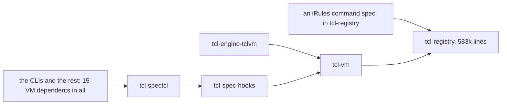
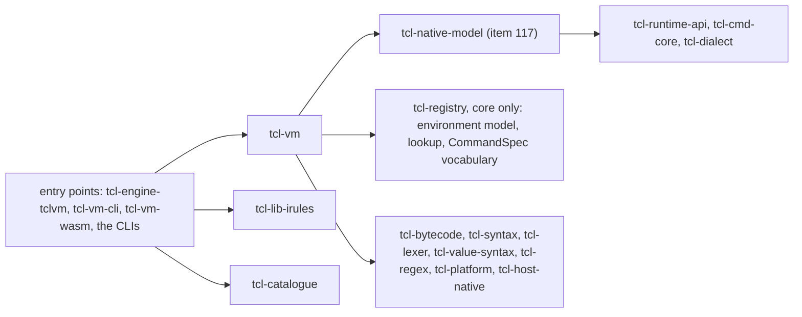
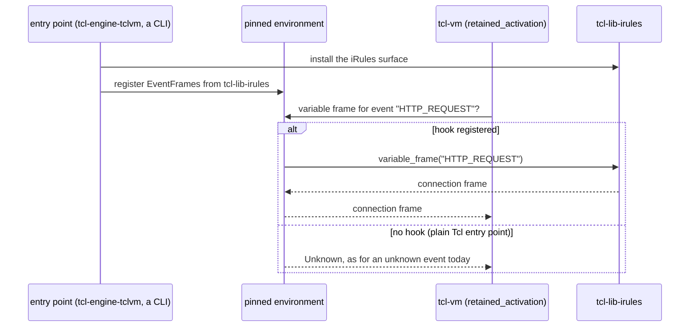

# `tcl-vm` after the native-model crate

Status: plan item 291, the rest of the workspace beside item 90. It builds on
item 117, which moves the `native_*` algorithms out of `tcl-registry` into
`tcl-native-model` ([design](../registry/registry-split/117-native-model.md)). It also builds on the registry split (items 261–264,
[design](../registry/registry-split-design.md)) and on step 0e (item 272,
[design](269-272-dev-dependency-cascades.md#272-tcl-vm--tcl-compiler-tcl-codegen)),
which takes the compiler out of the VM's tests. Item 259's registry-spec edit
is its measurement ([design](259-worktree-cost.md)). It does not redesign the
engines: that is item 88's engine convergence.

## Problem

`tcl-vm` is one crate: 220,204 lines in 481 `src` files, of which 58,298 are in
files named as tests, plus 60,649 lines under `tests/`. Its largest modules
are:

| Module | Lines |
|---|---|
| `interp` | 96.5k |
| `exec` | 19.5k |
| `cmd_oo` | 18.5k |
| `value` | 13.3k |
| `command` | 12.4k |
| `cmd_namespace` | 5.9k |
| `value_ops` | 5.1k |
| `expr` | 4.6k |

Its normal cone is 16 workspace crates (`cargo tree -p tcl-vm -e normal`).
Among them is `tcl-registry`, the 583k-line crate that the registry rule sends
every per-command fix to. A command-spec edit therefore rebuilds the VM, and
with it the 15 workspace crates that depend on the VM:

- `tcl-engine-tclvm`;
- `tcl-spec-hooks`;
- `tcl-spectcl`;
- the CLIs;
- the others above them.

What the VM names in `tcl-registry`, counted with
`rg -o 'tcl_registry::[a-z_0-9]+' rust/tcl-vm/src` on 26 November 2026, over
300 files:

| Group | Modules | References | Files | Where it goes |
|---|---|---|---|---|
| `native_*` interpreter algorithms (item 117 says the VM imports them in 157 files) | 59 | 481 | 158 | the native-model crate |
| the environment model: `model::ingress::resolve_environment` (250 uses), `PinnedContext` (14), `static_context_for_profile`, `runtime_context_for_profile`, `DocumentEnvironment` | 1 (`model`) | 312 | — | the registry core (the environment model stays in the core) |
| command lookup and specs: `CommandRegistry`, `get_for_surface`, `command_lookup::CommandLookupOrigin` (41 of 42 uses), `CommandRegistry::native_stock_registration_admission` | 2 | ~45 | — | the registry core |
| interpreter vocabulary: `special_vars` (68), `invocation_words` (37), `dictionary_scope` (15), `expr_surface` (15), `mathfunc` (13), `catch_invocation` (11), `definer` (10), `source_file` (9), `frame_effect`, `runtime_expr_validation`, `authored_math_functions`, `substitution`, `release_compilation`, `state_transition`, `completion` | 15 | ~210 | — | each one either native model or core, by inventory (below) |
| surface data: `commands::tcl::{NativeJim*, TclOoPropertyKind, InfoOoEnsembleKind, resolve_fconfigure_option}` (21) | 1 | 21 | — | the native model (interpreter kinds), not `tcl-dialect-tcl` |
| BIG-IP: `f5::{BigIpExecutionContext, naming::BigIpNameEvent, naming::observed_name_policy, evidence::BigIpBuild, rule_identity}` (25) | 1 | 25 | — | the f5-tcl dialect model (item 301), below the VM |
| iRules events: `events::EventRegistry::build().variable_frame(…)` (`retained_activation.rs:280`) | 1 | 4 | 1 | a table the entry point supplies (below) |
| process-wide registries: `default_registry()` (`cmd_namespace.rs:277`), `safe_interp_hidden_commands()` (`interp/interpreters/children.rs:512`), `registry_for_profile_with_overlay` (tests) | 3 | 5 | — | the VM's pinned registry, and the core |

Two of these rows would defeat item 291 even after the registry split:

- `EventRegistry::build()` reads iRules event data. That data moves to
  `tcl-lib-irules`, so a direct call would put an iRules library in the VM's
  cone.
- `default_registry()` reads the process-wide catalogue, so a direct call would
  put `tcl-catalogue` in the cone.

Either way, every iRules spec edit would rebuild the VM. Today a spec edit
anywhere in the registry reaches the VM and everything above it:



## Design

### What the VM depends on afterwards



The VM never depends on a dialect, library or catalogue crate (rule from the
registry split; item 265's gate covers `tcl-vm` as a generic crate). The
entry points install the surfaces:

- `tcl-engine-tclvm`;
- `tcl-vm-cli`;
- `tcl-vm-wasm`;
- the CLIs.

The VM reads them through the pinned context it already holds:
`environment::store_for_profile` returns
`model::static_context_for_profile(profile).commands()`
(`rust/tcl-vm/src/environment.rs:73`).

### Needs from the core versus the surfaces

| The VM needs | From | How |
|---|---|---|
| the environment model (releases, libraries, compatibility rows), pinned per interpreter | core | unchanged: `resolve_environment`, `PinnedContext` |
| command specs at run time: namespace subcommand resolution, stock-registration admission, the builtin command-surface gate | core lookup over the installed surfaces | `cmd_namespace.rs:277` reads the pinned store instead of `default_registry()` |
| interpreter algorithms and kinds (`native_*`, Jim and TclOO kinds, `fconfigure` options) | native model | moved by item 117. The `commands::tcl` kinds move with it, because they describe interpreter behaviour, not command data |
| BIG-IP execution context and name policy | f5-tcl dialect model, below the VM | moved with item 301 (f5-tcl releases and `tmm`/`scriptd` builds) |
| an iRules event's variable frame (initialisation namespace or connection) | the iRules library | an `EventFrames` hook in the environment: the entry point that installs `tcl-lib-irules` registers it. Without it the answer is `Unknown`, which is today's answer for an unknown event |
| the safe-interpreter hidden-command list | core (it is the C `Tcl_MakeSafe` list, release-keyed) | unchanged |

The event-frame hook in use. The VM asks its environment; whether an answer
exists depends on what the entry point installed, not on what the VM links:



The two call sites that would keep a surface or the catalogue in the cone
change like this.

**Before:**

```rust
// rust/tcl-vm/src/cmd_namespace.rs:277
let registry = tcl_registry::default_registry();
// rust/tcl-vm/src/retained_activation.rs:280
let root = match tcl_registry::events::EventRegistry::build().variable_frame(&event_text) {
```

**After:**

```rust
// rust/tcl-vm/src/cmd_namespace.rs: the store the VM already pins
let registry = crate::environment::store_for_profile(profile);
// rust/tcl-vm/src/retained_activation.rs: the entry point's hook, if any (sketch)
let root = match vm.environment().event_frames().variable_frame(&event_text) {
```

### `test-support` and its four users

`tcl-vm`'s `test-support` feature (`Cargo.toml:97`) gates three things:

- `pub mod test_support` (120 lines of constructors: `native_vm`,
  `native_vm_for_profile`, `native_vm_for_release`, `native_vm_with_output`,
  `DEFAULT_ENVIRONMENT`);
- `pub mod native_conformance` (112 lines, `dictionary_search_mutation_driver`
  and friends);
- one accessor, `NativeDictionarySearch::original_root`.

All four users enable it from `[dev-dependencies]`:

| User | Files | What it calls |
|---|---|---|
| `tcl-vm` itself (`Cargo.toml:107`) | 100 | `native_vm_for_profile` (100), `native_vm` (78), `native_vm_with_output` (19), `native_vm_for_release` (19) |
| `tcl-engine-tclvm` (`Cargo.toml:50`) | 1 | `native_vm` (5), `native_vm_for_profile`, `native_conformance::dictionary_search_mutation_driver` |
| `tcl-irule-test` (`Cargo.toml:58`) | 2 | `native_vm`, `native_vm_for_profile` |
| `tcl-spectcl` (`Cargo.toml:71`) | 3 | `native_vm`, `native_vm_for_profile` |

After item 272, `tcl-vm-it` is a fifth user.

**Decision: make `test_support` unconditional and keep only
`native_conformance` behind the feature.** The constructors are a few lines over
public API. Gating them buys nothing, and it costs a second build of `tcl-vm`
and of every crate above it in any worktree that tests one of these crates and
also builds a binary
([item 296](296-300-build-levers.md#296-test-support-feature-unification)).
`native_conformance` drives closed object capabilities that production must not
reach, so it stays gated. Its only outside user is `tcl-engine-tclvm`, with one
call. Whether that one call can move into `tcl-vm`'s own tests, so the feature
has no outside users, is an open question below.

### Should `tcl-vm` split?

**Not as part of item 291.** The reasons:

- VM and runtime work is deferred on `work` (owner decision, 23 November 2026),
  so VM edits are rare there. The VM's build cost on `work` comes from edits
  *below* it, which this item and item 272 remove. It does not come from edits
  inside it.
- A split that follows the module tree would cut through `interp` (96.5k
  lines), whose frame, namespace and command-identity code is exactly what item
  88 converges with `runtime/rust`. Cutting it now would fix boundaries that
  engine convergence is about to redraw.
- The right cuts are item 88's shared traits: `Frames`, `Namespaces` and
  command identity, implemented once per engine and shared through
  `tcl-runtime-api`. The items it leads are 20, 72, 161, 171, 178, 186 and 203.
  `runtime/rust` (308k lines) is not redesigned here; see item 88.

Record the trigger instead. Item 259's script gets a fifth, optional edit, a VM
command such as `rust/tcl-vm/src/cmd_list.rs`. If a VM edit's test cycle
exceeds the analyser edit's after step 12, the VM split is designed with item
88's traits as its seams.

### Open questions

- Which interpreter-vocabulary modules (the 15 in the table) are native model,
  and which are core? The test for each module: does a command spec name it?
  If so it is core vocabulary; if only an engine reads it, it is native model.
  The inventory is the first work item.
- Can `dictionary_search_mutation_driver`'s one use in `tcl-engine-tclvm`
  become a `tcl-vm` test? If yes, `test-support` has no outside users and can
  go entirely.
- Does the native-model crate stay free of `js-sys` and of host imports?
  `tcl-vm-wasm` depends on the VM with `default-features = false`, on the
  promise of a module with no imports at all. `tests/it_2/wasm_coro_e2e.rs` is
  the gate.

## Work list

1. Inventory the 24 non-`native_*` registry modules the VM names. Classify each as
   native model, core or surface, by the test above, and record the list in
   this file's follow-up step.
2. With item 117: re-point the 158 files of `tcl_registry::native_*` imports
   to the native-model crate, and move the `commands::tcl` interpreter kinds
   there.
3. Replace `default_registry()` in `cmd_namespace.rs` with the pinned store.
4. Add the `EventFrames` hook. Register it where `tcl-lib-irules` is installed
   (`tcl-engine-tclvm`, the CLIs). Remove `retained_activation.rs`'s direct
   `EventRegistry::build()`.
5. With item 301: move the `f5::*` execution-context types to the f5-tcl dialect
   model.
6. Make `tcl_vm::test_support` unconditional and keep `native_conformance` gated.
   Drop `features = ["test-support"]` from users that only call constructors:
   `tcl-irule-test` and `tcl-spectcl`.
7. Add `tcl-vm` to item 265's generic-crate list in the dependency gate.

## Verification

Done when (item 291's own, tightened):

- `cargo tree -p tcl-vm -e normal` lists the native-model crate and no
  `tcl-dialect-*`, `tcl-lib-*` or `tcl-catalogue` crate;
- `rg 'tcl_registry::(native_|commands::|events::|default_registry)' rust/tcl-vm/src`
  finds nothing;
- item 259's registry-spec edit (`tcl-lib-irules` after item 264) compiles no
  `tcl-vm` unit, in `cargo test -p tcl-lib-irules --no-run` or in
  `cargo build -p tcl-lsp-server`.

Measurements:

- the VM's normal cone (today 16 workspace crates);
- units rebuilt after the registry edit (today `tcl-vm` and its 15 dependents
  in a full build);
- the VM benchmarks (`scripts/perf/interp/`) on release builds, before and
  after. The native-model move crosses a crate boundary on hot paths, and the
  release profile's thin LTO should recover the inlining.

## Risks

- **Install order.** A VM created before an entry point installs surfaces would
  read an empty store. The registry split's loud failure covers it. Add a
  `tcl-vm-cli` test that runs a command before and after installation.
- **Hot-path inlining.** The native algorithms move to a separate crate. Small
  functions that relied on in-crate inlining need `#[inline]`; the VM benchmarks
  show which.
- **Overlap with item 88.** Moving code for 291 must not anticipate the
  convergence design. Moves are limited to imports and the three call-site
  changes above.

## Corrections to the overview

- Item 117 says the VM imports the native algorithms "in 157 files"; the count
  today is 158 files, 59 modules and 481 references.
- Item 291's text ("what it still names in `tcl-registry` is listed and moved")
  should name the two call sites that would otherwise keep a surface or the
  catalogue in the cone: `events::EventRegistry::build()` and
  `default_registry()`.
- `runtime/rust` also names `tcl_registry` in 456 files, 199 of them
  `native_*`. Item 117's move re-points them too; the crate-split overview's
  table lists only the VM.
- [Item 117's design](../registry/registry-split/117-native-model.md) expects
  item 291 to remove the VM's registry-core edge. This design keeps that edge.
  The VM pins its environment through the core (`resolve_environment`, 250
  uses) and reads command specs at run time (`get_for_surface`, stock
  admission). Item 291's own "done when" needs only that no surface crate is in
  the cone. Removing the core edge too would move the environment model and
  spec lookup below the registry, and is a separate decision.
