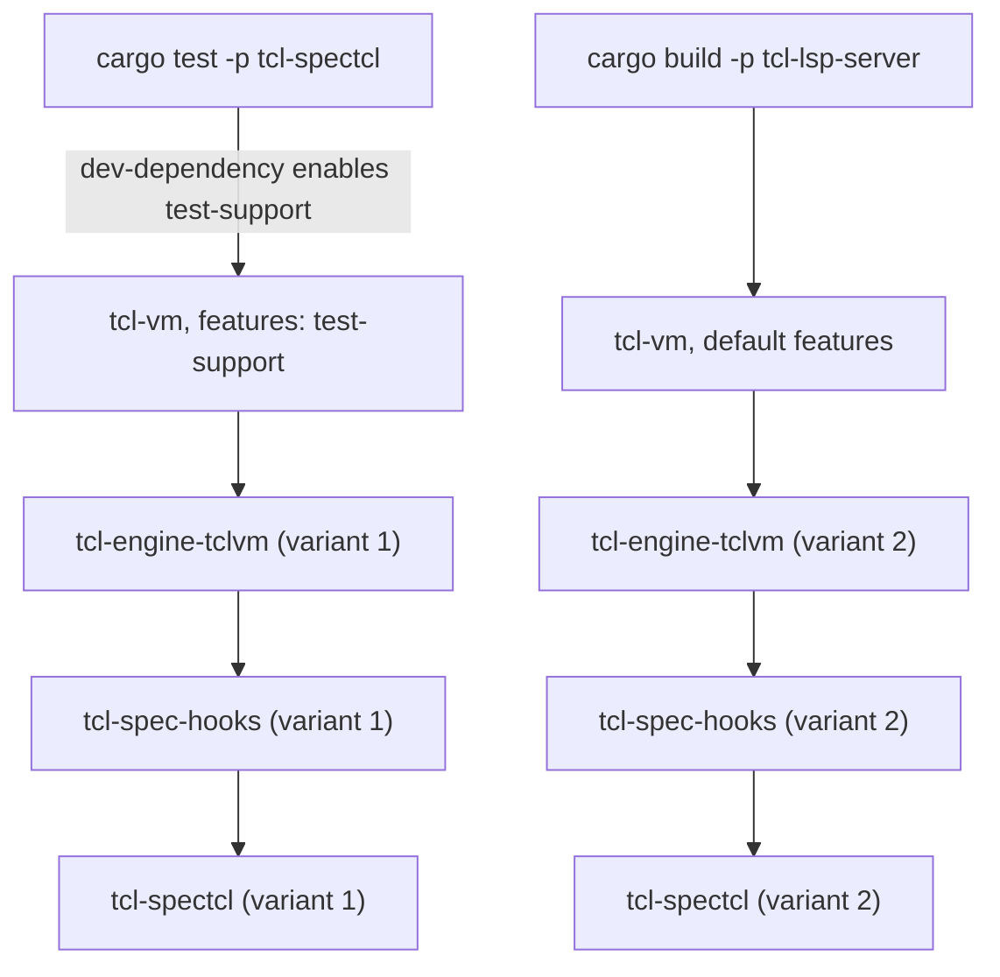
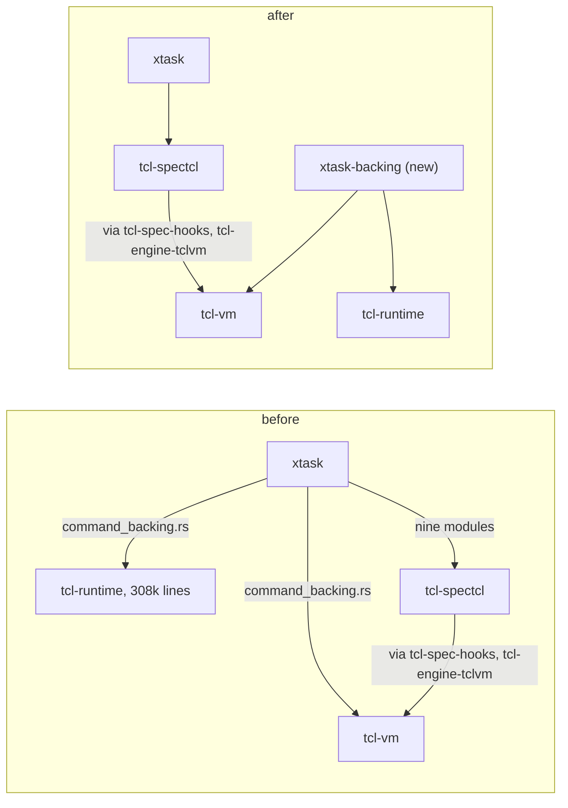
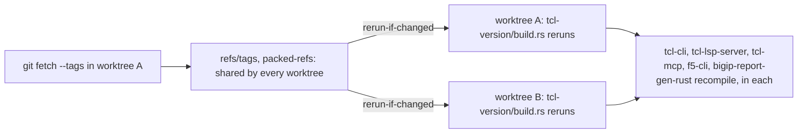

# Build levers 296–300

Status: plan items 296–300, build-time levers beside item 90. Each builds on
[item 259's script](259-worktree-cost.md), which measures it. Item 260's shared
cache ([design](260-shared-cache.md)) depends on 296, 297 and 299 to keep the
variant count down. Items 292 and 291 ([codegen](292-codegen.md),
[VM](291-vm.md)) apply 296's decision. Facts were checked on 26 November 2026.

## 296: `test-support` feature unification

### Problem

Under Cargo resolver 2 (`Cargo.toml:44`), a feature a dev-dependency enables
is active only in builds that need dev-dependencies, and there it applies to the
whole graph. So a crate has one unit hash in `cargo test -p A` and another in
`cargo build -p B`, as does every crate above it, and a worktree doing both
keeps two copies of all of them.

Every workspace feature enabled only from `[dev-dependencies]`:

| Feature | Enabled by | Duplicated cone in one worktree |
|---|---|---|
| `tcl-compiler/test-support` (`tcl-compiler/Cargo.toml:61`, 9 gated items) | `tcl-codegen` (`Cargo.toml:47`); `tcl-compiler-it` after item 266 | `tcl-compiler` (564k production lines) and `tcl-codegen`; under `tcl-compiler-it`, also `tcl-lsp-core`, `tcl-spectcl`, `tcl-spec-hooks`, `tcl-engine-tclvm` and `tcl-vm` |
| `tcl-vm/test-support` (`tcl-vm/Cargo.toml:97`: `test_support`, `native_conformance`, one accessor) | `tcl-vm` itself (`:107`), `tcl-engine-tclvm` (`:50`), `tcl-irule-test` (`:58`), `tcl-spectcl` (`:71`) | `tcl-vm`, `tcl-engine-tclvm`, `tcl-spec-hooks`, `tcl-spectcl` |
| `tcl-lsp-core/{truth-table, transport-fixtures}` (`tcl-lsp-core/Cargo.toml:34,36`) | `tcl-lsp-server` (`:149`), `tcl-cli` (`:79`), `tcl-mcp` (`:69`) | `tcl-lsp-core` (245k), `tcl-lsp-db`, `tcl-spectcl` and the rest of each consumer's graph above `tcl-lsp-core` |
| `tcl-irules/test-instrumentation` (`tcl-irules/Cargo.toml:33`) | `tcl-mcp` (`:66`) | `tcl-irules` and everything above it in `tcl-mcp`'s graph, `tcl-lsp-core` included |

The last two rows are not in item 296's text. The target directory here keeps
three `tcl-compiler` incremental directories (3.8, 1.5 and 1.5 GB).

The `tcl-vm` row, in one worktree that tests `tcl-spectcl` and then builds the
server. The two commands resolve `tcl-vm` with different features, so it and
every crate above it on the path get two unit hashes:



### Design

Each feature takes the first of these options that fits:

1. **A fixture crate**, when the fixture uses public API only. The
   diagnostic-policy truth table (`diagnostic_policy/truth_table.rs`, 1,718
   lines) becomes `tcl-lsp-policy-table`, a dev-dependency of its three
   consumers, if the `crate::` items it names (`diagnostic_report`,
   `source_decode`, `source_style`) are public; otherwise it takes option 2.
2. **Unconditional `#[doc(hidden)] pub`**, when the fixture is a few lines over
   internals: `tcl_vm::test_support` (120 lines of constructors,
   [291](291-vm.md)), `tcl-compiler`'s 9 items (split per crate,
   [292](292-codegen.md)) and the items step 0 widens (267, 271, 272).
   `retired_api_gate` checks that only test code names them; item 283's
   `#[doc(hidden)]` rule exempts items marked `// test-support`.
3. **Keep the feature and accept the variant**, when compiling the fixture in
   production is wrong: `tcl_vm::native_conformance` (it drives closed object
   capabilities) and possibly `tcl-irules`' request counter. The cost from item
   259's numbers is recorded here.

### Measurement plan

Run item 259's script with a sequence per worktree:
`cargo test -p <crate> --no-run` for each crate that enables one of the
features, then `cargo build -p tcl-lsp-server`. Record per package the distinct feature lists (`units_by_features`) and the
unit directories (`variants_on_disk`). Before and after, record the units
compiled and the target growth for the second command. **Done when:** each
crate with a dev-only feature builds one variant across the sequence, or its
duplicates are listed here with their measured cost and accepted.

## 297: two profiles per worktree

### Problem

The agent environment (`scripts/dev/agent-build-env.sh:112–116`) makes the
dev profile non-incremental and the test profile incremental at opt-level 1,
both without debuginfo. A worktree builds the same crates in up to four ways:

| Command | Profile | Mode |
|---|---|---|
| `cargo clippy`, `cargo check` | dev | check (`.rmeta` only) |
| `cargo xtask …` (the alias `run --package xtask --`, `.cargo/config.toml`), `cargo run -p tcl` | dev | build. `xtask` alone is 36 workspace crates and 232 packages |
| `cargo test` | test | build |
| rust-analyzer's `cargo check` (flycheck and build scripts) | dev | check |

Check and build mode never share outputs, whatever the profile, so one profile
can merge only the build-mode rows: `xtask` and `cargo run` with the tests.

### Design

**One profile (test) for every build-mode command; check and clippy stay on dev.**

- `agent-build-env.sh` exports `CARGO_ALIAS_XTASK="run --profile test --package xtask --"`.
  Environment configuration overrides the checked-in alias, and CI is
  unaffected.
- AGENTS.md tells agents to use `cargo run --profile test -p tcl`.
- Clippy stays on dev: under the test profile it would still share nothing with
  the tests (the modes differ), and it would stop sharing third-party check
  units with rust-analyzer's dev check.

**Before:**

```toml
# .cargo/config.toml:36–37, used as is by agents and CI
[alias]
xtask = "run --package xtask --"
```

**After:**

```sh
# agent-build-env.sh --print adds this line; CI keeps the checked-in alias
export CARGO_ALIAS_XTASK="run --profile test --package xtask --"
```

The table's three output sets (dev check, dev build, test build) become two:
`cargo xtask` and `cargo run` land in the test build with `cargo test`.

The gates may also run faster at opt-level 1: `make xtask-gates` took 413 s
locally, of which `kcs-index-links` (markdown reading) was 243 s
(build-test-cost item 2), so the gain is bounded. The cost is that crates
only `xtask` needs compile at opt-level 1 instead of 0, `tcl-runtime` (308k
lines) above all. Item 298 removes that one.

### Open questions

- Are a test's dependency rlibs built under the test profile? The Cargo book
  implies so; `ci.yml`'s `env:` comment assumes dev. Item 259's
  `units_by_profile` answers it, and the merge needs the test profile. Whether
  `cargo run --profile test` then reuses `cargo test`'s exact units shows in
  `target/debug/build/<pkg>/` after both.

### Measurement plan

In one worktree, record crates compiled and target growth for `cargo clippy
--workspace --all-targets`, `cargo xtask batch …` and `cargo test -p
tcl-lsp-core`, under today's setup and under the alias.

**Done when:** item 259 records both, and `agent-build-env.sh` adopts the
cheaper one or records why not.

## 298: `xtask` builds the engines for one gate

### Problem

`rust/xtask/Cargo.toml:58` and `:63` depend on `tcl-vm` and on `tcl-runtime`,
which is `runtime/rust`, 308k lines with a 362-line `build.rs`, reached by path
with `features = ["wasm_stdlib"]`. Only `command_backing.rs` names either
crate (`:262`, `:273`). The gate is `command-backing`: `Command::WasmBacking`
in `main.rs:235`, `make xtask-command-backing` at `Makefile:1209`, and in the
batch list at `Makefile:949`.

Build-test-cost decided against an opt-in feature (CI's drift leg would build
`xtask` twice); item 298 reopens it. Two facts the plan's text misses:

- **A second `[[bin]]` in the same package does not help.** Dependencies
  belong to the package, so every binary of `xtask` would still build both
  engines. The gate needs its own package.
- **`tcl-vm` stays in `xtask`'s cone anyway**, through
  `tcl-spectcl → tcl-spec-hooks → tcl-engine-tclvm → tcl-vm`
  (`cargo tree -p xtask -i tcl-vm`); nine `xtask` modules use `tcl_spectcl`
  (`pack_goldens`, `registry_axes`, `value_transfers` and six more). Removing
  the direct dependency removes `tcl-runtime` and the 6 packages only it needs
  (`allocator-api2`, `block-padding`, `chacha20`, `cipher`, `inout`, `rand`).

### Design

`xtask`'s engine edges before and after the split. `tcl-vm` stays, through the
pack loader; `tcl-runtime` leaves:



- **A new workspace package, `rust/xtask-backing`, holds `command_backing.rs`**,
  depending on `tcl-vm`, `tcl-runtime`, `tcl-registry` and `tcl-runtime-api`.
  `xtask` drops `tcl-vm` and `tcl-runtime`.
- **`'command-backing --check'` leaves the batch list.** `make
  xtask-command-backing` runs `cargo run -p xtask-backing -- --check`, and
  `xtask-check` keeps calling it, so CI builds each binary once.
- **`tcl-vm` leaving `xtask`'s cone is out of reach until `tcl-spectcl` stops
  pulling the engine.** SpecTcl hook bodies run on the VM, so that is a
  production need of `tcl-spectcl`, not a gate cost.

### Measurement plan

Measure cold `cargo build -p xtask` units, wall time and target growth, before
and after. Here `target/debug/build/tcl-runtime` is 2.1 GB. Also record the
`make xtask-gates` wall time, and the drift leg's duration on the first CI run.

**Done when** (corrected): `cargo tree -p xtask -e normal` lists no
`tcl-runtime` and lists `tcl-vm` only through `tcl-spectcl`, `make xtask-gates`
compiles no `tcl-runtime` unit, and CI's drift leg builds `xtask` and
`xtask-backing` once each.

## 299: build scripts

### Problem

**`tcl-version`** (`rust/tcl-version/build.rs`, 239 lines). In the dev profile
it re-runs when `HEAD`, the current branch ref, `refs/tags` or `packed-refs`
change (`src/git_inputs.rs:31–43`). Each commit therefore re-runs it and
recompiles `tcl-version` and its workspace dependents: `tcl-cli`, `tcl-lsp-server` (120k lines), `tcl-mcp`,
`f5-cli` and `bigip-report-gen-rust`. `bigip-query-wasm`, outside the
workspace, depends on it too. `refs/tags` and `packed-refs` live in the
repository shared by all worktrees. A `git fetch --tags` or `git pack-refs` in
one worktree therefore rebuilds the version stamp in every worktree.

**`tcl-dialect`** (`rust/tcl-dialect/build.rs`, 80 lines). It reads the 5-row
`data/reference-toolchains.tsv` and writes `REFERENCE_PATCHLEVELS` and
`REFERENCE_SOURCE_TAGS` to `OUT_DIR/reference_toolchains.rs`, which
`src/version.rs:27` `include!`s. It re-runs only when the TSV changes, not
per commit. Its cost is a build-script compile and run per worktree and per
profile under a crate with 41 direct workspace dependents (44 manifests name
it), and an `OUT_DIR` path in a hub crate's cache key ([260](260-shared-cache.md)).
The same two columns already exist as `patchlevel` and `source_tag` in the
generated `RELEASE_FACTS` (`cargo xtask release-facts`), and
`release_facts.rs:96–97` asserts that the two agree.

How a tag fetch in one worktree reaches the others:



### Design

- **`tcl-version`:** outside stamped and release builds, the build script emits
  `CARGO_PKG_VERSION` with a `-dev` suffix and empty commit and revision. It
  emits no `rerun-if-changed` on git paths. Release and `TCL_LSP_VERSION`-stamped
  builds keep today's behaviour exactly. Consumers already accept an empty
  commit (`bigip-report-gen`'s `engine_version_tests.rs:43`, `tcl-mcp`'s
  `main.rs:356`). A dev build of `tcl`:

**Before:**

```sh
$ target/debug/tcl --version    # rebuilt after every commit and tag fetch
tcl 0.1.0+gbb898626.dirty
```

**After:**

```sh
$ target/debug/tcl --version    # unchanged by commits and tag fetches
tcl 0.1.0-dev
```
- **`tcl-dialect`:** delete `build.rs`. `TclVersion::patchlevel()` and
  `reference_source_tag()` read `RELEASE_FACTS`. The `release-facts` generator
  reads the TSV as the one owner of those columns, and its `--check` fails on
  drift. The TSV stays, because `scripts/dev/tcl-reference-toolchains.sh` and
  `check-tcl-reference-toolchains` (`Makefile:969`) read it. This puts item
  119's "check the table in as source" into an existing generator.

**Before:**

```rust
// rust/tcl-dialect/src/version.rs
mod reference_toolchains {
    include!(concat!(env!("OUT_DIR"), "/reference_toolchains.rs"));
}
use reference_toolchains::{REFERENCE_PATCHLEVELS, REFERENCE_SOURCE_TAGS};

pub fn patchlevel(self) -> &'static str {
    REFERENCE_PATCHLEVELS[self.reference_index()]
}
```

**After:**

```rust
// rust/tcl-dialect/src/version.rs; no build.rs, no OUT_DIR
pub fn patchlevel(self) -> &'static str {
    self.release_facts().patchlevel
}
```

  The value does not change: for 8.4 both read `8.4.20`, from
  `data/reference-toolchains.tsv` today and from the generated
  `ReleaseFacts { version: TclVersion::V8_4, …, patchlevel: "8.4.20", … }`
  after.

### Measurement plan

Record the workspace units compiled by a dev `cargo build -p tcl-lsp-server`
after an empty commit, and after `git fetch --tags` in a sibling worktree
(expected after the change: 0 in both), and a cold `cargo build -p tcl-dialect`
before and after. **Done when** (item 299's own): the no-op commit recompiles
no workspace crate in a dev build, and `tcl-dialect` has no build script.

## 300: generated tables compiled as Rust

### Problem

The plan's "about 99k lines in 53 files" counts every file under `rust/` that
contains a generated marker anywhere, `xtask`'s generator sources included.
Files whose header says they are generated number 25, with 80,849 lines.
Seven are over 2,000 lines:

| File | Lines | Size | Kind | Generator today | Where after item 118 |
|---|---|---|---|---|---|
| `tcl-registry/src/base_objects/generated_names.rs` | 21,712 | 688 KB | table, `&[(&str, &str, &str)]` | none (item 119) | BIG-IP schema crate |
| `tcl-registry/src/base_objects/generated_objects.rs` | 20,419 | 1,080 KB | table, `&[BaseObject]` with field slices | none | BIG-IP schema crate |
| `tcl-dialect/src/generated_release_facts.rs` | 11,445 | 300 KB | table, `&[ReleaseFacts]` | `cargo xtask release-facts` | `tcl-dialect` (hub, 41 dependents) |
| `tcl-bigip/src/model/gen/canon.rs` | 7,088 | 228 KB | code, `Canon` impls | none (item 119) | `tcl-bigip`, generated from the schema crate |
| `tcl-registry/src/bigip/references.rs` | 5,061 | 148 KB | table, `&[ReferenceEdge]` | none | BIG-IP schema crate |
| `tcl-bigip/src/model/gen/parsers.rs` | 3,645 | 164 KB | code, parse functions | none | `tcl-bigip` |
| `tcl-registry/src/profile_defaults/generated.rs` | 2,213 | 80 KB | table, `&[ProfileDefaults]` | none | BIG-IP schema crate |

Item 118 moves four of the tables into a crate that only `tcl-lib-irules`,
`tcl-lib-iapps` and `tcl-bigip` depend on, so their cost is then paid only on a
cold build or a schema edit. The hot-path table is `tcl-dialect`'s release
facts: recompiled after every `tcl-dialect` edit, in every non-incremental
check and clippy run, and in every cold worktree.

### Design

- **Tables become embedded data where measurement says so.** The generator
  emits a compact line format (TSV, nested field lists as one escaped column).
  The crate `include_bytes!`s it and parses it once into a `LazyLock<Box<[T]>>`
  of `&'static str` slices into the embedded bytes, so `pub static X: &[T]`
  becomes `pub fn x() -> &'static [T]`. The browser and WASI builds are
  unaffected: `include_bytes!` needs no host.
- **Code stays code.** `canon.rs` and `parsers.rs` are functions, not tables.
- The release facts, for example, as a sketch:

**Before:**

```rust
// rust/tcl-dialect/src/generated_release_facts.rs, 11,445 lines of Rust
// @generated by cargo xtask release-facts; do not edit.
pub(crate) const RELEASE_FACTS: &[ReleaseFacts] = &[
    ReleaseFacts {
        version: TclVersion::V8_4,
        patchlevel: "8.4.20",
        source_tag: "core-8-4-20",
        // … math_functions, encodings, commands …
    },
    // …
];
```

**After:**

```rust
// the generator writes release_facts.tsv; rustc compiles one byte string
static DATA: &[u8] = include_bytes!("generated/release_facts.tsv");
pub(crate) fn release_facts_table() -> &'static [ReleaseFacts] {
    static TABLE: LazyLock<Box<[ReleaseFacts]>> = LazyLock::new(|| parse_release_facts(DATA));
    &TABLE
}
```

  `TclVersion::release_facts` stops being a `const fn`, and so do the four
  `const fn`s that read it (`version_string`, `dialect_profile_name`,
  `core_provided_packages`, `tcloo_version`). Any const use of those has to
  go first; the A/B says whether the table is worth that.
- **Overlap with item 119:** its new generators emit the data form directly;
  `release-facts` gains it.

### Measurement plan

For each of the seven files, an A/B on one machine: a cold `cargo build -p
<crate>` under both profiles with the file as it is, then with the table
replaced by an empty slice of the same type; `cargo build --timings` for the
crate's share of the critical path; and for the embedded form, its first-access
parse time in release and opt-level-1 builds, as a bench in the owning crate.
Record each in build-test-cost. **Done when** (item 300's own): each file over
2,000 lines has its compile cost recorded, and is either embedded with its load
time recorded or kept with the reason here.

## Work list

1. 296: `tcl-lsp-policy-table`; unconditional VM constructors; the per-crate
   fixture decision as each split step lands.
2. 297: `CARGO_ALIAS_XTASK` in `agent-build-env.sh` and its `--check`, after
   measurement.
3. 298: `rust/xtask-backing`; `Makefile:949` and `:1209–1211`; CI's drift step.
4. 299: `tcl-version/build.rs` and `git_inputs.rs`; delete `tcl-dialect/build.rs`;
   extend `release-facts`.
5. 300: the A/B for the seven files; convert where the record says so.

## Verification

Each lever's "done when" is above, measured with item 259's script as
before-and-after rows in build-test-cost: units per profile and feature set,
variants on disk, wall time and target growth.

## Risks

- **296:** unconditional fixtures are reachable from production; the gate, not
  the compiler, keeps them test-only.
- **297:** a hand-run dev `cargo run` still builds the dev variant; only the
  AGENTS.md line and `--check` guard it.
- **298:** a second drift step costs one more cargo start-up (about 4 s).
- **299:** a dev binary reports `0.1.0-dev`; anything parsing a debug build's
  version must accept it.
- **300:** a table that becomes a function changes every call site, and a parse
  error moves to start-up; the generator's `--check` and a load test per table
  cover it.

## Corrections to the overview

- Item 296 names two features. Two more dev-only feature sets duplicate cones:
  `tcl-lsp-core`'s `truth-table` and `transport-fixtures` (enabled by
  `tcl-lsp-server`, `tcl-cli` and `tcl-mcp`) and `tcl-irules`'
  `test-instrumentation` (enabled by `tcl-mcp`).
- Item 298: the gate is `command-backing`, not `wasm-backing`; a separate
  binary must be a separate package; and its "done when" cannot require no
  `tcl-vm`, because `tcl-spectcl` reaches it.
- Item 299: the dependents are `tcl-cli`, `tcl-lsp-server`, `tcl-mcp`, `f5-cli`
  and `bigip-report-gen-rust`, plus `bigip-query-wasm` outside the workspace;
  `tcl-dialect` has 41 direct workspace dependents, not 43; its build script
  does not re-run per commit, and its table duplicates `RELEASE_FACTS`.
- Item 300: 25 files and 80.8k lines carry a generated header. The 53 files and
  99k lines include generator sources.
