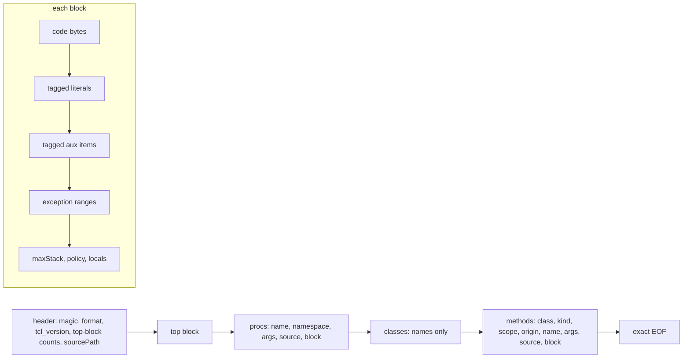
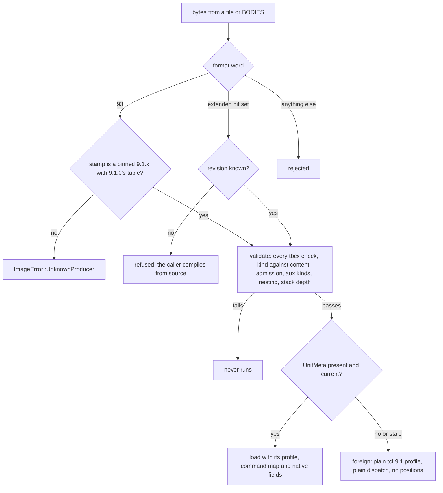

# Serialised bytecode: the tbcx format on a Tcl 9.1 base

**Status:** designed 26 November 2026, plan item 311. Owner decision, 26 November 2026: serialised bytecode uses the **tbcx** format. This replaces the earlier `tbcload` design and the custom `tclbc` container before it.

**Builds on:**
- item 312, the [VM on a Tcl 9.1 base](vm-tcl-9-1.md). This format carries its numbered opcode table, its admission table and its byte encoder;
- the [SpecTcl image](../registry/model/306-expect-spike.md) and [consumer hooks](../registry/model/313-consumer-hooks.md). Their `BODIES` section stores Tcl hook bodies.

**Feeds:**
- precompiled hook bodies in pack images (items 305–307, 313);
- AOT artefacts for the VM;
- cached compiled procedures for `tcl-db`;
- loading of `.tbcx` files that C Tcl 9.1 writes.

## Problem

`tcl-bytecode` has no serialiser.
- A `ModuleAsm` (`rust/tcl-bytecode/src/lib.rs:520`) exists only in memory.
- Its instructions use symbolic labels (`FunctionAsm::labels`, `lib.rs:194`). Exception handling is carried out of band, in `loop_targets` (`lib.rs:202`) and `Instruction::catch_target` (`instruction.rs:336`).
- `Op` has no opcode bytes (312).

So every process that runs a hook body, an AOT module or a cached procedure compiles it again, and the VM cannot load bytecode compiled elsewhere. `tbcload` stops at Tcl 9.0. Its README reads: "This package does not support Tcl 9.1 and later. Use the tbcx extension instead." ([tcltk-depot/tbcload](https://github.com/tcltk-depot/tbcload)).

## Research: tbcx

Sources:
- the project page, [bagnongithub.github.io/tbcx](https://bagnongithub.github.io/tbcx);
- the source, [github.com/bagnongithub/tbcx](https://github.com/bagnongithub/tbcx) at commit `2a7178d` (30 September 2026, "Tcl 9.1.0 lambda compatibility bug"), cloned for reading. It holds `tbcx.h` (487 lines), `tbcxsave.c` (7,329), `tbcxload.c` (8,195) and `tbcxdump.c` (1,215).

**Status and licence.**
- MIT, "Copyright (c) 2025 Miguel Bañón" (`LICENSE`).
- `AC_INIT([tbcx],[1.2.1])`; tags `v1.1` (12 April 2026) and `v1.2` (10 July 2026). Commits continue through September 2026.
- One maintainer, so the bus factor is one. The suite runs 824 cases in 34 files (README, "Build").
- It builds against Tcl 9.1 internals (`tclInt.h`, `tclCompile.h`, `tclOOInt.h`) and supports no earlier release. For older releases it points to `tclcompiler` and `tbcload`.

**Patchlevel rule.**
- The header stamps `maj<<24 | min<<16 | patch<<8 | type` (`Tbcx_PackTclVersion`, `tbcx.c:113`).
- The loader requires equality with the running interpreter (`tbcxload.c`, `Tbcx_PreflightArtifact`: "incompatible Tcl version"), because "TBCX reconstructs private structures whose ABI is not guaranteed across patch builds" (README).
- So 9.1.0 final is `0x09010002` (`TCL_FINAL_RELEASE` is 2, `tcl.h:34`).

**Wire format.** The file is binary and little-endian, with no text form.
- **Strings** are LPStrings: a `u32` length, then bytes with no NUL.
- **Header.**
  - The fixed fields: `magic u32 = 0x58434254` ("TBCX"), `format u32 = 93`, `tcl_version u32`, `codeLenTop u64`, then `u32` counts for the top block's exceptions, literals, aux data, locals and maximum stack.
  - Then `sourcePath`, an LPString.
  - The loader cross-checks every count against the parsed top block (`tbcxload.c:7925`).
- **Sections, in order:** the top block; `u32` procs, each `(name FQN, namespace, arg spec, body source, block)`; `u32` classes (advisory names only); `u32` methods, each `(class FQN, kind u8 0–4, scope u8 0–3, origin u8 0–1, name, arg spec, body source, block)`. The file ends there, and the loader checks for exact EOF.
- **A block** (`WriteCompiledBlock`, `tbcxsave.c:2752`), in order:
  1. `u32` code length, then the raw code bytes;
  2. `u32` literals, each tagged;
  3. `u32` aux items, each tagged;
  4. `u32` exception ranges. Each is `type u8` (loop or catch), then `nesting`, `codeOffset`, `numCodeBytes`, `continue`, `break` and `catch`, all `u32`. `0xFFFFFFFF` means "none";
  5. an epilogue: `maxStack u32`, `policy u32`, `numLocals u32`, then the local names as LPStrings, indexed by frame slot.

The file, in order. Every block has the same five parts:


- **Literal tags:**
  - 0 bignum, 1 boolean, 2 bytearray, 3 dict (insertion order), 4 double;
  - 5 list, 6 string, 7 wideint, 8 wideuint;
  - 9 lambda bytecode: namespace, args with defaults, block, body source;
  - 10 `BYTESRC`, a compiled script body: source, namespace, block.
- **Aux tags:**
  - 0 `JumptableInfo`: keys sorted by UTF-8;
  - 1 `JumptableNumInfo`: 9.1's numeric table, `u64` keys sorted;
  - 2 `DictUpdateInfo`;
  - 3 `NewForeachInfo`. `firstValueTemp` is canonicalised to 0, and `numLists` is written twice.
  Any other aux type aborts the save (`tbcxsave.c:3018`).
- **Source policy** sits in the top block's epilogue word:
  - 0 is legacy and source-backed: the code is not marked precompiled and may recompile;
  - 1 is strict compiled-only: every proc, method, `BYTESRC` and lambda source field is empty;
  - 2 is include-source: the source is kept for introspection only.
  - Saves write 1, or 2 with `-include-source`. Nested blocks must carry 0.

**What the saved bytes are.** This matters for byte identity.
- Saves of policy 1 or 2 compile with `DONT_COMPILE_CMDS_INLINE` set (`CompileScriptForArtifact`, `tbcxsave.c:1605`). Every command is then `push`…`invokeStk`, and no compile procs run (`tclCompile.c:2395`).
- They also force a command limit, so 9.1 keeps `startCommand`. The compaction pass runs only without limits (`tclCompile.c:1170`).
- Script-body arguments reaching `invokeStk` (the bodies of `if`, `while`, `foreach`, `try`, `namespace eval` and others) get a fresh tag-10 record. Only that push operand is rewritten (`InstrScanBodyLiterals`, `tbcxsave.c:2162`).
- The top-level script is itself rewritten before compiling:
  - proc bodies become markers `"\x01TBCX<n>"`;
  - method bodies become `"#\x01tbcx-method-stub"` (`tbcx.h`);
  - the loader's shims swap in the precompiled bodies when the top level runs `proc` or `oo::define`.
- So a tbcx block is **not** `tclsh`'s default compile. It is what `tclsh` 9.1 compiles under an execution trace with a command limit active.

The top-level rewrite on a two-line script. The marker index counts procs from
0 (`tbcxsave.c:6530`), and the loader's `proc` shim swaps the precompiled
body in when the top level runs:

**Before:**

```tcl
proc greet {name} { return "hello $name" }
puts [greet world]
```

**After:**

```tcl
proc greet {name} "\x01TBCX0"
puts [greet world]
```

**Positions.** None are kept.
- The loaded `ByteCode` has `numCommands = 0` and no command-location map (`tbcxload.c:4202`).
- Only `sourcePath` survives, for `info script`.

**Validation on load** (`PreflightBlock`, `ValidateBlockOperands`, `tbcxload.c:1349`, `:5895`).
- It runs before anything is materialised. The checks:
  - magic, format and the exact version;
  - every count against the limits: code ≤ 64 MiB, pools ≤ 1M, LPStrings ≤ 4 MiB, locals and stack ≤ 65,536, depth ≤ 64;
  - opcode ≤ `LAST_INST_OPCODE` and whole instructions;
  - the block ends in `done`;
  - literal, LVT and aux indices are in range;
  - jumps and jump-table targets land on instruction boundaries;
  - exception range kinds and their sentinels;
  - the policy word, and that strict files have empty source fields;
  - absolute namespace names without NULs;
  - exact EOF.
- An opcode outside the running Tcl's table is rejected ("invalid opcode").

**What it cannot represent:**
- `ForeachInfo`, the aux type of the 8.4 and 8.5 `foreach`;
- any opcode beyond 9.1's;
- a target release other than the producer's;
- positions;
- `self method` inside `oo::objdefine`;
- statically recognised cross-interpreter `interp eval` bodies;
- bodies built at run time. These stay data and compile when they run.

**Hazard to avoid in our writer.** Integer literals are tagged by their internal representation at save time, and only the value is written (`WriteLiteral`, `tbcxsave.c:1150`). A literal `0x10` that had been shimmered to an integer reloads as `16`.

## Design

### One format, two unit kinds

`tcl-bytecode` gains a `tbcx` module, with no dependency on the compiler or the VM:

```rust
pub mod tbcx {
    pub enum UnitKind { Interop, Extended { revision: u16 } }
    pub struct Unit { pub kind: UnitKind, pub stamp: TclVersion, pub policy: SourcePolicy,
                      pub source_path: Option<Vec<u8>>, pub top: Block, pub procs: Vec<ProcRec>,
                      pub classes: Vec<Vec<u8>>, pub methods: Vec<MethodRec>, pub ext: Vec<ExtSection> }
    pub fn write(u: &Unit) -> Vec<u8>;                      // deterministic
    pub fn read(bytes: &[u8]) -> Result<Unit, ImageError>;  // validates; no execution
    pub fn from_module(m: &ModuleAsm, kind: UnitKind) -> Result<(Unit, UnitMeta), ExportError>;
    pub fn into_module(u: Unit, meta: Option<UnitMeta>) -> Result<ModuleAsm, ImageError>;
    pub fn validate(u: &Unit, meta: Option<&UnitMeta>) -> Result<(), ImageError>;
}
```

| | **Interop unit** | **Extended unit** |
|---|---|---|
| `format` word | `93` | `0x8000_0000 \| revision<<16 \| 93`, first revision `0x8001_005D` |
| `tcl_version` | producer stamp: the pinned 9.1 patchlevel, `0x09010002` | the **target** release, e.g. `0x08061202` for 8.6.18 |
| Target and profile | Tcl 9.1, the plain `tcl` profile | any release 8.4–9.1, any profile (Jim, iRules, …) |
| Code | the tbcx shape: plain dispatch, `startCommand` kept | our normal optimised codegen |
| Opcodes | C Tcl 9.1's slots 0–210 only | slots 0–210 and private codes from 255 down |
| Extras | none: the file is byte-valid tbcx 1.2.1 | aux tag `0x8000_0000` (`ForeachInfo`); a trailing extension table |
| Loadable by C Tcl 9.1 + tbcx | yes, at the stamped patchlevel | no: refused at the header ("unknown magic or format") |

**The extension table** (extended units only) follows the methods section: `u32` count, then `(tag u32, block)` pairs. Tag 1 is `TOP_LEVEL_BODY`, `ModuleAsm::top_level_body` (`lib.rs:558`). The file ends after the table. A reader that does not know the revision refuses the unit, and the caller compiles from source.

The first twelve header bytes of each kind, little-endian. An interop unit
for 9.1.0, and an extended unit (first revision) targeting 8.6.18:

```text
offset  interop unit    extended unit
0       54 42 43 58     54 42 43 58     magic 0x58434254, "TBCX"
4       5d 00 00 00     5d 00 01 80     format 93 / 0x8001005D
8       02 00 01 09     02 12 06 08     tcl_version 0x09010002 / 0x08061202
```

C Tcl 9.1 with tbcx reads the second file's format word and stops there.

### Decisions

1. **The interop guarantee.** It holds both ways, at an exact patchlevel.
   - *Out:* an interop unit we write loads with `tbcx::load` from tbcx 1.2.1 (format 93) in `tclsh` at exactly the patchlevel we stamp.
     - The default stamp is the 9.1 pin in `reference-toolchains.tsv` (9.1.0).
     - `--stamp 9.1.N` is allowed only for a pinned 9.1 tree whose `tclInstructionTable[]` the 312 generator found identical to 9.1.0's.
     - The result runs as `source` of the same script would.
   - *In:* we read any format-93 file whose stamp is a pinned 9.1.x with an identical table. Other stamps are `ImageError::UnknownProducer`.
     - Our reader has no C ABI to protect, so the exact-match rule does not bind us. It binds only the files we hand back to C.
   - *Not promised:* files for a 9.1 patchlevel we have not pinned, and any release below 9.1.
2. **Byte identity is an interop requirement, against tbcx's shape.**
   - An interop export compiles through `CompileService::compile_traced` (`rust/tcl-runtime-api/src/compile_service.rs:571`), our existing equivalent of `DONT_COMPILE_CMDS_INLINE`, with compaction disabled.
   - The writer also replicates tbcx's top-level rewrite (proc markers, method stubs) and its occurrence plan (fresh tag-10 records for executable pushes).
   - The oracle is `tbcx::save` itself, run under the pinned `tclsh` 9.1.0. Every block's code bytes must match, or the fixture is on a listed divergence list.
   - 312's byte mode, against `getbytecode`, stays the check for normal optimised code.
3. **Our metadata never enters the payload.** `UnitMeta` holds:
   - the dialect profile id and dialect point;
   - `source_namespace`, `source_hash` and `plain_command_dispatch`;
   - specialisation stamps: the `PackFactStamp` list and `ArtefactIdentityManifest`;
   - per function, in payload order (top, procs by definition order, then extension blocks):
     - the native-compilation fields (`lib.rs:172–186`);
     - command and procedure bindings, and site claims;
     - error regions, splice ranges and `body_base_line`;
     - a **command map** (pc range to source range), because tbcx carries no positions;
     - the out-of-band instruction fields (`catch_target`, `start_hosts`, native selections), keyed by pc.
   - `meta_format: u16` is versioned on its own.
4. **A wrapper in pack images, a sidecar for standalone files.**
   - In `BODIES` (313), each entry is `TbcxUnit { meta_format, meta: UnitMeta, payload }`. A unit and its metadata must be replaced together.
   - A standalone `.tbcx` gets `<name>.tbcx.meta`, because tbcx enforces exact EOF and an interop file cannot carry trailing bytes. The same rule applies to extended files, for uniformity.
   - A file without metadata loads as *foreign*:
     - the plain `tcl` 9.1 profile;
     - plain dispatch and no native compilation;
     - exception handling derived from its exception ranges;
     - no positions, as in C.
5. **Private opcodes.** The unit kind marks them, and export either lowers them or refuses.
   - An interop unit can never contain one. `validate` rejects a code byte above 210, so a stray private opcode surfaces in our tooling, not as tbcx's "invalid opcode".
   - Export from an optimised module lowers only where the semantics are the same. The lowering is table-driven, beside 312's admission table:
     - `LNOT`→`not` (the VM runs both through one arm, `opcode_dispatch.rs:890`);
     - `LAND`/`LOR`→`swap; not; swap; not; bitor; not` and its dual, which keeps the left-first error order;
     - `STR_REPEAT` (stack `value count`, `opcode_dispatch.rs:792`)→`push ::tcl::string::repeat; reverse 3; reverse 2; invokeStk 3`, and `STR_REVERSE`→`push ::tcl::string::reverse; reverse 2; invokeStk 2`. These are C's uncompiled path, so they also see a renamed command, as C does.
     - `CALL_FUNC1` and `IRULE_*` have no lowering. They occur only on 8.4 and iRules targets, which are extended anyway.
   - Interop export normally recompiles in the tbcx shape (decision 2), so lowering serves only the `--from-optimised` path.
6. **Releases below 9.1 are extended units.**
   - The header names the target. The code uses 312's 9.1 numbering, with the deprecated one-byte forms and private codes that target emits.
   - 8.4 and 8.5 `foreach` use the `ForeachInfo` extension aux tag.
   - No C loader takes them: tbcx refuses the format word, and `tbcload` uses another numbering and grammar.
   - 9.0 targets are extended too: their meaning is 9.0's, not 9.1's.
7. **One binary codec.** tbcx is binary, so there is no ASCII85 and no second codec. Pack images embed the same bytes a file holds.
8. **Source.**
   - Pack units are strict (policy 1). `BODIES` keeps each body's source once, beside the unit, for the hash and the fallback.
   - Standalone exports take `-include-source` (policy 2) as tbcx does.
   - We read policy 0 as source-backed.
9. **Deterministic writes.**
   - Jump tables are sorted as tbcx sorts them.
   - Procs follow definition order, which the marker indices need, and classes are sorted.
   - Literal tags depend only on the literal's text: `STRING`, or a numeric tag only when the text is the value's canonical form (the hazard above).
   - The same module writes the same bytes, which `cargo xtask spec-images --check` needs (306).

   Some literal texts and the tag the rule gives them. The canonical form is
   what `tclsh` 9.1 prints for `expr {$text}`:

   | Literal text | Canonical form | Tag |
   |---|---|---|
   | `16` | `16` | 7, wideint |
   | `0x10` | `16` | 6, string |
   | `007` | `7` | 6, string |
   | `1.0` | `1.0` | 4, double |
   | `1e3` | `1000.0` | 6, string |
   | `18446744073709551616` | the same | 0, bignum |
   | `abc` | none | 6, string |
10. **Validation on load.** It runs before anything executes. A unit that fails any check never runs:
    - every tbcx check listed under Research, including the header-to-top-block cross-check and exact EOF;
    - the kind matches the content: an interop unit has stamp 9.1, no private codes, no extension aux and no extension table;
    - every opcode is admitted for the target release (312's `admitted`);
    - each aux kind matches its opcode (`jumpTable`→0, `jumpTableNum`→1, `dictUpdate*`→2, `foreach_start`→3 or the `ForeachInfo` extension);
    - exception nesting is consistent, and the recomputed stack depth is ≤ `maxStack`;
    - `UnitMeta` has one entry per function, its ranges and pcs fall in the code, and its profile id is known and matches the dialect point.
11. **Order relative to 312.** 311 needs 312's steps 1–3 first (`code`/`from_code`, `admitted`, `encode`/`decode`), with codes 0–210 equal to 9.1.0's. tbcx validates against the running 9.1 table. It needs 312's emit-time wide forms only for extended 9.1 units.

How a unit is loaded, from decisions 1, 4 and 10:



### Open questions

1. **Should we read methods and execute them?** 311 parses, validates and dumps method and class records. Executing them needs the VM's TclOO to accept precompiled bodies, the way tbcx's OOShim does. Until then a foreign unit with methods is `Unsupported(methods)`. *Settled by* demand for foreign OO files, or by item 313 needing them. *Settled:* in scope, by the owner decisions below.
2. **Must 311 land before 306?** 306 found one dynamic Tcl hook (`306-expect-spike.md`, "Hooks in the image"). *Settled by* the load-against-compile measurement below. *Settled:* no, by the owner decisions below.
3. **What when tbcx moves past format 93, or C Tcl releases 9.1.1?** Both refuse our old files. *Settled by* the owner: re-export on each pin bump (a `spec-images`-style check), or keep a stamp per supported patchlevel. *Settled:* re-export on each pin bump, by the owner decisions below.

## Work list

1. **312, steps 1–3:** the opcode table, `admitted` and `encode`/`decode`. Add an `export_lowering` column to `opcodes-by-release.tsv`.
2. **Reference toolchain:** build tbcx at `2a7178d` against `tmp/tcl9.1.0` (the `fetch-tcl-source` skill gains it). Generate `.tbcx` fixtures under `evidence/tcl/tbcx/` with `tbcx::save` from the bytecode-compare corpus (`rust/tcl-compiler/tests/fixtures/codegen/matching/`, 72 fixtures), plus OO, lambda and `switch -integer` cases.
3. **`tbcx::{read, write, validate}`** for interop units, with one rejection fixture per check. Our reader must accept every reference fixture.
4. **`from_module`/`into_module`, `UnitMeta`** and the extended format: the extension aux, the extension table, and the pc-keyed side tables.
5. **The interop writer:** `compile_traced` with compaction off, the top-level rewrite, the occurrence plan and export lowering.
6. **Consumers:**
   - `BODIES` in pack images (306, 313);
   - VM AOT loading and foreign `.tbcx` loading;
   - `tcl dis` dumping `.tbcx` and `TbcxUnit` in `tbcx::dump`'s layout;
   - `tcl-db` caching by source hash, profile and format, if compile time matters.
7. **`tcl-fuzz` arm `tbcx-decode`.** Mutated units must be rejected or loaded, never panic or run unvalidated. Deterministic corrupted fixtures run in CI, and campaigns stay manual (`AGENTS.md`).

## Verification

Done when:
- **Round trip:** `read(write(u)) == u` and `into_module(from_module(m)) == m` for every corpus module, at each target release 8.4–9.1.
- **Out:** for every corpus fixture, tbcx 1.2.1 in `tclsh` 9.1.0 loads our interop unit, and its result matches `source`.
- **In:** our VM loads every `tbcx::save` fixture, with the same result as C. Method records execute too (owner decisions), once the VM's TclOO accepts precompiled bodies.
- **Byte identity:** each block's code bytes equal `tbcx::save`'s, or the fixture is on a listed divergence list. Literal tags that differ but carry equal data form one listed class.
- **Parity:** running each unit matches compiling its source, native and in `tcl-vm-wasm`, as a differential test in the conformance runner.
- **Rejection:** one fixture per validation check. The fuzz arm runs clean for a recorded campaign.
- **Use:** pack images store hook bodies as `TbcxUnit`.

Record:
- **Bytes and decode time.** Native and WASM, over the corpus, the bundled packs' `BODIES` and tcllib 2.0 compiled for 9.1.
- **Load against compile.** Per hook body (open question 2), and the `BODIES` size with and without source.
- **Build cone.** Edits in `tcl-bytecode::tbcx`, measured with item 259's method.

## Risks

- **A one-maintainer upstream that tracks C internals.** A tbcx change of format or rewrite convention breaks the `Out` guarantee. The reference fixtures pin commit `2a7178d`, and the format word check refuses anything else.
- **The rewrite convention is specified only by code.** The marker and stub strings and the shim matching rules come from `tbcx.h` and `tbcxload.c`, not from a document. The byte-identity oracle is what keeps us honest.
- **Plain-dispatch export is slower in C** than `tclsh`'s inline compile. That is tbcx's choice for epoch safety, and we match it.
- **Metadata drift.** A sidecar can be lost or stale. `source_hash` and the function-count check turn that into a foreign load, never a wrong one.

## Corrections to the overview

- Plan item 311 still says "`tclbc`", "a research step on `tbcload` interop" and "byte identity with `tclsh` 9.0". The replacement text is in this design's handoff. (Applied 26 November 2026.)
- `313-consumer-hooks.md` (lines 266, 341 and 429) says `BODIES` holds "`tclbc` (311, tbcload-shaped)". It should read "`TbcxUnit` (311, tbcx format)". (Applied 26 November 2026.)

## Owner decisions (26 November 2026)

- **TclOO methods in foreign files are in scope.** The VM's TclOO accepts
  precompiled method bodies the way tbcx's loader does, so method records in
  C Tcl's `.tbcx` files execute, not refused.
- **Re-export on pin bumps.** When the Tcl patchlevel pin or the tbcx format
  moves, every interop unit we ship is re-exported. There is one stamp: the
  current pin.
- **Upstream risk is accepted, and tracked.** The fixtures pin a tbcx commit.
  Checking tbcx upstream and bumping the pin is part of every dependency
  update (AGENTS.md, "Build and release").
- **Item 311 does not block item 306.** The Expect spike can store hook source
  and compile on first call, and switches to `TbcxUnit` when 311 lands.
