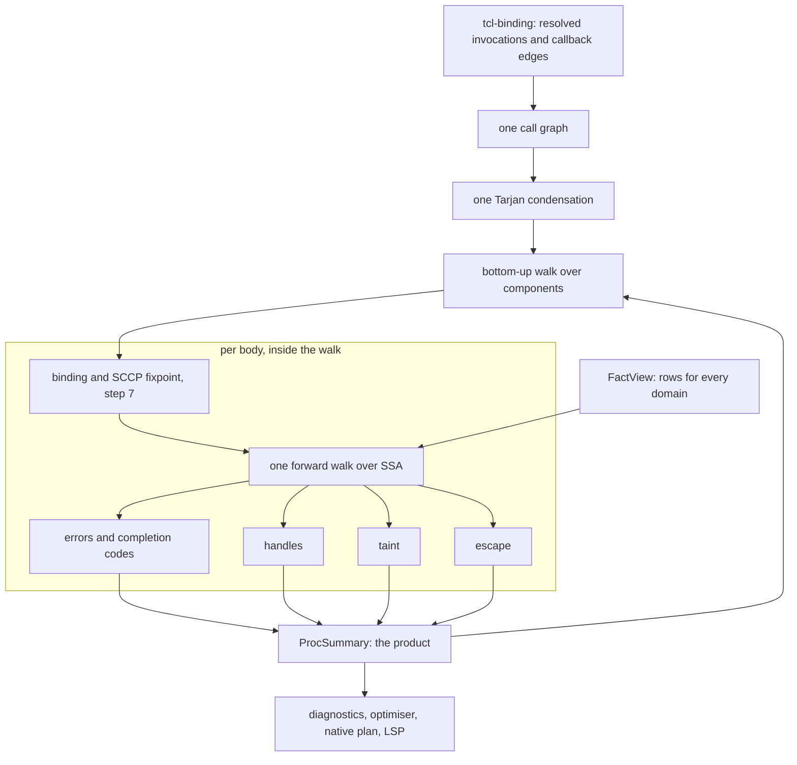
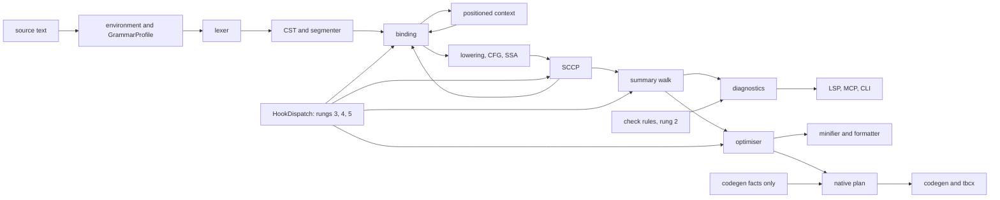
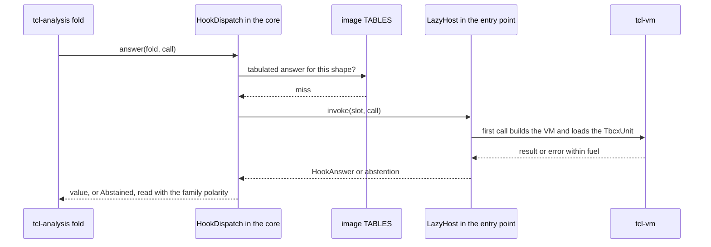
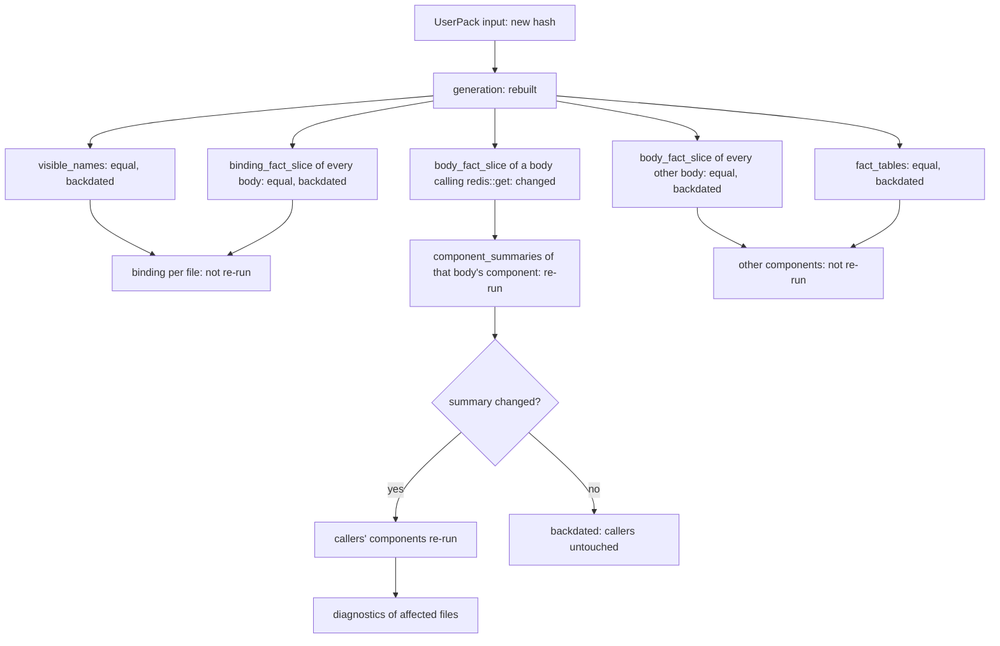
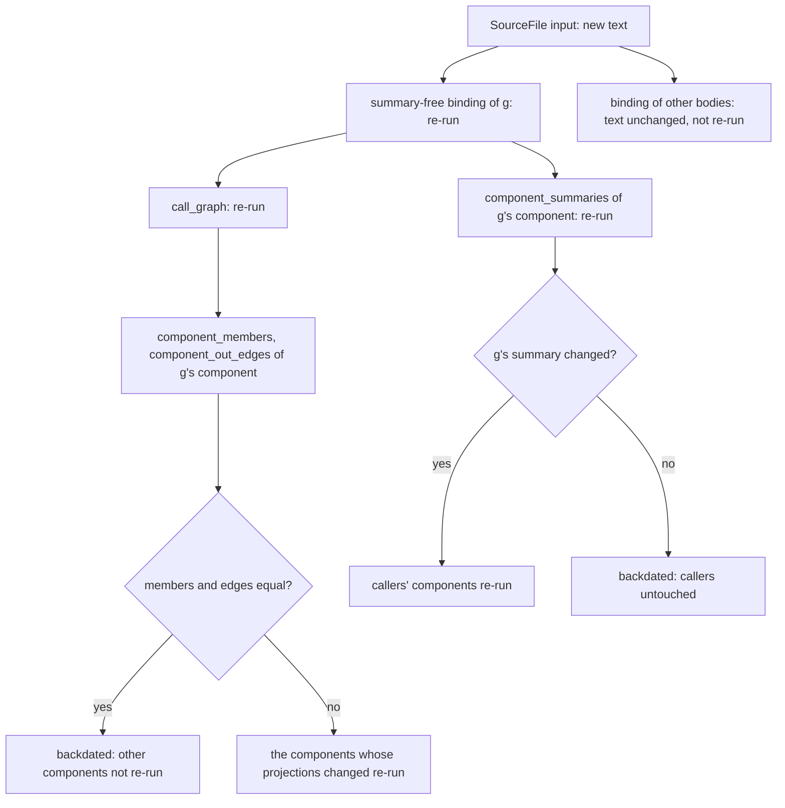
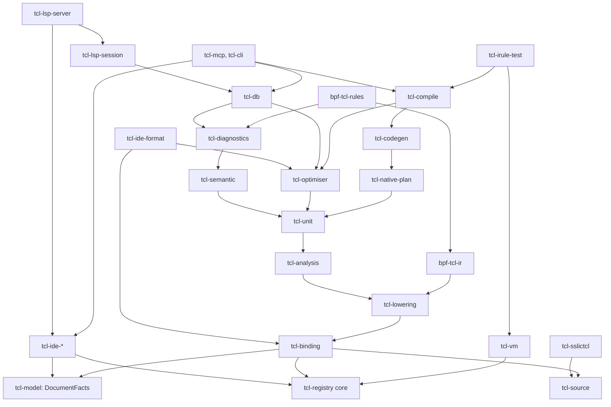
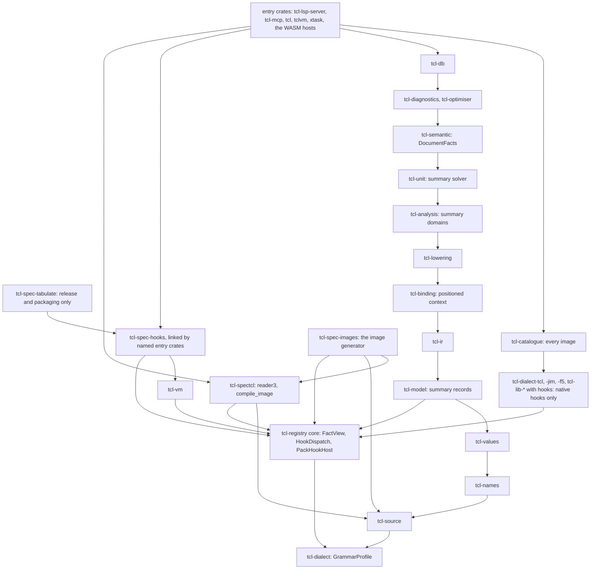

# The compiler, the analyser and SpecTcl 3 as one system

Status: designed 26 November 2026. It joins the compiler crate split (item
90, [overview](crate-split-design.md), [steps](crate-split/)), the registry
split and model ([registry split](../registry/registry-split-design.md),
[dialects and libraries](../registry/dialects-and-libraries.md), items
301–313, 319) and SpecTcl 3 ([305](../registry/model/305-spectcl-3.md),
[313](../registry/model/313-consumer-hooks.md),
[391](../registry/model/391-handle-types.md),
[392](../registry/model/392-error-codes.md), and the consolidated
specification in `registry/spectcl-3/`). Each SpecTcl design assumes its
analysis lives somewhere in "the analyser"; this document says
which crate, which pass, which interface, and how the interprocedural
analyses share one walk. Where it disagrees with a step design, it says so
in § *Corrections to other designs*.

Type names follow the specification's chapter 7 and
[393](../registry/model/393-taint.md) where they decide them (`HandleFacts`,
`LibraryChoice`, `TaintFact`, `ColourSet`, `ImageView`); names first
proposed here are marked *design sketch*.

## The decisions in brief

1. **One facts interface, in the registry core:** `FactView`, a generation
   plus a facet selection. No compiler crate names a surface, the catalogue
   or `tcl-spectcl`.
2. **Every fact is an image, and only `tcl-catalogue` embeds images.** That
   includes the Tcl core's specs, docs and release facts. `tcl-dialect-tcl`
   and the other surface crates hold native hooks only. A fact edit rebuilds
   `tcl-catalogue` and the crates that link it: the binaries, the WASM hosts,
   `xtask` and the `-it` test crates. It rebuilds no generic crate, not even
   its test target (§ 1, *The dependency rule*).
3. **The positioned context is computed in two places** and memoised by
   `tcl-db`. `tcl-binding` computes it inside a body, from that body's entry
   selection. `tcl-unit` computes each body's entry selection top-down, after
   condensation (§ 1).
4. **One summary framework:** domains and their product walk in
   `tcl-analysis`, the solver in `tcl-unit`, the records in `tcl-model`. One
   condensation, and one bottom-up walk with step 7's per-body fixpoint
   inside. Binding stays frozen inside a component until the component
   converges (§ 3). Today's six call-graph fixpoints become its domains.
5. **The VM is reached only through `PackHookHost`,** which exists today.
   Entry points supply a lazy host.
6. **Salsa inputs are packs and the generation they build.** Fine-grained
   invalidation comes from three backdated projections: binding facts, body
   facts and the shared tables. No salsa value holds a generation.
7. **Build time first;** SpecTcl engines wait for their crates. Every
   identity, value, interface and budget refinement below attaches to the
   extraction step that carries it or comes after Now 5; an extraction moves
   a type as it is (owner priority, 26 November 2026).
8. **Consumers read `DocumentFacts`.** `tcl-model` defines a binding-free
   document-facts trait that `AnalysisResult` projects into and
   `tcl-semantic` implements. `tcl-semantic` sits between `tcl-unit` and
   `tcl-diagnostics` as the one analysis query API (item 85). IDE crates
   depend on `tcl-model` and the registry core, never on `tcl-db` or
   `tcl-diagnostics` (§ 6).
9. **Facts are keyed by identity, never display text:** `BodyUnitRef`,
   `VariablePlaceRef`, `CommandRef`/`SourceCommandKey` and the core's
   `CommandKey`: the `*Ref`s are `tcl-core-types`' identity types, interned
   from `tcl-names`' source-key descriptors, and `CommandKey` is the core's
   (§ 3, § 9; D-D as revised).

## 1. Where SpecTcl facts enter the compiler

### What exists today

`tcl-compiler` reads `tcl-registry` directly (`cargo tree -p tcl-compiler
-e normal --depth 1`). Pack hooks cross one trait the registry defines and
`tcl-spectcl` implements: `PackHookHost`
(`rust/tcl-registry/src/pack_hooks.rs:518`, `invoke(slot, call) ->
HookAnswer`), installed process-wide by `install_host`
(`pack_hooks/host_installation.rs:156`) and implemented in
`tcl-spectcl/src/hooks/service.rs:324`. Extensions do the same through
`ExtensionHost` (`extension_host.rs:58`) in a thread-local. So the VM
boundary exists. What is wrong is the global installation, which
[step 14](crate-split/14-caching.md) deletes, and the loader's edge to the
VM, `tcl-spectcl` → `tcl-spec-hooks` → `tcl-engine-tclvm` → `tcl-vm` (§ 6).

### The interface

The registry core owns it: `tcl-model` is compiler vocabulary the VM and
`tcl-spectcl` must not depend on, and 391 and 392 already put `HandleType`,
`ErrorClass`, `Throws` and `CompletionCodes` in the core
([391](../registry/model/391-handle-types.md#rust-parity),
[392](../registry/model/392-error-codes.md#rust-parity)).

```rust
// design sketch: tcl_registry::facts (registry core); names provisional
pub struct Generation { /* surfaces, image bytes (catalogue: 'static; user packs: Arc), grammar profiles, hook table */ }
pub struct GenerationId(u64);                 // item 47: one per install

pub struct FactView<'g> {
    generation: &'g Generation,
    selection: &'g FacetSelection,            // dialect set, library choices, targets (308)
}
impl<'g> FactView<'g> {
    pub fn command(&self, key: CommandKey) -> Option<SpecRef<'g>>;       // facets already selected
    pub fn visible(&self, path: CommandPathId) -> Knowledge<CommandKey>; // an interned path, never display text
    pub fn handle_type(&self, id: HandleTypeId) -> Option<&'g HandleType>;   // 391
    pub fn error_class(&self, id: ErrorClassId) -> Option<&'g ErrorClass>;  // 392
    pub fn grammar(&self) -> &'g GrammarProfile;                            // 370
    pub fn hooks(&self) -> HookDispatch<'g>;  // rungs 3, 4, 5 behind one call
}
pub struct HookDispatch<'g> { table: &'g HookTable, host: Option<&'g dyn PackHookHost> }
pub struct CommandKey { library: LibraryId, path: CommandPathId }   // generation-independent; SpecKey retires
```

- **`CommandKey` is the stored identity of a registry command:** the library
  and the interned command path, equal across images and generations.
  Today's `SpecKey` hashes a `&'static` spec's address
  (`rust/tcl-registry/src/model/binding.rs:162`), which fails once specs
  come from images loaded at run time; `BindingTarget::Spec` holds a
  `CommandKey` instead. `visible` answers in item 78's `Knowledge`, so the
  `Visibility` enum of the first draft is retired (item 482, C30).

- **Concrete, not a trait object:** binding and SCCP read it in inner loops,
  and release LTO inlines a borrowed struct across crates.
- **Facets are selected once per view.** A range consumer (W150, completion
  over targets) gets a set selection and a `VersionLine` answer (308).
- **Hooks are one call.** `HookDispatch::answer(family, call)` tries the
  tabulated table (rung 5), the native table (rung 3), then the host
  (rung 4), and otherwise abstains.
- **The host is a field, not a global.** `install_host` survives only in
  entry points until the generation carries the host.
- **Views borrow; salsa values copy.** Every view borrows the generation for
  `'g` (chapter 7, *The model as Rust types*). Catalogue images are the
  `'g = 'static` case. A salsa value never holds a `FactView`, a `SpecRef` or
  an `Arc<Generation>`. It holds `CommandKey`s, interned IDs and copied
  facts, so it compares equal across generations. An old generation is
  dropped once the queries in flight that borrow it finish.
- **Abstention has a polarity per family.** `answer()` returns
  `HookAnswer::Abstained`, and the family's polarity in chapter 5's *Result
  protocols* says what the consumer does with it.

### How images and user packs reach it

Shipped packs, the Tcl core's included, are compiled once per build by the
`tcl-spec-images` generator into the catalogue's untracked `images/`
directory, and embedded by `tcl-catalogue`
([307](../registry/model/307-libraries-as-data.md#images-per-build)). The
generator compiles base images over the `tcl-spectcl` reader, `tcl-source`
and the registry core only: no VM, no compiler, no codegen. Rung-4
tabulation (`TABLES`) and `TbcxUnit` `BODIES` are an opt-in pass, the
separate `tcl-spec-tabulate` package, for release and packaging builds, keyed by the VM and codegen build;
dev images ship source-only `BODIES` with `tabulated_with_vm` clear, which
chapter 7 allows. The generator writes an image only when its bytes change,
so an unchanged rewrite relinks nothing. The embedded image is the
BundledPack default on every host; a `specs/` source on disk or in the
browser mount overrides it only when its hash differs, and is then compiled
into the user cache as a `UserPack` with tier BundledPack. User
and workspace packs are read by
`tcl-spectcl` on `tcl-source` and compiled in memory with no VM
([305](../registry/model/305-spectcl-3.md#the-loader-on-tcl-source)). The
entry point hands both kinds of bytes to the core: one decoder (spec R27),
the tier applied at install (R22). A generation is a value, so queries in
flight never mix generations (item 47's race).

Generic crates' tests read the same image files at run time, through the
unconditional `tcl_registry::testing` module (item 296's option 2). Cargo
does not fingerprint a file a test opens, so an image change recompiles no
test target. A native hook ID the test binary lacks is bound to an
abstaining stub, and the harness prints each stub once.

### How the positioned context selects facets

`FacetSelection` is the part of 308's `PositionedContext` that selection
reads: the dialect set, each `LibraryChoice` and the targets, per transition
interval. 308 puts the query in `tcl-db`, above the version gate
(`tcl-diagnostics`), the `check` atoms and binding's own visibility. So:

- **`tcl-binding` computes it inside a body.** Binding owns the package
  transitions (item 84) and the `Must`/`May` join it already uses for
  `BindingKnowledge` (`rust/tcl-registry/src/model/binding.rs:211`). It
  starts from the body's entry selection, calls the core's
  `resolve_libraries` (302) per interval and returns `ContextIntervals`, a
  sorted list of `(Span, FacetSelection)`.
- **`tcl-db` memoises it** as `positioned_context(db, file, at)`, which looks
  up the interval. The LSP session and `tcl-db`'s batch constructor (§ 6)
  call the query; crates below `tcl-db`, and every
  `tcl-ide-*` crate, take `&ContextIntervals` from their caller, the IDE
  crates through `DocumentInput` (§ 6).

Binding's first round uses the body's entry selection and its second the
intervals, inside step 7's per-body loop; the second is usually a no-op.

**Entry selections, top-down.** 308 makes a procedure's entry state the
join of the states at its known call sites. So a callee's selection depends
on its callers, while summaries flow up from callees. The two cannot share
one walk:

- **Before the call graph exists,** a procedure body's entry selection is
  the top-level selection at the end of its file, with every `Must`
  downgraded to `May`. File top level starts from the environment's
  placements. This is binding's first visit, and every body's rule until
  INT-d's second half lands.
- **After condensation,** `tcl-unit` runs one top-down pass over the
  components in reverse topological order. A body's entry selection is the
  join of the selections at its call sites. A component is iterated until no
  entry selection in it changes.
- **Termination.** Per library, a selection lives in a finite lattice:
  `Absent`, `Must` and `May` over version sets built from the finitely many
  intervals the rows and requires name, and `Unknown` as top. The join is
  monotone, so a component converges within the lattice's height times its
  body count.
- **Feedback into binding.** A changed entry selection can change
  visibility, and so add or remove edges. Each such change spends one of
  § 3's counted re-binding rounds. When the budget is spent, the affected
  sites bind as unknown and the graph is not re-condensed again.
- **Across files.** The pass runs over the unit's call graph, so a `package
  require` edit in `main.tcl` reaches the procedures of `lib.tcl` through
  it. Salsa re-binds only the bodies whose `entry_selection` changed (§ 5).

### The dependency rule

A fact edit, or a hook fix in a `tcl-lib-*` crate, must never rebuild
`tcl-analysis` or its test target. Seven edges can break that, and the rule
closes each:

| Edge | How it would rebuild `tcl-analysis` | Rule |
|---|---|---|
| a normal edge from a generic crate to a surface | every spec edit rebuilds it | forbidden by item 265's gate ([04-dependency-hygiene](../registry/registry-split/04-dependency-hygiene.md#the-gate)); compiler crates depend on the core only |
| a dev edge to `tcl-dialect-tcl`, whose rlib holds the Tcl core's facts | a Tcl core fact edit changes the rlib, so every generic crate's `--lib` test target recompiles | **new:** the Tcl core's facts are an image too ([307](../registry/model/307-libraries-as-data.md#decisions), decision 1); `tcl-dialect-tcl` holds hooks only, so the dev edge costs a recompile only on a hook edit; tests read images at run time through `tcl_registry::testing` |
| Tcl release facts in `tcl-dialect` (`generated_release_facts.rs`, 11,445 lines, 41 direct dependents) | a release-fact edit rebuilds `tcl-dialect` and everything above it, since cargo has no early cut-off ([259](../build-time/259-worktree-cost.md#the-four-edits)); item 300's `include_bytes!` keeps that | **new:** release facts move to the `DIALECTS` section of the Tcl core image; `tcl-dialect` keeps the types. Their 15 readers (`release_facts()` in `tcl-expr`, `tcl-syntax`, `tcl-dialect` and `tcl-registry`) take them from the `GrammarProfile` or the generation (INT-h) |
| a dev edge to `tcl-catalogue` on 265's known list | the catalogue links every `tcl-lib-*`, so a hook fix recompiles that crate's `--lib` tests | the crates item 90 splits out inherit no known-list row; tests that name a surface move to `-it` crates in the same step ([265](../registry/registry-split/04-dependency-hygiene.md#how-generic-crates-choose-their-test-surfaces)) |
| a normal edge to `tcl-spectcl` | a loader edit rebuilds the compiler | forbidden: the loader sits above the core and beside the compiler, never below it ([305](../registry/model/305-spectcl-3.md#the-loader-on-tcl-source)). `tcl-spectcl` takes its `SurfaceSet` from its caller (`registry_for_dialect_from(&SurfaceSet, …)`) and never depends on the catalogue: measured today, `tcl-sslictcl` is under `tcl-bigip` and `tcl-lsp-core` (`cargo tree -i tcl-sslictcl -e normal --offline`), and C16 puts `tcl-spectcl` under `tcl-sslictcl` |
| a `test-support` feature on the core | a feature enabled only from dev-dependencies gives every crate above the core a second unit hash in one worktree (item 296) | an unconditional `tcl_registry::testing` module, item 296's option 2 |
| an edge from the core to the BIG-IP schema (171k lines) | a schema edit rebuilds the core and so everything | the schema crate has its own role, `schema`, whose only dependents are `tcl-bigip`, `tcl-bigip-*` and `xtask` ([265](../registry/registry-split/04-dependency-hygiene.md#crate-roles)) |

The designs missed rows 2, 3, 4, 6 and 7. Item 265's rule 1 made
`tcl-dialect-tcl` every generic crate's default dev-dependency, 307 kept the
Tcl core's facts in Rust, and cargo fingerprints a test target on every
dev-dependency
([265 § Problem](../registry/registry-split/04-dependency-hygiene.md#problem)).
Together, every Tcl core fact edit would have recompiled `tcl-binding` up to
`tcl-diagnostics` as test crates.

**`xtask` is an entry crate.** It links `tcl-catalogue` (today it already
links `tcl-spectcl`, `tcl-compiler`, `tcl-lsp-core` and `tcl-vm`, `cargo tree
-p xtask -e normal,dev --depth 1 --offline`), so every fact edit relinks it,
and every rebuild claim in these designs names it. It does not generate the
images: the generator links no catalogue, so a fresh checkout can build the
images before anything embeds them (307).

It meets 304's rule (no library crate depends on the BIG-IP schema crate,
[304](../registry/model/304-f5-libraries.md#dependencies)): `tcl-catalogue`
must not either, and the profile-to-schema join stays in `tcl-bigip` (360).
A vocabulary change is a core edit and rebuilds everything; § 7 batches the
3.0 vocabulary so it lands once.

## 2. Fact families, crates and passes

Every SpecTcl 3 fact family, the crate and pass that read it, and what they
produce. Crate names are the split's targets; "today" columns are in the
step designs.

| Fact family | Defined in | Read by (crate, pass) | Produces |
|---|---|---|---|
| arity, options, option relations | core `CommandSpec` | `tcl-binding` (`registry_invocation`); `tcl-diagnostics` (arity and option checks); `tcl-ide-*` (signature help, completion) | `ResolvedInvocation`, E002 and option diagnostics |
| roles and invocation resolution (`clause_grammar` → `arg_role_resolver` → `arg_roles`) | core, plus rung 3/4/5 hooks | `tcl-binding`, the one binding walk (item 84) | `InvocationBinding` carried in `tcl-ir`'s `Facts`; the only role source for the minifier, formatter and optimiser (313 decision 1) |
| versioned facets and availability | core, selected by `FactView` | `tcl-binding` (visibility); `tcl-diagnostics` (version gate W135, W136, W144, W150); `tcl-ide-*` (hover `VersionLine`) | per-interval visibility; version diagnostics |
| state transitions (package, namespace, rename, alias) | core descriptors (305 rung 1) | `tcl-binding` | binding timeline; package transitions for the positioned context |
| effects, `optimise -no` | core (`world_effect`, `side_effects`) | `tcl-analysis` (`side_effects` classify, effects domain); `tcl-optimiser` (permissions); `tcl-native-plan` (334) | effect footprints, purity, rewrite permissions |
| results and shapes | core result facets; `CommandSemantics` speaks `ExactValue` and `Interval` (both `tcl-cmd-core`); `tcl_values::command_kernel` is the one entry, dispatching by ID to `tcl-cmd-core` or a fold hook | `tcl-analysis` (SCCP, `type_infer`, `transfer`) | value lattice facts, return shapes |
| handles (391) | core `HandleType`, producer and consumer rows | `tcl-analysis` (handles domain); `tcl-unit` (solver); `tcl-diagnostics` | `HandleFacts`; wrong-type, use-after-release, leak diagnostics |
| error codes and completion codes (392) | core `ErrorClass`, `Throws`, `CodeSet` | `tcl-analysis` (errors domain, catch and try sites); `tcl-unit` (solver); `tcl-diagnostics`; `tcl-optimiser` (dead `trap` arms) | `CatchFacts`, error sets, completion codes |
| taint (393) | core taint rows; today 15 `CommandSpec` fields | `tcl-analysis` (taint domain, once it reads no built unit); `tcl-unit` (solver); `tcl-diagnostics` (T1xx); `tcl-vm` (run-time taint, from the same rows) | colours, sink findings, taint summaries |
| events, flows, profiles (360, 380) | `tcl-lib-irules` and `tcl-lib-bpf` data, read through `FactView` | `tcl-irules` and `bpf-tcl-rules` (a rule crate above `tcl-diagnostics`, C31) as `UnitRule`/`SiteRule` contributions; `tcl-unit` (`connection_scope`); `tcl-irule-test` | event-order checks, CMP findings, test cases |
| grammar profiles (370) | type in `tcl-dialect`; pack profiles in the generation | `tcl-lexer`, `tcl-syntax`, `tcl-expr`, `tcl-source` (CST, segmenter); the writer owner; `tcl-codegen` records the id; `tcl-vm` | tokens, CST, segments; refusals of unsafe edits |
| hooks (rungs 3, 4, 5) | core `HookTable`; native IDs in surface crates; bodies in `BODIES` | every reader of the families they answer, through `HookDispatch` | the family's answer, or `Abstained` read with the family's polarity |
| `check` rules (rung 2) | core rule table | `tcl-diagnostics`, per site, with a `ctx` built from binding, SCCP and the positioned context | pack diagnostics (`PACK/ID`, spec R25) |
| rewrites and proofs (313, 335) | core `RULES` and `PROOFS` | `tcl-optimiser` (rewrite pass); `tcl-ide-format` (aggressive minify, through `tcl-optimiser`) | proved rewrites, gated by the positioned target set |
| layout (313) | core `RULES` | `tcl-ide-format` (formatter) | break choices only |
| scope and frozen names (335) | core role rows | `tcl-ide-format` (minifier) | per-name abstention |
| migrations (`migrate`, 390e) | core | `tcl-diagnostics` (finding plus fix); `tcl spec upgrade` and `find-legacy` in the CLI | modernisation findings and fixes |
| callbacks (390f, `-appends`) | core role rows | `tcl-binding` (callback edges); `tcl-unit` (callback edges in the call graph) | call edges into callback bodies, so handles and taint flow into them |
| embedded ranges (390d) | core role rows | `tcl-binding` (per-site range); `tcl-ide-tokens` (injection metadata) | ranges and editor injection data; never a parser |
| codegen facts (334) | core: purity, effect classes, `alias_of`, `semantic_operation`, `runtime_backing` | `tcl-native-plan`, `tcl-compile`; `tcl-vm` admission (`PackFactStamp`) | specialised sites, admission checks |
| eBPF recipes (380) | `tcl-lib-bpf` and `tcl-lib-linux-ebpf` data, read through `FactView` (no normal edge to a surface crate) | `bpf-tcl-ir` (closed `EbpfOp` catalogue); `bpf-tcl-codegen` (`KernelAbi`) | BPF IR and objects |
| SslicTcl document grammars (365) | `tcl-lib-sslictcl` | `tcl-spectcl` declaration reader on `tcl-source`; `tcl-sslictcl` model | `SslicModel` |
| `test` rows | source only | xtask conformance runners | conformance rows; dropped from the image |

### Facts no crate owns cleanly

- **The positioned context,** placed above its readers: § 1 and C5.
- **Certainty, taint colours and completion codes,** each with two to four
  types today: C2, C3 and C4 in § 8.
- **Fold evaluators:** settled (C12): one entry, `tcl_values::command_kernel`.
- **`connection_scope`,** iRules analysis in `tcl-unit` (step 13). Under
  391e the connection lifetime is a handle lifetime, so the handles domain
  takes it, and the rest becomes a `UnitRule` in `tcl-irules`.

## 3. One interprocedural framework

### The engines today


| Engine | Summary record | Call-graph walk |
|---|---|---|
| purity and effects | `ProcSummary` (`interprocedural.rs:264`) | transitive calls per procedure (`interprocedural/summary_fixpoints.rs:91`), then round-robin `loop` in `fixpoint_pure` (`:110`, `:119`) and `while changed` in `fixpoint_effects` (`:179`, `:190`) |
| value transfer | `TransferSummary` (`interprocedural/transfer.rs:112`) | Tarjan components (`transfer/summarisation.rs:430`), callees before callers (`:41`) |
| return values | — | `summarise_returns` (`interprocedural/return_summaries.rs:331`) |
| taint | `ProcTaintSummary` (`taint_interproc.rs:185`) | a dirty-set worklist (`taint_interproc/summary_fixpoint.rs:19`–`48`), and again per procedure in `tcl-lsp-db` as `proc_summary_cascade` (`check_solve.rs:115`, `lru = 512`) |
| object types | `ObjectHandleFacts` (`object_types.rs:248`) | `loop` over the whole unit's flow edges until no set grows (`object_types/object_flow.rs:97`) |
| escape | `ProcEscapeSummary` (`var_escape/types.rs:273`) | `while changed` (`var_escape/interprocedural.rs:273`) |

Six walks over one call graph, three convergence schemes, two copies of the
taint cascade. 391, 392 and 393 would add three more of the same shape.

### The design

One framework in three layers, following step 10's tiers:

- **the records** in `tcl-model`, so the LSP, MCP and the explorer print
  them without naming the engines;
- **the `SummaryDomain` trait, each domain's transfers and the product walk**
  in `tcl-analysis` (`tcl_analysis::summary`), beside step 10's
  `ProcedureSummaries` trait: a body's walk reads its callees only through
  summaries, never a built unit, so it is a per-function pass;
- **the solver** (condensation, component loop) in `tcl-unit`, the fixpoint
  driver of step 7.

```rust
// design sketch: proposed here; record names provisional (spec chapter 7)
// tcl-model
pub struct ProcSummary {                       // one record per body, every domain in it
    pub body: BodyUnitRef,                     // tcl-core-types identity, interned by tcl-names: never a display name or BodyKey text
    pub base: BaseSummary,                     // today's ProcSummary fields: arity, calls, purity, completes
    pub transfer: Option<TransferSummary>,
    pub returns: Knowledge<ExactValue>,        // item 78's lattice; ExactValue from tcl-cmd-core
    pub handles: HandleSummary,                // 391: parameter needs, returned type, releases
    pub errors: ErrorSummary,                  // 392: raises, completion codes
    pub taint: ProcTaintSummary,               // 393's gen/kill shape
    pub escape: EscapeSummary,
    pub frame_effects: Arc<[FrameEffect]>,     // 391 A6: upvar, global, uplevel, renames
}
pub enum FrameEffect {                         // keyed by identity plus a level relation
    Variable { level: LevelRelation, place: VariablePlaceRef },
    CommandTable { level: LevelRelation, command: CommandRef },
}
// tcl-analysis
pub trait SummaryDomain {
    type Fact: Lattice;                        // per SSA value or site, in one body
    type Summary: Lattice;                     // per body
    fn unknown_callee(&self, sig: &Signature) -> Self::Summary;     // top: what an unknown command does
    fn transfer(&self, cx: &FlowCx<'_>, at: StmtId, state: &mut Self::Fact, others: &ProductView<'_>);
    fn apply_call(&self, callee: &Self::Summary, call: &CallSite<'_>, state: &mut Self::Fact);
    fn summarise(&self, exits: &ExitStates<'_, Self::Fact>) -> Self::Summary;
}
```

- **The product.** A body's flow state is every domain's `Fact`. One
  forward walk over the SSA CFG calls each domain's `transfer` per statement,
  in a fixed order (errors and completion codes, handles, taint, escape);
  each reads the earlier ones through `ProductView`. SCCP stays its own
  sparse solver, runs first, and fixes the executable blocks.
- **The reduction is the point.** After `catch {open $p a} ch`, `ch` is a
  channel only where `catch` returned 0: the handles domain needs the errors
  domain's codes and SCCP's branch. Separate engines need a second pass.
- **One condensation** of the call graph from binding's resolved invocations
  (item 84) plus callback edges (390f), by one Tarjan pass.
- **One bottom-up walk.** Components are visited callees first. Inside a
  component the summaries are iterated until none changes, with binding
  frozen (below); past a per-domain height bound a summary widens to
  `unknown_callee`. The unit of work and of caching is the component
  (`component_summaries`, § 5), not one query per body.
- **Who drives it.** `tcl-unit` exposes a step function,
  `solve_component(members, lower: &dyn ProcedureSummaries) ->
  ComponentResult`, which iterates one component, re-binding included.
  `tcl-db` owns the walk: `component_summaries` calls it with the lower
  components' queries as `lower`. The call graph it condenses is built from
  the summary-free binding tier only (below), so no summary feeds the graph
  that orders the summaries, and the solver needs no salsa cycle recovery.
- **Frame identity.** Until item 66 gives frames an identity (stage 9),
  `FrameEffect` names its frame by a `LevelRelation` (relative or absolute
  level, as `tcl_registry::FrameLevel` does) beside the `VariablePlaceRef`;
  no frame effect is keyed by a variable or command name.
- **Scoped propagation.** Facts are keyed `(owner, variable)` as
  `ObjectHandleFacts::by_scope` is (`object_types.rs:275`). Only summary
  edges cross bodies: parameters, returns, callback arguments, a class's
  instance variables.
- **Certainty and proven reads.** As with `proven_reads`
  (`object_types.rs:277`), an edit, rename, fold or error needs a `Must` fact
  at an exact SSA read; a `May` fact may only label, annotate or warn.



### Against the binding fixpoint and item 84

Step 7's loop is per body (binding, lowering, SSA, SCCP, binding again,
[07](crate-split/07-binding-fixpoint.md#the-choice-inversion)); the summary
walk is across bodies. They nest: a body's loop runs inside its component's
visit, with its callees' summaries reaching SCCP through step 10's
`ProcedureSummaries` trait. So O103's pure-proc fold can feed binding, as
spike 94's `e01-computed-head` does within one body.

**Two binding tiers.** Binding has a summary-free tier and a
summary-refined tier:

- **Summary-free:** step 7's per-body loop with SCCP over the body alone,
  every callee read as `unknown_callee`. It depends on the body's own text,
  its entry selection and its fact slices, never on another body's summary.
  This is what item 103 persists per file, what point and collection
  queries read, and what the call graph is built from. A one-line edit
  re-binds one body in this tier, as the editor-actions design requires
  (`editor-actions-design.md:62`).
- **Summary-refined:** only for dynamic sites (a computed command head, a
  computed variable name) that the first tier left open. Such a site may
  bind against a converged callee summary, inside the component visit. A
  refined edge into the same component or a lower one is taken; an edge
  that would point anywhere else binds as unknown, is counted, and the
  explorer shows it, so the condensation never changes mid-walk.

A proved operand can bind an open call, and a widened summary can take a
proved operand away, so edges move both ways. Binding is therefore frozen
while a component iterates:

1. **Binding reads converged summaries only.** A body's step 7 loop binds
   against a callee's summary only once the callee's component has
   converged. A callee in the same component reads as `unknown_callee` for
   binding, while the summary iteration itself reads the current estimate.
   With binding fixed, every domain's transfer is monotone, so the component
   converges within its height bound.
2. **Re-binding after convergence.** The component's final summaries are
   then given to the summary-refined tier once. If no binding changes, the
   component is done. If one changes (an edge added or removed inside the
   component or towards a lower one), the affected bodies re-bind and step 1
   runs again for this component. The round stays inside the component's
   own query (C33).
3. **A counted budget.** A component gets at most three such rounds; the
   count is per component and shown by the explorer. When the budget is
   spent, every site whose binding changed in the last round binds as
   unknown, its callee summary is `unknown_callee`, and the component
   iterates once more with binding frozen. That result is sound, because
   `unknown_callee` is top in every domain.

Callers above a component see only its final summaries. Item 84's one walk
per body supplies the call, callback and package-transition edges.

**Example.** In `proc g {n} { if {$n>0} {return x[g [incr n -1]]}; set c [g
0]; $c hi; return puts }`, `g`'s first estimate returns `puts`, so SCCP could
bind `$c hi` to `puts`. Step 1 forbids it: `g` is its own component, so
binding reads `unknown_callee` and `$c hi` stays an open call. Once the
component converges, `g` returns `puts` or `x…`, which proves no command
name, so step 2 binds nothing and the component is done.

### What it costs

- **Time.** One O(V + E) condensation; one walk per body visit for every
  domain. The round-robin loops and the whole-unit object-flow rescan per
  round (`object_flow.rs:97`) go. A new domain costs its transfers, not a
  walk.
- **Memory.** One `ProcSummary` per body; site facts only for the body asked
  about. Of `ObjectHandleFacts`' module-wide maps only `proven_reads` stays.
- **Budgets,** recorded by INT-e against item 106's classes, under the
  `release` profile in CI's benchmark job, never in agent worktrees (one
  benchmark profile for 106, 306, 483 and the split's latency record). The
  numbers are recorded beside the Now-1 baseline and gate later stages on
  regression; the absolute budgets below are targets:
  - **Edit.** A one-line edit inside a procedure body, then a point query in
    a caller (hover, or a diagnostic at the cursor), within item 106's 100 ms
    after an edit. A point query reads the summary-free tier and waits on no
    summary. A query that needs summaries never answers from a partial wave:
    while the wave runs, its answer is marked provisional, barred from every
    action that needs a `Must` fact, and excluded from 106's measurement;
    the fresh-versus-warm differential runs after quiescence (C32).
  - **Cold.** Summaries for a whole unit at item 106's collection rate,
    300 ms per 10,000 lines, parse and binding excluded. tcllib 2.0 in
    `tmp/` is 883 files, 459,905 lines and 8,892 `proc` lines (counted 26
    November 2026), so 14 s. Today's cold scan is 58 s for 10,513 lines (item
    103), so this is a target to meet, not a measurement.
  - **Memory.** Step 14's resident-memory probe, before and after. At 1–3 KB
    per `ProcSummary`, tcllib's summaries are 9–27 MB.
  - Per-domain release latency on the item 46 corpus is recorded beside
    them.

## 4. Pass order and data flow

Each pass, with the facts and hook rungs it consults:

| Pass | Crate | Facts consulted | Hook rungs |
|---|---|---|---|
| environment and grammar profile | `tcl-dialect`, core | detection rows, pack `dialect` blocks | — |
| lexing | `tcl-lexer`, `tcl-expr`, `tcl-syntax` | `GrammarProfile` | — |
| CST and segmentation | `tcl-source` | `GrammarProfile` (the F5 `else` merge axis) | — |
| binding | `tcl-binding` | visibility, roles, clause grammars, transitions, callbacks, embedded ranges | 3, 4, 5 (roles, prefix, timing) |
| positioned context | `tcl-binding` | library and dialect rows, placements | — |
| lowering | `tcl-lowering` | lowering hook IDs (closed native set) | 3 (core only) |
| IR, CFG, SSA | `tcl-ir`, `tcl-lowering` | — | — |
| SCCP and values | `tcl-analysis`, `tcl-values` | results, shapes, folds | 3, 4 (fold) |
| entry selections | `tcl-unit`, top-down after condensation | library and dialect rows, call sites | — |
| summary walk: errors, handles, taint, escape | `tcl-analysis` domains, `tcl-unit` solver | `throws`, handle rows, taint rows (the sink gate is a rung 2 `SinkWhen` predicate, not a hook), effects | 3, 4 (effects) |
| diagnostics | `tcl-semantic`, `tcl-diagnostics`, `tcl-irules`, `bpf-tcl-rules` | `check` rules, version facets, migrations, events | 2, 3, 4 (diagnostic family) |
| optimiser | `tcl-optimiser` | effects, `optimise -no`, rewrites, proofs | 3, 4 (rewrite) |
| minifier, formatter | `tcl-ide-format` | roles (through `ResolvedInvocation`), scope, frozen, layout | 3, 4 (layout); rewrites through `tcl-optimiser` |
| native plan and codegen | `tcl-native-plan`, `tcl-compile`, `tcl-codegen` | codegen facts only (334) | none (spec R19) |
| tbcx | `tcl-codegen`, item 311 | the unit's `GrammarProfileId` | — |



### Where the VM is needed

Only rung 4, a Tcl hook body with no tabulated or native answer, needs an
interpreter. The core defines the boundary, `tcl-spec-hooks` implements it,
and the entry point wires them:

```rust
// design sketch: the existing trait, held instead of installed
// tcl-registry core (exists: pack_hooks.rs:518)
pub trait PackHookHost { fn invoke(&self, slot: HookSlot, call: &HookCall<'_>) -> HookAnswer; /* .. */ }
// tcl-spec-hooks (exists: tclvm_host, lib.rs:108), wrapped lazily
pub struct LazyHost { cell: OnceCell<HookHost<TclVmEngine>>, config: HostConfig }
impl PackHookHost for LazyHost { /* builds the VM on the first invoke, then delegates */ }
```



- The compiler and `tcl-ide-*` crates reach the host only through
  `HookDispatch`, and none depends on `tcl-vm`, `tcl-spec-hooks` or
  `tcl-spectcl`.
- An entry point without Tcl hooks links no VM; its rung 4 calls abstain.
  Spec Studio enables them for the author tier (spec trust table).
- **Fuel only.** An answer analysis consumes runs under the body's fuel, a
  command count, never a wall-clock cap. So the same inputs give the same
  answer on a loaded machine, and step 14's fresh-against-warm gate holds. A
  watchdog may still stop a runaway call; that quarantines the hook and moves
  `HookHostEpoch`, which invalidates every answer the hook gave.
- **A body that reads `values` runs once per site.** Such a roles, prefix or
  timing body feeds binding, which feeds SCCP, which feeds `values`. It is
  called in step 7's first round only, and later rounds reuse that answer,
  so a non-monotone body cannot make the loop oscillate (chapter 5, rung 4).
- The VM reads the registry core (admission, run-time taint), never the
  analysis crates. 393 tags a hook body's input words with the analyser's
  static `TaintFact`s; those are core types carried in `HookCall`, so the
  tagging adds no edge.

## 5. Incrementality and caching

The rule stays [step 14's](crate-split/14-caching.md#the-rule-per-crate):
lower crates are pure, `tcl-db` holds every cache.

### Inputs

`tcl-lsp-db`'s inputs today are `EvaluatorEpoch` (`lib.rs:556`),
`OverlayEpoch` (`:584`), `SourceFile` (`:699`), `AnalyserConfig` (`:810`),
`Project` (`:919`) and `RetainedModules` (`memoised_units.rs:239`, which
step 14 deletes). The integration adds:

| Input | Holds | Set by |
|---|---|---|
| `CompiledSurfaces` (singleton) | the catalogue's image bytes and hook tables | the entry point, once |
| `UserPack` (one per pack) | source hash, tier, compiled image `Arc` | the pack watcher (`tcl-lsp-session`'s `PackState` in the server; the batch constructor for MCP and the CLI); replaces `OverlayEpoch`'s role. A `specs/` override of a shipped pack is a `UserPack` with tier BundledPack. A document's stub lines are the per-file stub row below |
| `PackageLock` (one per workspace) | `tclpkg.lock`'s graph and `spec` tiers | `PackState` in the server; `BatchInputs.lockfile` in the CLI and MCP; a lockfile edit re-tiers packs through `generation` |
| per-file stub `UserPack` | a document's `# tcl-lsp: stub` lines, tier `Document` | `PackState` |
| `HookHostEpoch` | today's `EvaluatorEpoch`, renamed: moves on quarantine or reload | the hook host |

A replaced vendor pack and a document's stubs are both `UserPack` inputs:
tier BundledPack for a `specs/` source whose hash differs from the embedded
image's, tier `Document` per file for `# tcl-lsp: stub`. No other input kind.

Everything else is derived:

- `generation(db)`: item 47's registry generation. Only the projections
  below read it, so no other query depends on the whole generation;
- `grammar_profile(db, file) -> GrammarProfileId`, where the id is a content
  hash of the profile, so a pack edit that leaves a profile equal re-parses
  nothing; the CST is keyed on text and profile id;
- `visible_names(db, env)`: the names an environment can bind, no facts;
- `binding_fact_slice(db, body)`: for each command the body resolved, what
  binding reads: roles, clause grammars, transitions, callbacks, embedded
  ranges, and hook IDs with their polarity;
- `body_fact_slice(db, body)`: for each command the body resolved, what the
  summary domains read: `throws`, handle rows, taint rows, effects, results;
- `fact_tables(db)`: the rows no command owns: colours, sinks, origins,
  handle types, error classes and the `default` throws rows. Every summary
  depends on it;
- `hook_table(db)`: the projection of the generation's hook table that
  `HookDispatch` reads, compared by content;
- `entry_selection(db, body)`, over `tcl-unit`'s top-down pass, and
  `positioned_context(db, file, at)`, over `tcl-binding`'s intervals;
- `call_graph(db, unit)` with its condensation, one value per unit, built
  from the summary-free binding tier;
- `component_members(db, component)` and `component_out_edges(db,
  component)`: per-component projections of the call graph that backdate
  when equal, so a body edit that keeps a component's members and edges
  re-runs no other component;
- `component_summaries(db, component) -> Arc<[ProcSummary]>`, which reads
  only those projections and lower components' queries, and
  `body_summary(db, body)` as a projection of it. They replace
  `proc_summary_cascade` and the other per-engine queries.

Every one of these holds IDs and copied facts, never a view into the
generation. Bodies are keyed by declaration identity, `BodyUnitRef`, never
by text: today's keys are text (`ItemBodyKey.body_text`, `ProcBodyKey`;
[salsa-interned-gc](../rust/salsa-interned-gc.md#the-six-per-revision-interned-keys)),
and `ProcedureIdIssuer` draws from a process-wide counter
(`rust/tcl-core-types/src/body_identity.rs:24`, `NEXT_SCOPE`), so the same
unchanged body gets a new key on every rebuild. Item 274 derives the issuer
from a `tcl-db` input (file id, definition site, incarnation) and deletes
`NEXT_SCOPE`; until then component keys cannot backdate, and the interned
keys follow the GC contract in salsa-interned-gc.

**Minimal caching applies here too.** Every query above falls under step
14's memo gate ([14](crate-split/14-caching.md#the-rule-per-crate)): it
stays memoised only if deleting it costs more than the gate allows. The
per-body slices (`binding_fact_slice`, `body_fact_slice`) start as
"recompute, no memo" (a lookup per resolved command) unless the gate shows
otherwise.

### A user-pack edit

A user edits `redis.tclspec` and changes the `throws` row of `redis::get`:



Binding reads `visible_names` and `binding_fact_slice`. An edit that adds or
removes no name, and changes no role, grammar, transition, callback or
embedded range, re-binds nothing. A role edit (`redis::get`'s key word to
`-role Body`) changes the binding slice of each body that calls it, and
re-binds those bodies. A table edit (a new `colour`, a widened `-safe`, a
`handle` row, an `errorclass` window) changes `fact_tables` and re-runs every
summary, which is what such an edit means. Slices are recomputed (a lookup
per resolved command) and backdate when equal. A component whose summaries
did not change stops the wave, as `SummaryDepsKey` does for taint today
(`check_solve.rs:95`).

### A source edit

A one-line edit inside `proc g` changes `g`'s text, not its declaration
site, so its `BodyUnitRef` stays:



`call_graph` re-runs on every body edit, but it is one O(V + E) pass and no
component reads it directly; each reads its own projections.

### Not cached, on purpose

- positioned contexts per offset (only per interval);
- a body's site facts (recomputed when asked);
- the per-body fact slices, unless step 14's gate shows otherwise;
- per-domain summaries (one product query);
- rung 4 answers: not salsa values; tabulation at image build is the cache,
  and the host's existing slot cache stays entry-point state;
- `FactView` (a borrow) and old generations (dropped, no LRU).

## 6. Interfaces per consumer

### Today

Measured 26 November 2026 with `cargo tree -p <crate> -e normal --depth 1
--offline` (workspace crates shown). Cone: unique packages in `cargo tree -e
normal,build --prefix none`. VM: `cargo tree -e normal -i tcl-vm`.

| Consumer | Direct workspace edges today | Cone | `tcl-vm` in cone |
|---|---|---|---|
| `tcl-lsp-server` | `f5-xc`, `tcl-bigip`, `tcl-bigip-query`, `tcl-compiler`, `tcl-core-types`, `tcl-diagram`, `tcl-dialect`, `tcl-explorer`, `tcl-lexer`, `tcl-lsp-core`, `tcl-lsp-db`, `tcl-registry`, `tcl-spectcl`, `tcl-syntax`, `tcl-version` | 202 | yes, through `tcl-spectcl` → `tcl-spec-hooks` |
| `tcl-mcp` | `f5-cli`, `f5-xc`, `tcl-bigip`, `tcl-cli`, `tcl-cli-support`, `tcl-codegen`, `tcl-compiler`, `tcl-diagram`, `tcl-dialect`, `tcl-irules`, `tcl-lexer`, `tcl-lsp-core`, `tcl-registry`, `tcl-spec-studio`, `tcl-spectcl`, `tcl-syntax`, `tcl-version` | 341 | yes |
| `tcl-cli` | `tcl-cli-support`, `tcl-codegen`, `tcl-compiler`, `tcl-diagram`, `tcl-dialect`, `tcl-explorer`, `tcl-lexer`, `tcl-lsp-core`, `tcl-pkg`, `tcl-registry`, `tcl-sandbox`, `tcl-spec-studio`, `tcl-spectcl`, `tcl-syntax`, `tcl-version` | 227 | yes |
| `tcl-lsp-core` (formatter, minifier) | `tcl-bigip`, `tcl-cmd-core`, `tcl-compiler`, `tcl-core-types`, `tcl-dialect`, `tcl-irules`, `tcl-lexer`, `tcl-platform`, `tcl-regex`, `tcl-registry`, `tcl-sslictcl`, `tcl-syntax` | 134 | no |
| `tcl-compiler` (optimiser) | `tcl-bytecode`, `tcl-cmd-core`, `tcl-core-types`, `tcl-dialect`, `tcl-expr`, `tcl-lexer`, `tcl-regex`, `tcl-registry`, `tcl-runtime-api`, `tcl-syntax` | 64 | no |
| `tcl-codegen` | `tcl-bytecode`, `tcl-cmd-core`, `tcl-compiler`, `tcl-core-types`, `tcl-dialect`, `tcl-lexer`, `tcl-registry`, `tcl-runtime-api`, `tcl-syntax` | — | no |
| `tcl-vm` | `tcl-bytecode`, `tcl-cmd-core`, `tcl-core-types`, `tcl-dialect`, `tcl-host-native`, `tcl-lexer`, `tcl-platform`, `tcl-regex`, `tcl-registry`, `tcl-runtime-api`, `tcl-syntax`, `tcl-value-syntax` | — | itself |
| `tcl-irule-test` | `tcl-bigip`, `tcl-bytecode`, `tcl-cmd-core`, `tcl-codegen`, `tcl-compiler`, `tcl-dialect`, `tcl-irules`, `tcl-lexer`, `tcl-registry`, `tcl-runtime-api`, `tcl-syntax`, `tcl-vm` | — | yes, directly |
| `tcl-explorer` | `tcl-codegen`, `tcl-compiler`, `tcl-dialect`, `tcl-lexer`, `tcl-registry`, `tcl-spectcl`, `tcl-syntax` | 148 | yes |
| `tcl-spec-studio` | `tcl-compiler`, `tcl-dialect`, `tcl-lexer`, `tcl-lsp-core`, `tcl-registry`, `tcl-spectcl`, `tcl-syntax` | 148 | yes |
| `bpf-tcl-ir` | `tcl-compiler`, `tcl-lexer`, `tcl-registry`, `tcl-syntax` | 65 | no |
| `tcl-sslictcl` | `tcl-compiler`, `tcl-core-types`, `tcl-dialect`, `tcl-lexer`, `tcl-syntax` | 126 | no |

`runtime/rust` is its own workspace (`Cargo.toml:142`–`148`); it depends on
`tcl-registry` and the foundation crates (`runtime/rust/Cargo.toml:74`–`102`).

### Target

Consumers read analysis through one interface. `tcl-model` defines
`DocumentFacts`, a binding-free trait over a document's diagnostics
(`tcl_model::Diagnostic`), symbols, scopes, signatures, the resolved
invocation at an offset and the `ProcSummary` records. `AnalysisResult`
projects into it and `tcl-semantic` implements it. A feature crate takes:

```rust
// design sketch: tcl-ide-model (289), over tcl-model and the registry core only
pub struct DocumentInput<'a> {
    pub text: &'a str,
    pub environment: &'a ResolvedEnvironment,
    pub facts: FactView<'a>,                 // generation plus facet selection (§ 1)
    pub context: &'a ContextIntervals,       // the positioned context (§ 1)
    pub document: &'a dyn DocumentFacts,     // tcl-model; tcl-semantic implements it
}
```

The server's session fills it from `tcl-db`; MCP and the CLI fill it from
`tcl-db`'s session-free batch constructor (`tcl_db::Batch::run(inputs:
BatchInputs) -> BatchResult`, with the files, packs and `lockfile`), which
runs once and names no salsa type in its signature. `tcl-lsp-session`'s `PackState` is the watcher that sets the
`UserPack` inputs (§ 5), and its `registry_for(&self, uri) ->
Arc<CommandRegistry>` becomes a `FactView` backed by the current
generation.

None of this gates an extraction. 289 and 290 move the feature code with
today's inputs (`&AnalysisResult` and the caller's `&CommandRegistry`,
with the `tcl-ide-*` → `tcl-diagnostics` edges as exception rows), and
`DocumentInput`'s final fields and the batch constructor follow
`tcl-semantic` and items 480 and 484, after Now 5.

| Consumer | Depends on (normal) | Never on |
|---|---|---|
| LSP server stack | `tcl-lsp-session` → `tcl-db`; `tcl-ide-*`; `tcl-catalogue`; `tcl-spectcl` (loader); the hook runner (`tcl-spec-hooks`) linked as a dependency of the entry crate, not a feature | — |
| MCP, CLI | analysis through `tcl-db`'s batch constructor (`Batch::run`), no salsa; `tcl-ide-*`; MCP keeps `simulate`, so the VM through the hook runner (D-I) and `tcl-irule-test`; `tcl-compile` for `dis`, `compwasm`; `tcl-catalogue`; the hook runner as a linked dependency | `tcl-lsp-server`, `tcl-lsp-session` |
| feature crates (`tcl-ide-*`) | `tcl-model`, the registry core (`FactView`, `ContextIntervals`'s types), lower vocabulary | `tcl-db`, `tcl-diagnostics`, `tcl-unit`, `tcl-vm` |
| formatter, minifier (`tcl-ide-format`) | the above, plus `tcl-binding` and `tcl-optimiser` (rewrites) | `tcl-db`, `tcl-vm` |
| `tcl-semantic` | `tcl-unit` and below, the core | `tcl-diagnostics`, `tcl-db` |
| optimiser (`tcl-optimiser`) | `tcl-unit` and below, the core | surfaces, `tcl-spectcl` |
| codegen emitters (`tcl-codegen`, layer 5) | `tcl-ir`, `tcl-native-plan`, `tcl-lowering`, `tcl-analysis`, `tcl-values`, `tcl-model`, `tcl-bytecode` (the op crate), the core (292:119) | `tcl-optimiser`, `tcl-diagnostics`, `tcl-db`, `tcl-compile` |
| codegen drivers (`tcl-compile`, layer 5, above `tcl-codegen`) | `tcl-codegen`, `tcl-unit`, `tcl-optimiser`, the core (292:120) | `tcl-diagnostics`, `tcl-db` |
| VM, runtime | the core, `tcl-native-model`, `tcl-catalogue-core` (the Tcl and Jim images), foundation crates | every compiler crate, `tcl-catalogue` |
| iRules test framework | `tcl-compile`, `tcl-vm`, `tcl-irules`; facts from its caller (`FactView`), not the catalogue | `tcl-lsp-*`, `tcl-catalogue` |
| explorer (`tcl-explorer`) | the split crates its views read, `tcl-compile`; no `tcl-spectcl` ([294](../workspace/294-explorer.md)) | `tcl-vm` |
| Spec Studio | `tcl-spectcl`, `tcl-ide-format`, `tcl-ide-names`; the hook runner for the author tier | `tcl-lsp-core` |
| `bpf-tcl-ir` | `tcl-ir`, `tcl-lowering`, `tcl-model` (`target_contract`), the core; eBPF facts through `FactView` | `tcl-analysis`, `tcl-native-plan`, `tcl-lib-bpf` |
| BPF diagnostics (`bpf-tcl-rules`) | `tcl-diagnostics` (rule traits), `bpf-tcl-ir` | entry-point crates |
| `bpf-tcl-codegen`, `bpf-tcl` (binary) | `bpf-tcl-ir`; the binary adds `tcl-catalogue` | `tcl-analysis` |
| `tcl-sslictcl` | `tcl-source`, `tcl-spectcl`'s declaration reader (365) | `tcl-compiler` crates |
| `tcl-debugger` | `tcl-compile`, `tcl-vm` | `tcl-db` |
| `tcl-fuzz` | `tcl-compile`, `tcl-codegen` (emitter differential), `tcl-vm`, `tcl-catalogue` | `tcl-db` |
| packaging (`tcl docker`, `tcl pkg discover`) | `runtime_backing` and package names through a `FactView`; `tcl pkg discover` through the batch constructor | `tcl_spectcl::pack` internals (today `rust/tcl-cli/src/commands/docker.rs:58-84`) |
| WASM and WASI hosts (`tcl-lsp-server-wasm`, `-wasi`, `tcl-explorer-wasm`, `tcl-spec-studio-wasm`) | as their native counterparts, with the installed set of [01-surface-input](../registry/registry-split/01-surface-input.md); a hook runner only where the host lists one | — |
| BIG-IP tools (`f5-query`, `bigip-report-gen` and its builds, `bigip-query-wasm`), `sslictcl-data` | `tcl-catalogue`'s installed set, the domain crates | `tcl-db` unless they analyse Tcl |



`bpf-tcl-ir` stops at `tcl-lowering`: only `semantic_bridge.rs` names the
analysis modules and `target_contract`, and only its tests call it
([380 § Problem](../registry/model/380-spectcl-ebpf.md#problem)).
`target_contract` has no dependencies (`rust/tcl-compiler/src/target_contract.rs`
imports only `std`), so step 11 moves it to `tcl-model`. BPF diagnostics
cannot live in `bpf-tcl-ir`, because the `UnitRule`/`SiteRule` traits are in
`tcl-diagnostics`, above `tcl-unit`; they go to `bpf-tcl-rules`, which the
entry points register as they register `tcl-irules`.

### The target crate graph with the registry and SpecTcl crates



## 7. Sequencing

The owner puts build time first, then the splits, then the model and
SpecTcl 3, then the consumers. The plan's working order is the authority
(review P5, 26 November 2026); this section mirrors its stages:

| Stage | Items | Why here |
|---|---|---|
| Now 1. Cheap build wins | 259; 297, 298, 299, 260, 296 and 300's measurements; 246 (266–268) and 269–272; 318a; 247, 273 | measured baseline; test cascades cut; module map |
| Now 2. Registry inversion and core | 262, 263, 117a, 118a, then 264, 265; 480 (INT-a) | the core becomes the only thing generic crates name |
| Now 3. Vocabulary crates | 251, 281, 248, 280, 249, 275–277, 252; beside 252, the `tcl-bytecode` split (new item, E7) | `tcl-source` unblocks 305's reader; `tcl-model` takes the summary records; 311 and 312's opcode edits stop rebuilding the analyser and `runtime/rust`, which keep only the table crate |
| Now 4. Binding and the passes | 278, 250, 279, 253, 282, 254, 255, 117b | the crates the engines land in |
| Now 5. Top of the stack | 292, 256, 283; 257, 284, 285; 258, 286, 287; 288 with 314, then 319; 289, 315, 316; 290, 291, 293, 294, 317, 295; then 495 with 118b and 119 | `tcl-unit` and `tcl-db` exist |
| Now 6. Model, SpecTcl 3, images | 301–304; 305; 400–411, 413; 482 (INT-c); 390–392 model steps; 465–468; 309, 310, 404; 306, 406, 416; 307, 481 (INT-b), 415; the rest of 318; 417–420, 424–432, 435; 312, then 311 | every new fact family lands once; images need the catalogue; the hook VM needs 312 and 311 |
| Now 7. Integration | 308a; 483 (INT-e); 391b and 392b–c with 469–471; 484 (INT-g); 485 (INT-h); 487 (INT-m) | the framework needs `tcl-unit`; the salsa slices need `tcl-db` |
| Now 8. Consumers | 319's waves (325, 320, 313, 322, 323 with 414, 433, 436, 441, 472, then 324, 326, 328, 329, 327, 330); beside them 437–440, 442–464, 473, 474, 486 (INT-j) | each `tcl-ide-*` crate is born at pin zero |
| Waiting | 274 (with 77); 308b, then 321, 325's positioned half and 412 (after 84); 421 (with 41), 422 (with 39) | needs item 84 or other stages |
| Deferred | 423, 434, 475–479 (run-time taint), the engine bugs | engine work in scope: 117/291 crate moves, 311, 312 (9.1 default release, release-matched library, missing 9.1 commands), 313's VM half, 392f, 420's engine leg, 436; none of it gates Now 1–5; `runtime/rust` stays on 9.0 until item 88 (D-J) |

The identity, value and interface refinements of this design (§ 1's
`CommandKey`, § 3's identity keys and frame effects, `ExactValue` in
`tcl-cmd-core`, `DocumentFacts` and `tcl-semantic`) attach to the
extraction step that carries them or come after Now 5. Every extraction in
Now 3–5 moves its types as they are.

What waits: 305's reader for `tcl-source` (251) and the source store (288);
306 and 307 for `tcl-catalogue` (264); 308 for 302, 303, `tcl-binding`
(253), item 84 and `tcl-db` (286); 391b, 392b–c and 469–471 for INT-e,
so `tcl-unit` (258), while their rows need only the core; 313's rewrites for
`tcl-optimiser` (284), layout for `tcl-ide-format` (289), `TbcxUnit` bodies
for 311. 370's type lands in `tcl-dialect` at once, but its
`LexerConfig::default()` rewrites go crate by crate as each is extracted.

Where the designs disagree about order:

- **308 against item 84.** The plan runs 308 after 302 and 303 and
  "alongside item 84", which is stage 11. Split it: 308a (whole-file
  selection from `SignaturePackageRequire`, `Must`/`May` from the structural
  walk) in Now 7; 308b (per position) after 84.
- **391b before the split** would be written into the cyclic `tcl-compiler`
  and moved again. It waits for INT-e.
- **370's** 94 non-test `LexerConfig::default()` rewrites conflict with
  every move if done at once; do them per crate.
- **307's images per crate against 265's test rule:** settled: every image
  is in `tcl-catalogue`, the Tcl core's too (INT-b).

## 8. Contradictions and gaps

| # | Doc A says | Doc B says | Recommendation |
|---|---|---|---|
| C1 | 391: `ProcSummary { params: ParamNeed… }` | 392: `ProcSummary { raises, completion }`; code: `ProcSummary` is purity (`interprocedural.rs:264`) | one `ProcSummary` product with a slot per domain (§ 3); chapter 7's naming table names the record and its owner, `tcl-model` |
| C2 | 308: `LibraryChoice::{Must, May}` | code: `BindingKnowledge::{Must, May}` (`model/binding.rs:211`), `Knowledge::{Proven, BoundedSet}` (`answer.rs:64`); 391, 392: `certainty: Must` | `Certainty` is a projection of item 78's `Knowledge<T>`, not a second lattice: Must ⇔ `Proven` or a bounded set without absence, May ⇔ `includes_absent`; `BindingKnowledge` becomes `Knowledge<BindingTarget>`; `Visibility`, `TkFactCertainty` and `EventEmissionCertainty` are mapped or retired by item 482 (D-F) |
| C3 | 391c: `TaintColour::CHANNEL` derived from handle types | 393: `CHANNEL` leaves the colours and becomes an origin; code: two `TaintColour`s (`tcl-compiler/src/taint.rs:137`, `tcl-registry/src/taint.rs:50`) | 393's `CoreColour`, `ColourSet` and `TaintTable` in the core; 391c reads origins |
| C4 | 392: `CompletionCodes` in the core | step 5: `CompletionCodeLattice` to `tcl-model`; code: `CompletionCodeDomain` in the core (`completion.rs:189`) | the core's `CodeSet` is the value; `tcl-model`'s lattice is over it |
| C5 | 308: `positioned_context` in `tcl-db` | step 12: the version gate in `tcl-diagnostics`, below `tcl-db`; 305: `check` atoms read `libraries` | computed in `tcl-binding`, memoised in `tcl-db` |
| C6 | 370: `DialectPoint::grammars() -> &'static GrammarProfile` | 370 and spec ch. 4: pack profiles live in the salsa generation; step 14: no `Box::leak` | `GrammarProfileId` plus `Arc<GrammarProfile>` from the generation; compiled-in profiles may stay `&'static` constants |
| C7 | 307, spec ch. 1 and ch. 7 (*Placement*): core images `include_bytes!` in their own crate | 265 rule 1: generic crates dev-depend on `tcl-dialect-tcl` | every fact an image, the Tcl core's included; images in `tcl-catalogue`; surface crates hold hooks only; tests read images at run time through `tcl_registry::testing` (INT-b) |
| C8 | 391: the engine lives in "the analyser" | step 13: `object_types` goes to `tcl-unit`; code: `object_handle_facts` takes a built unit (`object_types.rs:508`) | domain in `tcl-analysis`, solved by `tcl-unit`; records in `tcl-model`; diagnostics in `tcl-diagnostics` |
| C9 | today: taint cascade in `tcl-lsp-db` per procedure (`check_solve.rs:115`) | step 10: taint is a whole-unit pass in `tcl-unit` | one `body_summary` query for every domain |
| C10 | 380: `ebpf_contribution -> Box<dyn AnalyserContribution>` | step 12: `UnitRule`, `SiteRule`, `RuleSet` | `UnitRule`/`SiteRule` |
| C11 | crate-split overview: `bpf-tcl-ir` needs `tcl-analysis` | 380: that edge is unused outside tests | `bpf-tcl-ir` over `tcl-lowering` (INT-k) |
| C12 | 313's hook table: folds in `tcl-registry::value_transfer` | step 10 and 117b: evaluators to `tcl-values` and `tcl-analysis` | the core keeps the declaration; `CommandSemantics` speaks `ExactValue` and `Interval`, both in `tcl-cmd-core`; `tcl_values::command_kernel` is the one entry, dispatching by ID to `tcl-cmd-core` or a fold hook (D-G, C38) |
| C13 | 313: layout in "the formatting crate" | 289: `tcl-ide-format` | name `tcl-ide-format` |
| C14 | 305's rung table: "4 (dynamic): `tcl-spec-hooks` → `tcl-vm`, linked by the entry point only" and rung 5 as native contributions | spec R2: rung 5 is tabulated answers; contributions are outside the ladder | spec R2; 305's runtime table renumbers |
| C15 | plan: 308 runs after 302 and 303 in the build-time stage | 308: alongside item 84 (stage 11) | split into 308a and 308b (§ 7) |
| C16 | 365: `tcl-sslictcl` builds its model from `tcl-spectcl`'s declaration reader | crate-split overview: `tcl-sslictcl` needs only `tcl-source` | `tcl-sslictcl` depends on `tcl-source` and the reader, not on `tcl-spectcl`'s hook or cache modules; the reader is a feature-free module |
| C17 | 308: "binding coverage: requires in `eval`, `uplevel` or callbacks are invisible" | 390f: callbacks have signatures and are call edges | the callback edges of § 3 reach those bodies; only `eval` of a computed string stays `Unknown` |
| C18 | spec ch. 7: `SpecSource::Image(&'static ImageView)`, `&'static` slices in model types | user packs load at run time; step 14: no `Box::leak` outside `tcl-db` | views only (`SpecRef<'g>`; D2 closed that way, chapter 7); catalogue images are the `'g = 'static` case; a generation owns user-pack bytes in an `Arc`; salsa values hold IDs and copied facts, never a generation |
| C19 | 308: a procedure's entry state is the join of the states at its call sites | this document's first draft: `tcl-binding` computes the context before any call graph exists | entry selections top-down in `tcl-unit` after condensation; before that, end of file with `Must` downgraded to `May` (§ 1) |
| C20 | this document's first draft: "edges only go from unknown to known" | § 3: widening to `unknown_callee` removes proved operands, so edges go both ways | binding frozen inside a component; a counted re-binding budget (§ 3) |
| C21 | this document's first draft: binding reads only `visible_names` | § 2 and § 4: binding reads roles, grammars, transitions, callbacks, embedded ranges and hooks; table rows belong to no command | `binding_fact_slice` and `fact_tables` (§ 5) |
| C22 | this document's first draft (§ 4) and 313: the taint gate is a hook family that keeps its silence | spec chapter 5 and 393: the gate is a `SinkWhen` predicate | one polarity per hook family, declared in chapter 5; no hook family for the gate |
| C23 | spec chapter 3: a full `throws` set is a claim | spec chapter 2: `throws PATTERN+ -when -on` cannot make the claim; real Tcl raises `TCL LIMIT`, `TCL WRITE` and `CHILDSTATUS` beyond any written set | 392's owner: `throws -complete`, and every other set open; § 9's sets are open |
| C24 | § 3: only parameters, returns, callback arguments and instance variables cross bodies | 391:274 and 393:215: handles and taint cross frames through `upvar`, `global`, `uplevel` and renames | 391's owner: summaries record frame effects, and such a call drops every handle in scope to `May` |
| C25 | 392:140: an unknown command raises `TCL LOOKUP COMMAND` and warns | 392:147: an unknown command raises `Any` | 392's owner: `Any`, and no warning |
| C26 | § 3: one walk per body visit | 393:244-245: two seeded runs per parameter, and `param_sinks` has no per-sink transfer | 393's owner: one seeded walk with per-sink keeps and adds |
| C27 | spec chapters 5 and 7: an image naming an ID the binary lacks is stale and recompiled from source | recompiling gives the same dangling ID | that hook is dormant and abstains, reported once; test loaders bind stubs (chapters 5 and 7) |
| C28 | plan.md:33: item 77's types land in `tcl-names` | step 3: the `*Ref` types, `IdentityInterner`, `Answer` and `Knowledge` stay in `tcl-core-types` | step 3 holds (D-D as revised): the identity types (`*Ref`, `IdentityKey`, `IdentityInterner`, the issuers) stay in `tcl-core-types` with `Answer`, `Knowledge` and `DiagCode`, because `tcl-runtime-api` names the `*Ref` types (`semantic_identity.rs:25`) and moving them would put `tcl-names` below it and make every `tcl-names` edit rebuild the workspace. `tcl-names` owns the source-key descriptors that intern to them and stays in layer 4a; 248 moves the keys as they are, and 274's descriptor rules and issuer follow after Now 5 ([03](crate-split/03-tcl-names.md#identity-with-274)) |
| C29 | item 77: no identity built from display text | 391, 392 and this doc's first § 9: `ProcSummary { name: "::save" }`, `BodyKey("body:1:0")` (a reporting label), `HandleValue { var: (…, "ch") }`, `FactView::visible(&str)`; code: `BindingTarget::Document(Arc<str>)` | facts and summaries keyed by `BodyUnitRef`, `VariablePlaceRef`, `CommandRef`/`SourceCommandKey` (§ 3, § 9); `visible` takes an interned path; `BindingTarget::Document` holds a `SourceCommandKey` |
| C30 | INT-c and 392 G13: `ErrorSet` has no certainty | this doc's first § 9: `ErrorSet { …, certainty: Certainty::May }` | § 9 drops it; `FactView::visible` answers `Knowledge<CommandKey>` and the draft's `Visibility` retires (D-F) |
| C31 | § 2: `bpf-tcl-ir` contributes `UnitRule`/`SiteRule`; § 6: `bpf-tcl-ir` takes `tcl_native_plan::target_contract` | step 12: the rule traits are in `tcl-diagnostics`, above `tcl-unit`; step 11: `target_contract` is in `tcl-native-plan`, rank 10; INT-k: `bpf-tcl-ir` stops at `tcl-lowering` | `target_contract` (no dependencies) moves to `tcl-model`; BPF rules go to `bpf-tcl-rules` above `tcl-diagnostics`; eBPF facts through `FactView` |
| C32 | § 3: a wave past its budget answers from the components already recomputed | step 14: fresh-versus-warm runs agree; § 3: edits need `Must` facts | no answer from a partial wave: provisional answers, barred from `Must` actions, excluded from 106's measurement; the differential runs after quiescence (D-E) |
| C33 | § 3: re-binding after convergence re-condenses the call graph | § 5: a component's query calls only lower components', so no salsa cycle | the call graph comes from the summary-free tier; `tcl-unit`'s `solve_component` is a step function and `tcl-db` owns the walk; a refined edge outside the component and its lower components binds as unknown |
| C34 | § 3: binding reads callee summaries | editor-actions design: point queries read the binding tier only, and an edit re-binds one body; 103 persists that tier per file | two binding tiers: summary-free (persisted, read by point queries, builds the call graph) and summary-refined for dynamic sites only (D-E) |
| C35 | § 5: `component_summaries` keyed by sorted `BodyKey`s and backdating | `BodyKey` is text today, and `ProcedureIdIssuer` draws from the process-wide `NEXT_SCOPE` (`body_identity.rs:24`), so every rebuild mints new keys; `call_graph` is one value per unit | bodies keyed by declaration identity from a `tcl-db` input (274 deletes `NEXT_SCOPE`); per-component `component_members` and `component_out_edges` that backdate; § 5's source-edit diagram |
| C36 | this doc's § 6: codegen is never on `tcl-optimiser` | 292:120: `tcl-compile` depends on `tcl-optimiser`; overview: `tcl-compile` in 4a over `tcl-codegen` in 5 | `tcl-codegen` (emitters) and `tcl-compile` (drivers) both in layer 5, `tcl-compile` above; § 6 lists 292's edges |
| C37 | this doc's § 6: `ide --> db`; LSP, MCP and the CLI call `positioned_context` | workspace overview rule 7: feature crates never name `tcl-db`; 289: `DocumentInput { text, environment, analysis: Option<&AnalysisResult> }`, "`AnalysisResult` (from `tcl-model`)"; step 5: `AnalysisResult` cannot move to `tcl-model` | `DocumentFacts` in `tcl-model`, implemented by `tcl-semantic`, which sits between `tcl-unit` and `tcl-diagnostics`; `DocumentInput` gains `facts`, `context`, `document`; the session and `tcl-db`'s batch constructor fill it; no `ide --> db` edge (D-C) |
| C38 | step 4: `ExactValue`'s home is settled "by the registry split" | 117's open question 3 defers to 280; the core's `CommandSemantics` cannot name `tcl-values`' `AbstractValue` | `ExactValue` and `Interval` in `tcl-cmd-core`; `command_kernel` the one entry (D-G) |
| C39 | step 4: SCCP's 48 `LatticeValue` references move to `AbstractValue` "mechanically"; its example writes `ExactValue::Int(11)` | `bounded_set.rs:24-31`: SCCP's const sets dedup under `cv_eq`, where `Int(1)` and `Float(1.0)` unify; `ExactValue` is a struct of bytes, numeric class and representation (`answers.rs:629`) | the lattice element is `ExactValue` with byte equality, and numeric equality is an operation; the change is semantic, with SCCP conformance rows, after Now 5; step 4 moves `LatticeValue` as it is |
| C40 | step 5: `tcl-model` takes the compiler's `SideEffectTarget` | `tcl-registry/src/side_effects.rs:24-27`: the registry's copy mirrors it, and has two more variants (`Process`, `ChannelIo`) | the registry core's copy is the one vocabulary; item 276 deletes the compiler copy, and `tcl-model` keeps only the classification records |
| C41 | this doc's first § 6 graph: `tcl-spec-images` → `tcl-spec-hooks` → `tcl-vm`; 307: the generator tabulates with the VM | the goal: a fresh worktree builds no VM to test a lexer | the generator is over the reader, `tcl-source` and the core; tabulation is the opt-in `tcl-spec-tabulate` package (D-A) |
| C42 | this doc: a `tcl-hooks` feature on the server | 318a: a feature on `tcl-spectcl`; chapter 5: browser and WASI hosts run bodies | the hook runner is a dependency named entry crates link, never a feature; WASM hosts are listed (D-I) |
| C43 | this doc's § 6: five entry crates | 01-surface-input:217-229 lists the WASM and WASI hosts, `f5-query`, `bigip-report-gen`, `tcl-debugger`, `tcl-fuzz`, `bpf-tcl`, `sslictcl-data`; `tcl docker` reads `tcl_spectcl::pack` internals | § 6 has a row for each, and packaging reads `runtime_backing` through a `FactView`; the tclpkg lockfile is a § 5 input (`PackageLock`) |
| C44 | step 13: semantic tokens, folding and symbols become salsa queries in `tcl-lsp-core` over `tcl_db::Db` | workspace overview: only `tcl-db` and the session name salsa; D-C | the feature crates stay pure; a memo, if step 14's gate asks for one, is a session query ([13](crate-split/13-unit-and-db.md#tcl-db-item-286)) |

## 9. Worked example: one procedure through every crate

A procedure that reads a line, opens a log file under `catch`, and writes the
line to it. The line is tainted (`gets` carries `Traits::TAINT_SOURCE`,
`rust/tcl-registry/src/commands/tcl/gets_.rs:83`).

**Source:**

```tcl
proc save {path} {
    set line [gets stdin]
    if {[catch {open $path a} ch opts]} {
        return [lindex [dict get $opts -errorcode] 0]
    }
    puts $ch $line
    close $ch
    return ok
}
puts [save /nonexistent/log.txt]
puts [save out.log]
```

Which crate sees what:

| Crate, pass | Sees |
|---|---|
| `tcl-source` | the body's eleven commands (tclsh's `Cmds 11` agrees), under `tcl9.1`'s profile |
| `tcl-binding` | `gets`, `open`, `catch`, `dict get`, `lindex`, `puts`, `close`, `return` resolved, all `Must`; the `catch` body is a script role; `ch` and `opts` are `VarWrite` roles |
| `tcl-analysis` (SCCP) | `opts` exists only on the error path; the mode word is the literal `a` |
| summary walk | errors: `open` throws `POSIX`, so the catch site's set is `{POSIX}` plus an open remainder (C23); handles: `ch` is a writable `file` on the 0 path only; taint: `line` is tainted and reaches `puts` on a file; return: `POSIX` or `ok` |
| `tcl-diagnostics` | W103; T101 on `puts $ch $line` (393's `Output` sink), which today fires under 8.6 only |
| `tcl-native-plan`, codegen | facts only: `open` and `puts` are effectful, so no folding |

**In memory:**

```rust
// design sketch: ProcSummary and the domain records are proposed here, in 391,
// 392 and 393; the explorer's row and the 8.6 taint facts below are real
ProcSummary {
    body: BodyUnitRef(/* save's declaration: file id, definition site, incarnation */),
    // "::save" and "body:1:0" are labels the explorer prints, never keys
    base: BaseSummary { arity: 1..=1, pure: false, completes: false, .. },
    handles: HandleSummary {
        params: &[ParamNeed { param: 0, accepts: NotAHandle }],   // by position; "path" is a label
        returns: NotAHandle,
        released: &[],                          // `ch` is opened and closed inside
    },
    errors: ErrorSummary {
        raises: ErrorSet { patterns: &[ErrorPattern(&["POSIX"])],   // from puts and close
                           other: true },                     // open: close also raises CHILDSTATUS (C23); no certainty (C30)
        completion: CodeSet::of(&[0, 1]),
    },
    taint: ProcTaintSummary { returns: TaintTransfer { base: TaintFact::CLEAN, from_params: &[] },
                              param_sinks: &[], validates: &[] },          // 393's gen/kill shape
    returns: Knowledge::BoundedSet { values: vec![ExactValue::text("POSIX"), ExactValue::text("ok")],
                                     includes_absent: false },
    frame_effects: Arc::from([]),               // no upvar, global, uplevel or rename
}
CatchFacts { site: Span(36..63),               // tclsh's src range for command 4
             completion: CodeSet::of(&[0, 1]),
             errors: ErrorSet { patterns: &[ErrorPattern(&["POSIX"])], other: true } }
HandleValue { var: VariablePlaceRef(/* save's frame, local slot of `ch` */), ty: "file",
              caps: {writable}, state: Live, certainty: Certainty::Must,   // Must: Knowledge::Proven
              on: CatchResult(0) }
```

The `returns` row is the reduced product at work: the errors domain types
`-errorcode`'s first field as `POSIX`, SCCP folds the literal `ok`, and the
caller's `puts` sees a two-value set. The error sets are open (`other:
true`): no written `throws` set is complete (C23), and `close` on a pipeline
raises `CHILDSTATUS`:

```text
$ printf 'a\n' | tclsh9.1 save2.tcl   # save.tcl, then: puts [catch {save {|false}} m o]; puts [dict get $o -errorcode]
1
CHILDSTATUS 31566 1
```

tclsh8.6 prints the same with its own process id. Until 392 gains `throws
-complete`, `returns` is `{POSIX, ok}` only on the paths the open remainder
does not reach.

**Bytecode (tclsh 9.1.0):**

```text
$ printf 'source saveproc.tcl\nputs [::tcl::unsupported::disassemble proc save]\n' | tclsh9.1   # excerpt
      0: level 0, catch, pc 35-54, catch 66
    (10) invokeStk 2
    (15) storeScalar %v1 	# var "line"
    (30) beginCatch 0
    (50) invokeStk 3
    (66) pushReturnCode
    (67) pushResult
    (68) pushReturnOpts
    (69) endCatch
    (70) storeScalar %v3 	# var "opts"
    (76) storeScalar %v2 	# var "ch"
    (83) jumpFalse +40 	# pc 123
    (107) dictGet 1
    (112) listIndexImm 0
    (144) invokeStk 3
```

Instructions 10, 50 and 144 are `gets`, `open` and `puts`. Nothing here
says `ch` is a file or `line` tainted: `storeScalar %v2` stores whatever
`catch` left on both paths. The handle fact needs the catch
result (`jumpFalse` at 83) and the error set together, hence one walk.

**Result:**

```text
$ printf 'a\nb\n' | tclsh9.1 save.tcl; cat out.log     (tclsh8.6 and 9.0 print the same)
POSIX
ok
b
$ printf 'a\nb\n' | tclsh8.4 save.tcl 2>&1 | head -1
wrong # args: should be "catch command ?varName?"
$ printf 'a\nb\n' | ./target/debug/tclvm save.tcl; od -c out.log
NONE
ok
0000000  \n
$ ./target/debug/tcl diag --dialect tcl9.1 save.tcl
save.tcl:3:22: warning W103     open with a dynamic argument (variable or command substitution): if the value starts with "|", it will execute a command pipeline. Validate input or use explicit I/O commands.
diagnostics=1 across 1 input(s)
$ ./target/debug/tcl explore --dialect tcl9.1 --json save.tcl   # interprocedural row, some fields
{"bodyKey": "body:1:0", "name": "::save", "arity": "1..1", "pure": false,
 "returnShape": "unknown", "hasBarrier": true, "hasUnknownCalls": true, "transfer": null}
$ ./target/debug/tcl diag --dialect tcl8.6 save.tcl   # W103 as above, then
save.tcl:6:14: warning T101     Tainted variable $line flows into puts; output may contain injected content
$ ./target/debug/tcl explore --dialect tcl8.6 --show taint --text save.tcl   # taintFacts view
└── function ::save
    ├── line#1: tainted
    ├── line#2: tainted
    └── line#3: tainted
```

- 8.4's `catch` has no options variable: 392's dict shape is per release.
- `tclvm` gives `-errorcode` `NONE` for the failed `open` and reads nothing
  from a piped `stdin`: two VM bugs (§ *Bugs found*).
- Today's row says "a barrier, unknown calls, `returnShape: unknown`"; the
  product says what `save` returns and raises.
- Under 8.6 the tainted line reaches `puts` (T101 on line 6); under 9.1 the
  same file draws no taint at all, 393's bug 1.

## 10. Proposed plan steps

Numbered `INT-a` onwards, to be placed after the plan's renumbering.

- **INT-a. `FactView` and `HookDispatch` in the core** (plan item 480) (after 262). Done
  when `tcl-compiler` reads `CommandRegistry` only through `FactView`
  adapters and `install_host`/`install_extension_host` have callers only in
  entry points (`rg`).
- **INT-b. Every fact an image, every image in the catalogue** (plan item 481) (with 264 and
  307). Done when item 259's `spec` edit (a comment appended to the Tcl
  core's `.tclspec`) and a release-facts row edit each rebuild nothing under
  `cargo test -p tcl-analysis --lib --no-run`. Under `cargo build --workspace
  --all-targets` they rebuild only `tcl-catalogue`, the binaries, the WASM
  hosts, `xtask` and the `-it` crates that take the catalogue. `rg
  'CommandSpec \{' rust/tcl-dialect-tcl/src` is empty. `cargo tree -p
  tcl-spec-images` lists no `tcl-vm`, `tcl-compile`, `tcl-unit` or
  `tcl-codegen`; tabulation is the separate opt-in `tcl-spec-tabulate`
  package; and a generator run that changes no image rewrites no file.
- **INT-c. One `Certainty`** (plan item 482, Now 6). Done when `Certainty` is
  defined as a projection of `Knowledge<T>` (Must ⇔ `Proven` or a bounded
  set without absence; May ⇔ `includes_absent`), `LibraryChoice` and
  `HandleValue` use it, `BindingKnowledge` is `Knowledge<BindingTarget>`,
  `Visibility`, `TkFactCertainty` and `EventEmissionCertainty` are mapped or
  gone, and `ErrorSet` has no certainty field (392, G13).
- **INT-d. Positioned context in `tcl-binding`** (folded into plan item 308a/308b) (after 253, 302, 303; 308a
  then 308b). Done when the version gate reads `&ContextIntervals`, `cargo
  tree -p tcl-diagnostics -e normal` lists no `tcl-db`, and 308's rows pass.
  The second half also needs `tcl-unit`'s top-down entry-selection pass:
  308's "inside a procedure" row and a cross-file row pass, and each
  component's re-binding count is recorded.
- **INT-e. The summary framework** (plan item 483) (after 258). Port § 3's six engines one
  at a time. Done when the explorer's JSON over the conformance corpus is
  byte-identical across each port, one Tarjan remains, the loops at
  `summary_fixpoints.rs:119,190`, `object_flow.rs:97` and
  `var_escape/interprocedural.rs:273` are gone, the call graph is built
  from the summary-free tier, and § 3's edit and cold numbers are recorded
  under the `release` benchmark profile with no regression against the
  Now-1 baseline (item 106's suite and tcllib 2.0); the absolute budgets
  gate later stages, not this item.
- **INT-f. The new domains:** (folded into plan item 470) 391b, 392b–c and 469–471 (393's summaries). Done
  when the examples of 391, 392 and § 9 show their summaries in `tcl
  explore`, and every object-type test passes unchanged.
- **INT-g. Fact slices and pack inputs** (plan item 484) (after 286, INT-a). Done when a
  `tcl-db` test edits one `throws` row in a user pack and salsa's event log
  shows `body_summary` re-run only for its callers' bodies, and no binding.
  A second test changes a role (`-role Body`) and sees only the calling
  bodies re-bound; a third adds a `colour` row and sees every summary re-run.
- **INT-h. Grammar profile ids** (plan item 485) (with 417–419, INT-g). Done when every parser
  takes a `GrammarProfile`, pack profiles come from the generation, and the
  memo gate finds no `Box::leak` for one.
- **INT-i. The VM boundary** (folded into plan item 318) (with 318). Done when `cargo tree -e normal -i
  tcl-vm` is empty for `tcl-spectcl`, `tcl-explorer`, `tcl-ide-*` and every
  compiler crate, and the server reaches `tcl-vm` only through
  `tcl-spec-hooks`.
- **INT-j. Consumer cones:** (plan item 486) § 6's target table as a ledger checked by
  `cargo xtask crate-layer`. Done when the gate passes and item 259 records
  each cone.
- **INT-k. `bpf-tcl-ir` without `tcl-analysis`.** (folded into plan item 464) Done when `cargo tree -p
  bpf-tcl-ir -e normal` lists no `tcl-analysis`, `tcl-native-plan` or
  `tcl-lib-*`, `target_contract` is in `tcl-model`, and the BPF rules
  register from `bpf-tcl-rules`.
- **INT-l. One taint colour, one completion code value** (folded into plan item 465) (with 465). Done when
  `rg 'struct TaintColour|enum CompletionCode(Lattice|Domain)' rust` finds
  one colour and one value type.
- **INT-m. § 9 as a conformance row.** (plan item 487) Done when `save`'s summary is checked
  on tclsh 8.6, 9.0 and 9.1.

## Corrections to other designs

- **Crate-split overview:** `bpf-tcl-ir` needs `tcl-lowering`, not
  `tcl-analysis`; drop the edge from the text and the target diagram.
  Applied, with `tcl-semantic`'s rank, the codegen layering and the
  `tcl-bytecode` split (deep review, 26 November 2026).
- **Steps 3, 4, 5, 7, 10–14:** identity (D-D), values (D-G), the model's
  `DocumentFacts` (D-C), the binding tiers and the component walk (D-E),
  `target_contract` and the memo gate are applied in each step's
  *Review fixes (26 November 2026, deep review)*.
- **289, 290, 293 (workspace):** `DocumentInput` gains `facts`, `context`
  and `document`; `PackState` sets the `UserPack` inputs; MCP and the CLI
  use `tcl-db`'s batch constructor (§ 6).
- **Step 10:** SCCP's `ProcedureSummaries` reads the product `ProcSummary`;
  the whole-unit tier's transfers (`taint`, `interprocedural`, `var_escape`,
  `object_types`) come down to `tcl-analysis` as domains as each stops
  reading a built unit, and only the solver stays in `tcl-unit`.
- **Step 13:** `connection_scope` splits between handle lifetimes and
  `tcl-irules`.
- **Step 14:** `body_summary` replaces the taint and optimisation summary
  queries; the inputs gain `CompiledSurfaces` and `UserPack`.
- **265 (registry step 4):** rule 1's macro is
  `tcl_registry::testing::install!`, `tcl-dialect-tcl` holds hooks only, and
  the split crates inherit no known-list row (INT-b).
- **269–272:** `tcl-spectcl`'s `registry_for_dialect_from` takes its
  `SurfaceSet` from the caller and never depends on the catalogue.
- **305:** the runtime-crates table's rung 5 follows spec R2; the loader
  hands image bytes to the core (R27).
- **307 and spec chapter 1:** `tcl-catalogue` embeds every image, and the
  Tcl core's facts are an image (307 decision 1).
- **308:** computed in `tcl-binding`, wrapped by `tcl-db`; split into 308a
  and 308b.
- **313:** folds are evaluated in `tcl-values`/`tcl-analysis` (117b); layout
  is `tcl-ide-format`.
- **370:** pack profiles come from the generation, not `&'static`.
- **380:** `AnalyserContribution` becomes `UnitRule`/`SiteRule`.
- **391, 392:** their `ProcSummary` sketches are slots of one record, with
  `Certainty`; the engines are `tcl-analysis` domains solved in `tcl-unit`.
  Their sketches key by `BodyUnitRef`, `VariablePlaceRef` and `CommandRef`,
  never `name: "::reopen"` or `(Global, "s")` (C29).

## Bugs found

- **`tclvm`, `open` failure.** `catch {open /nonexistent/x} m o; puts [dict
  get $o -errorcode]` prints `NONE`; tclsh 9.1 prints `POSIX ENOENT {no such
  file or directory}`.
- **`tclvm`, piped `stdin`.** `printf 'abc\n' | tclvm g2.tcl` with `puts
  [gets stdin line]; puts $line` prints `-1` and an empty line; tclsh 9.1
  prints `3` and `abc`.
- **Taint under 9.x** (confirms 393's bug 1). `proc p {} { set line [gets
  stdin]; eval $line }` draws T100 under `--dialect tcl8.6` and only W101
  under `tcl9.1`; § 9's `save` draws T101 under 8.6 and nothing under 9.1.
- **Interprocedural `hasUnknownCalls`.** `proc f {} { puts stdout x; close
  stdout }` gives `hasUnknownCalls: true` and `hasBarrier: true` in `tcl
  explore --json`, while each statement alone gives `false` for both. So does
  `proc f {} { puts [gets stdin] }`. Every command there is a core command.

## Review fixes (26 November 2026)

- **R1:** decision 2 and § 1's rule table: the Tcl core's facts and release facts are images; `tcl-dialect-tcl` holds hooks only; INT-b measures both edits.
- **R2:** § 1 rows 2 and 4: `tcl_registry::testing::install!`; split crates inherit no known-list row.
- **R3:** § 1 *Views borrow; salsa values copy*; C18; `FactView::command` returns `SpecRef<'g>`.
- **R4:** binding's receipt is `InvocationBinding` (§ 2); the core's view result is `SpecRef<'g>`.
- **R5:** § 1 row 5 and *Corrections*: `registry_for_dialect_from(&SurfaceSet, …)`.
- **R6:** § 1 row 6: an unconditional `tcl_registry::testing` module.
- **R7:** § 1 row 7: the `schema` role.
- **R12:** § 1 *`xtask` is an entry crate*; decision 2, the target graph and INT-b name `xtask`.
- **A1:** § 3: binding frozen inside a component, a counted re-binding budget, and an example; C20.
- **A2 (§ 9 only):** the error sets of § 9 are open, with the `CHILDSTATUS` run; C23. The `throws -complete` fix belongs to 392's owner.
- **A3:** § 5: `binding_fact_slice`, `fact_tables`; INT-g's two extra tests; C21.
- **A4:** § 3 and § 5: summaries keyed per component, `hook_table` and content-hashed profile ids, edit and cold budgets tied to item 106.
- **A5:** § 1 *Entry selections, top-down*, with a termination argument; the pass-order table; INT-d; C19.
- **A8:** § 1, § 4 and the sequence diagram: per-family polarity, and the sink gate is no hook; C22.
- **A9:** § 4: fuel only, and a `values` body runs in step 7's first round only.
- **A10:** § 1: test loaders bind missing native IDs to abstaining stubs; C27.
- **C19–C27:** added from the review's list of missing contradictions.

## Review fixes (26 November 2026, deep review)

Applied under the coordinator's decisions D-A and D-C to D-J and the owner's
priority (refinements never gate an extraction).

- **O2 (compiler side), C1 (§ 6 side):** decision 8; § 6's `DocumentFacts`, `DocumentInput`, session and batch constructor, and diagram without `ide --> db`; C37.
- **O5:** § 2's results row and C12: `command_kernel` the one entry, `ExactValue` and `Interval` in `tcl-cmd-core`; C38.
- **O7:** § 6's codegen rows follow 292's edges; `tcl-compile` in layer 5 above `tcl-codegen`; C36.
- **O9:** § 2 and § 6: `target_contract` to `tcl-model`, `bpf-tcl-rules` above `tcl-diagnostics`, eBPF facts through `FactView`; INT-k; C31.
- **O12:** § 3 *Who drives it*: `solve_component` in `tcl-unit`, the walk in `tcl-db`, the graph from the summary-free tier; C33.
- **M1:** C28 (the move itself is step 3's, under 274).
- **M2:** decision 9; § 1's `visible` and `CommandKey`; § 3's `ProcSummary` and `FrameEffect`; § 9's keys; C29.
- **M3:** § 5's identity paragraph; C35.
- **M7:** C39 (the fix is step 4's).
- **M8:** `returns` and `frame_effects` slots, level-keyed until item 66; § 3 *Frame identity*.
- **F2:** § 3 *Two binding tiers*; C34.
- **F3:** § 5: declaration-identity keys, `component_members`/`component_out_edges`, the source-edit diagram and the salsa-interned-gc contract; C35.
- **F4:** § 3's edit budget: no answer from a partial wave; C32.
- **F5:** § 5 *Minimal caching applies here too*; per-body slices recomputed; *Not cached*.
- **F10:** § 3's budgets and INT-e: one `release` benchmark profile in CI's benchmark job.
- **E7:** § 7's Now 3 row: the `tcl-bytecode` split beside `tcl-ir`.
- **C6:** § 6 rows for the WASM and WASI hosts, BIG-IP tools, `tcl-debugger`, `tcl-fuzz`, `bpf-tcl`, `sslictcl-data` and packaging; `PackageLock` in § 5; C43.
- **D-A:** § 1's generator paragraph, the target crate graph and INT-b's done-when; C41. **D-F:** C2, INT-c, C30. **D-H:** § 1 and § 5's `UserPack`. **D-I:** § 6; C42. **D-J:** § 7's deferred row.
- **D-D revised (plan pass).** C28, decision 9 and the `ProcSummary` sketch: the identity types stay in `tcl-core-types`; `tcl-names` owns the source-key descriptors that intern to them and stays above the registry core.
