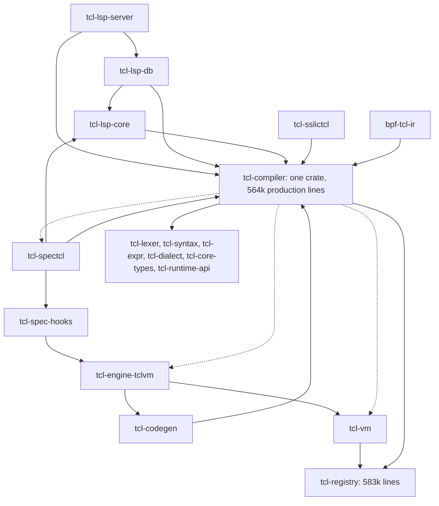
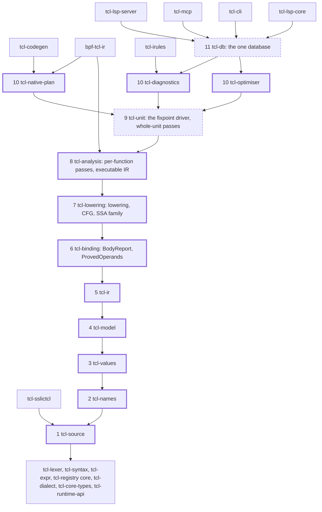
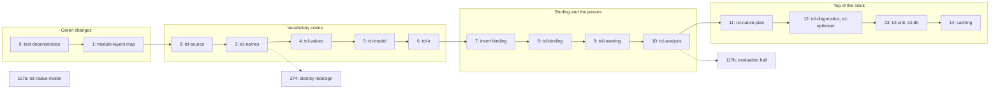

# Splitting tcl-compiler into layered crates

Status: designed 26 November 2026. Tracked as [plan item 90](../../work/name-handling/plan.md),
which the working order puts ahead of every other stage, with items 117 and 118
alongside. Revised 26 November 2026 after an independent review (the value
kernel gets its own crate, and the steps are finer), and again when the step
designs in [`crate-split/`](crate-split/) were written: binding sits below
lowering by inversion (item 278), executable IR is analysis, and the unit
crate, `tcl-unit`, sits below the diagnostics, the optimiser and the native
plan. Where this overview and a step design disagree, the step design holds. This is the concrete form of the "Crates" table in
[architecture-tidy-plan](../../work/name-handling/architecture-tidy-plan.md#crates).
It answers the blocker recorded in [build-test-cost §4](../../work/build-test-cost/current-state.md):
"any further split first needs cycles broken by design".

## Goal

A clean rearchitecture of the workspace into many small shared crates. Each has
a clean interface and supports every consumer that needs it: the LSP, MCP, the
CLI, the VM, codegen, the eBPF back end, the explorer, the SpecTcl tooling and
the BIG-IP tools. The aims are fast builds, little caching, and good runtime
performance. `tcl-compiler` is the first and largest piece. `tcl-registry` is the second:
it becomes a core plus one crate per dialect profile and per package
([registry split](../registry/registry-split-design.md), item 261), and items 117
and 118 move its native algorithms and BIG-IP data out. On this branch the tree may stay broken for
a long time while the layout changes. The order is chosen for the least total
work and the cleanest result, not to keep every step green.

### Parallel worktrees

The acceptance test for the layout: many independent worktrees work in
parallel, each on an isolated part of the stack, and none fills the disk or
memory. Each worktree's build compiles only the dependency cone of what it
touches. Five things decide that:

- **Cone size.** Working on a crate compiles its dependencies, and testing it
  compiles its dev-dependencies too. Today the normal cone of `tcl-registry`
  is 42 crates, of `tcl-compiler` 64 and of `tcl-lsp-core` 134, counted with
  `cargo tree -e normal,build` and each crate once. (The earlier 54, 80 and 179
  came from `sort -u` over the tree, which counts a crate twice when it appears
  both expanded and as `(*)`.) Every Tcl-facing
  crate sits above the 583k-line registry.
  - The split makes cones small.
  - The [registry split](../registry/registry-split-design.md) (item 261) keeps
    per-command data out of every generic crate's cone. Generic crates depend
    on the registry core only, and only entry points select surfaces. Items 117
    and 118 shrink the core further.
- **Dev-dependency hygiene.** A crate's tests may not depend on a crate above
  it, because that puts the whole upper stack into every worktree that tests
  it. Step 0 removes today's cases, which are not only `tcl-compiler`'s:
  `tcl-registry` tests through `tcl-spectcl`; `tcl-lsp-core` through
  `tcl-spectcl` and `tcl-codegen`; `tcl-lsp-db` through `tcl-vm`,
  `tcl-spectcl` and `tcl-codegen`; and `tcl-vm` through `tcl-compiler` and
  `tcl-codegen` (items 246 and 269–272). The `module-layers` gate (item 247)
  checks dev-dependency edges from the start, with these cases as a known list
  that may only shrink.
- **Peak memory.** rustc's peak memory grows with the size of the crate it is
  compiling. A 564k-line crate is one large process; ten smaller crates are ten
  smaller ones, which `-j` can bound.
- **Disk per worktree.** Debuginfo is already off and the target directory is
  per checkout (`scripts/dev/agent-build-env.sh`). What remains is incremental
  state (9.7 GB today, mostly `tcl-compiler`'s three caches) and large test
  binaries (183 MB for `tcl-compiler`'s lib tests). Both shrink with cone and
  crate size.
- **Sharing across worktrees.** Third-party dependencies and unchanged
  workspace crates are rebuilt in every worktree's target directory. A shared
  compiler cache would let worktrees reuse each other's outputs, and a cache
  keyed on absolute paths would miss across checkouts. That is item 260.
  sccache does not cache incrementally compiled crates, so the edited crate's
  cone is still rebuilt per worktree. Item 260 sets a target for that share and
  a target-directory pruning policy.
- **Build variants.** The same crate compiled more than once in one worktree:
  with and without a `test-support` feature (item 296), and under both the
  dev and test profiles (item 297). Item 259 records crates compiled per
  profile and per feature set, test-run peak RSS and rust-analyzer memory per
  worktree.

Item 259 measures this before the split, and then again as each crate builds.
The measure covers four representative isolated edits:
- a lexer or syntax change;
- a registry command spec;
- an analyser rule;
- an LSP feature.

For each edit it records the crates compiled, wall time, peak RSS and
target-directory growth.

Runtime performance is measured beside build cost. Each crate's first green
build records analysis latency on the analysis-performance corpus and the VM
benchmarks (`scripts/perf/interp/`), before and after (item 90's measurement
record). These run on release builds: the agents' opt-level-1 test builds lose
cross-crate inlining without LTO, so latency measured there would charge the
split for a cost release builds do not have.

## Why now

Build and iteration time is paid on every change in every later stage of the
plan, and three facts dominate it:

- **`tcl-compiler` is one compile unit.** It is 910k lines in `src/` (564k
  production, 346k test) plus 68k in `tests/`. 96 of its 121 top-level modules
  form one strongly connected graph. Any edit rebuilds the whole crate, then the
  9 to 25 crates above it.
- **Its lib tests pull in the upper stack.** They take `tcl-spectcl`, `tcl-vm`
  and `tcl-engine-tclvm` as dev-dependencies, and `tcl-spectcl` depends on
  `tcl-lsp-core`.
  - Cargo builds dev-dependencies for `--lib` test targets too. So after an edit,
    `cargo test -p tcl-compiler --lib` rebuilds `tcl-lsp-core`,
    `tcl-spec-hooks` and `tcl-spectcl` before its test binary links.
  - That is the 9 crates and 2 to 6 minutes seen in every failset log.
  - Only 12 `src` test blocks need `tcl-spectcl`, plus 7 `tests/` files and
    the `value_transfers` bench that use `tcl-spectcl` or `tcl-engine-tclvm`
    ([step 0](crate-split/00-test-dependencies.md)). `tcl-vm` does not depend
    on `tcl-compiler`, so its 22 users stay.
- **`tcl-registry` sits under everything.** It is 583k lines, and the registry
  rule sends every per-command fix there. A registry edit rebuilds `tcl-compiler`
  and the whole stack above it.
  - Item 117 takes the 58k lines of `native_*` algorithms out into
    `tcl-native-model` (117a), and later the `value_transfer` and
    `resolved_invocation` analysis driver into `tcl-analysis` (117b); the
    per-command semantics stay in the surface crates.
  - Item 118 takes the 171k lines of BIG-IP schema data out. `f5/`, the f5-tcl
    evidence model, goes to item 301 instead.

Today's edges around `tcl-compiler`, read from the crates' `Cargo.toml` files.
Each arrow points at the crate depended on; dotted arrows are
dev-dependencies. The dotted edges out of `tcl-compiler` close two loops back
onto it, through `tcl-spectcl` and through `tcl-engine-tclvm`:



Smaller levers, each a plan item with its own measurement:

- `test-support` features build a crate and its dependents twice in one
  worktree (item 296);
- check and clippy run under the dev profile and tests under the test profile
  at opt-level 1, so a worktree compiles every crate twice (item 297);
- `xtask` builds `tcl-vm` and `tcl-runtime` for every gate run, for one gate
  (item 298);
- `tcl-version`'s build script re-runs on every commit, and `tcl-dialect`'s
  generates into `OUT_DIR` under 41 direct dependents (item 299);
- 25 generated files (80.8k lines, 7 of them over 2,000 lines) are compiled as
  Rust, and the tables among them could be embedded as data (item 300, beside
  item 119's generators).

The linker is not the problem. Measured 26 November 2026 on the 183 MB
`tcl-compiler` test binary, a link takes 1.4–1.7 s with the bundled `rust-lld`
(already the default), 1.2 s with `mold` and 6.5 s with GNU ld. Switching to
mold would save about 0.4 s per link.

## Where the cycles come from

Most cycles come from shared vocabularies kept in the wrong module, not from
algorithms that need each other. Binding and value analysis are one fixpoint,
but binding needs only the values SCCP proved, not the passes
([step 7](crate-split/07-binding-fixpoint.md)). Counts are production
references (test files and inline `#[cfg(test)]` items excluded, 26 November
2026):

| Edge (production refs) | What crosses it | Fix |
|---|---|---|
| `ir` → `command_binding` (54) | `SourceNamespaceKey`, `CommandAllocationSite`, `BindingKind`, `SourceInvocationBinding` | the key types move down to `tcl-names`; `SourceInvocationBinding` stays with binding as `InvocationBinding`, carried through `tcl-ir`'s `Facts` parameter |
| `command_binding` → `signature_scan` (317) | `SignatureSourceNameInput`, `SignatureNamespaceScope`, `SignatureSourceNameKey` | none needed: both land in `tcl-binding`. Only `SignatureNamespaceScope` and `SignatureSourceNameKey` move to `tcl-names`; `SignatureSourceNameInput` is a binding receipt |
| `command_binding` → `analyser` (316; 550 from all binding modules) | `ResolvedAnalysisInput` (355 across binding), `AnalysisResult`, `ProcDef`, `ClassDef`; no production `Analyser::new` (all 598 calls are in tests) | the inputs and fact records move down to `tcl-model`, with `ProcDef` and `ClassDef` generic over binding's receipts; `AnalysisResult` stays in `tcl-diagnostics`, and binding reads it through a body-report trait it defines |
| `registry_invocation` ↔ `command_binding` (270 / 793) | `OriginalInvocationSourcePurpose`, `SourceCommandBindings`, `SourceInvocationBinding` | one crate; `tcl-invocation` is not extracted in this split (item 282) |
| binding → lowering and SSA: `ssa` (31), `lattice_rebase` (14), `cfg_builder` (3), `lowering` (2); `ir_helpers` (103) moves into binding | binding and value analysis are one fixpoint per body unit ([design integration](../../work/name-handling/design-integration.md#decisions), decision 1) | inversion (item 278): the readers move to their callers, the syntactic scans into binding, the rebasing into `tcl-ir`; the unit build drives the fixpoint |
| binding → value analysis: `tcl_expr_eval` (37), `value_transfer` (8), `var_escape` (5), `side_effects` (3), `shimmer` (1); none into `sccp`, `gvn`, `interprocedural` or `taint` | the value kernel and transfer functions | the kernel moves below binding to `tcl-values` (item 280); the rest moves as item 279 lists |
| `cfg_builder` → `optimiser` (8), `command_binding` → `optimiser` (3), `compilation_unit` → `taint` (3) | stray helpers | each helper moves to the lower side |

## Principles

1. **Each crate owns its data types.** A lower crate never names a higher one.
   Where a lower layer needs behaviour from above, such as binding asking for a
   body report, the lower crate defines a trait. The higher crate implements it,
   and the unit crate wires the two together.
2. **Vocabulary sits below algorithms.** Identities, keys, fact records,
   lattices and diagnostics live in small, stable crates, so editing an algorithm
   never rebuilds them.
3. **Each crate's API is narrow and explicit.** Each crate exposes a top-level
   `api` module, or curated `pub use` items of its own, rather than making every
   module `pub`. The 181 `#[doc(hidden)] pub` items (131 named by
   `tcl-codegen`, none by `bpf-tcl-ir`, 119 of them in binding) either become
   named API or move.
4. **The registry rule is unchanged.** Per-command knowledge stays in
   `tcl-registry` (or its data crates after items 117 and 118), and
   `registry-axes` covers every new crate.
5. **No façade.** A crate that re-exports everything keeps every consumer
   depending on every layer, which undoes the split.
   - Each extraction rewrites its consumers to the new crate in the same change.
     Most of the ~6.5k `tcl_compiler::` paths map one-to-one.
   - From then on, `retired_api_gate` forbids the old path.
   - What remains of `tcl-compiler` is the unit crate, which re-exports nothing.

For example, four imports in a consumer such as `tcl-codegen`, rewritten by
steps 2, 3, 6 and 12. Code above binding names the IR through binding's
aliases ([step 6](crate-split/06-tcl-ir.md)):

**Before:**

```rust
use tcl_compiler::segmenter::SegmentedCommand;
use tcl_compiler::command_binding::SourceNamespaceKey;
use tcl_compiler::ir::CommandTokens;
use tcl_compiler::analyser::Analyser;
```

**After:**

```rust
use tcl_source::segment::SegmentedCommand;
use tcl_names::namespace::SourceNamespaceKey;
use tcl_binding::ir::CommandTokens;
use tcl_diagnostics::Analyser;
```

## Crates (bottom up)

The crates that already exist sit below this stack: `tcl-lexer`, `tcl-syntax`,
`tcl-expr`, `tcl-registry`, `tcl-dialect`, `tcl-core-types`, `tcl-runtime-api`
and `tcl-cmd-core`. The names follow the tidy plan where the meaning is the
same. `tcl-names`, `tcl-values`, `tcl-model`, `tcl-lowering` and
`tcl-native-plan` are additions: they are the cuts that break the cycles above.
The tidy plan's `tcl-ir` is split in two, data types (`tcl-ir`) and builders
(`tcl-lowering`), because binding reads IR types.

**Decided by item 278 ([step 7](crate-split/07-binding-fixpoint.md)):
inversion.** `tcl-binding` sits below `tcl-lowering` and `tcl-analysis`.
Binding → lowering, SSA and analysis is 105 production references, against
1,232 the other way. The unit's per-body build drives the fixpoint, and
binding takes the values SCCP proved as an input (`ProvedOperands`); it never
calls up.

The rank column is the `module-layers` ledger's
([step 1](crate-split/01-module-layers.md)); equal ranks may not name each
other.

| Rank | Crate | Takes | Size (prod) | Direct users | Plan items that land here |
|---|---|---|---|---|---|
| 1 | `tcl-source` | `parsing` (CST), `segmenter`, `text`, the structured-word and source-site types (`ir::word_expr`, `ir::provenance`, `word_expr.rs`), `depth_guard`'s limits; `SourceMap` is already in `tcl-lexer` | ~5k | `tcl-sslictcl`, the SpecTcl loader, `tcl-lsp-core`, `tcl-codegen` | 82 (structured words), 41 (one segmentation) |
| 2 | `tcl-names` | identity and key types: `SourceNamespaceKey`, `SourceCommandKey`, `CommandAllocationSite`, `SourceOriginId`, `ExecutedScriptSource`, `BindingKind`, `Place`, `VariableCellKey`, `VariableExecutionFrame`, `SignatureNamespaceScope`, `SignatureSourceNameKey`; `CommandRef` is already in `tcl-core-types` | ~8k | every crate above | 77 (identity layer), 66 (frame value) |
| 3 | `tcl-values` | item 81's single value kernel: the value lattice (`LatticeValue`), abstract values, the `tcl_expr_eval` core, which carries binding's evidence types as a parameter | new | `tcl-model`, `tcl-binding`, `tcl-analysis`, the optimiser | 81 (kernels), 280 |
| 4 | `tcl-model` | fact vocabulary with no algorithms: analysis inputs and settings, `ProcDef` and `ClassDef` (generic over binding's receipts), one `Diagnostic` (three shapes today; `Finding`'s is the model), the result lattices (`bounded_set`, completion codes), side-effect and result records, the plain records inside `AnalysisResult`, `semantic_optimisation`. `Answer`, `Knowledge`, `DiagCode` and `Severity` are already in `tcl-core-types` | ~15k | LSP, MCP, CLI, DB | 78 (answer types), 50–53 (typed IR facts) |
| 5 | `tcl-ir` | IR and CFG data types (`Module`, `Procedure`, `Script`, `Statement`, `CommandTokens`, `cfg` types), generic over one `Facts` parameter for binding's annotations | ~8k | `tcl-codegen`, `bpf-tcl-ir`, `tcl-explorer`, `tcl-diagram`, `f5-xc` | 50–53 |
| 6 | `tcl-binding` | `command_binding`, `registry_invocation`, `realm`, `raw_binding`, `variable_bindings`, `var_resolve`, `signature_scan`, `dynamic_names`, `ir_helpers`, the `ssa::uses` scans, and twelve small modules that name binding back (`native_numeric` among them); defines the body-report trait and `ProvedOperands` | ~226k | LSP name features, `tcl-irules` | 84 (one binding walk), 19–25 (lookup), 245 |
| 7 | `tcl-lowering` | `lowering`, `lowering_hooks`, `cfg_builder`, SSA family (`ssa`, `memory_ssa`, `state_ssa`, `effect_ssa`) | ~45k | `tcl-codegen`, `bpf-tcl-ir`, the VM's compiler tests, `tcl-debugger` | 83 (every body a unit) |
| 8 | `tcl-analysis` | the per-function passes (`sccp`, `value_transfer`, the rest of `tcl_expr_eval`, `type_infer`, intervals, `static_loops`, `side_effects`) and executable IR (`executable_ir`, `world_state_ssa`, `dispatch_proof`, `semantic_analysis`) | ~44k | `tcl-explorer`, `tcl-codegen`, `bpf-tcl-ir` | 59–65 (constants), 117b |
| 9 | `tcl-unit` (today's `tcl-compiler`, renamed by item 258) | `compilation_unit` (the fixpoint driver), the whole-unit passes (`interprocedural`, `taint`, `taint_interproc`, `shimmer`, `gvn`, `var_escape`), `unit_scope`, the IR half of `source_graph`; no re-exports | ~65k | whole-unit consumers (`CompilationUnit`) | |
| 10 | `tcl-native-plan` | `native_lowering`, `common_aot_plan`, `target_contract`, `codegen_helpers`, `backend_registry`, `representation_plan` | ~14k | `tcl-codegen`; `bpf-tcl-ir` (`target_contract`) | |
| 10 | `tcl-diagnostics` | `analyser` (without `irules_event_checks`), `compiler_checks`, `AnalysisResult`, the `AnalysisResult` half of `source_graph`, `auto_path_eval`; implements binding's body-report trait; defines the `UnitRule` and `SiteRule` traits through which `tcl-irules` plugs in `irules_checks` (item 285) | ~107k | LSP stack, MCP, CLI | 85 turns it into rules over `tcl-semantic` |
| 10 | `tcl-optimiser` | `optimiser` | ~20k | `tcl-spec-hooks`, `tcl-engine-tclvm`, CLI | 244 |
| 11 | `tcl-db` (today's `tcl-lsp-db`, renamed by item 286) | the one database, above every analysis crate; no `tcl-lsp-core` dependency | ~19k | `tcl-lsp-server`, `tcl-mcp`, the CLI | 90's step 14; later the tiers of 101, 103, 46–49, 73 |
| later | `tcl-semantic` | the query API and fact store | new | every feature | 85 (phase 6) |

The target layout, with each crate's rank and the main consumers. Each arrow
points at the crate depended on, and only the nearest dependency is drawn:
every crate also names the ones further down. Thick borders mark new crates
and dashed borders the two renamed ones (`tcl-compiler` becomes `tcl-unit`,
`tcl-lsp-db` becomes `tcl-db`). `tcl-db` needs no native-plan module
([step 13](crate-split/13-unit-and-db.md)), so `tcl-native-plan` has no edge
up to it:



`tcl-codegen` builds over `tcl-native-plan`, `tcl-unit` and below (item 292).
`bpf-tcl-ir` needs `tcl-ir`, `tcl-lowering` and `tcl-analysis`, plus
`target_contract` from `tcl-native-plan`. Later, `tcl-semantic` sits over
binding and analysis.

`tcl-binding` is still the largest crate. `tcl-invocation`, the registry
adapter (`registry_invocation`, 39k), is not split off in this split: item 282
keeps it inside binding and defers the question until after item 84.

`SourceInvocationBinding` crosses the `ir` → `command_binding` edge. It is a
record of proofs, not a key, so it stays with binding as `InvocationBinding`, and
`tcl-ir` carries it through a `Facts` type parameter (items 248 and 252).

### What each consumer gains

- **`bpf-tcl-ir`** builds against `tcl-ir`, `tcl-lowering` and `tcl-analysis`
  (for executable IR), plus `target_contract`, with no diagnostics or
  optimiser. It lowers and builds CFGs itself, so it needs lowering too.
- **`tcl-sslictcl`** needs only `tcl-source`.
- **`tcl-codegen`** stops rebuilding when the diagnostics or the optimiser
  change. Its drivers split off into a `tcl-compile` crate above the unit
  crate (item 292, owner decision of 26 November 2026); `tcl-codegen` keeps
  the emitters.
- **The LSP crates** depend on `tcl-diagnostics` and `tcl-model`, plus
  `tcl-unit` for whole-unit work.
- **An edit to the analyser**, the busiest area with 92k test lines, rebuilds
  `tcl-diagnostics` and what sits above it, not binding, lowering, analysis or
  the unit.
- **The other crates compile in parallel.** Today a single frontend unit
  serialises the whole crate.

## Sequence

The step numbers are item 90's, and each step has its own design in
[`crate-split/`](crate-split/). The plan items are not numbered in step order,
so each step names its items in the order they run. Breakage between steps is
allowed: this is the "`work` branch exception" that the
[engineering guide](../rust/engineering-guide.md) and the
[tidy plan](../../work/name-handling/architecture-tidy-plan.md#phases) point to.

- **Where keeping things building costs work, skip it.** If keeping a step
  compiling would take shims, temporary re-exports or duplicated types, the
  step moves the code directly and fixes the edges afterwards.
- **Measure at milestones, not every step.** The gates, the failset
  comparisons, the build-time and size measurements and the runtime
  measurement record (analysis latency and VM benchmarks on release builds) run
  when each crate first builds again, not after every move.
- **Steps 0 and 1 are still green changes.** They are small, and step 0 pays
  for itself on every edit that follows.

The steps and what each builds on, as the step designs record it. Dotted
arrows are items that run beside the steps: 274 continues item 77's redesign
inside `tcl-names` alongside steps 4–13, 117b lands after step 10, and 117a
changes only crates below `tcl-compiler`, so it can run at any time:



0. **Test dependencies.** Take the upper stack out of each crate's tests.
   - 246, `tcl-compiler` ([design](crate-split/00-test-dependencies.md)), in
     three parts: 266 moves the 7 `tests/` files and the bench into a new
     `tcl-compiler-it` crate; 267 moves the 12 `src` test blocks behind
     `test-support` and drops the `tcl-spectcl` and `tcl-engine-tclvm`
     dev-dependencies; 268 re-keys the CI shards and the gates. This also
     removes the `tcl-spectcl` ↔ `tcl-compiler` dev cycle. Expected effect:
     after an edit, `cargo test -p tcl-compiler --lib` rebuilds one crate, not
     nine.
   - 269 `tcl-registry`, 270 `tcl-lsp-core`, 271 `tcl-lsp-db` and 272
     `tcl-vm`: the other verified dev-dependency cascades.
1. **Map before moving.** 247 adds the `module-layers` gate, which assigns
   each module its target crate and reports the back-edges (`use crate::X`
   from a lower layer to a higher one) per pair and per target crate. It checks
   dev-dependency edges from the start. 273 seeds and reviews the ledger.
   - The report is the work list for steps 2–12.
   - From step 13 on it becomes the gate that keeps the layers clean.
2. **`tcl-source` first** (251, then 281). It is near-acyclic (the `segmenter`
   ↔ `parsing` cycle is only 7/3 refs and stays inside it), it has rank 1, and
   the `tcl-names` types may carry source ranges. 281 rewires the SpecTcl
   loader and `tcl-sslictcl` onto it.
3. **`tcl-names`** (248). The identity and key types move unchanged;
   `SourceInvocationBinding` stays with binding. Item 77's redesign continues
   inside the new crate as 274, alongside the later steps.
4. **`tcl-values`** (280). Item 81's value kernel moves below binding, before
   binding is extracted and before the rest of the analysis move, because
   binding calls `tcl_expr_eval`.
5. **`tcl-model`** (249 result lattices, 275 the inputs and the generic
   `ProcDef`/`ClassDef`, 276 the result and side-effect records but not
   `AnalysisResult` itself, 277 one `Diagnostic` type, checked by golden diffs
   of LSP, CLI and MCP output).
   Consumers are rewritten in the same change, with no re-exports at the old
   paths.
6. **`tcl-ir`** (252). It is generic over one `Facts` parameter that carries
   binding's annotations.
7. **Binding against lowering and analysis** (278, 250, 279). 278 inventoried
   every binding → SSA, lowering, SCCP and value edge and chose inversion.
   250 inverts binding → analyser: binding only reads reports, so the
   body-report trait is a read view that binding defines and
   `tcl-diagnostics` implements, and binding's body-analysis cache is keyed
   through it. 279 applies the inversion.
8. **`tcl-binding`** (253, then 282). 253 is a pure move; folding
   `signature_scan` into the one binding walk stays item 84's work. 282
   records that `tcl-invocation` is not extracted.
9. **`tcl-lowering`** (254).
10. **`tcl-analysis`** (255): the per-function passes and executable IR. Item
    117b lands after it.
11. **`tcl-native-plan`** (256, then 283, which turns the `#[doc(hidden)] pub`
    items into named API). It sits above `tcl-unit`.
12. **`tcl-diagnostics` and `tcl-optimiser`** (257 `tcl-diagnostics` alone,
    284 `tcl-optimiser`, 285 `irules_checks` into `tcl-irules` through rule
    traits).
13. **The unit crate and the database** (258, 286, 287). 258 retires the
    façade and renames what is left `tcl-unit`, below the crates of steps 11
    and 12. 286 renames `tcl-lsp-db` to `tcl-db`, the one database at the top,
    and removes its `tcl-lsp-core` dependency. 287 re-points `tcl-compiler-it`
    onto the split crates.
14. **Caching.** Every memo gets a disposition. Three caches (binding per
    file, source words, retained modules) may become `tcl-db` queries, and
    only if deleting them costs more than 5% on the latency gate
    ([step 14](crate-split/14-caching.md), and
    [caching](../../work/name-handling/caching-design.md)). The lower crates
    expose pure functions over their inputs. The per-body tiers (items 101
    and 103, and 46–49 and 73) come later, after items 83 and 84.

Every extraction (steps 2–12) also does three things:

- moves its consumers off `tcl-compiler`;
- adds a `deny.toml` `wrappers` list for the new crate (the crate-layer gate);
- re-points the roots of `walker-ownership`, `registry-axes`,
  `owner-resolution`, `segmentation-drift`, `parser-ownership` and the
  owner-crate column of the shared-utility contracts, as the codegen split
  did.

Items 117 and 118 run alongside steps 0–13, and they do conflict with the
split in places:

- Item 117b moves the `value_transfer` and `resolved_invocation` analysis
  driver into `tcl-analysis`, and the per-command semantics into the surface
  crates. Until step 10 the analysis layer is inside `tcl-compiler`'s cycle, so
  117b lands after item 255. 117a, the `tcl-native-model` crate, changes
  crates below `tcl-compiler` only and can run at once
  ([design](../registry/registry-split/117-native-model.md)).
- Both change `tcl-registry`, which item 261's registry split is also
  reshaping. Their order against it is in the registry split's step designs
  ([117](../registry/registry-split/117-native-model.md),
  [118](../registry/registry-split/118-bigip-schema.md)).

## The rest of the workspace

`tcl-compiler` and the registry are the two largest pieces, but the same goal
applies to every crate. Each item below is small and has its own "done when";
the [workspace overview](../workspace/overview.md) and the
[build-time designs](../build-time/) hold the detail. Sizes are production
lines (test files and `#[cfg(test)]` modules excluded), with `wc -l` over
`src` in brackets where it differs (26 November 2026).

| Crate | Size | Problem | Item |
|---|---|---|---|
| `tcl-spectcl` | 30k (43k) | depends on `tcl-lsp-core` (`vfs` and the spec-pack notice types, in 13 production files), an upward edge [project-layout](../contracts/project-layout.md) rule 4 allows and the tidy plan forbids | 288 retires the rule's exception |
| `tcl-spectcl` | | links `tcl-spec-hooks` → `tcl-engine-tclvm` → `tcl-vm` and `tcl-codegen`, which puts the VM into the server, the explorer, Spec Studio and MCP; the SpecTcl 3 loader needs no VM, only the hook runner does | 318, through 305–307 |
| `tcl-lsp-core` | 132k (245k) | links the domain crates `tcl-bigip` (58k), `tcl-irules` (5k) and `tcl-sslictcl` (9k) instead of reaching them through interfaces; splits into 11 `tcl-ide-*` crates and the adapters `tcl-ide-f5` and `tcl-ide-sslictcl` | 289, with 315 (`tcl-lsp-it`) and 316 (`tcl-ide-diagnostics-fixtures`) |
| `tcl-lsp-server` | 70k (120k) | one crate; `Backend` has `impl` blocks in 120 files. [build-test-cost](../../work/build-test-cost/current-state.md) decided against splitting it; reopened under this goal | 290 |
| `tcl-vm` | 220k | depends on `tcl-registry` for the native algorithms; after item 117, on `tcl-native-model`, keeping its edge to the registry core | 291 |
| `tcl-codegen` | 69k | depends on the whole of `tcl-compiler`; it splits into the emitters (`tcl-codegen`) and a `tcl-compile` driver crate (owner decision, 26 November 2026) | 292 |
| `runtime/rust` (`tcl-runtime`) | 308k | the second engine, duplicating the VM's frame and namespace code | the existing engine-convergence items: 88 and its shared items (20, 72, 161, 171, 178, 186, 203), deferred on this branch |
| `tcl-mcp` | 6.5k (12k) | depends on `tcl-cli` and `f5-cli` for a handful of items, which move to `tcl-kcs-help` and `f5-explain`; `f5-xc` is a fine library dependency, but its own edge to `tcl-lsp-core` is not | 293 |
| `tcl-explorer` | 9.7k (13k) | depends on `tcl-vm` (four items in `live_entry.rs`, behind the optional `live-entry` feature), `tcl-codegen` and `tcl-spectcl` | 294; 317 (a `tcl-explore` binary for the skill) |
| low hubs: `tcl-dialect` (32k), `tcl-lexer` (27k), `tcl-syntax` (48k), `tcl-core-types` (4k) | | 27–40 direct dependents each in the root workspace, so an edit rebuilds most of the workspace | 295 |
| top hubs: `tcl-mcp`, `tcl-cli`, `tcl-lsp-server`, `tcl-lsp-core`, `tcl-compiler-it` | | agent tooling builds them in every worktree | 295 |
| every crate | | the crate-layer gate protects four crates through hand-written `wrappers` lists | 314 (the rank gate) |

## Docs and paths

Design documents cite source paths such as `rust/tcl-compiler/src/...`. Each
extraction rewrites the paths of the modules it moves, in the same change; the
documents that describe the crate layout ([project-layout](../contracts/project-layout.md),
[current architecture](../rust/current-architecture.md), [engineering guide](../rust/engineering-guide.md))
are updated in the step that changes the layout.

## Risks

- **Generic and `#[inline]` code** is instantiated in downstream crates. Watch
  the release binary size and the WASM build at each step. Release builds
  already use LTO; the opt-level-1 test builds do not, so they lose
  cross-crate inlining, and analysis latency is measured on release builds
  only.
- **Widened visibility.** Every `pub(crate)` item that crosses a new boundary
  becomes `pub`.
  - Keep a crate-level `api` module and mark the rest `#[doc(hidden)]`.
  - The ratchet counts these items.
- **Work in flight.** Items being worked on while modules move will conflict.
  Agents finish their current item at a clean point, and new item work waits
  for the step that moves its modules.
- **A long broken period.** While crates don't build, the test suites and the
  conformance runner can't vouch for behaviour. Each crate's first green build
  is followed by a failset comparison against the last green commit before the
  move. Item 75's conformance runner is re-run once the unit crate builds.
- **Caching kept small.** The split removes caches rather than adding them.
  Each crate exposes pure functions, and the one database at the top
  (`tcl-db`) caches only at the unit boundaries where re-computation has
  measured cost (see [caching](../../work/name-handling/caching-design.md)).
  Every other hand-written memo is deleted. Identity types are never salsa
  values, so `tcl-names` and the registry stay salsa-free and the VM can use
  them. `tcl-db` keeps its interned query keys, whose fields are `tcl-names`
  identities, and no type with a `'db` lifetime leaves `tcl-db`.

## Review fixes (26 November 2026)

- **R4:** binding's per-site receipt, `tcl-ir`'s `Facts::Command`, is `InvocationBinding` (was `CommandFacts`, which the integration design also used for the core's view; `InvocationFacts` is taken by `tcl-registry/src/resolved_invocation/invocation_facts.rs:64`). Chapter 7's naming table records it.
