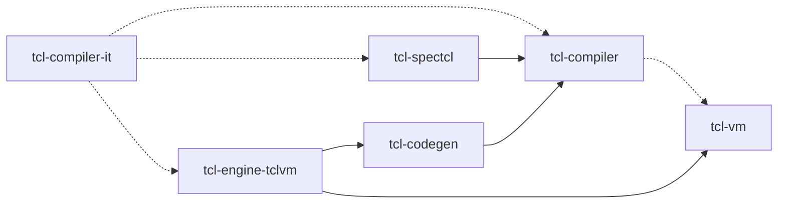

# Compiler tests and dependency direction

Part of [splitting tcl-compiler](../crate-split-design.md), items 246 and
266–268. The compiler's unit tests must not depend on crates that consume the
compiler. Tests needing SpecTcl or an engine/codegen consumer live in the
separate `tcl-compiler-it` crate.

## Dependency boundary

`tcl-compiler` has no dev-dependency on `tcl-spectcl` or `tcl-engine-tclvm`.
`tcl-vm` remains a dev-dependency for compiler-free execution witnesses; it
has no compiler dependency. Cargo builds every dev-dependency for every test
target, including `--lib`, so keeping the upper stack out of this manifest is
what prevents an isolated compiler edit from rebuilding it before unit tests.

`tcl-compiler-it` has no production library. Its integration harness is
`tests/it_4/main.rs` for general cases and `tests/jim/main.rs` for Jim;
modules preserve the compiler tests' original paths.
The `value_transfers` benchmark belongs to this crate too. SpecTcl's own
compiler dependency remains a separate concern of the source-crate split.

Jim's core surface stays authored in SpecTcl and loaded by its single loader.
Integration tests call `tcl_spectcl::core_surfaces::install()` before preparing
Jim analysis inputs. A generated or handwritten duplicate catalogue in a
lower crate would defeat that ownership rule.

## Public test boundary

The 12 Jim-dependent source test blocks contain 44 named tests. Their public
observations live in `tcl-compiler-it`: diagnostics and their source spans,
procedure and class metadata, method association, command-slot presence, and
future-body inventories. They use existing public APIs; no compiler item is
made public for a test, and `src` contains no test body behind `test-support`.

The reporting guard's unwind and depth-refusal invariant stays a
`#[cfg(test)]` compiler unit test. Its fixture uses the ordinary Tcl registry
and an empty reporting plan, issuing no Jim name receipt and loading no
SpecTcl pack. This invariant concerns private guard storage and has no public
identity or field-layout assertion in an integration test.

The `test-support` feature is limited to genuine compiler input fixtures
used by other crates. It does not export tests, callbacks into private test
bodies, or private analyser results. A private post-analysis fixture is
compiled only for the compiler's own unit tests.

Public tests cover these boundaries:

| Test group | Observable contract |
|---|---|
| Logical Jim body roles | Conditional class metadata and inheritance; replaced handlers and inert data create no class. |
| Finite foreach declarations | Declared names, body spans and references; source/namespace changes cannot borrow previous results. |
| Procedure source words | Static-list/body positions, rooted forms, expansion refusal and source replacement. |
| Called static declarations | Body geometry and variable scope; readonly assistance creates no caller variable. |
| Nested static reads | W210 stays suppressed only for the appropriate static/formal scope, including nested calls, redefinitions and computed bodies. |
| Stock classes and members | Public command presence, inherited variables, method metadata and refusal after unknown/replaced dependencies. |
| Future wrappers | Exact source inventories and authored frame layouts; authored labels supply no native namespace identity or execution target. |
| First method heads | W123 is issued only at the eligible first entry and withheld after effects, substitutions or uncertain history. |
| Separate analysis results | Repeated analysis and changed sources preserve their own diagnostics and member/body spans. |

## Gates and validation

`cargo xtask module-layers` enforces the shrinking upward
dev-dependency and test-support-body ledgers. An empty
`test-support-bodies.tsv` means any new exported test body fails the gate.
`cargo xtask test-cleanup --check` holds the broader private-state review
inventory to its shrinking baseline; it is a survey, not a semantic name
resolver or permission to delete every candidate.

Compare moved tests by full module/function name with `failset.py compare`.
Keep unchanged failures explicit, investigate every new failure, and record
which implementation-only assertions were removed in the active ownership
tracking document. A test's source file or binary is not its identity.

Both integration harnesses belong to shard 4 in
`scripts/dev/rust-test-binary-shards.tsv`. Its heavy-test rows and package-path
classification follow the test crate. The general ownership gates recognise
`tests/` trees and test-gated source, so no production dependency permission
is introduced by moving a test.

Build-cost measurements belong to
[the single build-cost record](../../../work/build-test-cost/current-state.md),
including the same-machine edit/rebuild comparison and the release benchmark
baseline. Agent test-profile timings are not release latency measurements.
