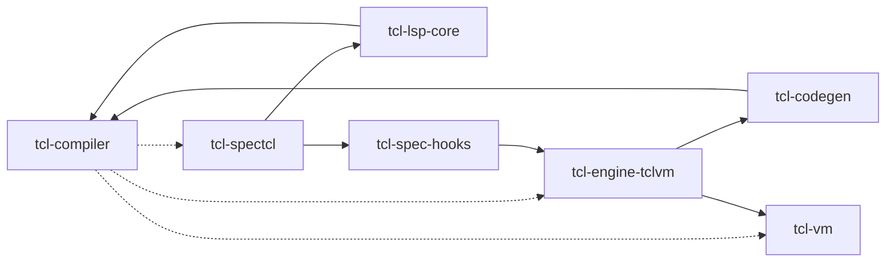
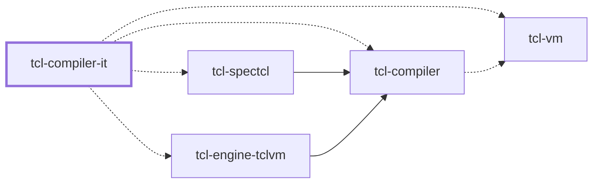

# Step 0: take the upper stack out of tcl-compiler's tests

Part of [splitting tcl-compiler](../crate-split-design.md). Plan item 246, the
`tcl-compiler` part of step 0, done as items 266 (the `tests/` files and the
bench), 267 (the `src` blocks behind `test-support`) and 268 (CI shards and
gates). Nothing before it; step 1 builds on its measurement.

The same fault exists in other crates, as sibling items of step 0, each
verified in its `Cargo.toml` on 26 November 2026:

- 269: `tcl-registry`'s dev-dependency on `tcl-spectcl`;
- 270: `tcl-lsp-core`'s on `tcl-spectcl` and `tcl-codegen`;
- 271: `tcl-lsp-db`'s on `tcl-vm`, `tcl-spectcl` and `tcl-codegen`;
- 272: `tcl-vm`'s on `tcl-compiler` and `tcl-codegen`.

Each gets its own short design when it starts. The `module-layers` gate
(item 247) checks dev-dependency edges from the start, with these as a known
list that may only shrink.

## Problem

After any `tcl-compiler` edit, `cargo test -p tcl-compiler --lib` rebuilds
eight other crates before its test binary links. The failset log
`80506e31e9fdca29-1be3edfd8ad9.log` shows them: `tcl-sslictcl`, `tcl-irules`,
`tcl-codegen`, `tcl-bigip`, `tcl-engine-tclvm`, `tcl-spec-hooks`,
`tcl-lsp-core` and `tcl-spectcl`. That costs 2–6 minutes per edit.

Cargo builds every dev-dependency for every test target, `--lib` included,
and two of `tcl-compiler`'s dev-dependencies depend on `tcl-compiler` itself:

- `tcl-spectcl` pulls `tcl-lsp-core` and everything `tcl-lsp-core` needs.
- `tcl-engine-tclvm` pulls `tcl-codegen`.

The two loops, from the `Cargo.toml` files (dotted arrows are
dev-dependencies; each arrow points at the crate depended on):



The third upper-stack dev-dependency, `tcl-vm`, does not depend on
`tcl-compiler`, so a `tcl-compiler` edit does not rebuild it, and it stays. It
is not built once for good: `tcl-vm` depends on `tcl-registry`, so a registry
edit rebuilds it, along with `tcl-compiler` itself.

## What uses them

| Dependency | Use | Sites |
|---|---|---|
| `tcl-spectcl` | `core_surfaces::ensure()` (seeds Jim's compiled-in core surface: rosters plus commands); `PackSet::fact_stamps` once | 12 files in `src` with 44 tests and 63 distinct crate-internal paths (`site_claims.rs` names it only in a doc comment), plus files in `tests/` and the `value_transfers` bench |
| `tcl-engine-tclvm` | closed-consumer test ingress | files in `tests/` |

Together, 7 files in `tests/` (97 tests) and the bench use one or both.

`core_surfaces::ensure()` cannot move below `tcl-compiler`. It evaluates two
SpecTcl packs through the SpecTcl loader, and the loader parses with
`tcl_compiler::parsing`. Generating a static copy of the evaluated packs into
`tcl-registry` would create a second catalogue, which the design that put Jim's
surface in SpecTcl was written to avoid (its Q1/Q6).

## Design

Items 266–268 are steps 1–3, then 4–5, then 6–7 below.

1. Create a new crate, `rust/tcl-compiler-it`. It has no library code and only
   tests. Its dev-dependencies:
   - `tcl-compiler` with `features = ["test-support"]`;
   - `tcl-spectcl`;
   - `tcl-engine-tclvm`;
   - `tcl-vm`;
   - `tcl-test-support`.
2. Move the 12 `src` test blocks that call `tcl_spectcl` into it, keeping their
   module paths as directories (`tests/command_binding/jim_stock_class.rs` and so
   on).
   - Where a block is a trailing `#[cfg(test)] mod tests` inside a production
     file (`jim_wrapper_body.rs`, `jim_stock_class.rs`,
     `declaration_preview/static_read_child.rs` and others), the module moves and
     the production file loses its test block.
   - Shared helpers they call move with them.
3. Move the 7 `tests/` files and the bench into the same crate. They are already external tests, so no visibility changes.
4. Expose the internal items those blocks name as `#[cfg(feature =
   "test-support")] pub`. This is the precedent the codegen split set.
   - There are 63 distinct paths today. Where several reach the same type, add
     one fixture function in a `test_support` module instead of widening each.
   - The `owner-resolution` manifest rows that name a widened item record its
     test-only visibility.
5. Drop `tcl-spectcl` and `tcl-engine-tclvm` from `tcl-compiler`'s
   `[dev-dependencies]`. This also removes the `tcl-spectcl` ↔ `tcl-compiler`
   dev cycle the Cargo.toml comment describes.

The change to the manifests:

**Before:**

```toml
# rust/tcl-compiler/Cargo.toml (comments trimmed)
[dev-dependencies]
tcl-test-support = { path = "../tcl-test-support" }
tcl-vm = { path = "../tcl-vm" }
tcl-engine-tclvm = { path = "../tcl-engine-tclvm" }
serde_json = { workspace = true }
temp-env = "0.3"
rayon = "1"
tcl-spectcl = { path = "../tcl-spectcl" }
```

**After:**

```toml
# rust/tcl-compiler/Cargo.toml
[dev-dependencies]
tcl-test-support = { path = "../tcl-test-support" }
tcl-vm = { path = "../tcl-vm" }
serde_json = { workspace = true }
temp-env = "0.3"
rayon = "1"

# rust/tcl-compiler-it/Cargo.toml (tests only)
[dev-dependencies]
tcl-compiler = { path = "../tcl-compiler", features = ["test-support"] }
tcl-spectcl = { path = "../tcl-spectcl" }
tcl-engine-tclvm = { path = "../tcl-engine-tclvm" }
tcl-vm = { path = "../tcl-vm" }
tcl-test-support = { path = "../tcl-test-support" }
```

No crate that depends on `tcl-compiler` is built for its lib tests any more.
The loops close in the new crate instead, which nothing depends on:


6. Re-key CI:
   - the nextest shard map (`scripts/dev/rust-test-binary-shards.tsv`) gets the
     new crate's binaries;
   - `verify-nextest-binary-shards.py --metadata-only` passes;
   - the heavy-test table (`scripts/dev/rust-heavy-tests.tsv`) moves the rows of
     moved tests.
7. Re-point the gates that treat `rust/tcl-compiler/tests/` or `src/**/tests`
   as test code so they also cover `rust/tcl-compiler-it/`:
   - `walker-ownership`;
   - `retired_api_gate`;
   - `diag-emission`'s search roots.

## Verification

- **Test parity.** Run the moved tests on the base commit as `tcl-compiler`
  tests, and on the split as `tcl-compiler-it` tests. Compare them by test name.
  No outcome may change in either direction. Use `failset.py compare` on the
  two sets.
- **Measured.**
  - The crates compiled by `cargo test -p tcl-compiler --lib --no-run` after
    touching one `tcl-compiler` source file: expected 1, down from 9.
  - Its wall time, on the same machine and load as today's 2–6 minutes.
- **No cascade left.** `cargo tree -p tcl-compiler -e dev` lists neither
  `tcl-spectcl` nor `tcl-engine-tclvm`.

## As built (26 November 2026)

Two choices differ from steps 2, 4 and 7 above; the owner may revisit them.

- **The 12 `src` blocks' bodies stay in `tcl-compiler`; their test entries
  move.** The blocks read private fields and `pub(super)` items across the
  binding owner (`ModuleCommandBindings`' state, `SourceCommandBindings`'
  points, `OriginalSourceTransitionSeed`'s parts), well beyond the 63 paths:
  widening them would export most of `command_binding` under `test-support`.
  Instead each block is `#[cfg(feature = "test-support")] #[doc(hidden)] pub
  mod` with its `#[test] fn` turned into `pub fn` and its
  `tcl_spectcl::core_surfaces::ensure()` calls removed. The bodies are reached
  through `tcl_compiler::command_binding::spectcl_test_bodies`,
  `analyser::handlers::{original_proc_source_layout_tests,
  finite_foreach_source_controls}`, `analyser::commands::original_logical_jim_body_roles_tests`
  and `compilation_unit::original_native_static_read_owner_tests`.
  `tcl-compiler-it`'s `tests/it_4/` has one `#[test]` per body, in a module
  tree that repeats the old path (`command_binding::jim_stock_class::tests`
  and so on), which seeds Jim's surface and calls the body. Test names are
  unchanged. No item's visibility was widened, so no `owner-resolution` row
  changed; one `#[cfg(test)]` helper,
  `Analyser::analyse_and_retain_result_for_test`, is now
  `cfg(any(test, feature = "test-support"))`.
- **One harness.** The 7 `tests/` files (with `value_transfer_witnesses`'
  submodules) and the test entries are modules of `tests/it_4/main.rs`, under
  their old module paths; the parent helpers they used are copied into
  `tests/it_4/analyser.rs` and `optimiser.rs`, and `body_identity` is included
  by path from `tcl-compiler/tests/support/`. The `value_transfers` bench is
  `tcl-compiler-it`'s. `tcl-vm` is not a dev-dependency: no moved test uses it.
- **Gates.** `retired-api-gate` already scans every file under `rust/`, and
  `walker-ownership` and `diag-emission` skip `tests/` trees, so the new
  crate needed no new roots. What the gates needed was to read a
  `#[cfg(feature = "test-support")]` module as test code, as they read a
  `#[cfg(test)]` one: `xtask::util::is_test_gate` (used by
  `test_module_start` and the test-module file scan), the token scan in
  `semantic_ownership/source.rs`, and `registry_axes::test_guarded`.
  `deny.toml` lists `tcl-compiler-it` as a `tcl-compiler` wrapper, and
  `rust-tests-package-paths.txt` lists the crate.

Measured: after a one-line `tcl-compiler` edit, `cargo test -p tcl-compiler
--lib --no-run` compiles 1 crate in 29.8 s, down from 9 crates in 55.0 s
([build-test-cost](../../../work/build-test-cost/current-state.md)). Parity: the
309 moved tests give 182 passes and 127 failures on both sides, and
`failset.py compare` reports no new and no fixed failure; `-p tcl-compiler
--lib analyser::` and `cfg_builder` are unchanged apart from the 9 moved
analyser tests.

## Out of scope

- The 22 `tcl_vm` users stay in place.
- The `tcl-spectcl` loader's own dependency on `tcl-compiler` is untouched:
  `parsing` moves to `tcl-source` in step 2, and item 281 then rewires the
  SpecTcl loader onto `tcl-source`.
