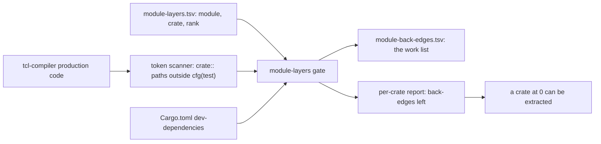
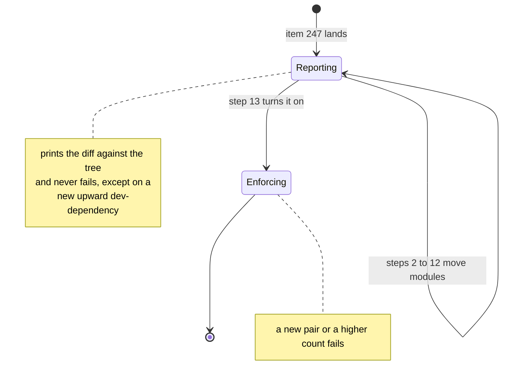

# Step 1: the module-layers map

Part of [splitting tcl-compiler](../crate-split-design.md). Plan item 247 (the
gate and its tests), then item 273 (seeding and reviewing the ledger).
Builds on [step 0](00-test-dependencies.md). Steps 2–12 are measured against it.

## Problem

The production code of `tcl-compiler` is one cycle: 96 of its 121 modules form
one strongly connected graph. No crate builds on its own while a module of a
lower layer still names one of a higher layer. The branch may stay broken while
modules move, but the moves still need a work list: which edges block which
crate, and which types to move or invert to clear them.

## Design

A new gate in `rust/xtask/src/semantic_ownership.rs` beside `walker-ownership`,
`module-layers`, run by `cargo xtask check` and `make xtask-gates`. Two ledgers
in `docs/work/name-handling/ownership/`:

- `module-layers.tsv` gives each top-level module its target crate and the
  crates' order. It has one row per module, with these columns: `module`,
  `crate`, `rank`.
  - The ranks follow the [design](../crate-split-design.md#crates-bottom-up):
    `tcl-source` 1, `tcl-names` 2, `tcl-values` 3, `tcl-model` 4, `tcl-ir` 5,
    `tcl-binding` 6, `tcl-lowering` 7, `tcl-analysis` 8, the unit crate
    (`tcl-unit`) 9, `tcl-native-plan`, `tcl-diagnostics` and `tcl-optimiser`
    10, and `tcl-db` 11 ([step 13](13-unit-and-db.md)).
  - Binding sits below `tcl-lowering`: item 278 chose inversion
    ([step 7](07-binding-fixpoint.md)). The seeded ledger reports binding →
    lowering and SSA edges as back-edges, which item 279 clears.
  - Equal ranks may not name each other.
  - Splitting a module across two crates is recorded as rows for its
    submodules (`analyser::types` → `tcl-model`).
- `module-back-edges.tsv` is the work list. It has one row per (from-module,
  to-module) pair where the "from" crate's rank is not above the "to" crate's
  rank, with the count of production references.
  - A production reference is a `crate::` path in a `use` item or an expression,
    outside `#[cfg(test)]` items and test files, counted with the token scanner
    the other gates use.
  - During the split the gate only reports: it prints the ledger's diff against
    the tree and never fails.
  - From step 13 on, a new pair or a higher count fails, so the layers stay
    clean.
- Dev-dependency edges are checked from the start, not only after the split.
  A crate's `[dev-dependencies]` may not name a crate of a higher layer in the
  workspace's crate order (`deny.toml`'s wrapper lists). Today's cases (items
  246 and 269–272) are a known list that may only shrink; a new one fails.

The gate also reports the total, the number of pairs still at a nonzero count,
and, per target crate, whether it has no back-edges left. A crate with no
back-edges can be extracted.

What the gate reads and writes:



Its mode changes once, at step 13:



A worked example. In the seeded ledger, `command_binding` is rank 6 and
`analyser` is rank 11 (`tcl-diagnostics`, above `tcl-semantic` at 10), so this line in `command_binding` counts as one
production reference on a back-edge:

```rust
use crate::analyser::ResolvedAnalysisInput;
```

The same line inside a `#[cfg(test)] mod tests` block, or in a `tests.rs`
file, counts nothing. The ledgers then hold rows like these (the counts are
today's, from the table below; `analyser::types` shows a split module):

```text
# module-layers.tsv
module	crate	rank
segmenter	tcl-source	1
analyser::types	tcl-model	4
ir	tcl-ir	5
command_binding	tcl-binding	6
signature_scan	tcl-binding	6
analyser	tcl-diagnostics	11

# module-back-edges.tsv
from	to	count
command_binding	analyser	316
ir	command_binding	54
```

## Seeding

The first ledger is generated from the tree as it stands (`cargo xtask
module-layers --write`) and reviewed by hand:

- whether each module's target crate is right;
- the split rows for modules whose parts go to different crates
  (`analyser::types`, `analyser::input`, `command_binding`'s key types).

Today's measurement, with test code excluded, is about 178 two-way pairs. The
largest are:

| Pair | Count |
|---|---|
| `command_binding` → `analyser` | 316 (production; it reads reports, step 7) |
| `command_binding` → `signature_scan` | 317 |
| `registry_invocation` → `command_binding` | 270 |
| `ir` → `command_binding` | 54 |

## Verification

- **Unit tests** in `semantic_ownership`:
  - a new back-edge is reported, and fails in enforcing mode;
  - a new upward dev-dependency fails;
  - test code is not counted;
  - equal-rank crates naming each other are reported.
- **Seed:** the seeded ledger passes on the tree it was generated from.

## What the next steps read from it

| Step | Done when |
|---|---|
| 3, 5 (vocabulary) | every back-edge into the types that move to `tcl-names` and `tcl-model` is gone |
| 4 (value kernel) | no binding module names `tcl_expr_eval` or `analyses` |
| 7 (binding against lowering) | 278's inventory lists every binding → lowering, SSA and value pair; after 250, `tcl-binding` → `tcl-diagnostics` reads 0 |
| 2, 6, 8–12 | each crate is extracted when its row in the per-crate report reads 0 |

## Review fixes (26 November 2026, deep review)

- **O2:** the example ranks `tcl-diagnostics` 11, above `tcl-semantic` (10, decision D-C); `tcl-db` is 12 ([step 13](13-unit-and-db.md)).

## As built (27 November 2026)

Item 247. The gate is `rust/xtask/src/semantic_ownership/module_layers.rs`,
run as `cargo xtask module-layers` by `cargo xtask check` and
`make xtask-gates` (0.5 s, under the test-profile `xtask` alias). It differs
from the design in these points:

- **Re-exports.** A `crate::` path is followed through `pub use` items
  (of any visibility) to the module that defines it before a row is matched.
  `use crate::analyser::ResolvedAnalysisInput` therefore counts against
  `analyser::input`, and `crate::command_binding::SourceNamespaceKey` against
  `command_binding::namespace_context`. Paths into another crate's re-export
  (`expr_ast`, `naming`) match no row and are not counted.
- **Rows.** A row names a top-level module, a submodule, or an item by the
  path that defines it; the longest matching row wins. The gate fails, in
  both modes, on a top-level module without a row, a row naming nothing, a
  crate with two ranks, and the `unassigned` crate that `--write` gives a new
  module.
- **Test code** is a `#[cfg(test)]` item, an item behind `test-support` or
  `any(test, feature = "test-support")`, and a file declared under a test
  gate.
- **Mode switch.** `module-layers.tsv`'s `# mode: reporting` line becomes
  `# mode: enforcing` at step 13. Reporting prints the ledger's diff;
  enforcing fails on any difference, a lower count included, so the ledger is
  lowered with the tree.
- **Dev-dependency order.** A dev-dependency of crate A on B is upward when B
  depends on A, or when A has dependents and B reaches a `deny.toml` layer
  (a ban with wrappers) that A does not. `xtask` and `xtask-backing` are
  tooling and are not checked. A self dev-dependency (`tcl-spectcl` enabling
  its own `programmed-packs`, item 318a; `tcl-vm` its own `test-support`) is
  not an edge. Items 246 and 269–272 left two cases, both `tcl-cshim`'s
  tests: `tcl-engine-tclvm` and `tcl-spec-hooks` (`dev-edges.tsv`).
- **The `test-support` body lint** (deep review W1) reads every workspace
  crate's `src`. A body is a `#[test]` function, or a `pub fn` that an
  enabling crate's test of the same name calls, directly or through a
  `macro_rules!` that declares `#[test]` functions (`tcl-compiler-it`'s
  `spectcl_seeded_tests!`). It finds 12 `tcl-compiler` modules
  (`test-support-bodies.tsv`). Item 267 counts 13: the 13th,
  `command_binding::spectcl_test_bodies`, only re-exports the others.
- **Duplicated crates.** For each crate whose `test-support` feature another
  crate enables, the gate prints how many workspace crates that test build
  compiles a second time beside a `tcl-lsp-server` build, item 296's
  measure. Today: `tcl-compiler`'s from `tcl-codegen` 2 and from
  `tcl-compiler-it` 9; `tcl-vm`'s from `tcl-engine-tclvm` 2, `tcl-irule-test`
  1, `tcl-spectcl` 4 and `tcl-vm-it` 1. The counts come from
  `cargo metadata --no-deps` and ignore optional dependencies.
- **Ranks** follow the crate table as revised (O2): `tcl-diagnostics` 11.
  `tcl-irules`, which takes `irules_checks` and `irules_event_checks`
  (item 285), is ranked 12. No module goes to `tcl-db`.
