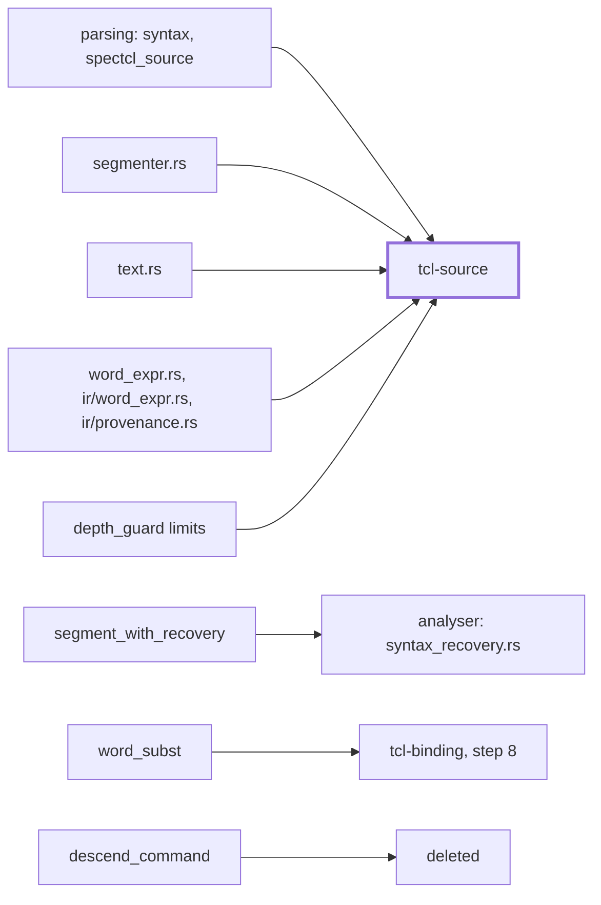
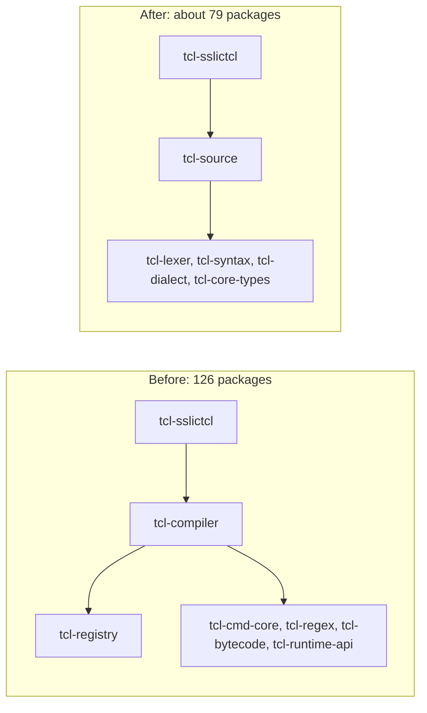

# Step 2: extract tcl-source

Part of [splitting tcl-compiler](../crate-split-design.md). Plan item 251
(the extraction), then item 281 (the SpecTcl loader and `tcl-sslictcl` onto
it). Builds on [step 1](01-module-layers.md): the ledger's `tcl-source` row is
this step's work list. [Step 3](03-tcl-names.md) builds on it: the identity
types there carry `SourceSite` and `ExecutedScriptSource` geometry, which needs
the source types below them.

## Current boundary

`tcl-source` owns `cst`, `segment`, `spectcl`, `words`, `text` and `limits`.
Its workspace dependencies are `tcl-lexer`, `tcl-syntax`, `tcl-dialect` and
`tcl-core-types`; `strsim` supplies the existing spelling-distance algorithm.
There are no compiler compatibility re-exports. The dependency policy rejects
upward edges, including dev-dependencies, except independent test support.

Binding claims remain in the compiler and belong to the binding layer in
the module ledger; any move into registry core still follows item 261's
owner decision. The optimiser's independent structured-IR walk cap stays
with the optimiser. Neither is source geometry.

Ghost recovery and its diagnostic tests live in the analyser. The unused
registry-dispatched `descend_command` API is removed; public analyser tests
cover conditional body discovery and lambda-local scope isolation.
`CaseListSpec::shape()` projects the registry descriptor onto
`CaseListShape<'static>` for source-only case-list flattening.

The CST, segmentation and spelling public contracts follow the source crate.
Compiler word-binding, absolute IR span and stack-budget tests remain in the
compiler. Dialect-only fixtures obtain grammar from `tcl-dialect`. SslicTcl
reads only `tcl-source`; its data binary needs no registry bootstrap, and its
registry-pack parity test lives in SpecTcl. SpecTcl's source readers use this
crate, while its optimiser, evaluator and binding hooks retain the compiler.

## Problem

`tcl-sslictcl` needs a parser and nothing else, but it depends on the whole of
`tcl-compiler`. It names three items: `parsing::syntax::build::build_document`,
`parsing::syntax::segment::segments_from_document` and
`segmenter::SegmentedCommand` (`rust/tcl-sslictcl/src/dsl.rs:36-38`). Its
normal dependency cone is 126 packages (`cargo tree -p tcl-sslictcl -e
normal,build`, 26 November 2026), and that cone includes `tcl-registry`.

The SpecTcl loader has the same fault. It names `tcl_compiler::parsing` in 11
production files, almost all of it `parsing::spectcl_source`.

The candidate modules, measured with a scanner that drops test files, inline
`#[cfg(test)]` items and comments:

| Module | Production lines | Edges inside `tcl-compiler` |
|---|---|---|
| `parsing` (`syntax/`, `spectcl_source/`) | ~2.8k | `segmenter` 3 lines (`SegmentedCommand`, `WordFragment`, `command_span`, `word_piece`) |
| `segmenter.rs` | ~1.27k | `parsing` 8 lines; `analyser` 3, all in `segment_with_recovery` |
| `text.rs` | 170 | none |
| `word_expr.rs` | 488 | `ir` word types only |
| `ir/word_expr.rs`, `ir/provenance.rs` | 390 | `word_expr` 2 |
| `word_subst` | ~1.35k | `registry_invocation` 30, `command_binding` 11, `ir` 7, `ir_helpers` 2, `lowering_hooks`, `value_shapes` |

Two of these modules reach the registry:

- `parsing/syntax/descend.rs:44` imports `CommandRegistry` and `ArgRole` for
  `descend_command` (`descend.rs:185`). That function has no production caller;
  only the module's own tests call it. Every production caller uses
  `descend_token`.
- `segmenter.rs:776`: `flatten_case_list_clauses` takes a
  `&tcl_registry::CaseListSpec`, but it reads only `clause_flags` and
  `clause_value_flags`. It builds the `tcl_syntax::case_list::CaseListShape`
  from them at `segmenter.rs:780`.

`parsing/syntax/red.rs:813` also uses
`tcl_registry::model::ingress::resolve_environment`, but only inside a test.

The registry rule also matters here. `merge_f5_if_else_lookahead`
(`segmenter.rs:1217`) folds an `else`/`elseif` command into the preceding `if`
under the F5 trunk grammar's `brace_line_continuation` axis. This is the N5
parser rule. It compares command names, and `registry-axes` lists
`segmenter.rs` with 2 known comparisons
(`rust/xtask/src/registry_axes.rs:181`).

## Design

### The crate

`rust/tcl-source` sits at rank 1. Its normal dependencies are `tcl-lexer`,
`tcl-syntax`, `tcl-dialect` and `tcl-core-types`, and nothing else from the
workspace. It does not depend on `tcl-registry`. That is the step's main
decision: a registry dependency would put the 42-package registry cone back
under `tcl-sslictcl` and the SpecTcl loader, which is what this step exists to
remove. The cone of those four crates is 17 packages today.

Public namespaces:

```rust
pub mod cst      { /* today's parsing::syntax: green, red, build, segment, descend_token */ }
pub mod segment  { pub struct SegmentedCommand; pub fn segment_commands(..);
                   pub fn segment_commands_with_offset_and_config(..);
                   pub fn flatten_case_list_clauses(src, text, tok,
                       shape: &tcl_syntax::case_list::CaseListShape, config) -> ..; }
pub mod words    { pub struct WordExpr; pub enum WordPart; pub enum WordOpacity;  // ir::word_expr + word_expr.rs
                   pub struct SourceSite; pub enum Provenance; pub struct NodeId; } // ir::provenance
pub mod spectcl  { /* today's parsing::spectcl_source: pack statements, includes, original words */ }
pub mod text     { pub fn edit_distance(..); pub fn suggest_similar(..); /* ... */ }
pub mod limits   { /* depth_guard's source and expression nesting limits */ }
```

### What moves in

- `parsing` as a whole (`syntax/`, `spectcl_source/`).
- `segmenter.rs`, except `segment_with_recovery` (`segmenter.rs:1080`).
- `text.rs`.
- The structured-word and source-site types: `ir/word_expr.rs`,
  `ir/provenance.rs` and the production part of `word_expr.rs`.
- The nesting limits in `depth_guard.rs`, which `ir` and `word_subst` both
  read.

### What stays, and where it goes

- **`word_subst` does not move.** It operates on `ir::CommandTokens` and
  calls `registry_invocation::resolved_handler_invocation`,
  `command_binding::SourceRuntimeReachability` and `ir_helpers`
  (`word_subst.rs:275-453`). It is a binding service, and the ledger assigns it
  to `tcl-binding` (step 8). This corrects the overview.
- **`segment_with_recovery` moves to the analyser.** Its one production caller
  is `analyser/state/syntax_recovery.rs:45`, and it reads the analyser's
  `RecoveryKnownCommands`, `Diagnostic` and `unterminated_bracket_diagnostics`.
  `tcl-source` keeps `build_document_with_ghosts`, the ghost re-lex primitive.
  The recovery loop moves into `syntax_recovery.rs` with the two tests that
  call it (`segmenter/tests.rs:339,354`).
- **`descend_command` is deleted.** Its four tests are rewritten on
  `descend_token`, or moved to the analyser if they test the registry's
  `Body` roles.

Where each candidate goes:



### Decisions

1. **Structured words and source sites move with the CST.** Item 82 puts
   structured words in `tcl-source`, and steps 3 and 4 need them below their
   own crates. `ExecutedScriptSource` (step 3) names `ir::{Provenance,
   WordExpr}`, and the value kernel (step 4) names `ir::SourceSite`
   (`tcl_expr_eval.rs:212`). Leaving these types in `tcl-ir` (rank 5) would
   recreate the back-edges that steps 3 and 4 have to clear.
2. **`flatten_case_list_clauses` takes the shape, not the spec.** Its 6
   production callers (5 in `analyser/handlers`, 1 in
   `tcl-lsp-core/src/executable_regions.rs`, which also names it in a doc
   comment) build the `CaseListShape` from the registry spec they already
   hold. The registry stays the owner of which commands take a case list.
   Today the function builds the shape itself:

**Before:**

```rust
// tcl-compiler/src/segmenter.rs
pub fn flatten_case_list_clauses(
    source: &str,
    text: &str,
    tok: Token,
    case: &tcl_registry::CaseListSpec,
    config: LexerConfig,
) -> Vec<((String, Token), (String, Token))> {
    let elements = flatten_clause_list_elements_with_config(source, text, tok, config);
    let shape = tcl_syntax::case_list::CaseListShape {
        clause_flags: case.clause_flags,
        clause_value_flags: case.clause_value_flags,
    };
    // ...
}
```

**After:**

```rust
// tcl-source/src/segment.rs: no tcl-registry in scope
pub fn flatten_case_list_clauses(
    source: &str,
    text: &str,
    tok: Token,
    shape: &tcl_syntax::case_list::CaseListShape,
    config: LexerConfig,
) -> Vec<((String, Token), (String, Token))>;

// each caller, which already holds the spec
let shape = CaseListShape {
    clause_flags: case.clause_flags,
    clause_value_flags: case.clause_value_flags,
};
let clauses = tcl_source::segment::flatten_case_list_clauses(source, text, tok, &shape, config);
```

3. **The F5 `else` merge moves unchanged.** It is a fact of the F5 trunk
   parser, applied before any command lookup, and its `registry-axes`
   allowance moves with it (`rust/tcl-source/src/segment.rs`, 2). A later
   change can replace the name test with a keyword table in the trunk grammar
   descriptor (`tcl-dialect`), which owns the lexical N-rules on the same
   axis. That change belongs to item 41 (one segmentation), not to a pure move.
4. **`text.rs` moves as the overview says.** It is the edit-distance and
   suggestion owner and has no dependencies. It is not source geometry, so if
   `tcl-source` grows a reason to exclude it, `tcl-syntax` is its fallback
   home.
5. **Tests go with their modules.** Inline tests of the moved files keep their
   own dev-dependencies. Where a test needs a dialect grammar it takes it from
   `tcl-dialect`, not `tcl-registry`, so `tcl-source`'s test cone also stays
   off the registry.

### Who consumes it

Measured with `rg -l 'tcl_compiler::segmenter'` and the same for `parsing`
(production files):

| Crate | Uses |
|---|---|
| `tcl-lsp-core` | `segmenter` in 79 files, `parsing::spectcl_source` in 2, `text` in 2 |
| `tcl-codegen` | `segmenter` in 9 files |
| `tcl-spectcl`, `tcl-spec-studio` | `parsing` in 11 and 4 files |
| `tcl-diagram`, `tcl-irules`, `tcl-lsp-db`, `tcl-vm` | `segmenter` in 2 files each |
| `tcl-sslictcl`, `tcl-explorer`, `tcl-cli`, `tcl-mcp`, `tcl-lsp-server`, `tcl-irule-test`, `xtask` | 1 file each |
| inside `tcl-compiler` | `segmenter` in 248 production files, `parsing` in 11, `text` in 9 |

All of them are rewritten in the same change, with no re-exports
(principle 5). `tcl-irule-test` also names `analyser` (`live.rs:76,628`), so it
stays on `tcl-compiler` after this step. This corrects the overview, which
lists it as a `tcl-source` user.

### Item 281: the SpecTcl loader and tcl-sslictcl

- `tcl-sslictcl` drops `tcl-compiler` and depends on `tcl-source`. Its
  expected cone is about 79 packages, of which about 62 are its own crypto
  crates. It no longer has `tcl-registry`, `tcl-cmd-core`, `tcl-regex`,
  `tcl-bytecode` or `tcl-runtime-api` below it.
- `tcl-spectcl`'s loader (`loader.rs`, `loader/*`, `export.rs`, `upgrade.rs`,
  and `pack.rs`'s parsing calls) moves onto `tcl_source::spectcl` and
  `tcl_source::cst`.

`tcl-sslictcl`'s workspace dependencies, before and after (each arrow points
at the crate depended on):



The change in `rust/tcl-sslictcl/src/dsl.rs`:

**Before:**

```rust
use tcl_compiler::parsing::syntax::build::build_document;
use tcl_compiler::parsing::syntax::segment::segments_from_document;
use tcl_compiler::segmenter::SegmentedCommand;
```

**After:**

```rust
use tcl_source::cst::build::build_document;
use tcl_source::cst::segment::segments_from_document;
use tcl_source::segment::SegmentedCommand;
```

`tcl-spectcl` still needs the compiler for three things after this step:

| Use | Site | Follows |
|---|---|---|
| `optimiser::closed_consumer` | `hooks/owned_application.rs:30`, `hooks/owned_evaluator.rs:33` | `tcl-optimiser`, step 12 |
| `const_subst::SelectedConstFold` | `hooks/owned_evaluator.rs:32` | the optimiser or `tcl-analysis` |
| `site_claims::pack_fact_stamp` | `pack.rs:340` | see open question 2 |

Its `analyser` use (`cache.rs:1357`) is in a test. These are crate-level
dependencies, so `cargo tree -p tcl-spectcl` keeps showing `tcl-compiler`
until the hooks move. Item 305's done-when ("no `tcl-compiler` … under the
loader") cannot be checked with `cargo tree` while the loader and the hooks
share one crate. See open question 1.

### Open questions

1. **Does the SpecTcl loader become its own crate now?** One option is a
   `tcl-spec-loader` crate (the loader, the pack model and `spectcl_source`'s
   users) with `tcl-spectcl` above it; then 305's done-when holds at 281. The
   other is to wait for step 12, when the hooks move onto `tcl-optimiser`.
   This is the owner's call. The evidence for it is the cone of a loader-only
   crate (`cargo tree` once it exists) set against the cost of carrying the
   hooks.
2. **Where does `site_claims` go?** It has no edges inside `tcl-compiler`; it
   names only `tcl_registry::{CommandRegistry, pack_origin::PackOrigin,
   registry::ResolvedCall}` and `tcl_runtime_api` (`site_claims.rs:32-35`).
   Its users are `const_subst` (13 references) and `tcl-spectcl`'s `pack.rs`.
   Placing it next to `pack_origin` in the registry core would take `pack.rs`
   off the compiler. That needs item 261's agreement, because 261 is reshaping
   that crate.

## Work list

1. Delete `descend_command` and rewrite its tests on `descend_token`.
2. Change `flatten_case_list_clauses` to take `&CaseListShape`, and update the
   6 call sites.
3. Move `segment_with_recovery` and its two tests into
   `analyser/state/syntax_recovery.rs`.
4. Replace the test-only registry lookups in `red.rs` and `descend.rs` with
   `tcl-dialect` profile lookups.
5. Create `rust/tcl-source`. Move `parsing/`, `segmenter.rs`, `text.rs`,
   `word_expr.rs` (production and tests), `ir/word_expr.rs`,
   `ir/provenance.rs` and `depth_guard`'s limits into it. Write the `api`
   module.
6. Rewrite every consumer path in the table above, inside `tcl-compiler` and
   across the workspace. `ir` re-exports nothing; its users import
   `tcl_source::words`.
7. Move the segmenter's integration tests (`tests/it_4/differential_segment.rs`,
   `differential_group.rs`, `span_char_boundaries.rs` and
   `it_2/differential_word_expr.rs`) into `rust/tcl-source/tests` where their
   dependencies allow. The rest stay in `tcl-compiler-it`.
8. Re-point the gate roots:
   - `segmentation_drift.rs:111-113` and `dialect_drift.rs:97`
     (`SEGMENTER_OWNER`);
   - `registry_axes.rs:181`;
   - `value_transfers.rs:113` (the `word_subst.rs` exemption, which stays on
     its old path until step 8);
   - `parser-ownership`, `walker-ownership` and `owner-resolution`;
   - the owner-crate column of the shared-utility contracts (segmentation and
     word spans).
9. Add `tcl-source` to `deny.toml`'s wrappers. Its allowed workspace
   dependencies are the four crates above.
10. Item 281: rewire `tcl-sslictcl` (`dsl.rs`, `Cargo.toml`) and the SpecTcl
    loader. Then rewire `tcl-spec-studio` and `tcl-lsp-core`'s two
    `spectcl_source` users.

## Verification

- **Done when (251):**
  - `tcl-source` builds and its tests pass.
  - `cargo tree -p tcl-source -e normal` names no `tcl-registry` and no
    `tcl-compiler`.
  - `module-layers` reports no back-edge out of `tcl-source`.
  - `rg 'tcl_compiler::(parsing|segmenter|text)\b' rust/` finds nothing, and
    `retired_api_gate` forbids those paths.
  - The moved `differential_segment` corpus test is byte-identical over the
    Tcl 8.4–9.0 corpus.
- **Done when (281):**
  - `cargo tree -p tcl-sslictcl` shows no `tcl-compiler` and no
    `tcl-registry`.
  - `rg tcl_compiler::parsing rust/tcl-spectcl` finds nothing.
  - The SpecTcl loader tests and `tcl spec export` give the same output for
    every bundled pack.
- **Measured** (item 90's record, against item 259's baseline):
  - the crates compiled after a one-line edit to `segment.rs`;
  - `tcl-sslictcl`'s cone (expected 126 → about 79) and its rebuild count after
    a `tcl-compiler` edit (expected 0);
  - the cold build time of `tcl-source`.

  Analysis latency and the VM benchmarks are recorded when `tcl-compiler`
  builds again on top of it.

## Risks

- **Churn.** 248 production files inside `tcl-compiler` and 79 in
  `tcl-lsp-core` change their imports. These are path-only edits, but they
  conflict with any work in flight in those files.
- **Inlining.** `segment_commands*` and the CST builders are hot in the
  analyser and the LSP. Once they cross a crate boundary, generic or small
  functions may lose inlining in the opt-level-1 test builds. Release latency
  is the measure.
- **`word_expr` tests** construct `CommandTokens` and call `word_subst`
  (`word_expr.rs:559,656`). Those tests stay in `tcl-compiler` until steps 6
  and 8, so the move splits the file.

## Corrections to the overview

- `word_subst` is not source-layer code. It names `registry_invocation` (30),
  `command_binding` (11) and `ir` (7), so it belongs to `tcl-binding`.
- "Source maps": `SourceMap` already lives in `tcl-lexer`. The source-map
  types inside the compiler are `ir::provenance` (`SourceSite`, `Provenance`,
  `NodeId`) and `ir::word_expr`, and they move here.
- `tcl-irule-test` uses `analyser` as well, so it is not a `tcl-source`-only
  user.
- "Near-acyclic" misses one edge. Besides the `segmenter` ↔ `parsing` cycle,
  which stays inside the crate, `segmenter` → `analyser` (3 references) leaves
  it. Moving `segment_with_recovery` clears it.
- Item 305's `cargo tree` check needs open question 1 settled.
