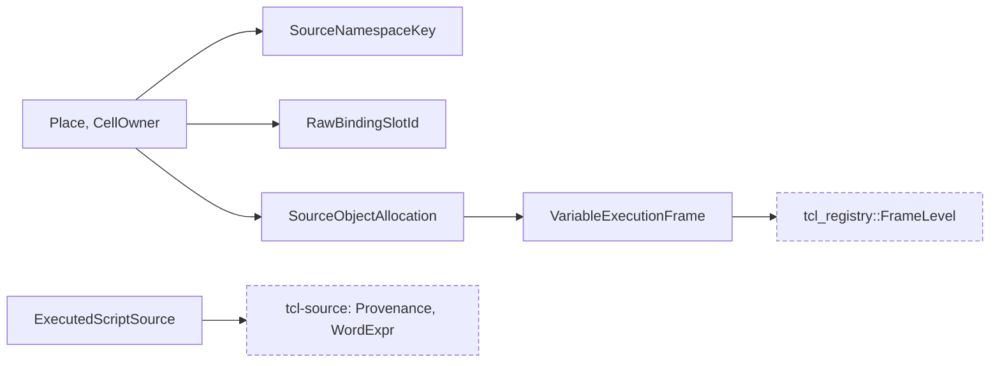

# Step 3: extract tcl-names

Part of [splitting tcl-compiler](../crate-split-design.md). Plan item 248
(the source-key types move down unchanged), then item 274 (item 77's
redesign, inside the new crate). Builds on [step 2](02-tcl-source.md):
`ExecutedScriptSource` and the namespace keys name `tcl-source`'s word and
source-site types. Steps [4](04-tcl-values.md), [5](05-tcl-model.md) and
[6](06-tcl-ir.md) build on it: the value kernel, the model records and the IR
all name these keys.

## Problem

The identity and key types are defined inside the binding modules, so every
lower layer that names a key names `command_binding`. Today `ir` → `command_binding`
is 54 production references in 10 files, and `cfg.rs` adds 15. Most of them are
keys. The definitions, verified with `rg 'pub (struct|enum) X\b'`:

| Type | Defined at | Mentions (`rg -c`, all of `rust/`) |
|---|---|---|
| `SourceNamespaceKey` | `command_binding/namespace_context.rs:32` | 838 in `tcl-compiler`, 15 in `tcl-codegen` |
| `SourceCommandKey` | `command_binding/namespace_context.rs:215` | 234 |
| `CommandAllocationSite`, `CommandAllocation`, `AllocationIncarnation`, `CommandIdentity`, `RuntimeCommandTokenIdentity`, `CommandRefInterner` | `command_binding/command_identity.rs:29-136` | `CommandAllocationSite` 928, plus 13 in `tcl-lsp-core` and 7 in `tcl-codegen` |
| `SourceOriginId`, `SourceOriginKind` | `command_binding/source_origin.rs:32,80` | 368 |
| `OriginalSourcePointOrigin` (the token only) | `command_binding/source_point_entry.rs:53` | |
| `ExecutedScriptSource`, `ExecutedScriptMapping` | `command_binding/executed_script_source.rs:29,53` | 366 |
| `SourceObjectAllocation` | `command_binding/object_instance.rs:29` | |
| `BindingKind` | `command_binding.rs:417` | 486 |
| `Place`, `CellIdentity`, `CellOwner`, `CellGeneration` | `place.rs:127-178` | `Place` 496 |
| `RawBindingSlotId`, `CallableStorageIdentity` | `raw_binding.rs:37,48` | |
| `VariableCellKey` | `var_resolve/cell_key.rs:44` | 435 |
| `VariableExecutionFrame` | `var_resolve.rs:103` | 471 |
| `SignatureNamespaceScope` | `signature_scan/scope.rs:33` | |
| `SignatureSourceNameKey` | `signature_scan/original_name.rs:132` | |

These types form a closure, and the move has to take all of it:

- `Place` and `CellOwner` hold a `SourceNamespaceKey`, a `RawBindingSlotId`
  and a `SourceObjectAllocation`.
- `SourceObjectAllocation` holds a `VariableExecutionFrame`.
- `VariableExecutionFrame` holds a `tcl_registry::FrameLevel`.

So `tcl-names` depends on the registry core. That is allowed, since the
registry sits below the stack.

The closure as field references (an arrow points at the type a field holds):



`CommandRef`, the other `*Ref` types, `IdentityInterner`, `Answer` and
`Knowledge` are in `tcl-core-types` today (`semantic_identity.rs:76`,
`answer.rs:64,101`), and they stay there. Under decision D-D as revised,
`tcl-core-types` keeps the identity types (`*Ref`, `IdentityKey`,
`IdentityInterner`, the issuers) beside `Answer`, `Knowledge` and
`DiagCode`, and `tcl-names` owns the source-key descriptors that intern to
them (*Identity with 274*, below).

## Design

### The crate

`rust/tcl-names` sits at rank 2. It depends on `tcl-source`, `tcl-core-types`,
`tcl-lexer`, `tcl-syntax`, `tcl-dialect`, `tcl-runtime-api` (for
`NativeNamespaceContext` and `NativeInterpreterIdentity`) and the
`tcl-registry` core. Its public interface is the types above, grouped into
modules:

```rust
pub mod command   { CommandIdentity, CommandAllocationSite, CommandAllocation,
                    AllocationIncarnation, RuntimeCommandTokenIdentity, CommandRefInterner,
                    SourceCommandKey, BindingKind }
pub mod namespace { SourceNamespaceKey, SignatureNamespaceScope }
pub mod origin    { SourceOriginId, SourceOriginKind, OriginalSourcePointOrigin,
                    ExecutedScriptSource, ExecutedScriptMapping }
pub mod variable  { Place, CellIdentity, CellOwner, CellGeneration, VariableCellKey,
                    VariableExecutionFrame, RawBindingSlotId, CallableStorageIdentity,
                    SourceObjectAllocation }
pub mod word      { SignatureSourceNameKey }
```

Only the types move, together with the methods that read nothing but these
types and the lower crates. A method that reaches binding stays in binding as
a free function or an extension trait, in the same change:

| Method | Reaches | Becomes |
|---|---|---|
| `SourceOriginId::original_lexical_command`, `original_script_words_in`, `original_lexical_projection` (`source_origin.rs:239-280`) | `registry_invocation::OriginalSourceCommandProjection` and a static memo table | `tcl_binding::SourceOriginLexical`, an extension trait |
| `SourceNamespaceKey` from `ir::CommandTokens` (`namespace_context.rs:681`) | the IR | a free function in binding |
| `ExecutedScriptSource`'s `EffectiveInvocationWord` constructors (`executed_script_source.rs:23`) | `registry_invocation` | binding |
| `place.rs:383`'s use of `var_resolve::namespace_contains` | a pure helper | the helper moves into `tcl-names` |

### SourceInvocationBinding: not a key, so it stays

`SourceInvocationBinding` (`command_binding.rs:665`) has about 60 fields.
They are compiled-candidate proofs, lookup snapshots
(`lookup_state: Option<Arc<SourceLookupSnapshot>>`), declaration-flow
inventories, native compiler preparations, a `ResolveContext`, frozen argument
words and targets. Most are `Arc`s of binding-private types (`declaration_flow`,
`compiled_invocation`, `declaration_layout`, `receiver_self`). It is a record
of proofs, not a key.

Decision: **it goes neither to `tcl-names` nor to `tcl-ir`**. It moves with
binding (step 8). Moving it to `tcl-ir` would drag binding's private types
below binding, which recreates the cycle. Design integration's decision 4
already makes it binding's per-site product, returned by
`invocation_at_source(offset)`.

What `ir` actually needs is a place to carry it: `CommandTokens.source_binding`,
`nested_bindings` and `variable_accesses` (`ir/command_tokens.rs:76-84`). Step 6
gives `tcl-ir` one type parameter for binding's annotations, so the IR holds
the record without naming its type. The part of the record that `ir` reads
itself (`evaluated_command_word`, `ir/script.rs:82,92`) becomes a method of
that parameter's trait. Item 252 records the same answer.

`SignatureSourceNameInput` (`signature_scan/name_value.rs:973`) is the same
kind of thing. Its variants hold binding receipts: `OriginalLogicalListField`
holds `Arc<OriginalLogicalLambdaBody>`, and `SignatureSourceNameValue`'s origin
holds `OriginalProducedNameValue`, `OriginalJimStockName` and
`OriginalObjectCommandNameResult` (`name_value.rs:30-36,870-873`). It stays in
binding. Only the two pure name types, `SignatureNamespaceScope` and
`SignatureSourceNameKey`, move here.

### Decisions

1. **Move only what a lower crate names.** The overview lists
   `command_binding` → `signature_scan` (315 production references by the
   scanner, against the overview's 317) as a `tcl-names` move. Both modules
   land in `tcl-binding`, so that edge is internal to one crate and needs no
   breaking. The signature types move only where `tcl-model` (`ProcDef`,
   `ClassDef`, step 5) or `tcl-ir` names them.
2. **Pure move first, redesign second.** Item 248 changes no
   representation. Item 274 changes representations inside the new crate,
   one type at a time, and each change rebuilds only `tcl-names`' dependants.
3. **The global interner moves as it is.** `SourceOriginId::from_kind` uses a
   process-wide `OnceLock<Mutex<SourceOriginInterner>>`
   (`source_origin.rs:215`), and the projection memo is a second static table.
   The memo goes to binding (above). The interner moves with the type,
   recorded on the memo gate's known list. Item 274 replaces it with an
   interner passed by the owner of the analysis. Item 90's done-when allows no
   `OnceLock` memo outside `tcl-db`, and an identity crate should hold no
   process state.
4. **No salsa.** As the overview says, `tcl-names` stays salsa-free so the VM
   and `tcl-runtime-api` adapters can use it.

<a id="identity-moves-in-with-274"></a>

### Identity with 274

Today identity has three vocabularies: the `*Ref` types, `IdentityKey` and
`ProcedureId` in `tcl-core-types`; the source keys this step moves; and the
engines' `CommandId(u32)`/`NsId(u32)`. Under decision D-D as the coordinator
revised it (26 November 2026), the identity types (`*Ref`, `IdentityKey`,
`IdentityInterner` and the issuers) stay in `tcl-core-types`, which is low
and rarely edited. `tcl-names` owns the source-key descriptors
(`SourceCommandKey`, `CommandAllocationSite`, `Place` and the rest of this
step's types) and the rules that intern them to `*Ref`s: its only identity
is the `*Ref` a descriptor interns to. Facts and summaries above it are
keyed by `BodyUnitRef`, `VariablePlaceRef` and `CommandRef`/`SourceCommandKey`,
never by display text.

The identity types do not move because of build time. `tcl-runtime-api`
names the `*Ref` types (`rust/tcl-runtime-api/src/semantic_identity.rs:25`),
and `tcl-bytecode` names `ProcedureId` and its issuer through it
(`tcl-bytecode/src/lib.rs:560`). Moving them into `tcl-names` would put
`tcl-names` below `tcl-runtime-api` and the registry core, so every later
`tcl-names` edit would rebuild the whole workspace. Instead `tcl-names`
stays in the workspace overview's layer 4a, above the registry core, with
its edges to `tcl-runtime-api` and the core, and a `tcl-names` edit
rebuilds `tcl-values` and the crates above it. Item 274's work is the
descriptor rules and the issuer below; it comes after Now 5 and gates no
extraction.

**The issuer.** `ProcedureIdIssuer::default()` draws its scope from a
process-wide counter (`tcl-core-types/src/body_identity.rs:24`,
`NEXT_SCOPE`), and `IdentityInterner::new` calls it
(`semantic_identity.rs:123`), so the same unchanged body gets a new key on
every rebuild and no summary keyed by it can backdate. Item 274 derives the
issuer and domain from a `tcl-db` input (the file id, the
revision-independent definition site and the incarnation), passed in by the
owner of the analysis, and deletes `NEXT_SCOPE`. Its test: re-analysing an
unchanged file gives equal `ProcSummary` keys, and the summary query
backdates.

### Item 274: item 77 inside tcl-names

Item 77's remaining work, from its status note (25 November 2026) and
verified:

- **The display-text key.** `command_binding/ensemble_dispatch.rs:167` builds
  a relative ensemble map target's head with
  `rooted_member_key(&frozen.namespace.display()?, head)`, then looks it up by
  string (`source_binding(state, &head, &frozen.namespace)`). The fix is a
  slot lookup: `SourceCommandKey::Slot { namespace: frozen.namespace.clone(),
  simple: NameBytes::from(head) }` resolved by a key-taking
  `source_binding_at_slot`, with the ensemble's rule of no global fallback kept
  in that function. The function lives in binding. The key constructor lives
  here.

  The Tcl rule the slot lookup keeps, checked in `tclsh` 8.5 to 9.1: a
  relative `-map` target resolves in the ensemble's namespace, and does not
  fall back to the global command of the same name.

**Source:**

```tcl
proc helper {} { return global }
namespace eval ns {
    proc helper {} { return ns }
    namespace ensemble create -command ::tool -map {run helper}
}
namespace eval ns2 {
    namespace ensemble create -command ::tool2 -map {run helper}
}
puts [tool run]
puts [tool2 run]
```

**In memory:**

```rust
// these types exist today (command_binding/namespace_context.rs:32, :215);
// the namespace key is shown in its authored form
// `tool2 run` looks up `helper` in ::ns2's slot table
SourceCommandKey::Slot {
    namespace: SourceNamespaceKey::Authored("::ns2".into()),
    simple: NameBytes::from("helper"),
}
// source_binding_at_slot → no binding; ::helper is never consulted
```

**Bytecode (tclsh 9.1.0):**

```text
$ echo '…; proc q {} {tool run}; puts [::tcl::unsupported::disassemble proc q]' | tclsh9.1
    (0) push 0 	# "tool"
    (5) push 1 	# "run"
    (10) invokeStk 2
    (15) done
```

**Result:**

```text
$ tclsh8.5 ens.tcl   # and 8.6, 9.0, 9.1: the same two lines
ns
invalid command name "::ns2::helper"
$ ./target/debug/tclvm ens.tcl
ns
invalid command name "::ns2::helper"
```

The ensemble call compiles to a plain `invokeStk`, so the rule lives in
dispatch, and binding has to model it.

**Before:**

```rust
// command_binding/ensemble_dispatch.rs (simplified): an identity rebuilt from display text
let head = tcl_syntax::naming::rooted_member_key(&frozen.namespace.display()?, head);
let binding = source_binding(state, &head, &frozen.namespace);
```

**After:**

```rust
// the key is built from the namespace key, never from its display text
let key = SourceCommandKey::Slot {
    namespace: frozen.namespace.clone(),
    simple: NameBytes::from(head),
};
let binding = source_binding_at_slot(state, &key); // no global fallback
```

- **Two more candidates the note does not list.** `signature_scan/ctx.rs:512`
  and `:548` build `qualify(&namespace.display()?, written)` and derive a
  `SignatureNamespaceScope::Symbolic` from the result. This happens on the
  path with no name policy. 274 checks whether either is an identity.
  `signature_scan` folds into binding under item 84, so the fix may land
  there.
- **Labels, not identities.** The `lookup_namespace` strings copied beside
  their keys (204 mentions in `tcl-compiler`) and `ResolveContext.namespace`
  stay labels, as item 77 recorded. 274 marks them `#[doc(hidden)]`
  presentation fields.
- **Incarnations and provenance** for frame, body unit, instance, package and
  interpreter, keyed as the `*Ref` types that move here (above).
  `VariableExecutionFrame` still carries `identity: String` frames
  (`var_resolve.rs:107-116`); item 66's frame value replaces those strings.
- **The engines' tokens** through `tcl-runtime-api`, unchanged: the adapters
  produce `tcl-core-types` refs.

274 runs after Now 5 and blocks no extraction (D-D revised). Its done-when is
item 77's own:

- two different `CommandRef` incarnations over `dynamic/e09-delete-proc.tcl`
  and `rename-alias/r01-rename-basic.tcl`;
- `rg` finds no identity built from display text in any crate under
  `rust/`, not only `tcl-compiler` and `tcl-lsp-core`, whose code the split
  moves to `tcl-binding`, `tcl-names`, `tcl-model`, `tcl-analysis` and the
  registry;
- `cargo tree -p tcl-names -e normal` lists no `tcl-runtime-api` and no
  `tcl-registry`, and `NEXT_SCOPE` is gone;
- the identity column in conformance is green.

## Work list

1. Generate the closure. The `module-layers` ledger lists, for each seed type
   above, every type its fields name. Review the closure by hand; nothing
   outside it moves.
2. Split the files that hold both keys and algorithms:
   - `source_origin.rs` (the memo methods go to binding);
   - `namespace_context.rs` (the `CommandTokens` method);
   - `executed_script_source.rs` (the invocation-word constructors);
   - `place.rs` (`namespace_contains` comes along);
   - `signature_scan/scope.rs` and `original_name.rs` (only the two key types
     move);
   - `object_instance.rs` and `raw_binding.rs` (only the types move).
3. Create `rust/tcl-names` and move the types and their pure methods. The
   `#[cfg(test)]` modules in those files move with them where their
   dependencies allow; tests that build bindings stay behind.
4. Rewrite the consumers' paths in the same change: inside `tcl-compiler`,
   and in `tcl-codegen`, `tcl-lsp-core`, `tcl-lsp-server`, `tcl-explorer` and
   `tcl-lsp-db`. Nothing is re-exported from `command_binding`.
5. Add the `deny.toml` wrapper list. Re-point the roots of `owner-resolution`
   (the name owner) and `walker-ownership`.
6. Then 274, one representation change at a time. Each change is its own
   commit, with a test from item 77's done-when.

## Verification

- **Done when (248):**
  - `tcl-names` builds and its tests pass.
  - The ledger reports no reference from `ir`, `cfg`, `analyses` or the value
    kernel into `command_binding`, `place`, `raw_binding` or `var_resolve` for
    a type in the table above.
  - `rg 'command_binding::(SourceNamespaceKey|CommandAllocationSite|BindingKind)' rust/`
    finds nothing.
  - `cargo tree -p tcl-names` shows no `tcl-compiler`.
- **What remains of `ir` → `command_binding`:** this step moves 21 of the
  53 references the scanner finds: `SourceNamespaceKey` 7,
  `CommandAllocationSite` 5, `CommandAllocation` 3, `BindingKind` 3,
  `SourceOriginKind` 2 and `ExecutedScriptSource` 1. The other 32 are
  binding's annotations, and step 6 parameterises them: `SourceInvocationBinding`
  7, `SourceVariableAccess` 5, `SourceCommandTarget` 3, the procedure-body
  receipts and the rest. In `cfg.rs` this step moves 8 of 15.
- **Measured:** the crates compiled after an edit to one `tcl-names` file
  (expected: `tcl-names` and everything above it, which is still most of the
  workspace), and the same for a binding edit, which should not rebuild
  `tcl-names`.

## Risks

- **The closure is larger than it looks.** `VariableCellKey`'s file is 964
  lines and `object_instance.rs` 1,450. If the closure pulls in a type with
  binding-heavy methods, stop and split the file rather than widen the move.
- **Derives on key types.** `Ord` and `Hash` derives (for example on
  `CommandAllocationSite`) are relied on by `BTreeSet` ordering in
  `ir/module.rs:73`. A pure move keeps them exactly as they are.
- **The registry dependency.** It drags item 261's `tcl-registry` core under
  `tcl-names`. If 274 can replace `FrameLevel` with a `tcl-core-types` level
  selector, `tcl-names` drops the registry. Measure the cone first.

## Corrections to the overview

- `CommandRef` is in `tcl-core-types` today, and stays there: neither 248
  nor 274 moves it (D-D revised).
- `command_binding` → `signature_scan` is intra-crate in the target layout.
  It is not a reason to move the signature types down.
- "Signature name and scope types" moves only `SignatureNamespaceScope` and
  `SignatureSourceNameKey`. `SignatureSourceNameInput` is a receipt type and
  stays with binding.
- `SourceInvocationBinding` goes neither to `tcl-names` nor, as a type, to
  `tcl-ir`. `tcl-ir` carries it through a type parameter (step 6). Item 248's
  text should say so.
- The identity closure also needs `Place`'s cell types, `RawBindingSlotId`,
  `VariableCellKey`, `VariableExecutionFrame`, `SourceOriginId` and
  `ExecutedScriptSource`, and it brings a dependency on the registry core.

## Review fixes (26 November 2026, deep review)

- **M1:** *Identity with 274* (renamed from *Identity moves in with 274*; the old anchor still works): under D-D as revised, the identity types stay in `tcl-core-types`, and `tcl-names` owns the source-key descriptors that intern to them, so it stays in layer 4a and a `tcl-names` edit does not rebuild the workspace. 248 moves the keys as they are.
- **M2:** facts keyed by identity, never display text; 274's grep runs over every crate.
- **M3:** *The issuer*: derived from a `tcl-db` input; `NEXT_SCOPE` deleted.

## As built (item 248, 27 November 2026)

`rust/tcl-names` holds the keys, moved without a representation change. The
consumers in `tcl-compiler`, `tcl-codegen`, `tcl-lsp-core`, `tcl-lsp-server`,
`tcl-explorer`, `tcl-compiler-it` and `tcl-spectcl` import them from
`tcl_names` directly; nothing re-exports them, and `retired_api_gate` rejects
the old `tcl_compiler::` paths (`tcl_compiler::place`, and the moved names
under `command_binding`, `var_resolve`, `raw_binding` and
`signature_scan::scope` / `original_name`). The departures from the design:

- **Modules.** `command`, `namespace`, `origin`, `variable` and `word` are as
  designed, with one addition: `place` keeps the whole `Place` model (its
  constructors, `overlap` and `places_read_to_form`) as its own module rather
  than inside `variable`, so `place::scalar(…)` reads as before. `variable`
  holds `cell_key`'s keys and tables together with `VariableExecutionFrame`,
  `RawBindingSlotId`, `CallableStorageIdentity` and
  `SourceObjectAllocation`, and `namespace_contains` came with them.
- **Command tables stay in binding.** `SourceCommandTable`,
  `SourceNamespaceMap`, `SourceNamespaceSet` and their `CommandKeyQuery` /
  `NamespaceKeyQuery` text queries are binding state, not keys: the command
  table memoises derived rows in a `OnceLock`. They stay in
  `command_binding/namespace_context.rs`, which now holds only them and the
  `SourceInvocationBinding` root-namespace method. The ledger's
  `command_binding::namespace_context` row was wrong and is gone, as are the
  rows for `source_origin` and `executed_script_source`, whose residue is
  binding.
- **Dependencies.** `tcl-names` names no `tcl-source`: the only constructor
  that read a `WordExpr` (`from_word`) needs the effective invocation word and
  stays in binding. Since item 117a, `InvocationDialect` lives in
  `tcl-native-model`, so that is a dependency too. The full set is
  `tcl-core-types`, `tcl-dialect`, `tcl-lexer`, `tcl-native-model`,
  `tcl-registry`, `tcl-runtime-api` and `tcl-syntax`; `crate-layer` and
  `deny.toml` enforce it.
- **Methods that reach binding** became extension traits in the compiler, so
  call sites keep their method syntax with one import:
  `command_binding::SourceOriginLexical` (`original_lexical_command`,
  `original_script_words_in`), a private `SourceOriginProjection` for the
  projection memo, `command_binding::ExecutedScriptWords` (`from_word`,
  `literal_word_base`), `signature_scan::scope::SignatureNamespaceChild`
  (`child_from_key`, `child_from_input`) and
  `raw_binding::RawBindingSlotRelocation` (`relocated`).
  `SignatureNamespaceScope::from_logical_lambda_list` became the free
  function `signature_scan::scope::namespace_from_logical_lambda_list`. The
  activation-name helpers stay in `command_binding/source_origin.rs`.
- **Visibility.** Constructors the compiler called inside one crate are now
  `#[doc(hidden)] pub`: `SourceOriginId::{derived, derived_image, from_kind,
  activation_key}` and the new `shared_kind` (the projection memo's key),
  `OriginalSourcePointOrigin::{from_issued_key, matches_issued_key}` (the
  source-point entry still issues the key), `SourceCommandKey::{slot,
  holder}`, `SourceNamespaceKey::{is_root, is_descendant_of}`,
  `SignatureNamespaceScope::{root, context_for_policy, child}`,
  `ExecutedScriptSource::from_original_word_value`, `origin::folds_to`,
  `VariableCellKey::{incoming_root_global, is_native_error_storage}`,
  `IncomingRootGlobalCell` and
  `SignatureSourceNameKey::from_original_logical_source_word`. The
  `SourceOriginId` fields stay private.
- **Process state.** The `SourceOriginId` interner moved with the type, and
  its `memos.tsv` row points at `rust/tcl-names/src/origin.rs`; the
  projection memo stays in binding. `walker-ownership` and `memo-type` scan
  `tcl-names`.
- **Tests.** The key tests moved with their modules (`place`, `variable`,
  `word`). The two `SourceOriginId` fingerprint and interner tests moved from
  `command_binding/tests/source_walk.rs` into `origin.rs`, where the private
  fields they set are visible, and the collision half of
  `full_source_identity_breaks_fingerprint_collisions_without_merging_roots`
  joined them. The binding half
  (`full_source_identity_selects_equal_roots_without_merging_foreign_ones`)
  no longer forces a fingerprint collision; it checks that equal roots
  select and a foreign root does not, which the private-field write only
  made harder to reach. `place`'s worker-overlap test needs
  `resolve_literal_place` and moved to `var_resolve/tests.rs`.
- **The ledger.** `module-back-edges.tsv` has no row out of or into a moved
  type. `analyser::types → signature_scan` rose from 102 to 110 because
  `signature_scan::scope` is no longer listed as `tcl-names`: its remaining
  items (`SignatureSourceLookup`, the name inputs) are binding.

The measurements are in the
[build-cost record](../../../work/build-test-cost/current-state.md#item-248-step-3a-tcl-names-before--after).
