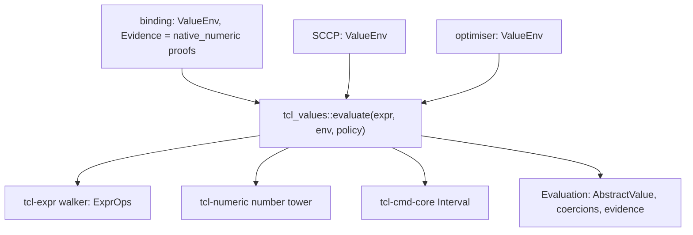

# Step 4: extract tcl-values, the value kernel

Part of [splitting tcl-compiler](../crate-split-design.md). Plan item 280,
the crate form of item 81 (kernels with abstract-value interfaces). Builds on
[step 3](03-tcl-names.md): the kernel's evidence names cell identities and
source sites, which steps 2 and 3 have moved below it. [Step 5](05-tcl-model.md)
builds on it: the model's result lattices sit beside the value lattice, and
`tcl-model` may name `tcl-values`.

## Problem

Binding and value analysis are one fixpoint per body unit
([design integration](../../../work/name-handling/design-integration.md#decisions),
decision 1). Both sides should use one abstract-value kernel, and binding's
private value handling should become a client of it. Today:

- **Binding calls the expression evaluator directly.** It names
  `tcl_expr_eval` 37 times in 4 production files:
  - `command_binding/expression_preparation.rs`: 17;
  - `declaration_flow/evaluation.rs`: 9;
  - `original_literal_argv_rewrite.rs`: 6;
  - `source_walk/expression_walk.rs`: 5.

  This was verified with a scanner that drops test files and inline
  `#[cfg(test)]` items. The items named are `FoldPolicy` (11),
  `format_tcl_value_with_policy`, `Env::new`, `parse_literal_in`,
  `parse_integer_operand_with_policy`, `eval_tcl_expr_with_policy`,
  `analyse_tcl_expr_with_resolved_math_bindings`, `TclValue`,
  `FoldEvaluation`, `EnvValue::text` and `NativeExpressionResultDependency`.
  Binding also names `native_numeric` 50 times in 14 files, `value_transfer` 7
  and `analyses` once.
- **The value representations are many.**

  | Type | Where | Role |
  |---|---|---|
  | `LatticeValue`, `ConstValue`, `LatticeKind` | `analyses.rs:35-63` | SCCP's lattice (48 production references across 41 files) |
  | `TclValue` (`Int`, `Float`, `Big`) | `tcl_expr_eval.rs:97` | numeric expression results |
  | `EnvValue`, `Env` | `tcl_expr_eval.rs:159,189` | evaluator inputs |
  | `FoldValue` | `tcl_expr_eval/fold_ops.rs:94` | the evaluator's internal value, with retained native-object evidence |
  | `ExactValue<Bytes>`, `NumericValue` | `tcl-registry/src/value_transfer/answers.rs:616,629` | value transfer's exact values |
  | `Interval` | `tcl-cmd-core/src/partial_value.rs:31` | intervals, shared with value transfer |

- **What is already shared below the compiler.** `tcl-expr` owns the
  evaluation walker: the `ExprOps` trait with dispatch, short-circuit and the
  rule for comparing numbers against strings (`tcl-expr/src/expr/eval.rs:68`).
  `tcl-numeric` owns the number tower, and `tcl-cmd-core` owns the interval
  domain. What sits in `tcl-compiler` is the value domain those pieces are
  applied to, and the policy around it.

The `tcl_expr_eval` module is 4.4k production lines. Its edges inside the
crate:

| File | Lines | Edges |
|---|---|---|
| `tcl_expr_eval.rs` | 823 | `analyses::ConstValue`; the evidence types `native_numeric::{SourceIntegerContentsReads, SourceNativeNumericObject}`, `ir::SourceSite`, `place::CellIdentity` (`:177-214`) |
| `fold_ops.rs` | 963 | `native_numeric::SourceIntegerContentsRead` (`:104`); `native_lowering::cells::variable_reference_place` (`:539`) |
| `services.rs` | 682 | `value_transfer::lattice_inputs::variable_name` (`:179`) |
| `condition_facts.rs` | 649 | `var_resolve`, `existence_query`, `registry_invocation`, `ir_helpers`, `sccp::place_base` |
| `fold_policy.rs`, `arithmetic.rs`, `numerals.rs`, `native_constant.rs` | 1,280 | none |

## Design

### The crate

`rust/tcl-values` sits at rank 3. It depends on `tcl-source` (`SourceSite`),
`tcl-names` (cell identities, where evidence names them), `tcl-expr`,
`tcl-numeric`, `tcl-syntax`, `tcl-dialect`, `tcl-cmd-core`,
`tcl-runtime-api` and the `tcl-registry` core (`InvocationDialect`,
`mathfunc`, `IntrinsicId`, `SemanticOperationId`, and `ExactValue` until it
moves to `tcl-cmd-core`, below).

### The kernel's interface

One value type, one environment trait and one evaluation entry point. Binding,
SCCP, value transfer, intervals and the optimiser call these and nothing else
in `tcl-values`.

This step moves `LatticeValue` as it is, and `evaluate` returns it. The
target type below replaces it after Now 5 (decision D-G), and that
replacement is a semantic change, not a mechanical one:

- **The lattice element is `ExactValue`, with byte equality.**
  `ExactValue` is a struct of the exact bytes, an optional numeric class and
  representation evidence (`tcl-registry/src/value_transfer/answers.rs:629`).
  Numeric equality is an operation over it, never the set's equality.
- **SCCP's sets are not that today.** `ConstSet` dedups under `cv_eq`, where
  `Int(1)` and `Float(1.0)` unify, which is why `bounded_set.rs:24-31` keeps
  SCCP off `BoundedSet`. Tcl keeps them apart, so a set holding `1` and
  `1.0` has two members:

  ```text
  $ echo 'puts [list [string equal 1 1.0] [expr {1 == 1.0}] [lsort -unique {1 1.0 01}]]' | tclsh9.1
  0 1 {01 1 1.0}
  ```

  tclsh 8.4, 8.6 and 9.0 print the same. The change therefore lands with
  SCCP conformance rows over such sets (`constants/execution.tsv` gains
  them), and every changed fold is a reviewed difference.
- **`ExactValue` and `Interval` live in `tcl-cmd-core`.** The registry's
  `CommandSemantics` speaks them, so surface crates never name `tcl-values`,
  and `command_kernel` is the one entry: it dispatches by
  `SemanticOperationId` to `tcl-cmd-core` or, for a fold hook, through
  `HookDispatch`.

```rust
/// The abstract value, after Now 5 (design integration, decision 7; D-G).
pub enum AbstractValue {
    Unreached,                          // SCCP's "not yet reached"
    Exact(ExactValue),                  // one value, byte-exact (tcl-cmd-core)
    Set(BoundedSet<ExactValue, 32>),    // dedup by bytes; MAX_CONSTSET_SIZE today
    Interval(tcl_cmd_core::partial_value::Interval),
    Overdefined,                        // maps to Answer::Unknown
}

/// What an evaluation context supplies. Binding, SCCP and the optimiser each
/// implement it; `E` is their own evidence, carried through untouched.
pub trait ValueEnv {
    type Evidence: Clone;
    fn variable(&mut self, reference: &WordRef, at: u32) -> Read<Self::Evidence>; // the written reference; the env resolves it to a VariablePlaceRef
    fn command(&mut self, script: &str, at: u32) -> Read<Self::Evidence>;
    fn math_function(&mut self, name: &str, arity: u32, at: u32) -> MathTarget;
}
pub struct Read<E> { pub value: AbstractValue, pub evidence: Option<E> }

pub struct Evaluation<E> {
    pub value: AbstractValue,
    pub coercions: Vec<NativeCoercionObligation>,
    pub result_dependency: Option<NativeExpressionResultDependency>,
    pub evidence: Vec<E>,
}

pub fn evaluate<V: ValueEnv>(expr: &ExprNode, env: &mut V, policy: FoldPolicy) -> Evaluation<V::Evidence>;
pub fn format_value(value: &ExactValue, policy: FoldPolicy) -> Option<String>;
pub fn parse_literal(text: &str, numbers: NumberSyntax) -> Option<ExactValue>;
pub fn command_kernel(op: SemanticOperationId, args: &[AbstractValue], hooks: HookDispatch<'_>) -> AbstractValue; // the one entry: tcl-cmd-core or a fold hook, by ID
```

`evaluate` is the `ExprOps` implementation over `AbstractValue`, driven by
`tcl-expr`'s walker. `FoldPolicy` (`fold_policy.rs:34`) is unchanged and stays
the one carrier of dialect numeric policy. `command_kernel` is item 81's
entry for `tcl-cmd-core` commands over abstract values. At this step it covers
the commands `const_fold` covers today; item 81's done-when grows it.

Each client implements `ValueEnv` with its own evidence type, and the kernel
hands that evidence back untouched:



`FoldPolicy` is why the dialect matters to a fold. The same expression gives
different answers by release. A leading 0 is octal up to 8.6 and decimal from
9.0, and both compilers fold it to a constant:

**Source:**

```tcl
puts [expr {010 + 1}]
```

**Bytecode (tclsh 9.1.0):**

```text
$ echo 'puts [::tcl::unsupported::disassemble script {expr {010 + 1}}]' | tclsh9.1
    (0) push 0 	# "11"
    (5) done
$ echo 'puts [::tcl::unsupported::disassemble script {expr {010 + 1}}]' | tclsh8.6
    (0) push1 0 	# "9"
    (2) done
```

**Bytecode (tcl dis):**

```text
$ ./target/debug/tcl dis --dialect tcl9.1 --source 'expr {010 + 1}'
    (0) push 0	# "11"
    (5) done
$ ./target/debug/tcl dis --dialect tcl8.6 --source 'expr {010 + 1}'
    (0) push1 0	# "9"
    (2) done
```

**Result:**

```text
$ tclsh8.4 octal.tcl; tclsh8.5 octal.tcl; tclsh8.6 octal.tcl
9
9
9
$ tclsh9.0 octal.tcl; tclsh9.1 octal.tcl
11
11
$ ./target/debug/tclvm octal.tcl
11
```

A binding call site, before and after, on that expression:

**Before:**

```rust
// command_binding/expression_preparation.rs
let number = crate::tcl_expr_eval::eval_tcl_expr_with_policy(&node, &env, policy);
// Option<TclValue>
```

**After:**

```rust
// binding's ValueEnv supplies variables and carries its own evidence
let evaluation = tcl_values::evaluate(&node, &mut env, policy);
// Evaluation<E>, E being binding's evidence type; evaluation.value is an AbstractValue
```

**In memory before:**

```rust
// TclValue exists today (tcl_expr_eval.rs:97)
Some(TclValue::Int(9))    // policy for tcl8.4–8.6
Some(TclValue::Int(11))   // policy for tcl9.0, tcl9.1
```

**In memory after:**

```rust
// design sketch: these types are proposed above
Evaluation {
    value: AbstractValue::Exact(ExactValue { bytes: b"11".to_vec(),           // tcl9.0, tcl9.1
                                             numeric: Some(NumericValue::Int(11)),
                                             representation: /* canonical integer */ }),
    coercions: vec![],
    result_dependency: None,
    evidence: vec![],
}
```

### What moves in

- `analyses.rs`'s lattice part: `LatticeValue`, `ConstValue`, `LatticeKind`
  and `MAX_CONSTSET_SIZE`. Its analysis-result records (`ConstantBranch`,
  `DeadStore`, `ReadBeforeSet`, `UnusedVariable`) go to `tcl-model` in step 5.
- `tcl_expr_eval.rs`, `fold_ops.rs`, `fold_policy.rs`, `arithmetic.rs`,
  `numerals.rs`, `native_constant.rs` and the evaluation half of
  `services.rs`.
- Two lexical helpers the core calls:
  `native_lowering::cells::variable_reference_place` and
  `value_transfer::lattice_inputs::variable_name`. Both turn a written
  variable reference into a name. They move here or are replaced by
  `tcl_lexer::variable_names`, whichever the shared-utility contract names as
  owner.

### What stays

- `condition_facts.rs` stays. It reads `var_resolve`, `existence_query`,
  `registry_invocation`, `ir_helpers` and `sccp`, so it is an analysis client
  of the kernel. It moves to `tcl-analysis` in step 10.
- `native_numeric` stays. Binding uses it 50 times and it names
  `var_resolve`, `command_binding` and `place`, so it is binding-level. Its
  types reach the kernel only as `ValueEnv::Evidence`, through the
  `RetainedNativeObject` variant of `FoldValue`. That variant becomes
  `Read::evidence`.

### Decisions

1. **The evidence is a type parameter, not a moved type.** The core's three
   binding-level types (`SourceNativeNumericObject`,
   `SourceIntegerContentsRead`, `CellIdentity`) are proofs from the caller's
   context. The kernel must carry them but never inspect them. A parameter
   keeps the kernel below binding without moving `native_numeric`. The
   alternative, moving `native_numeric` down, would bring `var_resolve` with
   it.
2. **Keep one `FoldPolicy`.** It is already the single dialect-policy carrier
   and has no edges inside the crate.
3. **`LatticeValue` moves as it is; `AbstractValue` follows after Now 5.**
   This step moves `LatticeValue` and its `cv_eq` sets unchanged. The later
   change to `AbstractValue` over byte-exact `ExactValue` is semantic (see
   *The kernel's interface*), with SCCP conformance rows. The conversion
   `ConstValue` ↔ `ExactValue` is the one adapter meanwhile. It is deleted
   when item 81's done-when holds: no private `llength` evaluator in SCCP and
   no `const_fold.rs` in the registry.
4. **Binding's private values become clients.** `formal_value.rs` and
   `evaluated_word.rs` (`command_binding/`) hold exact text values. They
   produce `AbstractValue::Exact` and read through `ValueEnv`. Item 280
   names `cfg_lattice.rs` as well, but that file is binding's name-world
   lattice over the CFG (`ModuleCommandBindings` states), not a value
   lattice. It has no value kernel to adopt and is out of scope.

### Who consumes it

| Consumer | Today's use of `tcl_expr_eval` (production files) |
|---|---|
| optimiser | 17 |
| SCCP | 9 |
| analyser | 9 |
| binding (`command_binding`) | 4 |
| `value_transfer`, `interprocedural` | 3 each |
| `tcl-codegen` | 3 |
| `static_loops`, `compilation_unit` | 2 each |
| `ssa`, `shimmer`, `native_numeric`, `native_integer_proof`, `math_function_binding`, `expression_rewrite`, `dataflow_graph`, `cfg_builder` | 1 each |

The root re-exports in `lib.rs:232` (`Env`, `EnvValue`, `TclValue`,
`eval_tcl_expr`, `format_tcl_value`) are removed. Their users import from
`tcl_values`.

### Open questions

1. **Where does `ExactValue` live?** Settled (decision D-G): in
   `tcl-cmd-core`, with `Interval`, so the core's `CommandSemantics` can speak
   it. Plan item 59 already has the registry's `ConstOps` use it. The move is
   after Now 5; this step names it where it is.
2. **Does the interval evaluator call `evaluate` or `command_kernel`?**
   `intervals.rs` has its own `DeclarationIntervals` keyed by `ValueKey` and
   reads SCCP. Item 81's done-when needs it on the kernel. The evidence is the
   `constants/execution.tsv` rows: run once with the interval evaluator on the
   kernel and once with it off, and they must not differ.

## Work list

1. Split `tcl_expr_eval`: the core files and the evaluation half of
   `services.rs`, against `condition_facts.rs` and the analysis half.
2. Turn `FoldValue::RetainedNativeObject`'s evidence fields and
   `NativeOperandObjectIdentity::Source` into the `Evidence` parameter. The
   implementations of `ValueEnv` in binding, SCCP and the optimiser supply
   today's types.
3. Move the two lexical helpers, or replace them with `tcl_lexer` calls.
4. Create `rust/tcl-values`. Move the lattice part of `analyses.rs` and the
   core. Define `AbstractValue`, `ValueEnv`, `Evaluation` and `evaluate` over
   `tcl-expr`'s `ExprOps`.
5. Rewrite the consumers listed above, and delete `lib.rs`' re-exports.
6. Make `formal_value.rs` and `evaluated_word.rs` produce `AbstractValue`.
7. Add the `deny.toml` wrapper list, and the `owner-resolution` row for the
   numbers and expression-value axis.

## Verification

- **Done when (280):**
  - `tcl-values` builds, and `cargo tree -p tcl-values` shows no
    `tcl-compiler`.
  - The ledger reports no binding module naming `tcl_expr_eval` or
    `analyses` (step 1's row for step 4).
  - The rows in `constants/execution.tsv` and `lists-dicts-arrays/folds/`
    give the same results before and after the move, under tclsh 8.4–9.1.
  - The SCCP, `tcl_expr_eval` and value-transfer test suites pass, compared
    with `failset.py` by test name.
- **Measured:**
  - The analysis latency record: cold, and after a one-line edit. The kernel
    is on the hot path of SCCP and binding, and crossing a crate boundary can
    cost inlining, so take it on a release build.
  - The VM benchmarks (`scripts/perf/interp/`), because `tcl-codegen`'s
    constant folding uses the kernel.
  - The crates compiled after a kernel edit, against today's `tcl-compiler`
    plus its dependants.

## Risks

- **Monomorphisation.** `evaluate` is generic over `ValueEnv`. Three or four
  instantiations, one per client, are expected. More than that is a sign of
  a missing shared implementation. Watch release binary size; the overview's
  budget is 5%.
- **Two lattices at once.** Until `ConstValue` is gone, a value can take two
  routes. The single adapter is the only crossing, and a test checks it
  round-trips.
- **Item 117 in flight.** Its evaluation half moves `value_transfer` into the
  analysis layer after step 10, while this step makes value transfer a kernel
  client. Do this step first. Item 117 then moves a module that already
  calls the kernel.

## Corrections to the overview

- The `tcl_expr_eval` core is not dependency-free. It needs the
  `native_numeric` and `place` evidence types and `ir::SourceSite`. The
  design carries the evidence as a parameter, and steps 2 and 3 move the
  source types down.
- Item 278's inventory and the overview's cycle table omit binding →
  `native_numeric` (50 references in 14 files). The overview's crate table
  does not assign `native_numeric` to any crate. The 273 ledger review should
  assign it, probably to `tcl-binding`.
- Item 280's mention of `cfg_lattice.rs` as a private value lattice is
  inaccurate. It is the binding-state lattice.
- `tcl-cmd-core`'s `partial_value::Interval` is already the shared interval
  domain, which item 81's text could name.

## Review fixes (26 November 2026, deep review)

- **M7:** *The kernel's interface*: the lattice element is byte-exact `ExactValue`, numeric equality an operation; the `LatticeValue` move is semantic, with SCCP conformance rows, after Now 5 (decision 3); the example uses `ExactValue`'s fields.
- **O5:** open question 1 settled by D-G: `ExactValue` and `Interval` in `tcl-cmd-core`; `command_kernel` the one entry, dispatching to `tcl-cmd-core` or a fold hook.
- **M2:** `ValueEnv::variable` takes the written reference, not a name string the kernel would treat as identity.
