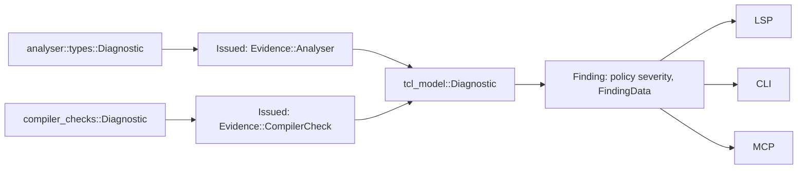

# Step 5: extract tcl-model

Part of [splitting tcl-compiler](../crate-split-design.md). Plan items, in
order:

- 249: the result lattices;
- 275: `ProcDef`, `ClassDef` and the analysis inputs;
- 276: the result and side-effect records;
- 277: one `Diagnostic`.

Builds on [step 3](03-tcl-names.md), because the records name allocation
sites and namespace keys, and on [step 4](04-tcl-values.md), because the
result records sit beside the value lattice. [Step 6](06-tcl-ir.md) builds on
it: the IR's module records name `ResolvedAnalysisInput` and `ClassDef`
(`ir/definition_script.rs`, `ir/module.rs`). Step 7's item 250 defines its
body-report trait over these types.

## Problem

Binding names the analyser for its inputs and facts. The scanner (test files
and inline `#[cfg(test)]` items dropped, comments ignored, 26 November 2026)
finds 594 `crate::analyser::…` path references from the binding modules,
370 of them in `command_binding`:

| Item | Binding modules | `command_binding` only |
|---|---|---|
| `ResolvedAnalysisInput` (and its methods) | 355 | 185 |
| `AnalysisResult` | 97 | 66 |
| `Analyser::new` | 36 | 35 |
| `ProcDef` | 17 | |
| `ClassDef` | 8 | |

The overview's "about 150" and "~280" are lower than these counts. The
`module-layers` ledger (step 1) gives the authoritative count; these are the
order of magnitude.

The candidate types and what their fields name:

| Type | Defined at | Fields name |
|---|---|---|
| `BoundedSet` | `bounded_set.rs:46` | nothing in the crate |
| `CompletionCodeLattice`, `CompletionObligations` | `completion.rs:45` | `BoundedSet` |
| `ResolvedAnalysisInput` | `analyser/input.rs:37` | `DialectProfile`, `ContextRegistry`, `LexerConfig`, `VendorSourceNamePolicy`, `ScriptEncoding`; `command_binding::TrustedSourceModuleLoader` (which holds an `ExecutedScriptSource`, step 3); `EntryProcedureFrame` (strings only) |
| `ProcDef` | `analyser/types/procedures.rs:243` | `signature_scan::{ParamDef, EnsembleSubcommandProvenance, SignatureSourceCommand, SourceFormalCount, SignatureSourceNameInput}` |
| `ClassDef` | `analyser/types/class_def.rs:159` | `signature_scan::{SignatureSourceCommand, SignatureSourceLookup}`; the latter holds an `Option<SignatureSourceNameInput>` (`scope.rs:558`) |
| `AnalysisResult` | `analyser/types.rs:136` | `realm::CommandBindingRealm`, `command_binding::{OriginalCompletedCommandWorld, OriginalSourceConditionalRegion}`, `signature_scan` metadata, `compilation_unit::OriginalOptimiserSourceOrigin` |
| side-effect records (`StorageType` … `CalleeSummary`) | `side_effects.rs:60-711` | nothing in the crate; the algorithms after `:712` name `var_resolve`, `place`, `taint` |
| analysis-result records (`ConstantBranch`, `DeadStore`, …) | `analyses.rs` | nothing |
| `Answer`, `Knowledge` (item 78) | `tcl-core-types/src/answer.rs:64,101` | already below the compiler |

### Two Diagnostic types, and a third

| Field | `analyser::types::Diagnostic` (`diagnostic.rs:40`) | `compiler_checks::Diagnostic` (`compiler_checks.rs:206`) |
|---|---|---|
| `code: DiagCode`, `span: Span`, `severity: Severity`, `message: String` | yes | yes |
| `fixes: Vec<CodeFix>` | yes | yes |
| `replacement: Option<String>` (a fix on the same span) | — | yes |
| `category: String` (`"gvn"`, `"taint"`, …) | — | yes |
| `subject: Option<DiagnosticSubject>` | yes: 12 variants naming `command_binding`, `signature_scan`, `registry_invocation` (`diagnostic_subject.rs:199`) | — |
| `signed_data_group_comparison` | yes | — |
| `source_context: Option<DiagnosticSourceContext>` | — | yes: a `SourceImage`, `LexerConfig`, `RegistrySnapshot` and `ResolvedAnalysisInput` (`compiler_checks.rs:73`) |
| `payload: CheckPayload` | — | yes: names `irules_checks::IrulesCheckPayload` and `taint::TaintSinkSource` |
| derives | `PartialEq, Eq` | `PartialEq, Eq, Hash` |

`DiagCode` and `Severity` are already in `tcl-core-types`. `CodeFix` and
`FixSafety` are in `irules_checks.rs:138,209`.

A third shape already exists: `tcl-lsp-core`'s `Finding`
(`diagnostic_policy.rs:158`). It has `code`, `span`, `severity`, `message`,
`fixes`, a `producer`, and `data: Option<FindingData>` holding the original
issuer. Its `From` impls (`:175,192`) fold `replacement` into a
`RequiresReview` fix and drop `category`. The LSP, the CLI (`tcl diag`,
`commands/diag.rs:761`) and MCP (`tools.rs`, `diagnostics_report`) all report
through `Finding` and the diagnostic policy.

## Design

### The crate

`rust/tcl-model` sits at rank 4. It depends on `tcl-names`, `tcl-values`,
`tcl-source`, `tcl-core-types`, `tcl-dialect` and the `tcl-registry` core
(`ContextRegistry`, `ScriptEncoding`). It holds vocabulary and no algorithms.

### 249: the result lattices

`bounded_set.rs` and `completion.rs` move unchanged. Inside the crate,
`BoundedSet` has 27 mentions and the completion lattice 28. `types.rs` (the
`TclType` lattice, 887 lines) names only `BoundedSet` and no binding module
names it. It stays with `type_infer` (step 10) unless the ledger shows a lower
user.

### 275: ProcDef, ClassDef and the inputs

`ResolvedAnalysisInput`, `EntryProcedureFrame`, `TrustedSourceModuleLoader`
and `OriginalAnalyserSourceSettings` move to `tcl_model::input`. The
settings type moves with one exception: its `source_graph::current_analysis`
call (`source_settings.rs:137`) names the unit crate, so it becomes a
function there. `ResolvedAnalysisInput::for_nested_source`'s use of the
segmenter (`input.rs:404`) is fine, because `tcl-source` is below.

`ProcDef` and `ClassDef` carry binding receipts: `SignatureSourceNameInput`
and `SignatureSourceLookup`'s original input. Step 3 showed these are proofs,
not keys. Consumers read them heavily: `.original_name_input` appears 174
times in `tcl-lsp-core` and 75 times in the analyser. That rules out moving
them into a side table now.

**Decision: one receipt parameter.** `tcl-model` defines a trait for the
receipt types its records carry. Binding implements it, and the analyser and
the LSP use binding's type aliases:

```rust
// tcl-model
pub trait Receipts: 'static {
    type NameInput: Clone + Debug + PartialEq + Eq + Hash;   // SignatureSourceNameInput
    type Lookup:    Clone + Debug + PartialEq + Eq;          // SignatureSourceLookup
}
pub struct ProcDef<R: Receipts> { /* today's fields */ pub original_name_input: Option<R::NameInput>, .. }
pub struct ClassDef<R: Receipts> { .. pub metaclass_lookup: Option<R::Lookup>, .. }

// tcl-binding (step 8; inside tcl-compiler until then)
pub struct BindingReceipts;
impl tcl_model::Receipts for BindingReceipts { type NameInput = SignatureSourceNameInput; type Lookup = SignatureSourceLookup; }
pub type ProcDef = tcl_model::ProcDef<BindingReceipts>;
pub type ClassDef = tcl_model::ClassDef<BindingReceipts>;
```

The signature record types with no receipt inside move to `tcl-model`
alongside: `ParamDef`, `EnsembleSubcommandProvenance`, `SourceFormalCount`
and `SignatureSourceCommand`. Their fields are `NamePolicyProtocol`,
`ByteCommandSlot`, `ParameterGrammar` and an `Arc` of formal parameters. The
ledger confirms each.

Step 6 extends the same trait for the IR (`tcl_ir::Facts: tcl_model::Receipts`),
so the workspace has one receipt parameter, not one per crate.

The trait and the types around it, across steps 5 and 6:

```mermaid
classDiagram
  class Receipts {
    <<trait, tcl-model>>
    type NameInput
    type Lookup
  }
  class Facts {
    <<trait, tcl-ir, step 6>>
    type Command
    type Function
    type Module
  }
  class ProcDef~R~ {
    original_name_input: Option~R::NameInput~
  }
  class ClassDef~R~ {
    metaclass_lookup: Option~R::Lookup~
  }
  class BindingReceipts {
    <<tcl-binding>>
  }
  Receipts <|-- Facts
  Receipts <|.. BindingReceipts
  Facts <|.. BindingReceipts
  ProcDef ..> Receipts
  ClassDef ..> Receipts
```



### 276: the result and side-effect records

- `side_effects.rs` up to line 711 moves: `StorageType`, `StorageScope`,
  `ConnectionSide`, `EffectRegion`, `SideEffect`, `CommandSideEffects` and
  `CalleeSummary`. `classify_*` and the storage-scope algorithms (`:712` on)
  go to `tcl-analysis` in step 10. Binding's 3 references
  (`registry_invocation/handler_invocation.rs`) then name `tcl-model`.
- **`SideEffectTarget` does not move: 276 deletes it.** It mirrors the
  registry core's enum (`tcl-registry/src/side_effects.rs:24-27`: "Variant
  names match the consumer's `tcl_compiler::side_effects::SideEffectTarget`"),
  which has every compiler variant plus `Process` and `ChannelIo`; the
  compiler copy imports it as `RegistryTarget` and maps it one-to-one in
  `lift_registry_target` (`tcl-compiler/src/side_effects.rs:1149`). The
  registry is the single source of truth, so `tcl-model`'s records name the
  core's `SideEffectTarget`, and the two registry-only variants keep today's
  mapping (`Process` reads as `Unknown`, `ChannelIo` as `FileIo`) inside
  `classify_*`.
- `analyses.rs`' result records (`ConstantBranch`, `DeadStore`,
  `ReadBeforeSet`, `UnusedVariable`) move.
- The plain records inside `AnalysisResult` that binding reads move too: the
  namespace path, export, import and forget records, package provide and
  require records, `Scope` (`analyser/types/scopes.rs:147`) and
  `DefinedSymbol`. The scanner finds binding reading `namespace_paths` and
  `namespace_exports` 41 times each, and `namespace_imports` 21 times.
- **`AnalysisResult` itself does not move.** It holds binding's own outputs,
  `OriginalCompletedCommandWorld` (97 reads from binding) and
  `CommandBindingRealm`, and a unit-crate type. It is the analyser's report,
  and it stays in `tcl-diagnostics`. Item 250 (step 7) gives binding a
  narrower `BodyReport` type, defined in binding, which the analyser fills.
  That removes binding's 97 `AnalysisResult` references.
- **`DocumentFacts`, the consumer interface (decision D-C).** `tcl-model`
  defines a binding-free trait over what a document's analysis found. It is
  added by item 289, which needs it, not by this step, so it gates no
  extraction:

  ```rust
  // design sketch: tcl_model::document
  pub trait DocumentFacts {
      fn diagnostics(&self) -> &[Diagnostic];                        // the one type of 277
      fn symbols(&self) -> &[DefinedSymbol];
      fn scopes(&self) -> &[Scope];
      fn invocation_at(&self, offset: u32) -> Option<InvocationView<'_>>; // resolved CommandKey, roles, Knowledge
      fn summary(&self, body: BodyUnitRef) -> Option<&ProcSummary>;
  }
  ```

  `AnalysisResult` projects into it in `tcl-diagnostics`, and `tcl-semantic`
  (item 85, between `tcl-unit` and `tcl-diagnostics`) implements it as the
  one analysis query API. Feature crates take `&dyn DocumentFacts` in 289's
  `DocumentInput` and so depend on `tcl-model`, never on `tcl-diagnostics`.
- **`Answer` and `Knowledge` do not move.** They are in `tcl-core-types`,
  which `tcl-runtime-api` and the VM use. The registry's `Knowledge`
  (`tcl-registry/src/knowledge.rs:38`) is a different type with the same name:
  it describes the completeness of a facts domain (`Unknown`, `Partial`,
  `Complete`). 276 records the collision. Item 261's core split renames the
  registry's type (`Completeness`), so the two never meet in one `use` list.

### 277: one Diagnostic

The merged type takes `Finding`'s shape, which every surface already reports
through:

```rust
// tcl-model
pub struct Diagnostic {
    pub code: DiagCode, pub span: Span, pub severity: Severity, pub message: String,
    pub fixes: Vec<CodeFix>,           // `replacement` becomes a same-span RequiresReview fix
    pub producer: Producer,            // Analyser | CompilerCheck(Category) | Optimiser | Style
}
pub struct CodeFix { pub span: Span, pub new_text: String, pub description: String, pub safety: FixSafety }

// tcl-diagnostics (inside tcl-compiler until step 12)
pub struct Issued<E> { pub diagnostic: Diagnostic, pub evidence: E }
pub enum Evidence {
    Analyser { subject: Option<DiagnosticSubject>, signed_data_group: Option<Box<SignedDataGroupComparison>> },
    CompilerCheck { payload: CheckPayload, source_context: Option<DiagnosticSourceContext> },
}
```

How the three shapes meet:



A compiler check that carries a `replacement` today, before and after 277.
W201 (manual path concatenation, `path_concat.rs`) is one. Its producer
already copies the replacement into a same-span review fix
(`compiler_checks.rs:436`), so the merged type drops `replacement` and the
surfaces see no change. The check's own test input:

**Source:**

```tcl
set x 42
set p "/tmp/$x"
```

**Before:**

```rust
// compiler_checks::Diagnostic, from from_path_concat (real field values)
Diagnostic {
    span,                                   // the value word "/tmp/$x"
    code: DiagCode::W201,
    category: "taint".into(),
    severity: Severity::Hint,
    message: "Possible manual path concatenation. Use [file join] for portable path construction.".into(),
    replacement: Some("[file join /tmp $x]".into()),
    fixes: vec![CodeFix { span, new_text: "[file join /tmp $x]".into(),
                          description: "Rewrite with `file join`".into(),
                          safety: FixSafety::RequiresReview }],
    source_context: None,
    payload: CheckPayload::PathConcatenation { variable: "p".into() },
}
```

**After:**

```rust
// tcl_model::Diagnostic, inside tcl-diagnostics' Issued
Issued {
    diagnostic: Diagnostic {
        code: DiagCode::W201, span, severity: Severity::Hint, message,
        fixes: vec![CodeFix { span, new_text: "[file join /tmp $x]".into(),
                              description: "Rewrite with `file join`".into(),
                              safety: FixSafety::RequiresReview }],
        producer: Producer::CompilerCheck(Category::Taint),
    },
    evidence: Evidence::CompilerCheck {
        payload: CheckPayload::PathConcatenation { variable: "p".into() },
        source_context: None,
    },
}
```

The values come from `path_concat.rs`'s test
`warning_includes_replacement_when_buildable` (`:585`), which accepts
`$x` or `${x}` in the replacement. `tcl diag` does not show W201 on this input
today; the test is the source.

Decisions, with reasons:

1. **The evidence stays with its producer.** `DiagnosticSubject` and
   `CheckPayload` name binding, taint and iRules types. Putting them in
   `tcl-model` would pull those layers below the model. Consumers that need
   evidence already reach it through `FindingData`'s originals: code actions,
   currency checks and `check_payload`.
2. **`category` becomes `Producer::CompilerCheck(Category)`,** a closed enum
   in place of a string. Its values come from the existing producers (`sccp`,
   `gvn`, `shimmer`, `taint`, …).
3. **`Finding` keeps policy fields only.** After 277 it is
   `Diagnostic` plus its policy-relabelled severity and `FindingData`.
   `FindingData::Analyser` and `FindingData::CompilerCheck` hold
   `Issued<Evidence>`. Its two `From` impls become one.
4. **Derives.** The merged `Diagnostic` derives `Hash`, as the compiler
   checks' type does today. The evidence types keep their own derives, so
   `DiagnosticSubject` does not have to gain `Hash`.

### The golden-diff check

277 changes the type every surface reports through, so it is verified by
output, not by types. Write `scripts/dev/diagnostic-goldens.py` and run it on
the last green commit before 277 and on the commit after. Its corpus is the
815 `.tcl` fixtures under
`docs/work/name-handling/handover/oo-dispatch-probe/` (the conformance
corpus) and `tests/fixtures/`, each under its declared dialect, with
`f5-irules`, `jim` and `tcl8.4` added for the dialect-specific rows.

| Surface | Capture |
|---|---|
| CLI | `tcl diag --json`, `tcl lint --json` and `tcl validate --json` (`DiagArgs`, `tcl-cli/src/cli.rs:972`) |
| MCP | `analyze`, `validate`, `review` and `code_actions` (through `tcl_mcp::tools::run_tool`, one process per dialect) |
| LSP | `textDocument/publishDiagnostics`, then `textDocument/codeAction` over each diagnostic's range (`.claude/skills/lsp-client/lsp_client.py`) |

The script normalises key order and sorts diagnostics by `(start, end, code)`,
and nothing else. Messages, severities, fix texts, fix safety and data
payloads are compared exactly. **Done** means the two runs are byte-identical.
A difference fails the step, unless it is the one expected change: a
`replacement` that becomes a fix. `Finding` already makes that conversion, so
the expected count is zero. The script stays in the tree for steps 12 and 13,
which move the producers.

## Work list

1. 249: move `bounded_set.rs` and `completion.rs`, and delete the root
   re-export (`lib.rs:227`).
2. 275:
   - move `EntryProcedureFrame`, `TrustedSourceModuleLoader`,
     `ResolvedAnalysisInput` and `OriginalAnalyserSourceSettings` (minus the
     `source_graph` call);
   - define `Receipts`;
   - make `ProcDef` and `ClassDef` generic, and move them with the
     receipt-free signature records;
   - add binding's aliases;
   - rewrite the paths.
3. 276: split `side_effects.rs` and move the records. Move `analyses.rs`' records
   and the plain `AnalysisResult` field types. Rename the registry's
   `Knowledge` with item 261.
4. 277:
   - capture the goldens on the base commit;
   - move `CodeFix` and `FixSafety`;
   - define `Diagnostic`, `Producer`, `Issued` and `Evidence`;
   - convert the analyser's and the compiler checks' emitters;
   - collapse `Finding`'s conversions;
   - re-capture the goldens and diff.
5. Re-point `diag-emission`'s owner rows and `deny.toml`'s wrappers.

## Verification

- **Done when:**
  - `tcl-model` builds, and `cargo tree -p tcl-model` shows no
    `tcl-compiler`.
  - The ledger reports no binding module naming `analyser::input`,
    `analyser::types::{procedures, class_def, scopes}`, `bounded_set`,
    `completion` or `side_effects`' records.
  - `rg 'struct Diagnostic\b' rust/` finds one definition.
  - The golden diff is empty.
- **What is left for step 7:** binding's `Analyser::new` (36) and
  `AnalysisResult` (97) references. These are item 250's trait.
- **Measured:**
  - the crates compiled after an analyser edit: still `tcl-compiler` and up
    until step 12, but `tcl-model` must not rebuild;
  - analysis latency (release build): the generic `ProcDef` has one
    instantiation and should cost nothing.

## Risks

- **The receipt parameter spreads.** Every function that takes a `ProcDef`
  across crates names `R` or the alias. Only binding's aliases may be used
  above binding, which keeps signatures unchanged for the analyser and the
  LSP.
- **Output drift hidden in policy.** The diagnostic policy relabels severities
  and merges findings, so a type change could alter the merge. The goldens
  capture policy output for that reason, not just producer output.
- **The fixture run is slow.** 815 files × 4 surfaces on the busy machine.
  Run the CLI and MCP captures in one process per dialect, and the LSP
  capture once per corpus with one server.

## Corrections to the overview

- `Answer`, `Knowledge`, `DiagCode` and `Severity` already live in
  `tcl-core-types`. Item 276's text should drop `Answer`/`Knowledge` and
  record the registry's same-named `Knowledge`.
- `AnalysisResult` cannot move to `tcl-model`, because it names binding,
  realm and unit-crate types. Item 276 should move the records it holds, and
  leave the type to `tcl-diagnostics` and item 250. What consumers read is
  `DocumentFacts`, which it projects into (289's "`&AnalysisResult` (from
  `tcl-model`)" is wrong on both counts).
- `ProcDef` and `ClassDef` carry binding receipts. They move as generic types
  over `tcl_model::Receipts`, and item 275's text should say so.
- There are three diagnostic shapes, not two. `tcl-lsp-core`'s `Finding` is
  the one the merged type should match.
- Binding's references into the analyser are higher than the overview's
  counts: 594, with `ResolvedAnalysisInput` at 355, by this scanner.

## Review fixes (26 November 2026, deep review)

- **O2 (compiler side):** `DocumentFacts` in `tcl-model`, added by 289; `AnalysisResult` projects into it; `tcl-semantic` implements it (D-C).
- **M9:** `SideEffectTarget` is deleted, not moved; `tcl-model` names the registry core's.
