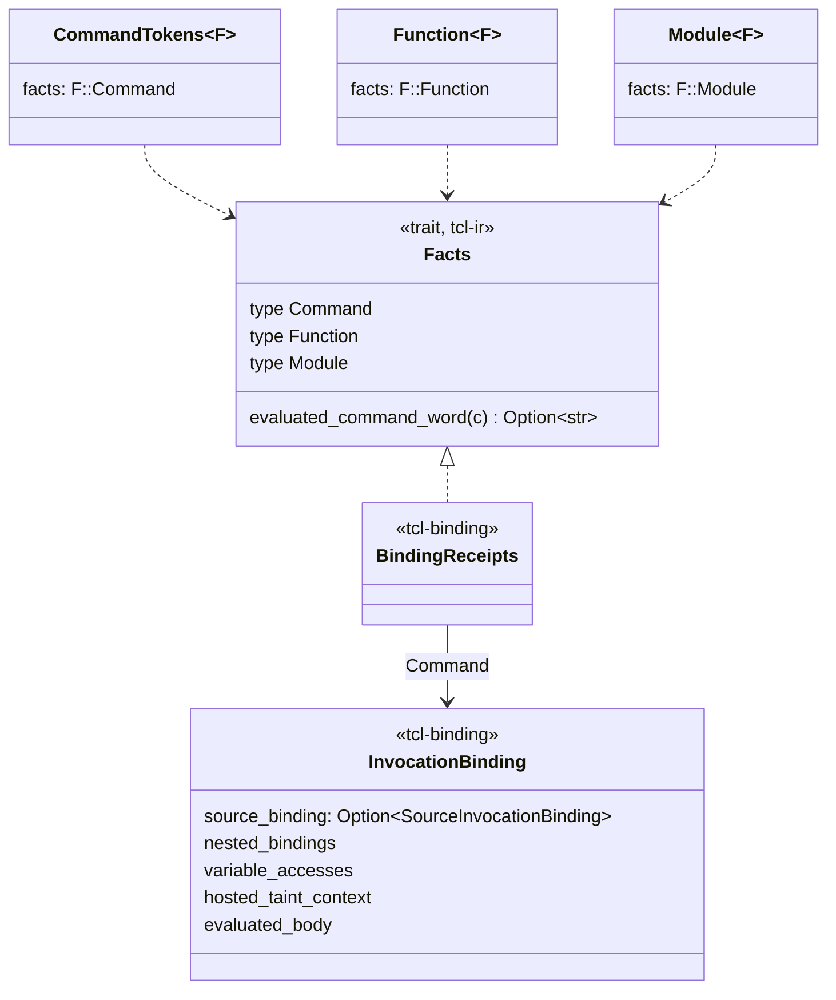

# Step 6: extract tcl-ir

Part of [splitting tcl-compiler](../crate-split-design.md). Plan item 252.
Builds on steps [2](02-tcl-source.md) (word and source-site types),
[3](03-tcl-names.md) (keys), [4](04-tcl-values.md) and [5](05-tcl-model.md)
(`ResolvedAnalysisInput`, `ClassDef`, and the `Receipts` parameter this step
extends). [Step 7](07-binding-fixpoint.md) (items 278, 250 and 279) builds on it: once the IR's data
types sit below binding, binding's remaining edges into lowering, SSA and
analysis are the whole of item 278's inventory.

## Problem

The IR and CFG data types are 7.2k lines in `ir/` (1.1k of them in
`ir/tests.rs`) and 1,277 in `cfg.rs`. They hold binding's results inside their
own records:

- **`CommandTokens`** (`ir/command_tokens.rs:60-91`) has `source_binding:
  Option<SourceInvocationBinding>`, `nested_bindings: Arc<Vec<(u32,
  SourceInvocationBinding)>>`, `variable_accesses: Vec<SourceVariableAccess>`,
  `hosted_taint_context: Option<Arc<HostedSourceTaintContext>>` and
  `evaluated_body: Option<Box<EvaluatedBodyRegion>>`.
- **`cfg::Function`** (`cfg.rs:341-472`) has `SourceMathInvocation` and
  `SourceExpressionPreparation` lists, `SourceNativeCompilationFailure`,
  `NativeCompilationAdmission`, `cfg_builder::CfgMetadataContext`,
  `OriginalSourceCallMayWrites` and `dynamic_names::DynamicNameBarrier`
  (three fields).
- **`Module`** (`ir/module.rs:120-207`) has `source_entry: SourceAnalysisEntry`,
  `RetainedSourceModuleBindings`, `SourceFutureCallSite`, the
  `Original{Native,Logical,Hosted}ProcedureBody` maps,
  `SourceInstalledProcedureBody` and `registry_invocation::OriginalAuthoredProcedureBody`.

These fields are read everywhere. In production code outside test files:

| Field | Reads |
|---|---|
| `.source_binding` | about 1,175: 1,112 in `tcl-compiler` (309 `registry_invocation`, 261 `command_binding`, 60 `analyser`, 54 `lowering`, …), 40 in `tcl-codegen`, 19 in `tcl-lsp-core`, 3 in `tcl-diagram`, 1 in `bpf-tcl-ir` |
| `.variable_accesses` | 105 |
| `.nested_bindings` | 61 |
| `.evaluated_body` | 32 |
| `.hosted_taint_context` | 16 |

What `ir` names in `command_binding`, by the scanner: 53 references in 9
files. `cfg.rs` adds 15.

| Type (references in `ir` / `cfg.rs`) | Kind | Goes to |
|---|---|---|
| `SourceNamespaceKey` 7/1, `CommandAllocationSite` 5, `CommandAllocation` 3, `BindingKind` 3, `SourceOriginKind` 2/3, `ExecutedScriptSource` 1/4 | key | `tcl-names` (step 3): 21/8 |
| `SourceInvocationBinding` 7, `SourceVariableAccess` 5 | per-command annotation | the `Facts::Command` parameter |
| `SourceMathInvocation` 1/3, `SourceExpressionPreparation` 1/3, `SourceNativeCompilationFailure` 1/1 | per-function annotation | `Facts::Function` |
| `SourceAnalysisEntry` 2, `RetainedSourceModuleBindings` 2, `SourceFutureCallSite` 1, the three procedure-body receipts 3, `SourceInstalledProcedureBody` 1, `formal_topology` 1, `original_receiver_body_context` 1 | per-module annotation | `Facts::Module` |
| `SourceCommandTarget` 3 (`module.rs:561-631`) | an argument to `Module` methods | those methods move to binding |
| `SourceReceiverMethodEntry` 1, `SourceMethodReceiver` 2 (`method_identity.rs:106-113`) | a constructor | moves to binding |

`ir` and `cfg.rs` also name other modules in production:

| Edge | What | Fix |
|---|---|---|
| `var_resolve` | `ResolveContext` 3, `VariableProofRelocation` 2; `VariableExecutionFrame`, `VariableCellKey` | `ResolveContext` and the relocation go into `Facts::Command`; the frame and cell key went to `tcl-names` |
| `registry_invocation` | 3 function calls in `definition_script.rs:150,280-284`; `HostedSourceTaintContext`; `OriginalAuthoredProcedureBody` | the calls go to binding; the types go into `Facts` |
| `lattice_rebase` | `rebase_command_tokens`, `rebase_source_word`, `rebase_script` (`source_bpf_command.rs`, `definitions.rs:157`) | span rebasing is an IR operation, so it moves into `tcl-ir`; `rebase_function_unit` (`lattice_rebase.rs:47`) is a memo helper and stays in the unit crate |
| `cfg_builder` | `build_cfg_function_in_bpf_selected_scope` (`source_bpf_command.rs:668`), `CfgMetadataContext` | the BPF builder function moves to `tcl-lowering`; `CfgMetadataContext` goes into `Facts::Function` |
| `connection_scope::event_resolve_context` (`definitions.rs:162`), `signature_scan::scope::SignatureSourceCommand`, `formal_parameters::SourceProcedureFormalTopology` | a call; records | the call goes to binding; `SignatureSourceCommand` went to `tcl-model` (step 5); the formal topology is checked by the ledger |
| `analyser` | `ResolvedAnalysisInput` 3, `ClassDef` 1 | `tcl-model` (step 5); `Analyser` is test-only (`definition_script.rs:301`) |
| `execution_region::EvaluatedBodyRegion`, `native_compilation_admission`, `dynamic_names::DynamicNameBarrier` | annotations | into `Facts` |
| `depth_guard`, `word_expr`, `segmenter` | limits, word types | `tcl-source` (step 2) |

## Design

### The crate

`rust/tcl-ir` sits at rank 5. It depends on `tcl-source`, `tcl-names`,
`tcl-model` (for the `Receipts` trait, `ResolvedAnalysisInput` and
`ClassDef`), `tcl-values` (for the constant lattice in IR facts, if the ledger
finds one), `tcl-expr` (`ExprNode`), `tcl-core-types`, `tcl-runtime-api` and
the registry core. It holds the data types and the pure operations on them:
construction from segmented commands (`CommandTokens::from_segmented`), span
rebasing, statement walks, and procedure and method identity.

### SourceInvocationBinding, as item 248 left it

Step 3 found that `SourceInvocationBinding` is a record of proofs, not a key,
and that it cannot move below binding. This step gives the IR a slot for it
without naming its type.

**Decision: `tcl-ir` is generic over one facts parameter, which extends step
5's `Receipts`.**

```rust
// tcl-ir
pub trait Facts: tcl_model::Receipts {
    type Command:  Clone + Debug + Default + PartialEq + Rebase;   // per CommandTokens
    type Function: Clone + Debug + Default;                        // per cfg::Function
    type Module:   Clone + Debug + Default;                        // per Module
    fn evaluated_command_word(c: &Self::Command) -> Option<&str>;  // the one read ir makes (script.rs:82,92)
}
pub trait Rebase { fn rebase(&mut self, delta: i64); }

pub struct CommandTokens<F: Facts> { /* lexical fields */ pub facts: F::Command, pub synthetic: Option<SyntheticMarker>, .. }
pub enum   Statement<F: Facts> { .. }
pub struct Script<F: Facts>, Procedure<F: Facts>, Module<F: Facts> { .. pub facts: F::Module }
pub mod cfg { pub struct Function<F: Facts> { .. pub facts: F::Function }; pub struct CfgModule<F: Facts>; .. }

// tcl-binding (inside tcl-compiler until step 8)
pub struct InvocationBinding { pub source_binding: Option<SourceInvocationBinding>,
    pub nested_bindings: Arc<Vec<(u32, SourceInvocationBinding)>>,
    pub variable_accesses: Vec<SourceVariableAccess>,
    pub hosted_taint_context: Option<Arc<HostedSourceTaintContext>>,
    pub evaluated_body: Option<Box<EvaluatedBodyRegion>> }
impl tcl_ir::Facts for BindingReceipts { type Command = InvocationBinding; type Function = FunctionFacts; type Module = ModuleFacts; .. }
pub mod ir { pub type CommandTokens = tcl_ir::CommandTokens<BindingReceipts>; pub type Module = tcl_ir::Module<BindingReceipts>; /* … */ }
```

The IR owns the slots; binding owns what fills them:



The reasons:

1. **It keeps the fixpoint's in-place annotation.** Binding writes its record
   into the IR it walks, and lowering and SSA read it from there. A side table
   keyed by site would match design integration's decision 4 more closely
   (`invocation_at_source(offset)`), but it means rewriting about 1,400 field
   reads, and the reads in `lowering` and `ssa` would need a table threaded
   through every call. That is item 50's and item 84's redesign, not a move.
2. **It costs nothing at run time.** There is one instantiation in practice.
   `bpf-tcl-ir`, the explorer and the diagram read binding's facts too, so
   they use binding's aliases.
3. **The rewrite is mechanical.** `tokens.source_binding` becomes
   `tokens.facts.source_binding`. Consumers outside the IR import
   `tcl_binding::ir::*` aliases, so their type names do not change.

A reader in `tcl-codegen`, before and after:

**Before:**

```rust
use tcl_compiler::ir::CommandTokens;

fn bound(tokens: &CommandTokens) -> bool {
    tokens.source_binding.is_some()
}
```

**After:**

```rust
use tcl_binding::ir::CommandTokens; // = tcl_ir::CommandTokens<BindingReceipts>

fn bound(tokens: &CommandTokens) -> bool {
    tokens.facts.source_binding.is_some()
}
```

### What moves in

- `ir.rs` and `ir/`, minus the algorithms named above:
  - `definition_script.rs`'s registry calls;
  - `module.rs`' `SourceCommandTarget` methods;
  - `method_identity.rs`' constructor from a binding entry;
  - `source_bpf_command.rs`' CFG build, whose data type stays.
- `cfg.rs`, minus `Function`'s constructors that call `cfg_builder`.
- `cfg_layout.rs`, if the ledger shows it is data only.
- The IR half of `lattice_rebase.rs`: `rebase_command_tokens`,
  `rebase_source_word` and `rebase_script`, calling `Facts::Command::rebase`
  for the annotation's spans (`lattice_rebase.rs:192-196` today).

### Who consumes it

Production files naming `tcl_compiler::ir` or `cfg` today:

| Crate | Uses | After this step |
|---|---|---|
| `tcl-codegen` | `ir` 210, `cfg` 47, plus `command_binding` 112 | binding's aliases until step 11, then `tcl-ir` and `tcl-native-plan` (item 292) |
| `bpf-tcl-ir` | `ir` 24, `cfg` 4; also `executable_ir`, `lowering`, `cfg_builder`, `dispatch_proof`, `world_state_ssa`, `registry_invocation`, `semantic_analysis` | still on the compiler for the non-IR modules |
| `tcl-explorer` | `ir` 22, plus SSA, SCCP, analyser and others | item 294 |
| `tcl-diagram`, `f5-xc` | `ir` 6 each, plus `source_graph`, `registry_invocation` and `analyser` | the unit crate for `source_graph` |

### Open questions

1. **Side table or parameter, in the long run?** Settle it with item 50 (the
   annotated command). The evidence is the count of `facts.*` reads outside
   binding, lowering and SSA after step 9. If that count is small, a side
   table owned by binding is cheaper to reason about.
2. **Is `SourceProcedureFormalTopology` a receipt?** It sits in
   `signature_scan::formal_parameters` and `Module` names it
   (`ir/module.rs:417`). The ledger's closure for it decides between
   `tcl-model` and `Facts::Module`.

## Work list

1. Define `Facts` and `Rebase` in a new `rust/tcl-ir`. Move the three
   annotation groups out of `CommandTokens`, `cfg::Function` and `Module` into
   `InvocationBinding`, `FunctionFacts` and `ModuleFacts` in `command_binding`.
2. Add the type parameter to `CommandTokens`, `Statement`, `Script`,
   `Procedure`, `Module`, `cfg::Function`, `CfgModule` and the records that
   contain them. Add binding's aliases.
3. Move the algorithms out of `ir` (the list above) to binding, lowering or
   the unit crate.
4. Move `ir/`, `cfg.rs` and the IR half of `lattice_rebase.rs` into `tcl-ir`.
   Rewrite `.source_binding`, `.nested_bindings`, `.variable_accesses`,
   `.evaluated_body` and `.hosted_taint_context` to go through `.facts`.
5. Rewrite the consumers' paths: inside `tcl-compiler`, then `tcl-codegen`,
   `bpf-tcl-ir`, `tcl-explorer`, `tcl-diagram`, `f5-xc`, `tcl-lsp-core`,
   `tcl-lsp-db` and `tcl-cli`. Delete the root re-export
   (`lib.rs:230`, `pub use ir::{Module, Procedure, Script, Statement}`).
6. Add `deny.toml`'s wrappers. Re-point `walker-ownership` (statement walks)
   and the IR-statement range rule in the syntax-tree contract.

## Verification

- **Done when (252):**
  - `tcl-ir` builds, and `cargo tree -p tcl-ir` shows no `tcl-compiler`.
  - The ledger shows no reference from `tcl-ir` to any binding, lowering or
    analysis module.
  - `rg 'command_binding::' rust/tcl-ir` finds nothing.
  - the `bytecode-compare` skill's comparison shows no instruction change, and the
    IR snapshots from `tcl explore --json` are identical before and after.
- **Step 7's starting point:** what is left between binding and the IR crates
  is binding → `tcl-ir`, which is downward and allowed. Every remaining
  back-edge out of binding goes to lowering, SSA or analysis, which is
  item 278's inventory.
- **Measured:**
  - analysis latency (release build): the facts indirection is a field access,
    and the measurement confirms no cost;
  - the VM benchmarks (`scripts/perf/interp/`), because codegen walks the IR;
  - release binary size, native and WASM;
  - the crates compiled after an edit to `ir/statement.rs`.

## Risks

- **The generic parameter is wide.** Every function over `Statement` gains
  `<F: Facts>`, or takes binding's alias. Code above binding uses the alias
  only. Code in `tcl-ir` is generic. Nothing in between should be generic,
  because each extra generic caller is a monomorphised copy.
- **`Default` and `PartialEq` on annotations.** `CommandTokens` derives
  `PartialEq`, and equality on IR includes the annotations today. Keep that
  behaviour; the bounds above require it.
- **`bpf-tcl-ir` gains nothing yet.** It reads binding's facts and names
  lowering and `world_state_ssa`, so its cone stays large until steps 9–11.

## Corrections to the overview

- `bpf-tcl-ir` uses `lowering`, `cfg_builder`, `dispatch_proof`,
  `world_state_ssa`, `registry_invocation` and `semantic_analysis` as well as
  `ir`. "Builds against `tcl-ir` and `tcl-native-plan` only" holds only after
  those move or are inverted.
- `cfg.rs` holds binding results too (15 references to `command_binding`),
  so the IR's tie to binding is not only `SourceInvocationBinding`.
- Item 252's text ("receives `SourceInvocationBinding` as the annotated
  command") should read: `tcl-ir` is generic over a `Facts` parameter, and
  `SourceInvocationBinding` stays with binding as `InvocationBinding`.

## Review fixes (26 November 2026)

- **R4:** binding's per-site receipt, `tcl-ir`'s `Facts::Command`, is `InvocationBinding` (was `CommandFacts`, which the integration design also used for the core's view; `InvocationFacts` is taken by `tcl-registry/src/resolved_invocation/invocation_facts.rs:64`). Chapter 7's naming table records it.
