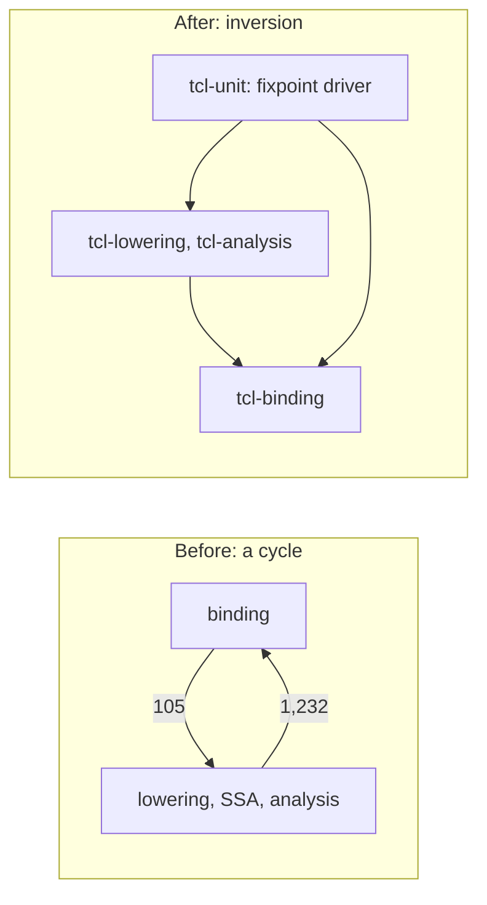
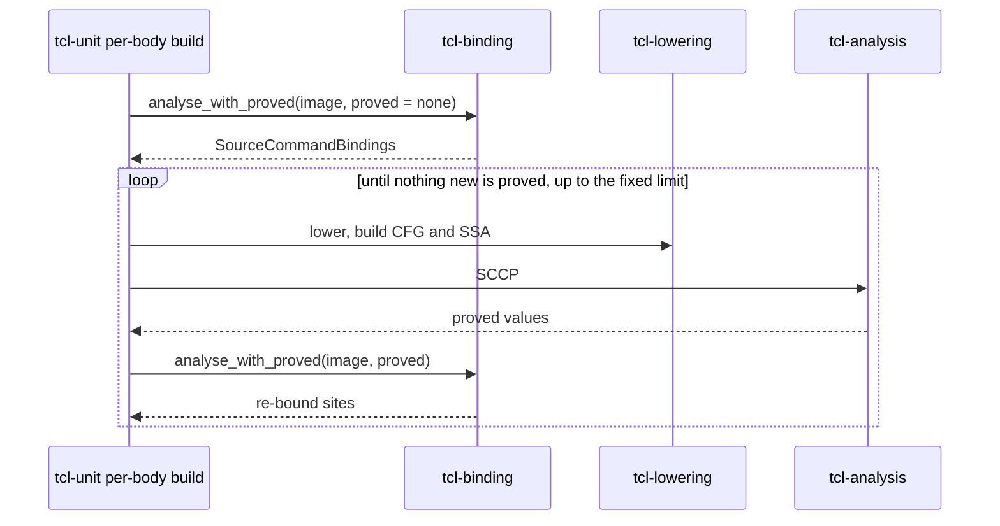

# Step 7: binding against lowering, analysis and the analyser

Part of [splitting tcl-compiler](../crate-split-design.md). Plan items 278
(edge inventory and layout choice), 250 (the body-report trait) and 279
(apply the choice), in that order. Builds on step 6 (`06-tcl-ir.md`) and on
the vocabulary steps 3–5 (`03-tcl-names.md`, `04-tcl-values.md`,
`05-tcl-model.md`). Steps 8 ([`tcl-binding`](08-tcl-binding.md)), 9
([`tcl-lowering`](09-tcl-lowering.md)) and 10
([`tcl-analysis`](10-tcl-analysis.md)) build on it.

**Decision: inversion.** Binding sits below lowering and analysis, and the
compilation unit drives the fixpoint from above. The evidence is one-sided
(105 references up against 1,232 down), so no measurement is pending.

## Problem

Binding and value analysis are one fixpoint per body unit
([design integration](../../../work/name-handling/design-integration.md#decisions),
decision 1). The overview and plan item 278 read that as "binding calls into
lowering, SSA and SCCP by design" and left the layout open. The counts they
quote (`ir_helpers` 115, `lowering` 68, `ssa` 52, `cfg_builder` 18) came from
`rg 'crate::<module>\b'` over files whose names are not test names. That
count includes the `#[cfg(test)] mod tests` blocks inside production files,
which are large in binding: about 60k of the 281k lines in the seven
binding modules' non-test-named files are inline tests.

### Method

Measured at `8d63aa0d` (26 November 2026). The binding modules are
`command_binding`, `registry_invocation`, `realm`, `raw_binding`,
`variable_bindings`, `var_resolve`, `signature_scan`, `dynamic_names` and
`ir_helpers` (step 8 places it with them). Test-named files (`tests.rs`,
`*_tests.rs`, `tests/`, `test_*`, the `include!`d `*_corpus.rs`) are dropped,
and so is every item under `#[cfg(test)]` or `#[cfg(any(test, feature =
"test-support"))]`, found by a string- and char-aware brace matcher. A
reference is a `crate::<module>` token on a non-comment line. The 14 grouped
`use crate::{…}` imports in binding name no lowering, SSA or analysis module.
This method gives 558,933 production lines for the crate (the overview says
564k), 223k for binding, and 226k with `ir_helpers`.

### Binding → lowering and SSA (51 references in 14 files)

| From → to | Refs (files) | What crosses |
|---|---|---|
| `command_binding` → `ssa` | 23 (4) | `SsaFunction`, `Symbol`, `Version`, `SsaSourceView::at_statement`: the `diagnostic_version` readers on advice records (`declaration_layout/invocation_advice.rs:85`, `source_operand_advice.rs:200`, `expression_operand_advice.rs:43`, `declaration_preview/static_read_alternatives.rs:163`) |
| `registry_invocation` → `ssa` | 5 (2) | `SsaSourceView`, `ValueKey`: `matches_point` and `matches_source_point` (`authored_source_structure.rs:604`, `source_taint.rs:53`) |
| `ir_helpers` → `ssa` | 3 (2) | `ssa::uses_of`, `structural_body_indices` and `is_dynamic_write_target`: syntactic scans of `Statement`s that build no SSA (`ssa/uses.rs`, 1.5k lines) |
| `command_binding` → `lattice_rebase` | 11 (4) | `rebase_command_tokens`, `rebase_script`, `rebase_span` |
| `variable_bindings`, `registry_invocation` → `lattice_rebase` | 3 (2) | the same |
| `command_binding` → `cfg_builder` | 3 (2) | `CfgMetadataContext::Standalone`, which is an alias of `registry_invocation::OwnedInvocationMetadataContext` (`cfg_builder/mod.rs:1169`) |
| `command_binding` → `lowering` | 1 (1) | `declared_surface_package_loader` (`lowering/execution_regions.rs:35`), which reads only the registry and returns binding's `TrustedPackageLoader` |
| `registry_invocation` → `lowering` | 1 (1) | `Lowerer::original_logical_body_for_module`, in `source_body` (`logical_frame.rs:219`). Its only callers are in `cfg_builder` |
| `registry_invocation` → `lowering_hooks` | 1 (1) | `word_content_base` |

### Binding → value analysis (54 references)

| From → to | Refs (files) | What crosses |
|---|---|---|
| `command_binding` → `tcl_expr_eval` | 37 (4) | `FoldPolicy` (12), `TclValue`, `Env`, `EnvValue`, `eval_tcl_expr_with_policy`, `format_tcl_value_with_policy`, `parse_integer_operand_with_policy`, `analyse_tcl_expr_with_resolved_math_bindings`: step 4's kernel |
| `command_binding`, `dynamic_names`, `ir_helpers` → `value_transfer` | 8 (4) | `view_of`, `StructureInputs`, `literal_keyed_update`, `literal_template_plan`, `source_template_plan`, `SourceWord`: registry-driven evaluation that item 117 moves |
| `command_binding`, `registry_invocation`, `ir_helpers` → `var_escape` | 5 (4) | `helpers::invocation_facts`, `original_substitution_invocations`, `OriginalDeclaredProcedureArgumentSlots::from_module` |
| `registry_invocation` → `side_effects` | 3 (1) | `EffectRegion`, `normal_handler_effect_regions` |
| `command_binding` → `shimmer` | 1 (1) | `commit::CommitState` |

There are no production references to `sccp`, `interprocedural`, `gvn`,
`taint`, `type_infer` or `value_shapes`. The plan's 6, 3 and 2 for those are
all in test code. The single `sccp` hit is a doc link
(`mutation_summary.rs:174`).

### The other direction

Lowering and the SSA family name the binding modules 665 times, the analysis
modules 567 times and `compilation_unit` 114 times. Lowering runs binding
(`lowering/body_cache.rs:55`, `lowering/script_bodies.rs:189` call
`SourceCommandBindings::analyse_*`); binding walks source and never lowers a
body for its own walk.

### Binding → the analyser (550 references)

| From | Refs (files) |
|---|---|
| `command_binding` | 316 (84) |
| `registry_invocation` | 132 (39) |
| `realm` | 73 (6) |
| `signature_scan` | 26 (8) |
| `variable_bindings`, `ir_helpers` | 3 (2) |

What crosses it: `ResolvedAnalysisInput` (498 mentions in 116 files),
`AnalysisResult` (283 in 52), `ProcDef` (15), `OriginalAnalyserSourceSettings`
(9), `ClassDef` (8), `LogicalSourceProcedureDeclaration` (8) and about 40 more
names. The behaviour calls are few: the three `Analyser::readonly_*_realm`
captures (`registry_invocation/source_structure/selected_words.rs:100–133`),
`build_class_hierarchy` and three `class_hierarchy::original_metadata`
functions, four `analyser::utils` source scans, and
`OriginalAnalyserSourceSettings::capture`/`apply` through
`configure_analyser` (`source_point_entry.rs:631–660`).

**`Analyser::new` has no production call in binding.** All 598 calls in the
binding modules are in tests, test-support items and the cache corpus. Binding
never runs an analysis. It receives the parent's or the child's
`AnalysisResult` from its caller and reads it. Four binding files add inherent
`impl AnalysisResult` blocks: `conditional_metadata.rs:216`,
`source_scoped_body.rs:356`, `source_declared_method_template.rs:104` and
`logical_math.rs:431`.

Accesses on an `AnalysisResult` in those 52 files: `resolved_input` 102,
`retained_command_realm` 70, `matches_original_source_image` 39,
`body_lexer_config` 22, `resolved_registry` 19, and about 30 declaration
lookups (`original_procedure_declarations`, `all_classes`, `global_scope`,
`command_aliases`, `source_targets`, …) with 1–5 uses each.

## Design

### The choice: inversion

| | Inversion | Co-location |
|---|---|---|
| Edges to break | 105 binding → lowering/analysis references, all in the classes below | none |
| Crate size | `tcl-binding` ~226k, `tcl-lowering` ~45k | one ~270k crate |
| An analyser or SCCP edit rebuilds binding | no | no |
| A lowering or SSA edit rebuilds binding | no | yes |
| Matches the data flow | yes: lowering runs binding, and 1,232 references point down at binding | no |
| Where the fixpoint loop lives | the unit driver, which already sequences lowering, binding, CFG, SSA and SCCP per function | inside the merged crate |

Reasons:

1. **The edges are thin and mechanical.** No binding production code builds
   SSA, runs SCCP or lowers a body for its own walk.
2. **The feedback edge is already an input.** Spike 94's probe
   (`binding_value_fixpoint_probe.rs`, test-only) drives the loop from above
   by calling `CompilationUnit::build_with_analysis_input` and reading SCCP.
   It feeds values back through one hook, `operand_value`, called from
   `source_arguments.rs:141`. Binding does not need to call SCCP. It needs
   to accept "values SCCP has proved" as an input.
3. **Co-location grows the largest crate** by 45k lines, and every lowering
   or SSA edit would rebuild binding.

The fixpoint driver is the compilation unit's per-body build, in `tcl-unit`
below the analyser ([step 13](13-unit-and-db.md)). It runs binding, lowering,
CFG, SSA and SCCP, collects proved operands, and re-runs binding, up to the
fixed limit.

The edges between the two groups, in production references, before and after
item 279 (each arrow points at the module group named):



One body's build, as the unit drives it:



Spike 94's probe case `e01-computed-head` shows what the loop is for. The
command word is a variable read that binding alone leaves open; SCCP can fold
`lreverse {set}` to `set`, and the next round binds the command:

```tcl
set head [lreverse {set}]
$head value 1
puts $value      ;# 1, in tclsh 8.5 and later
```

### Binding's interface for the loop

Binding defines the input. It never calls up:

```rust
// tcl-binding::fixpoint
pub trait ProvedOperands {
    /// Exact contents SCCP proved for an original whole-word variable read
    /// that binding left open. `None` keeps binding's own answer.
    fn operand(&self, origin: &SourceOriginId, word: Span) -> Option<ProvedValue>;
}
pub struct ProvedValue { pub value: tcl_values::ExactValue }

impl SourceCommandBindings {
    pub fn analyse_with_proved(
        image: &SourceImage, config: LexerConfig, registry: &CommandRegistry,
        options: SourceAnalysisOptions<'_>, proved: &dyn ProvedOperands,
    ) -> Self;
}
```

The probe's memo bypass (`source_analysis_driver.rs:675`) becomes a key
field: the proved-operand set's fingerprint enters `SourceAnalysisCacheKey`.

### Breaking each edge (item 279)

| Class | Edge | Move |
|---|---|---|
| Consumer-side readers | `diagnostic_version`, `symbolic_version`, `matches_point`, `matches_source_point`, `static_read_alternatives` (28 refs, 6 files) | Move them to their callers' crates as extension functions over the advice record's public fields. The callers are the analyser's dataflow rules, `taint`, `intervals`, `interval_bounds` and `compilation_unit/unit_queries.rs` |
| Mis-filed syntactic scans | `ssa::uses` and `uses_of`, `structural_body_indices`, `is_dynamic_write_target` | Move them into `tcl-binding` beside `ir_helpers`. SSA then calls down to them |
| IR rebasing | `rebase_span`, `rebase_command_tokens`, `rebase_script` | Move them to `tcl-ir` (`ir::rebase`). The `FunctionUnit` rebasing in `lattice_rebase.rs` (it names `compilation_unit`) stays with the unit |
| Alias path | `cfg_builder::CfgMetadataContext` | Name `registry_invocation::OwnedInvocationMetadataContext` directly |
| Misplaced helpers | `declared_surface_package_loader`; `source_body` | The first moves into `command_binding/trusted_packages.rs`. The second moves to `cfg_builder`, its only caller |
| Lowering hook | `lowering_hooks::word_content_base` | Moves to `tcl-ir` or binding; it is a word-geometry helper |
| Value kernel | `tcl_expr_eval` (37) | Step 4 (item 280): `FoldPolicy`, `TclValue`, `Env` and the `*_with_policy` functions are kernel. `analyse_tcl_expr_with_resolved_math_bindings` takes binding's math bindings through a trait the kernel defines |
| Registry evaluation | `value_transfer` (8) | Item 117's evaluation half. `literal_keyed_update`, `literal_template_plan`, `source_template_plan` and `SourceWord` take a registry and literal words; step 4 checks they need nothing more and moves them to `tcl-values`. `view_of`/`StructureInputs` (one file, `representation_plan.rs:390`) go through a kernel trait if not |
| Analysis facts | `var_escape::helpers` (5), `side_effects` (3), `shimmer::commit::CommitState` (1) | `invocation_facts` and `original_substitution_invocations` scan registry invocations and move into binding. `EffectRegion` and `CommitState` are records for `tcl-model`; `normal_handler_effect_regions` moves to its caller's side or into binding with its inputs, whichever the ledger shows is one-way |
| Stray constant | `optimiser::MAX_OPTIMISER_WALK_DEPTH` (3) | Moves beside the `depth_guard` limits in `tcl-source` (step 2) |

After these moves, binding names no lowering, SSA or analysis module.

### The body-report trait (item 250)

Binding reads reports and never produces them, so the trait is a read view.
Binding defines it, `tcl-diagnostics` implements it for `AnalysisResult`,
and every caller passes its own report:

```rust
// tcl-binding::report
pub trait BodyReport {
    fn resolved_input(&self) -> Option<&ResolvedAnalysisInput>;        // tcl-model
    fn retained_realm(&self) -> Option<&Arc<CommandBindingRealm>>;      // tcl-binding
    fn body_lexer_config(&self) -> Option<LexerConfig>;
    fn matches_source_image(&self, image: &SourceImage, config: LexerConfig) -> bool;
    fn resolved_registry(&self) -> Option<&Arc<CommandRegistry>>;
    fn declarations(&self) -> &DeclarationFacts;                        // tcl-model
    fn key(&self) -> BodyReportKey;
}
```

- `DeclarationFacts` groups the procedure, class, scope, alias and
  source-target tables binding reads; step 5 moves their record types to
  `tcl-model`.
- The 283 `AnalysisResult` mentions become `&dyn BodyReport`, and the four
  `impl AnalysisResult` blocks become free functions over it.
- The `readonly_*_realm` captures need the analyser's walk-environment
  resolution (`analyser/state/walk_environment.rs:308`). They move up to
  `tcl-diagnostics` with `OriginalSourceRegistryContext::capture`. Its 7
  `tcl-lsp-core` callers and 13 internal callers name the new path.
- `OriginalAnalyserSourceSettings` is plain data (`analyser/source_settings.rs:28`).
  Step 5 moves it to `tcl_model::input`. `capture` and `apply` stay
  on `Analyser`, and binding stores the data in its entries.

**Wiring.** The plan says "the unit crate supplies it". Binding only receives
reports, so nothing is injected: the analyser passes `&self.result`, and LSP
features pass the result they hold.

**Cache keying.** Today `SourceAnalysisCacheKey`
(`source_analysis_cache.rs:48`) holds the source image, lexer config,
purpose, frame, `RegistrySemanticKey` and a `SourceAnalysisEntry`. The entry
carries `analyser_source_settings` and a `source_point_entry`, which holds a
snapshot of the parent's analysis. The point entry matches its parent and
child by `resolved_input` equality, `matches_original_source_image` and
realm input (`source_point_entry.rs:190–245`). Under the trait:

```rust
#[derive(Clone, PartialEq, Eq, Hash)]
pub struct BodyReportKey {
    pub image: SourceImageId,          // tcl-source: content identity, not address
    pub config: LexerConfig,
    pub input: ResolvedAnalysisInput,  // Eq as today
    pub settings: OriginalAnalyserSourceSettings, // tcl_model::input
}
```

- The point entry stores the parent's `BodyReportKey`, not the report.
- `matches_parent_analysis(&dyn BodyReport)` compares keys.
- The key is content-based, so it stays valid in the one database of
  [step 14](14-caching.md), where this memo becomes a query or goes.

## Work list

1. Check `module-back-edges.tsv` (step 1) against this doc's counts.
2. Item 279, in the edge table's order, after steps 4 and 5 have landed.
3. Item 250: add `tcl-binding::report` with the trait and `BodyReportKey`.
   Rewrite the 52 files, turn the four `impl AnalysisResult` blocks into free
   functions, and move the three realm captures and
   `OriginalSourceRegistryContext::capture` up.
4. Add `ProvedOperands` and `analyse_with_proved` (no-op by default), and
   rewrite spike 94's probe onto them.
5. Update the overview's crate table and diagram (item 278's "done when").

## Verification

- `module-back-edges.tsv` has no row from a binding module into a lowering,
  SSA, analysis or analyser module (items 279 and 250).
- The body-report cache tests pass unchanged: `source_analysis_cache` and
  `source_point_entry`, the `conditional_source` tests, and the
  `source_load` child-matching tests.
- Spike 94's fresh-versus-incremental check gives the same rounds, re-bound
  counts and sealed site bytes for all eight cases.
- Measured when `tcl-binding` first builds (step 8): its cone; that an edit to
  `lowering/` or `sccp/` rebuilds no binding crate; release analysis latency
  on the corpus before and after the trait.

## Risks

- **Virtual calls on the report path.** If release latency on the corpus
  regresses by more than 1%, make the hot readers generic over `R: BodyReport`.
- **The production loop is not built yet.** Phase 3's per-body scheduler may
  want binding to ask for values mid-walk, not between rounds. If it does,
  `ProvedOperands` is still the right shape, because it is queried during the
  walk. Only a need to run SSA from inside binding would reopen co-location,
  and spike 94 found none.
- **Readers moved up** need `pub` getters on the advice records, which stay.

## Corrections to the overview

- The binding → lowering, SSA and analysis counts in the overview's cycle
  table and in item 278 include inline test modules. The production counts
  are: `ir_helpers` 103 (it belongs to binding anyway), `lowering` 2, `ssa`
  31, `cfg_builder` 3, `lattice_rebase` 14, `tcl_expr_eval` 37,
  `value_transfer` 8, and `interprocedural`, `gvn`, `taint` and `sccp` 0.
- "`Analyser::new` (33)" is 0 in production; the 598 calls are all test code.
  `command_binding` → `analyser` is 316, not ~280. All binding modules
  together name the analyser 550 times.
- `AnalysisResult` cannot move to `tcl-model` (item 276). It holds a
  `CommandBindingRealm`, `OriginalCompletedCommandWorld`,
  `OriginalSourceConditionalRegion`, `signature_scan` records,
  `compilation_unit::OriginalOptimiserSourceOrigin` and
  `auto_path_eval::PathConstantAssignments` (`analyser/types.rs:136`).
  Its fact records go to `tcl-model`. The type itself stays in
  `tcl-diagnostics`, and binding reads it through `BodyReport`.
- `ResolvedAnalysisInput` names `command_binding::TrustedSourceModuleLoader`
  (`analyser/input.rs`, 3 references). Step 5b moves that record down with it.
- The overview's diagram and crate table should show the inversion layout
  with no "undecided" note. The fixpoint driver is the unit's build, in
  `tcl-unit` ([step 13](13-unit-and-db.md)).
