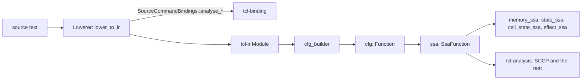
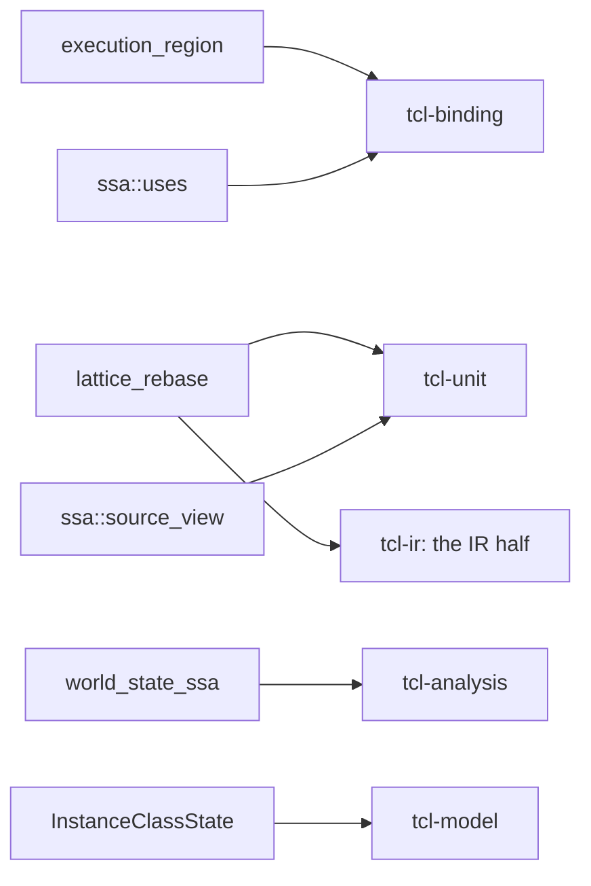

# Step 9: extract tcl-lowering

Part of [splitting tcl-compiler](../crate-split-design.md). Plan item 254.
Builds on [step 8](08-tcl-binding.md) (`tcl-binding`) and on
[step 7](07-binding-fixpoint.md), which chose **inversion**. So this step is
not empty: `tcl-lowering` is its own crate above `tcl-binding`.
[Step 10](10-tcl-analysis.md) (`tcl-analysis`) builds on it.

## Problem

Lowering, CFG building and the SSA family are about 45k production lines
(measured as in step 7, 26 November 2026):

| Module | Lines | Notes |
|---|---|---|
| `cfg_builder` | 14,436 | CFG construction, frame-effect summaries (`upvar_info`, `global_write_info`) |
| `lowering` | 12,618 | source → IR (`Lowerer`, `lower_to_ir_with`), body cache, script bodies |
| `ssa` | 10,917 | SSA construction and queries; 1.5k of it is `ssa::uses`, which goes to binding (step 8) |
| `world_state_ssa` | 2,111 | SSA over executable IR: goes with `executable_ir` ([step 10](10-tcl-analysis.md)) |
| `state_ssa`, `memory_ssa`, `cell_state_ssa`, `effect_ssa` | 1,339, 1,266, 531, 240 | the state SSA family |
| `lowering_hooks` | 1,254 | registry-driven lowering hooks |
| `lattice_rebase` | 481 | the IR part goes to `tcl-ir`; the `FunctionUnit` part goes to `tcl-unit` |
| `cfg_layout` | 197 | |

Lowering runs binding. `lowering/body_cache.rs:55` and
`lowering/script_bodies.rs:189` call `SourceCommandBindings::analyse_*`. The
group names the binding modules 665 times and binding names it 51 times. Step
7 clears those 51.

The data flow for one body, from source text to the SSA that `tcl-analysis`
reads. Lowering calls binding, which sits below it:


 The group's other references, outside `tcl-ir`,
`tcl-source`, `tcl-names`, `tcl-model` and `tcl-binding`:

| From → to | Refs (files) | What crosses | Fix |
|---|---|---|---|
| `ssa` → `compilation_unit` | 25 (5) | `ssa/source_view/*` reads `CompilationUnit` and `FunctionUnit` | `source_view` is a query layer over a built unit, so it moves to `tcl-unit` |
| `lowering`, `cfg_builder`, `ssa` → `analyser` | 29 (18) | `ResolvedAnalysisInput` (18), `OriginalAnalyserSourceSettings` (2), `has_logical_source_name_context` (5), `has_hosted_source_name_context` (2), `ResolvedAnalysisInput::new` | step 5 (`tcl-model`); the `has_*` methods move with the input type |
| `world_state_ssa` → `executable_ir` | 11 (3) | `ExecutableFunction`, `ExecutableInstruction`, `CompletionId` | `world_state_ssa` leaves the group |
| `cfg_builder` → `tcl_expr_eval` | 8 (1) | kernel functions | step 4 (`tcl-values`) |
| `cfg_builder` → `optimiser` | 8 (4) | `MAX_OPTIMISER_WALK_DEPTH` | the constant moves beside the `depth_guard` limits (`tcl-source`), as in step 7 |
| `lowering`, `cfg_builder` → `value_transfer` | 7 (4) | registry-driven literal plans | step 4 or item 117, as in step 7 |
| `lowering` → `execution_region` | 13 (1) | execution-region records | `execution_region` (360 lines) names `command_binding` 13 times, so it goes to `tcl-binding` |
| `ssa` → `taint` | 2 (1) | `InstanceClassState` (`ssa/instance_options.rs:35`) | the record goes to `tcl-model` |
| `ssa` → `def_use`, `slot_allocation` | 1, 5 | def/use and slot helpers | both join `tcl-lowering`: `def_use` → `ssa` is 6 and `slot_allocation` → `ssa` is 3 |

## Design

### The crate

`rust/tcl-lowering` takes:

- `lowering`, `lowering_hooks`, `cfg_builder`, `cfg_layout`;
- `ssa` without `ssa::uses` and `ssa::source_view`;
- `state_ssa`, `memory_ssa`, `cell_state_ssa`, `effect_ssa`;
- the helpers whose users are all in the group or above it:

| Module | Lines | Why here |
|---|---|---|
| `def_use` | 658 | names `ssa` 6 times; used by the analyser (25), optimiser (23) and others above |
| `slot_allocation` | 725 | used only by `ssa` (5) |
| `deferred_writes` | 1,539 | names `lowering` and `cfg_builder` 5 times each |
| `const_subst` | 1,029 | names binding and `word_subst`; used by `lowering` (1), `sccp`, `value_transfer`, `gvn`, `optimiser`, the analyser |
| `var_observability` | 549 | names `registry_invocation` 13 times; used by `cfg_builder` and above |
| `native_byte_compilation` | 629 | used only by `lowering`; its 7 hidden items are `tcl-codegen`'s byte plan ([step 11](11-tcl-native-plan.md)) |
| `specialise_factories`, `subst_nocommands` | 113, 103 | used by `lowering` and above |

That is about 45k lines.

It depends on `tcl-source`, `tcl-names`, `tcl-values`, `tcl-model`,
`tcl-ir`, `tcl-binding` and the registry core. It has no dev-dependency above
it. The VM's compiler tests and `tcl-debugger` use it through their own test
crates (item 272).

### Public interface

```rust
// tcl_lowering::api
pub use crate::lowering::{Lowerer, lower_to_ir, lower_to_ir_with};
pub use crate::cfg_builder::{prepare_cfg_context_bundle, PreparedCfgContext};
pub use crate::ssa::{SsaFunction, Symbol, Version, ValueKey, build_ssa};
pub use crate::memory_ssa::MemorySsaFunction;
pub use crate::state_ssa::StateSsa;
```

- These `pub use` lines are curated re-exports of the crate's own items, which
  principle 3 allows. No other workspace crate is re-exported.
- The 23 `#[doc(hidden)]` items in this group (`cfg_builder` 7,
  `native_byte_compilation` 7, `lowering` 5, `lowering_hooks` 2, `ssa` 1,
  `const_subst` 1) are there for codegen. They become `tcl_lowering::native`
  (step 11).
- Lowering's own memo, `lowering/configuration.rs` `MEMO:OnceLock`, is one of
  the rows [step 14](14-caching.md) deletes.

### Consumers

These are the files that name `tcl_compiler::{lowering, cfg_builder, ssa,
memory_ssa, lowering_hooks, cfg_layout}` today:

| Crate | Files |
|---|---|
| `tcl-codegen` | 36 |
| `tcl-vm` (tests only; its normal dependencies exclude `tcl-compiler`) | 25 |
| `tcl-lsp-core` | 7 |
| `tcl-lsp-db` | 7 |
| `tcl-explorer` | 4 |
| `bpf-tcl-ir` | 3 |
| `tcl-cli`, `f5-xc` | 2 each |
| `tcl-debugger`, `tcl-fuzz`, `tcl-lsp-server`, `bpf-tcl` | 1 each |

Each is rewritten in the same change. `bpf-tcl-ir` calls `lower_to_ir` and
`build_cfg_function_in_bpf_selected_scope`, so it depends on `tcl-lowering`
as well as `tcl-ir`.

For example, `bpf-tcl-ir/src/semantic_bridge.rs`:

**Before:**

```rust
use tcl_compiler::lowering::lower_to_ir;
```

**After:**

```rust
use tcl_lowering::api::lower_to_ir;
```

### Decisions

- **`world_state_ssa` goes with executable IR, not here.** It names
  `executable_ir` 11 times, and its users (`dispatch_proof`,
  `semantic_analysis`) sit with executable IR in `tcl-analysis` (step 10).
- **`ssa::source_view` goes to the unit.** Its functions take a built
  `CompilationUnit` (`original_source_read_at_unit`). Keeping it here would
  keep the 25 references up.
- **`execution_region` goes to binding.** It names `command_binding` 13
  times, and lowering, `executable_ir` and `irules_checks` use it.
  `ir` → `execution_region` (3) is a back-edge that
  [step 6](06-tcl-ir.md) must clear.

The modules that leave the group, and where they go:



### Open questions

- **Whether `cfg_builder`'s frame-effect summaries belong in analysis.**
  `upvar_info` and `global_write_info` are summaries
  ([design integration](../../../work/name-handling/design-integration.md#decisions),
  decision 6) rather than CFG construction. Keep them here unless the
  `tcl-analysis` → `tcl-lowering` count after step 10 shows they are the
  only reason analysis names `cfg_builder`. Then move them, measured by the
  ledger row.

## Work list

1. Steps 4, 5 and 7 have landed. Move `ssa::source_view` to the unit's module
   tree, `world_state_ssa` to the executable-IR group, `execution_region` to
   `tcl-binding`, and `InstanceClassState` to `tcl-model`.
2. Create `rust/tcl-lowering` with the modules above, and write
   `tcl_lowering::api`.
3. Rewrite the consumers in `tcl-compiler` and in the crates above.
4. Gates:
   - add `deny.toml` `wrappers` for `tcl-lowering`;
   - re-root `walker-ownership`, `owner-resolution` and `registry-axes`;
   - re-key `parser-ownership` for the lowering hooks.

## Verification

- `rust/tcl-lowering` builds, and its back-edge rows read 0.
- `tcl-debugger` and item 272's VM test crate depend on `tcl-lowering`, not
  `tcl-compiler` (item 254's "done when").
- The failset comparison against the last green commit before the move shows
  no change.
- Measured:
  - cone size (`cargo tree -p tcl-lowering -e normal`);
  - crates rebuilt by `cargo test -p tcl-lowering --lib --no-run` after an
    edit to `cfg_builder/`;
  - that an edit to `sccp/` or `analyser/` rebuilds no lowering crate;
  - release analysis latency, cold and after a one-line edit;
  - the VM benchmarks, before and after.

## Risks

- **Hot paths across a crate boundary.** SSA construction calls binding's
  `find_at_source` per statement. Release builds use LTO; check the latency
  record.
- **`cfg_builder`'s size.** It is the largest module here and depends on
  binding, the kernel and the registry. If its compile time dominates the
  crate's, a later cut can split the summaries off (open question above).

## Corrections to the overview

- Step 9 is not empty: step 7 chose inversion.
- The overview lists `ir_helpers` in `tcl-lowering`. It goes to `tcl-binding`.
- `world_state_ssa` goes to the executable-IR group in `tcl-analysis`, not to
  the SSA family here.
- `bpf-tcl-ir` needs `tcl-lowering`. The overview's "builds against `tcl-ir`
  and `tcl-native-plan` only" does not hold, because it lowers and builds
  CFGs itself.
