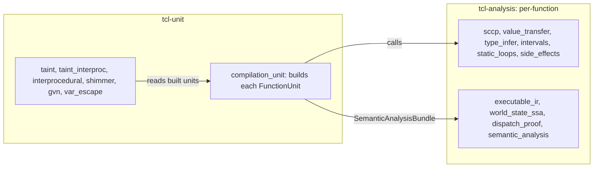
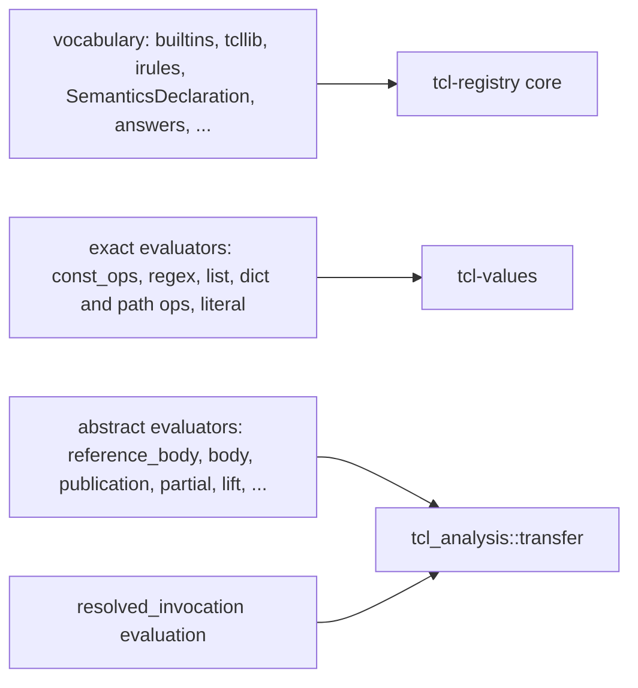

# Step 10: extract tcl-analysis, and item 117's evaluation half

Part of [splitting tcl-compiler](../crate-split-design.md). Plan item 255,
then the evaluation half of item 117 (moving `value_transfer` and
`resolved_invocation` evaluation out of the registry into this layer). Builds
on [step 9](09-tcl-lowering.md) (`tcl-lowering`) and on step 4
(`04-tcl-values.md`), which moved the value kernel down. Steps 11
([`tcl-native-plan`](11-tcl-native-plan.md)), 12
([diagnostics and optimiser](12-diagnostics-optimiser.md)) and 13
([the unit](13-unit-and-db.md)) build on it.

## Problem

The overview puts every value and summary pass into one `tcl-analysis` crate
(~85k): SCCP, value transfer, the rest of `tcl_expr_eval`, type inference,
shimmer, intervals, GVN, interprocedural, escape, taint, static loops and
side effects. The ledger shows two tiers, separated by the compilation unit
(measured as in step 7, 26 November 2026).

**Per-function passes.** These compute the fields of a `FunctionUnit`
(`compilation_unit.rs:236`: `cfg`, `ssa`, `sccp: SccpResult`,
`types`, `taints`, `memory_ssa`, `semantic_facts: SemanticAnalysisBundle`, …).
They do not read a built unit:

| Module | Lines | Refs to `compilation_unit` |
|---|---|---|
| `sccp` | 9,571 | 0 |
| `value_transfer` | 10,358 | 14, of which 13 are in `queries/proven_values.rs` |
| `tcl_expr_eval` (after step 4) | ≤4,391 | 0 |
| `type_infer` | 2,870 | 3 (`type_infer.rs`) |
| `intervals`, `interval_bounds` | 931, 1,564 | 0 |
| `static_loops`, `side_effects` | 1,873, 1,286 | 0 |
| `value_shapes`, `dataflow_graph` | 280, 516 | 0 |

**Whole-unit passes.** These read built `FunctionUnit`s and `CompilationUnit`s:

| Module | Lines | Refs to `compilation_unit` |
|---|---|---|
| `taint` | 12,486 | 40 (8 files) |
| `interprocedural` | 11,485 | 17 (6) |
| `shimmer` | 6,844 | 9 (2) |
| `gvn` | 1,933 | 7–8 (1) |
| `taint_interproc` | 2,219 | 4 (4) |
| `var_escape` | 5,628 | 1 (1) |

In turn, `compilation_unit` names `sccp` 46 times, `interprocedural` 25,
`value_transfer` 23, `ssa` 20, `dispatch_proof` 12, `semantic_analysis` 4,
`taint` 3 and `type_infer` 2. It builds each function's record from the
per-function passes, then runs the whole-unit passes over the records. One
crate holding both tiers and the unit would hold a cycle through the unit.
Splitting the passes from the unit puts 95 references the wrong way.

The two tiers, with the unit's build between them:



What each tier can see, on a two-procedure file. SCCP over `double` alone
cannot know `$x`; whether `$y` in `main` is 42 is a question about the call,
and only the whole-unit tier reads `double`'s record from inside `main`'s:

```tcl
proc double {x} { expr {$x * 2} }
proc main {} {
    set y [double 21]
    puts $y          ;# 42
}
main
```

**Executable IR is analysis, not codegen.** `compilation_unit` computes a
`SemanticAnalysisBundle` per function (`compilation_unit/function_build.rs:31`)
from `executable_ir` (5,198 lines), `world_state_ssa` (2,111),
`dispatch_proof` (2,467) and `semantic_analysis` (1,026). `gvn` reads
`executable_ir` and `dispatch_proof`. So these sit below the unit, not in
`tcl-native-plan` above it.

## Design

### The crate

`rust/tcl-analysis` holds the per-function tier and executable IR:

| Group | Modules |
|---|---|
| Values | `sccp`, `value_transfer` (without `queries`), the non-kernel `tcl_expr_eval`, `type_infer`, `intervals`, `interval_bounds`, `static_loops`, `side_effects`, `value_shapes`, `dataflow_graph` |
| Executable IR | `executable_ir`, `world_state_ssa`, `dispatch_proof`, `semantic_analysis`, `mixed_region_plan` (it and `semantic_analysis` name each other once each) |

That is about 44k lines. It depends on `tcl-lowering`, `tcl-binding` and the
vocabulary crates, and has no dev-dependency above it.

The whole-unit tier (`taint`, `taint_interproc`, `interprocedural`,
`shimmer`, `gvn`, `var_escape`) goes into `tcl-unit` with the unit
([step 13](13-unit-and-db.md)). It is about 41k lines.

Small edges from the lower tier up, broken in this step:

| Edge | Fix |
|---|---|
| `value_transfer::queries::proven_values` → unit (13) | it queries a built unit; it moves to `tcl-unit` |
| `type_infer.rs` → unit (3) | the unit-level `infer_function_return_type` caller moves up; `TypeLattice` stays |
| `type_infer` → `shimmer::hints::is_pure_intrep` (1) | the hint moves to `tcl-values` |
| `semantic_analysis` → `gvn::resolved_invocation_is_*gvn_candidate` (2) | the two predicates over resolved-invocation facts move down beside `semantic_analysis` |
| `side_effects` → `taint::is_irules_dialect` (3) | becomes an environment query (item 304); until then the function moves to `tcl-model` |
| `sccp` → `interprocedural` (2) | `ModuleProcedures` in SCCP's solve inputs (`sccp.rs:1090`); SCCP defines a `ProcedureSummaries` trait for the callee summaries it reads, and the unit's `ModuleProcedures` implements it |
| `sccp`, `value_transfer` → `codegen_helpers::split_list_values` (3) | moves to `tcl-values` (list parsing) |
| `tcl_expr_eval`, `interprocedural` → `native_lowering::cells::variable_reference_place` (3) | moves down in step 4 (to `tcl-values`, or replaced by `tcl_lexer::variable_names`, as `04-tcl-values.md` decides) |
| `sccp`, `dispatch_proof`, `semantic_analysis` → `analyser::ResolvedAnalysisInput` | step 5 (`tcl-model`) |

### Public interface

```rust
// tcl_analysis::api
pub use crate::sccp::{sccp, SccpResult, FoldTrust, SemanticValueProjection, ValueFactInputs};
pub use crate::value_transfer::AnalysisContextKey;
// `TypeLattice` is in `types.rs` today; it moves to `tcl-model` (step 5).
pub use crate::semantic_analysis::SemanticAnalysisBundle;
pub use crate::executable_ir::{ExecutableFunction, ExecutableInstruction, CompletionId};
pub use crate::dispatch_proof::{DispatchEntryAssumption, SiteDispatchProof};
```

The hidden items here (`type_infer` 3, `tcl_expr_eval` 3, the rest in
`interval`/`execution` helpers) are codegen's. They become
`tcl_analysis::native` ([step 11](11-tcl-native-plan.md)).

### Consumers

- `tcl-explorer` (SCCP and executable-IR views).
- `tcl-codegen` (`sccp` 2 files, `executable_ir` 6, `semantic_analysis`).
- `bpf-tcl-ir`: it names `executable_ir` 20 times, plus `dispatch_proof`,
  `semantic_analysis` and `world_state_ssa`, so it depends on this crate.
- `tcl-lsp-db` (`sccp`) and the crates above.

### Item 117's evaluation half

Today `tcl-registry/src/value_transfer` (19.5k lines in 36 submodules) mixes
two things:

- **The vocabulary** that command specs declare: `builtins` (648 references
  from the specs), `tcllib` (31), `irules` (22), `SemanticsDeclaration`,
  `declaration`, `declared`, `inputs`, `answers`, `decline`, `route`,
  `selection`.
- **The evaluators**: `const_ops`, `regex`, `iteration`, `keyed_update`,
  `list_update`, `destructure`, `template`, `path`, `literal`, `cell_update`,
  `cell_write`, `conditional_list_*`, `partial`, `lift`, `unbind`,
  `reference_body`, `body`, `publication`.

`tcl-registry/src/resolved_invocation` (7.6k lines) evaluates a resolved
invocation's argument roles, options, case clauses and effects over a spec.

The move:

1. **The vocabulary stays in the registry core**, because 339 spec and hook
   files name it.
2. **Exact-value evaluators go to `tcl-values`**: the ones over concrete
   values with no lattice (`const_ops`, `regex`, list, dict and path
   operations, `literal`). Binding uses some of them (step 7) and the VM
   names `tcl_registry::value_transfer` in one file. A kernel below binding
   is the only home all three can reach.
3. **Abstract evaluators go to `tcl-analysis`** beside its own
   `value_transfer`: `reference_body`, `body`, `publication`, `partial`,
   `lift`, `unbind`, `cell_*`, `conditional_*`, `iteration`, and the
   `resolved_invocation` evaluation. The two `value_transfer` trees become
   one module, `tcl_analysis::transfer`.
4. **Hook dispatch.** Where a spec declares an evaluator by name (SpecTcl
   packs, `tcl-spec-hooks`), the registry keeps the declaration and the
   name. The evaluator table is registered by the entry point into the
   analysis layer, as the overview's principle 1 requires.

Where today's `tcl-registry/src/value_transfer` and `resolved_invocation`
end up:



**Open question:** whether the 35 references from `commands/tcl/*.rs` (19
files) into evaluator submodules are declarations or calls. Settle it with
`rg 'value_transfer::(const_ops|regex|…)::' tcl-registry/src/commands`. A
declaration's constructor type moves to the vocabulary; a call becomes a hook
registration.

**Done when** (item 117's text): `rg` finds `value_transfer` and
`resolved_invocation` evaluation only in `tcl-values` and `tcl-analysis`.
`tcl-registry/src/value_transfer` holds declaration types only.

## Work list

1. Break the small up-edges in the table above.
2. Move `value_transfer::queries`, `taint`, `taint_interproc`,
   `interprocedural`, `shimmer`, `gvn` and `var_escape` into the unit's module
   tree. In `tcl-compiler` they stay beside `compilation_unit`, which becomes
   `tcl-unit` in step 13.
3. Create `rust/tcl-analysis` with the per-function tier and the
   executable-IR group, and write `tcl_analysis::api`.
4. Rewrite the consumers (`tcl-codegen`, `tcl-explorer`, `bpf-tcl-ir`,
   `tcl-lsp-db`, and the rest of `tcl-compiler`).
5. Gates:
   - add `deny.toml` `wrappers`;
   - re-root `value-transfers` and `registry-axes` (item 255's "done when");
   - re-root `walker-ownership` and `owner-resolution`.
6. Item 117's evaluation half, steps 1–4 above, as a separate change after
   `tcl-analysis` builds.

## Verification

- `rust/tcl-analysis` builds, `value-transfers` and `registry-axes` name its
  roots, and its back-edge rows read 0.
- A failset comparison against the last green commit shows no change.
- Item 117's half: the `rg` check above, and the `value_transfers` bench
  (`tcl-compiler-it`) unchanged within noise.
- Measured:
  - cone size;
  - crates rebuilt by `cargo test -p tcl-analysis --lib --no-run` after an
    edit to `sccp/`;
  - that an edit to `analyser/` rebuilds no analysis crate;
  - that a registry command-spec edit after item 117 does not rebuild
    the evaluators' tests;
  - release analysis latency, cold and after a one-line edit;
  - the VM benchmarks.

## Risks

- **SCCP's inner loop calls value transfer and the kernel across crates.**
  Release LTO covers it; opt-level-1 test builds will be slower. Watch the
  latency record, and mark small kernel functions `#[inline]`.
- **Two-tier placement may shift.** If the unit stops reading a pass, or a
  per-function pass starts reading the unit, its tier changes. The
  `module-layers` gate reports that as a back-edge.

## Corrections to the overview

- `tcl-analysis` holds the per-function tier only. `interprocedural`, `taint`,
  `taint_interproc`, `shimmer`, `gvn` and `var_escape` read built units, so
  they sit with the unit in `tcl-unit` (step 13).
- `executable_ir` belongs in `tcl-analysis`, not `tcl-native-plan`. The unit
  builds a `SemanticAnalysisBundle` from it per function. The same holds for
  `world_state_ssa`, `dispatch_proof` and `semantic_analysis`.
- Item 255's list ("SCCP, value transfer, intervals, GVN, interprocedural,
  escape, taint, side effects") should drop GVN, interprocedural, escape and
  taint, and add executable IR.
