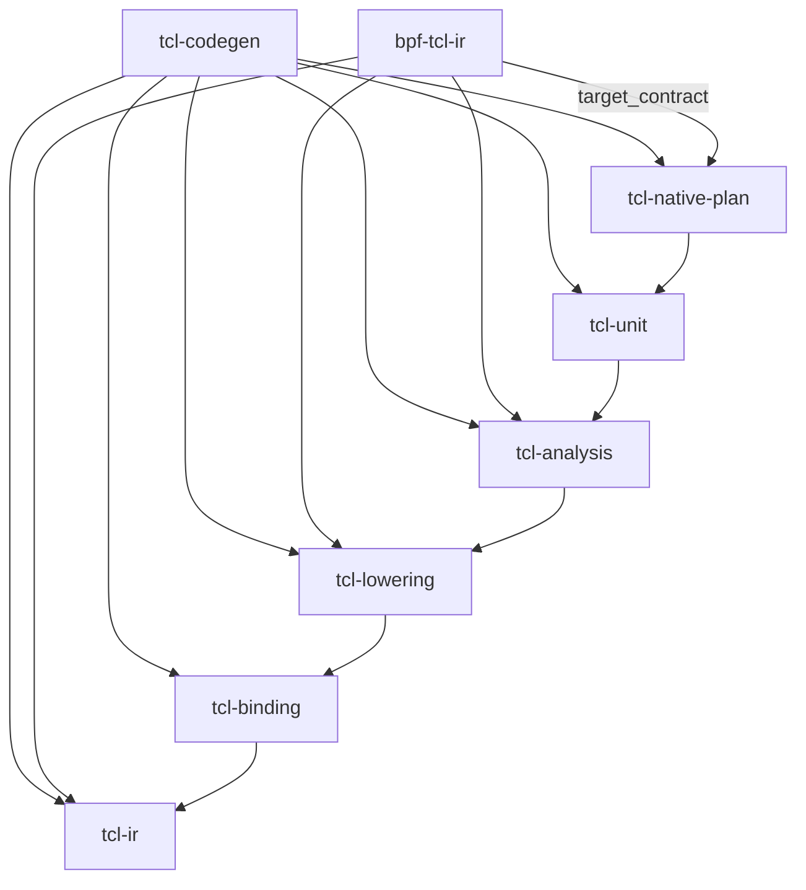

# Step 11: extract tcl-native-plan, and name the hidden API

Part of [splitting tcl-compiler](../crate-split-design.md). Plan items 256
(extract `tcl-native-plan`) and 283 (the `#[doc(hidden)] pub` items become
named API), in that order. Builds on [step 10](10-tcl-analysis.md), which
keeps executable IR in `tcl-analysis`. [Step 12](12-diagnostics-optimiser.md)
builds on it, and item 292 (`tcl-codegen` names only the crates it uses)
follows from it.

## Problem

### The native-plan modules

The overview's list is `executable_ir`, `native_lowering`, `common_aot_plan`,
`target_contract`, `codegen_helpers` and `backend_registry`, about 20k
lines. Step 10 found that executable IR is analysis: the unit builds a
`SemanticAnalysisBundle` from it per function. The modules left here
(measured as in step 7, 26 November 2026):

| Module | Lines | Names | Named by |
|---|---|---|---|
| `native_lowering` | 5,044 | `ir`, `executable_ir`, `registry_invocation`, `command_binding`, `intervals`, `var_escape`, `semantic_optimisation` | `common_aot_plan`; the `cells` helpers are named by `tcl_expr_eval`, `interprocedural`, `native_numeric` and `math_function_binding` |
| `common_aot_plan` | 3,511 | `ir`, `registry_invocation`, `command_binding`, `var_escape`, `ssa`, `compilation_unit` (6), `semantic_optimisation` | `native_integer_proof` |
| `target_contract` | 1,174 | nothing | `backend_registry`; `bpf-tcl-ir` |
| `backend_registry` | 1,163 | `semantic_analysis`, `target_contract`, `representation_plan` | `mixed_region_plan` (1) |
| `native_integer_proof` | 1,107 | `common_aot_plan`, `intervals`, `ssa`, `cfg` | `common_aot_plan` |
| `representation_plan` | 800 | `semantic_analysis` | `common_aot_plan`, `backend_registry`, `mixed_region_plan` |
| `codegen_helpers` | 611 | nothing | `sccp`, `value_transfer` (`split_list_values`), `native_lowering` |
| `compile_84` | 157 | `segmenter`, `lowering` | `tcl-codegen` |

`common_aot_plan` names `compilation_unit`, so this crate sits above
`tcl-unit`.

Three small edges point the wrong way:

- `mixed_region_plan` (in `tcl-analysis`) → `backend_registry` and
  `representation_plan`;
- `sccp` and `value_transfer` → `codegen_helpers`;
- the analysis modules → `native_lowering::cells`.

### The hidden items

`tcl-compiler/src` has 181 `#[doc(hidden)]` attributes. They were classified
by the item each one marks, and by which crates name that item. A crate
counts only in files that also mention `tcl_compiler`. A field counts only as
`.name`.

| Item kind | Count |
|---|---|
| `fn` | 97 |
| `struct` | 26 |
| field | 19 |
| `mod` | 15 |
| `enum` | 13 |
| `use` | 9 |
| `const`, `trait` | 1, 1 |

| Where the item lands | Hidden items | Named by `tcl-codegen` | Named by nobody outside `tcl-compiler` |
|---|---|---|---|
| `tcl-binding` and the vocabulary crates | 119 (`command_binding` 62, `registry_invocation` 40, others) | 79 | 37 |
| `tcl-lowering` | 22 | 21 | 1 |
| `tcl-ir` and `lib.rs` | 13 | 11 | 2 |
| `tcl-unit` | 11 | 6 | 5 |
| `tcl-native-plan` | 9 | 8 | 1 |
| `tcl-analysis` | 7 | 6 | 1 |

- **`tcl-codegen`** names 131 of the 181, and is the only outside user of
  106. 13 of the 131 have short names (`id`, `value`, `owns`), so some of
  those matches may be false.
- **`bpf-tcl-ir` names none.** Its 9 apparent matches are common names
  (`owns`, `id`, `value`, `context`, `record`, `matches_module`), and its own
  `matches_module` is a method on `ir::SourceBpfModuleContext`. It uses about
  75 ordinary `pub` paths: `ir` 24, `executable_ir` 20, `cfg` 4,
  `dispatch_proof` 4, `rebase_script` 3, `cfg_builder` 2, `lowering` 2, and 1
  each for `target_contract`, `semantic_analysis`, `world_state_ssa`,
  `registry_invocation` and `parse_expr_for_profile`.
- **9 items are test fixtures** (`fixture_id`, `native_call_for_test`,
  `evaluated_region_test_fixture`, `unknown_history_for_test`, …).
- **47 items have no user outside `tcl-compiler`.**

So the hidden items are mostly binding's interface to native compilation,
not the native plan's. `tcl-codegen`'s most-named binding items:

- `admitted_native_compiler_invocation` (13);
- `SourceAnalysisEntry` (13), `SourceAnalysisOptions` (10);
- `ModuleCommandMutations` (11), `scan_module_command_mutations_with_bindings`;
- `SourceInvocationBinding` (10);
- `InvocationMetadataContext`, `compiled_namespace_context`,
  `NativeCompilationDependency`;
- `BodySourceProofs`, `SourceExpressionPreparation`;
- `original_native_compiler_words`;
- the `compiled_preflight::ordered_locals` fields (`frame`, `formals`,
  `locals`, `protocol`, `compilation`).

## Design

### The crate (item 256)

`rust/tcl-native-plan` takes `native_lowering`, `common_aot_plan`,
`native_integer_proof`, `backend_registry`, `target_contract`,
`representation_plan`, `codegen_helpers` (without `split_list_values`) and
`compile_84`. That is about 13.5k lines. It depends on `tcl-unit`,
`tcl-analysis`, `tcl-lowering`, `tcl-binding` and the vocabulary crates.

The three wrong-way edges:

| Edge | Fix |
|---|---|
| `mixed_region_plan` → `backend_registry`, `representation_plan` (1 each) | `mixed_region_plan` takes the backend's region policy as a parameter (a `RegionPolicy` trait in `tcl-analysis`, which `backend_registry` implements) |
| `sccp`, `value_transfer` → `codegen_helpers::split_list_values` | moves to `tcl-values` |
| analysis → `native_lowering::cells::{variable_reference_place, CellPlace}` | moves down with step 4 (`tcl-values`, or `tcl_lexer::variable_names`) |
| `semantic_analysis` → `semantic_optimisation` (1) | `semantic_optimisation` (269 lines, configuration with no dependencies) moves to `tcl-model`, not `tcl-optimiser` |

`target_contract` has no dependencies, and `bpf-tcl-ir` names it. Whether it
belongs in `tcl-model`, so that `bpf-tcl-ir` does not need this crate, is
settled by item 292's measurement: if `bpf-tcl-ir` names nothing else here,
move it.

### Named API (item 283)

Each crate gets one module per consumer role, and no hidden items:

| Crate | Module | Takes |
|---|---|---|
| `tcl-binding` | `native` | the compiler-facing binding facts: admission (`admitted_native_compiler_invocation`, `NativeCompilationDependency`), the compiled preflight (`SourceCompilerLocalInventory`, `OriginalFormalTopology`, `SourceCompilerFormalOwner`), mutation scans (`ModuleCommandMutations`, `scan_module_command_mutations_with_bindings`), metadata (`InvocationMetadataContext`, `compiled_namespace_context`), source words (`original_native_compiler_words`, `BodySourceProofs`) |
| `tcl-lowering` | `native` | `build_cfg_codegen_with_registry_and_context`, `prepare_cfg_context_bundle`, the `cfg_lower` and `summary_candidates` modules, `native_byte_compilation`'s plan (`NativeByteCommandPlan`, `native_byte_command_plan`), `ResolvedLowering`, `extract_proved_expr_arg`, `finish_module` |
| `tcl-ir` | `api` | `original_source_procedure_bodies`, `native_source_procedure_bodies_for_compilation`, `unanimous_statement_source_tokens`, `rebase` (from `lattice_rebase`); `tcl-source`'s `limits` (today `depth_guard`) |
| `tcl-analysis` | `native` | `eval_native_constant`, `NativeConstantResult`, `original_literal_argument_contents` |
| `tcl-unit` | `native` | `FunctionUnit::function`, `source_config`, `source_metadata_input` as getters |
| `tcl-native-plan` | `api` | `direct_call_argument_value`, `original_direct_expression_body_operations`, `variable_word_place`, `name_data_place`, `VariableWordDecline`, `compile_failure` |

Rules:

- **Fields become getters.** The 19 hidden `pub` fields, such as
  `ordered_locals::SourceCompilerLocalInventory { frame, formals, locals,
  protocol, compilation, .. }`, become private fields with `pub fn` getters.
  Codegen reads them and does not build them.
- **Unused items become private.** The 47 items no outside crate names become
  `pub(crate)`, or are deleted if nothing inside uses them either.
- **Fixtures go behind `test-support`.** The 9 test fixtures become
  `#[cfg(feature = "test-support")] pub`, as step 0 did.
- **Hidden modules are replaced.** The 15 hidden `mod` items (`compile_84`,
  `depth_guard`, `environment_ingress`, `lattice_rebase`,
  `native_byte_compilation`, `compiled_preflight`, `compiler_inventory`,
  `formal_topology`, `runtime_entry`, …) are not made public. Their
  codegen-facing items are listed in the modules above.
- **The ratchet.** `rg '#\[doc\(hidden\)\]'` over the split crates' `src`
  must find none outside `test-support` items (item 283's "done when"). A
  gate rule keeps it at zero.

One struct, before and after (two of its seven hidden fields shown):

**Before:**

```rust
// tcl-compiler: command_binding/compiled_preflight/ordered_locals.rs
#[doc(hidden)]
pub struct SourceCompilerLocalInventory {
    #[doc(hidden)]
    pub frame: crate::var_resolve::VariableExecutionFrame,
    #[doc(hidden)]
    pub locals: Vec<Option<NameBytes>>,
    // chunk, config, compilation, protocol, formals: also hidden pub fields
}

// tcl-codegen
let frame = &locals.frame;
```

**After:**

```rust
// tcl-binding, reached through tcl_binding::native
pub struct SourceCompilerLocalInventory {
    frame: tcl_names::variable::VariableExecutionFrame,
    locals: Vec<Option<NameBytes>>,
    // ...
}
impl SourceCompilerLocalInventory {
    #[inline]
    pub fn frame(&self) -> &VariableExecutionFrame { &self.frame }
    #[inline]
    pub fn locals(&self) -> &[Option<NameBytes>] { &self.locals }
}

// tcl-codegen
let frame = locals.frame();
```

### Consumers

- **`tcl-codegen`** depends on `tcl-native-plan`, `tcl-unit`, `tcl-analysis`,
  `tcl-lowering`, `tcl-binding` and `tcl-ir` (item 292). It needs `tcl-unit`
  because 27 of its files name `compilation_unit` today. Measure whether it
  could drop `tcl-unit` by building through `tcl-native-plan`'s entry.
- **`tcl-explorer`** reads plans through `tcl-native-plan` (item 294).
- **`bpf-tcl-ir`** needs `tcl-ir`, `tcl-lowering` and `tcl-analysis` (for
  `executable_ir`), plus `target_contract`.

The two native consumers' crates after the split (each arrow points at the
crate depended on). `tcl-codegen` is drawn as one crate; under the owner
decision below, its drivers move to `tcl-compile`:



## Work list

1. Move `split_list_values` to `tcl-values`, `cells` down with step 4,
   `semantic_optimisation` to `tcl-model`, and add the region-policy trait.
2. Create `rust/tcl-native-plan` with the modules above.
3. Item 283, crate by crate, starting from the bottom (`tcl-ir`, then
   `tcl-binding`, `tcl-lowering`, `tcl-analysis` and `tcl-unit`, then this
   crate):
   - write the `native` or `api` module;
   - convert the hidden items;
   - rewrite `tcl-codegen` and `tcl-explorer` onto the named paths.
4. Gates: add `deny.toml` `wrappers` for `tcl-native-plan`, and add a
   `doc(hidden)` ratchet at 0 for the split crates.

## Verification

- `rust/tcl-native-plan` builds, and `tcl-codegen` and `bpf-tcl-ir` name no
  `tcl_compiler::` path for these modules (item 256).
- `rg '#\[doc\(hidden\)\]'` over every split crate's `src` finds only
  `test-support` items (item 283).
- `tcl-codegen`'s tests and the bytecode comparison (`bytecode-compare`
  skill, 8.4–9.1) are unchanged.
- Measured:
  - `tcl-codegen`'s cone before and after;
  - crates rebuilt after an analyser edit with `cargo test -p tcl-codegen
    --no-run` (expected: no codegen crate);
  - the VM benchmarks and AOT compile time, on release builds.

## Risks

- **Codegen churn.** 131 item paths in `tcl-codegen` change at once. Do it
  per crate, in step 3's order, so each change is reviewable.
- **Getters on hot structs** (`SourceCompilerLocalInventory`) need `#[inline]`, or the
  opt-level-1 test builds slow down.

## Corrections to the overview

- `executable_ir` is not in `tcl-native-plan` (see step 10). This crate sits
  above `tcl-unit`, not beside `tcl-analysis`.
- "The roughly 150 `#[doc(hidden)] pub` items made for codegen": 131 of the
  181 are named by `tcl-codegen`, and 119 of the 181 are in binding, not in
  native-plan modules.
- `bpf-tcl-ir` does not "build against `tcl-ir` and `tcl-native-plan` only".
  It lowers, builds CFGs and reads executable IR.
- `semantic_optimisation` goes to `tcl-model`, not `tcl-optimiser`. It is
  pass configuration with no dependencies, and executable-IR analysis
  reads it.

## Owner decision (26 November 2026)

`tcl-codegen` splits into the emitters (`tcl-codegen`) and a driver crate (`tcl-compile`) above the unit crate, per [292](../../build-time/292-codegen.md). Where this doc keeps one `tcl-codegen`, read it as the emitter crate. The driver modules (`compile_service`, the WASM pipeline, `inlining`) go to `tcl-compile`.
