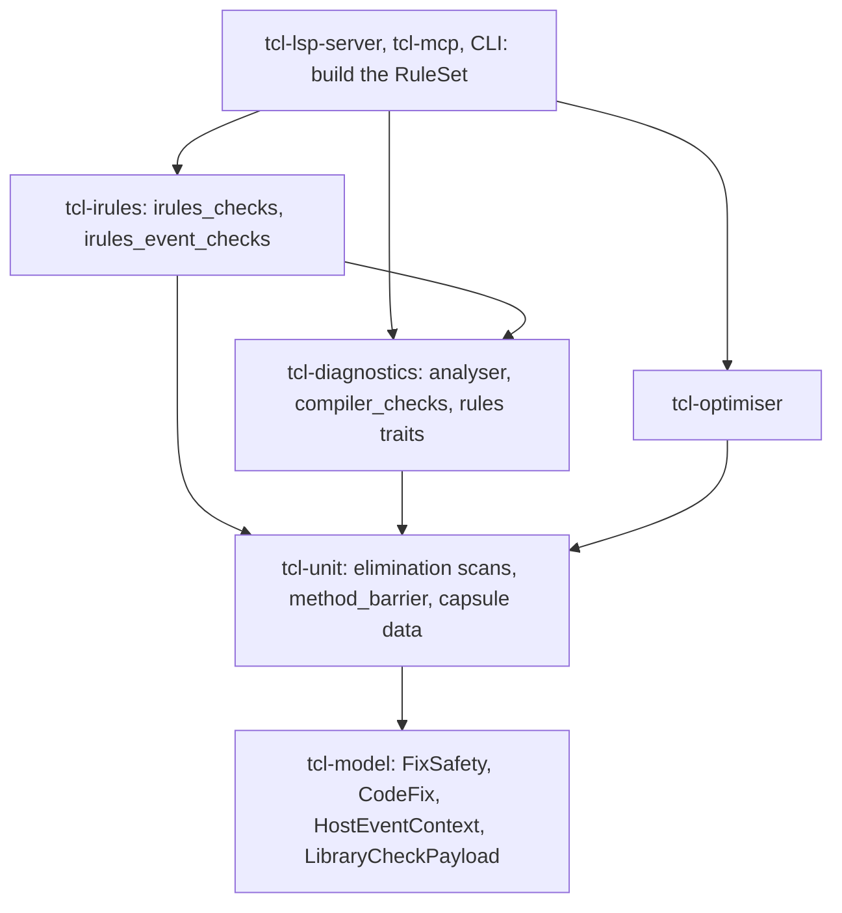
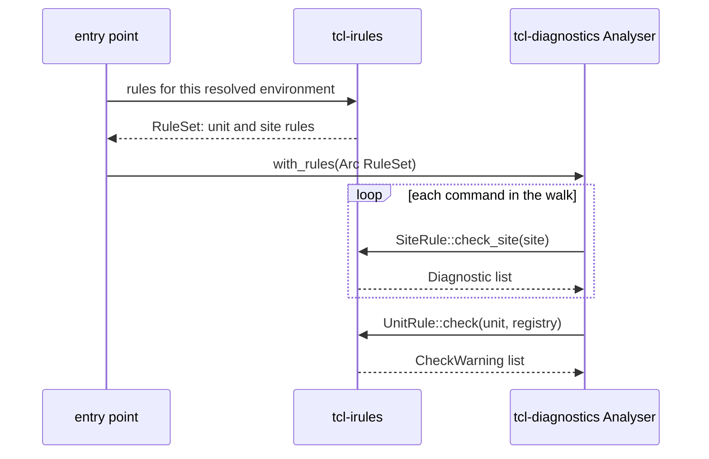

# Step 12: extract tcl-diagnostics and tcl-optimiser, and place irules_checks

Part of [splitting tcl-compiler](../crate-split-design.md). Plan items 257
(`tcl-diagnostics` alone), 284 (`tcl-optimiser`) and 285 (where
`irules_checks` belongs), in that order. Builds on
[step 11](11-tcl-native-plan.md). [Step 13](13-unit-and-db.md) builds on it.

**Decision for item 285:** `irules_checks` and the analyser's
`irules_event_checks` move to `tcl-irules`. They plug in through two rule
interfaces that `tcl-diagnostics` defines, and the entry points register them.

## Problem

Measured as in step 7, 26 November 2026:

| Module | Production lines |
|---|---|
| `analyser` | 104,438 (of which `irules_event_checks.rs` is 1,239) |
| `optimiser` | 20,488 |
| `irules_checks` | 3,786 |
| `compiler_checks` | 1,230 |

The analyser is the busiest area, with 92k test lines. Today an analyser edit
rebuilds all of `tcl-compiler` and 9 crates above it.

**The analyser sits above the unit, not below it.**

- `analyser` → `compilation_unit` is 175 references (`FunctionUnit` 121,
  `CompilationUnit` 45). The analyser builds the unit at
  `analyser/diagnostics.rs:481` and its rules read the records.
- `compilation_unit` → `analyser` is 40, and is all vocabulary:
  `ResolvedAnalysisInput` 29 (two of them `ResolvedAnalysisInput::new`) and
  `OriginalAnalyserSourceSettings` 6, which go to `tcl-model` in step 5, plus
  doc links.

**The analyser and the optimiser name each other.**

| Edge | Refs | What crosses |
|---|---|---|
| `analyser` → `optimiser` | 8 | `elimination::scan_scope_aliases_with_metadata_context`, `scan_global_scope_aliases_*`, `scan_module_traced_globals_*`, `collect_textual_var_references`, `collect_rmw_hidden_reads` (`analyser/diagnostics.rs:615–1273`, `dead_stores.rs:285`), `helpers::expr_simplify::eq_ne_compares_as_strings` |
| `optimiser` → `analyser` | 12 | `ResolvedAnalysisInput` 6, `script_encoding` 3, `writes_externally_read_special_variable` 2, `document_declared_surface` 1 |

**Lower modules call the optimiser.**

- `sccp/original_value_facts/existence_branches.rs:648` and
  `shimmer/thunking.rs:604` call `elimination::scan_scope_aliases_*`.
- `unit_scope/extra_scan_contexts.rs:191` calls `method_barrier::compute`.
- `body_analysis_capsule.rs:333` calls `optimise_unit_raw_report`, and
  `compilation_unit` uses the capsule 6 times.
- The `MAX_OPTIMISER_WALK_DEPTH` constant is read from 11 places (steps 7
  and 9).

**iRules checks are spread across the analyser.**

| Edge | Refs (files) | What crosses |
|---|---|---|
| `analyser` → `irules_checks` | 39 (24) | `FixSafety::RequiresReview` 28, `BehaviourHardening` 6, `SemanticsEquivalent`, `CodeFix`, `is_unnormalised_getter`, `format_message` |
| `compiler_checks` → `irules_checks` | 9 | `IrulesCheckPayload` as a variant of the check payload (`compiler_checks/payload.rs:86`), and the finders (`find_hoistable_set_warnings`, `find_generic_static_name_warnings`, `find_conditional_collection_source_pairing_advice`, …) |
| `taint` → `irules_checks` | 2 | |
| `irules_checks` → lower modules | | `ir` 40, `registry_invocation` 28, `compilation_unit` 10, `execution_region` 7, `place_bridge` 6, `var_resolve` 4, `sccp` 3 |

`analyser/irules_event_checks.rs` holds IRULE1002–6001. It runs per command
inside the analyser's walk (`commands/site_diagnostics.rs:381`) and reads the
enclosing `when` event. There are 19 `is_irules()` checks in `tcl-compiler`.

[Dialects and libraries](../../registry/dialects-and-libraries.md#consumers)
says `irules_checks` "belongs to the iRules library side". That cannot be
`tcl-lib-irules`, the registry data crate below the compiler, because the
checks read IR, binding and the unit. The library's code side is the domain
crate `tcl-irules`. It already depends on `tcl-compiler`, naming
`registry_invocation` 16 times, `analyser` 8, `source_graph` 6, `segmenter`
4 and `realm` 2.

## Design

### tcl-diagnostics (item 257)

`rust/tcl-diagnostics` takes:

- `analyser` without `irules_event_checks`;
- `compiler_checks`;
- `AnalysisResult` and its report capture (`analyser/authenticated_report.rs`);
- the `BodyReport` implementation ([step 7](07-binding-fixpoint.md));
- from `source_graph`, the `AnalysisResult` queries (`current_analysis`);
- `auto_path_eval`, whose `PathConstantAssignments` is an `AnalysisResult`
  field and which reads `AnalysisResult` (`path_constants/original.rs`).

It depends on `tcl-unit` and everything below it. Its public surface is
`Analyser`, `AnalysisResult`, `Diagnostic` and the code types (from
`tcl-model`), and `compiler_checks::run`.

The crates at rank 10 and the domain crate above them, after this step (each
arrow points at the crate depended on). The analyser and the optimiser no
longer name each other:



The analyser's 8 references into the optimiser move down. The elimination
scans and `eq_ne_compares_as_strings` are IR and unit facts, so they go to
`tcl-unit` (or to `tcl-analysis` where they take no unit); SCCP and shimmer
call them there too. Then neither crate names the other.

### tcl-optimiser (item 284)

`rust/tcl-optimiser` takes `optimiser`. It does not take
`semantic_optimisation`, which goes to `tcl-model` (step 11). It depends on
`tcl-unit` and below, and it does not depend on `tcl-diagnostics`. Its 12
references into the analyser are cleared like this:

- `ResolvedAnalysisInput` and `script_encoding` come from `tcl-model`.
- `writes_externally_read_special_variable` and `document_declared_surface`
  are source facts. They go to `tcl-binding`.

The lower modules' calls into the optimiser:

| Call | Move |
|---|---|
| `elimination::scan_*` from SCCP and shimmer | down, with the analyser's (above) |
| `method_barrier::compute` from `unit_scope` | `method_barrier` moves to `tcl-unit` |
| `optimise_unit_raw_report` from `body_analysis_capsule` | the capsule's data and lowering carry stay in `tcl-unit`; `optimiser_report(&capsule)` becomes a `tcl-optimiser` function |
| `MAX_OPTIMISER_WALK_DEPTH` | beside the `depth_guard` limits in `tcl-source` |

The consumers rewritten are the ones in item 284's "done when":

- `tcl-spec-hooks`, `tcl-engine-tclvm`, `tcl-spectcl` (5 files) and the CLI
  (4);
- `tcl-lsp-core` (9), `tcl-lsp-db` (7), `tcl-lsp-server` (5),
  `tcl-explorer` (4), `xtask` (3), `tcl-codegen` (3) and `tcl-mcp` (1).

### iRules rules in tcl-irules (item 285)

`tcl-diagnostics` defines the two shapes of rule that exist today:

```rust
// tcl_diagnostics::rules
pub trait UnitRule: Send + Sync {
    fn id(&self) -> RuleSetId;
    fn applies(&self, env: &ResolvedEnvironment) -> bool;     // "iRules library present"
    fn check(&self, unit: &CompilationUnit, registry: &CommandRegistry,
             out: &mut Vec<CheckWarning>);
}
pub trait SiteRule: Send + Sync {
    fn applies(&self, env: &ResolvedEnvironment) -> bool;
    fn check_site(&self, site: &SiteContext<'_>, out: &mut Vec<Diagnostic>);
}
pub struct SiteContext<'a> {
    pub command: &'a str, pub args: &'a [String], pub tokens: &'a [Token],
    pub scope_path: &'a str, pub enclosing: Option<&'a HostEventContext>,
    pub registry: &'a CommandRegistry,
}
pub struct RuleSet { pub unit: Vec<Box<dyn UnitRule>>, pub site: Vec<Box<dyn SiteRule>> }
impl Analyser { pub fn with_rules(self, rules: Arc<RuleSet>) -> Self; }
```

- **The vocabulary moves down.** `FixSafety` and `CodeFix` go to
  `tcl-model` (step 5 already moves them). This clears 37 of the analyser's 39 references (the other 2
  are in `irules_event_checks`, which moves), and they are diagnostic
  vocabulary, not iRules.
- **The payload becomes a library payload.**
  `CompilerCheckPayload::Irules(IrulesCheckPayload)` becomes
  `Library(LibraryCheckPayload)`:
  ```rust
  pub struct LibraryCheckPayload { pub library: LibraryId, pub kind: &'static str,
                                   pub data: serde_json::Value }
  ```
  `tcl-irules` builds it, and `tcl-lsp-core/check_payload.rs` and
  `tcl-explorer/serialise/irules.rs` decode it through `tcl-irules`'s typed
  view (`IrulesCheckPayload::try_from(&LibraryCheckPayload)`). The MCP and
  LSP wire shapes stay byte-identical, which the golden diffs check.
- **The event context.** `when`-event tracking (`Analyser::current_event`)
  becomes `HostEventContext`, a generic "enclosing host event" record in
  `tcl-model` that the analyser fills from the registry's event descriptors.
- **Registration.** `tcl-lsp-server`, `tcl-mcp` and the CLI build one
  `RuleSet` per resolved environment and pass it to the analyser. This
  matches [item 289](../../../work/name-handling/plan.md): domain crates
  contribute rules through interfaces that the entry points register.

How the rules reach the analyser:



- **Gating.** The `is_irules()` checks inside the moved code become `applies`
  (item 304's environment query).
- **What moves to `tcl-irules`:**
  - `irules_checks`, all 3,786 lines;
  - `analyser/irules_event_checks.rs` (1,239 lines) and its tests (1,283);
  - `taint`'s 2 references, which become a `UnitRule` contribution or a
    taint-source descriptor in the registry, whichever the 2 sites are.

`tcl-irules` then depends on `tcl-diagnostics` (for the traits) and on
`tcl-unit`. `tcl-diagnostics` names no iRules-only module (item 285's "done
when").

The IRULE4001 pair from `irules_event_checks/tests.rs`, which the risks
section's per-entry-point test can reuse:

**Before:**

```tcl
when HTTP_REQUEST {
    set static::c 1
}
# the analyser reports IRULE4001: a write to a static:: variable outside RULE_INIT
```

**After:**

```tcl
when RULE_INIT {
    set static::c 1
}
# no IRULE4001
```

**Result before:**

```text
$ ./target/debug/tcl diag --dialect f5-irules before.irul
no diagnostics
diagnostics=0 across 1 input(s)
```

**Result after:**

```text
$ ./target/debug/tcl diag --dialect f5-irules after.irul
no diagnostics
diagnostics=0 across 1 input(s)
```

The pair holds in the analyser's tests (`irule4001_fires_for_static_write_outside_rule_init`,
`irule4001_suppressed_in_rule_init`), which call `Analyser::analyse` directly.
The CLI does not report IRULE4001 on either file today, though it does report
other iRules checks (IRULE5001 on an ungated `log`). The risks section's
per-entry-point test would catch this gap.

### Open questions

- **The cost of the `SiteRule` call per command.** It is one virtual call per
  site per registered rule set. Settle it with release analysis latency on an
  iRules-heavy subset of the corpus, before and after. If it costs more than
  1%, pass the rule set as a generic parameter.
- **`analyser/diagnostics/dataflow/irules_cells.rs` (486 lines).** It emits
  IRULE4001, IRULE4003, IRULE4005 and IRULE6001 from the analyser's dataflow
  pass over resolved cells, not from `irules_event_checks.rs`, and the move
  list above does not name it. 285's done-when ("no iRules-only module")
  needs it moved too. It reads cells, not a site, so it fits neither rule
  shape as written. Settle it with the ledger: either `UnitRule` gains the
  resolved cells, or a third rule shape is added.
- **Other dialect rule groups.** Check `tk_checks.rs` and the Jim-only rules
  with `rg 'is_jim|tk' analyser`. They follow the same pattern if they read
  only their library's presence. They are not part of this step.

## Work list

1. Move the vocabulary down (`FixSafety` and `CodeFix` if step 5 has not): `HostEventContext` and
   `LibraryCheckPayload` to `tcl-model`; the elimination scans to
   `tcl-unit`/`tcl-analysis`; `method_barrier` and the capsule's data part to
   `tcl-unit`; the two source facts to `tcl-binding`.
2. Item 257: create `rust/tcl-diagnostics` with the modules above, including
   `auto_path_eval` and the `AnalysisResult` half of `source_graph`.
3. Item 284: create `rust/tcl-optimiser`, including `optimiser_report`.
4. Item 285: add `rules`. Move `irules_checks` and `irules_event_checks` to
   `tcl-irules` as one `RuleSet` contribution, and register it in the three
   entry points.
5. Rewrite the consumers, add `deny.toml` `wrappers` for both new crates, and
   re-root `diag-emission`, `registry-axes` and `owner-resolution`.

## Verification

- `rust/tcl-diagnostics` builds. After an analyser edit, the failset logs show
  only `tcl-diagnostics` and the crates above it rebuilt (item 257). Today
  that is 9 crates and 2–6 minutes.
- `rust/tcl-optimiser` builds, and the five named consumers use it (item
  284). The optimiser's rewrite-safety rows (item 244) are unchanged.
- The `irules_checks` and IRULE tests pass from `tcl-irules`, and
  `rg 'irules' rust/tcl-diagnostics/src` finds no iRules-only module (item
  285). The golden diffs of LSP, CLI and MCP output are byte-identical.
- Measured:
  - each crate's cone;
  - the crates rebuilt after an analyser edit and after an optimiser edit
    (each must not rebuild the other);
  - release analysis latency, cold and after a one-line edit, on the full
    corpus and the iRules subset.

## Risks

- **Rule registration is easy to forget.** A consumer that builds an
  `Analyser` without a `RuleSet` silently loses the iRules diagnostics. Make
  `Analyser::new` take the rule set from the resolved environment's
  catalogue entry, and add a test per entry point that IRULE4001 fires.
- **Item 243 is in progress** on `variable_bindings` and the hosted entry, and
  touches IRULE4002. Land it before step 4 above.

## Corrections to the overview

- The unit sits below `tcl-diagnostics` and `tcl-optimiser`, not above them
  (see step 13).
- `semantic_optimisation` is not part of `tcl-optimiser`.
- "`irules_checks` belongs to the iRules library side" means `tcl-irules`, the
  domain crate, not `tcl-lib-irules`. The dialects-and-libraries page should
  say so. `analyser/irules_event_checks.rs` moves too.
