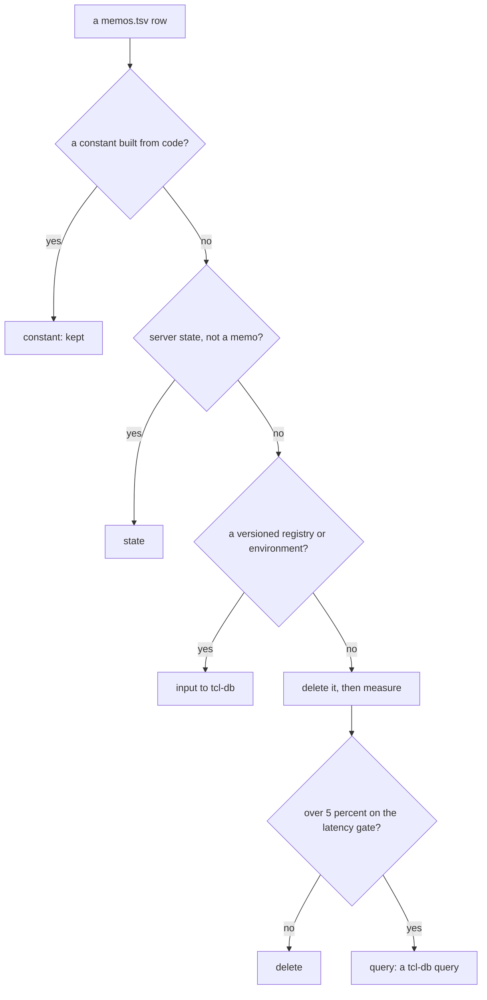

# Step 14: caching after the split

Part of [splitting tcl-compiler](../crate-split-design.md). This is item 90's
step 14, the last step of the split; it has no item number of its own. It
follows the rule in [caching](../../../work/name-handling/caching-design.md#one-architected-layer):
lower crates are pure, and one database sits at the top. Builds on
[step 13](13-unit-and-db.md) (`tcl-unit`, `tcl-db`). The per-body tiers
(items 101 and 103, and 46–49 and 73) come later, after items 83 and 84.

## Problem

The memo ledger
([`ownership/memos.tsv`](../../../work/name-handling/ownership/memos.tsv))
lists 245 rows:

| Crate | Rows |
|---|---|
| `tcl-compiler` | 102 (115 occurrences) |
| `tcl-registry` | 85 |
| `tcl-lsp-server` | 36 |
| `tcl-lsp-core` | 12 |
| `tcl-cli-support` | 4 |
| `tcl-mcp`, `tcl-irules` | 2 each |
| `tcl-expr`, `tcl-codegen` | 1 each |

`tcl-lsp-db` is not in the ledger, as the database, but it holds
`RetainedModules`: a `Mutex<RetainedModuleTable>` inside a salsa input,
which is a hand-written 512-entry LRU (`memoised_units.rs:190–240`).

The caching design measured the cost of today's layering (`65261ff6`):

- a two-line script takes 63 ms cold and 17 ms per repeat;
- a 687-line file takes 2.16 s cold and 1.27 s per repeat;
- after 10 distinct documents the caps hold about 230 MB, and stay there.

Its faults 1–3 (memos salsa cannot see, versioned registries in globals, five
staleness mechanisms) are what this step removes for the compiler stack.

## Design

### The rule, per crate

| Crate | May hold |
|---|---|
| `tcl-source` … `tcl-native-plan`, `tcl-diagnostics`, `tcl-optimiser` | constants built from code, and nothing else: no `Mutex`/`OnceLock`/`thread_local!` memo, no `Box::leak`. Scratch lives in the call that needs it |
| `tcl-names` | its own identity interner, if item 274 keeps one: plain Rust, no salsa, usable by the VM |
| `tcl-db` | every cache: salsa queries with `lru` and byte budgets, and versioned inputs |

**No salsa interning for identity types.** `tcl-db` has 14
`#[salsa::interned]` structs (`ProcBodyKey`, `ItemBodyKey`, `FnLatticeKey`,
`OriginalCommandSlot`, …). They stay only as query keys. Their fields are
`tcl-names` identities (`OriginalCommandSlot` wraps `ByteCommandSlot` and a
`NamePolicyProtocol`), and no type with a `'db` lifetime leaves `tcl-db`. The
identities themselves are never salsa values, so `tcl-names` and the registry
stay salsa-free.

**Measured gate for keeping a cache.** A deleted memo comes back, as a
`tcl-db` query and never as a memo, only if deleting it raises one of these
by more than 5% on the analysis-performance corpus (release build):

- cold latency;
- latency after a one-line edit;
- the 687-line probe's repeat time.

The 5% threshold is a proposal for the owner to confirm. The measurement is
recorded beside the decision in this doc's table.

How one memo row is decided:



### tcl-compiler's 102 rows

The rows land in the new crates. Each row is in one of four groups, and each
group has one disposition:

| Group | Rows (occ.) | Rows | Disposition |
|---|---|---|---|
| Constants built from code | 18 (20) | `OPS`, `TABLE`, `SET` (`definition_warnings`, `var_escape/helpers` ×2, `irules_checks`), `EMPTY` (`compilation_unit`, `object_types`), `EMPTY_OBJECT_TYPES`, `EMPTY_REALM`, `NO_ENV`, `MISSING` (`slot_presence`), `ROOT` (`advice_graph`), `SHARED` (`catalogue_seed`), `REGISTRY` (`irules_event_checks`, ×2), `LIMIT`, `MAX_PROJECTED`, `BODY_BARRIER_CAPACITY`, `REGION_PLAN_CAPACITY` | **Kept** as `const` or `LazyLock` constants. The ledger gets a `constant` waiver class, and the gate checks that the initialiser takes no runtime input. Exceptions: `REGISTRY` in `irules_event_checks` builds a profile registry, which becomes an input from `tcl-db` (item 262), and the four `thread_local!` capacity knobs become `const` |
| Instrumentation and switches | 14 (14) | `WorkspaceWalkTotals`, `SourceFunctionPhaseTotals`, `OriginalSourceQueryTotals`, `TRACED`, `Active` (`analysis_control`), `ENABLED` (`source_analysis_cache`), the `<module>` observers (`command_observers`, `original_command_table`, `host_structure_observer`), `capture`, `recent_capture`, `target` (`materialized_footprint`), `NAMES` (`root_owner_work`), `ORIGINAL_CORPUS_INPUTS` (a test corpus) | **Deleted.** A count that a tool needs becomes a return value of the call it measures, behind a `trace` feature that is off in every shipped build. The corpus TLS moves into `tcl-compiler-it` |
| Process-global memos and thread-locals | 21 (21) | `MEMOS` (`source_analysis_driver`, `source_origin`, `source_point_entry`), `INTERNER` (`source_origin`, `source_point_entry`), `ROWS` (`slot_presence`, ×2), `MEMO` (`frame_clobbers`, ×2), `CELL` (`environment_ingress`, `Box` + `OnceLock`), `root_bindings`, `SourceLookupSnapshot`, `SourcePointQuery`, `Memo` (`incomplete_body_metadata`), `build` (`phi_undef`), `arg_var_names`, `local_instance_classes_with_source`, `RECENT_WORDS`, `same_buffer`, `STRUCTURED_IR_SEGMENT_STACK` | **Deleted**, with three replacements. The two interners become `tcl-names` identities (`SourceOriginId`). `CELL` becomes the environment input. The reentrancy and scratch state (`STRUCTURED_IR_SEGMENT_STACK`, `same_buffer`, `RECENT_WORDS`) becomes an explicit parameter. `ROWS` is keyed by builtin name only, not by registry, which is a wrong-answer risk across registries, so it goes first |
| Memos inside values | 49 (60) | `BindingBaseline`, `OriginalSourceAnalysisMemo` ×3, `PointBindingMemo`, `SourceBindingPoint`, `SourceHeadProjectionCache`, `SourceLookupSnapshot`, `MEMO` (`conditional_source`, `region` ×3, `lowering/configuration`), `OriginalSingleSourceCutSurvey`, `DeclarationFlowInventory` ×2, `SourceDeclarationFlowCache` ×2, `OriginalDeclarationSourceOperandCache` ×2, `OriginalProcedureStaticReadAlternatives`, `DeferredBodyIndexCache`, `DeferredNamespaceIndexCache`, `TableIndexEntry`, `JimStockContinuationMemo`, `LayoutProjectionMemo`, `SourceBindingTimeline`, `DerivedRows` ×2, `SourceNamespaceSet` ×2, `SourceCompilerNameEffectsCache`, `original_word_function_occurrences`, `OriginalRealmQueryMemo`, `ProjectionEntry` ×2, `BodyProjectionMemo`, `InvocationProjectionMemo`, `RetainedSourceBodyInventory`, `ModuleProjectionMemo`, `DerivedIndexes`, `InventoryIndexCache`, `NamespaceLedger` ×2, `SourcePointGraphMemo`, `ParameterSourcePrefixCache`, `PreparedSourceNativeInvocation`, `OriginalInvocationBindingCache`, `OriginalCommandTokenCache`, `OriginalSourceCutBodyLayout`, `SemanticValueProjection`, `HierarchyCache`, `SourceWordsMemo`, `FiniteForeachReportingState`, the `dead_stores` advice cells ×2, `Scan`/`SourceScan` (`deferred_writes`) | **Deleted.** Where a value's own index is read many times per analysis (the deferred-body and namespace indexes, `DerivedIndexes`, `NamespaceLedger`, `SourceBindingTimeline`), it becomes an ordinary field computed when the value is built: no interior mutability, and equality is no longer transparent to it. Everything else is recomputed per call |

### What becomes a database query

Three caches cross a unit boundary that the
[architecture plan](../../../work/name-handling/architecture-tidy-plan.md)
names (source file, binding per file, body unit, summaries per unit). They
become `tcl-db` queries if the gate above shows their cost:

| Today | Boundary | Query |
|---|---|---|
| `source_analysis_cache` (`root_bindings`, 16 whole `SourceCommandBindings` per thread) and `source_analysis_driver` `MEMOS` (`OriginalSourceAnalysisMemo` per owner) | binding per file | `source_bindings(db, file, entry: SourceEntryKey) -> Arc<SourceCommandBindings>`, keyed on the step 7 `SourceAnalysisCacheKey` (content image, config, frame, registry key, entry) and, for child sources, the parent's `BodyReportKey` |
| `SourceWordsMemo` (`analyser/types/result_caches.rs`), which binding reads through `memoise_source_words` | source file | `source_words(db, file) -> Arc<SourceWords>` |
| `RetainedModules` (512-entry LRU in an input) | body unit | `lowered_document_module` already has `lru = 512` (`memoised_units.rs:132`). The table exists because a re-lowering after eviction mints new procedure identities, so every lattice key built from them is new (#2543, `memoised_units.rs:180–188`). It is deleted once procedure identities are content-derived (item 274 in `tcl-names`), and kept until then as the one documented exception |

The existing whole-file and per-body queries in `tcl-db` (analysis,
compilation unit, compiler checks, tokens, symbols, folding, item bodies,
lattices, lowering, taint and optimisation summaries) are unchanged in this
step. Step 13 moves the feature queries into `tcl-lsp-core`, over `tcl_db::Db`.

### The other crates' rows

These are not compiler memos, but the same rule decides them. Each is done
by the item named.

| Rows | Disposition | Item |
|---|---|---|
| `tcl-registry`, 50 versioned registry, profile, context, assembly, pack-hook and snapshot statics (`REGISTRIES`, `CONTEXTS`, `PROFILES`, `PROJECTED_PROFILES`, `LEAKED*`, `CORE_SURFACE_REGISTRIES`, assembly `CACHE`/`LOWERED`, `BY_IDENTITY`, `PLANS`, `LIVE`, …) | become `tcl-db` inputs with `Arc` handles; the registry core takes surfaces as input | caching plan step 2, item 262 |
| `tcl-registry`, 9 leaks and interners (`security_floor` ×3, `dialects` `INTERNED`/`MAP`, `pack_hooks/thunks` ×3, `construction::insert`) | deleted: `Arc<str>` or `tcl-names` identities in place of `Box::leak` | caching plan step 1, item 262 |
| `tcl-registry`, 5 `value_transfer/reference_body` and `literal` memos | deleted with item 117's evaluation move (step 10) | 117 |
| `tcl-registry`, 4 thread-local scratch (`extension_host`, `invocation_words`, `pack_hooks::is_cacheable`, `spec` credential names) | deleted: explicit parameters | 262 |
| `tcl-registry`, 17 constants (`KEYWORDS`, `OPTIONS`, generated `SPECS`, `NAMES`, `WORDS`, `HASH`, …) | kept, under the `constant` waiver | — |
| `tcl-lsp-server` 36, `tcl-lsp-core` 12, `tcl-cli-support` 4, `tcl-mcp` 2 | mostly server state, not memos (`DocumentStore`, `BackendState`, publication, scheduling). The caches among them (`SemanticTokensCache`, `PerUriCaches`, `workspace_index` `Derived`, the package-resolver survey cache, `script_walk` `WalkFacts`) fold into `tcl-db` queries | caching plan step 4 (one pipeline), after items 83 and 84 |
| `tcl-expr` parser `CACHE`, `tcl-codegen` `validate_native_function`, `tcl-irules` `TABLES`, `IrulesExecutableCommand` | parser cache deleted (expression parses are per word); `TABLES` is a constant; the other two are deleted | this step |

The ledger gains a `disposition` column, with one of `constant`, `delete`,
`query:<name>`, `input` or `state`. Every row gets one.

Four of today's rows, before and after (`slot_presence.rs` is
`command_binding/original_command_table/slot_presence.rs`):

**Before:**

```text
# Source path	Fact or grammar	Declaration and operation	Waiver reason	Occurrences
rust/tcl-compiler/src/.../slot_presence.rs	analysis-memo	MISSING:LazyLock	-	1
rust/tcl-compiler/src/.../slot_presence.rs	analysis-memo	ROWS:Mutex	-	1
rust/tcl-compiler/src/.../slot_presence.rs	analysis-memo	ROWS:OnceLock	-	1
rust/tcl-compiler/src/lowering/configuration.rs	analysis-memo	MEMO:OnceLock	-	1
```

**After:**

```text
# Source path	Fact or grammar	Declaration and operation	Waiver reason	Occurrences	Disposition
rust/tcl-binding/src/.../slot_presence.rs	analysis-memo	MISSING:LazyLock	constant	1	constant
rust/tcl-binding/src/.../slot_presence.rs	analysis-memo	ROWS:Mutex	-	1	delete
rust/tcl-binding/src/.../slot_presence.rs	analysis-memo	ROWS:OnceLock	-	1	delete
rust/tcl-lowering/src/lowering/configuration.rs	analysis-memo	MEMO:OnceLock	-	1	delete
```

The `delete` rows leave the ledger when their memos are gone, which is
the verification below.

## Work list

1. Add the `disposition` column to `memos.tsv`, filled from the tables above,
   and the `constant` waiver class to the gate.
2. Delete the instrumentation group, then the process-global group:
   - `slot_presence` `ROWS` first;
   - then the interners into `tcl-names`;
   - then `environment_ingress` `CELL` into an input.
3. Delete the memos inside values, one crate at a time from the bottom
   (`tcl-binding` holds 40 of the 49). Record the gate measurement per
   deletion batch.
4. Add `source_bindings` and `source_words` to `tcl-db` only if step 3's
   measurements cross the gate.
5. Delete `RetainedModules` once item 274's content-derived procedure
   identities land; check with #2543's pack-churn loop that memory stays flat.
6. Turn the memo gate to "no `Mutex`/`OnceLock`/`thread_local!` memo or
   `Box::leak` outside `tcl-db` and `tcl-names`", with constants exempt.

## Verification

- `memos.tsv` has no `delete` row left. No `tcl-compiler`-derived crate has
  a row other than `constant`.
- The memo gate passes in enforcing mode.
- **Determinism.** Fresh-versus-warm differential runs agree on the
  analysis-performance corpus, and randomised in-process test order gives
  the same failset.
- **Measured**, before and after, on release builds:
  - the caching probe (two-line and 687-line, cold and repeat);
  - resident memory after 10 and 40 distinct documents (230 MB today);
  - the per-keystroke latency budget;
  - the W210 per-procedure spike (37–50 ms, budget 50 ms).

## Risks

- **Latency regressions from deleted memos.** Some memos exist because a
  walk revisits the same body many times. The gate turns those into queries
  rather than restoring them, but each needs a key that captures everything
  the memo keyed on implicitly through pointer identity.
- **Pack-churn memory** (#2543) is mostly in the registry rows. It falls only
  when item 262 lands, not with this step alone.

## Corrections to the overview

- "Identity types do not use salsa interning": `tcl-db` keeps 14 interned
  query keys, which is consistent with the rule only if their fields are
  `tcl-names` identities and no `'db` type leaves `tcl-db`. The overview
  should say that.
- The memo inventory counts are 245 ledger rows, not "about 110 caches". The
  difference is constants, instrumentation and server state, which this doc
  classifies separately.
