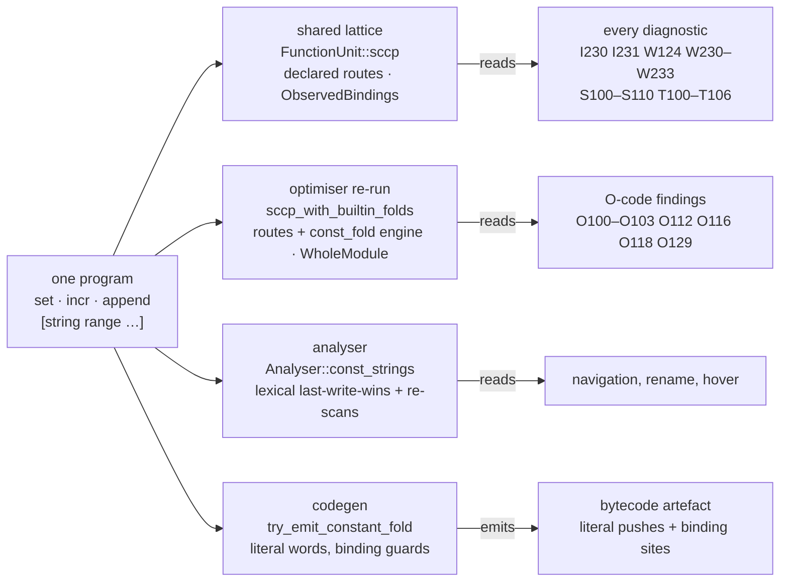

# Value-transfer consumer contracts

The registry owns command-specific value semantics. Compiler and editor
consumers supply current inputs, execute the declared transfer, and retain
its applicability and provenance. This page specifies consumer boundaries,
third-party evaluation routes, compiler-local handlers, and the command
recognition limits enforced by `cargo xtask value-transfers --check`.

Read [value-transfers.md](value-transfers.md) for the interface and
[value-evaluation.md](value-evaluation.md) for evaluation, budgets and caches.
Generated command declarations and route availability are listed in
[the value-transfer catalogue](../../generated/value-transfers.md).

A value or type fact is not an edit certificate. Rewrites additionally need
current source correspondence, the selected command's binding contract,
applicable target semantics and preserved effects and error paths. Missing
or ambiguous input declines rather than becoming a successful empty answer.

## Where per-command knowledge lives

The registry invariant ([command-registry.md](command-registry.md)) says
per-command knowledge is a `CommandSpec` fact and the compiler is a generic
consumer. On the value axis the compiler's passes ask the registry; the
table lists every pass that touches constants, values, or dataflow and
what it reads.

| Site | What it reads |
|---|---|
| `sccp.rs` `evaluate_defs_under` | every `Statement::Call` through the driver's `evaluate_call`, an `ExprEval` through `evaluate_expr_eval`, and the typed `Incr` node through `evaluate_incr` — the registry's derived cell update over the invocation view the node projects to; no command is recognised by its spelling |
| `value_transfer.rs` `evaluate_call` | a `foreach` / `lmap` header's per-element `ConstSet` transfer from the iteration plan the explicit declaration answers (`PlanAnswer::Iterate`), one of the handlers § *Compiler-owned handlers* lists |
| `existence_query.rs`, `sccp.rs` | `[info exists X]` through `SemanticOperationId::Intrinsic(IntrinsicId::InfoExists)`, answered inside the fixed point as a read of `FactDomain::Existence` (`SccpResult::existence_at`) |
| `optimiser/chain_fold.rs` | the O104 / O130 write-chain classifier: the resolved cell update, gated on the observed binding of the statement's own head |
| `optimiser/structure_elimination.rs` | O112: the solver's selection facts; no private subject resolution or arm matching |
| `optimiser/elimination.rs` `assignment_safe_to_delete` | a dead `incr` is removable only when it cannot raise: a literal integer amount, a place that holds an integer wherever it is bound, and a place bound where the statement reads it unless every release the profile spans creates the absent cell |
| `optimiser/end_offset.rs` | O128's own length-position table for `lindex`, `lrange`, `lreplace`, `string index` / `range` / `replace`, `llength`, and `string length` — `arg_roles` debt, pinned in the ratchet |
| `static_loops.rs` | `LoopEnumeration` runs an `incr` and every command through the route its head resolves to (`exec_command`), with no arithmetic of its own |
| `intervals.rs` `transfer` | the `Incr` node as the registry-described integer add (`RangeModel::IntegerAdd`) |
| `interval_bounds.rs` | the dynamic halves of W230–W232: container lengths from its own map — a literal list, a `[list …]` element count, `lset` preserving length |
| `value_provenance.rs` | its own φ / copy walk and `[list …]` element count |
| `script_arg.rs` | a `[list …]` script through `Traits::BUILDS_COMMAND_PREFIX` |
| `auto_path_eval.rs` | `file` subcommands on the registry's path route where every platform reads the name alike; `info script`, and the host's `dirname`, `normalize`, and `join` readings the route declines, waived as irreducible |
| `analyser/` | `const_strings` retains lexical source facts; `infer_list_length_from_recent_set` performs an innermost structural scan under retained `BoundsMetadataContext` and complete lexer configuration. W103/W300 path advice uses selected original descriptors and the complete CU written-value premise. |

Three modules are the exemplars:
`rust/tcl-compiler/src/existence_query.rs` recognises `[info exists X]`
through `SemanticOperationId::Intrinsic(IntrinsicId::InfoExists)` and names
no command; `rust/tcl-compiler/src/const_subst.rs` folds any `[cmd …]`
through `CommandSpec::const_fold` and states "No command name is matched
here"; `rust/tcl-compiler/src/world_state_ssa.rs` renames mutable
interpreter state from registry `StateTransition` facts alone.

The shared per-unit lattice carries the command trust and no registry
engine (`BuiltinFoldInputs { registry_engine: false, trust:
ObservedBindings, .. }` in `compilation_unit.rs`): every declared route
folds there, so every diagnostic reads the routes' values, while the
registry's `const_fold` engine runs only in the optimiser's re-run
(`registry_engine: true` in `optimiser/propagation.rs`). Every call has a
transfer — the route its head resolves to, or a decline with its reason —
and the solver decides a flattened `switch`'s dispatch chain and states one
selection record per opaque `switch`, so a constant subject decides each
arm's reachability.

## What each analysis reads

Paths are relative to `rust/tcl-compiler/src/`. "Reads the lattice" means
`SccpResult::values`; "reads reachability" means `executable_blocks` /
`executable_edges` only. `folded_types` (`SccpResult::folded_types`) is the
side map of semantic type and shape per value, distinct from
representation evidence.

| Module | Fact it produces | What it reads |
|---|---|---|
| `analyses.rs` | the lattice vocabulary | — |
| `sccp.rs` | the lattice, reachability, constant branches | the value-transfer driver for every call, expression and `Incr` node, with exact ingress and `folded_types`; `evaluate_branch` resolves a nested command lazily, evaluates a finite set member by member, and reads a whole-variable `Raw` operand; each branch fact records its kind, and the solver states one selection record per opaque `switch`; the existence domain decides `info exists` and unbinds inside the fixed point; each loop whose start state the solver proves runs to its exit, and what the loop leaves is stated as exact-value edge refinements on its exit edges, which a second run reads (`enumerate_loops`, `SccpResult::loop_enumerations`); an opaque `catch` body's writes take what the body leaves (`catch_body_answer`); the per-value map answers per `(BlockId, ValueKey)` for an edge refinement — the existence domain's (`SccpResult::existence_at`) and the value domains' (the solver narrows a block's statements and terminator by the exact values and finite sets in force there, `RefinementFlow`, `SccpResult::value_at`); a statement's embedded writes are the definitions of its synthetic call, evaluated once with the host under `LocalWrites` (`LatticeDriver::evaluate_embedded`); values and existence are published per completion path — a statement that certainly raises where a handler is thrown to defines what its stores that ran left (`DefValues::Raised`, `BlockExit`), a region entry opens only where the body's first command can fail before it stores, and a flattened `catch` is evaluated where its region ends |
| `const_subst.rs` | `[cmd …]` folds through `const_fold` | the registry `const_fold` engine the optimiser's re-run turns on; `ResolvedConstSubst::command_bindings` is the evidence shape an outcome carries |
| `type_infer.rs` | the type lattice | `values` for `lindex` indices and list literals; types `Statement::Incr` as `Int`; joins `folded_types` rather than re-splitting a `Const(String)` list; `expr_call_type` reads a math function's type from `tcl_syntax`'s `MathFuncSpec::result_class`; a type refinement in force at a block types the version it names there (`type_refined_statements`: an integer in the arm of `string is integer -strict $x`, a number in that of `$x == 1`), and the shimmer use checks read it per block (`types_in_force`) |
| `types.rs`, `value_shapes.rs`, `word_expr.rs` | vocabulary and word helpers | — |
| `intervals.rs` | per-value integer intervals | seeds from `Const(Int)`, `Const(Bool)` and a `ConstSet`; the `Incr` transfer is the interval domain's model of the registry-described integer add (`RangeModel::IntegerAdd`), a `$var` amount contributing its interval; a use's guard narrowing is the range refinements in force at its block (`refine_interval`), the bound read by the condition's own transfer under the target's grammar, for a version the type lattice or a `string is integer -strict` refinement proves an integer; an integer an enumerated loop's exit state holds is the version's interval where it is in force, past the loop header's widening at `MAX_ITERS` |
| `interval_bounds.rs` | W233 and the dynamic halves of W230–W232 | `intervals`, and its own container-length map: a literal list, a `[list …]` element count, `lset` preserving length |
| `native_integer_proof.rs` | native-add evidence | `values` directly; rejects `ConstSet` |
| `value_provenance.rs` | written constants reaching a use, with source spans | its own φ / copy walk and `[list …]` element count |
| `rendered_properties.rs` | may/must string-content flags | reachability |
| `representation_plan.rs` | representation obligations | — |
| `tcl_expr_eval.rs` | expression evaluation under `FoldPolicy` | the evaluator: the full value result, lazy `var` / `command` / `call` services over the analysis inputs (`ExprServices`, `pub(crate)`), `rand` / `srand` the one name check; `var` reads the ordered state's writes before the inputs, and `command` ends the evaluation at a nested outcome that did not complete normally |
| `word_subst.rs` | nested `[cmd …]` lift | feeds nested-word folding; a lifted call is `expr` by the registry's `EXPR_CONCATENATES_ARGS` trait, not the spelling, as `optimiser/end_offset.rs` resolves it |
| `subst_nocommands.rs` | `[subst -nocommands]` evaluation | the `const_map` its two callers pass — lowering's const map from `eval_subst_nocommands_body`, the factory bindings from `specialise_factories.rs` — and the template-word plan's `reads` and `escapes`; it is the materialisation for the commands-off case |
| `static_loops.rs` | the state a bounded `for`, `while` or `foreach` leaves, and an opaque `catch` body's | `LoopEnumeration` (`enumerate_loop`, `enumerate_script`) runs each statement through the registry's routes over exact values and existence, a `switch` through its own `Selection` transfer, under the iteration plan's completion protocol, the cap a `Budget(Iterations)` decline that publishes nothing; `summarise_for_statement` and `summarise_static_for` answer a `for` loop's post-loop constants from the same run, a name the loop writes that their environment does not hold a scalar of unknown value |
| `loops.rs` | the natural-loop forest | reachability |
| `dynamic_names.rs` | the name-blindness barrier | the call's template-word plan for a template-expanding command, so `subst -novariables $t` does not blind every read; a dynamic write or destroy blinds the whole function, and in the existence domain a barrier leaves every place may-bound from that statement on |
| `existence_query.rs` | `[info exists]` recognition through `IntrinsicId` | the existence domain's front: it answers through the expression route's `nested` service as a read of `FactDomain::Existence`, so the condition decides inside the fixed point |
| `var_observability.rs`, `var_refs.rs`, `var_resolve.rs`, `var_scoping.rs` | alias / trace lattice, reference scanning, place resolution | gates and helpers; `var_scoping.rs` refines `upvar` / `namespace upvar` by argument index itself |
| `var_escape/` | local-versus-frame tagging for WASM | none; `info_subcommands.rs`'s audited allow-list is a `SubCommand` trait candidate on another axis |
| `place.rs`, `place_bridge.rs` | storage places and overlap | `Statement::Incr` read modelling; `place_bridge.rs` asks for `namespace upvar` positions by name (`arg_roles` debt) |
| `memory_ssa.rs`, `effect_ssa.rs`, `state_ssa.rs`, `world_state_ssa.rs` | versioned memory, effects, world state | none; name-free |
| `def_use.rs` | def-use chains, `UseKind` | `VariableName` (#1934) |
| `dead_stores.rs` | the Explorer's liveness view | reachability; excludes `Incr`, deliberately |
| `dataflow_graph.rs` | the Explorer's data-flow graph | renders `LatticeValue` |
| `side_effects.rs` | effect classification | name-free |
| `taint.rs`, `taint_interproc.rs` | taint colours | reachability and φ edges; never `values`; `Incr` passthrough |
| `interprocedural.rs`, `interprocedural/transfer.rs` | `ProcSummary`, `MethodSummary`, `TransferSummary` | each pure procedure's seedless lattice read at its exits (`exit_value`, the reading O103's re-run shares; `summarise_returns` consults it one stage after the purity fixpoint), `classify_return`'s exact shapes where no run is made; the alias names from the registry — a scope alias's `alias_frame` and `VarWrite` operands, an alias-pair call's level by argument-count parity as a `FrameLevel` — and a scope alias read as a link, not an instance-variable write; `TransferSummary` holds parameter roles with a `Name` parameter's `FrameLevel` and ordered outcomes, the global places a callee writes, the completion domain, and the effect footprint, composed bottom-up and invalidated with the module's bindings |
| `unit_scope.rs` | call-site seeding | literal-only, string-typed seeds |
| `command_binding.rs`, `alias.rs`, `realm.rs`, `registry_invocation.rs`, `dispatch_proof.rs` | binding validity, aliases, the realm, dispatch stability | name-free gates; `realm.rs`'s `namespace import` scan is a `StateTransition::Namespace` consumer candidate |
| `object_types.rs` | object-handle provenance | the type lattice |
| `lambda_literal.rs`, `inline_uplevel.rs`, `inlining/` | lambda splitting, passthrough inlining, the unwired IR inliner | shape only; `inlining/` synthesises its own `break` |
| `shimmer/` | S100–S103, S110 | `values` and reachability; `ArgTypeHint::transparent_from`; S100 reads existence, so a φ merging a bound version with an unbound one is no representation merge: `set x 1; if {$c} { unset x }; puts $x` reports W210 and no S100 |
| `path_concat.rs`, `uri_split.rs`, `regex_source.rs`, `scan_predicate.rs` | W201, IRULE3103, regex source spans, `scan` no-match proof | `uri_split` reads `Const(String)` values; `scan_predicate`'s table is `scan`'s own format grammar |
| `common_aot_plan.rs`, `mixed_region_plan.rs`, `semantic_optimisation.rs` | AOT evidence and plans | `values` as evidence; refuses a constant without a singleton type, and a computed value never authorises live intrinsic dispatch |
| `slot_allocation.rs`, `signature_scan/`, `lattice_rebase.rs`, `environment_ingress.rs` | slots, signature scan, span rebasing, dialect ingress | — ; `lattice_rebase.rs` shifts every span-carrying fact |
| `lowering/` const map | `proc $name` and body-word resolution before SSA | its own literal-only map — it runs before SSA exists and records only `set var {literal}` — and `eval_subst_nocommands_body`, which folds a `subst` whose template-word plan is exactly commands-off; `specialise_factories.rs` extracts the factory template through the same plan |
| `cfg_builder/` | blocks, terminators, loop nodes | the `switch` dispatch chain and `Raw` subject; `emit_opaque_catch` and `lower_try_dispatch` make a body one call whose defs are the body's; a statement's word effects (`<word-effects>`), a definition point paired with its host; both builds share one plan and completion protocol: a procedure's straight-line `catch` is lowered into a block per statement with its region entry and its `catch` end (`lower_catch`, `Function::region_entries`, `Function::catch_ends`), the faithful build's `try` body is a block per statement, and a handler's entry state is the join of its throw sources' prefix states |

## What each optimisation reads

Producers are under `rust/tcl-compiler/src/optimiser/` unless named. A
rewrite needs source-edit validity and behavioural equivalence — errors,
effects, binding, evaluation order, implicit results, target semantics —
and a diagnostic is never that proof.

| Code | Producer | What it reads |
|---|---|---|
| O100 | `propagation.rs`, `branch_folding.rs` | `sccp_constants_for`, `sccp_value_literal`, `command_mutations`, operand types — including the values the registry's routes give the lattice (`incr`, `append`, `lappend`, `[set x]`, the `dict` keyed updates, `string range`, `list`, `llength`, `string length`) and the values a statement's nested writes leave (`set r [expr {$x + [incr x] + $x}]` gives `r` 5 and `x` 2); a single call site's argument is propagated into the callee's body, so `bump n` rewrites `upvar 1 $name v` to `upvar 1 n v` |
| O101 | `branch_folding.rs`, `expr_simplify.rs`, `propagation.rs` | `constant_branches`, the constants projection, `trusts("expr")`; every fold re-asks the shared expression route (`evaluate_expression_detached`) under the rewrite's whole-module trust, so it folds only what the lattice proves; the existence branch fact, an enumerated loop's exit state and an edge refinement each decide a condition, and `is_switch_dispatch` keeps a flattened `switch`'s chain from folding |
| O102 | `propagation.rs` `run_load_forwarding` | def-use chains, `UseKind::Operand`, `is_externally_mutable`, `TraceInputs`; never `values`; no word of a statement that reads a place beside a write its own substitutions make is an operand |
| O103 | `propagation.rs` two shapes | `ProcSummary`, `trusts_proc_binding`, `evaluate_proc_with_constants`, whose re-run runs the callee's bounded loops under the call's seeds and reads each return's value at its block (`SccpResult::value_at`) |
| O104, O130 | `chain_fold.rs` | the classifier dispatches on the resolved cell update, gated on the observed binding of the statement's own head, and a `$var` piece folds through the lattice value it holds; a piece that needs backslash substitution ends the run; an unrelated statement between the writes is tolerated, and the chain must start at a literal `set` |
| O105, O106 | `rust/tcl-compiler/src/gvn.rs` | reachability; the same value is not the same observable computation |
| O107 | `elimination.rs` | `executable_blocks`: the blocks applied reachability drops, a flattened `switch`'s dead arms among them; a selection never drops a block, so an opaque form's arms are I231's alone; applied reachability only, never a selection fact |
| O108 | `elimination.rs` ADCE | def-use, `assignment_safe_to_delete_with_effect`; an existence read — `[info exists x]`, `[array exists x]`, an unbind — is an SSA use of the version it observes, so the pair behind `[info exists b]` (#2132) stays; a dead `incr` is removable only when it cannot raise — a literal integer amount, a place that holds an integer wherever it is bound, and a place bound where the statement reads it unless every release the profile spans creates the absent cell — so one that may find its place absent is retained under a profile spanning 8.4 and removed under one that does not |
| O109, O126 | `elimination.rs`, `manager.rs` coupling | def-use and the dead-store guards; a nested cell update's read is an SSA use (#2050), and a call records the names its callee's global-write summary holds as observed, so a store the callee may read stays (#2214); a read inside a braced `expr` is a use of the version it reads, and a statement's reads beside a write its own substitutions make are by name, so the store ahead of `puts [expr {$x + [set x 10] + $x}]` stays; a φ's read over the edge from the block before a `catch` or `try` body counts only where the solver opens it, a store a raise preserved is read where the preserving definition is, and a write in a `catch` or `try` body inside a substitution reads the version before it, so a store ahead of a write that may stop part-way is dead only where every path overwrites it |
| O110 | `expr_simplify.rs` | operand types; the regrouping is type-guarded, and a residual is typed, never a rendered constant |
| O111 | `rust/tcl-lsp-core/src/diagnostic_report.rs` `brace_expr_hints` | the analyser's W100 findings as the unbraced-expression fact — W100 is a fact code, computed whatever a layer says — and no policy: one `Finding` at the span of every unbraced expression, with policy deciding W100 and O111 independently, the rule [diagnostic-policy.md](diagnostic-policy.md) § *What the producers leave to the policy* states |
| O112 | `structure_elimination.rs` | its own `Env` projection for `if`, `while` and `for`, whose conditions are decided on the shared expression route (`decide_condition_detached`) under the rewrite's whole-module trust; a `switch` only from the solver's decision — the selection record at the statement for an opaque form, the applied branches of the dispatch chain for a flattened one — and only where every member of the subject runs one body, so a `switch` the solver never analysed, inside an opaque `catch` body, is left alone; no private subject resolution or arm matching remains |
| O113, O117, O120 | `branch_folding.rs`, `expr_simplify.rs` | operand types; integer versus float and target rules stay explicit, and W110 is not an edit certificate |
| O114, O119 | `pattern_recognition.rs` | all-versions `Int` typing |
| O115 | `branch_folding.rs`, `expr_simplify.rs`, `helpers/expr_simplify.rs`, `propagation.rs` | `trusts("expr")` |
| O116, O118, O129 | `propagation.rs` `try_o129_fold` | `ConstSubstCtx` over the re-run lattice; presentation gates decide what is spliced |
| O121–O123 | `tail_call.rs` | none |
| O124 | `unused_procs.rs` | `ProcSummary::calls`, `has_barrier`; whether a call is reachable is the call-graph axis's question, answered where `ProcSummary::calls` is built and not by any value fact |
| O125 | `code_sinking.rs` | side-effect-free assignment shapes, the `Incr` node among them |
| O127 | `propagation.rs` `run_store_to_load_forwarding` | def-use, memory SSA, "not SCCP-constant"; a constant use takes O100 |
| O128 | `end_offset.rs` | its own `lindex` / `lrange` / `lreplace` / `string …` / `llength` length-position table — the index-argument role the registry does not carry, `arg_roles` debt |
| switch-arm deletion | `structure_elimination.rs` | selection facts; no rewrite deletes a `switch` arm, and no code is reserved for one |

The `Optimisation` record (`code`, `message`, `span`, `replacement`,
`group`, `hint_only`) and the LSP surface — one `HINT` diagnostic per
finding with the replacement in `Diagnostic.data`, applied by
`apply_optimisations` through the `optimiseDocument` command — carry every
code alike. The Explorer's `opt` view shows the findings, and its `sccp`
view each statement's route and the reason an answer declined.

## What each diagnostic reads

The catalogue has 211 diagnostic codes (`docs/generated/diagnostic_codes.md`,
one row each); most are syntax, scope, version, dialect, or protocol facts
with no constant input. The rows below are the ones with a constant
relationship; [value-transfers-examples.md](value-transfers-examples.md)
has a program for each, with the tool's observed behaviour.

| Code | Producer | What it reads |
|---|---|---|
| I230, I231 | `analyser/diagnostics/dataflow.rs` | `constant_branches` by kind + `executable_blocks`: I230 and a flattened `switch`'s I231 from the `Applied` facts, an opaque form's I231 from the `Selected` facts (`emit_selected_arm_diagnostics`); the existence fold runs once; the existence branch fact, an enumerated loop's exit state and an edge refinement each decide a condition |
| O100 (hint) | `compiler_checks.rs` `from_constant_branch` | every `ConstantBranch` |
| W124 | `dataflow.rs` `emit_invalid_ip_diagnostics` | every `Const(String)` in `values`, a computed one included |
| W233, W230–W232 (dynamic half) | `dataflow.rs` → `interval_bounds.rs` | `values` + reachability, through `intervals`; a finding only when the whole interval lies outside the range |
| W210, W211, W213, W214, W220, H300 | `dataflow.rs` | reachability; `whole_unset_names`, `phi_can_undef`, the existence guards (`SccpResult::guarded`, `SccpResult::existence_guards`), and the preserved versions the declared preserve outcomes leave (`SccpResult::preserved`), which W210 and W213 read through, so a `regexp` or `scan` no-match needs no prover of its own; W211 counts an existence read — `info exists`, `array exists`, an `unset` — as a use of the binding (#2132) |
| W126 | `dataflow.rs` | the type lattice |
| W123, W307, W308 | `var_command.rs`, `helpers.rs` | `Const` / `ConstSet` strings for `$cmd` dispatch and `dict with` |
| S100, S101 | `shimmer/use_site.rs`, `shimmer/expr.rs`, `shimmer/commit.rs` | `values` + reachability; `is_valid_instance_of` suppresses on a known-valid constant; an unbind is no typed value, so `set x 1; if {$c} { unset x }; puts $x` reports W210 and no S100 |
| S102, S103, S110 | `shimmer/thunking.rs`, `sharing.rs`, `byte_array.rs` | reachability; S110 reads `folded_types` for a byte-array value |
| T100–T106, IRULE3001–3004, W313 | `taint.rs` | reachability and φ edges; never `values` |
| IRULE3101 | `taint.rs` `find_setter_constraint_warnings` | reachability and the subject's `Const(String)` value, so `set p /a; HTTP::path $p` reports nothing |
| IRULE3103 | `uri_split.rs` | `values` (`Const(String)` only) |
| IRULE1005–1008, 1201, 1202, 3102, 4002, 4004, 5002, 5004 | `irules_checks.rs` | every check consumes applied reachability: the walks over the flow graph skip a block outside `executable_blocks`, the two over the structured IR (IRULE1201 and 1202, IRULE5002 and 5004) skip a statement only unreachable blocks hold, IRULE4004's write counts count only writes that run, and a `clientside`, `serverside` or `peer` body gets a solver run of its own, so a respond in a dead arm commits nothing |
| W201 | `path_concat.rs` via `compiler_checks.rs` | reachability, rendered properties, taints |
| W121, W127, W137, W138, W141, W145, W146, W200, W202, W303 | the analyser's literal checks; `analyser/diagnostics/proven.rs` | the written words, then the proven-word re-run over the exact value the lattice proves for a word at its statement (`proven_word_value`), reported only at a proven word and without a fix: `set m 255.0; append m .255.0` before `IP::addr $ip mask $m` gives W121, `set re {(a+)+$}; regexp $re $s` W303, a computed `format` or `binary format` template W138, W200 or W202; a word a command with no route computes (`string tolower`, `none (unauthored)`) stays unchecked |
| W230, W232 (literal half) | `analyser/bounds_checks.rs`; `proven.rs` | the literal container and index, then the proven words: a container a route computes is checked (`set l [list a b c]` or `[split "a,b,c" ,]`, then `lindex $l 9`, gives W230), one no route computes is not (`lrange` has no value route, #2437) |
| W147, W152 | the analyser's option checks | the literal option spellings, and a proven option word where the call's option scan reads the lattice (`set o [string range -pathxx 0 4]; glob -directory root $o prefix *.tcl` gives W147); a pack command's declared relations read only the literal words, so `::bibtex::parse -command handle $o rec` with a proven `$o` gives neither (#2453) |
| W102 | `analyser/diagnostics/security.rs` | the template-word plan's `kinds`, re-read with the switch values the lattice proves (`emit_w102_template_plans`): `set opt -novariables; subst $opt $x` warns of `[cmd]` alone and advises `-nocommands`, as the literal spelling does; a `subst` inside a command substitution (`set r [subst $opt $x]`) keeps every kind (#2451) |
| W240–W242 | `analyser/bounds_checks.rs` | the loop header's branch fact decides a header the solver proves — `set n 0; while {$n} {…}` is W240, `set go 1; while {$go} {…}` is W241, neither W242 — and a header nothing decides keeps the condition text's verdict, its counter read from the iteration plan: the bound a literal in the condition and the step a literal amount of the registry's cell update, from the integer a `for`'s start script writes or the solver proves where the loop starts, so `set i $start` is checked; a bound or a step only the solver proves is not read (`set n 10; while {$i < $n} {incr i -1}` reports nothing, #2452) |
| IRULE4004 | `irules_checks.rs` | a `set` whose value the lattice proves, so `set x [string range abcdefgh 0 3]` in a per-request event is reported as hoistable |

### Blast radius, and what keeps each family sound

1. **O100 / O101 / O102 / O112 / O129** rewrite source; a wrong value is a
   miscompile of the suggestion. Permission 2 keeps the producer; the
   presentation gates (printable ASCII, size, `is_value_safe_bare_word`,
   `render_propagation_word`) decide what is spliced; binding evidence is
   re-proven before emission.
2. **I230 / I231 + O107 / O108:** a wrong branch decision marks live code
   unreachable, and `executable_blocks` gates taint, shimmer, W210 / W211 /
   W220, and the IRULE flow checks, so a spurious "unreachable" silently
   removes a whole family's findings for that block. Applied reachability
   requires a real CFG edge and a proven condition under binding validity;
   a declared fact that is false is the author's under ruling 3.
3. **W124 / W233 / W230–W232:** a wrong `Const(String)` fabricates a finding
   at a span the user never wrote. Exact ingress and the no-fabricated-span
   rule apply.
4. **W123 / W307 / W308:** a wrong constant resolves a command to the wrong
   target, and rename keys off it. A computed head is never rename-safe.
5. **S100 / S101:** a wrong constant *suppresses* a real finding.
   Representation evidence is separate from the value.
6. **T100–T106:** taint never reads `values`, so a value cannot create a
   false negative; only an unsound `executable_edges` could drop a tainted
   φ incoming, and applied reachability is gated as in 2.

### Families with no constant input

The E-codes (syntax and recovery), W001–W004, the usage and style codes
W100–W120 not listed above, the version-gate codes W135, W136, W139, W144,
W149, and W150, the scope codes W215–W218, W250, the security codes
W300–W312 other than W303, H301, TK1001–TK1003, BIGIP6xxx, IAPP7xxx,
SSLIC1xxx, and the IRULE event and structure checks not listed above are
unaffected. They are listed so that "every diagnostic" is answered rather
than implied. The XC translation codes, the BPF frontend codes, and the
TLS report codes outside `DiagCode` have their own gate owners; a BPF
frontend rejection is never controlled by diagnostic enablement, and the
report-side TLS grade policy is a centralisation boundary of its own.

## Third-party commands

Purity alone never supplies an evaluator. A command uses one of three
explicitly owned routes:

- A registry-declared direct route calls a shared Rust core under its exact
  supported releases and platform semantics. The simulator's generated stubs
  are not evaluators, and volatile world-state readers do not become constants.
- A declared implementation runs the real operation in the bounded engine,
  with named inputs, dependencies, target semantics and budgets. Workspace
  declarations are authoritative only in their actual loaded generation.
  Provisioning never loads arbitrary workspace packages because a file opened.
- A user procedure uses the interprocedural path: current argument-sensitive
  facts seed the callee's transfer, and ordered summaries retain writes,
  unbinding, completion and observer effects across calls.

Unsupported or unauthored routes decline explicitly. Platform-dependent
results, suspect bindings, volatile reads and cross-event state must not be
folded from a display name or purity annotation. Consult the generated
catalogue for each declaration's actual route rather than a prose count of
commands or packs.

## The drift gate and the generated inventory

One `cargo xtask value-transfers` command, in the `make xtask-check`
family, with three parts in the shape of its neighbours:

1. **A source lint**, after `number-drift` and `segmentation-drift`: a Tcl
   command or subcommand name used to *recognise an invocation* — as the
   operand of `==` / `!=` / `matches!` on a `command`, `canonical_command`,
   `cmd`, `head`, or `sub` binding, as a `match` arm on such a binding, or
   as a `&str` constant compared against one — plus a `match` arm on a
   command-specific ID (`Native(…)`, a hook variant whose handler
   implements one command's binding rules), under `rust/tcl-compiler/src/`
   and the analysis and language-server crates named above, outside the
   registry-dispatch owners. A reviewed site carries
   `// value-transfer-ok: <axis> — <reason>`; the reason names the axis the
   fact belongs to, or states why it is irreducible. The `rand` / `srand`
   check in the expression evaluator, `scan_predicate.rs`'s conversion
   table, and the inliner's synthesised `break` are the expected waivers.
   The lint is a warning mechanism: a renamed local binding, a helper
   table, or a command-specific hook variant can evade it, so the
   contract tests and the ownership review are the gate's other half. It
   is also what holds four invariants — `sccp.rs` recognises no command
   by spelling, `static_loops.rs` performs no arithmetic of its own,
   `param_traits.rs` matches no command by name, and no consumer walks a
   template word. Every scanned file is held to one of two rules: a file
   in `CLEAN_FILES` is *clean* — every
   site waived or gone — and every other file is *ratcheted* at its count
   of unwaived sites, which may only fall (§ *The ratchet over unreviewed
   files*).
2. **A registry enumeration**, after `callback-inventory`: every command,
   subcommand, and form is resolved through the invocation resolver with a
   representative argument shape, and the result is written to
   `docs/generated/value-transfers.md` — pack, command, the declared
   semantics (declared, derived, inherited, or declined), the evaluator
   route (direct, expression, declared implementation, or none) with its
   origin (native, `.tclspec` body), the target roles, and a *gap* column
   for a command that declares `VarWrite` roles, `READS_BEFORE_WRITE`,
   `pure`, or `ReferentiallyTransparent` and has no route. `append`,
   `lappend`, and `dict incr` have no gap: each declares its semantics. The
   pure-ish third-party commands are rows too.
   `--check` fails on drift, on an unclassified `VarWrite` command with no
   semantics and no waiver, and on a stale waiver.
3. **A pinned-set test**, after `rust/tcl-registry/tests/analyser_hooks.rs`:
   the set of specs carrying each route, swept over every loadable dialect
   and the shipped `.tclspec` packs, so a route cannot appear, vanish, or
   move without the test changing beside it.

The owner-resolution manifest in
[shared-utility-contracts-rust.md](../contracts/shared-utility-contracts-rust.md)
has a row — surface *constant evaluation and value transfers*, owner
`tcl-registry` with `tcl-compiler`'s driver as the engine, gate
`xtask-value-transfers` — so `owner-resolution` proves the pages' claims
resolve to live code and a registered gate. The Explorer's `sccp` view and
`tcl explore --show sccp` render each statement's route and decline
reason, which keeps the generated inventory and what a contributor sees in
the tool the same artefact.

## Compiler-owned handlers

Every declared direct route is implemented in the registry
([`NativeEvalId::owner`](../../../rust/tcl-registry/src/value_transfer/route.rs)).
The following compiler-local handlers each have a
handler keyed by a typed registry identity rather than a command name,
where it lives, what keys it, why it stays, and the waiver that marks its
site.

| Handler | Where | Keyed by | Why it stays | Waiver |
|---|---|---|---|---|
| the loop header's per-element `ConstSet` transfer over a literal, lattice, or folded list, one set per binder of the plan | `rust/tcl-compiler/src/value_transfer.rs`, `evaluate_call` | `PlanAnswer::Iterate` from the explicit `foreach` / `lmap` declaration | the bounded-loop enumeration states the exact exit state past the loop and keeps this transfer as the binders' value inside it, where the header still widens | none needed: generic over the plan |
| the `dict with` key binder: each key of a constant dict value defined as a variable of the body's frame, for the no-path form | `rust/tcl-compiler/src/analyser/handlers.rs`, `handle_dict_with_command` | `AnalyserHookId::DictWith`, stamped on `dict`'s `with` subcommand | the analyser's variable table is not a value-transfer answer: the handler reads the dict from the analyser's constant-string map, while `DICT_WITH` (`value_transfer/body.rs`) states the same keys to the lattice | none needed: keyed by the hook identity |
| the regex-pattern recorder: a `regexp` or `regsub` pattern word, literal or a constant variable's value, recorded for highlighting | `rust/tcl-compiler/src/analyser/handlers.rs`, `handle_regex_pattern_capture` | `AnalyserHookId::RegexPatternCapture`, stamped on `regexp` and `regsub` | a presentation record, not a value: it finds the pattern through `regex_source::regexp_pattern_index` and reads a variable through the analyser's constant-string map | none needed: keyed by the hook identity |

Every run consults the module's command trust, under one of two stances
(`FoldTrust` in `rust/tcl-compiler/src/sccp.rs`). The shared per-unit
lattice folds under `ObservedBindings`: a head folds while the module's own
observed bindings leave it denoting its builtin, so one unresolved head
elsewhere in a file does not cost it every constant. The optimiser's
re-run — the only run a rewrite lands from — folds under `WholeModule`,
which also declines once any binding transition in the module is
unbounded. Under either stance a route declines a head the module shadows,
renames or aliases with `RebindingSuspected`, the typed `incr` node
included, and a run with no trust fact in hand declines every route
. The memoised editor path and a whole-module build take the same
stance under the same key: the interned `ValueTransferContext` in
`rust/tcl-lsp-db/src/lib.rs` holds the command trust its
`CommandTrustSnapshot` stands for, rebuilt once per module, and a fresh
build folds under the scan that snapshot was taken from, which it
round-trips to.

### The ratchet over unreviewed files

The lint holds a *clean* file — every file in `CLEAN_FILES` — to zero unwaived sites, and pins every other
scanned file at its current count of unwaived recogniser-shaped sites in
`RATCHET` (`rust/xtask/src/value_transfers.rs`). `--check` fails when a
file's count rises above its pin. The scan of a file ends at its inline
`#[cfg(test)]` module; any other `#[cfg(test)]` item — a `mod name;`
declaration, a `use`, a braced item — is skipped alone. A pin is lowered
beside the review that removes or waives the file's sites, adding the `value-transfer-ok`
annotations for the sites it reviews; a pin is never raised, and never
added — a site that moves to a new file is reviewed there. The gate holds the following limits equal to `RATCHET`. Each row names
the owning axis or the reason the recogniser remains local. These are
enforced drift limits.

| File | Sites | Owner or constraint |
|---|---|---|
| `rust/tcl-cli/src/commands/minimize.rs` | 1 | the `arg_roles` axis — `var_target_positions`, a reimplementation of the role axis for eight commands |
| `rust/tcl-compiler/src/analyser/class_lattice.rs` | 3 | the `definition_body` axis — `oo::objdefine`, `oo::copy`, and `info` by name |
| `rust/tcl-compiler/src/analyser/diagnostics/security.rs` | 2 | the `return_type` axis — a `pattern_type` conditional on `-regexp` absorbs the `switch`-specific ReDoS scan |
| `rust/tcl-compiler/src/analyser/diagnostics/validity.rs` | 2 | the `traits` axis — `unset` beside the `DESTROYS_VARIABLE` query, `matchclass` by its lifecycle field |
| `rust/tcl-compiler/src/analyser/irules_event_checks.rs` | 6 | the `special_vars` and `side_effects` axes — the `static::`, `log`, and `global` checks |
| `rust/tcl-compiler/src/codegen/cmd_subst.rs` | 3 | the `native_lowering` axis — instruction selection for `set` and the `array` intrinsics |
| `rust/tcl-compiler/src/codegen/emitter/bytecoded.rs` | 4 | the `native_lowering` axis — instruction selection for the `dict` and `array` ensembles |
| `rust/tcl-compiler/src/codegen/emitter/loop_blocks.rs` | 2 | the `native_lowering` axis — the loop emitter's `foreach` / `lmap` collect flag, which the declared iteration plan can carry |
| `rust/tcl-compiler/src/codegen/statements.rs` | 2 | the `native_lowering` axis — `break` / `continue` as loop exits |
| `rust/tcl-compiler/src/codegen/structured.rs` | 2 | the `native_lowering` axis — `break` / `continue` as loop exits |
| `rust/tcl-compiler/src/connection_scope.rs` | 1 | the `traits` axis — `unset` beside the `DESTROYS_VARIABLE` query |
| `rust/tcl-compiler/src/inline_uplevel.rs` | 1 | the `native_lowering` axis — the inliner's synthesised `break` / `continue`, the expected waiver |
| `rust/tcl-compiler/src/irules_checks.rs` | 3 | the `side_effects` axis — `drop` / `reject` / `discard`, `DNS::return`, `event disable all` |
| `rust/tcl-compiler/src/lowering/mod.rs` | 1 | the `frame_effect` axis — the `namespace` body |
| `rust/tcl-compiler/src/lowering/structured.rs` | 2 | the `native_lowering` axis — `dict for` / `dict map` lowering by subcommand |
| `rust/tcl-compiler/src/optimiser/end_offset.rs` | 1 | the `arg_roles` axis — O128's length-position table is the index-argument role the registry does not carry, the same role boundary as the W230–W232 family |
| `rust/tcl-compiler/src/place_bridge.rs` | 2 | the `arg_roles` axis — `namespace upvar` positions by name |
| `rust/tcl-compiler/src/shimmer/thunking.rs` | 1 | the `native_lowering` axis — a thunked `break` |
| `rust/tcl-compiler/src/ssa.rs` | 1 | the `arg_roles` axis — `trace add variable` positions by name |
| `rust/tcl-compiler/src/taint.rs` | 3 | the `side_effects` and `traits` axes — the `file` path-sink narrowing, the `string match` / `first` / `equal` guard parse, and the `interp` / `proc` rebinding order |
| `rust/tcl-compiler/src/var_escape/handlers.rs` | 2 | the `arg_roles` and `traits` axes — `namespace upvar`'s positions and `info exists` by name; the walker consumes these facts in this file |
| `rust/tcl-compiler/src/var_escape/helpers.rs` | 1 | the `traits` axis — `info exists` beside `INTROSPECTS_BY_NAME` |
| `rust/tcl-compiler/src/var_scoping.rs` | 1 | the `arg_roles` axis — `namespace upvar` positions by name |
| `rust/tcl-irules/src/lib.rs` | 1 | the `options` axis — the `class match` / `class search` option scan ahead of the data-group reference |
| `rust/tcl-lsp-core/src/oo_body.rs` | 1 | the `definition_body` axis — `oo::define` / `oo::objdefine` by name |
| `rust/tcl-mcp/src/irule_gen.rs` | 2 | the `side_effects` axis — `table`'s shared-state subcommands and the terminal-action table; the `set` / `incr` recognisers read the resolved cell update |
| `rust/tcl-mcp/src/irule_test.rs` | 2 | the `side_effects` axis — the `pool` / `node` sinks and the terminal-action table, where every listed command carries a `TaintColour` |
| `rust/tcl-sslictcl/src/bin/sslictcl-data.rs` | 4 | irreducible — the tool's own CLI verbs (`testssl-to-dsl`, `check-trust`, `compile-trust`), not Tcl commands; a file-level CLI waiver |

## Required semantic checks

Independent Tcl oracles establish language behaviour; contract tests check
ownership and consumer integration. Tests cover positive, refused and unknown
inputs under the same release, source, configuration and loaded registry.
Keep effects and errors ordered, retain partial storage and completion paths,
and reject stale source, changed bindings or retired pack generations.

Direct and memoised consumers must agree on facts and applicability. Display
policy may suppress a diagnostic or transformation without changing those
semantic facts. Lightweight tokens and symbols must not trigger evaluation.
A shared implementation comparison is useful for adapters but is not an
independent oracle for the implementation itself.

## Related contracts

- [Value transfers](value-transfers.md)
- [Value evaluation](value-evaluation.md)
- [Worked examples](value-transfers-examples.md)
- [Registry consumer contracts](registry-consumer-contracts.md)
- [Shared utility contracts](../contracts/shared-utility-contracts-rust.md)
- [Registry contract tests](../contracts/registry-contract-tests.md)
