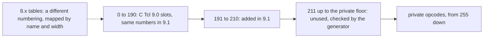
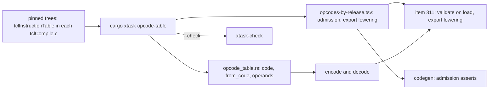

# The VM on a Tcl 9.1 base

**Status:** designed 26 November 2026, plan item 312 (owner decision, 26 November 2026: the VM moves to Tcl 9.1 and later).

**Builds on:**
- `tcl-bytecode`'s `Op` and the compiler's release-aware codegen (`tcl-codegen`);
- the release-fact tables of items 79 and 202;
- the pinned oracles in `rust/tcl-dialect/data/reference-toolchains.tsv` (9.1 is `9.1.0`, tag `core-9-1-0`).

**Feeds:**
- item 311, [serialised bytecode](bytecode-image.md), in the tbcx format (format 93), whose units carry 9.1-numbered code bytes. tbcx validates code against the running C Tcl 9.1 table, so slots 0–210 must equal 9.1.0's;
- item 88's engine convergence, through `runtime/rust`'s shared use of `tcl-bytecode`.

## Problem

The VM runs one opcode set for every target release, and older releases are reached through dialect gating. The docs call that set "Tcl 9.0.2" (`rust/tcl-bytecode/src/lib.rs:22`, `docs/design/runtime/tclvm-opcode-status.md`). The code has already moved past that.

**`Op` today** (`rust/tcl-bytecode/src/op.rs:27`) has 225 variants:

| Group | Variants |
|---|---|
| C Tcl 9.0.4 opcodes (`tclInstructionTable[]`, 191 entries) | 191 |
| Opcodes added in Tcl 9.1 | 17 of 20 |
| A second variant for slot 188 (`LREPLACE`, beside 9.0's `LREPLACE4`) | 1 |
| Private opcodes, in no C Tcl 9.x table: `CALL_FUNC1`, `LAND`, `LOR`, `LNOT`, `STR_REPEAT`, `STR_REVERSE` and ten `IRULE_*` | 16 |

Two parts are missing:
- **No numbering.** `Op` has mnemonics (`op.rs:419`), sizes (`op.rs:960`) and a 9.1 wide-form map (`op.rs:1092`), but no opcode byte. Nothing can emit or read C Tcl code bytes.
- **Three 9.1 opcodes are absent:** `dictRemove`, `arithSeries` and `foreach_index`.

**How 9.1 is reached today.** Codegen compiles in the 9.0 shape. For a 9.1 target, a post-pass rewrites each instruction to its wide form (`rust/tcl-codegen/src/codegen/operand_width.rs:43`, keyed on `TclVersion::emits_wide_instructions_only`, `rust/tcl-dialect/src/version/release_behaviour.rs:380`). The `bytecode-compare` goldens cannot show 9.1 at all: they are release-blind, so 9.1 is compared through cached `tcl dis --dialect tcl9.1` output (`.claude/skills/bytecode-compare/SKILL.md`). The corpus has 72 fixtures (`rust/tcl-compiler/tests/fixtures/codegen/matching/`). None of them exercises a command that 9.1 newly compiles.

## What changed from 9.0 to 9.1, from the sources

These come from `tmp/tcl9.0.4/generic/` and `tmp/tcl9.1.0/generic/`. The tables were compared slot by slot, with `tclCompile.c:44` (9.0.4) against `tclCompile.c:65` (9.1.0). The design is [TIP 720](https://core.tcl-lang.org/tips/doc/trunk/tip/720.md).

**Numbering.** Slots 0–190 keep their numbers. 9.1 appends slots 191–210 (211 in all). So 9.0 code bytes are valid 9.1 code bytes. 8.x numbering is different: 8.6.18 differs from 9.0 at 150 of its 190 slots, because 9.0 dropped `lor`/`land` at slots 40–41.

The code space, as this design numbers it:



**Renamed** (same slot, same width, suffix dropped): `push4`→`push`, `invokeStk4`, `loadScalar4`, `loadArray4`, `storeScalar4`, `storeArray4`, `jump4`, `jumpTrue4`, `jumpFalse4`, `beginCatch4`, `appendScalar4`, `appendArray4`, `lappendScalar4`, `lappendArray4`, `lreplace4`.

**Deprecated** (`DEPRECATED_OPCODE`, `tclCompile.h:639`): every one-byte-operand form, `loadScalarStk`, `storeScalarStk`, `returnCodeBranch` (now `returnCodeBranch1`), and the one-byte `tailcall`, `tclooNext` and `tclooNextClass`.
- The 9.1 compiler no longer emits them.
- `tclExecute.c` still executes them unless the build defines `REMOVE_DEPRECATED_OPCODES` (`tclExecute.c:19`). Such a build "cannot load Tcl 9.0 bytecodes" (TIP 720).

**Reused names.** `tailcall`, `tclooNext` and `tclooNextClass` each name two slots, a deprecated one-byte one (143, 172, 173) and a new four-byte one (195–197). Anything that keys an opcode by mnemonic is wrong on 9.1. Width-explicit names, such as our `TCLOO_NEXT4`, stay unambiguous.

**Operand types retyped**, with the same width: `unset*` carry `OPERAND_UNSF1`, `lreplace` carries `OPERAND_LRPL1` and `clockRead` carries `OPERAND_CLK1`.

**New opcodes** (slots 191–210) and what compiles to them:

| Slot | Opcode | Emitted by (9.1 source) | In `Op` |
|---|---|---|---|
| 191–194 | `incrScalar`, `incrArray`, `incrScalarImm`, `incrArrayImm` (LVT4) | `incr` (`tclCompCmdsGR.c:483`) | yes |
| 195 | `tailcall` (UINT4) | `tailcall` (`tclCompCmdsSZ.c:2970`) | `TAILCALL4` |
| 196–197 | `tclooNext`, `tclooNextClass` (UINT4) | `next`, `nextto` (`tclCompCmdsGR.c:3267`, `:3349`) | `TCLOO_NEXT4`, `TCLOO_NEXT_CLASS4` |
| 198 | `swap` | `array set`, dict compilers | yes |
| 199 | `errorPrefixEq` | `try … trap` (`tclCompCmdsSZ.c:3488`) | yes |
| 200 | `tclooId` | `info object creationid` (`tclCompCmdsGR.c:736`) | yes |
| 201 | `dictPut` | `dict replace` and others | yes |
| 202 | `dictRemove` | `dict remove` (`tclCompCmds.c:1358`) | **no** |
| 203 | `isEmpty` | `string is` (`tclCompCmdsSZ.c:632`) | yes |
| 204 | `jumpTableNum` (new aux type `JumptableNumInfo`) | `subst`, `switch -integer`, `try` | yes |
| 205 | `tailcallList` | `tailcall` with `{*}` | yes |
| 206–207 | `tclooNextList`, `tclooNextClassList` | `next`/`nextto` with `{*}` | yes |
| 208 | `arithSeries` (flags UINT1) | `lseq` (`tclCompCmdsGR.c:1788`) | **no** |
| 209 | `uplevel` | `uplevel` (`tclCompCmdsSZ.c:4662`) | yes |
| 210 | `foreach_index` (UINT4 UINT4) | `lfilter` (`tclCompCmds.c:3228`) | **no** |

**Newly compiled commands in 9.1:** `dict remove`, `dict replace`, `info object creationid`, `ledit`, `lfilter`, `lpop`, `lseq` and `uplevel`, each with a `TclCompile*Cmd` that 9.0.4 lacks. `switch -integer` ([TIP 730](https://core.tcl-lang.org/tips/doc/trunk/tip/730.md)) compiles through `IssueSwitchNumJumpTable`.

For example, `dict remove` inside a proc, from `tcl::unsupported::disassemble`
in the pinned `tclsh` builds (header lines dropped). 9.0.4 invokes the
command with one-byte operands; 9.1.0 emits wide forms and the new opcode:

**Source:**

```tcl
proc p {d} { dict remove $d a }
puts [p {a 1 b 2}]
```

**Bytecode before (tclsh 9.0.4):**

```text
    (0) push1 0 	# "::tcl::dict::remove"
    (2) loadScalar1 %v0 	# var "d"
    (4) push1 1 	# "a"
    (6) invokeStk1 3
    (8) done
```

**Bytecode after (tclsh 9.1.0):**

```text
    (0) loadScalar %v0 	# var "d"
    (5) push 0 	# "a"
    (10) dictRemove
    (11) done
```

**Bytecode (tcl dis):**

```text
$ ./target/debug/tcl dis --dialect tcl9.0 dr.tcl   # ::p only, label lines dropped
    (0) push1 0	# "dict"
    (2) push1 1	# "remove"
    (4) loadScalar1 %v0
    (6) push1 2	# "a"
    (8) push1 3
    (10) invokeReplace 4 2
    (16) done
$ ./target/debug/tcl dis --dialect tcl9.1 dr.tcl
    (0) push 0
    (5) push 1	# "remove"
    (10) loadScalar %v0
    (15) push 2	# "a"
    (20) invokeStk 4	# dict
    (25) done
```

**Result:**

```text
$ tclsh9.0 dr.tcl; tclsh9.1 dr.tcl; ./target/debug/tclvm dr.tcl
b 2
b 2
b 2
```

Our compiler has the wide forms for 9.1 but no `dictRemove`, since `Op` has
none (slot 202 above). For 9.0 it emits `invokeReplace`, where 9.0.4 pushes
`::tcl::dict::remove` directly.

`lseq 5` goes the same way: `push1`, `push1`, `invokeStk1 2` in 9.0.4, and
four `push` and `arithSeries 13` in 9.1.0:

**Source:**

```tcl
puts [lseq 5]
```

**Bytecode before (tclsh 9.0.4):**

```text
    (0) push1 0 	# "lseq"
    (2) push1 1 	# "5"
    (4) invokeStk1 2
    (6) done
```

**Bytecode after (tclsh 9.1.0):**

```text
    (0) push 0 	# "0"
    (5) push 1 	# ""
    (10) push 2 	# "1"
    (15) push 3 	# "5"
    (20) arithSeries 13
    (22) done
```

**Bytecode (tcl dis):**

```text
$ ./target/debug/tcl dis --dialect tcl9.1 --source 'lseq 5'   # label lines dropped
    (0) push 0	# "lseq"
    (5) push 1	# "5"
    (10) invokeStk 2	# lseq
    (15) done
```

**Result:**

```text
$ echo 'puts [lseq 5]' | tclsh9.1
0 1 2 3 4
```

**Semantics with no new opcode.** `lseq` loses its `expr` behaviour ([TIP 746](https://core.tcl-lang.org/tips/doc/trunk/tip/746.md)), which is visible through `arithSeries`. The full list is in `tmp/tcl9.1.0/changes.md`. `subst` options, `timer`, `unicode`, the C99 math functions and regexp `\z` are command-level, and they stay registry facts.

**`ByteCode` struct.** Its fields are unchanged from 9.0.4. Only `createTime` (under `TCL_COMPILE_STATS`) changes type. The command-location encoding (`EncodeCmdLocMap`) is unchanged apart from a `Tcl_Size` local. The aux types are `ForeachInfo`, `NewForeachInfo`, `DictUpdateInfo` and `JumptableInfo`, plus the new `JumptableNumInfo` (`tclCompCmds.c:92`, `tclCompCmdsSZ.c:109`). `ForeachInfo`'s temp fields become `Tcl_LVTIndex`, an alias of `Tcl_Size`, so their width is unchanged.

## Design

### The opcode set is C Tcl 9.1's, numbered

`Op` keeps its width-explicit variant names: `PUSH4` stays, not `PUSH`. 9.1 reuses mnemonics across widths, and the VM has 784 `Op::` uses. Renaming every variant buys nothing a table cannot give. What changes is that every variant gets a byte:

```rust
// rust/tcl-bytecode/src/opcode_table.rs — generated, do not edit
impl Op {
    pub const fn code(self) -> u8;                 // C Tcl 9.1 slot, or a private code
    pub const fn from_code(code: u8) -> Option<Op>;
    pub const fn operands(self) -> &'static [OperandKind]; // LIT4, LVT1, UNSF1, AUX4, ...
}
/// Which opcodes a target release may contain, in 9.1 numbering.
pub fn admitted(release: tcl_dialect::TclVersion, op: Op) -> bool;
```

**In memory:**

```rust
// design sketch: rows the generator would write. The slots are real: they are
// the indices of tmp/tcl9.1.0/generic/tclCompile.c's tclInstructionTable[]
// (211 named entries, 0–210)
Op::DONE.code()      == 0     // "done"
Op::PUSH1.code()     == 1     // "push1"
Op::PUSH4.code()     == 2     // "push"
Op::LREPLACE4.code() == 188   // "lreplace"
Op::LREPLACE.code()  == 188   // "lreplace"
Op::DICT_PUT.code()  == 201   // "dictPut"
Op::UPLEVEL.code()   == 209   // "uplevel"
Op::from_code(202)   == None  // "dictRemove": no Op variant yet
```

- **C slots 0–210** are generated from `tmp/tcl9.1.0/generic/tclCompile.c`'s `tclInstructionTable[]`, by name plus width. `LREPLACE` and `LREPLACE4` both map to 188.
- **Private opcodes** take codes from 255 downward. The generator fails if C's table reaches the private floor, so a later C release cannot collide with them silently.
- **Admission per release** is a generated table (`rust/tcl-bytecode/data/opcodes-by-release.tsv`), in the style of items 79 and 202:
  - each pinned release's `tclInstructionTable[]`, mapped by name and width onto 9.1 numbering;
  - plus the private opcodes that the release's dialect admits (8.4: `CALL_FUNC1`, `LAND`, `LOR`, `LNOT`; iRules: `IRULE_*`).

  Codegen asserts admission, and item 311's loader rejects a unit that breaks it.
- **Export lowering** is a column of the same table. It gives, per private opcode, the standard 9.1 sequence that item 311's interop export substitutes (`LNOT`→`not`, `LAND`/`LOR`, `STR_REPEAT`/`STR_REVERSE`), or none (`CALL_FUNC1`, `IRULE_*`).

Where the table comes from and who reads it:



### Semantics base: 9.1 for every opcode

Every dispatch arm implements 9.1's `TclExecuteByteCode` behaviour. Where 9.0 and 9.1 differ for one opcode, 9.1 wins, and the older behaviour is a dialect fact the arm reads. No such opcode-level difference was found beyond the operand retyping above, so this is a rule for later releases, not a migration today.

- **Deprecated opcodes stay executable.** C Tcl 9.1 keeps them by default. Our 8.4–9.0 targets emit them, which is how their output matches their own `tclsh`.
- **`runtime/rust` uses `tcl-bytecode`'s tables** (`LiteralTable`, `LocalVarTable`, `NativeExpressionNumberLiteral`: `runtime/rust/src/interp/native_body_artifact.rs:89`) but not `Op`. The numbering change does not touch it. Its 9.1 command semantics are item 88's work.

### Older releases keep their behaviour through gating

Three gates, each with one owner:

1. **What compiles.** Whether a command compiles inline, and to what, for a given release is a registry fact on its `CommandSpec`'s lowering descriptor, with a release range. It is never a `match` in codegen (the registry rule in `AGENTS.md`). The eight newly compiled commands get 9.1 ranges. On ≤ 9.0 they stay invocations, so `lfilter` and `lseq` there remain whatever the registry says those releases do.
2. **Operand width.** Width selection replaces the widening post-pass. Codegen picks the form from `TclVersion` when it emits, so jump layout is computed once in the target's shape. Narrow forms for ≤ 9.0, wide forms for 9.1.

   ```mermaid
   flowchart LR
     subgraph grpToday["Today"]
       emitA["emit in the 9.0 shape"] --> layoutA["jump shortening"] --> widen["widen_operands: every op to its wide form, for 9.1"]
     end
     subgraph grpAfter["After"]
       emitB["emit the target's form, chosen from TclVersion"] --> layoutB["jump layout, once"]
     end
   ```
3. **Command semantics.** The `lseq` `expr` removal, `subst` options and the new math functions are gated in the builtins by the same dialect point as today.

### The default release, the library and the commands

An opcode table alone does not give a 9.1 VM. Today 9.1 is reachable only by
asking for it, it runs with whatever library the shell exports, and it lacks
commands 9.1 has. 312 therefore also covers three things (owner scope, 26
November 2026, D-J). They stay with 312, after the crate splits; none of them
moves earlier or gates Now 1–5.

**1. The default release moves to 9.1.** Three places pin 9.0 in code:

- `tclvm --help`: `--tcl-version <x.y> … (default 9.0)`;
- `tcl-engine-tclvm`: `resolve_environment("tcl9.0")` in `with_registry`
  (`rust/tcl-engine-tclvm/src/lib.rs:509`);
- `tcl-spec-hooks`: `private_application_hook_engine(TclVersion::V9_0, …)`
  (`rust/tcl-spec-hooks/src/private_application.rs:97`), and the test at
  `emit.rs:975` sets `tcl9.0`.

All three take 9.1. Rung-4 hook bodies then run on the release chapter 5
assumes ("Bodies run on the 9.1 VM"). `runtime/rust` does not move: it stays
on 9.0 until item 88 (see "`runtime/rust` stays on 9.0" below).

**2. A release-matched Tcl library.** The VM reads `TCL_LIBRARY` whatever
release is selected (`rust/tcl-vm-cli/src/main.rs:271`,
`rust/tcl-vm/src/interp/bootstrap.rs:811`). Without it, it installs a partial
autoloader (`bootstrap.rs:636`). The `tclshX.Y` wrappers on `PATH` unset
`TCL_LIBRARY`; `tclvm` does not. So one variable decides whether `clock`
works and whether init succeeds (runs below).

- The library is selected per release by the platform-bootstrap owner
  (`tcl-platform`'s `bootstrap`, the owner map's "interpreter platform
  bootstrap" row), from the pinned tree of that release: `init.tcl`,
  `clock.tcl` and its `msgs`/`tzdata`, `tcltest`, `package.tcl`, `auto.tcl`
  and `word.tcl`. A native build embeds each pinned release's read-closure
  the way `runtime/rust` already embeds 9.0.4's
  (`runtime/rust/vendor/tcl_library/manifest.json`, checked by `cargo xtask
  runtime-stdlib`).
- `TCL_LIBRARY` is honoured only when its `init.tcl` names the selected
  release. Otherwise the VM writes one line to stderr naming both releases
  and uses the embedded library. It never fails init on another release's
  library, and never runs `clock` with no library.
- The manifest's `embedded_stdlib_revision`
  (`tcl-runtime-api/src/manifest.rs:51`, today `9.0.4+…`) becomes per
  release, so a unit compiled against one release's library is checked
  against that release's.

**3. The commands 9.1 has.** `info commands` under `tclvm --tcl-version 9.1`
with the 9.1.0 library, against `tclsh9.1`:

| | Commands |
|---|---|
| new in 9.1, missing from `tclvm` | `divmod`, `frexp`, `lfilter`, `modf`, `remquo`, `timer`, `unicode` |
| present in 9.0, missing from `tclvm` at 9.0 and 9.1 | `chan`, `fcopy`, `fileevent`, `lremove`, `pid`, `socket`, `timerate`, `unload`, `zipfs`, `zlib` |
| in `tclvm`, not in `tclsh` 9.0 or 9.1 | `my` (a global; C has it only inside method bodies) |

312 adds handlers for the first row, each with its registry spec and
`runtime_backing` in the same change (`AGENTS.md`, "WASM command parity").
`lfilter` needs one before step 5 can compile it to `foreach_index`. The
second row and `my` are 9.0 conformance bugs: they go on the deferred engine
list, not into 312.

### `runtime/rust` stays on 9.0

`runtime/rust` keeps 9.0 semantics until item 88 (owner scope, D-J). The two
engines then run different base releases. Until 88:

- every differential lane that pairs `tclvm` with `runtime/rust`
  (`tcl-fuzz`, the conformance runner, `command-backing`'s side-by-side
  report) passes `--tcl-version 9.0` to `tclvm`
  ([differential fuzzing](../contracts/differential-fuzzing.md), rule 4);
- `command-backing` keeps admitting core commands "available at 9.0 or later"
  (`rust/xtask/src/command_backing.rs:69`), so the 9.1 commands above stay on
  `KNOWN_UNBACKED` for the runtime;
- the runtime documents that name 9.0 as their reference stay correct for
  `runtime/rust` (Corrections, below).

### Taint

Taint (item 393, run-time half 475, deferred) is run-time state, never part
of the opcode table or a unit. No opcode carries a tag. In a `taint` build the
check runs at invoke, before a sink command's handler, and a compiled inline
form of a sink command (`expr`, `string map`) calls the same check. A build
without the feature runs the opcodes unchanged.

### Codegen

- Add `DICT_REMOVE`, `ARITH_SERIES` and `FOREACH_INDEX` to `Op`, with VM arms.
- Add lowering for the eight newly compiled commands, plus `switch -integer`, reading the registry descriptors.
- Emit `ERROR_PREFIX_EQ` and `JUMP_TABLE_NUM` where 9.1 does. Our `try` and `subst` paths already partly do (`native_try.rs:202`, `native_substitution.rs:139`).
- Emit wide forms directly for 9.1, and retire `widen_operands`.

### Decisions

- **Width-explicit names, generated numbers.** This avoids churn and the 9.1 name reuse. The C table is the source of truth, and a `--check` gate keeps the generated file current.
- **One numbering for every target.** Serialised units (311) are 9.1-numbered even for 8.x targets. Units for targets below 9.1 are tbcx *extended* units, which C Tcl does not load. C Tcl byte identity against `getbytecode` is promised for 9.0 and 9.1 targets only, because 9.0's slots are a prefix of 9.1's. 8.x targets are checked by disassembly, as now. Only 9.1 interop units are C-loadable, through tbcx at an exact patchlevel.
- **Private codes from the top.** C grows upward, and the gap is checked.
- **Do not port `REMOVE_DEPRECATED_OPCODES`.** Older targets need those opcodes.

### Open questions

- **Is 312 still deferred?** *Settled by the owner:* no. 312 is in Now 6, after the crate splits and before 311, and it now includes the default release, the library and the 9.1 commands above (D-J). None of it moves into Now 1–5.
- **9.0 or 9.1 name in disassembly for ≤ 9.0 targets?** Today it is the release's own name (`format.rs:331`). Keep that. Nothing measured argues otherwise.

## Work list

1. **Opcode table generator.** Add `cargo xtask opcode-table`. It parses each pinned tree's `tclInstructionTable[]` and writes `opcode_table.rs` and `opcodes-by-release.tsv`, with `--check` in `xtask-check`.
2. **`Op` numbering.**
   - Add `code`/`from_code`/`operands`/`admitted`, plus the three missing variants.
   - Extend the `opcode_family_partition_total` test (`rust/tcl-bytecode/src/tests.rs:341`) to cover codes.
   - Fix the crate doc (`lib.rs:22`), which says "Tcl 9.0.2" and "only dependency is `tcl-syntax`". It has four.
3. **Byte encoder.** Add `encode`/`decode` between `FunctionAsm` and code bytes, after `layout::resolve_layout` (`layout.rs:108`). Item 311 consumes it.
4. **Registry descriptors.** Add release ranges for the eight newly compiled commands and `switch -integer`.
5. **Codegen.**
   - Emit-time width selection, then delete `operand_width.rs`'s post-pass.
   - Lowering for the new commands.
   - Admission asserts.
6. **VM arms** for `dictRemove`, `arithSeries` and `foreach_index`, with 9.1 semantics, and conformance rows in `rust/tcl-vm/tests/it_5/opcode_c_parity.rs`.
7. **Opcode status.** Rewrite `docs/design/runtime/tclvm-opcode-status.md` in 9.1 slot order (211 rows plus a private-opcode section).
8. **bytecode-compare.**
   - Add release-aware goldens for 9.1, so `-v 9.1` compares goldens and not a cache.
   - Add fixtures for each newly compiled command, for `switch -integer`, `try … trap`, `tailcall {*}`, `next {*}`, and `incr` on a proc with more than 256 locals.
   - Add a byte-level mode. It rebuilds C Tcl's bytes from `tcl::unsupported::getbytecode` instructions and their `pc` offsets (`tclDisassemble.c`, `tclBasic.c:415`), using pc deltas to tell apart the slots that share a mnemonic. It compares them with `encode`'s output.
9. **Pins.** `reference-toolchains.tsv` already pins 9.1.0. `check-tcl-reference-toolchains` gains the rule that the opcode table's source tree is the pinned 9.1 tree.
10. **`runtime/rust`.** Nothing until item 88. Then its `Frames`/`Namespaces` traits carry the 9.1 `uplevel` and `tailcall` semantics, and the differential suite gains the new fixtures. Until then its lanes pin `--tcl-version 9.0`.
11. **Library per release.** The platform-bootstrap owner selects and embeds each pinned release's library read-closure; `tcl-vm-cli` and `bootstrap.rs` take it from there and honour `TCL_LIBRARY` only for the selected release. `embedded_stdlib_revision` becomes per release.
12. **Default release 9.1** in `tclvm`, `tcl-engine-tclvm` and `tcl-spec-hooks`, after step 11, so a 9.1 default never runs on a 9.0 library.
13. **The 9.1 commands:** `divmod`, `frexp`, `lfilter`, `modf`, `remquo`, `timer` and `unicode`, with specs, `runtime_backing` and conformance rows. Before step 5's `lfilter` lowering.

## Verification

Done when:
- `Op` has a code for every C Tcl 9.1 slot, and `opcode-table --check` is green against the pinned 9.1.0 tree.
- Every one of the 211 slots has a VM arm. `tclvm-opcode-status.md` reads 211 executed.
- `bytecode-compare -v 9.1 all` matches on the extended corpus by disassembly, and its byte mode matches `getbytecode`'s bytes, or the fixture is on a listed divergence list.
- `-v 8.4` through `-v 9.0` show no new mismatches against the pre-change baseline (`failset.py`).
- The conformance runner's rows for the new commands pass against `tclsh` 9.1.0, and against 9.0.4 as non-compiled invocations, native and WASM.
- `tclvm` with no `--tcl-version` reports `9.1.0` for `info patchlevel`, as do `tcl-engine-tclvm` and the hook engine.
- `tclvm --tcl-version 9.1`, run with `TCL_LIBRARY` unset and again with it set to the 9.0.4 library, passes every conformance row (item 205) tagged for 9.1 with the same result as `tclsh9.1`, including `lseq`, `clock format` and the seven 9.1 commands. Each run records its `--tcl-version` and `TCL_LIBRARY` ([evidence](../contracts/tcl-execution-evidence.md)).
- The same runs at `--tcl-version 8.4`, `8.6` and `9.0` initialise with no `version conflict` or `can't find package tcl` line.

Record:
- **Build cone.** Edits to `opcode_table.rs` rebuild `tcl-bytecode` and its dependants. Measure with item 259's method.
- **VM benchmarks.** The existing VM benchmark set on 9.1 targets before and after emit-time widening. TIP 720 expects larger bytecode, and we measure ours.

## Risks

- **Width selection moves jump layout.** Shortening runs before widening today. Emitting wide directly changes offsets in 9.1 output only. The goldens show it.
- **Mnemonic-keyed code breaks silently on 9.1.** Grep for opcode lookups by name (`format.rs`, the explorer, `tcl dis`) and route them through `code()`.
- **A 9.2 that compacts opcodes.** TIP 720 proposes a "level 2" that renumbers. That would be a new base. The generator makes it a regenerated table, not a hand port.
- **Private codes.** A unit holding a private code is a tbcx *extended* unit, which tbcx refuses at its format word. That is intended for `IRULE_*`. The admission table keeps them out of `tcl` dialect units.

## Bugs found

Runs of 26 November 2026: `./target/debug/tclvm` (debug build of 26 November)
and the pinned `tclshX.Y` (whose wrappers unset `TCL_LIBRARY`). Each `tclvm`
line names its `--tcl-version` (none means the 9.0 default) and whether
`TCL_LIBRARY` was set; "set" means the session's
`tmp/tcl9.0.4/library`.

1. **`lseq` under 9.1 aborts.** `puts [lseq 3]`: `--tcl-version 9.1`,
   unset: no output, no stderr, exit 1. With `-c`: `native compiler preflight
   provider required`, exit 1. With the 9.1.0 library set: also exit 1, no
   output. Default (9.0), set or unset: `0 1 2`. `tclsh9.0`, `tclsh9.1`:
   `0 1 2`.
2. **The library follows the shell, not the release.** Any script,
   `--tcl-version 8.4`, set: `application-specific initialization failed:
   can't find package tcl 9.0.4`; `8.6`: `… exactly 9.0.4`; `9.1`:
   `version conflict for package "tcl": have 9.1.0, need exactly 9.0.4`. The
   script then runs without its library.
3. **`clock` aborts without a library, and takes earlier output with it.**
   `puts a; catch {clock format 0 -gmt 1}; puts b` on one line: default,
   `8.6`, `9.0` and `9.1`, unset: no stdout, no stderr, exit 1. Over three
   lines, `a` is printed and then the run stops. `catch` does not stop it.
   `8.4` unset and default set print `a`, `b` and the date. All `tclsh`
   releases print all three. Root cause: library selection (bug 2), not
   `clock`. The fix is the release-matched library above; the lost stdout is
   its own bug (output is not flushed when the run exits).
4. **`scan` integer width is wrong on the VM's own releases.**
   `puts [scan 4294967295 %d]`: `tclvm` prints `4294967295` at every
   `--tcl-version`, set or unset. `tclsh8.4`, `tclsh9.0` and `tclsh9.1` print
   `-1`; `tclsh8.6` prints `4294967295`. So the default (9.0) and 9.1 are
   wrong, not only older releases. The kernel fix is item 420's (`scan`
   takes its grammar).
5. **Missing and extra commands** (the table above): seven 9.1 commands, ten
   9.0 commands, and a global `my`. `chan names`, default, unset: `invalid
   command name "chan"`.

Bugs 1–3 and 5's first row are 312's. Bug 4 is 420's. 5's other rows go on
the deferred engine list.

## Corrections to the overview

- The runtime documents that name 9.0 as the reference describe
  `runtime/rust`, which stays on 9.0 until item 88, and `tclvm` only until
  312 lands:
  - `runtime/tcl-conformance-harness.md` ("Tcl 9.0 is the reference standard
    for the bytecode VM"; the pinned sweep tree), now qualified there;
  - `runtime/namespace-tree.md:16` (C citations from 9.0.4), now qualified
    there;
  - `runtime/rust-vm-tier-parity.md` is generated by `cargo xtask
    tcltest-sweep` from 9.0.4. After 312 the sweep's `tclvm` side runs the
    9.1.0 tree, and the `runtime/rust` side stays on 9.0.4 until 88;
  - `rust/xtask/src/command_backing.rs:69` admits commands "available at 9.0
    or later": correct for the runtime until 88.
- The first `bytecode-image.md` (the `tclbc` design) and `lib.rs:22` say `Op` "matches Tcl 9.0.2". It is the 9.0 set plus 17 of 9.1's 20 additions plus 16 private opcodes, and it has no opcode numbers. The reference pin for 9.0 is 9.0.4, not 9.0.2.
- `tcl-bytecode`'s crate doc lists `tcl-syntax` as its only dependency. `Cargo.toml` lists `tcl-dialect`, `tcl-lexer`, `tcl-runtime-api` and `tcl-syntax`.
- `tclvm-opcode-status.md` counts 191 instructions and cites `rust/tcl-bytecode/src/lib.rs` for `Op`. `Op` is in `op.rs`.

## Review fixes (26 November 2026, deep review)

- **E2:** 312 also moves the default release to 9.1 (`tclvm`, `tcl-engine-tclvm`, `tcl-spec-hooks`), takes a release-matched library from the platform-bootstrap owner instead of `TCL_LIBRARY`, and adds the seven 9.1 commands; its done-when runs `tclvm --tcl-version 9.1` over the 9.1 conformance rows ("The default release, the library and the commands", work list 11–13, Verification). It stays after the splits.
- **E3:** the `lseq`, library, `clock` and `scan` bugs and the command gaps are recorded with their runs ("Bugs found"); the `clock` root cause is library selection.
- **E8:** `runtime/rust` stays on 9.0 until item 88 and its differential lanes pin `--tcl-version 9.0`; the runtime documents are listed under Corrections.
- **E10:** taint is not in the opcode table or a unit, and is checked at invoke in taint builds ("Taint").
