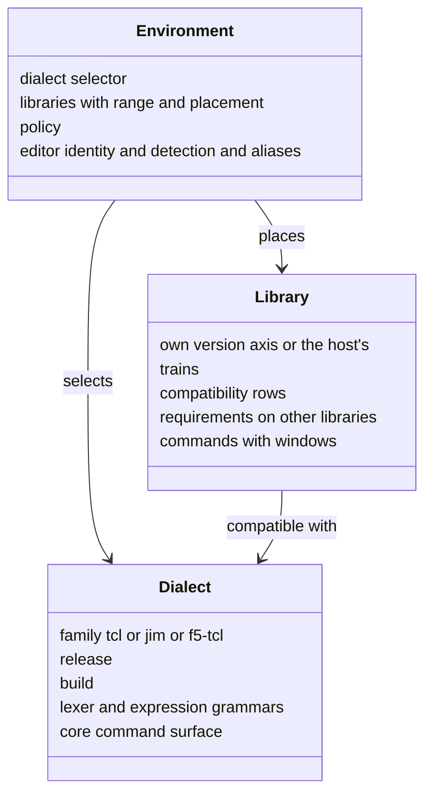
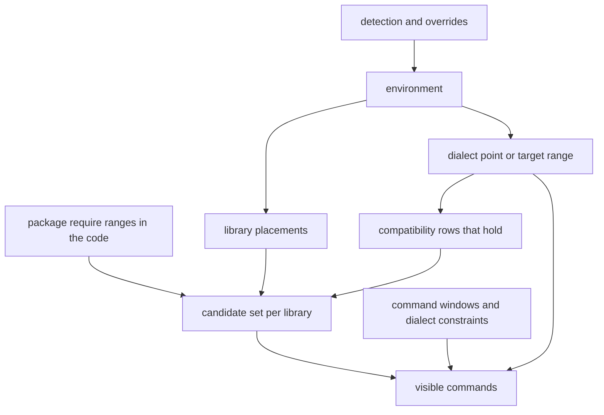
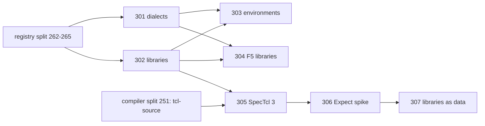

# Dialects, libraries and environments: the target model

Status: designed 26 November 2026, owner direction. Plan items 301–307 carry
it, and the crate layout is in [registry split](registry-split-design.md).

This document supersedes the classification in
[the registry model](dialect-and-package-registry-redesign.md) §0 and §2 where
they disagree: iRules and iApps are libraries, not dialect families. That
document stays the reference for evidence, detection and the analysis world.

## The model

There are three kinds of thing, and nothing is both.

1. **A dialect is a fundamental language.** It is a *family* at a *release*,
   under a *build*.
   - It owns everything that changes how source is read and evaluated: the
     lexer and expression grammars, numerals, escapes, the character model, the
     release semantics of core commands, and the core command surface.
   - The families are:

     | Family | Releases | Builds |
     |---|---|---|
     | `tcl` | 8.4, 8.5, 8.6, 9.0, 9.1 | canonical |
     | `jim` | 0.76–0.84 | `full`, `minimal`, plus capability flags for its optional extensions (`binary`, `ensemble`, `json`, `tclprefix`, `zlib`) |
     | `f5-tcl` | the BIG-IP releases, its real version axis | `tmm` (the traffic interpreter that runs iRules) and `scriptd` (the configuration interpreter that runs iApps and tmsh scripts) |

   - The F5 grammar axes, `irules_brace_separator` and
     `brace_line_continuation`, belong to the f5-tcl family under both
     builds: TMM, `TmshCliScript` and `IAppImplementation` read source the
     same way ([301](model/301-dialects.md)). The rule-loader flags
     (`closed_load_time_resolution`, `declaration_only_top_level`) are the
     iRules library's policy, not the dialect's.
2. **A library is a provider of commands on top of dialects.** Tk, the
   libraries Tcl bundles (http, msgcat, tcltest, …), each tcllib module, Expect,
   Itcl, Thread, iRules, iApps, tmsh and the EDA vendor libraries are all
   libraries. A library has:
   - **Its own version axis, with trains.** For example, Itcl 3.x and 4.x;
     `struct::graph` 1.x and 2.x.
   - **Compatibility rows.** Each row says that versions R of this library work
     on family F at releases S, optionally under a build or capability
     predicate.
     - Rows are a disjunction; each row is a conjunction.
     - Examples: "Itcl 3.4 on tcl 8.4–8.6", "Itcl 4.x on tcl 8.6–9.1",
       "Thread 2.8 on tcl 8.6", "Thread 3.0 on tcl 9.0–9.1",
       "iRules (tracks host) on f5-tcl, any release, build tmm".
   - **Requirements on other libraries,** with ranges on each side. For
     example, "Tk 8.6 requires tcl 8.6". A requirement can differ per train,
     because a `pkgIndex.tcl` may guard one train and not another, so today's
     `TcllibModule.core_floor` becomes a per-train row
     ([302](model/302-libraries.md)). In tcllib 2.0 both of `snit`'s trains
     require Tcl 8.5 or 9 (`snit.tcl:18`, `snit2.tcl:18`), and neither loads
     TclOO.
   - **Commands.** Each command, subcommand and option carries a window on the
     library's own axis (introduced, deprecated, retired). It may add a
     dialect constraint where a library command depends on the host release.
     The two conjoin.
   - **Tracking.** A library may *track its host*: its version is the
     dialect's release. iRules does this; the iRules surface of BIG-IP 17.1 is
     iRules 17.1.
3. **An environment is a selectable combination.** It is a dialect selector
   (family, a release or a release range, a build) plus libraries. Each library
   has a version range and a placement:
   - **ambient:** loaded without `package require`;
   - **hosted:** available once required;
   - **bundled:** shipped with the dialect release, at the version that release
     bundles.

   It also carries the policy (open or closed world), the editor identity,
   detection rows and aliases. `tcl8.6`, `wish` (tcl + Tk ambient),
   `f5-irules` (f5-tcl/tmm + iRules ambient), `f5-iapps` (f5-tcl/scriptd + iApps
   and tmsh), `expect` and the EDA shells are environments.

The diagram shows how the three kinds refer to each other. Only an environment
names both of the others.



Resolution for a document runs in three steps:

1. **Environment.** The environment, after detection and overrides, gives the
   dialect point or target range.
2. **Library versions.** Each library's candidate version set is the
   intersection of three things:
   - its placement range;
   - its compatibility rows against the dialect;
   - the `package require` constraints found in the code, with lower and upper
     bounds and multi-train selection.
3. **Visible commands.** A command is visible when its window intersects its
   library's candidate set and its dialect constraint holds.

The flow below follows the three steps. The code's requires meet the
environment's placements at the candidate sets.



A worked example: tcllib 2.0 ships `struct::graph` in two trains, 1.2.2 and
2.4.4. With `tcllib-2.0/modules` on `auto_path`, one fresh tclsh 8.5 to 9.1
per line gives:

**Source:**

```tcl
package require struct::graph              ;# 2.4.4
package require struct::graph 1.2          ;# 1.2.2
package require struct::graph 1.0 2.0      ;# 2.4.4
package require -exact struct::graph 1.2.2 ;# 1.2.2
package require struct::graph 1.3          ;# can't find package struct::graph 1.3
```

**Bytecode (tclsh 9.1.0):**

```text
ByteCode
  Source "package require struct::graph              ;# 2.4.4\npa..."
  Cmds 5, src 291, inst 135, litObjs 9, aux 0, stkDepth 5, code/src 0.00
  Commands 5:
      1: pc 0-20, src 0-42        2: pc 21-46, src 52-94
      3: pc 47-77, src 104-146        4: pc 78-108, src 156-198
      5: pc 109-133, src 208-250
  Command 1: "package require struct::graph              ..."
    (0) push 0 	# "package"
    (5) push 1 	# "require"
    (10) push 2 	# "struct::graph"
    (15) invokeStk 3 
    (20) pop 
  Command 2: "package require struct::graph 1.2          ..."
    (21) push 0 	# "package"
    (26) push 1 	# "require"
    (31) push 2 	# "struct::graph"
    (36) push 3 	# "1.2"
    (41) invokeStk 4 
    (46) pop 
  Command 3: "package require struct::graph 1.0 2.0      ..."
    (47) push 0 	# "package"
    (52) push 1 	# "require"
    (57) push 2 	# "struct::graph"
    (62) push 4 	# "1.0"
    (67) push 5 	# "2.0"
    (72) invokeStk 5 
    (77) pop 
  Command 4: "package require -exact struct::graph 1.2.2 ..."
    (78) push 0 	# "package"
    (83) push 1 	# "require"
    (88) push 6 	# "-exact"
    (93) push 2 	# "struct::graph"
    (98) push 7 	# "1.2.2"
    (103) invokeStk 5 
    (108) pop 
  Command 5: "package require struct::graph 1.3          ..."
    (109) push 0 	# "package"
    (114) push 1 	# "require"
    (119) push 2 	# "struct::graph"
    (124) push 8 	# "1.3"
    (129) invokeStk 4 
    (134) done 
```

**Result:**

```text
$ cat req.tcl
# req.tcl DIR ARGS...: one package require in a fresh interpreter, with DIR on auto_path
lappend auto_path [lindex $argv 0]
set args [lrange $argv 1 end]
if {[catch {eval package require $args} r]} { set r "error: [lindex [split $r \n] 0]" }
puts [format "  %-26s %s" "require $args" $r]
$ for sh in tclsh8.4 tclsh8.5 tclsh8.6 tclsh9.0 tclsh9.1 ./target/debug/tclvm; do echo "# $sh"
    for r in struct::graph 'struct::graph 1.2' 'struct::graph 1.0 2.0' '-exact struct::graph 1.2.2' \
        'struct::graph 1.3'; do $sh req.tcl tmp/tcllib-2.0/modules $r 2>/dev/null; done; done
# tclsh8.4
  require struct::graph      error: can't find package struct::graph
  require struct::graph 1.2  error: can't find package struct::graph 1.2
  require struct::graph 1.0 2.0 error: wrong # args: should be "package require ?-exact? package ?version?"
  require -exact struct::graph 1.2.2 error: can't find package struct::graph 1.2.2
  require struct::graph 1.3  error: can't find package struct::graph 1.3
# tclsh8.5
  require struct::graph      2.4.4
  require struct::graph 1.2  1.2.2
  require struct::graph 1.0 2.0 2.4.4
  require -exact struct::graph 1.2.2 1.2.2
  require struct::graph 1.3  error: can't find package struct::graph 1.3
# tclsh8.6
  require struct::graph      2.4.4
  require struct::graph 1.2  1.2.2
  require struct::graph 1.0 2.0 2.4.4
  require -exact struct::graph 1.2.2 1.2.2
  require struct::graph 1.3  error: can't find package struct::graph 1.3
# tclsh9.0
  require struct::graph      2.4.4
  require struct::graph 1.2  1.2.2
  require struct::graph 1.0 2.0 2.4.4
  require -exact struct::graph 1.2.2 1.2.2
  require struct::graph 1.3  error: can't find package struct::graph 1.3
# tclsh9.1
  require struct::graph      2.4.4
  require struct::graph 1.2  1.2.2
  require struct::graph 1.0 2.0 2.4.4
  require -exact struct::graph 1.2.2 1.2.2
  require struct::graph 1.3  error: can't find package struct::graph 1.3
# ./target/debug/tclvm
  require struct::graph      2.4.4
  require struct::graph 1.2  1.2.2
  require struct::graph 1.0 2.0 2.4.4
  require -exact struct::graph 1.2.2 1.2.2
  require struct::graph 1.3  error: can't find package struct::graph 1.3
```

The model reaches the same answers through its candidate sets:

| Require | Candidate set | Selected |
|---|---|---|
| none | {1.2.2, 2.4.4} | 2.4.4, the newest train |
| `1.2` | {1.2.2}: a bare `1.2` means 1.2 up to 2 | 1.2.2 |
| `1.0 2.0` | {1.2.2, 2.4.4}: alternatives union | 2.4.4 |
| `-exact 1.2.2` | {1.2.2} | 1.2.2 |
| `1.3` | ∅ | a report, not a fallback |

The dialect step matters too. The struct `pkgIndex.tcl` starts with
`package vsatisfies [package provide Tcl] 8.5 9`, so on tcl 8.4 no
compatibility row holds and every set is ∅. tclsh 8.4 agrees: it cannot read
that index (its `vsatisfies` takes two arguments) and finds no
`struct::graph`. Its `package require` also takes one version, so `1.0 2.0`
is a usage error there.

Answers over a target range are sets, as today (`tclLsp.targets`).

The lexer and grammar-level consumers take the dialect only. Visibility,
version gating, closed-world policy and editor features take the resolved
environment.

### Bundled libraries

A library a dialect release ships with gets an ambient or bundled placement in
that release's environments, at the bundled version. The bundled versions come
from each pinned source tree's `library/*/pkgIndex.tcl` and
`pkgs/<dir>/configure.ac`. (`pkgs/package.list.txt` maps directory names to
package names and carries no versions.) `fetch-tcl-source` must keep the
`pkgs/` trees for the generator. That table is generated with the release
facts (items 79 and 202), never written by hand.

TclOO is the worked example:
- It is a library on tcl 8.5 (the `TclOO` package).
- It is part of the core surface from 8.6 on.
- So it is a library whose compatibility row ends at 8.5, plus core commands
  from 8.6.

## What changes from today

| Today | Target |
|---|---|
| `Family { Tcl, F5Tcl, F5Irules, Jim }`; F5 has one release, `tmos`/`tmm`; BIG-IP versions sit on a keyed side axis defaulting to 16.1.0 | `{ tcl, jim, f5-tcl }`; f5-tcl's releases are BIG-IP releases; `tmm` and `scriptd` are builds |
| iRules is a core family for its surface and a keyed package for versions; `irules_policy` sits in generic visibility | iRules is a library on f5-tcl/tmm that tracks its host; iRules policy hangs off the library's presence |
| `DialectProfile` `CATALOG`: 19 rows mixing dialects and environments; Jim has no row; aliases kept twice | `tcl-dialect` holds dialects only; environments are data with one alias table |
| a spec's applicability: `SpecSurface` rows (one provider each, OR'd) + `required_package` + `tcllib_package` + `lifecycle` on whichever axis `lifecycle_axis` picks | one `Availability`: a window on the library's axis ∧ an optional dialect constraint; library-level compatibility rows |
| package windows in SpecTcl `available` parsed and dropped (D17-P); `package require` read as a lower bound only | windows carried; requirements read as full ranges with trains |
| Jim builds and capabilities not selectable | selectable through the environment; libraries and commands may require a capability |
| the surface list kept in six disagreeing copies | one catalogue crate lists the shipped dialects and libraries |

## SpecTcl 3

SpecTcl is redesigned to state the model directly. Old packs keep loading
through shims.

- **Top-level forms.**
  - `dialect FAMILY {…}` is trusted tiers only: releases, builds, capability
    flags and axis values.
  - `library NAME {…}` holds `versions` and trains, `compatible {FAMILY RANGE
    ?-build B? ?-requires CAPS?}` rows, `requires {LIBRARY RANGE}`, and
    `tracks-host`.
  - `command`, `subcommand` and `option` carry `available LIBRARY-RANGE
    ?-dialect {FAMILY RANGE …}?`, plus the existing argument, role, effect and
    hook vocabulary.
  - `environment NAME {dialect …; library NAME RANGE -placement ambient|hosted|bundled; policy …; alias …; detect …}`.

  For example, Itcl's two trains, the `tk` environment that hosts it, and a
  command that only the 4.x train has ([302](model/302-libraries.md)'s rows):

  **Source:**

  ```spectcl
  speclib itcl-example 3 {
      library Itcl {
          alias itcl
          train 3 {3.4-4}
          train 4 {4-5}
          compatible Itcl 3.4 {tcl 8.4-8.6}
          compatible Itcl 4- {tcl 8.6-9.2}
      }
      environment tk {
          dialect tcl 8.4-9.1 -default 8.6
          library Tk 8.4- -placement ambient
          library Itcl 3.4- -placement hosted
          alias wish
      }
      command itcl::local {
          available Itcl 4.0-
      }
  }
  ```

  **In memory:**

  ```rust
  // design sketch: types proposed in 301, 302 and 303
  Library {
      id: LibraryId("Itcl"),
      aliases: &["itcl"],
      axis: LibraryAxis::Own,
      trains: &[
          Train { name: "3", versions: VersionSet("3.4-4"), .. },
          Train { name: "4", versions: VersionSet("4-5"), .. },     // no `versions` row: `latest` unset
      ],
      compatible: &[
          CompatibilityRow { library: VersionSet("3.4"), dialect: DialectRange { family: Family::Tcl, releases: VersionSet("8.4-8.6") }, build: None, requires_caps: &[] },
          CompatibilityRow { library: VersionSet("4-"), dialect: DialectRange { family: Family::Tcl, releases: VersionSet("8.6-9.2") }, build: None, requires_caps: &[] },
      ],
      requires: &[],
      distribution: DistributionId("itcl-example"),
  }
  EnvironmentDefinition {
      id: EnvironmentId("tk"),
      dialect: Some(DialectSelector { family: Family::Tcl, default_release: Release("8.6"), releases: VersionSet("8.4-9.1"), build: Build::Canonical, capabilities: CapabilityOverrides([]) }),
      libraries: vec![
          PlacedLibrary { id: LibraryId("Tk"), range: VersionSet("8.4-"), placement: Placement::Ambient },
          PlacedLibrary { id: LibraryId("Itcl"), range: VersionSet("3.4-"), placement: Placement::Hosted },
      ],
      ..                                            // presentation, editor, policy, detection, provenance
  }
  AliasTable { rows: [("wish", EnvironmentId("tk"), Provenance::Pack("itcl-example"))] }
  VersionedSpec {                                   // itcl::local
      availability: Availability { library: Some(LibraryId("Itcl")), window: ItemHistory("4.0-"), dialect: None },
      ..                                            // every facet empty: one unversioned value
  }
  ```
- **Hooks.** A shipped library's hooks are native Rust functions in its crate,
  named by `-native ID`, as today. Tcl-bodied hooks remain for third-party
  packs.
- **Shims.**
  - 1.x (`dialects {…}`) and 2.x (`available`, `environment`, `include from`)
    load by translation into the 3 model, the role `upgrade.rs`'s
    `TRANSLATIONS` and `MEMBERSHIP` tables play today.
  - The promise changes from byte-equal `CommandSpec` to *equivalent answers*.
    The loader's equivalence tests compare visibility, arity and roles for
    every command across the release matrix, for every bundled pack and the
    test corpus.
  - `tcl spec upgrade` rewrites any old pack to 3.
- **Not shimmed.** sslictcl is internal to this project, so its surface and
  format change with its consumers, with no compatibility layer. The same goes
  for the equivalence packs, which are generated measuring instruments.
- **Loader placement.** The loader moves off `tcl-compiler` and `tcl-lsp-core`:
  - it lexes with `tcl-source` (compiler split, item 251);
  - it reads files through a source-store trait the entry point supplies.

  It sits in layer 6, above the core and beside the compiler, over
  `tcl-source`; the declaration reader is its own crate, `tcl-decl-reader`,
  directly above `tcl-source`.

## Libraries as data (decided by a spike)

The surfaces are 185k lines of Rust command data plus 171k lines of BIG-IP
schema data. Every per-command fix recompiles Rust. Separately, the
compiled-surface plan measures 1.3 ms to build native Tcl 8.6 against 697 ms
to load the same surface from SpecTcl, and `SpecArena`/`CompiledSurface` are
not built.

The target, if the spike holds:
- **Each shipped library is authored once, in SpecTcl 3.** Its crate holds
  only the native hooks.
- **Packs are compiled to images.** A tool compiles the library's pack into a
  compact binary image, which the crate embeds with `include_bytes!`. The image
  is checked in and regenerated with a `--check` gate (item 119). Loading
  decodes the image without parsing.
- **A spec edit is a data edit.** Regenerating the image recompiles only that
  one small crate.
- **One catalogue.** The 98k lines of equivalence packs and the native Rust
  catalogue are both deleted.

The spike (item 306) does this end to end for Expect (2.7k lines). It measures:
- load time and memory against the native surface;
- the build time of a one-command edit;
- equivalence of answers.

It decides between three outcomes: libraries as data; native Rust per library
crate (the crate split alone); or data for some libraries and Rust for
hook-heavy ones (the Tcl core surface).

## Consumers

- **iRules checks.** The `is_irules()` checks (18 in `tcl-compiler`, 14 in
  `tcl-lsp-core`, 7 in `tcl-lsp-server`, 3 in `tcl-cli`) and the 114 + 53
  `"f5-irules"` strings become queries on the resolved environment:
  - "is the iRules library present";
  - "is the build `tmm`".
- **`irules_checks`** and `analyser/irules_event_checks.rs` move to
  `tcl-irules`, the domain crate, not to `tcl-lib-irules`. They plug in
  through the `UnitRule` and `SiteRule` traits that `tcl-diagnostics`
  defines, and the entry points register them through a `RuleSet`
  ([compiler split step 12](../compiler/crate-split/12-diagnostics-optimiser.md),
  item 285).
- **The lexer** receives the dialect core profile only.
- **The VM and the runtime** receive the dialect plus the libraries they can
  execute.

## Plan items

| Item | Step |
|---|---|
| 301 | The dialect model: three families, F5 releases and builds, selectable Jim builds and capabilities, and `tcl-dialect` cleared of environments |
| 302 | The library model: version trains, compatibility rows, requirements, bundling, one `Availability` per command, D17-P fixed, full `package require` ranges |
| 303 | Environments as data over 301 and 302, with one alias table and one catalogue |
| 304 | iRules, iApps and tmsh as libraries on f5-tcl; consumers move to environment queries |
| 305 | SpecTcl 3 with 1.x/2.x shims, the loader on `tcl-source`, and `tcl spec upgrade` to 3 |
| 306 | The libraries-as-data spike on Expect, which decides 307 |
| 307 | Shipped libraries as SpecTcl-sourced images (conditional on 306) |

## Order

1. **Crate split first.** The registry crate split (262–265) needs none of
   this model, and it pays for itself in build time.
2. **Then the model.** 301, 302 and 303 change types the surface crates
   already hold, so they follow the split.
3. **iRules and iApps.** 304 follows 301 and 302.
4. **SpecTcl.** 305 needs 302's vocabulary and the compiler split's
   `tcl-source` (item 251).
5. **The spike.** 306 follows 305, and 307 follows 306.

The same order as a graph:



## Owner decisions (26 November 2026)

1. **One crate per package, not per distribution.**
   - Each library package is its own crate: tmsh and iApps are separate, and every tcllib package is its own crate.
   - After item 307, a package crate is an image plus its native hooks, so the crates are generated scaffolding rather than hand-kept code.
2. **The tmsh `cli script` interpreter.** Whether it is the `scriptd` build or a third f5-tcl build is question Q11 in the plan's [BIG-IP and iRules questions](../../work/name-handling/plan.md#big-ip-and-irules-questions). An agent answers it with an appliance probe.
3. **No rename.** The family keeps its existing spelling, `f5-tcl`.
4. **Bundled vendor packs may change their own aliases.**
5. **Generators stay, as user tooling.**
   - Pack generators ship alongside `tcl spec upgrade` and `tcl spec compile`.
   - Hand-editing a generated pack is allowed.
   - Reconciling hand edits with a regenerated library update is the job of the user or the AI tooling (item 310), not the loader's.
6. **Every artefact ships source and images.** That includes the web bundle, which carries both the `.tclspec` source and the compiled image.
7. **The Tcl core's hover and documentation become an image too.** Its hooks stay native.
8. **Tk's 16 rows keyed "8.7" are re-keyed to the real Tk release** that introduced each one, read from the Tk sources in `tmp/tk*/`. This is part of item 302.

## Review fixes (26 November 2026, deep review)

- **Loader placement (workspace fixer, plan pass).** The loader sits in layer 6, above the core and beside the compiler, over `tcl-source`; the declaration reader is its own crate, `tcl-decl-reader`.
