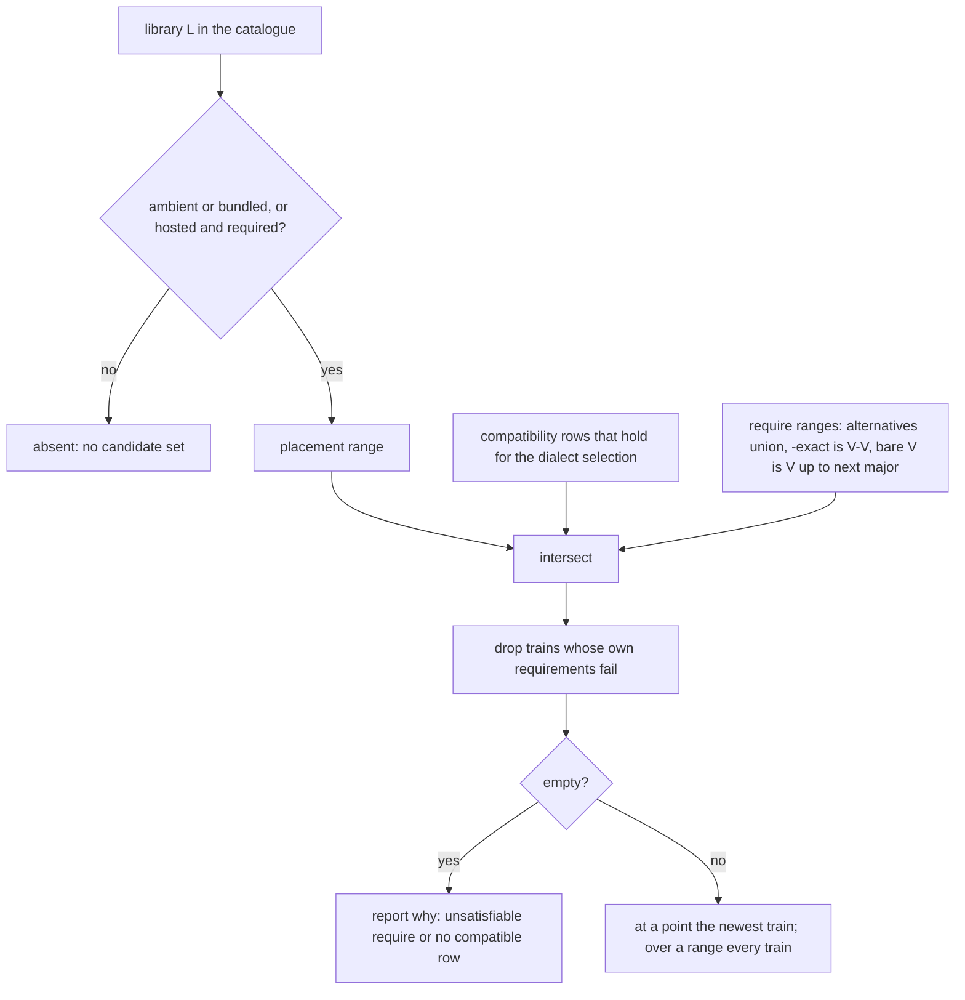

# Step 302: the library model

Status: designed 26 November 2026. Plan item 302, step 2 of
[dialects, libraries and environments](../dialects-and-libraries.md). Builds on
[301](301-dialects.md). [303](303-environments.md) places libraries,
[304](304-f5-libraries.md) adds the F5 libraries,
[305](305-spectcl-3.md) writes them in SpecTcl 3, and
[308](308-positioned-context.md) asks them per position.

Library-to-library dependencies (alternatives, lazy, optional and
conditional edges, conflicts, provided names, extension of another
library's commands) are designed in
[331](331-library-dependencies.md), which replaces this document's
`Requirement` with `Dependency` and corrects resolution step 4 at a point.
Parity between Rust-authored surfaces and SpecTcl 3 over these types is
[332](332-rust-spectcl-parity.md).

## Problem

A spec's applicability is spread over five fields and two side tables:

| Today | Where | Count in `commands/` |
|---|---|---|
| `surface: Option<&[SpecSurface]>`: one provider per row, rows OR'd | `tcl-registry/src/spec.rs:339`, `tcl-dialect/src/model/authored_surface.rs:62` | 1,857 `Some` |
| `required_package: Option<&str>` | `spec.rs:766` | 477 |
| `tcllib_package: Option<&str>` | `spec.rs:1100` | 288 |
| `lifecycle` on "whichever package owns it"; `arity_windows`; `VersionedArgValue` | `spec.rs:1109`, `lifecycle.rs:119`, `arity.rs:200` | |
| `TcllibModule { package, trains, core_floor }` (214 rows, 7 multi-train); `LibraryPin`/`PackagePlacement` | `model/tcllib.rs:69`; `library.rs`; `model/environment.rs:189` | |

The consequences:

- **The axis is guessed.** `lifecycle_axis` (`version_gate.rs:430`) picks the
  axis per spec: a keyed ambient placement, then `owning_package()`
  (`required_package.or(tcllib_package)`, `spec.rs:1720`), then the Tcl core
  axis if any row names `Core(Tcl)`.
- **Requirements are lower bounds.** `package_version_floor`
  (`version_gate.rs:1154`) takes the highest written lower bound of the
  unconditional requires. It falls back to `TclVersion::V9_1` when the profile
  has no Tcl release. `tcl-lsp-core/src/document_floor.rs:142` repeats the rule
  and the fallback. `-exact`, upper bounds and train selection are lost.
- **D17-P.** `available {package Tk 8.5-8.6}` validates the window and keeps
  only the name (`tcl-spectcl/src/loader/available.rs:384-412`).
- **`core_floor` is per module, but a guard can be per train.** snit's
  `pkgIndex.tcl` offers 2.3.4 only under `vsatisfies [package provide Tcl]
  8.5 9`, and 1.4.3 unconditionally
  (`tmp/tcllib-2.0/modules/snit/pkgIndex.tcl`). The table says
  `core_floor: Some("8.5")` for both trains. That is right for tcllib 2.0
  only because `snit.tcl:18`, the 1.x train's own source, also runs
  `package require Tcl 8.5 9`. One floor per module cannot say which of the
  two facts it came from, or state a guard that differs per train.
- **TclOO is core-only.** `oo::*` rows are `TCL86_PLUS`
  (`commands/tcl/oo_object.rs:233`), so `package require TclOO` on 8.5 makes
  nothing visible.
- **Bundled versions are hand-written.** `ladder_environments` hard-codes
  Itcl, http, msgcat and tcltest per release (`model/environment.rs:1107`).
  The values match `library/*/pkgIndex.tcl` today, but no gate checks them.
- **Only availability is versioned.** Arity has windows. Options have a
  surface and a lifecycle. Argument roles, effects, return types, the
  subcommand set, deprecation text and hover have none. `string is` classes
  are two hand-written per-release tables (`native_string_is_compilation.rs:90`,
  `C86` and `C9`).

## Design

### Types (registry core, `tcl-registry::model::library`)

```rust
pub struct LibraryId(Interned);               // "Tk", "Itcl", "struct::graph", "iRules"
pub struct Library {
    pub id: LibraryId,
    pub aliases: &'static [&'static str],      // "itcl" for "Itcl" (item 32)
    pub axis: LibraryAxis,
    pub trains: &'static [Train],
    pub compatible: &'static [CompatibilityRow], // OR'd
    pub requires: &'static [Requirement],      // AND'd
    pub distribution: DistributionId,          // the crate that ships it (registry split)
}
pub enum LibraryAxis {
    Own,                                       // VersionAxisId::package(id)
    TracksHost,                                // version = the dialect release
}
pub struct Train { pub name: &'static str, pub versions: VersionSet, pub latest: Version }
pub struct CompatibilityRow {                  // a conjunction
    pub library: VersionSet,                   // on the library's axis
    pub dialect: DialectRange,
    pub build: Option<Build>,
    pub requires_caps: &'static [Extension],
}
pub struct DialectRange { pub family: Family, pub releases: VersionSet } // on core(family)
pub struct Requirement { pub library: VersionSet, pub needs: LibraryId, pub range: VersionSet }
pub enum Placement { Ambient, Hosted, Bundled }
pub struct PlacedLibrary { pub id: LibraryId, pub range: VersionSet, pub placement: Placement }

pub struct Availability {                      // on each command, subcommand, option
    pub library: Option<LibraryId>,            // None = the dialect's core surface
    pub window: ItemHistory,                   // on the library's axis
    pub dialect: Option<DialectConstraint>,    // conjoined
}
pub struct DialectConstraint { pub ranges: &'static [DialectRange], pub caps: &'static [Extension] }
```

`VersionSet`, `Version` and `ItemHistory` are reused from
`tcl-dialect/src/model/version_set.rs`. A tracks-host library's versions are
its host's releases, so the iRules surface of BIG-IP 17.1 is iRules 17.1.

### Versioned facets

Every fact a command carries can vary by library version and by dialect
version, not only its presence. A facet is a list of windowed values:

```rust
pub struct Facet<T: 'static> { pub rows: &'static [(FacetKey, T)] }  // first match wins
pub struct FacetKey { pub library: VersionSet, pub dialect: Option<DialectRange> }
pub struct VersionedSpec {
    pub availability: Availability,
    pub arity: Facet<Arity>,
    pub options: Facet<&'static [OptionId]>,       // each option also has its own Availability
    pub subcommands: Facet<&'static [SubId]>,
    pub roles: Facet<&'static [ArgRole]>,
    pub effects: Facet<EffectSet>,
    pub returns: Facet<ReturnType>,
    pub value_sets: Facet<&'static [ValueId]>,     // enumerated argument values
    pub deprecation: Facet<Option<DeprecationText>>,
    pub docs: Facet<DocId>,                         // hover, synopsis, examples (item 121)
}
```

- **Defaults.** An empty facet means the unversioned value, and most facets
  have one row.
- **Selection.** For a resolved context the lookup selects the first row
  whose key holds the context's library candidate set and dialect point. Over
  a set (a target range, or a conditional require), it returns every distinct
  value with the keys that select it (`Selected<T> = SmallVec<[(T, FacetKey);
  1]>`). 308 renders those.
- **In the image** (306), a facet is an offset into a table of `(key_id,
  value_offset)` pairs over interned keys. A single-row facet costs a `u32`.
- **Today's data maps directly:** `arity_windows` → the arity facet,
  `VersionedArgValue` and the `string is` tables → value-set facets, an
  option's `surface`/`lifecycle` → its `Availability`.

Examples:

| Fact | Facet rows |
|---|---|
| `lsort -stride` (TIP 326, `commands/tcl/lsort_.rs:162`) | option `-stride`: `Availability { library: None, dialect: tcl 8.6- }` |
| `string is` classes | value-set facet: `{tcl 8.4}` → 18 classes; `{tcl 8.5}` adds `list` and `wideinteger`; `{tcl 8.6}` → `C86` (adds `entier`); `{tcl 9.0-}` → `C9` (adds `dict`). Checked against each tclsh's `bad class` message |
| Tk `text -insertunfocussed` (`commands/tk/text.rs:931`) | option availability `Tk 8.6-`, with docs facet "since Tk 8.6" |
| iRules `persist mcp` (`commands/irules/persist.rs:84,198`) | subcommand availability `iRules 21.1-`; value-set facet adds `mcp` to `persist`'s mode list from 21.1 |

### Resolution

Input: a dialect point or target range (301 and 303), the environment's
placements (303), and the document's requirements at a position (308).

```rust
pub struct LibraryWorld { pub versions: Map<LibraryId, VersionSet>, pub provenance: Map<LibraryId, Why> }
pub fn resolve_libraries(
    dialect: &DialectSelection,                 // a point or a VersionSet per family
    placements: &[PlacedLibrary],
    requires: &[PositionedRequire],              // name, alternatives, -exact, conditional
    catalogue: &LibraryCatalogue,
) -> LibraryWorld;
```

1. **Present.** A library is present when it is ambient or bundled, or when
   it is hosted and a require names it (or an alias of it). Requirements of
   present libraries (`Requirement`) pull their targets in as present too.
2. **Candidates.** Each present library's candidate set is the intersection
   of three sets:
   - its placement range. For a bundled library, this is the version that
     release bundles.
   - the union of its compatibility rows whose dialect range meets the
     dialect selection and whose build and capability predicates hold.
   - the require ranges, read with `tclPkg.c`'s algebra
     (`VersionSet::from_requirements`): alternatives union, `-exact` is
     `V-V`, and a bare `V` is `[V, next major)`.
3. **Trains.** Tcl picks the newest satisfying version, so within the
   candidate set the selection is the newest train that still meets it.
   `require struct::graph 1.2` therefore picks the 1.x train even though 2.4.4
   exists. Over a range, every satisfiable train stays in the set.
4. **Requirements of the library itself** (`snit 2.x requires Tcl 8.5 or 9`,
   `snit2.tcl:18`) narrow both sides: a train whose requirement fails on the dialect
   selection leaves the set.
5. **Empty set.** A present library with an empty set reports why (an
   unsatisfiable require, or no compatible row). That is a new diagnostic
   input for W120 and its relatives, not a silent permissive fallback.

The steps for one library, as a flow:



**Visibility.** An item is visible when its window meets its library's
candidate set and its dialect constraint holds at the point (or anywhere in
the range, per 308's presentation). A core item (`library: None`) uses the
dialect release as its point. A tracks-host library's candidate set is the
dialect release set.

### Mapping today's fields

| Today | 302 |
|---|---|
| `SpecSurface { Core(Tcl), windows }` | `Availability { library: None, window, dialect: None }` (the window becomes an `ItemHistory` on the core axis) |
| `SpecSurface { Core(Jim), … }`, `include from tcl into jim` | the Jim core surface; the roster stays (`inherited_surface.rs`) |
| `SpecSurface { Core(F5Irules) }` (`SpecSurface::IRULES`) | `library: Some(iRules)` (304) |
| `SpecSurface { Package(P), windows }` | `library: Some(P)`, `window` from `windows` (D17-P closed) |
| `required_package: Some(P)` | `library: Some(P)`; the hosted placement gives "visible once required" |
| `tcllib_package: Some(P)` | `library: Some(P)`; the library's distribution is `tcllib` |
| `lifecycle` + `lifecycle_axis` | `window`, on the axis the `library` field names. `lifecycle_axis` is deleted |
| `ALL_TCL_AND_IRULES`, `TK_AND_TCL` (several rows) | one row per library, or `library: None` plus a dialect constraint |
| `TcllibModule.trains` | `Library.trains` |
| `TcllibModule.core_floor` | per-train `CompatibilityRow { library: train, dialect: tcl FLOOR- }`, read from each `package ifneeded`'s guard and the train's own `package require Tcl` |
| `LibraryPin::TracksBase` | a bundled placement at the generated version |
| `LibraryPin::Keyed(BigipVersion)` | `LibraryAxis::TracksHost` on f5-tcl |

### Worked examples

| Library | Rows | Answers |
|---|---|---|
| Itcl | trains 3 = `3.4-4`, 4 = `4-5`; `{3.4 on tcl 8.4-8.6}`, `{4.x on tcl 8.6-9.2}`; alias `itcl` | 8.5 + `require Itcl` → {3.4}; 8.6 → {3.4, 4.x}, and the newest picks 4.x; `require -exact Itcl 3.4` on 9.0 → ∅ (report); `itcl::local` window `4.0-` |
| Thread | `{2.8 on tcl 8.6}`, `{3.0 on tcl 9.0-9.2}` | 8.6 + `require Thread 3` → ∅; 9.0 + `require Thread` → {3.0} |
| Tk | own axis; `{8.4 on tcl 8.4}` … `{9.0 on tcl 9.0}` (one per line), `requires tcl = same line` | `wish` 8.6 → {8.6}; `require Tk 8.5` on 8.6 → {8.6} (8.6 satisfies 8.5); `text -insertunfocussed` visible at 8.6 |
| TclOO | library `TclOO`, train 1 = `0.6-1.1`, `{TclOO on tcl 8.5}` only; core `oo::*` items `library: None, dialect: tcl 8.6-` | 8.5 + `require TclOO` → library items visible; 8.6 → core items visible, and the require is satisfied by the core's provided `TclOO 1.1.0` (`generated_release_facts.rs:1093`) |
| snit (multi-train tcllib) | trains 2 = `2.3.4`, 1 = `1.4.3`; `{2.x on tcl 8.5-9.2}` (the `pkgIndex.tcl` guard and `snit2.tcl:18`'s `package require Tcl 8.5 9`), `{1.x on tcl 8.5-9.2}` (`snit.tcl:18`, the same require) | 8.4 + `require snit` → ∅ (report); 8.6 → {2.3.4}; `require snit 1` → {1.4.3} |
| iRules | tracks host, `{any on f5-tcl, build tmm}` | f5-tcl 16.1/tmm → iRules {16.1}; `HTTP2::header` visible; 15.1 → not visible; scriptd → iRules absent |

The snit row matches tclsh. With only `tcllib-2.0/modules/snit` on
`auto_path`, one fresh interpreter per line gives:

**Source:**

```tcl
package require snit              ;# 8.5 to 9.1: 2.3.4
package require snit 1            ;# 8.5 to 9.1: 1.4.3
package require -exact snit 1.4.3 ;# 8.5 to 9.1: 1.4.3
package require snit 3            ;# every release: can't find package snit 3
package require snit              ;# 8.4: can't find package snit
```

**Bytecode (tclsh 9.1.0):**

```text
ByteCode
  Source "package require snit              ;# 8.5 to 9.1: 2.3.4\n..."
  Cmds 5, src 309, inst 125, litObjs 7, aux 0, stkDepth 5, code/src 0.00
  Commands 5:
      1: pc 0-20, src 0-33        2: pc 21-46, src 55-88
      3: pc 47-77, src 110-143        4: pc 78-103, src 165-198
      5: pc 104-123, src 243-276
  Command 1: "package require snit              ..."
    (0) push 0 	# "package"
    (5) push 1 	# "require"
    (10) push 2 	# "snit"
    (15) invokeStk 3 
    (20) pop 
  Command 2: "package require snit 1            ..."
    (21) push 0 	# "package"
    (26) push 1 	# "require"
    (31) push 2 	# "snit"
    (36) push 3 	# "1"
    (41) invokeStk 4 
    (46) pop 
  Command 3: "package require -exact snit 1.4.3 ..."
    (47) push 0 	# "package"
    (52) push 1 	# "require"
    (57) push 4 	# "-exact"
    (62) push 2 	# "snit"
    (67) push 5 	# "1.4.3"
    (72) invokeStk 5 
    (77) pop 
  Command 4: "package require snit 3            ..."
    (78) push 0 	# "package"
    (83) push 1 	# "require"
    (88) push 2 	# "snit"
    (93) push 6 	# "3"
    (98) invokeStk 4 
    (103) pop 
  Command 5: "package require snit              ..."
    (104) push 0 	# "package"
    (109) push 1 	# "require"
    (114) push 2 	# "snit"
    (119) invokeStk 3 
    (124) done 
```

**Result:**

```text
$ cat req.tcl
# req.tcl DIR ARGS...: one package require in a fresh interpreter, with DIR on auto_path
lappend auto_path [lindex $argv 0]
set args [lrange $argv 1 end]
if {[catch {eval package require $args} r]} { set r "error: [lindex [split $r \n] 0]" }
puts [format "  %-26s %s" "require $args" $r]
$ for sh in tclsh8.4 tclsh8.5 tclsh8.6 tclsh9.0 tclsh9.1 ./target/debug/tclvm; do echo "# $sh"
    for r in snit 'snit 1' '-exact snit 1.4.3' 'snit 3'; do $sh req.tcl tmp/tcllib-2.0/modules/snit $r; done; done
# tclsh8.4
error reading package index file tmp/tcllib-2.0/modules/snit/pkgIndex.tcl: wrong # args: should be "package vsatisfies version1 version2"
  require snit               error: can't find package snit
error reading package index file tmp/tcllib-2.0/modules/snit/pkgIndex.tcl: wrong # args: should be "package vsatisfies version1 version2"
  require snit 1             error: can't find package snit 1
error reading package index file tmp/tcllib-2.0/modules/snit/pkgIndex.tcl: wrong # args: should be "package vsatisfies version1 version2"
  require -exact snit 1.4.3  error: can't find package snit 1.4.3
error reading package index file tmp/tcllib-2.0/modules/snit/pkgIndex.tcl: wrong # args: should be "package vsatisfies version1 version2"
  require snit 3             error: can't find package snit 3
# tclsh8.5
  require snit               2.3.4
  require snit 1             1.4.3
  require -exact snit 1.4.3  1.4.3
  require snit 3             error: can't find package snit 3
# tclsh8.6
  require snit               2.3.4
  require snit 1             1.4.3
  require -exact snit 1.4.3  1.4.3
  require snit 3             error: can't find package snit 3
# tclsh9.0
  require snit               2.3.4
  require snit 1             1.4.3
  require -exact snit 1.4.3  1.4.3
  require snit 3             error: can't find package snit 3
# tclsh9.1
  require snit               2.3.4
  require snit 1             1.4.3
  require -exact snit 1.4.3  1.4.3
  require snit 3             error: can't find package snit 3
# ./target/debug/tclvm
  require snit               2.3.4
  require snit 1             1.4.3
  require -exact snit 1.4.3  1.4.3
  require snit 3             error: can't find package snit 3
```

On 8.4 the index's guard is itself the error: 8.4's `package vsatisfies`
takes two arguments, so reading `pkgIndex.tcl` fails, and tclsh reports
`error reading package index file`.

Today's row becomes the library's rows. The generator reads each train's
guard and its source's `package require Tcl`:

**Before:**

```rust
TcllibModule {
    package: "snit",
    trains: &["2.3.4", "1.4.3"],
    core_floor: Some("8.5"),
    evidence: "snit/pkgIndex.tcl",
}
```

**After:**

```spectcl
library snit {
    versions 1.4.3 2.3.4
    train 1 {1-2}
    train 2 {2-3}
    compatible snit 1 {tcl 8.5-9.2}    ;# snit.tcl:18
    compatible snit 2 {tcl 8.5-9.2}    ;# pkgIndex.tcl guard, snit2.tcl:18
}
```

**In memory:**

```rust
// design sketch: these types are proposed in 302 (VersionSet is today's, in tcl-dialect)
Library {
    id: LibraryId("snit"),
    aliases: &[],
    axis: LibraryAxis::Own,
    trains: &[                                   // `versions 1.4.3 2.3.4` gives each `latest`
        Train { name: "1", versions: VersionSet("1-2"), latest: Version("1.4.3") },
        Train { name: "2", versions: VersionSet("2-3"), latest: Version("2.3.4") },
    ],
    compatible: &[
        CompatibilityRow {
            library: VersionSet("1-2"),
            dialect: DialectRange { family: Family::Tcl, releases: VersionSet("8.5-9.2") },
            build: None,
            requires_caps: &[],
        },
        CompatibilityRow {
            library: VersionSet("2-3"),
            dialect: DialectRange { family: Family::Tcl, releases: VersionSet("8.5-9.2") },
            build: None,
            requires_caps: &[],
        },
    ],
    requires: &[],
    distribution: DistributionId("tcllib"),
}
```

TclOO's bundled placement is generated from `provided_packages`. A require
of a core-provided package is satisfied without making it a library surface.

### Bundled versions are generated

The item 79/202 generator (`cargo xtask release-facts`, which writes
`generated_release_facts.rs`) gains `bundled_libraries: &[(name, version)]` per
release. It reads:

- `library/*/pkgIndex.tcl` in each pinned tree (http, msgcat, tcltest,
  platform, opt, dde, registry, and cookiejar and `tcl::idna` from 9.0);
- `pkgs/<dir>/configure.ac` or `pkgIndex.tcl.in` for itcl, thread, tdbc* and
  sqlite3, with `pkgs/package.list.txt` mapping directory to package name;
- `provided_packages` for the core-provided packages (TclOO, zlib,
  `tcl::tommath`).

The environment's bundled placements are generated from this table, with a
`--check` gate. `ladder_environments`' hand-written tuples are deleted.

### Dependencies and consumers

The types live in the registry core, and `VersionSet` stays in `tcl-dialect`.
Library crates export `&'static [Library]`, and `tcl-catalogue` lists them.
Consumers: `ResolvedContext`, the version gate, 308's query (and through it
hover, completion and MCP), and the SpecTcl loader (305).

### Decisions

1. **One `Availability` per item, and facets for everything else.**
   Availability is the common question. Facets are rare and cost a pointer.
2. **Rows on the library, not the command.** "Itcl 4 needs Tcl 8.6" is
   stated once. A dialect constraint on a command is the exception.
3. **The newest satisfying train wins at a point, and every train stays in the
   set over a range.** This matches `package require`.
4. **An empty candidate set is a reported answer.** Falling back to `V9_1` or
   to permissive hides wrong targets.

### Open questions

- **Tk 8.7.** 16 Tk rows say `Lifecycle::introduced_in("8.7")`, a Tk
  release that no Tcl line pairs with (Tk 8.7 became 9.0). Settled by
  checking each against the Tk 9.0.4 tree: re-key it to 9.0, or keep 8.7 as a
  train with no compatible row.
- **Thread 2.8 on 9.0.** Is Thread 2.8 loadable on Tcl 9.0? Settled by the
  `pkgs/thread*` `configure.ac` in the 9.0.4 and 9.1.0 trees once they are
  fetched with `pkgs/`.

## Work list

1. Add `model/library.rs` to the registry core with the types above and
   `resolve_libraries`, with unit tests from the worked examples.
2. Add `Availability` and the facets to `CommandSpec`, `SubCommand` and
   `OptionSpec`. A mechanical converter maps `surface`, `required_package`,
   `tcllib_package` and `lifecycle` per the mapping table (a one-off xtask).
3. Convert `TcllibModule` into `Library` rows in `tcl-lib-tcllib`, reading
   per-train guards from `pkgIndex.tcl` (generated, `--check`).
4. Convert `arity_windows`, `VersionedArgValue` and the `string is` tables to
   facets.
5. Fix D17-P: `available.rs:384` builds `Availability.window` from the range.
6. Replace `package_version_floor` and `DocumentFloor` with 308's query, and
   delete `lifecycle_axis` and the `V9_1` fallbacks.
7. Extend the release-facts generator with `bundled_libraries`, and generate
   the bundled placements.
8. Delete `required_package`, `tcllib_package`, `owning_package` and
   `SpecSurface`.

## Verification

- **The new conformance area `library-visibility`** (item 75's framework):
  rows are (environment, dialect point, requires, item), and columns are the
  registry's `resolve_spec`, the version gate's diagnostic, completion's
  candidate list and hover's "since" line. The matrix is Tcl 8.4–9.1 × the
  six worked libraries × {no require, bare require, ranged, `-exact`,
  conditional}, plus f5-tcl {15.0, 16.1, 17.1, 21.1} × {tmm, scriptd} for
  iRules. Expected cells come from the oracles: tclsh `package require` in
  each pinned tree with tcllib 2.0 on `auto_path`, and the iRules lifecycle
  data.
- **Done when:** the plan's text is met (Itcl, Thread, Tk, TclOO and one
  multi-train tcllib module answer correctly across the matrix). `rg
  'required_package|tcllib_package|lifecycle_axis' rust --glob '!**/shim/**'`
  finds nothing. `rg 'V9_1\)' rust/tcl-compiler/src/analyser/diagnostics/version_gate.rs
  rust/tcl-lsp-core/src/document_floor.rs` finds nothing. The bundled-library
  table has a `--check` gate.
- **Measurements:** `resolve_spec` per lookup (today 235 ns known head under
  `tcl8.6`, `spectcl-compiled-surface-plan.md`), with a budget of +10%.
  `resolve_libraries` per document under 20 µs. The build cone of the core
  after a library-row edit: the library crate, `tcl-catalogue` and the
  binaries only.

## Risks

- **Converter mistakes across 2,600 fields.** Mitigation: the converter's
  output is compared with registry dumps under every shipped environment
  before the old fields are deleted.
- **Empty sets surface as new diagnostics.** Mitigation: they report under a
  new hint code until the corpus sweep (`fp_sweep`) is clean.

## Corrections to the overview

- `TcllibModule.core_floor` cannot become a library-level row, because a
  guard can be per train. snit is not an example of a difference, though:
  in tcllib 2.0 both trains require Tcl 8.5 or 9 (`snit.tcl:18`,
  `snit2.tcl:18`). The overview's "snit 1.x also runs on 8.4" is wrong, and
  tclsh 8.4 cannot even read snit's `pkgIndex.tcl`. This document's snit row
  said `{1.x on tcl 8.4-9.2}` until 26 November 2026; it now says 8.5.
- The overview's example "tcllib's `snit` 2.x requires Tcl 8.5 and TclOO" is
  wrong. `snit2.tcl:18` requires only `Tcl 8.5 9`, and snit 2 does not load
  TclOO.
- The overview says bundled versions come from `pkgs/package.list.txt`. That
  file maps directory names to package names for documentation and carries
  no versions. Versions come from `library/*/pkgIndex.tcl` and
  `pkgs/<dir>/configure.ac`. The checked-out trees in `tmp/` hold only
  `pkgs/README` and `package.list.txt`, so `fetch-tcl-source` must keep
  `pkgs/` for the generator.
