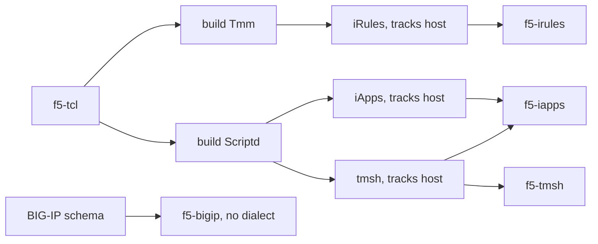
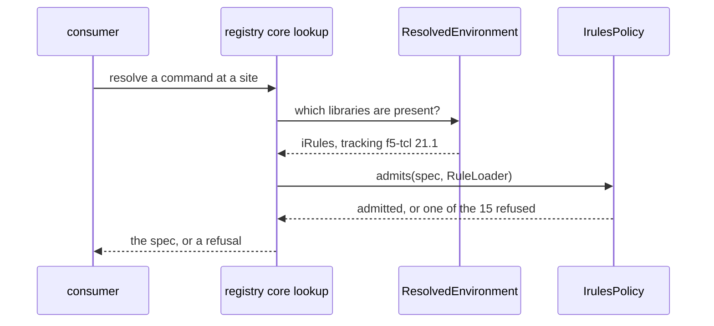

# Step 304: iRules, iApps and tmsh as libraries on f5-tcl

Status: designed 26 November 2026. Plan item 304, step 4 of
[dialects, libraries and environments](../dialects-and-libraries.md). Builds on
[301](301-dialects.md) (f5-tcl, `tmm` and `scriptd`), [302](302-libraries.md)
(tracks-host libraries) and [303](303-environments.md) (`ResolvedEnvironment`).
[305](305-spectcl-3.md)'s shims translate `f5-irules` tokens onto it.

## Problem

iRules is a family for its surface and a keyed package for its versions. The
code asks "is this iRules?" in several ways. Production counts (tests
excluded), 26 November 2026:

| Consumer | `tcl-compiler` | `tcl-lsp-core` | `tcl-lsp-server` | `tcl-cli` | `tcl-irules` | `tcl-registry` | `tcl-dialect` |
|---|--:|--:|--:|--:|--:|--:|--:|
| `is_irules()` calls | 18 | 14 | 7 | 3 | 3 | 0 | 0 |
| `"f5-irules"` literals | 114 | 53 | 10 | 8 | 24 | 64 | 9 |
| `Family::F5Irules` | 7 | 5 | 0 | 0 | 0 | 48 | 44 |
| `InvocationRealm::RuleLoader` | 68 | 12 | 0 | 0 | 3 | 47 | 8 |
| `irules_policy::` | 4 | 0 | 0 | 0 | 0 | 9 | 0 |

- **`DialectProfile::is_irules()`** is pointer identity against the interned
  catalogue row (`tcl-dialect/src/profile.rs:626`). `tcl-compiler` has a
  second predicate over `SurfaceQuery` (`irules_checks.rs:372`) and a third,
  `taint::is_irules_dialect` (`taint.rs:791`).
- **`InvocationRealm::RuleLoader` is the default realm for every family**
  (`#[default]`, `model/authored_surface.rs:316-318`). `SurfaceQuery::core`
  and `any_release` build it (`:443`, `:453`). Only iRules has a rule loader,
  so a plain Tcl query carries a realm that means nothing for it, and
  `with_realm` special-cases `F5Irules` (`:463-478`).
- **`irules_policy` sits in generic visibility.** `ResolvedContext` calls
  `irules_policy::runtime_surface_admits` and `irules_disabled_class`
  (`tcl-registry/src/model/context.rs:860`, `:964-968`), and the registry's
  lookup does too (`registry/lookup.rs:586`). The policy is the 16
  interpreter-absent and 15 compiler-refused commands (measurements §4b).
- **iApps and tmsh are packages named by strings** (`"f5-iapps-cmds"`,
  `"f5-tmsh-cmds"`) on the keyed BIG-IP axis (`model/environment.rs:1385`,
  `:1438`). `SpecSurface::IAPPS`/`TMSH` are `Package("iapps")`/`("tmsh")`
  (`authored_surface.rs:143-145`), a third spelling.

## Design

### Three libraries in two crates

| Library | Axis | Compatibility | Placement | Crate |
|---|---|---|---|---|
| `iRules` | tracks host | `{any on f5-tcl, build tmm}` | ambient in `f5-irules` | `tcl-lib-irules` |
| `iApps` | tracks host | `{any on f5-tcl, build scriptd}` | ambient in `f5-iapps` | `tcl-lib-iapps` |
| `tmsh` | tracks host | `{any on f5-tcl, build scriptd}` | ambient in `f5-iapps` and `f5-tmsh` | `tcl-lib-iapps` |

The family, its builds, the libraries on them and the environments that
place them:



The BIG-IP schema (`f5-bigip-schema`) is the `f5-bigip` environment's
library and stays with item 118's crate. The f5-tcl **core** surface (the 8.4.6
fork as BIG-IP ships it) is `tcl-dialect-f5`'s and is common to both builds.
The interpreter-absent commands are a property of the `tmm` build's core
surface, measured as absent even through `eval`. The compiler-refused
commands are iRules policy.

### The iRules library owns its policy

```rust
// tcl-lib-irules
pub struct IrulesPolicy;          // registered through the library's hook table
impl LibraryPolicy for IrulesPolicy {
    fn realms(&self) -> &[RealmId];                     // RuleLoader, InterpreterRuntime
    fn admits(&self, spec: &CommandSpec, realm: RealmId) -> Admit; // the 15 refused
    fn world(&self) -> WorldPolicy;                     // Closed
    fn top_level(&self) -> TopLevelRule;                // declaration-only (when, proc, priority, timing)
    fn load_time_resolution(&self) -> bool;             // true
    fn operators_as_commands(&self) -> bool;            // false
}
// registry core
pub trait LibraryPolicy: Send + Sync { /* the methods above, with permissive defaults */ }
```

The registry core asks every *present* library's policy. Under `f5-irules`
a lookup goes like this; under plain Tcl the iRules library is absent and
no policy is asked:


 A query with no
iRules library never sees a rule-loader realm. `InvocationRealm` moves from
`tcl-dialect` to the core as a `RealmId` that libraries register.
`InterpreterRuntime` is the dialect's realm and becomes the default.
`RuleLoader` is iRules'. The two flags 301 removes from `Family`
(`closed_load_time_resolution`, `declaration_only_top_level`) become
`load_time_resolution` and `top_level`.

### Environment queries replace the checks

```rust
impl ResolvedEnvironment {                     // 303
    pub fn has_library(&self, id: LibraryId) -> bool;
    pub fn build(&self) -> Option<Build>;
    pub fn policy<P: LibraryPolicy>(&self) -> Option<&P>;
}
pub mod f5 {                                    // in tcl-lib-irules, re-exported by the core's facade
    pub const IRULES: LibraryId; pub const IAPPS: LibraryId; pub const TMSH: LibraryId;
}
```

| Today's check | Becomes |
|---|---|
| `profile.is_irules()` (grammar or editor reasons: semantic tokens, formatting, snippets, minify) | `env.has_library(IRULES)` |
| `is_irules()` deciding the closed world, W123 grade, top-level rules | `env.policy::<IrulesPolicy>()` (`world`, `load_time_resolution`, `top_level`) |
| `is_irules()` in event checks (`irules_event_checks.rs`, `tcl-irules/source_context.rs`) | `env.has_library(IRULES)`, then the library's event model |
| `"f5-irules"` as an environment-id comparison | `env.has_library(IRULES)` (or the id, where the id itself is the subject: detection, settings and the registry dump) |
| `"f5-irules"` as a 1.x surface token | the 305 shim only |
| `Family::F5Irules` in surfaces (`SpecSurface::IRULES`, 48 registry sites) | `Availability { library: IRULES }` |
| `Family::F5Irules` in grammar or ancestry (`tcl-dialect`, 44) | gone. The grammar is f5-tcl's (301) |
| `InvocationRealm::RuleLoader` as the default | `InterpreterRuntime` by default; `RuleLoader` only where `IRULES` is present |
| `irules_policy` in `context.rs` and `lookup.rs` | `LibraryPolicy::admits`, called for present libraries |
| "is the build `tmm`" (exec absent, `wordSize`, `tcl_platform` facts) | `env.build() == Some(Build::Tmm)` |
| `"f5-iapps"` strict-ASCII W108 | `env.policy.strict_ascii` (already data) |

In code, one check of each kind (a sketch over the table's rows):

**Before:**

```rust
if profile.is_irules() {
    // semantic tokens: colour iRules event names
}
if profile.is_irules() {
    // binding: closed world, declaration-only top level
}
```

**After:**

```rust
if env.has_library(f5::IRULES) {
    // semantic tokens: colour iRules event names
}
if let Some(policy) = env.policy::<IrulesPolicy>() {
    let world = policy.world();         // WorldPolicy::Closed
    let top_level = policy.top_level(); // declaration-only
}
```

`irules_checks` (`tcl-compiler/src/irules_checks.rs`) is iRules-specific
analysis. It stays an analysis pass, registered by the entry points when the
iRules library is linked. That answers compiler split step 257's open
question: it belongs to the library side, as a registered check over generic
interfaces. It does not live in `tcl-lib-irules`, which holds data and hooks
only.

### Which consumers move where

| Crate | Sites | Move |
|---|---|---|
| `tcl-compiler` (18 `is_irules`) | `analyser/irules_event_checks.rs` (3), `handlers/symbol_definitions.rs` (2), `commands/body_arguments.rs` (2), `stub_shadows.rs`, `post_walk.rs`, `input.rs`, `procedures.rs`, `literal_contents.rs`, `irules_cells.rs`, `site_diagnostics.rs`, `invocation_records.rs`, `lowering/module_assembly.rs`, `command_binding/trusted_packages.rs`, `hosted_procedure_body.rs` | `has_library` for the event and cell passes; `policy` for binding and lowering |
| `tcl-lsp-core` (14) | `semantic_tokens/original.rs` (3), `semantic_tokens.rs` (2), `formatting/config.rs` (2), `code_actions/context_diagnostics.rs` (2), `snippets.rs`, `minify.rs`, `irules_context.rs`, `completion.rs`, `code_actions/irules_profiles.rs` | `has_library` |
| `tcl-lsp-server` (7) | `code_actions.rs` (2), `navigation/ilx.rs`, `diagnostics/{report,pull,f5_models}.rs`, `commands/xc_translate.rs` | `has_library` |
| `tcl-cli` (3) | `commands/transform.rs` | `has_library` |
| `tcl-irules` (3) | `source_context.rs` | `has_library` |

The 114 `"f5-irules"` literals in `tcl-compiler` cluster in
`command_binding/source_analysis_cache_corpus.rs` (15), `precedence_hazards.rs`
(6), `source_graph.rs` (5) and `vendor_advice.rs` (5). Each is classified in
the work list as an environment-id use (it stays, through a
`EnvironmentId::F5_IRULES` constant) or a library question (it moves).

### Dependencies

`tcl-lib-irules` depends on the core only. No command spec reads the BIG-IP
schema, so it has no edge to item 118's crate (registry split step 3,
decision 3).
Generic crates depend on the core only. They name `f5::IRULES` through the
core's library-id facade, which is a constant and not a crate edge (item 265's
gate).

### Decisions

1. **The policy hangs off the library.** A query without iRules carries no
   rule-loader realm, so the generic lookup has no iRules branch.
2. **The interpreter-absent set is a `tmm` core property.** It was measured
   through `eval`, not through the rule loader (§4b).
3. **tmsh is a library separate from iApps.** `f5-tmsh` places tmsh alone,
   and `f5-iapps` places both.

### Open questions

- **Does `f5-tmsh` run on `scriptd`?** This is 301's probe.
- **Is iCall (`BigIpExecutionContext::ICallScript`) a library?** Its
  transcript shows 95 commands and `exec`, like scriptd. Settled when an
  iCall surface is authored. Until then it has no environment.

## Work list

1. `tcl-registry` core: add `LibraryPolicy` and `RealmId`. Move
   `irules_policy.rs` into `tcl-lib-irules` as `IrulesPolicy`.
2. `context.rs:860,964` and `lookup.rs:586`: call present libraries' policies.
3. `authored_surface.rs`: `InvocationRealm` → core `RealmId`, with
   `InterpreterRuntime` as the default. Delete `with_realm`'s `F5Irules` arm.
4. Convert `SpecSurface::IRULES`, `IAPPS` and `TMSH` rows to `Availability`
   (302's converter).
5. Add `ResolvedEnvironment::{has_library, build, policy}`. Rewrite the 45
   `is_irules()` sites by the table above. Classify the 290 production
   `"f5-irules"` literals and move each.
6. Delete `DialectProfile::is_irules`, `taint::is_irules_dialect` and
   `irules_checks::is_irules`.
7. Register `irules_checks` from the entry points (with compiler split step 257).

## Verification

- **Done when:** `rg 'is_irules\(\)' rust` finds none outside
  `ResolvedEnvironment` (the plan's text). `rg 'F5Irules|"f5-irules-cmds"'
  rust` finds only the shims. `rg 'irules_policy' rust/tcl-registry/src`
  finds nothing in the core.
- **Conformance unchanged:** these iRules and iApps rows produce
  byte-identical output before and after:
  - `tcl-compiler/tests/it_5/checks/irules.rs`;
  - the F5 evidence rows (`tcl-registry/src/f5/evidence/resolution_contexts.rs`,
    the 92 parser cases per context, and `f5/corpus` tests);
  - item 224's build-stamped rows;
  - `tcl-irules` tests, the `tcl-irule-test` suite, and the iApps
    `version_gate` and W108 tests;
  - the LSP semantic-token and formatting snapshots for `.irul` and `.iapp`
    fixtures.

  The check is a recorded diagnostics and token dump over the iRules corpus
  in `bigip-irule-parser-measurements.md`, compared before and after.
- **Measurements:** the rebuild set after an iRules spec edit, which should
  be `tcl-lib-irules`, `tcl-catalogue` and the binaries only. `resolve_spec`
  under `f5-irules`, within ±5% of today's.

## Risks

- **A missed `"f5-irules"` that means "the library is present".** Mitigation:
  `registry-axes` gains an `f5-irules` axis that counts the remaining
  literals and only shrinks.
- **Realm default flip.** Some generic code may rely on `RuleLoader` being the
  default, for example a source-only query under plain Tcl. Mitigation: a
  sweep of the 68 compiler sites before the flip, run against the existing
  realm tests in `native_procedure.rs:1610-1623`.

## Corrections to the overview

- The counts are confirmed for production code (18, 14, 7, 3 `is_irules()`;
  114 and 53 `"f5-irules"`). There are also 3 `is_irules()` calls in
  `tcl-irules` and 64 `"f5-irules"` literals in `tcl-registry`, which the
  overview omits. Including tests, there are 58 `is_irules()` calls and 1,202
  literals.
- "The lexer receives the dialect core profile only" also needs `tmm` to
  carry no lexical delta. This holds, by 301's correction.

## Review fixes (26 November 2026)

- **D12:** the lookup sequence shows iRules tracking f5-tcl 21.1, a K5902 line, not 16.1.
