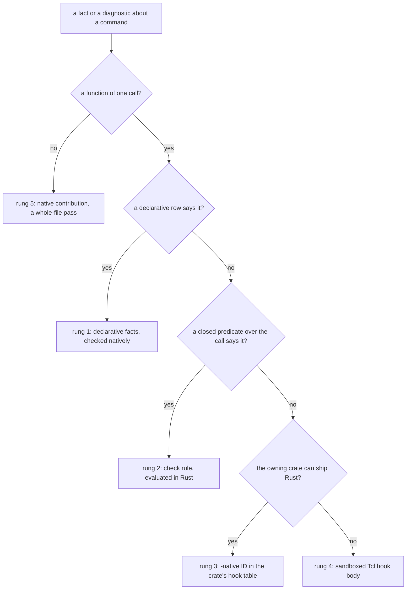
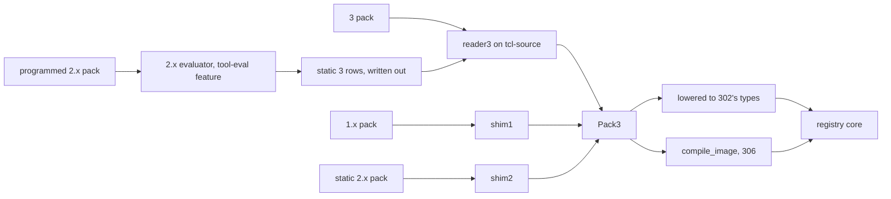

# Step 305: SpecTcl 3

Status: reference draft, 26 November 2026. Plan item 305, step 5 of
[dialects, libraries and environments](../dialects-and-libraries.md). It needs
[302](302-libraries.md)'s vocabulary and compiler split item 251
(`tcl-source`). [306](306-expect-spike.md) compiles it to images, and
[308](308-positioned-context.md) supplies the hook context.

The [consolidated SpecTcl 3 specification](../spectcl-3/README.md) supersedes
this design in detail: its grammar, model and plan items 400–479.

The `library` block's dependency rows (`requires` with `-mode`, `-any`
and `-when`, `provides`, `conflicts`, `provides-early`) and the `extend`
item are designed in [331](331-library-dependencies.md). The map from
every production below to the registry model, and the gate that keeps
Rust and SpecTcl 3 at parity, are in [332](332-rust-spectcl-parity.md).

## Problem

- **A pack is a program.** A 2.x pack is Tcl evaluated in a sandbox:
  `tcl-spec-hooks/src/pack_eval.rs` adds 24 commands
  (`PACK_EVAL_EXTRA_COMMANDS`, `:67`: `proc`, `apply`, `eval`, `namespace`,
  `catch`, `try`, `lmap`, `array`, …) to the hook whitelist.
  `tcl-spec-hooks` depends on `tcl-vm` and `tcl-engine-tclvm`, with
  `runtime/rust` as a dev-dependency. `loader/eval/static_drive.rs` (319
  lines) is the fast path that skips the interpreter when every statement is
  static.
- **The loader depends on the compiler and the LSP core.** `tcl-spectcl`'s
  normal dependencies include `tcl-compiler` (its lexer config,
  `tcl_compiler::parsing::spectcl_source`, `upgrade.rs:69`) and
  `tcl-lsp-core` (the `vfs` source store and the notice types, in 19 files,
  item 288).
- **The compatibility promise is byte-equal `CommandSpec`**
  (`loader/available.rs:40-44`). That is why D17-P exists: a package window
  has no 1.x field to land in.
- **Vocabularies.** `KNOWN_VOCABULARY_VERSIONS = 1, 1.0, 1.1, 1.2, 2, 2.0, 2.1,
  2.2, 2.3` (`loader.rs:727`), newest 2.3. The cache key is
  `VOCABULARY_VERSION = "2"` (`lib.rs:132`).

**What packs actually compute.** No shipped pack uses `proc`, a loop or `set`
at pack level:

- `specs/*.tclspec` (8 files, 35,136 lines);
- `core-surfaces/jim*.tclspec` (1,053 lines).

The only hits are inside hover examples and one hook body (`upf.tclspec:822`,
`arg_role_resolver`). Templating appears only in the four test fixtures under
`rust/tcl-spectcl/tests/fixtures/templated/` (`proc fleet-command`, `foreach
{name arity} …`, `[format]` for hover prose) and in
`docs/design/spec-dsl-examples/{foreach,switch,upvar}.tclspec`. The two
equivalence packs (98,349 lines) are generated and fully static.

## Design

### SpecTcl 3 is declarative

A 3 pack is a fixed grammar read by a parser, with no evaluation. It uses
Tcl's word syntax (braces, quotes, backslashes, comments), lexed by
`tcl-source`, but no command substitution or variable substitution.
`[…]` and `$` are literal text, and a `$` in prose is prose.

**Decision: no templating in 3.** No shipped pack needs it, and every
generated pack (the equivalence packs, the EDA extractions) comes from a
generator that can expand repetition itself. A "bounded static expansion" in
the reader would still be a small evaluator with its own fuel, error model
and source-position mapping, all of it for test fixtures. A 1.x/2.x pack that
computes its rows is evaluated **once, at tool time**, by `tcl spec upgrade`
(below) or by the bundling step, and the static rows are written out. The LSP
and the compiler never evaluate a pack.

For example, `tests/fixtures/templated/rows.tclspec` loops over an option
table. Its 3 form is the loop's output, written out:

**Before:**

```spectcl
speclib rows 2.0 {
    command sortish {
        arity 1..
        traits {CSE_CANDIDATE}
        foreach {flag prose} {
            -ascii {Compare in code-point order.}
            -integer {Compare as integers.}
            -real {Compare as floating-point values.}
        } {
            option $flag -detail $prose
        }
    }
}
```

**After:**

```spectcl
speclib rows 3 {
    command sortish {
        arity 1..
        traits {CSE_CANDIDATE}
        option -ascii -detail {Compare in code-point order.}
        option -integer -detail {Compare as integers.}
        option -real -detail {Compare as floating-point values.}
    }
}
```

**In memory:**

```rust
// design sketch: types proposed in 302; both forms load to this
VersionedSpec {                                   // sortish
    availability: Availability { library: None, window: ItemHistory::ALL, dialect: None },
    arity: Facet { rows: &[(FacetKey::ANY, Arity::new(1, None))] },
    options: Facet { rows: &[(FacetKey::ANY, &[OptionId("-ascii"), OptionId("-integer"), OptionId("-real")])] },
    docs: Facet { rows: &[(FacetKey::ANY, DocId(..))] },   // the three -detail strings
    ..                                            // traits {CSE_CANDIDATE} rides along unchanged
}
```

**Dependency consequence.** The reader, loader and image compiler need no VM.
They depend on `tcl-source`, the registry core and a source-store trait.
Only the Tcl hook runner (rung 4) links `tcl-vm`, and only an entry point that
enables Tcl hooks links the hook runner.

### Top-level forms

```text
pack       := 'speclib' NAME '3' ?'3.' MINOR? '{' item* '}'
item       := dialect | library | environment | command | check | hook | default
dialect    := 'dialect' FAMILY '{' ( 'release' LINE ?'-patch' VERSIONS?
                                   | 'build' BUILD ?'-capabilities' CAPS?
                                   | 'capability' CAP
                                   | 'axis' AXIS VALUE ?'-from' LINE? )* '}'     ; trusted tiers only
library    := 'library' NAME '{' lib-row* '}'
lib-row    := 'alias' NAME+
            | 'versions' VERSION+                  ; every known version
            | 'train' TRAIN RANGE                  ; e.g. train 4 {4-5}
            | 'compatible' LIB-RANGE '{' FAMILY RANGE ?'-build' BUILD? ?'-requires' CAPS? '}'
            | 'requires' LIB-RANGE '{' LIBRARY RANGE '}'
            | 'tracks-host' FAMILY ?'-build' BUILD?
            | 'provided-by-core' FAMILY RANGE      ; TclOO from 8.6
environment:= 'environment' NAME '{' env-row* '}'
env-row    := 'dialect' FAMILY RANGE ?'-default' LINE? ?'-build' BUILD? ?'-capabilities' CAPS?
            | 'library' NAME RANGE '-placement' ('ambient'|'hosted'|'bundled')
            | 'policy' ('open'|'closed'|'ambient-plus-require') ?'-fixed-ensembles'? ?'-strict-ascii'?
            | 'alias' NAME+ | 'editor_identity' ID | 'selecting_identity' ID
            | 'file_extension' EXT DISPLAY | 'filename' NAME | 'signature' TEXT | 'shebang' WORD
            | 'display_name' TEXT | 'short_name' TEXT | 'help_terms' WORD+
command    := 'command' NAME '{' cmd-row* '}'
cmd-row    := 'available' LIB-RANGE ?'-dialect' '{' (FAMILY RANGE)+ '}'? ?'-requires' CAPS?
            | 'versions' KEY '{' cmd-row* '}'      ; a versioned facet block
            | arity | role | option | subcommand | form | effect | returns | hover | …  (2.3's rows)
            | HOOK-KIND ?'-native' ID? ?'-body' ARGS BODY? ?'-inputs' SHAPE?
LIB-RANGE  := LIBRARY RANGE | 'core' RANGE          ; core = the dialect's own surface
KEY        := LIB-RANGE ?'-dialect' '{' FAMILY RANGE '}'?
```

`RANGE` is Tcl requirement syntax with the redesign's §5.4 reading (`8.6-`,
`8.4-9.0`, a bare `V` meaning that line). `subcommand` and `option` take the
same `available` and `versions` rows. A pack's `default { available … }`
applies to every command it declares.

### Versioned facets

`versions KEY { … }` restates any facts for the versions KEY selects. Blocks
are ordered, and the first match wins over the unversioned facts (302's
`Facet<T>`). Documentation is a fact like any other, so hover is per version
(item 121).

**Source:**

```spectcl
command lsort {
    option -stride { available core 8.6- ; takes strideLength -integer 2.. }
}
command {string is} {                          ;# the 18 classes of 8.4
    arg class -values {alnum alpha ascii boolean control digit double false graph
                       integer lower print punct space true upper wordchar xdigit}
    versions {core 9.0-} { arg class -values+ {list wideinteger entier dict} }
    versions {core 8.6-} { arg class -values+ {list wideinteger entier} }
    versions {core 8.5-} { arg class -values+ {list wideinteger} }
}
command text {                                  ;# library Tk
    option -insertunfocussed {
        available Tk 8.6-
        hover { summary {How the insert cursor shows without focus.} since {Tk 8.6} }
    }
}
command persist {                               ;# library iRules, tracks host
    subcommand mcp { available iRules 21.1- ; arity 1 ; hover {…} }
    versions {iRules -21.1} { arg mode -values- {mcp} }
}
```

**In memory:**

```rust
// design sketch: types proposed in 302; `core` is the dialect's own axis
VersionedSpec {                                   // lsort; -stride's own Availability:
    options: Facet { rows: &[(FacetKey::ANY, &[.., OptionId("-stride")])] },
    ..                                            //   { library: None, window: ItemHistory("8.6-"), dialect: None }
}
VersionedSpec {                                   // string is; first match wins, newest first
    value_sets: Facet { rows: &[
        (FacetKey { library: VersionSet("core 9.0-"), dialect: None }, &[/* 18 */ .., "list", "wideinteger", "entier", "dict"]),
        (FacetKey { library: VersionSet("core 8.6-"), dialect: None }, &[/* 18 */ .., "list", "wideinteger", "entier"]),
        (FacetKey { library: VersionSet("core 8.5-"), dialect: None }, &[/* 18 */ .., "list", "wideinteger"]),
        (FacetKey::ANY, &["alnum", "alpha", "ascii", "boolean", .., "wordchar", "xdigit"]),   // the 18 of 8.4
    ] },
    ..
}
VersionedSpec {                                   // text; -insertunfocussed's Availability:
    options: Facet { rows: &[(FacetKey::ANY, &[.., OptionId("-insertunfocussed")])] },
    ..                                            //   { library: Some("Tk"), window: ItemHistory("8.6-") },
}                                                 //   docs facet "since Tk 8.6"
VersionedSpec {                                   // persist (library iRules, tracks host)
    subcommands: Facet { rows: &[(FacetKey::ANY, &[.., SubId("mcp")])] },   // mcp: iRules 21.1-, arity 1
    value_sets: Facet { rows: &[
        (FacetKey { library: VersionSet("iRules -21.1"), dialect: None }, &[/* mode list */ ..]),  // without mcp
        (FacetKey::ANY, &[/* mode list */ .., "mcp"]),
    ] },
    ..
}
```

`-values+` and `-values-` amend the unversioned list, which keeps the common
case of one added value to one line. Because the first matching block wins,
the `string is` blocks run newest first and each restates every addition
since 8.4. The classes are tclsh's: each release's `bad class` error lists
them, and 8.5 adds `list` and `wideinteger`, 8.6 `entier`, and 9.0 `dict`.

### Diagnostics that need code: five rungs

1. **Declarative facts, checked natively.** Arity, closed value sets, option
   relations (`option_conflict` and the others, `OptionRelation::evaluate`),
   `clause_grammar`, `case_list`, `definition_body`, binding transitions.
2. **`check`: a closed predicate language, evaluated in Rust.** It has no VM,
   no loops, no `proc` and no general code (below).
3. **Named native hooks**, `-native ID`. In the target they are Rust in the
   owning dialect or library crate, registered through its hook table.
4. **Sandboxed Tcl hook bodies.** Each is a pure function of words plus
   context, with fuel limits, isolation per pack, and quarantine on a crash
   (spec-packs.md "Covering the hooks").
5. **Native contributions**: anything that is not a function of one call
   (whole-file passes such as `irules_checks`).

An author, or the `spec-author` skill (item 310), climbs the ladder only as
far as the fact needs:



### The `check` form

```text
check      := 'check' ID '{' 'on' TARGET-CMD 'when' PRED 'emit' EMIT '}'
PRED       := '{' 'all' PRED+ '}' | '{' 'any' PRED+ '}' | '{' 'not' PRED '}' | ATOM
ATOM       := '{' 'present' OPT '}'                    ; option written
            | '{' 'argc' OP N '}'                      ; OP in < <= == >= >
            | '{' 'kind' WORD KIND '}'                 ; literal var command script expand
            | '{' 'known' WORD '}'                     ; value known (folding or the value lattice)
            | '{' 'value' WORD ('in'|'notin') LIST '}' | '{' 'value' WORD 'matches' GLOB '}'
            | '{' 'value' WORD 'version-in' RANGE '}'  ; value read as a version
            | '{' 'library' LIBRARY RANGE '}'          ; 308's positioned versions intersect RANGE
            | '{' 'dialect' FAMILY RANGE '}' | '{' 'build' BUILD '}'
WORD       := 'arg' N | 'option' OPT | 'subcommand'
EMIT       := CODE SEVERITY '-at' WORD '-message' TEMPLATE ?'-fix' FIX?
FIX        := '{' 'replace' WORD TEMPLATE '}' | '{' 'delete' WORD '}'
```

Answers are three-valued. An atom over an unknown value is *unknown*, and a
rule emits only when its predicate is proved true. Over a version set (a
target range, or a conditional require) `library` and `dialect` are true
only if they hold for every member. Templates take `{arg N}`, `{value WORD}`,
`{library L}` and `{dialect}`. A rule compiles to a small expression tree in
the image.

**Source:**

```spectcl
check bench-mode-value {                ;# an enumerated -mode (rung 1 covers a closed list;
  on bench::run                         ;#  this is for a set that depends on another option)
  when {all {present -mode} {known {option -mode}} {present -legacy}
            {value {option -mode} notin {fast slow}}}
  emit W160 warning -at {option -mode} -message {with -legacy, -mode must be fast or slow}
}
check itcl3-exact-on-tcl9 {
  on {package require}
  when {all {present -exact} {value {arg 2} in {Itcl itcl}}
            {value {arg 3} version-in 3-4} {dialect tcl 9.0-}}
  emit W161 error -at {arg 3} -message {Itcl {value {arg 3}} does not load on Tcl {dialect}; Itcl 4 is the 9.x train}
}
check trace-variable-retired {          ;# the registry has no option deprecated in 9.0;
  on {trace variable}                   ;# `trace variable` is the nearest real case
  when {dialect tcl 8.4-}
  emit W144 warning -at subcommand -message {deprecated since 8.4, gone in 9.0}
       -fix {replace subcommand {add variable}}
}
check persist-mcp-arity {
  on {persist mcp}
  when {all {library iRules 21.1-} {argc != 2}}
  emit E002 error -at command -message {persist mcp takes one persistence name on BIG-IP {library iRules}}
}
```

**In memory:**

```rust
// design sketch: 305's check form; the type names are illustrative,
// stored in the image's RULES section as post-order (op, arg) pairs (306)
CheckRule { id: "bench-mode-value", on: "bench::run",
    when: Pred::All(&[Present("-mode"), Known(Word::Option("-mode")), Present("-legacy"),
                      ValueNotIn(Word::Option("-mode"), &["fast", "slow"])]),
    emit: Emit { code: "W160", severity: Warning, at: Word::Option("-mode"),
                 message: "with -legacy, -mode must be fast or slow", fix: None } }
CheckRule { id: "itcl3-exact-on-tcl9", on: "package require",
    when: Pred::All(&[Present("-exact"), ValueIn(Word::Arg(2), &["Itcl", "itcl"]),
                      ValueVersionIn(Word::Arg(3), VersionSet("3-4")),
                      Dialect(DialectRange { family: Family::Tcl, releases: VersionSet("9.0-") })]),
    emit: Emit { code: "W161", severity: Error, at: Word::Arg(3),
                 message: "Itcl {value {arg 3}} does not load on Tcl {dialect}; …", fix: None } }
CheckRule { id: "trace-variable-retired", on: "trace variable",
    when: Pred::Dialect(DialectRange { family: Family::Tcl, releases: VersionSet("8.4-") }),
    emit: Emit { code: "W144", severity: Warning, at: Word::Subcommand,
                 message: "deprecated since 8.4, gone in 9.0",
                 fix: Some(Fix::Replace(Word::Subcommand, "add variable")) } }
CheckRule { id: "persist-mcp-arity", on: "persist mcp",
    when: Pred::All(&[Library(LibraryId("iRules"), VersionSet("21.1-")), Argc(Ne, 2)]),
    emit: Emit { code: "E002", severity: Error, at: Word::Command,
                 message: "persist mcp takes one persistence name on BIG-IP {library iRules}", fix: None } }
```

The last two show the limit. Lifecycles (`trace variable`'s
`deprecated_in("8.4").retired_from("9.0")`, `commands/tcl/trace.rs:1317`) and
arity facets are rung 1 already, so `check` is for what rung 1 cannot say.

### How much each rung absorbs

| Today | Count | Rung |
|---|--:|---|
| `AnalyserHookId` (`tcl-registry/src/hooks.rs:374`) | 32 | `Foreach`, `Switch`, `Catch`, `DictWith`, `Apply`, `Uplevel`, `NamespaceEval` (7) become rung 1 (roles, body scopes, case lists). `Package{Require,Provide,Ifneeded,Prefer}`, `Namespace{Import,Export,Forget,Path,Unknown}`, `Rename`, `InterpAlias`, `Source`, `Load`, `ModulePathAdd` (14) become rung 1 binding-transition descriptors (`state_transition.rs`). `Proc`, `OptProc`, `OoDefine`, `OoObjdefine`, `Interp{Eval,Create,Delete,Hide,Expose}`, `NamespaceEnsemble`, `RegexPatternCapture` (11) stay rung 3 |
| `literal_argument_validator` / `validator` in `commands/` | 13 / 13 | about two thirds to `check` (value-shape checks), the rest rung 3 |
| `clause_shape_check` | 1 | rung 1 (`clause_grammar`) |
| `-native` hook rows in the equivalence packs | 1,655 | unchanged: native IDs. 501 are `native_compilation`, 127 `successful_handler`, 103 `native_result`, 106 `const_fold`/`const_fold_versioned` |
| Tcl-bodied hooks, bundled packs | 1 (`upf.tclspec`, `arg_role_resolver`) | rung 4, tabulated at build (`BUNDLED_ROLE_TABLES`) |
| Tcl-bodied hooks, `spec-dsl-examples/` | 7 (`arg_role_resolver` ×3, `const_fold` ×3, `context_gate`) | `const_fold` and `context_gate` to `check`/rung 1; resolvers stay rung 4 |

### The hook context and result protocols

A rung 4 body is called as `{words ctx}`. A `check` reads the same record
natively.

| `ctx` key | Value |
|---|---|
| `kinds` | per word: `literal`, `var`, `command`, `script`, `expand` |
| `values` | per word: the known value, or absent |
| `options` | dict of written option → word index |
| `argc` | the word count after the command name |
| `command` | the resolved command path (`{trace variable}`) |
| `dialect` | `{family F release R build B capabilities {…}}` (308; a list of these over a set) |
| `libraries` | dict of library → `{versions {…} placement P provenance K}` (308) |
| `targets` | the declared target set per axis |
| `realm` | the realm id (304) |

| Protocol | Result |
|---|---|
| roles | a list of `{index ROLE}` |
| fold | `{value V}` or nothing |
| timing | `{immediate|deferred|unknown}` per script word |
| prefix | `{index arity}` of a command prefix |
| **diagnostic** | a list of `{code C severity S at {arg N} message M ?fix {replace {arg N} TEXT}?}` |

An error, a fuel blowout or no result means abstention.

### Compilation into the image

- `check` rules compile to expression trees in the image's rule table (306).
  They are data, so a rule edit is a data edit.
- Hooks that read only the call's shape (`kinds`, `argc`, `options`, not
  `values` or `libraries`) are tabulated at image build over every shape the
  `-inputs` declaration admits. This generalises today's
  `BUNDLED_ROLE_TABLES` (`tcl-spectcl/src/bundled_manifest.rs:92`, emitted by
  `cargo xtask gen-bundled-manifests`).
- Only a dynamic Tcl hook (one that reads `values`, or one whose shapes are
  unbounded) keeps its source in the image. It starts the hook VM lazily on
  the first call that misses the table, and compiles there. 306 explains why
  bytecode is not stored yet.

| Rung | Runtime crates |
|---|---|
| 1, 2 | the registry core and the image reader |
| 3 | the owning dialect or library crate |
| 4 (tabulated) | none beyond 1 |
| 4 (dynamic) | `tcl-spec-hooks` → `tcl-vm`, linked by the entry point only |
| 5 | the crate the entry point registers |

### Shims: 1.x and 2.x to 3

| Old construct (vocabulary) | 3 |
|---|---|
| `dialects {tcl8.6 …}` (1.0); `TRANSLATIONS` (`upgrade.rs:86`): `tclX.Y`, `tclX.Y+`, `all-tcl`, `tcl8.x` | `available core RANGE` per the table (`tcl8.x` → `core 8.4-9.0`) |
| `dialects {f5-irules}` | `available iRules 0-` (304) |
| `dialects {tk}` | `available Tk 0-` |
| `MEMBERSHIP` tokens `f5-iapps`, `f5-tmsh`, `expect`, `spectcl`, `bpf` (`upgrade.rs:117`) | `available iApps|tmsh|Expect|spectcl|bpf 0-` (the environment's ambient library) |
| `f5-bigip` (refused, `upgrade.rs:140`) | still refused |
| `required_package P`, `tcllib_package P` (1.0) | `available P 0-` |
| `introduced_version`, `deprecated_version`, `retired_version` (1.0) | `available P RANGE` plus `deprecated -from V` |
| `-deprecation-fix`, `versioned_arg_value` (1.1) | `deprecated -fix`, `versions {P RANGE} { arg … -values+ }` |
| `ambient_package NAME V` (1.2) | `environment OWNER { library NAME V -placement ambient }` (U4) |
| `file_extension … -dialect D` (1.0) | `environment D { file_extension … }` (U5) |
| `script_timing_resolver`, `object_class`, `tk_geometry`, `callback_taint_inputs`, `-variable-scope`, … (1.2) | unchanged rows |
| `available {PROVIDER WINDOW}` (2.0) | `available LIB-RANGE`, **with the window carried** (D17-P) |
| `available {jim 0.78-}` | `available core 0.78-` in a jim pack, or `-dialect {jim 0.78-}` |
| `provides NAME V…` (2.0) | `library NAME { versions V… }`, with trains inferred by major |
| `co_provides` (2.0) | `library … { alias … }` with a predicate |
| `environment NAME {core F R; ambient|hosted …}` (2.0) | `environment NAME { dialect F R; library … -placement … }` |
| `environment NAME -extend {…}` (2.0) | the same block with `-extend` |
| `dialect NAME {release; axis}` (2.0) | `dialect` (unchanged words) |
| `include from tcl into jim ?-available? {…}` (2.0) | unchanged (the Jim roster) |
| `refine`, `constraints`, `option_placement`, `script_lookup_scope` (2.0) | unchanged rows |
| `-positionals`, `arg_role_resolver_roles` (2.1) | unchanged |
| `semantics`, `evaluate`, `facts` (2.2); `-domain` (2.3) | unchanged |
| any pack-level `proc`, `foreach`, `set`, `[format]` (2.x evaluation) | expanded once at tool time; the static rows are written out |

Two translations from the table, applied to real rows. First, the 1.x dialect
tokens on `lsort.tclspec`'s two gated options (the other rows are unchanged):

**Before:**

```spectcl
speclib tcl 2.1 {
command lsort {
    option -nocase -dialects tcl8.5+ -detail {Case-insensitive comparison.}
    option -stride -takes strideLength -integer {Range 2 max} -dialects tcl8.6+
}
}
```

**After:**

```spectcl
speclib tcl 3 {
command lsort {
    option -nocase { available core 8.5- ; detail {Case-insensitive comparison.} }
    option -stride { available core 8.6- ; takes strideLength -integer {Range 2 max} }
}
}
```

**In memory before (today):**

```rust
// today: real fields of OptionSpec (tcl-registry/src/hover.rs:601)
OptionSpec {
    name: "-nocase",
    value: OptionValue::flag(),
    detail: "Case-insensitive comparison.",
    surface: Some(&[SpecSurface { provider: SpecProvider::Core(Family::Tcl), windows: &[("8.5", None)] }]),
    ..
}
OptionSpec {
    name: "-stride",
    value: OptionValue::Takes(OptionArg { integer: Some(IntegerDomain::Range(2, i64::MAX)), hint: "strideLength", .. }),
    surface: Some(&[SpecSurface { provider: SpecProvider::Core(Family::Tcl), windows: &[("8.6", None)] }]),
    ..
}
```

**In memory after:**

```rust
// design sketch: types proposed in 302
Availability { library: None, window: ItemHistory("8.5-"), dialect: None }   // -nocase
Availability { library: None, window: ItemHistory("8.6-"), dialect: None }   // -stride; its value
                                                  // shape (integer 2..max, hint strideLength) is unchanged
```

Second, D17-P. The 2.x loader validates a package window and keeps only the
name, so this `text` option is visible under every Tk. The 3 row keeps the
window:

**Before:**

```spectcl
speclib tk-extras 2.0 {
command text {
    available {package Tk}
    option -insertunfocussed -takes cursorStyle -available {package Tk 8.6-}
}
}
```

**After:**

```spectcl
speclib tk-extras 3 {
command text {
    available Tk 0-
    option -insertunfocussed {
        available Tk 8.6-
        takes cursorStyle
    }
}
}
```

**In memory before (today):**

```rust
// today: real fields of CommandSpec and OptionSpec; the 8.6- window is gone (D17-P)
CommandSpec {
    name: "text",
    surface: Some(&[SpecSurface { provider: SpecProvider::Package("Tk"), windows: &[] }]),
    options: &[OptionSpec {
        name: "-insertunfocussed",
        value: OptionValue::Takes(OptionArg { hint: "cursorStyle", .. }),
        surface: Some(&[SpecSurface { provider: SpecProvider::Package("Tk"), windows: &[] }]),
        ..
    }],
    ..CommandSpec::DEFAULT
}
// notice: `available {package Tk 8.6-}`: a per-package version window has no
// SpecTcl 1.x field, so only the package name is carried
```

**In memory after:**

```rust
// design sketch: types proposed in 302
VersionedSpec {                                   // text
    availability: Availability { library: Some(LibraryId("Tk")), window: ItemHistory::ALL, dialect: None },
    options: Facet { rows: &[(FacetKey::ANY, &[OptionId("-insertunfocussed")])] },
    ..
}
Availability { library: Some(LibraryId("Tk")), window: ItemHistory("8.6-"), dialect: None }  // -insertunfocussed
```

### Equivalent answers

The promise changes from byte-equal `CommandSpec` to equivalent answers. For
each pack P and its upgraded form P3, the test collects every command,
subcommand and option name in either, crossed with every release matrix
point:

- Tcl 8.4–9.1;
- jim 0.76–0.84 under both builds;
- f5-tcl {15.0, 16.1, 17.1, 21.1} under each build;
- each library's trains.

At each point, both forms must agree on:

1. **visibility** (`resolve_spec` is some or none);
2. **arity** (the selected shape);
3. **roles**: the role list for a fixed set of call shapes per command (0 to
   max-arity literal words, plus one `expand`);
4. **deprecation** state.

The corpus is every bundled pack, `rust/tcl-spectcl/tests/fixtures/**`,
`docs/design/spec-dsl-examples/**` and `tests/fixtures/spec-packs/**`.

### The loader on `tcl-source`

```rust
pub trait SourceStore { fn read(&self, path: &SourcePath) -> Result<Arc<[u8]>, SourceError>; }
pub fn read_pack(bytes: &[u8], origin: &SourcePath, store: &dyn SourceStore) -> Result<Pack3, Notices>;
pub fn compile_image(packs: &[Pack3]) -> Image;   // 306
```

The path from a pack's source to the registry, for any vocabulary:



Only the programmed path links a VM, and only `tcl spec upgrade` and the
bundling xtask take it.

Every shipped pack is compiled to an image when the editor bundles are
built (306), so at run time the reader runs only for a replaced bundled pack
or a user's pack. Those are compiled once, without a VM, and cached by source
hash. The lexer comes from `tcl-source` (item 251). `SourceStore` moves with item
288 into a small crate below both `tcl-spectcl` and `tcl-lsp-core`. The
notice types move into `tcl-spectcl`. The loader then sits just above the
registry core.

### `tcl spec upgrade`

The command rewrites any pack to 3, from 1.x or 2.x. It keeps the
source-range rewriting discipline (`upgrade.rs:25-31`) for static rows. A
pack that computes rows is evaluated once with the 2.x evaluator and
rewritten from its captured rows, with a notice that the layout changed.
`--verify` runs the equivalence test above.

### sslictcl

sslictcl gets no shim. Its pack, its consumers (`tcl-sslictcl`) and its
format change together in one commit.

## Work list

1. `tcl-spectcl/src/reader3/`: the parser over `tcl-source`, and `Pack3`.
2. Lower `Pack3` into 302's types. Add `check` to the registry core's rule
   table.
3. Shims: `loader/shim1.rs` and `shim2.rs` translate into `Pack3`. The 2.x
   evaluator moves behind a `tool-eval` feature used only by `tcl spec
   upgrade` and the bundling xtask.
4. Item 288: `SourceStore` crate, and notices into `tcl-spectcl`.
5. `upgrade.rs`: target 3. The equivalence test replaces the byte-equal
   round trips.
6. Upgrade the bundled packs to 3 and delete the 2.x copies.

## Verification

- **Done when:** every bundled pack and the corpus load under 3. The 1.x and
  2.x fixtures give equivalent answers to their upgraded forms. `cargo tree
  -p tcl-spectcl -e normal` (default features) shows no `tcl-compiler`,
  `tcl-lsp-core` or `tcl-vm`. A `check` rule edit rebuilds no Rust crate when
  the pack is image-backed (306).
- **Measurements:** time to read the bundled EDA packs, against today's 421
  ms on-demand load (`spectcl-compiled-surface-plan.md`). The build cone of
  `tcl-spectcl`.

## Risks

- **Third-party 2.x packs that compute.** These are upgraded at tool time.
  The LSP shows a notice offering `tcl spec upgrade` and loads the 2.x pack
  through the tool evaluator only if the user enables it.
- **`check` grows into a language.** Mitigation: the atom set is closed, and
  a new atom needs a design note and a registry-axes review.

## Corrections to the overview

- The overview's rung list has four rungs. With `check`, SpecTcl 3 has five.
- No option in the registry is deprecated from 9.0. The 9.0 boundary
  examples are retirements (`trace variable`/`vdelete`/`vinfo`).

## Owner decisions (26 November 2026)

- **Generators stay, as user tooling.** The family keeps its spelling `f5-tcl`. Pack generators (the vendor-library generators and a programmed 2.x pack's extracted generator) ship as tooling users can run. A SpecTcl 3 pack stays declarative.
- **Hand edits are allowed.** Editing a generated pack by hand is allowed, and reconciling hand edits with a regenerated library update is the job of the user or the AI tooling (item 310).
