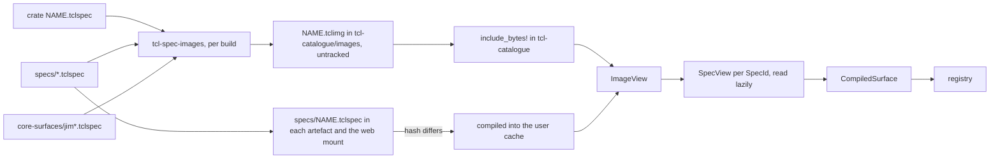
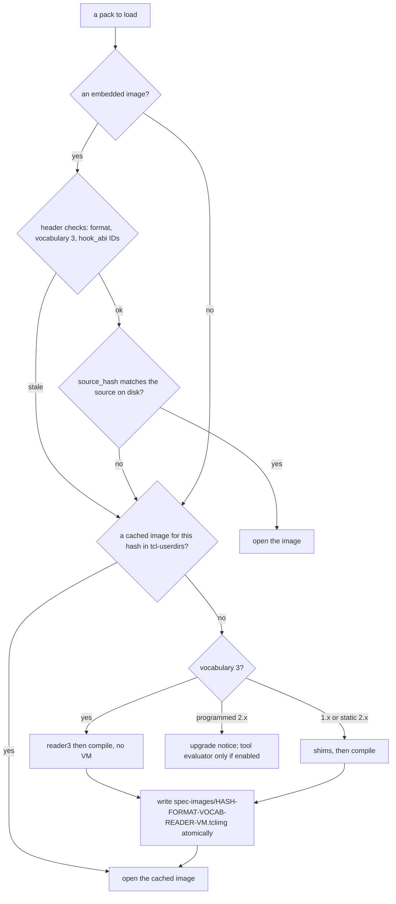

# Step 306: spike, Expect as data

Status: designed 26 November 2026. Plan item 306, step 6 of
[dialects, libraries and environments](../dialects-and-libraries.md). Builds on
[305](305-spectcl-3.md) (SpecTcl 3, `check`, hook rungs) and
[302](302-libraries.md) (facets). It decides [307](307-libraries-as-data.md).

## Problem

Every per-command fix recompiles Rust. The surfaces are 185k lines of Rust in
`tcl-registry/src/commands/`. The SpecTcl path is too slow to replace them as
it stands: evaluating the Tcl 8.6 equivalence pack takes 697 ms, against 1.3
ms for native `build_default` (`spectcl-compiled-surface-plan.md`, Results).
The cost is evaluation and parsing, not data volume, and nothing yet loads a
surface without parsing.

Expect is the test subject. It is `tcl-registry/src/commands/expect/`: 36
files and 2,742 lines, with 38 `surface` rows and 35 hovers. It has one hook
shape, used 6 times (`case_list: CaseListSpec::EXPECT` with
`AnalyserHookId::Switch`, for example `expect_cmd.rs:172`). It has no folds
and no codegen hooks, so it is hook-light, and it is a library on `tcl` with
an `expect` environment.

Today the packs reach users as source:

| Artefact | How packs ship today |
|---|---|
| VS Code VSIX (universal and six platform targets) | `specs/*.tclspec` copied beside each server binary (`Makefile:373`) |
| VS Code web | copied to `dist/web/specs/` with an `index.json` (`Makefile:353-357`, `copy-web-assets.cjs:41`), mounted by `primeSpecPacks` |
| VS Code WASI server | copied beside the module (`Makefile:402`) |
| JetBrains `.zip` | copied beside each server binary (`Makefile:2438-2440`) |
| Zed, Neovim, Emacs, Helix and other bare-binary clients | none on disk. The server falls back to the eight `include_str!` sources (`tcl-spectcl/src/bundled.rs:113-145`) |
| Sublime package | none. CI asserts it ships no `specs/` (`.github/workflows/ci.yml:3777`) |

## Design

### Compile once per build

The generator, `tcl-spec-images` (`cargo spec-images`; [307](307-libraries-as-data.md#images-per-build)),
compiles every shipped pack to an image in one run:

- the dialects and libraries, the Tcl core's included (after 307);
- the EDA packs in `specs/`;
- Jim's `core-surfaces/*.tclspec`;
- for the spike, `expect.tclspec`.

The image bytes are platform-independent, so one build's images go into
every artefact above, inside its binary or WASM module. Images are compiled
per build and never checked in (owner decision); `--check` (item 119)
recompiles and fails if an image differs from what its source compiles to.
Dev images are not tabulated: the VM pass (`--tabulate`, 307) runs only in
release and packaging builds.

From source to the registry, at build time and at run time:



### Image format, version 1

All integers are little-endian. All references are `u32` offsets from the
image start, with no pointers. Every section is 8-byte aligned. An image is
valid when the header checks pass, and readers never trust offsets without
bounds checks. A `&[u8]` view is enough, with no allocation for reads.

```text
Header (64 bytes)
  magic        "TCLSPIMG"
  format       u16   = 1            image layout version
  vocabulary   u16   = 3.minor      SpecTcl vocabulary the compiler spoke
  hook_abi     u16                  version of the native hook-ID table
  flags        u16
  source_hash  u64   xxh3 of the pack source bytes (and its includes, in order)
  section_count u32, section table offset u32
  total_len    u32, crc32 u32
Section table: (kind u32, offset u32, len u32, count u32)*
  STRINGS     one string table: (offset u32, len u32)* then UTF-8 bytes; all names, prose
  VERSIONS    interned VersionSets: (axis u32 → STRINGS, range_count u16, ranges (min,max as string ids))
  LIBRARIES   302's Library rows: id, aliases, trains, compatible rows, requires
  ENVIRONMENTS 303's definitions
  SPECS       the spec arena: fixed-size records (SpecRecord) indexed by SpecId u32
  FACETS      (key_id u32, value_off u32)* per facet; first match wins
  NAMES       sorted (name string id, SpecId) for binary search, per library
  RULES       305 `check` expression trees: (op u8, arg u32)* in post-order
  ROLE_TABLES tabulated shape-only hooks: (hook_id, shape_key u64, answer_off)*
  HOOKS       (kind u16, native_id u32 | tcl_body string id, inputs shape)*
```

`SpecRecord` holds offsets into the other sections, with no inline variable
data:

- name;
- `Availability` (library id, window id, dialect-constraint id);
- arity facet;
- options, subcommands and forms (sub-arenas of records);
- roles, effects and returns;
- docs (hover, synopsis, examples as string ids);
- deprecation;
- hook refs.

This is `SpecArena` from the compiled-surface plan's phase 3, laid out as
bytes. Lookup is a binary search on `NAMES`, which yields a `SpecId`. A
`SpecView<'img>` reads fields lazily. `CompiledSurface` (plan phase 3) is
built over views and never copies the data.

**Versioning.** A reader accepts exactly its `format`, and a `vocabulary`
whose major is 3 and whose minor is at most its own. A mismatch on either, or
an unknown `hook_abi`, marks the image *stale*. The pack is then compiled
from source in process: slower, never wrong. An ID the binary lacks makes
only that hook dormant, since recompiling would give the same ID. The
consolidated format, with section numbers and record layouts, is
[chapter 7](../spectcl-3/07-image-and-rust-parity.md#the-image-format-1).

### One placement

| Pack kind | Placement | Load |
|---|---|---|
| Dialect and library images (Tcl, Jim, f5-tcl, Tk, tcllib, Expect, iRules, …) | `include_bytes!` in `tcl-catalogue` | at registry install, with zero parsing |
| Replaceable vendor packs (`specs/*`) | `include_bytes!` in `tcl-catalogue` too: the BundledPack default on every host, replacing today's `include_str!`. `specs/NAME.tclspec` ships beside the binary and in the web mount as source only | lazily, through demand loading (`tcl-spectcl/src/demand.rs`, `demand::enable`; the manifest-only path in spec-packs.md) |

No `.tclimg` ships beside a binary or in the web mount: the binary already
embeds the same build's bytes, and a replaced source fails the hash and is
recompiled anyway. A `specs/` source on disk or in the browser mount
overrides the embedded image only when its hash differs; it is then compiled
into the user cache as a `UserPack` with tier BundledPack (chapter 7's
*shipped-pack resolution*). `include_bytes!` works for
`wasm32-unknown-unknown` and `wasm32-wasip1` because it is a compile-time
constant. The Sublime package ships no server and no packs, but LSP-Tcl
downloads the release's `tcl-lsp-server` on first use
(`editors/sublime-text/README.md`), so Sublime is a bare-binary client and
gets the embedded images like Zed or Helix.

### Replaced and user packs

Each image carries `source_hash`. At load:

1. **A bundled pack replaced on disk.** This means a `specs/` file,
   `TCL_LSP_SPEC_PACK_DIR`, or a file in the browser mount. Its source hash
   is compared with the embedded image's, and on a mismatch the embedded
   image is ignored for that pack.
2. **A pack with no current image** is compiled once with the 3 reader (no
   VM). The image is cached under `tcl-userdirs`' cache directory (the
   browser keeps an in-memory cache per session instead) as
   `spec-images/<source_hash>-<format>-<vocabulary>-<reader_build>-<vm>.tclimg`
   (chapter 7) and is reused on
   the next start. Writes are atomic (temp file plus rename). A corrupt cache
   entry fails the header checks and is rebuilt.
3. **`tcl spec compile PACK… [-o DIR] [--check]`** does the same on demand
   for authors and CI.

The load decision for one pack, as a flow:



A 1.x or 2.x pack is upgraded in memory through the shims first. A pack that
computes rows needs the tool evaluator (305), so an image is only produced
when that evaluator is enabled. Otherwise the user gets the upgrade notice.

### Hooks in the image

- **Native hooks** are `(kind, native_id)`. The image names the ID, the
  owning crate's hook table resolves the name at install, and `hook_abi`
  versions the table. Native hooks answer live and are never tabulated.
- **Shape-only Tcl bodies**, which read `kinds`, `argc` and `options` (305's
  context), are tabulated into `ROLE_TABLES` (chapter 7's `TABLES`) at image
  build, when the generator links the hook VM. This replaces
  `BUNDLED_ROLE_TABLES` (`tcl-spectcl/src/bundled_manifest.rs:92`) and
  `cargo xtask gen-bundled-manifests`.
- **Dynamic Tcl hooks keep their source in the image** and are compiled to VM
  bytecode on the first call. Storing bytecode is not possible today:
  - `tcl-bytecode` (`FunctionAsm`, `ModuleAsm`, `lib.rs:165`, `:520`) has no
    serialiser;
  - literals are in-memory `Value`s;
  - nothing versions the instruction set.

  Storing bytecode would take a versioned instruction-set number, a literal
  pool encoded as bytes, a loader that validates jump targets, and a
  differential test that runs the same stored bytecode native and under WASM.
  The bundled packs have one dynamic Tcl hook (`upf.tclspec`'s resolver,
  already tabulated), so compile-at-first-call costs nothing measurable, and
  the spike keeps it.

### The spike itself

Step 1 restates each Rust file as SpecTcl 3. For `log_user.rs`, the smallest
shape with an option, a form and a hover:

**Before:**

```rust
const OPTIONS: &[OptionSpec] = &[OptionSpec {
    name: "-info",
    value: OptionValue::flag(),
    detail: "Return current setting.",
    surface: None,
    aliases: &[],
    lifecycle: Lifecycle::UNSPECIFIED,
    min_abbrev: None,
    effect: None,
}];

const FORMS: &[FormSpec] = &[FormSpec {
    synopsis: "log_user ?-info | 0 | 1?",
    ..FormSpec::DEFAULT
}];

pub fn spec() -> CommandSpec {
    CommandSpec {
        name: "log_user",
        surface: Some(SpecSurface::EXPECT),
        arity: Arity::new(0, 1),
        hover: Some(HoverSnippet {
            summary: "Control whether send/expect output is logged to stdout.",
            synopsis: &["log_user -info", "log_user 0|1"],
            snippet: "With ``1`` (default), output is sent to stdout. With ``0``, output is suppressed.",
            source: "Expect log_user(1)",
            examples: "",
            return_value: "",
        }),
        forms: FORMS,
        options: OPTIONS,
        ..CommandSpec::DEFAULT
    }
}
```

**After:**

```spectcl
command log_user {
    available Expect 0-
    arity 0..1
    option -info -detail {Return current setting.}
    form Default {log_user ?-info | 0 | 1?}
    hover {
        summary {Control whether send/expect output is logged to stdout.}
        synopsis {log_user -info}
        synopsis {log_user 0|1}
        description {With ``1`` (default), output is sent to stdout. With ``0``, output is suppressed.}
        source {Expect log_user(1)}
    }
}
```

**In memory after:**

```rust
// design sketch: types proposed in 302; the image stores it as a SpecRecord (above)
CommandSpec {                                     // log_user (chapter 7's name)
    availability: Availability { library: Some(LibraryId("Expect")), window: ItemHistory("0-"), dialect: None },
    arity: Facet { rows: &[(FacetKey::ANY, Arity::new(0, 1))] },
    options: Facet { rows: &[(FacetKey::ANY, &[OptionId("-info")])] },   // flag, detail as before
    docs: Facet { rows: &[(FacetKey::ANY, DocId(..))] },   // form, summary, two synopses, description, source
    ..
}
```

`SpecSurface::EXPECT` becomes `available Expect 0-`, as 305's shim table
translates the `expect` membership token. The equivalence test (step 4)
checks that both forms give the same visibility, arity and roles.

1. Author `tcl-lib-expect/expect.tclspec` in SpecTcl 3 from the 36 Rust
   files. `case_list EXPECT` becomes a rung 1 `case_list` row, and the
   `Switch` hook stays `-native Switch`.
2. Add the reader `tcl_registry::image::ImageView` in the core, the writer
   `tcl-spectcl::image::compile_image`, and the `tcl-spec-images` generator.
3. `tcl-catalogue` embeds `expect.tclimg`; `tcl-lib-expect` keeps its
   `HookTable`.
4. Run the equivalence test (305) between the native Expect surface and the
   image, under the `expect` environment and `tcl8.6` with `package require
   Expect`.
5. Measure (below), using the compiled-surface plan's method. Then write the
   decision into 307.

## Work list

1. `rust/tcl-registry/src/image/{layout.rs, view.rs}` and
   `rust/tcl-spectcl/src/image/write.rs`, with fuzzed bounds checks (`cargo
   fuzz` target on `ImageView::open`).
2. `rust/tcl-spec-images` with `--write` and `--check`; `cargo xtask
   spec-images --check` and a Makefile target `xtask-spec-images` in
   `xtask-check`.
3. `tcl-lib-expect`: the pack and its `HookTable`; the image in
   `tcl-catalogue`.
4. Staging is unchanged: `Makefile` keeps copying `specs/*.tclspec` (`:353`,
   `:373`, `:402`, `:2438`) and `copy-web-assets.cjs` keeps listing them in
   `index.json`; no `.tclimg` is staged. The bare-binary fallback's packs move
   from `bundled.rs`'s `include_str!` to images in `tcl-catalogue`, which
   every host uses by default. The source's `source_hash` is in the image
   header, so a staged source is checked without embedding it again.
5. `tcl spec compile` in `tcl-cli`.

## Verification

Measure with the compiled-surface plan's harnesses (`ci` profile, 4 vCPU):
`surface_costs` per phase, `dialect_pair_bench.py` for server start and RSS,
and callgrind for attribution.

| Measurement | Baseline | Recorded as |
|---|---|---|
| Expect surface load: native `expect_command_specs()` against image open plus first `CompiledSurface` | native, today | ms, RSS delta |
| Expect lookup: `resolve_spec` known and unknown head | 235 / 20 ns (`tcl8.6`) | ns |
| Server start with **all bundled packs** as images (EDA, Jim, Expect) | 136 ms and 35 MiB manifests; 421 ms for the first EDA document (plan Results) | ms, MiB |
| The Tcl 8.6 equivalence pack as an image | 697 ms evaluated; 1.3 ms native | ms |
| One-command edit to Expect: rebuild set and wall time | today `tcl-registry` and everything above | crates rebuilt, s |
| Image size: Expect, each EDA pack, the 8.6 equivalence pack | source bytes | bytes, compressed in VSIX |
| Bundle growth per artefact: each VSIX, the JetBrains zip, the web bundle, the WASI module | today's artefact sizes | bytes |
| Equivalence | — | zero differences |

**Decision thresholds for 307:**

- **Data** (all libraries as images) if:
  - the 8.6-equivalent image loads within 5× native (≤ 7 ms);
  - Expect's lookups are within +10% of native;
  - server start with every bundled image is no slower than today and uses no
    more memory;
  - a one-command edit rebuilds only `tcl-catalogue` and the crates that
    link it: the binaries, the WASM hosts, `xtask` and the `-it` crates;
  - equivalence is exact.
- **Data except hook-heavy surfaces** if the load and lookup thresholds hold
  but the Tcl core's 1,655 native hook rows make authoring in SpecTcl no
  smaller than the Rust.
- **Native Rust per library crate** (the registry split alone) if image load
  is over 20 ms for the 8.6 surface, or lookup is over +25%, or any
  equivalence difference cannot be fixed in the vocabulary.

**Done when:** the measurements are recorded in this document, and the
decision is written into 307.

## Risks

- **Marketplace size limits.** The images add bytes to every binary and
  WASM module, so to six platform VSIXes and the JetBrains zip. Budget: each
  artefact (each VSIX, the JetBrains zip, the web bundle, the WASI module,
  the `tcl-lsp-server` binary) grows by at most 10% over its size at the
  spike's base commit, compressed where it ships compressed, summed over the
  whole of 307. Each 307 PR records its share alongside; crossing the
  budget is reported to the owner and gates nothing (owner priority: measure
  alongside, never block a step). Dropping `.tclimg` from `specs/`
  (above) keeps each image in the artefact once.
- **Hash drift between source and image.** `--check` in `xtask-check`, and
  the runtime source-hash comparison.
- **A malformed user-cache image.** Bounds checks, the CRC and the fuzz
  target. A failure falls back to source.

## Corrections to the overview

- `spectcl-compiled-surface-plan.md`'s phase 3 (`SpecArena`,
  `CompiledSurface`) is not built. The image is its byte form, so the spike
  builds phase 3 too.
- `bundled.rs:41-43` says the Sublime package stages `specs/`, but CI
  asserts it does not (`ci.yml:3777`). The coordinator's list mentions an
  Emacs bundle, but none exists: `editors/emacs` holds only a README, and
  Emacs uses the bare binary.
- The EDA packs are in `specs/` at the repository root, not in
  `rust/tcl-spectcl/specs/`.

## Owner decisions (26 November 2026)

- **Every artefact ships source and images,** the web bundle included: the `.tclspec` source beside each compiled image.
- **The Tcl core's hover and documentation become an image too.** Its hooks stay native. That is a fixed decision, not one the spike's size breakdown decides.

## Review fixes (26 November 2026)

- **R4:** `ImageView` is the core's (`tcl_registry::image`); `tcl-spectcl` owns only the writer. The sketch's `VersionedSpec` is `CommandSpec`.
- **R9:** versioning follows chapter 7: a minor at most the reader's, and an unknown ID makes the hook dormant.
- **R12, R14:** lines 41, 46–48, 57–58, 125, 143, 280, 293 and 324: images are compiled per build and embedded by `tcl-catalogue`; rebuild claims name `xtask` and the `-it` crates.

## Review fixes (26 November 2026, deep review)

- **C2, O10 (D-H):** *One placement*: the catalogue-embedded image is the BundledPack default on every host; `specs/` ships sources only, and a differing source compiles into the user cache (browser: in memory per session). The flowcharts and work list item 4 follow; the owner's "source and images" holds with the image inside the binary.
- **C2 (Sublime):** Sublime downloads the release's bare binary, so it gets the embedded images.
- **E4, O1 (D-A):** dev images are not tabulated; `--tabulate` runs only in release and packaging builds.
- **F12:** *Risks*: each artefact may grow at most 10% over the spike's base, recorded per 307 PR alongside and gating nothing.
