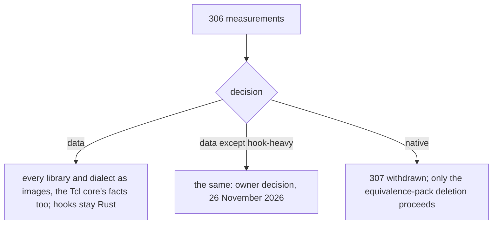
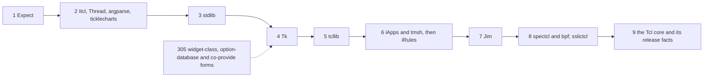

# Step 307: shipped libraries as data (conditional)

Status: designed 26 November 2026, **conditional on 306's decision**. Plan item
307, step 7 of [dialects, libraries and environments](../dialects-and-libraries.md).
Builds on [306](306-expect-spike.md) (the image format, the spike's numbers),
[305](305-spectcl-3.md) (SpecTcl 3) and the registry split (items 261–265).
It ends the model's steps.

## Problem

Command data is Rust. Hooks per surface count fields such as `*_hook`,
`*_resolver`, `*_validator`, `*fold*`, `native_compilation`, `native_result`,
`successful_handler`, `codegen` and `lowering` set to `Some` under
`tcl-registry/src/commands/<surface>/`:

| Surface | Lines | Hook fields |
|---|--:|--:|
| `irules` | 63,551 | 15 |
| `tcl` | 47,569 | 746 |
| `tcllib` | 27,052 | 14 |
| `tk` | 22,072 | 47 |
| `stdlib` | 11,725 | 7 |
| `expect` | 2,742 | 6 |
| `iapps` | 2,250 | 0 |
| `spectcl` | 2,071 | 2 |
| `closed_evidence` | 1,395 | 0 |
| `sslictcl` | 1,046 | 0 |
| `bpf` | 1,028 | 0 |
| `thread`, `itcl`, `ticklecharts`, `argparse` | 979, 536, 533, 356 | 8, 0, 0, 0 |

The two equivalence packs (`rust/tcl-spectcl/equivalence/`, 33,295 + 65,054 =
98,349 lines) restate the `tcl8.6` and `f5-irules` surfaces as SpecTcl. They are
generated by `cargo xtask gen-equivalence-packs`, and they are measuring
instruments loaded by no product. Each spec edit recompiles `tcl-registry`
and everything above it (registry split, Problem).

## Design

**If 306 decides "data"**, every shipped library and every dialect surface,
the Tcl core's included, is authored once in SpecTcl 3 and compiled to an
image per build. A package crate holds `NAME.tclspec` and its native hooks,
and nothing else. `tcl-catalogue` embeds every image.

For Expect, the spike's subject, the layout changes like this:

**Before:**

```text
rust/tcl-registry/src/commands/expect/
    mod.rs  close.rs  debug.rs  expect_cmd.rs  log_user.rs  send.rs  spawn.rs  …
    (36 files, 2,742 lines of CommandSpec literals, inside the 583k-line crate)
```

**After:**

```text
rust/tcl-lib-expect/
    expect.tclspec      the pack, SpecTcl 3
    src/                its HookTable; its one hook shape is the core's -native Switch
rust/tcl-catalogue/images/
    expect.tclimg       compiled per build by tcl-spec-images; untracked
```

306's outcome decides how far this goes:



### What stays native

Only hooks. The Tcl core (`tcl-dialect-tcl`) keeps its 746 hook fields of the
845 counted above as Rust, behind `-native ID` rows in the Tcl core's pack.
The equivalence packs show the shape: the `tcl8.6` pack has 1,158 `-native`
rows (the iRules pack 497), and across both packs the bulk are
`native_compilation` (501), `successful_handler` (127), `native_result` (103)
and `const_fold` (106). Its facts, its docs and the Tcl release facts move to
the image.

An earlier draft kept the Tcl core's facts as Rust, because a pack of
`-native` references saves no Rust. That cost the build what it saved in
lines: `tcl-dialect-tcl` is every generic crate's test dev-dependency (item
265, rule 1), so a Rust fact edit recompiled every generic crate's `--lib`
test target ([integration § 1](../../compiler/compiler-analyser-spectcl-integration.md#the-dependency-rule)).
With the facts in the image, a fact edit rebuilds `tcl-catalogue` and the
crates that link it, and a dev edge to `tcl-dialect-tcl` costs a recompile
only on a hook edit. Owner goals settle it: fast incremental builds over
fewer lines of indirection. `native_lowering`, `native_lowering_windows` and
`dispatch_dependencies` stay Rust-only tables in `tcl-dialect-tcl`, keyed by
command (`Derived`, open decision D8).

Everything else is hook-light (15 or fewer hook fields), and every hook it
has is already a native ID. That covers iRules, Tk, tcllib, the bundled
libraries, Expect, iApps and tmsh, and the small libraries.

**Packages with no hooks.** Most tcllib packages and bundled libraries have
no native hook. Each is still its own crate (owner decision), holding its
`.tclspec` and an empty `HookTable`. `tcl-catalogue` does not depend on a
crate whose `HookTable` is empty: the generator reads the `.tclspec` from the
crate's directory, and the image reaches the binaries through the
catalogue's `images/`. Such a crate is a workspace member nothing depends
on, so it costs no rebuild cascade. It is not free under `--workspace
--all-targets`: tcllib's 214 packages and the bundled libraries add about
230 members to today's 57 (`cargo metadata --no-deps`), and each would add a check unit, a libtest harness
and a rustdoc run. So a hookless crate's manifest sets `[lib] test = false`
and `doctest = false`, and its pack is tested through the catalogue's `-it`
crate (the pack's `test` rows run there). The crates are generated, so the
generator writes those two lines. Item 259's workspace-wide rows measure
what remains, before step 5 (tcllib) lands.

**If 306 decides "data except hook-heavy"**, the owner decision above holds
all the same. **If 306 decides "native"**, 307 is withdrawn, the registry
split alone stands, and only the equivalence-pack deletion below proceeds.

### Order

The order is smallest risk first, and each step is one PR with its
equivalence run:

1. **Expect** (the spike's output, already done).
2. **The small libraries**: `itcl`, `thread`, `argparse` and `ticklecharts`,
   one crate each (`tcl-lib-itcl`, `tcl-lib-thread`, `tcl-lib-argparse`,
   `tcl-lib-ticklecharts`). They exercise trains (Itcl 3/4, Thread 2/3) end
   to end.
3. **`stdlib`**, one crate per bundled library (`tcl-lib-http`,
   `tcl-lib-msgcat`, `tcl-lib-tcltest`, …), with the generated bundled
   versions from 302.
4. **`tk`.** It needs the widget-class, option-database and co-provide
   vocabulary (redesign §6.3), so it waits until those forms are in 305.
5. **`tcllib`**: 214 modules, multi-train, `TCLLIB_MODULES` folded into the
   library rows.
6. **`iapps`/tmsh**, then **`irules`**, the largest at 63k lines. The iRules
   events and their lifecycle data move too. iRules has no edge to the BIG-IP
   schema crate (item 118), because no command spec reads the schema
   (registry split step 3, decision 3).
7. **Jim**, whose core surface is already SpecTcl
   (`core-surfaces/jim*.tclspec`), switches from evaluation to its image.
8. **The DSL libraries**: `tcl-lib-spectcl`, then `tcl-lib-bpf` and
   `tcl-lib-linux-ebpf` (380). `tcl-lib-sslictcl` (365) changes with its
   consumers, with no shim, in the same PR as `tcl-sslictcl`.
9. **The Tcl core and its release facts.** The pack is exported once from
   the native surface with every hook as `-native ID`, and checked by 305's
   equivalence test before the Rust goes. `cargo xtask release-facts` writes
   the `DIALECTS` rows instead of `tcl-dialect/src/generated_release_facts.rs`,
   and the 15 `release_facts()` call sites (in `tcl-expr`, `tcl-syntax`,
   `tcl-dialect` and `tcl-registry`) read them from the `GrammarProfile` or
   the generation (plan item 485, integration INT-h).



### What is deleted

- `tcl-registry/src/commands/<surface>/` for every surface, about 185k
  lines, the Tcl core's included; only the `closed_evidence` mechanism stays.
- `tcl-dialect/src/generated_release_facts.rs` (11,445 lines).
- Both equivalence packs (98,349 lines), `cargo xtask gen-equivalence-packs`,
  and its Makefile target `xtask-gen-equivalence-packs`. iRules and the Tcl
  core become authored packs. Until each surface's Rust is deleted, 305's
  equivalence test runs against a generated *temporary* export in CI, which
  is never checked in; after that, the parity gate's three legs are the
  check (chapter 7).
- `BUNDLED_ROLE_TABLES` and `gen-bundled-manifests` (306).

### Images per build

Images are compiled per build and never checked in (owner decision). One
generator writes every image (item 119):

- **The generator** is `tcl-spec-images`, a small binary crate over
  `tcl-spectcl`'s reader (reader3, `compile_image`), `tcl-source` and the
  registry core only. It links no VM, no compiler, no codegen, no catalogue
  and no surface crate, so a fresh checkout builds it in about the time the
  core takes, and runs it before anything that embeds an image builds. `cargo
  spec-images` is its alias; the agent environment points it at the test
  profile (`CARGO_ALIAS_SPEC_IMAGES="run --profile test -p tcl-spec-images
  --"`, item 297), so it adds no dev-build variant of the core.
- **`--write`** compiles each `rust/tcl-dialect-*/NAME.tclspec`,
  `rust/tcl-lib-*/NAME.tclspec` and `specs/*.tclspec` into
  `rust/tcl-catalogue/images/NAME.tclimg`, untracked, and writes
  `images/inputs.tsv`: each image with its source files and their xxh3. It
  **writes a file only when its bytes change**, so an unchanged image keeps
  its modification time and cargo relinks nothing.
- **Base images are not tabulated.** A `--write` image has source-only
  `BODIES` and `tabulated_with_vm` clear, which chapter 7 already allows. Its
  shape-only Tcl bodies are answered live where the hook runner is linked
  (D-I) and abstain where it is not. The shipped packs hold one dynamic Tcl
  hook today (`upf.tclspec`'s resolver), so a dev build loses almost nothing.
- **`--tabulate` is an opt-in second pass**, run by the release and
  packaging targets only. It lives in its own package, `tcl-spec-tabulate`,
  because cargo dependencies belong to the package (item 298's finding): that
  package links `tcl-spec-hooks` and the VM, compiles each Tcl body to a
  `TbcxUnit`, writes the rung-5 `TABLES`, and sets `tabulated_with_vm`. Its
  output is keyed by the VM and codegen build (`reader_build` already holds
  `HOOK_VM_REVISION` and the tbcx format), so a VM or codegen edit changes no
  dev image and rebuilds no catalogue consumer.
- **`tcl-catalogue` embeds them** with `include_bytes!`. Its build script has
  no workspace build-dependency, only `xxhash-rust`. It emits
  `rerun-if-changed` for every source in `inputs.tsv`, and fails the build
  when an image is missing or its source hash differs, naming the pack and
  `cargo spec-images`. Cargo fingerprints the embedded files, so a
  regenerated image rebuilds `tcl-catalogue` and the crates that link it:
  the binaries, the WASM hosts, `xtask` and the `-it` test crates.
- **`--check`** recompiles in memory and fails on any byte difference from
  the images present, naming the pack and the first differing section. It
  runs in `xtask-check` (as `cargo xtask spec-images --check`, once `xtask`
  builds) and in CI before packaging, so every editor artefact gets the
  checked bytes.
- **Registered** in item 119's generator manifest, so the
  `@generated`-without-generator lint covers images. Images carry the
  `source_hash` header instead of a text `@generated` line.
- **Every launch path runs it first.** `tcl-catalogue`'s build fails on a
  missing image, so each path that builds an embedding crate generates the
  images before it builds:

  | Launch path | How it gets images |
  |---|---|
  | `make` targets, the session-start hook | a `spec-images` prerequisite |
  | `scripts/tcl-mcp` (`cargo run --locked -p tcl-mcp`, every agent session) | runs `cargo spec-images --write` before `cargo run` |
  | the compiler-explorer skill (`cargo run -p tcl-cli`) | the same, in its wrapper |
  | rust-analyzer | the session-start hook's run; after a `.tclspec` edit, the build script's error names `cargo spec-images` |
  | CI release builds in the ubi8 and riscv containers (`ci.yml:3207`, `:3256`, `:3280`) | a step running `--write` then `--tabulate` before `cargo build -p "$PACKAGE" --release` |
  | WASM builds (`make lsp-server-wasm`, the WASI server, `explorer-wasm`, `spec-studio-wasm`, `bigip-query-wasm`, `tcl-vm-wasm`) | the `spec-images` prerequisite, plus `--tabulate` in packaging |

  The images are platform-independent, so one run serves every target of a
  build, cross targets included. Release and packaging builds always run
  `--tabulate`; dev builds never do.

The images could instead come from `tcl-catalogue`'s build script with the
reader as a build-dependency. That is rejected: build-dependencies compile
under `build-override`, which differs from the test profile's opt-level 1,
so each worktree would hold the reader stack, the registry core included,
twice. That is the cost item 296 removes for features.

### The registry rule and `registry-axes`

- **The registry rule is unchanged in substance.** Per-command knowledge
  lives in a dialect or library crate, now in its `.tclspec` instead of its
  Rust. The rule's wording in `AGENTS.md` names "the dialect or library
  crate's spec pack or Rust" as the registry.
- **`registry-axes`' vocabulary source changes.** It derives the vocabulary
  from the registry built from every surface (the native ones plus the
  images), which is what it already does for shipped `.tclspec` packs
  (`xtask/src/registry_axes.rs`, part 1). The lint over consumer crates is
  unchanged. The registry-crate set it exempts grows to the library crates
  (registry split item 264), and their Rust is only hooks.
- **A new check:** a dialect or library crate's `src/` may not contain
  `CommandSpec` literals once it is image-backed (`rg 'CommandSpec \{'
  rust/tcl-lib-*/src rust/tcl-dialect-*/src` is empty). This prevents a
  split source of truth.

### Dependencies

Dialect and library crates depend on the registry core (for the hook
traits) and on their own hooks' needs (`tcl-cmd-core` for folds). No surface
crate depends on `tcl-spectcl`. The image reader lives in the core; only the
generator (`tcl-spec-images`) and the user-pack path link the image
compiler.

The generator's small cone needs two changes below it: `tcl-spectcl` drops
its normal edge to `tcl-spec-hooks` (the hook runner is a dependency the
named entry crates link, D-I), and its reader parses with `tcl-source`
(items 251 and 281). Until both land, `tcl-spec-images` reaches the VM
through `tcl-spectcl`, and a fresh worktree builds `tcl-vm` before any
catalogue consumer; item 259's `spec` row records that cost.

**The engines' facts.** The engines do not link `tcl-catalogue`. A small
`tcl-catalogue-core` crate embeds only the Tcl and Jim core images (from the
same untracked `images/`, which `tcl-catalogue` then takes from it rather
than embedding twice). `tclvm`, `runtime/rust` (cdylib and WASM),
`tcl-vm-wasm` and `tcl-engine-tclvm` link it and install it when an
interpreter is created. Library facts an engine needs (`errorclass` rows,
taint sinks, `LIBRARY_UNITS`, `library_versions`) arrive through the
entry point's installed `SurfaceSet`; a compiled WASM program gets a
per-module fact projection stamped by codegen and links no catalogue. The
install table is [registry split step 1's](../registry-split/01-surface-input.md#entry-points).

### Decisions

1. **The Tcl core's facts and docs are an image in `tcl-catalogue`;
   `tcl-dialect-tcl` holds hooks only.** So do the Tcl release facts, in the
   image's `DIALECTS` section. A Rust fact would recompile every generic
   crate's test target on each edit (see *What stays native*). This replaces
   the earlier "the Tcl core stays Rust".
2. **The equivalence packs are deleted, not kept as goldens.** They are
   generated restatements, and 305's equivalence test is the check.
3. **One generator for all images, and one opt-in tabulation pass.** One
   format, one `--check`, one place for the format version. Tabulation is a
   separate package so the generator's cone holds no VM, compiler or
   codegen (D-A).
4. **Images per build, embedded only by `tcl-catalogue`** (owner decision),
   from an untracked directory the generator fills; the Tcl and Jim core
   images are embedded once, by `tcl-catalogue-core`, which `tcl-catalogue`
   links.
5. **Engines read the core images from `tcl-catalogue-core`**, and library
   facts from the entry point's `SurfaceSet` (D-B; *Dependencies*).

### Open questions

- **Core docs as an image?** Settled: the owner moved them, and decision 1
  moves the facts with them.
- **The BIG-IP schema crate's form.** Is it data images too (item 300), or
  Rust? This is settled with item 118.

## Work list

Per surface, in the order above:

1. `tcl spec export` from the native surface into `NAME.tclspec`. Then edit it
   by hand to SpecTcl 3 idiom (facets, `check`).
2. Run the equivalence test against native until there are zero differences.
3. `cargo spec-images --write`; `tcl-catalogue` embeds the image, and the
   crate keeps only its `HookTable` (none if it has no hooks; then `test =
   false` and `doctest = false`).
4. Delete the Rust command files, and keep the hooks.
5. Re-run `registry-axes`, which should report the same findings.

Then delete the equivalence packs and their generator.

Once, before step 1: create `tcl-spec-images` and `tcl-spec-tabulate`, and
`tcl-catalogue-core` unless item 264 already cut it (334 §3: only where that
costs the split nothing; no extraction waits for it); add the `spec-images` prerequisite to every launch path
in *Images per build*; add `CARGO_ALIAS_SPEC_IMAGES` to `agent-build-env.sh`
(item 297).

## Verification

- **Done when:** each shipped dialect and library crate holds its
  `.tclspec` and hooks only, and its image is in `tcl-catalogue`. A
  one-command edit (a `.tclspec` row) rebuilds `tcl-catalogue` and the crates
  that link it: the binaries, the WASM hosts, `xtask` and the `-it` test
  crates, and no generic crate's test target. That is measured with item
  259's `spec` edit. A hook edit also rebuilds its crate and the test targets
  that dev-depend on it. Load time is within 306's budget. `rg -c '' -g
  '*.tclspec' rust/tcl-spectcl/equivalence` finds no files. `cargo tree -p
  tcl-spec-images` lists no `tcl-vm`, `tcl-compile`, `tcl-unit` or
  `tcl-codegen` (INT-b), and a VM or codegen edit rebuilds no image in a dev
  build (259's `vm` row). A Tcl-core or Jim `.tclspec` edit also rebuilds
  `tcl-catalogue-core` and the engines that link it; that set is 259's
  `spec-core` row.
- **Conformance:** every existing suite passes unchanged after each surface's
  PR: registry sweeps, compiler `it_*`, LSP snapshots, the iRules and iApps
  rows (304), and `library-visibility` (302).
- **Measurements per PR:**
  - the crates rebuilt after a one-spec edit;
  - the generator's wall time, cold and after a one-spec edit (budget in
    259's `spec` row);
  - server start and RSS with `dialect_pair_bench.py`;
  - `resolve_spec` per lookup;
  - artefact size growth per editor bundle.

## Risks

- **Vocabulary gaps** (Tk's widget model, iRules events). Mitigation: those
  surfaces go late, and the gap blocks only them.
- **Two sources during migration.** Mitigation: one surface per PR, and the
  `CommandSpec`-literal check above.
- **Authoring ergonomics.** Mitigation: Spec Studio and the LSP's own
  `spectcl` environment already edit `.tclspec`, and image rebuilds are one
  xtask.

## Corrections to the overview

- "Deleting the native Rust catalogue" includes the Tcl core's facts after
  decision 1: all of about 185k lines go, and the Tcl core keeps only its
  hooks.
- The plan's item 307 says "the images are checked in". Under the owner's
  "images compiled per build" they are not; see *Images per build*.
- The plan's done-when "a one-command edit recompiles that crate alone"
  omits `tcl-catalogue`, the binaries, `xtask` and the `-it` crates.
- Plan item 318's "the reader, loader and image compiler need no VM" holds
  for `tcl-spec-images` only once tabulation is the separate pass above.

## Owner decisions (26 November 2026)

- **One crate per package,** not per distribution: each tcllib package, each bundled Tcl library, iApps and tmsh each get their own crate. A package crate is an image plus hooks, so these crates are generated scaffolding.
- **The Tcl core's hover and documentation become an image.** Only its hooks stay native Rust.
- **Every artefact ships the `.tclspec` source beside the image.**

## Review fixes (26 November 2026)

- **R1:** decision 1 replaced: the Tcl core's facts, docs and release facts are an image in `tcl-catalogue`; `tcl-dialect-tcl` holds hooks only (*What stays native*, order step 9).
- **R12:** every rebuild claim names `tcl-catalogue`, the binaries, the WASM hosts, `xtask` and the `-it` crates; hookless packages stay crates (owner decision) that the catalogue does not depend on. The finding's "data directories in `tcl-catalogue`" is not taken: it conflicts with one crate per package.
- **R14:** lines 40–41, 55–60, 143, 171–174, 199 and 207–209: images are compiled per build into `tcl-catalogue`, not checked in beside each crate (*Images per build*).
- **R16:** `crates/*` paths are `rust/tcl-lib-*` and `rust/tcl-dialect-*`.

## Review fixes (26 November 2026, deep review)

- **O1, E4, C3 (D-A):** *Images per build*: the generator is over the reader, `tcl-source` and the core only; `--tabulate` is a separate package (`tcl-spec-tabulate`) for release and packaging; images are written only when their bytes change; every launch path is listed; done-when gains INT-b's `cargo tree` check and 259's `vm` row; plan item 318's sentence is corrected (*Corrections*).
- **F9:** the alias uses the test profile (`CARGO_ALIAS_SPEC_IMAGES`, 297); the generator's time is measured per PR; *Dependencies* records that `tcl-vm` builds first until `tcl-spectcl` drops its hook edge.
- **E5, C4, O11 (D-B):** *Dependencies* and decision 5: `tcl-catalogue-core` gives the engines the Tcl and Jim images; library facts come through the `SurfaceSet`; WASM programs get a codegen projection.
- **F8:** hookless crates set `test = false` and `doctest = false` and are tested through the catalogue's `-it` crate; the member count is 57 today, measured.
- **W11, O15:** order steps 2, 3 and 8 name one crate per package (`tcl-lib-itcl`, …, `tcl-lib-bpf`, `tcl-lib-linux-ebpf`, `tcl-lib-sslictcl`).
- **O10 (D-H):** the EDA packs are compiled into the catalogue like every other pack (unchanged here; the registry split's contrary line is fixed).
