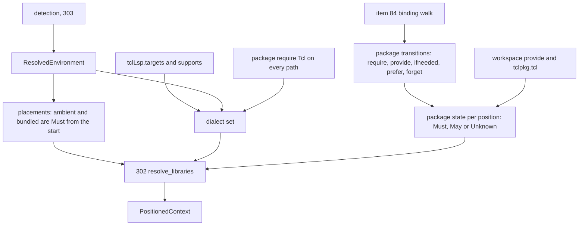
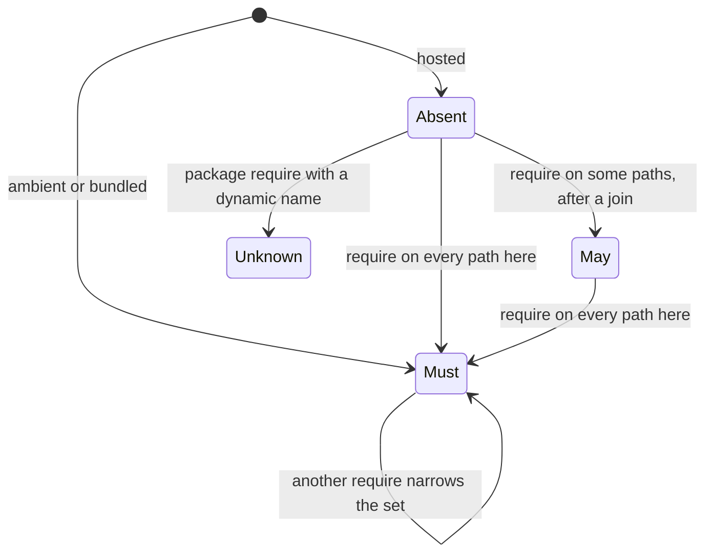
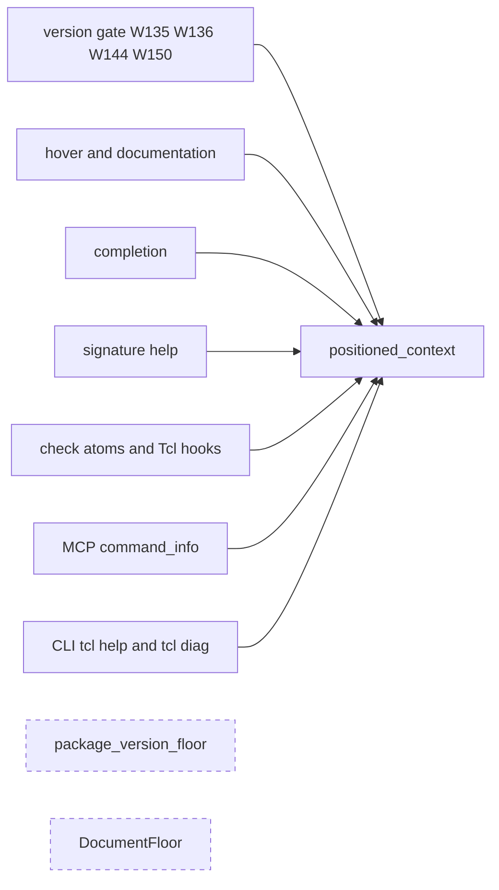

# Step 308 (proposed): the positioned library and dialect query

Status: proposed 26 November 2026, as a new plan item 308. It builds on
[302](302-libraries.md) (resolution, facets) and [303](303-environments.md)
(`ResolvedEnvironment`), and sits alongside item 84's single binding walk,
which supplies the per-position package state. [305](305-spectcl-3.md)'s hook
context and `check` atoms read it.

## Problem

Each consumer answers "which versions apply here?" for itself, and most
answer it for the whole file.

| Site | What it does |
|---|---|
| `version_gate::package_version_floor` (`tcl-compiler/src/analyser/diagnostics/version_gate.rs:1154`) | The highest written **lower bound** of the unconditional requires. It falls back to `TclVersion::V9_1` when the profile names no Tcl release (`:1155-1156`). Upper bounds, `-exact` ranges, alternatives as a union, and train selection are dropped. A conditional require is ignored |
| `DocumentFloor` (`tcl-lsp-core/src/document_floor.rs:43`) | The same rule again for request-time providers, with its own `V9_1` fallback (`:142`). Used from 8 files |
| `ResolvedContext::require_package` (`tcl-registry/src/model/context.rs:373`) | Records a require into the context's floors. Its six callers are all tests (`model/context/tests.rs`, `registry/tests/effective_semantics.rs`) |
| hover (`tcl-lsp-core/src/hover/builtin_commands.rs:109-121`) | Prints `**Requires**: package require P` from `spec.required_package` and a whole-file scan of `analysis.package_requires`. iRules events read `placement_floor("f5-irules-cmds")` (`:150`) |
| hover (`hover/original_registry.rs:711`) | Reads `analysis.package_requires` again |
| completion (`completion.rs:888`, `completion/argument_values.rs:113`, `:173`) | `DocumentFloor::for_spec` for subcommand filtering; `placement_floor("f5-irules-cmds")` for iRules values |
| MCP `command_info` (`tcl-mcp/src/tools/editor_queries.rs:57`) | Takes a dialect parameter, with no position |

`SignaturePackageRequire` (`tcl-compiler/src/signature_scan/types.rs:158`)
already carries every alternative, `exact`, `conditional` and `control_flow`,
and its range. None of the consumers use more than the lower bound.

## Design

### One query

```rust
// tcl-db (the one database, item 90), over the binding owner's realm state
#[salsa::tracked]
pub fn positioned_context(db: &dyn Db, file: File, at: Offset) -> Arc<PositionedContext>;

pub struct PositionedContext {
    pub environment: Arc<ResolvedEnvironment>,      // 303, after detection
    pub dialect: DialectChoice,                     // a point, or a set over a target range
    pub libraries: Map<LibraryId, LibraryChoice>,
    pub targets: TargetSet,                         // tclLsp.targets ∩ `# tcl-lsp: supports`
}
pub enum LibraryChoice {
    Absent,
    Must { versions: VersionSet, why: Why },        // present on every path to here
    May  { cases: SmallVec<[(VersionSet, Why); 2]> }, // present on some paths
    Unknown { reason: UnknownReason },              // dynamic name, `package unknown` handler, eval
}
pub enum Why {
    Placement(Placement),                    // ambient or bundled from the environment
    Require { at: Span, exact: bool },       // a `package require` reached here
    Provide { at: Span },                    // `package provide` in this file
    Workspace { manifest: SourcePath },      // `tclpkg.tcl` or a workspace pkgIndex.tcl
    Requirement { of: LibraryId },           // pulled in by another library (302)
}
```

### How the answer is built

1. **The dialect.** Detection (303, unchanged) gives the environment. Its
   selector, intersected with `targets`, gives the dialect set. A
   `package require Tcl RANGE` reached on every path narrows it.
2. **Package state per position.** Item 84's binding walk records one
   transition per `package require`, `provide`, `ifneeded`, `prefer` and
   `forget` site (`AnalyserHookId::Package*`, which 305 moves to transition
   descriptors). Each records its alternatives, its `-exact` flag and its
   position. The state at a program point is the join over the paths that
   reach it, the same lattice as binding's `BindingKnowledge` (`Must`/`May`).
   - **Straight-line code:** a require earlier in the same block is `Must`.
   - **Conditionals** (`if`, `catch`, `try`, `switch` arms): a require on one
     branch is `May` after the join, carried with its range. The require in
     `if {[catch {package require Tk 8.6}]} {package require Tk 8.5}` gives
     `May {8.6-9, 8.5-9}`.
   - **Procedure bodies:** the entry state is the join of the states at the
     body's known call sites. If the call graph is unknown, it is the
     top-level state at the end of the file, downgraded to `May`.
   - **Dynamic names** (`package require $p`) make every library hosted by
     the environment `Unknown` from that point.
3. **Versions per library.** For each library in the state, 302's
   `resolve_libraries` intersects three things:
   - the placement range;
   - the compatibility rows against the dialect set;
   - the require ranges.

   This uses `tclPkg.c`'s algebra: alternatives union, `-exact` gives
   `V-V`, and a bare `V` gives `[V, next major)`. Train selection keeps the
   newest satisfying train at a point and every train over a range.
4. **Workspace.** `package provide` in the workspace and `tclpkg.tcl` add
   versions the catalogue does not know (a workspace's own `mylib 2.1`) and
   mark them `Why::Workspace`. They make a hosted library available to
   require. They are not a require themselves. `tclpkg.tcl` stays outside
   the target set (redesign §5.4).
5. **The environment's placements.** An ambient or bundled library is `Must`
   from the file's start, at its placement range. A hosted library is
   `Absent` until required.
6. **Targets.** `targets` never moves the primary point (redesign §11 O7). It
   widens the dialect and library sets that range-checking consumers read.

The inputs meet in `resolve_libraries`, once per transition interval:



One library's state along a walk moves like this. `Must` and `May` carry
their version sets; a join of `Must` with `Absent` is `May`.



A worked example under the lenient `tcl` environment with `tclLsp.targets`
`tcl 8.5-9.0`. The comments give the context at the end of each line:

```tcl
package require Tcl 8.6                ;# dialect {8.6}: a bare 8.6 means 8.6 up to 9
if {$gui} {
    package require Tk 8.6             ;# Tk Must {8.6} inside the arm
}
text .t -insertunfocussed none         ;# Tk May {8.6} after the join
package require $extra                 ;# every hosted library Unknown from here
```

The first line is tclsh's own answer: `package require Tcl 8.6` succeeds on
8.6.18 and fails on 9.0.4 with `version conflict for package "Tcl": have
9.0.4, need 8.6`. Writing `8.6-` or `8.6 9` instead keeps {8.6, 9.0}.

The query is per body unit and per binding transition, not per offset.
`positioned_context(at)` finds the transition interval containing `at`, and
salsa memoises per interval. An edit re-runs only the body unit it touches
(item 49).

### Every consumer calls it

| Consumer | Today | With 308 |
|---|---|---|
| version gate (W135, W136, W144, W150) | `package_version_floor` | `ctx.libraries[lib]` for each site. A `May` case warns only if every case fails, and W150 takes the targets |
| `DocumentFloor` | its own floor | deleted. Request providers call the query |
| hover and documentation | whole-file requires; `required_package` | the selected facets (302) at `ctx`, with the version line below |
| completion | `DocumentFloor::for_spec` | visible items at `ctx`; `May` items offered with their annotation |
| signature help | the unversioned arity | the arity facet at `ctx` |
| `check` rules and Tcl hooks (305) | none | the `library`/`dialect` atoms and the `ctx.libraries` key |
| MCP `command_info` | a dialect parameter | an optional `{file, position}`, else the environment's start-of-file context |
| CLI `tcl help`/`tcl diag` | the dialect flag | the same query over the CLI's analysis |
| W120 (missing require) | whole-file heuristic (assistance view, redesign §5.2) | unchanged as an assistance-view heuristic, but reading `ctx` for "required above this use" (H301) |

Every consumer reads one query. The two floors it replaces are deleted:



For one pinned require, the version gate's input changes from a floor to a
set with its reason:

**Before:**

```text
source:  package require -exact Tk 8.5.19     (environment tcl8.6)
         text .t -insertunfocussed none
floor:   Tk >= 8.5, from the require's lower bound; -exact is lost
```

**After:**

```text
source:  package require -exact Tk 8.5.19     (environment tcl8.6)
         text .t -insertunfocussed none
ctx:     Tk Must { versions: ∅, why: Require { exact: true } }
answer:  a report: Tk 8.5.19 has no compatible row on tcl 8.6
```

The two views of redesign §5.2 stay distinct types. `positioned_context` is
the semantic view. The assistance view (`assist_context`) is the same record
with the file-level union of requires substituted, labelled as such.

### Presenting a set of versions

```rust
pub enum VersionLine {
    Since { library: LibraryId, from: Version },                        // "since Tk 8.6"
    Range { library: LibraryId, set: VersionSet },                      // "Tk 8.5–8.6"
    Differs { selected: (FacetValue, VersionSet), others: Vec<(FacetValue, VersionSet)> },
    Unknown { reason: UnknownReason },
}
```

- **One point.** Hover shows the selected facet's value. An item whose
  window starts after the library's first version gets "since L V". A
  deprecated one gets "deprecated since L V", from its deprecation facet.
- **A set where the facet agrees.** As above, plus "(all of Tk 8.5–8.6)" only
  when the set has more than one train.
- **A set where the facet differs.** The value for the newest member is
  shown, then one line per other value: "Tk 8.5: no `-insertunfocussed`".
  For arity: "takes 1 argument on BIG-IP 21.1; absent before".
- **Completion.** It offers the union over the set. Items visible in only
  part of it carry the annotation as a detail (`(Tk 8.6+)`, `(Tcl 9.0+)`)
  and sort after the items visible everywhere.
- **`May` requires** are shown as "if `package require Tk 8.6` ran (line
  12)".

### Dependencies

The query lives in `tcl-db` (or the analysis crate that owns binding results,
per item 90's layering). It depends on the registry core (302 and 303 types),
the binding results (item 84) and the workspace package index. Consumers
depend on it through the database, never on each other.

### Decisions

1. **The answer is a set with provenance, never a floor.** A floor cannot say
   `-exact`, an upper bound, two trains, or "on one branch".
2. **Per transition interval, not per offset.** Package state changes only at
   transitions, so this keeps the query count bounded.
3. **No fallback release.** An environment with no Tcl point answers with its
   family's set. The `V9_1` fallbacks are deleted.

### Open questions

- **Procedure entry state when callers are across files.** Settled by item
  68's cross-file name world. Until then, cross-file callers contribute
  `May` from the file's top-level end state.
- **Cost.** Settled by measuring `positioned_context` on the analysis
  performance suite's 687-line file (item 46). Budget: under 5% of analysis
  time.

## Work list

1. Item 84: binding records package transitions with their alternatives,
   `exact`, `conditional` and span. This replaces the `package_requires` vector.
2. `tcl-db`: `positioned_context` and `assist_context`.
3. Migrate the version gate, then delete `package_version_floor` and its
   `V9_1` fallback.
4. Migrate hover, completion and signature help, then delete `DocumentFloor`.
5. Delete `ResolvedContext::require_package`, or make it the query's internal
   step.
6. MCP `command_info` and the CLI take an optional position.

## Verification

**Conformance rows** form a new area, `positioned-versions`. The columns are
hover's version line, completion's candidates, the version-gate diagnostic and
the `check` atom value. Each row is one file and one cursor position:

| Row | Source | Expected at the cursor |
|---|---|---|
| Tk 8.5 against 8.6 | `package require Tk 8.5` then `text .t -insertunfocussed` under `tcl8.6` | Tk {8.6} (8.6 satisfies 8.5): option valid; hover "since Tk 8.6" |
| Tk pinned below the option | `package require -exact Tk 8.5.19` | Tk ∅ on tcl 8.6 (no compatible row): a report, not a floor |
| Tk on 8.5 | the same under `tcl8.5` | Tk {8.5}: `-insertunfocussed` not offered; hover "since Tk 8.6" |
| Itcl exact | `package require -exact Itcl 3.4` under `tcl8.6` | Itcl {3.4}: `itcl::local` (4.0-) not offered |
| Itcl exact on 9.0 | the same under `tcl9.0` | ∅ with a report; `check itcl3-exact-on-tcl9` fires |
| No require | `text .t` under `wish` | Tk at the bundled placement (8.6) |
| No require, hosted | `text .t` under `tcl8.6` | Tk `Absent`: W120 |
| One branch only | `if {$gui} {package require Tk 8.6}` then a Tk call after the `if` | Tk `May {8.6}`: completion annotates; no version diagnostic |
| Multi-train | `package require struct::graph 1.2` | struct::graph {1.2.2}: 2.x-only commands not offered |
| Alternatives | `package require Thread 2.8 3` under `tcl9.0` | Thread {3.0} |
| Inside a procedure | a require in `proc init`, a use in `proc run` called after `init` | `Must` if the call order is proved, else `May` |
| iRules by target | `persist mcp x` under `f5-irules` with `bigipVersion` 16.1 against 21.1 | not visible at 16.1, visible at 21.1; hover "since BIG-IP 21.1" |
| Targets range | `tclLsp.targets` `tcl 8.5-9.0`, `lmap` | W150 naming 8.5; hover "since Tcl 8.6" |

**Done when:**

- `positioned_context` is the only version source for the version gate,
  hover, completion, signature help, MCP `command_info` and the CLI.
- `rg 'package_version_floor|DocumentFloor|TclVersion::V9_1\)'` finds none in
  `tcl-compiler/src/analyser/diagnostics` or `tcl-lsp-core/src`.
- `ResolvedContext::require_package` has a production caller or is gone.
- Every row above is green.

**Measurements:**

- the query's share of analysis time on the item 46 suite;
- hover and completion latency on the lsp-client benchmark, which should be
  unchanged within 5%;
- the rebuild set after an edit to the query: `tcl-db` and its dependents
  only.

## Risks

- **Binding coverage.** Requires inside `eval`, `uplevel` or callbacks are
  invisible to a structural walk. Mitigation: they produce `Unknown` from the
  enclosing body, never `Absent`.
- **Noise from `May`.** Mitigation: diagnostics fire only when every case
  fails, and completion annotates rather than hides.
