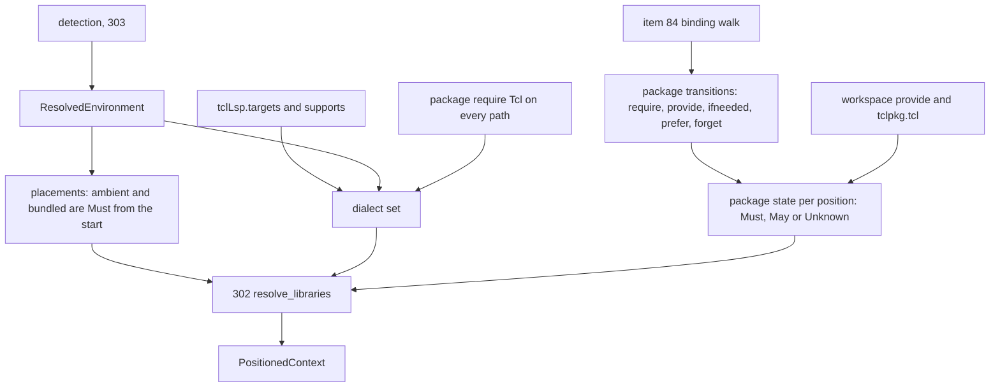
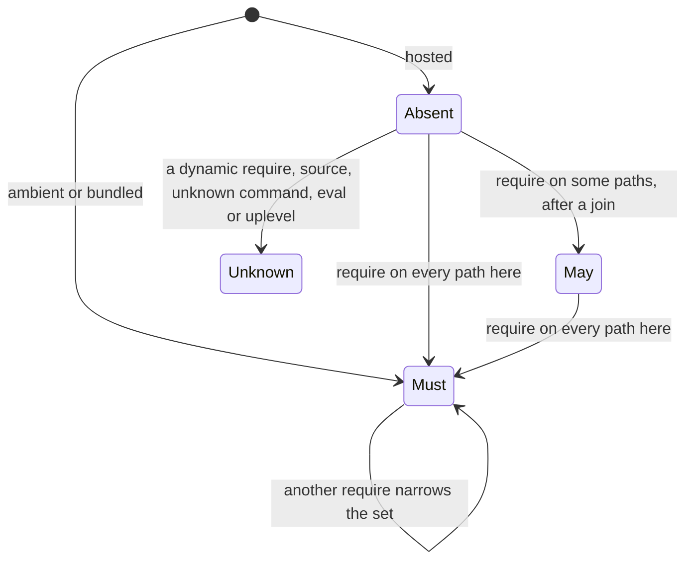
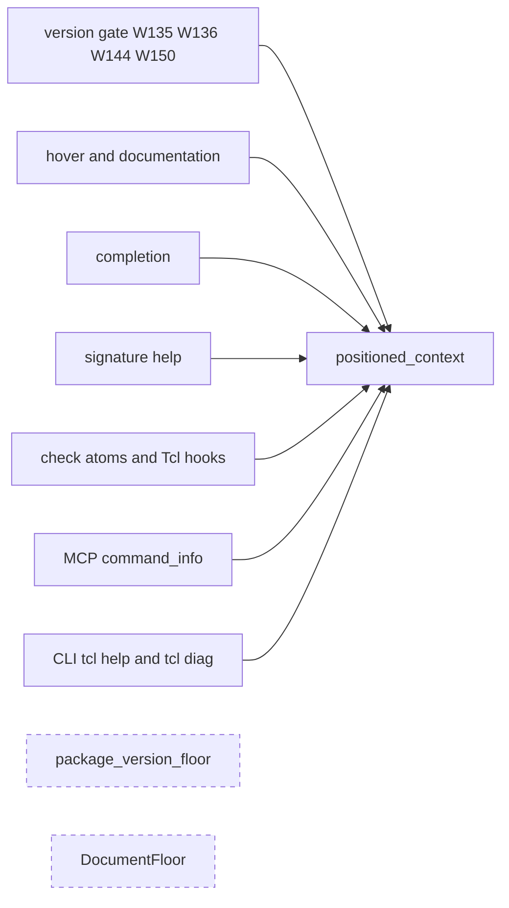

# Step 308 (proposed): the positioned library and dialect query

Status: proposed 26 November 2026, as a new plan item 308. It builds on
[302](302-libraries.md) (resolution, facets) and [303](303-environments.md)
(`ResolvedEnvironment`), and sits alongside item 84's single binding walk,
which supplies the per-position package state. [305](305-spectcl-3.md)'s hook
context and `check` atoms read it.

## Problem

Each consumer answers "which versions apply here?" for itself, and most
answer it for the whole file.

| Site | What it does |
|---|---|
| `version_gate::package_version_floor` (`tcl-compiler/src/analyser/diagnostics/version_gate.rs:1154`) | The highest written **lower bound** of the unconditional requires. It falls back to `TclVersion::V9_1` when the profile names no Tcl release (`:1155-1156`). Upper bounds, `-exact` ranges, alternatives as a union, and train selection are dropped. A conditional require is ignored |
| `DocumentFloor` (`tcl-lsp-core/src/document_floor.rs:43`) | The same rule again for request-time providers, with its own `V9_1` fallback (`:142`). Used from 8 files |
| `ResolvedContext::require_package` (`tcl-registry/src/model/context.rs:373`) | Records a require into the context's floors. Its six callers are all tests (`model/context/tests.rs`, `registry/tests/effective_semantics.rs`) |
| hover (`tcl-lsp-core/src/hover/builtin_commands.rs:109-121`) | Prints `**Requires**: package require P` from `spec.required_package` and a whole-file scan of `analysis.package_requires`. iRules events read `placement_floor("f5-irules-cmds")` (`:150`) |
| hover (`hover/original_registry.rs:711`) | Reads `analysis.package_requires` again |
| completion (`completion.rs:888`, `completion/argument_values.rs:113`, `:173`) | `DocumentFloor::for_spec` for subcommand filtering; `placement_floor("f5-irules-cmds")` for iRules values |
| MCP `command_info` (`tcl-mcp/src/tools/editor_queries.rs:57`) | Takes a dialect parameter, with no position |

`SignaturePackageRequire` (`tcl-compiler/src/signature_scan/types.rs:158`)
already carries every alternative, `exact`, `conditional` and `control_flow`,
and its range. None of the consumers use more than the lower bound.

## Design

### One query

```rust
// tcl-db (the one database, item 90), over the binding owner's realm state
#[salsa::tracked]
pub fn positioned_context(db: &dyn Db, file: File, at: Offset) -> Arc<PositionedContext>;

pub struct PositionedContext {
    pub environment: Arc<ResolvedEnvironment>,      // 303, after detection
    pub dialect: DialectChoice,                     // a point, or a set over a target range
    pub libraries: Map<LibraryId, LibraryChoice>,
    pub targets: TargetSet,                         // tclLsp.targets ∩ `# tcl-lsp: supports`
}
pub enum LibraryChoice {
    Absent,
    Must { versions: VersionSet, why: Why },        // present on every path to here
    May  { cases: SmallVec<[(VersionSet, Why); 2]> }, // present on some paths
    Unknown { reason: UnknownReason },              // dynamic name, `package unknown` handler, eval
}
pub enum Why {
    Placement(Placement),                    // ambient or bundled from the environment
    Require { at: Span, exact: bool },       // a `package require` reached here
    Provide { at: Span },                    // `package provide` in this file
    Workspace { manifest: SourcePath },      // `tclpkg.tcl` or a workspace pkgIndex.tcl
    Requirement { of: LibraryId },           // pulled in by another library (302)
}
```

### How the answer is built

1. **The dialect.** Detection (303, unchanged) gives the environment. Its
   selector, intersected with `targets`, gives the dialect set. A
   `package require Tcl RANGE` reached on every path narrows it.
2. **Package state per position.** Item 84's binding walk records one
   transition per `package require`, `provide`, `ifneeded`, `prefer` and
   `forget` site (`AnalyserHookId::Package*`, which 305 moves to transition
   descriptors). Each records its alternatives, its `-exact` flag and its
   position. The state at a program point is the join over the paths that
   reach it, `Knowledge<T>` projected to `Certainty` (spectcl-3/03).
   - **Straight-line code:** a require earlier in the same block is `Must`.
   - **Conditionals** (`if`, `catch`, `try`, `switch` arms): a require on one
     branch is `May` after the join, carried with its range. The require in
     `if {[catch {package require Tk 8.6}]} {package require Tk 8.5}` gives
     `May {8.6-9, 8.5-9}`.
   - **Procedure bodies:** the entry state is the join of the states at the
     body's known call sites. Binding runs before any call graph exists, so
     it cannot compute that join. `tcl-unit` does, in one top-down pass over
     the condensed call graph, with a termination argument and a counted
     re-binding budget ([integration
     § 1](../../compiler/compiler-analyser-spectcl-integration.md#how-the-positioned-context-selects-facets)).
     Until that pass runs, and wherever the call graph is unknown, it is the
     top-level state at the end of the file, downgraded to `May`.
   - **Dynamic names** (`package require $p`) make every library hosted by
     the environment `Unknown` from that point.
   - **Opaque code** has the same effect. A `source`, a call to an unknown
     command, `eval` or `uplevel` of a computed script may run a `package
     require`, so after one every hosted library still `Absent` is
     `Unknown`. A `Must` or `May` already proved stays.
3. **Versions per library.** For each library in the state, 302's
   `resolve_libraries` intersects three things:
   - the placement range;
   - the compatibility rows against the dialect set;
   - the require ranges.

   This uses `tclPkg.c`'s algebra: alternatives union, `-exact` gives
   `V-V`, and a bare `V` gives `[V, next major)`. Train selection keeps the
   newest satisfying train at a point and every train over a range.
4. **Workspace.** `package provide` in the workspace and `tclpkg.tcl` add
   versions the catalogue does not know (a workspace's own `mylib 2.1`) and
   mark them `Why::Workspace`. They make a hosted library available to
   require. They are not a require themselves. `tclpkg.tcl` stays outside
   the target set (redesign §5.4).
5. **The environment's placements.** An ambient or bundled library is `Must`
   from the file's start, at its placement range. A hosted library is
   `Absent` until required, or `Unknown` after opaque code (step 2).
6. **Targets.** `targets` never moves the primary point (redesign §11 O7). It
   widens the dialect and library sets that range-checking consumers read.

The inputs meet in `resolve_libraries`, once per transition interval:



One library's state along a walk moves like this. `Must` and `May` carry
their version sets; a join of `Must` with `Absent` is `May`.



A worked example under the lenient `tcl` environment with `tclLsp.targets`
`tcl 8.5-9.0`. The comments give the context at the end of each line:

**Source:**

```tcl
package require Tcl 8.6                ;# dialect {8.6}: a bare 8.6 means 8.6 up to 9
if {$gui} {
    package require Tk 8.6             ;# Tk Must {8.6} inside the arm
}
text .t -insertunfocussed none         ;# Tk May {8.6} after the join
package require $extra                 ;# every hosted library Unknown from here
```

**In memory:**

```rust
// design sketch: types proposed in 302, 303 and 308
// at `text .t -insertunfocussed none` (line 5):
PositionedContext {
    environment: Arc<ResolvedEnvironment { id: "tcl", .. }>,
    dialect: DialectChoice::Set(VersionSet("tcl 8.6")),          // targets 8.5-9.0 ∩ require Tcl 8.6
    libraries: {
        LibraryId("Tk"): LibraryChoice::May { cases: [(VersionSet("8.6"), Why::Require { at: Span(line 3), exact: false })] },
        ..                                        // bundled ones (http, msgcat, tcltest) are Must
    },
    targets: TargetSet { core: VersionSet("tcl 8.5-9.0"), .. },
}
// after `package require $extra` (line 6): every hosted library
//     LibraryChoice::Unknown { reason: UnknownReason::DynamicName }
```

**Bytecode (tclsh 9.1.0):**

```text
ByteCode
  Source "package require Tcl 8.6                ;# dialect {8.6}..."
  Cmds 5, src 322, inst 131, litObjs 12, aux 0, stkDepth 4, code/src 0.00
  Commands 5:
      1: pc 0-25, src 0-38        2: pc 26-82, src 86-169
      3: pc 47-71, src 102-136        4: pc 83-108, src 171-209
      5: pc 109-129, src 241-279
  Command 1: "package require Tcl 8.6                ..."
    (0) push 0 	# "package"
    (5) push 1 	# "require"
    (10) push 2 	# "Tcl"
    (15) push 3 	# "8.6"
    (20) invokeStk 4 
    (25) pop 
  Command 2: "if {$gui} {\n    package require Tk 8.6             ;# ..."
    (26) startCommand +56 1 	# next cmd at pc 82, 1 cmds start here
    (35) push 4 	# "gui"
    (40) loadStk 
    (41) nop 
    (42) jumpFalse +35 	# pc 77
  Command 3: "package require Tk 8.6             ..."
    (47) push 0 	# "package"
    (52) push 1 	# "require"
    (57) push 5 	# "Tk"
    (62) push 3 	# "8.6"
    (67) invokeStk 4 
    (72) jump +10 	# pc 82
    (77) push 6 	# ""
    (82) pop 
  Command 4: "text .t -insertunfocussed none         ..."
    (83) push 7 	# "text"
    (88) push 8 	# ".t"
    (93) push 9 	# "-insertunfocussed"
    (98) push 10 	# "none"
    (103) invokeStk 4 
    (108) pop 
  Command 5: "package require $extra                 ..."
    (109) push 0 	# "package"
    (114) push 1 	# "require"
    (119) push 11 	# "extra"
    (124) loadStk 
    (125) invokeStk 3 
    (130) done 
```

**Result:**

```text
$ cat ctx-gui1.tcl     # ctx-gui0.tcl sets gui 0
set gui 1; set extra http
source ctx.tcl
puts "Tk [package present Tk], http [package present http]"; exit
$ export TCLLIBPATH=$PWD/tk86   # its pkgIndex.tcl loads tmp/tk8.6.18/unix/libtk8.6.so
$ xvfb-run -a tclsh8.5 ctx-gui1.tcl 2>&1 | head -1
version conflict for package "Tcl": have 8.5.19, need 8.6
$ xvfb-run -a tclsh8.6 ctx-gui1.tcl 2>&1 | head -1
Tk 8.6.18, http 2.9.9
$ xvfb-run -a tclsh9.0 ctx-gui1.tcl 2>&1 | head -1
version conflict for package "Tcl": have 9.0.4, need 8.6
$ xvfb-run -a ./target/debug/tclvm ctx-gui1.tcl 2>&1 | head -1
version conflict for package "Tcl": have 9.0.4, need 8.6
$ xvfb-run -a tclsh8.5 ctx-gui0.tcl 2>&1 | head -1
version conflict for package "Tcl": have 8.5.19, need 8.6
$ xvfb-run -a tclsh8.6 ctx-gui0.tcl 2>&1 | head -1
invalid command name "text"
$ xvfb-run -a tclsh9.0 ctx-gui0.tcl 2>&1 | head -1
version conflict for package "Tcl": have 9.0.4, need 8.6
$ xvfb-run -a ./target/debug/tclvm ctx-gui0.tcl 2>&1 | head -1
version conflict for package "Tcl": have 9.0.4, need 8.6
```

The first line is tclsh's own answer: `package require Tcl 8.6` succeeds on
8.6.18 and fails on 9.0.4 with `version conflict for package "Tcl": have
9.0.4, need 8.6`. Writing `8.6-` or `8.6 9` instead keeps {8.6, 9.0}.
On 8.6 with `gui` 0, `text` does not exist, which is why Tk is only `May`
after the join.

The query is per body unit and per binding transition, not per offset.
`positioned_context(at)` finds the transition interval containing `at`, and
salsa memoises per interval. An edit re-runs only the body unit it touches
(item 49).

### Every consumer calls it

| Consumer | Today | With 308 |
|---|---|---|
| version gate (W135, W136, W144, W150) | `package_version_floor` | `ctx.libraries[lib]` for each site. A `May` case warns only if every case fails, and W150 takes the targets |
| `DocumentFloor` | its own floor | deleted. Request providers call the query |
| hover and documentation | whole-file requires; `required_package` | the selected facets (302) at `ctx`, with the version line below |
| completion | `DocumentFloor::for_spec` | visible items at `ctx`; `May` items offered with their annotation |
| signature help | the unversioned arity | the arity facet at `ctx` |
| `check` rules and Tcl hooks (305) | none | the `library`/`dialect` atoms and the `ctx.libraries` key |
| MCP `command_info` | a dialect parameter | an optional `{file, position}`, else the environment's start-of-file context |
| CLI `tcl help`/`tcl diag` | the dialect flag | the same query over the CLI's analysis |
| W120 (missing require) | whole-file heuristic (assistance view, redesign §5.2) | unchanged as an assistance-view heuristic, but reading `ctx` for "required above this use" (H301); it fires on `Absent` only, never on `Unknown` |

Every consumer reads one query. The two floors it replaces are deleted:



For one pinned require, the version gate's input changes from a floor to a
set with its reason:

**Before:**

```text
source:  package require -exact Tk 8.5.19     (environment tcl8.6)
         text .t -insertunfocussed none
floor:   Tk >= 8.5.19, the require's written version; the upper bound -exact sets is lost
```

**After:**

```text
source:  package require -exact Tk 8.5.19     (environment tcl8.6)
         text .t -insertunfocussed none
ctx:     Tk Must { versions: ∅, why: Require { exact: true } }
answer:  a report: Tk 8.5.19 has no compatible row on tcl 8.6
```

**Bytecode (tclsh 9.1.0):**

```text
ByteCode
  Source "package require -exact Tk 8.5.19\ntext .t -insertunfocu..."
  Cmds 2, src 64, inst 57, litObjs 9, aux 0, stkDepth 5, code/src 0.00
  Commands 2:
      1: pc 0-30, src 0-31        2: pc 31-55, src 33-62
  Command 1: "package require -exact Tk 8.5.19..."
    (0) push 0 	# "package"
    (5) push 1 	# "require"
    (10) push 2 	# "-exact"
    (15) push 3 	# "Tk"
    (20) push 4 	# "8.5.19"
    (25) invokeStk 5 
    (30) pop 
  Command 2: "text .t -insertunfocussed none..."
    (31) push 5 	# "text"
    (36) push 6 	# ".t"
    (41) push 7 	# "-insertunfocussed"
    (46) push 8 	# "none"
    (51) invokeStk 4 
    (56) done 
```

**Result:**

```text
$ cat exact.tcl
package require -exact Tk 8.5.19
text .t -insertunfocussed none
$ TCLLIBPATH=$PWD/tk86 xvfb-run -a tclsh8.6 exact.tcl
can't find package Tk exactly 8.5.19
    while executing
"package require -exact Tk 8.5.19"
    (file "exact.tcl" line 1)
$ ./target/debug/tcl diag --dialect tcl8.6 exact.tcl          # today
no diagnostics
diagnostics=0 across 1 input(s)
```

tclsh 8.6 refuses the require. Today's gate says nothing about the file at
all; the After answer is the report it should give.

The two views of redesign §5.2 stay distinct types. `positioned_context` is
the semantic view. The assistance view (`assist_context`) is the same record
with the file-level union of requires substituted, labelled as such.

### Presenting a set of versions

```rust
pub enum VersionLine {
    Since { library: LibraryId, from: Version },                        // "since Tk 8.6"
    Range { library: LibraryId, set: VersionSet },                      // "Tk 8.5–8.6"
    Differs { selected: (FacetValue, VersionSet), others: Vec<(FacetValue, VersionSet)> },
    Unknown { reason: UnknownReason },
}
```

- **One point.** Hover shows the selected facet's value. An item whose
  window starts after the library's first version gets "since L V". A
  deprecated one gets "deprecated since L V", from its deprecation facet.
- **A set where the facet agrees.** As above, plus "(all of Tk 8.5–8.6)" only
  when the set has more than one train.
- **A set where the facet differs.** The value for the newest member is
  shown, then one line per other value: "Tk 8.5: no `-insertunfocussed`".
  For arity: "takes 1 argument on BIG-IP 21.1; absent before".
- **Completion.** It offers the union over the set. Items visible in only
  part of it carry the annotation as a detail (`(Tk 8.6+)`, `(Tcl 9.0+)`)
  and sort after the items visible everywhere.
- **`May` requires** are shown as "if `package require Tk 8.6` ran (line
  12)".

### Dependencies

`tcl-binding` computes the intervals inside a body, `tcl-unit` computes each
body's entry selection top-down, and `tcl-db` memoises both
(`entry_selection` and `positioned_context`; [integration
§ 5](../../compiler/compiler-analyser-spectcl-integration.md#inputs)). They
depend on the registry core (302 and 303 types), the binding results (item
84) and the workspace package index. Consumers depend on the query through
the database, never on each other.

**The IDE crates read it without the database.** Hover, completion and
signature help live in `tcl-ide-*` crates, which depend on `tcl-model` and
the registry core only (D-C). Their caller (the LSP session, or `tcl-db`'s
session-free batch constructor for the CLI and MCP) hands them
`DocumentInput { text, environment, facts: FactView<'_>, context:
&ContextIntervals, document: &dyn DocumentFacts }` (chapter 6). `context`
is this query's answer per transition interval, and `facts` is the same
generation the analyser read, so hover's `VersionLine`, completion and the
version gate select facets through one path and cannot disagree. A
document's `# tcl-lsp: stub` declarations are a per-file `UserPack` input
with tier `Document` (chapter 7), so they appear in that `FactView`.

### Decisions

1. **The answer is a set with provenance, never a floor.** A floor cannot say
   `-exact`, an upper bound, two trains, or "on one branch".
2. **Per transition interval, not per offset.** Package state changes only at
   transitions, so this keeps the query count bounded.
3. **No fallback release.** An environment with no Tcl point answers with its
   family's set. The `V9_1` fallbacks are deleted.

### Open questions

- **Procedure entry state when callers are across files.** Settled: the
  top-down pass runs over the unit's call graph, so a `package require` edit
  in `main.tcl` reaches the procedures of `lib.tcl`, and salsa re-binds only
  bodies whose entry selection changed. Until item 68's cross-file name world
  gives that graph its cross-file edges, cross-file callers contribute `May`
  from the file's top-level end state.
- **Cost.** Settled by measuring `positioned_context` on the analysis
  performance suite's 687-line file (item 46). Budget: under 5% of analysis
  time.

## Work list

1. Item 84: binding records package transitions with their alternatives,
   `exact`, `conditional` and span. This replaces the `package_requires` vector.
2. `tcl-db`: `positioned_context` and `assist_context`.
3. Migrate the version gate, then delete `package_version_floor` and its
   `V9_1` fallback.
4. Migrate hover, completion and signature help, then delete `DocumentFloor`.
5. Delete `ResolvedContext::require_package`, or make it the query's internal
   step.
6. MCP `command_info` and the CLI take an optional position, through `tcl-db`'s
   batch constructor.
7. `tcl-ide-*`: hover, completion and signature help read `DocumentInput.facts`
   and `.context`; no IDE crate names `tcl-db` (INT-a's done-when covers
   them).

## Verification

**Conformance rows** form a new area, `positioned-versions`. The columns are
hover's version line, completion's candidates, the version-gate diagnostic and
the `check` atom value. Each row is one file and one cursor position:

| Row | Source | Expected at the cursor |
|---|---|---|
| Tk 8.5 against 8.6 | `package require Tk 8.5` then `text .t -insertunfocussed` under `tcl8.6` | Tk {8.6} (8.6 satisfies 8.5): option valid; hover "since Tk 8.6" |
| Tk pinned below the option | `package require -exact Tk 8.5.19` | Tk ∅ on tcl 8.6 (no compatible row): a report, not a floor |
| Tk on 8.5 | the same under `tcl8.5` | Tk {8.5}: `-insertunfocussed` not offered; hover "since Tk 8.6" |
| Itcl exact | `package require -exact Itcl 3.4` under `tcl8.6` | Itcl {3.4}: `itcl::local` (4.0-) not offered |
| Itcl exact on 9.0 | the same under `tcl9.0` | ∅ with a report; `check itcl3-exact-on-tcl9` fires |
| No require | `text .t` under `wish` | Tk at the bundled placement (8.6) |
| No require, hosted | `text .t` under `tcl8.6` | Tk `Absent`: W120 |
| Require behind opaque code | `source gui.tcl` (which requires Tk), then `text .t`, under `tcl8.6` | Tk `Unknown`: no W120 |
| One branch only | `if {$gui} {package require Tk 8.6}` then a Tk call after the `if` | Tk `May {8.6}`: completion annotates; no version diagnostic |
| Multi-train | `package require struct::graph 1.2` | struct::graph {1.2.2}: 2.x-only commands not offered |
| Alternatives | `package require Thread 2.8 3` under `tcl9.0` | Thread {3.0} |
| Inside a procedure | a require in `proc init`, a use in `proc run` called after `init` | `Must` if the call order is proved, else `May` |
| iRules by target | `persist mcp x` under `f5-irules` with `bigipVersion` 16.1 against 21.1 | not visible at 16.1, visible at 21.1; hover "since BIG-IP 21.1" |
| Targets range | `tclLsp.targets` `tcl 8.5-9.0`, `lmap` | W150 naming 8.5; hover "since Tcl 8.6" |

**Done when:**

- `positioned_context` is the only version source for the version gate,
  hover, completion, signature help, MCP `command_info` and the CLI.
- `rg 'package_version_floor|DocumentFloor|TclVersion::V9_1\)'` finds none in
  `tcl-compiler/src/analyser/diagnostics` or `tcl-lsp-core/src`.
- `ResolvedContext::require_package` has a production caller or is gone.
- Every row above is green.

**Measurements:**

- the query's share of analysis time on the item 46 suite;
- hover and completion latency on the lsp-client benchmark, which should be
  unchanged within 5%;
- the rebuild set after an edit to the query: `tcl-db` and its dependents
  only.

### Evidence: opaque code can require a library

**Source:**

```tcl
# a.tcl
package require struct::set
# b.tcl
proc setup {} {uplevel #0 {source a.tcl}}
setup
puts [struct::set size {a b c}]
```

**Result:**

```text
$ TCLLIBPATH=$PWD/tmp/tcllib-2.0/modules tclsh8.6 b.tcl     (tclsh9.1 prints the same)
3
$ ./target/debug/tcl diag --dialect tcl8.6 b.tcl            # today
b.tcl:3:7: warning W120     "struct::set" requires `package require struct::set`
```

The library is present at line 3, yet today's whole-file heuristic warns. Under
the rule above, the `source` makes `struct::set` `Unknown`, and W120 is
silent.

## Risks

- **Binding coverage.** Requires inside `eval`, `uplevel` or callbacks are
  invisible to a structural walk. Mitigation: they produce `Unknown` from the
  enclosing body, never `Absent`.
- **Noise from `May`.** Mitigation: diagnostics fire only when every case
  fails, and completion annotates rather than hides.

## Review fixes (26 November 2026)

- **A5:** procedure entry states are computed top-down in `tcl-unit` after condensation, with the end-of-file `May` rule before that; *Dependencies* and the cross-file open question follow (integration C19).
- **A12 (308's part):** opaque code (`source`, an unknown command, `eval`, `uplevel`) makes a hosted `Absent` library `Unknown`; W120 fires on `Absent` only; a new conformance row and the tclsh 8.6 and 9.1 run above.

## Review fixes (26 November 2026, deep review)

- **O3 (D-C):** *Dependencies*: IDE crates read the answer through `DocumentInput { facts: FactView, context: &ContextIntervals, document }`, never `tcl-db`; work list item 7.
- **O4 (D-C):** document stubs are a per-file `UserPack` input that appears in the same `FactView`.
- **Language fixer handoff (D-F):** the join is `Knowledge<T>` projected to `Certainty` (spectcl-3/03), not `BindingKnowledge`.
