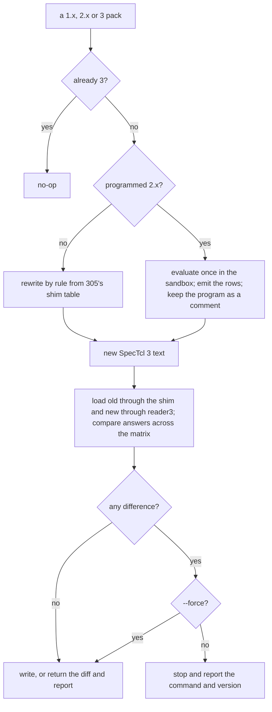
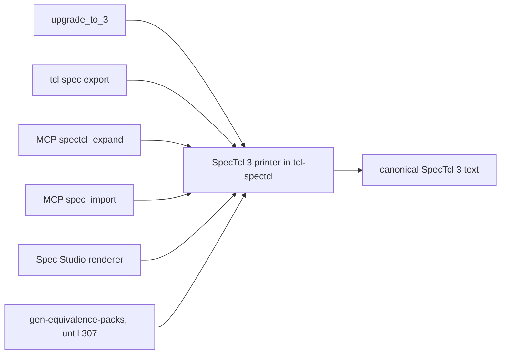

# Upgrading user packs to SpecTcl 3, and authoring tools that emit 3

**Status:** designed 26 November 2026. Plan items 309 (migration tooling) and 310 (authoring and AI tooling).

**Builds on:**
- [SpecTcl 3](305-spectcl-3.md), which supplies the grammar, the shims and the equivalent-answers test;
- [the image spike](306-expect-spike.md).

1.x and 2.x packs keep loading through the shims, so upgrading is never required to keep working. The tooling makes upgrading a one-step action that proves the upgraded pack still means the same thing. Every tool that writes SpecTcl writes 3.

## Today

**Upgrading:**
- `tcl spec upgrade FILE` rewrites a 1.x declaration in place and preserves every other byte. Its flags are `--check` (report only), `--restyle` (canonical re-emit) and `--verify` (snapshot check). See `rust/tcl-cli/src/commands/spec.rs:437` and `rust/tcl-spectcl/src/upgrade.rs`.
- A *programmed* 2.0 pack (`proc`, `foreach` or `set` between the vocabulary words) is evaluated, not walked, and upgrade does not rewrite it.

**Writers of SpecTcl:**
- `tcl spec export`;
- MCP `spectcl_expand`, `spec_import` and `spectcl_check`;
- Spec Studio's renderer (`rust/tcl-spec-studio/src/render_spectcl.rs`), with its VS Code and JetBrains panels;
- `cargo xtask gen-equivalence-packs`;
- the `spec-author` skill (`ai/claude/skills/spec-author/SKILL.md`).

The skill teaches 2.0: "declare the newest, `speclib <name> 2.0`" and "forty commands differing in two fields are a `foreach` over a data table". SpecTcl 3 forbids that pattern.

**Docs:** `docs/design/spec-dsl-examples/README.md` calls the 2.x syntax "frozen", and the KCS how-tos (`kcs-howto-write-a-tclspec-pack.md`, `kcs-howto-create-command-specs-without-rust.md`, `kcs-howto-declare-an-option-effect-in-a-tclspec-pack.md`) teach 2.x.

## 309: upgrading user packs automatically

### One engine

`tcl_spectcl::upgrade_to_3(source, options) -> UpgradeResult` produces the new text, a diff and an equivalence report. Every surface calls it. It has two paths:

- **Declarative packs** (most 1.x and canonical 2.x packs). It rewrites by rule from 305's shim table, keeping comments and layout around the rewritten rows. `--restyle` re-emits canonically.
- **Programmed 2.x packs.**
  - It evaluates the pack once in the existing sandbox, at upgrade time only.
  - It emits the resulting registrations as literal SpecTcl 3 rows.
  - It keeps the original program in a `# generated by` header comment block naming the source hash, so the author can see what was expanded.
  - If the author still wants to generate, the program moves to a generator script outside the pack. The report points this out.

For example, the fixture `tests/fixtures/templated/fleet.tclspec` registers four commands through a `proc` and a `foreach`. Upgraded, the four registrations are literal rows and the program survives only as a comment (two of the four commands shown):

**Before:**

```spectcl
speclib fleet 2.0 {
    proc fleet-command {name arity} {
        command math::fleet::$name {
            arity $arity
            traits {CSE_CANDIDATE}
            return_type Numeric
            option -verbose -detail {Report each step as it runs.}
            subcommand probe {
                arity 0
                detail {Probe one input and report what it holds.}
            }
        }
    }
    foreach {name arity} {alpha 2 beta 1 gamma 3 delta 1} {
        fleet-command $name $arity
    }
}
```

**After:**

```spectcl
# generated by tcl spec upgrade from fleet.tclspec (source hash <xxh3>);
# the program it expanded:
#   proc fleet-command {name arity} { command math::fleet::$name { … } }
#   foreach {name arity} {alpha 2 beta 1 gamma 3 delta 1} { fleet-command $name $arity }
speclib fleet 3 {
    command math::fleet::alpha {
        arity 2
        traits {CSE_CANDIDATE}
        return_type Numeric
        option -verbose -detail {Report each step as it runs.}
        subcommand probe {
            arity 0
            detail {Probe one input and report what it holds.}
        }
    }
    command math::fleet::beta {
        arity 1
        traits {CSE_CANDIDATE}
        return_type Numeric
        option -verbose -detail {Report each step as it runs.}
        subcommand probe {
            arity 0
            detail {Probe one input and report what it holds.}
        }
    }
    # math::fleet::gamma (arity 3) and math::fleet::delta (arity 1) follow
}
```

**In memory:**

```rust
// design sketch: types proposed in 302; one record per expanded command
VersionedSpec {                                   // math::fleet::alpha
    availability: Availability { library: None, window: ItemHistory::ALL, dialect: None },
    arity: Facet { rows: &[(FacetKey::ANY, Arity::new(2, 2))] },
    returns: Facet { rows: &[(FacetKey::ANY, ReturnType::Numeric)] },
    options: Facet { rows: &[(FacetKey::ANY, &[OptionId("-verbose")])] },
    subcommands: Facet { rows: &[(FacetKey::ANY, &[SubId("probe")])] },   // probe: arity 0
    ..                                            // traits {CSE_CANDIDATE} rides along unchanged
}
// beta, gamma and delta differ only in arity: 1, 3 and 1
```

### Proof before writing

Before the upgrade writes anything, it loads the old text through the shim and the new text through the 3 reader. It compares their answers across the release matrix: visibility, arity, roles, versioned facets and documentation.
- Any difference stops the write and reports the differing command and version.
- `--force` writes anyway and keeps the report.
- Upgrading a 3 pack is a no-op. The test suite checks idempotence.

The whole path, from any surface's request to a written file:



### Surfaces

| Surface | Behaviour |
|---|---|
| CLI | `tcl spec upgrade [--to 3] [--check \| --diff \| --write] PATH…` over files or a workspace. It exits non-zero under `--check` when anything would change, for CI. |
| LSP | An information diagnostic on a 1.x or 2.x pack ("SpecTcl 2.3 pack: upgrade to 3 available"). A code action, "Upgrade to SpecTcl 3", returns a `WorkspaceEdit`, so the editor shows its normal preview. A workspace command, "Upgrade all packs to SpecTcl 3", applies one batched edit after the preview. |
| VS Code, JetBrains, Zed | The command and the code action through the LSP. Spec Studio gets an "Upgrade to 3" button that shows the diff and the equivalence report. |
| MCP | A `spectcl_upgrade` tool with `dry_run` (default true). It returns the new text, the diff and the equivalence report; `write` applies them. |
| `tcl-pkg` / `tclpkg.tcl` | `tcl pkg` reports packs in a project that are below 3, so a project's own CI can gate on them. |

Nothing writes a user's file without an explicit user action. No upgrade runs silently on open.

### Deprecation path (owner decision)

The shims stay. Whether the loader later warns on 1.x packs, and from which release, is the owner's call. This design does not schedule it.

## 310: authoring and AI tooling that emits SpecTcl 3

### One printer

A single SpecTcl 3 printer in `tcl-spectcl` writes the canonical form: field order, versioned facets as compact window rows, and `check` rules. These all use it, so no tool keeps a second emitter:
- `upgrade_to_3`;
- `tcl spec export`;
- `spectcl_expand`;
- `spec_import`;
- Spec Studio's renderer;
- the equivalence-pack generator, while it exists (item 307 deletes it).



### What each tool gains

| Tool | Change |
|---|---|
| `spec_import` (MCP), from a library scan with `snapshots: [{version, path}]` | Emits a `library` block with versions and trains, and `compatible` rows inferred from each snapshot's `package require Tcl`. Per-command facets come from the differences between snapshots, instead of a single `introduced_version`. |
| `spectcl_check` (MCP) | Validates 3. On an older pack it reports which fields would upgrade. |
| `command_info` (MCP) | Reports facets for the caller's positioned library context (item 308), so an AI sees the version-correct shape. |
| Spec Studio | Edits 3 in place. Its schema adds library, trains, compatibility rows, facets and `check` rules. |
| `spec-author` skill | Rewritten for 3. See below. |
| AI system prompts (`ai/prompts/*.md.j2`) | The `spectcl` dialect text describes 3. Regenerated through `ai/prompts/manifest.json`. |

### The `spec-author` skill for 3

- **Read first.** Point at 305 and the rewritten examples, not the frozen 2.x README.
- **Prefer the lowest rung.** Climb the rungs in order:
  1. declarative facts and versioned facets;
  2. `check` rules;
  3. a native hook ID;
  4. a Tcl hook, only for what can't be declared.

  Each Tcl hook gets `-inputs` so it can be cached or tabulated.
- **No templating.** Repetition is written out by the printer from the inferred data, or generated by a script outside the pack. It is never a `foreach` in the pack.
- **Version history.** Use `spec_import` snapshots to produce trains and compatibility rows, and mark guessed rows as `version-gate:` notes for the author to confirm.
- **Validation loop.** Draft, then `spectcl_check`, then the equivalence test against the compiler's inference on the library's own sources. The skill finishes only when the check is clean.
- **Evals.** A small eval suite:
  - three sample libraries (one versioned across two snapshots, one with a cross-option constraint, one that needs a Tcl hook);
  - expected outcomes: the pack passes `spectcl_check`, covers every exported command, uses a `check` rule rather than a hook where one suffices, and has no templating.

### Docs

- `spec-dsl-examples/` gains 3 versions of every example. The 2.x files move under `legacy/` as shim fixtures.
- The KCS how-tos are rewritten for 3. Each keeps a short "coming from 2.x" section that points at `tcl spec upgrade`.

## Verification

### 309

The upgrade corpus covers:
- every bundled pack;
- `spec-dsl-examples/` and its external drafts;
- the 1.x and 2.x test fixtures;
- one programmed 2.x pack with `proc` and `foreach`.

Every corpus pack upgrades with a clean equivalence report, a second upgrade is a no-op, and the LSP code action and MCP tool give byte-identical text to the CLI.

### 310

- No SpecTcl writer in the tree emits a declaration below 3. A test greps each writer's output.
- The skill's evals pass.
- `spectcl_check` rejects templating in a 3 pack.

## Risks

- **Expanded programmed packs are long.** That is the cost of read-not-run. The header names the generator, so authors don't hand-edit what a script produced.
- **Equivalence across the matrix is slow on large packs.** The upgrade checks only the releases a pack's own rows mention, plus each family's newest release; CI runs the full matrix.

## Owner decisions (26 November 2026)

- **Generators ship as user tooling.** A programmed 2.x pack's extracted generator script is kept and shipped, so a user can rerun it.
- **Hand edits are allowed,** and keeping hand edits across a regenerated library update is the user's or the AI tooling's job. The `spec-author` skill therefore gets a "regenerate and re-apply hand edits" flow: diff the old generated output against the hand-edited pack, regenerate, and replay the diff, reporting conflicts.
