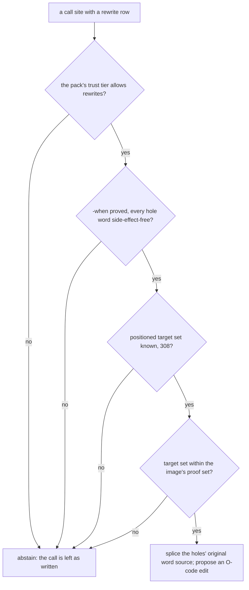
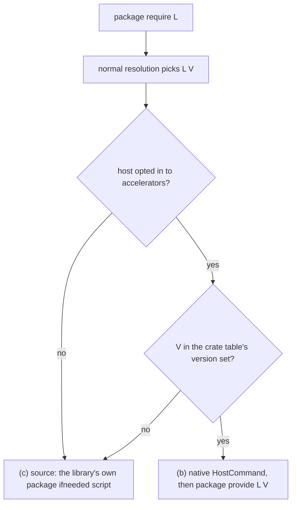
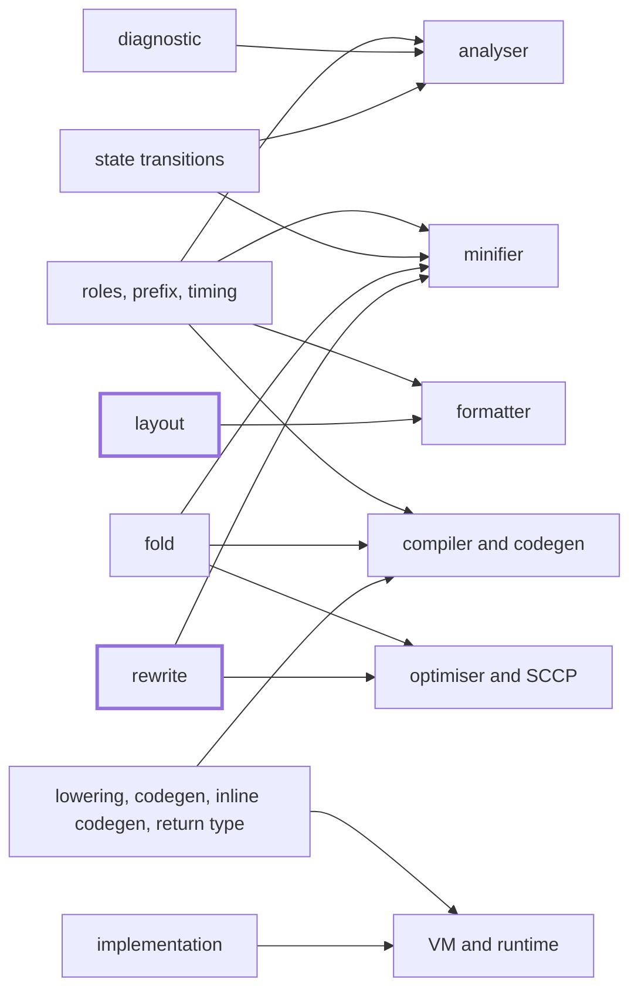

# Step 313 (proposed): SpecTcl facts and hooks for every consumer

Status: proposed 26 November 2026, as a new plan item 313. It builds on
[305](305-spectcl-3.md) (rungs, hook context, images), [306](306-expect-spike.md)
(the image format), [307](307-libraries-as-data.md) (library crates),
[308](308-positioned-context.md) (positioned versions) and item 311
([`TbcxUnit`](../../compiler/bytecode-image.md), tbcx format). The codegen rungs it extends are
[registry-consumer-contracts.md § Four rungs of codegen meeting
`.tclspec`](../../compiler/registry-consumer-contracts.md#four-rungs-of-codegen-meeting-tclspec).
Built on by the optimiser and formatter crate steps (items 284 and the
formatter's split) and by the owner's interactive examples page.

## Problem

A pack today speaks mostly to the analyser. The other consumers read the
registry in their own ways, and a pack cannot say what each needs.

| Consumer | How it reads the registry today | What a pack cannot say |
|---|---|---|
| Analyser | 13 pack hook families (`HookFamily`, `tcl-registry/src/pack_hooks.rs:96`), 32 `AnalyserHookId`s (`hooks.rs:374`) | — |
| Optimiser (`tcl-compiler/src/optimiser`, 9 `PassId`s, `mod.rs:641`) | static GVN needs `is_effect_free()` **and** `Traits::CSE_CANDIDATE` (`gvn.rs:753`); folds go through `const_subst.rs` (an `EvalRoute`, else `const_fold`/`const_fold_versioned`) | a rewrite; a fold proved per release; withholding hoisting from a pure but costly command |
| Minifier (`tcl-lsp-core/src/minify*`, 7,888 lines) | roles from the resolved invocation (`command_rendering.rs:81`), `case_list`, ten traits in `name_compaction.rs`; 12 typed `MinifyRefusal`s (`original.rs:64`) | that an option's value is a global variable name; that a literal is frozen; that a body's variables are bound by data |
| Formatter (`tcl-lsp-core/src/formatting`, 8,757 lines) | `ArgRole::{Body, Keyword, Expr}` (`engine/argument_roles.rs`), `ArgPresentation::{BlockScript, InlineScript}` (`presentation.rs:52`) | option/value pairs; preferred breaks; alignment. Long lines split greedily by nesting depth (`engine/line_wrapping.rs:178`) and may break between `-text` and its value |
| VM (`tcl-vm`) and `runtime/rust` | `CodegenHookId` (21), `InlineCodegenHookId` (32), `LoweringHookId` (26) are closed native sets; `RuntimeBacking` (`runtime_backing.rs:45`: shipped builtin, Tcl body, host native, none) behind the tier gate (`model/capability.rs:82`); `register_spec_builtin` attests intrinsic ids (`runtime/rust/src/interp/commands/registration.rs:180`) | a library's executable form; the library version a specialised site assumed |

`CSE_CANDIDATE` means two things. It gates reuse (`gvn.rs:753`) and it
asks for a redundancy diagnostic (`gvn.rs:555`, `is_worth_reporting`). The
mathop specs leave it off for the second reason (`mathop_generated.rs:114`),
which also turns off the first.

## Design

Every consumer reads the **same** argument-role, effect and binding facts
through `ResolvedInvocation`. Each consumer adds only the facts and hooks
that are specific to it. Everything below uses 305's grammar; new rows are
marked.

### 1. Optimiser

**Permissions derive from effects.** 2.x rows carry over: `side_effects`
and `effects -complete RANGE` (README "How completely the effects are
known"), now over a `LIB-RANGE`. A complete, empty effect list gives
`pure`. `effect-free` reads the world, and anything else is `impure`. The
permissions follow from that:

| Class | CSE | Hoist | Dead-call removal | Fold |
|---|---|---|---|---|
| pure | yes | yes | yes | if a fold route exists |
| effect-free | within a world-stable region | no | yes | no |
| impure | no | no | no | no |

A new `optimise -no {cse|hoist|dead-call}` row can only *withdraw* a
permission, for example from a pure call that is too costly to hoist out
of a cold branch. A pack cannot grant beyond its effects, so the effect
facts stay the single source of truth. `report redundant` (new) takes over
the diagnostic half of `CSE_CANDIDATE`, and the trait is retired.

**Folds.** `const_fold` takes the `dialect` key from 305's `ctx`, which
absorbs `const_fold_versioned`. It is literal-only
(`HookFamily::requires_all_literal`). The rungs are 3 (`-native`) and 4
(Tcl body), or the `evaluate` routes (value-evaluation.md). A body runs on
an engine pinned to each release in the target set (308). It folds only if
every release gives the same value, and otherwise it abstains.

**Rewrites (new family).** `rewrite ID -when PRED -to TEMPLATE` is rung 1:
the template is data, and its holes are `{arg N}`. A rewrite whose
replacement must be computed is `-native ID` (rung 3) or `-body` (rung 4,
tabulated when it reads only shape). The result protocol is `{replace
TEMPLATE}` or nothing. The optimiser splices each hole's *original word
source*, and it proposes the replacement as an O-code edit, as
`closed_consumer` proposals are proposed (`closed_consumer.rs:18`).

The path from a rewrite row to an applied edit, where every "no" is an
abstention:



**Safety: proof sets.** Every rewrite, and every fold body, carries
`-proof {RELEASES}`. `tcl spec prove` runs the pack's differential corpus
(the left side, the right side, and error cases) under each release's real
`tclsh`, and the image records the release set that passed. A consumer
applies the rewrite only when 308's positioned target set is a subset of
the proof set. An unknown target set abstains. The holes reorder
evaluation, so `-when` must prove every hole word side-effect-free (`kind …
var` or `literal`).

**Source:**

```spectcl
speclib tcllib-opt 3 {
command math::max {                       ;# tcllib math 1.2.6, misc.tcl:165
    available math 1.2-
    arity 1..
    side_effects none ; effects -complete {math 1.2-}
    const_fold -proof {core 8.5-9.1} -body {words ctx} {
        set m [lindex $words 0]
        foreach w $words {
            # decimal only: `08` is a string on 8.x and 8 on 9.x
            if {![regexp {^-?(0|[1-9][0-9]*)$} $w]} return
            if {$w > $m} { set m $w }
        }
        fold $m
    }
}
command {struct::set contains} {          ;# sets_tcl.tcl:78: expr {[lsearch -exact $set $item] >= 0}
    available struct::set 2.2-
    arity 2
    side_effects none ; effects -complete {struct::set 2.2-}
    rewrite set-contains-in -proof {core 8.5-9.1} \
        -when {all {kind {arg 0} var} {kind {arg 1} var}} \
        -to {expr {{arg 1} in {arg 0}}}
}
}
```

**In memory:**

```rust
// design sketch: types proposed in 302 and 313; hook and rewrite field names are illustrative
VersionedSpec {                                   // math::max
    availability: Availability { library: Some(LibraryId("math")), window: ItemHistory("1.2-"), dialect: None },
    arity: Facet { rows: &[(FacetKey::ANY, Arity::new(1, None))] },
    effects: Facet { rows: &[(FacetKey { library: VersionSet("math 1.2-"), dialect: None }, EffectSet::complete(&[]))] },  // pure
    ..
}
Hook {
    family: HookFamily::Fold,                     // const_fold
    body: HookBody::Tcl { params: "words ctx", source: .. },
    proof: ProofSet(VersionSet("core 8.5-9.1")),  // the image's PROOFS row: what `tcl spec prove` passed
}
VersionedSpec {                                   // struct::set contains
    availability: Availability { library: Some(LibraryId("struct::set")), window: ItemHistory("2.2-"), dialect: None },
    arity: Facet { rows: &[(FacetKey::ANY, Arity::new(2, 2))] },
    effects: Facet { rows: &[(FacetKey { library: VersionSet("struct::set 2.2-"), dialect: None }, EffectSet::complete(&[]))] },
    ..
}
Rewrite {
    id: "set-contains-in",
    when: Pred::All(&[Kind(Word::Arg(0), Var), Kind(Word::Arg(1), Var)]),
    to: Template("expr {{arg 1} in {arg 0}}"),    // holes take each word's original source
    proof: ProofSet(VersionSet("core 8.5-9.1")),
}
```

With that pack, over the target set `core 8.6-9.0`:

**Before:**

```tcl
set limit [math::max 3 7 5]
set odd   [math::max 08 3]
set hit   [struct::set contains $seen $k]
```

**After:**

```tcl
set limit 7
set odd   [math::max 08 3]
set hit   [expr {$k in $seen}]
```

**Bytecode before (tclsh 9.1.0):**

```text
ByteCode
  Source "set limit [math::max 3 7 5]\nset odd   [math::max 08 3]..."
  Cmds 6, src 97, inst 111, litObjs 12, aux 0, stkDepth 5, code/src 0.00
  Commands 6:
      1: pc 0-31, src 0-26        2: pc 5-29, src 11-25
      3: pc 32-67, src 28-53        4: pc 46-65, src 39-52
      5: pc 68-109, src 55-95        6: pc 82-108, src 66-94
  Command 1: "set limit [math::max 3 7 5]..."
    (0) push 0 	# "limit"
  Command 2: "math::max 3 7 5..."
    (5) push 1 	# "math::max"
    (10) push 2 	# "3"
    (15) push 3 	# "7"
    (20) push 4 	# "5"
    (25) invokeStk 4 
    (30) storeStk 
    (31) pop 
  Command 3: "set odd   [math::max 08 3]..."
    (32) startCommand +35 1 	# next cmd at pc 67, 1 cmds start here
    (41) push 5 	# "odd"
  Command 4: "math::max 08 3..."
    (46) push 1 	# "math::max"
    (51) push 6 	# "08"
    (56) push 2 	# "3"
    (61) invokeStk 3 
    (66) storeStk 
    (67) pop 
  Command 5: "set hit   [struct::set contains $seen $k]..."
    (68) startCommand +42 1 	# next cmd at pc 110, 1 cmds start here
    (77) push 7 	# "hit"
  Command 6: "struct::set contains $seen $k..."
    (82) push 8 	# "struct::set"
    (87) push 9 	# "contains"
    (92) push 10 	# "seen"
    (97) loadStk 
    (98) push 11 	# "k"
    (103) loadStk 
    (104) invokeStk 4 
    (109) storeStk 
    (110) done 
```

**Bytecode after (tclsh 9.1.0):**

```text
ByteCode
  Source "set limit 7\nset odd   [math::max 08 3]\nset hit   [exp..."
  Cmds 5, src 70, inst 86, litObjs 9, aux 0, stkDepth 4, code/src 0.00
  Commands 5:
      1: pc 0-11, src 0-10        2: pc 12-47, src 12-37
      3: pc 26-45, src 23-36        4: pc 48-84, src 39-68
      5: pc 62-83, src 50-67
  Command 1: "set limit 7..."
    (0) push 0 	# "limit"
    (5) push 1 	# "7"
    (10) storeStk 
    (11) pop 
  Command 2: "set odd   [math::max 08 3]..."
    (12) startCommand +35 1 	# next cmd at pc 47, 1 cmds start here
    (21) push 2 	# "odd"
  Command 3: "math::max 08 3..."
    (26) push 3 	# "math::max"
    (31) push 4 	# "08"
    (36) push 5 	# "3"
    (41) invokeStk 3 
    (46) storeStk 
    (47) pop 
  Command 4: "set hit   [expr {$k in $seen}]..."
    (48) startCommand +37 1 	# next cmd at pc 85, 1 cmds start here
    (57) push 6 	# "hit"
  Command 5: "expr {$k in $seen}..."
    (62) startCommand +22 1 	# next cmd at pc 84, 1 cmds start here
    (71) push 7 	# "k"
    (76) loadStk 
    (77) push 8 	# "seen"
    (82) loadStk 
    (83) listIn 
    (84) storeStk 
    (85) done 
```

**Result:**

```text
$ cat run.tcl
lappend auto_path tmp/tcllib-2.0/modules
package require math; package require struct::set
set seen {a b c}; set k b
source [lindex $argv 0]
puts [list $limit $odd $hit]
$ tclsh8.5 run.tcl before.tcl
7 3 1
$ tclsh8.6 run.tcl before.tcl
7 3 1
$ tclsh9.0 run.tcl before.tcl
7 08 1
$ tclsh9.1 run.tcl before.tcl
7 08 1
$ ./target/debug/tclvm run.tcl before.tcl
7 08 1
$ tclsh8.5 run.tcl after.tcl
7 3 1
$ tclsh8.6 run.tcl after.tcl
7 3 1
$ tclsh9.0 run.tcl after.tcl
7 08 1
$ tclsh9.1 run.tcl after.tcl
7 08 1
$ ./target/debug/tclvm run.tcl after.tcl
7 08 1
```

The second line does not fold: `math::max 08 3` is 3 on 8.6 and 08 on 9.0
(tclsh 8.6.18 and 9.0.4, tcllib's math 1.2.6), so the body abstains on the
non-decimal word.

`struct::set contains` and `in` agree on members, on non-members, on `01`
against `1`, and on the error for a malformed list (`unmatched open brace
in list`). Both were checked on 8.5.19 to 9.1.0 and tclvm.

### 2. Minifier

**Name facts on roles.** The minifier reuses the analyser's roles. 313
adds three flags to `arg` and `option`:

| Flag | Meaning for renaming |
|---|---|
| `-scope local\|caller\|global\|namespace` on a `VarRead`/`VarWrite`/`VarCell`/`CommandName`/`NamespaceName` role | where the name resolves; a `global` or `caller` name is renamed only if the whole program is (`isolated`) |
| `-frozen` | the literal's bytes are data (SQL, a regexp, a key). Never rewritten, unquoted or re-escaped |
| `-binds-vars data` on a `Body` | the body's free variables are bound by run-time data (sqlite3 column names), so no variable read in the body is renamed |

An option's value takes `-value-role ROLE ?-scope S?` (Tk's `-textvariable`
names a global variable). A command whose name roles depend on other
words uses the `roles` family (`arg_role_resolver`). It is shared with the
analyser and tabulated when it reads only shape.

**Abstention is per name, not per file.** The minifier abstains for a name
when an unknown command, an expansion or a dynamic word in its scope could
spell that name, and it renames every other name in the scope. A pack is
*minifier-safe* when each of its commands declares complete roles for
every word (no `Value` that is secretly a name), every name role has a
`-scope`, and every hook it uses declares `-inputs`. `tcl spec check
--consumer minifier` reports the gaps. A missing fact costs a rename,
never correctness.

**Source:**

```spectcl
speclib tcllib-cmdline 3 {
command cmdline::getopt {                 ;# cmdline 1.5.3: upvar 1 on words 0, 2, 3
    available cmdline 1.5-
    arity 4
    arg 0 -role VarCell -scope caller ; arg 1 -role Value -frozen
    arg 2 -role VarWrite -scope caller ; arg 3 -role VarWrite -scope caller
}
}
```

**In memory:**

```rust
// design sketch: types proposed in 302 and 313
VersionedSpec {                                   // cmdline::getopt
    availability: Availability { library: Some(LibraryId("cmdline")), window: ItemHistory("1.5-"), dialect: None },
    arity: Facet { rows: &[(FacetKey::ANY, Arity::new(4, 4))] },
    roles: Facet { rows: &[(FacetKey::ANY, &[
        ArgRole::VarCell  { scope: Scope::Caller },       // args
        ArgRole::Value    { frozen: true },               // {v o.arg}
        ArgRole::VarWrite { scope: Scope::Caller },       // opt
        ArgRole::VarWrite { scope: Scope::Caller },       // val
    ])] },
    ..
}
```

With the pack, the compact tier gives:

**Before:**

```tcl
proc parse {args} {
    set flags {}
    while {[cmdline::getopt args {v o.arg} opt val] > 0} {
        lappend flags $opt $val
    }
    return [list $flags $args]
}
```

**After:**

```tcl
proc parse {args} {set a {};while {[cmdline::getopt args {v o.arg} b c]>0} {lappend a $b $c};return [list $a $args]}
```

**Bytecode before (tclsh 9.1.0):**

```text
ByteCode
  Source "\n    set flags {}\n    while {[cmdline::getopt args {v..."
  Cmds 6, src 146, inst 128, litObjs 7, aux 0, stkDepth 5, code/src 0.00
  Proc, refCt 1, args 1, compiled locals 4
      slot 0, scalar, arg, "args"
      slot 1, scalar, "flags"
      slot 2, scalar, "opt"
      slot 3, scalar, "val"
  Exception ranges 1, depth 1:
      0: level 0, loop, pc 25-53, continue 55, break 96
  Commands 6:
      1: pc 0-10, src 5-16        2: pc 11-101, src 22-113
      3: pc 25-53, src 85-107        4: pc 55-84, src 30-67
      5: pc 102-126, src 119-144        6: pc 111-125, src 127-143
  Command 1: "set flags {}..."
    (0) push 0 	# ""
    (5) storeScalar %v1 	# var "flags"
    (10) pop 
  Command 2: "while {[cmdline::getopt args {v o.arg} opt val] > 0} {\n..."
    (11) startCommand +90 1 	# next cmd at pc 101, 1 cmds start here
    (20) jump +35 	# pc 55
  Command 3: "lappend flags $opt $val..."
    (25) startCommand +29 1 	# next cmd at pc 54, 1 cmds start here
    (34) loadScalar %v2 	# var "opt"
    (39) loadScalar %v3 	# var "val"
    (44) list 2 
    (49) lappendList %v1 	# var "flags"
    (54) pop 
  Command 4: "cmdline::getopt args {v o.arg} opt val..."
    (55) push 1 	# "cmdline::getopt"
    (60) push 2 	# "args"
    (65) push 3 	# "v o.arg"
    (70) push 4 	# "opt"
    (75) push 5 	# "val"
    (80) invokeStk 5 
    (85) push 6 	# "0"
    (90) gt 
    (91) jumpTrue -66 	# pc 25
    (96) push 0 	# ""
    (101) pop 
  Command 5: "return [list $flags $args]..."
    (102) startCommand +25 2 	# next cmd at pc 127, 2 cmds start here
  Command 6: "list $flags $args..."
    (111) loadScalar %v1 	# var "flags"
    (116) loadScalar %v0 	# var "args"
    (121) list 2 
    (126) done 
    (127) done 
```

**Bytecode after (tclsh 9.1.0):**

```text
ByteCode
  Source "set a {};while {[cmdline::getopt args {v o.arg} b c]>0}..."
  Cmds 6, src 96, inst 128, litObjs 7, aux 0, stkDepth 5, code/src 0.00
  Proc, refCt 1, args 1, compiled locals 4
      slot 0, scalar, arg, "args"
      slot 1, scalar, "a"
      slot 2, scalar, "b"
      slot 3, scalar, "c"
  Exception ranges 1, depth 1:
      0: level 0, loop, pc 25-53, continue 55, break 96
  Commands 6:
      1: pc 0-10, src 0-7        2: pc 11-101, src 9-72
      3: pc 25-53, src 57-71        4: pc 55-84, src 17-50
      5: pc 102-126, src 74-95        6: pc 111-125, src 82-94
  Command 1: "set a {}..."
    (0) push 0 	# ""
    (5) storeScalar %v1 	# var "a"
    (10) pop 
  Command 2: "while {[cmdline::getopt args {v o.arg} b c]>0} {lappend..."
    (11) startCommand +90 1 	# next cmd at pc 101, 1 cmds start here
    (20) jump +35 	# pc 55
  Command 3: "lappend a $b $c..."
    (25) startCommand +29 1 	# next cmd at pc 54, 1 cmds start here
    (34) loadScalar %v2 	# var "b"
    (39) loadScalar %v3 	# var "c"
    (44) list 2 
    (49) lappendList %v1 	# var "a"
    (54) pop 
  Command 4: "cmdline::getopt args {v o.arg} b c..."
    (55) push 1 	# "cmdline::getopt"
    (60) push 2 	# "args"
    (65) push 3 	# "v o.arg"
    (70) push 4 	# "b"
    (75) push 5 	# "c"
    (80) invokeStk 5 
    (85) push 6 	# "0"
    (90) gt 
    (91) jumpTrue -66 	# pc 25
    (96) push 0 	# ""
    (101) pop 
  Command 5: "return [list $a $args]"
    (102) startCommand +25 2 	# next cmd at pc 127, 2 cmds start here
  Command 6: "list $a $args..."
    (111) loadScalar %v1 	# var "a"
    (116) loadScalar %v0 	# var "args"
    (121) list 2 
    (126) done 
    (127) done 
```

**Result:**

```text
$ cat run.tcl
lappend auto_path tmp/tcllib-2.0/modules
package require cmdline
source [lindex $argv 0]
puts [parse -v -o out.txt input.tcl]
$ tclsh8.5 run.tcl before.tcl
{v 1 o out.txt} input.tcl
$ tclsh8.6 run.tcl before.tcl
{v 1 o out.txt} input.tcl
$ tclsh9.0 run.tcl before.tcl
{v 1 o out.txt} input.tcl
$ tclsh9.1 run.tcl before.tcl
{v 1 o out.txt} input.tcl
$ ./target/debug/tclvm run.tcl before.tcl
{v 1 o out.txt} input.tcl
$ tclsh8.5 run.tcl after.tcl
{v 1 o out.txt} input.tcl
$ tclsh8.6 run.tcl after.tcl
{v 1 o out.txt} input.tcl
$ tclsh9.0 run.tcl after.tcl
{v 1 o out.txt} input.tcl
$ tclsh9.1 run.tcl after.tcl
{v 1 o out.txt} input.tcl
$ ./target/debug/tclvm run.tcl after.tcl
{v 1 o out.txt} input.tcl
$ cat nopack.tcl
proc parse {args} {set a {};while {[cmdline::getopt args {v o.arg} opt val]>0} {lappend a $opt $val};return [list $a $args]}
$ tclsh8.6 run.tcl nopack.tcl
{v 1 o out.txt} input.tcl
$ tclsh9.1 run.tcl nopack.tcl
{v 1 o out.txt} input.tcl
$ cat blind.tcl
proc parse {args} {set a {};while {[cmdline::getopt args {v o.arg} opt val]>0} {lappend a $b $c};return [list $a $args]}
$ tclsh8.6 run.tcl blind.tcl
can't read "b": no such variable
$ tclsh9.1 run.tcl blind.tcl
can't read "b": no such variable
```

Without the pack, `opt` and `val` are literals of an unknown command, so
those two names keep their spelling and only `flags` becomes `a`. Renaming
them blindly gives `can't read "b": no such variable`. The forms were run on
8.5 to 9.1 and tclvm: the safe forms print `{v 1 o out.txt} input.tcl`. `args`
is never renamed.

### 3. Formatter

**Layout facts (new `layout` block).** `clause_grammar`, `Body` roles and
`-layout BlockScript|InlineScript` stay as they are. The new rows are:

```text
layout-row := 'lead' N                        ; words that stay on the command line
            | 'pairs' ('options'|FROM)        ; never break inside a pair
            | 'break' ('fit'|'each'|'never')  ; once the line exceeds max_line_length
            | 'align' ('options'|FROM)        ; pad the first word of each pair to one width
            | 'clause' ROW '-break' ('before'|'never')   ; per clause_grammar row
```

**Layout hook (new family).** `layout -body {words ctx}` emits `break-before
I`, `keep I` and `group FROM TO`. It may only choose among separator
positions (`source_layout::separator_spaces`), so it cannot touch word text.
A hook that reads only shape is tabulated. One that reads `values` is
memoised by content.

**Meaning and idempotence.** Every edit replaces separator whitespace
between two words with whitespace or with `\`-newline plus indent, which
Tcl reads as one separator. The formatter checks that the word sequence is
unchanged and that `format(format(x)) == format(x)`. If a layout answer
would fail either check, the formatter falls back to today's greedy split.

**Source:**

```spectcl
speclib tk-layout 3 {
command ttk::button {
    available Tk 8.5-
    layout { lead 1 ; pairs options ; break each ; align options }
}
command exec {
    layout -inputs {kinds values} -body {words ctx} {
        set i 0
        foreach w $words {
            if {[lindex [dict get $ctx kinds] $i] eq "literal" && $w in {| |&}} { break-before $i }
            incr i
        }
    }
}
}
```

**In memory:**

```rust
// design sketch: types proposed in 302 and 313; layout field names are illustrative
VersionedSpec {                                   // ttk::button
    availability: Availability { library: Some(LibraryId("Tk")), window: ItemHistory("8.5-"), dialect: None },
    layout: Layout { lead: 1, pairs: Pairs::Options, breaks: Break::Each, align: Align::Options },
    ..
}
VersionedSpec {                                   // exec
    layout: Layout::Hook(Hook {
        family: HookFamily::Layout,
        inputs: Inputs { kinds: true, values: true, .. },   // reads values: memoised by content, not tabulated
        body: HookBody::Tcl { params: "words ctx", source: .. },
        ..
    }),
    ..
}
```

With `max_line_length` 60, the formatter gives:

**Before:**

```tcl
ttk::button .b -text "Save file" -command [list save $path] -width 12 -style Accent.TButton
exec grep -v {^#} config.txt | sort -u | awk {{print $1}} > out.txt
```

**After:**

```tcl
ttk::button .b \
    -text    "Save file" \
    -command [list save $path] \
    -width   12 \
    -style   Accent.TButton
exec grep -v {^#} config.txt \
    | sort -u \
    | awk {{print $1}} > out.txt
```

**Bytecode after (tclsh 9.1.0):**

```text
ByteCode
  Source "ttk::button .b \\n    -text    \"Save file\" \\n    -co..."
  Cmds 3, src 203, inst 147, litObjs 23, aux 0, stkDepth 13, code/src 0.00
  Commands 3:
      1: pc 0-75, src 0-121        2: pc 25-49, src 58-72
      3: pc 76-145, src 123-201
  Command 1: "ttk::button .b \\n    -text    \"Save file\" \\n    -co..."
    (0) push 0 	# "ttk::button"
    (5) push 1 	# ".b"
    (10) push 2 	# "-text"
    (15) push 3 	# "Save file"
    (20) push 4 	# "-command"
  Command 2: "list save $path..."
    (25) startCommand +25 1 	# next cmd at pc 50, 1 cmds start here
    (34) push 5 	# "save"
    (39) push 6 	# "path"
    (44) loadStk 
    (45) list 2 
    (50) push 7 	# "-width"
    (55) push 8 	# "12"
    (60) push 9 	# "-style"
    (65) push 10 	# "Accent.TButton"
    (70) invokeStk 10 
    (75) pop 
  Command 3: "exec grep -v {^#} config.txt \\n    | sort -u \\n    | ..."
    (76) push 11 	# "exec"
    (81) push 12 	# "grep"
    (86) push 13 	# "-v"
    (91) push 14 	# "^#"
    (96) push 15 	# "config.txt"
    (101) push 16 	# "|"
    (106) push 17 	# "sort"
    (111) push 18 	# "-u"
    (116) push 16 	# "|"
    (121) push 19 	# "awk"
    (126) push 20 	# "{print $1}"
    (131) push 21 	# ">"
    (136) push 22 	# "out.txt"
    (141) invokeStk 13 
    (146) done 
```

**Result:**

```text
$ cat run.tcl
package require Tk
proc save {p} {}; set path notes.txt
source [lindex $argv 0]
puts [list [.b cget -text] [.b cget -command] [.b cget -width] [.b cget -style]]
set f [open out.txt]; puts [read -nonewline $f]; close $f
exit
$ cat config.txt
# hosts
zeta 1
alpha 2
zeta 1
$ TCLLIBPATH=$PWD/tk86 xvfb-run -a tclsh8.6 run.tcl before.tcl
{Save file} {save notes.txt} 12 Accent.TButton
alpha
zeta
$ TCLLIBPATH=$PWD/tk91 xvfb-run -a tclsh9.1 run.tcl before.tcl
{Save file} {save notes.txt} 12 Accent.TButton
alpha
zeta
$ TCLLIBPATH=$PWD/tk86 xvfb-run -a tclsh8.6 run.tcl after.tcl
{Save file} {save notes.txt} 12 Accent.TButton
alpha
zeta
$ TCLLIBPATH=$PWD/tk91 xvfb-run -a tclsh9.1 run.tcl after.tcl
{Save file} {save notes.txt} 12 Accent.TButton
alpha
zeta
```

The `exec` words are identical before and after (`[list …] eq [list …]` is
1 on 8.4 to 9.1 and tclvm). The Before form compiles to the same
instructions; only the Source and command text in the listing differ. The
Result runs use the Tk 8.6.18 and 9.1.0 builds under `tmp/`, loaded by a
`pkgIndex.tcl` on `TCLLIBPATH`; tclvm has no Tk.

### 4. The VM and the runtime

**Decision: (c) by default, (b) for trusted accelerators, and not (a).**

- **(c) Execution stays with the library's own source.** The VM resolves
  `package require` through its own `package ifneeded` and `auto_path`
  (`tcl-vm/src/cmd_package.rs`), and it runs tcllib as tcllib ships. This
  is the only option with no second source of truth. It also keeps
  `info body`, `info procs` and the library's own bugs, which is what
  scripts observe. The existing `runtime_backing tcl-body {-package-source
  PATH}` already points the codegen rung 3 at that source.
- **(b) Native accelerators by ID.** Rust implementations live in the
  library's accelerator crate (`tcl-lib-<pkg>-accel`, over `tcl-engine-api`),
  keyed by `NativeImplId`, never in the library crate and never behind a
  cargo feature: a `runtime` feature on a library crate would be unified on
  in every build that links the catalogue, and put `tcl-engine-api` under it.
  Engine entry points that opt in link it by name; the catalogue and the
  library crate never do ([334](334-spectcl-codegen-vm-runtime.md) §3).
  Each is a `HostCommand`
  defined through `tcl_engine_api::Engine::define_command`, the interface
  the C shim uses, so tclvm, `runtime/rust` (`RuntimeEngine`) and WASM all
  get it. The pack writes `implementation -native ID -versions {L RANGE}`.
  The crate's table keys each ID to its command name and the upstream
  versions it reproduces, and a mismatch is refused at load. An
  accelerator **never wins version selection**. After normal resolution
  picks `L V`, the host replaces that version's load script only when V is
  in the table's set. It is opt-in by host configuration, because
  `info procs` differs from C Tcl, as tcllib's own critcl accelerators also
  make it differ.
- **(a) is rejected as an implementation source.** A Tcl body in the pack is
  a copy of the library that drifts from it silently. `BodySource::PackText`
  already says so (`runtime_backing.rs:152`), and its use stays limited to
  the workspace's own package as a reference body (`capability.rs:84`). What
  survives of (a) is a **cache**: an image may carry a `TbcxUnit` (item 311,
  tbcx format) for the library's real source, keyed by that source's
  hash. A stale hash falls back to source, the way 306's images do.

How a host picks a library's executable form:



**Who `runtime_backing` reports.** An accelerated library command's backing
owner is the library's own source (`TclBody { PackageSource }`), which is
what runs when the host has not opted in. `command-backing` and the WASM
parity invariant hold core commands to `runtime/rust` and `tcl-vm`; the
backing reports list linked accelerators in their own section, and an
accelerator is never a command's backing (334 §3).

**Facts the VM uses.** These are pure and effect classes (folding at
compile time and dead-call removal), `alias_of` (rung 2),
`semantic_operation {Intrinsic …}` (guards and specialisation) and
`runtime_backing` (identity kind). `PackFactStamp` (`tcl-runtime-api`)
gains `library_versions`, the set the site's facet was selected for. At
admission the VM checks `package present L` against that set, and a
mismatch takes the generic path.

**Source:**

```spectcl
speclib tcllib-run 3 {
library md5 { versions 2.0.7 2.0.8 2.0.9 }
command md5::md5 {
    available md5 2-
    arity 1..
    option -hex ; option -file -takes filename ; option -channel -takes channel
    ;# no `side_effects none`: -file and -channel read the world
    runtime_backing tcl-body {-package-source md5x.tcl}
    implementation -native tcllib.md5.v2 -versions {md5 2.0.9}
}
}
```

**In memory:**

```rust
// design sketch: types proposed in 302 and 313
Library {
    id: LibraryId("md5"),
    trains: &[Train { name: "2", versions: VersionSet("2-3"), latest: Version("2.0.9") }],  // trains inferred by major
    ..
}
VersionedSpec {                                   // md5::md5
    availability: Availability { library: Some(LibraryId("md5")), window: ItemHistory("2-"), dialect: None },
    arity: Facet { rows: &[(FacetKey::ANY, Arity::new(1, None))] },
    options: Facet { rows: &[(FacetKey::ANY, &[OptionId("-hex"), OptionId("-file"), OptionId("-channel")])] },
    effects: Facet::EMPTY,                        // no complete effect list: impure, no fold, no CSE
    ..
}
RuntimeBacking::TclBody { package_source: "md5x.tcl" }
Implementation { native: NativeId("tcllib.md5.v2"), versions: VersionSet("md5 2.0.9") }   // IMPLEMENTATIONS row
```

**Source:**

```tcl
puts [package require md5]     ;# 2.0.9 from tcllib's pkgIndex, in every mode
puts [md5::md5 -hex abc]       ;# 900150983CD24FB0D6963F7D28E17F72
package require math
puts [math::max 3 7 5]         ;# 7; with the pack, compiled to `push 7` under a PackFacts claim
```

**Bytecode (tclsh 9.1.0):**

```text
ByteCode
  Source "puts [package require md5]     ;# 2.0.9 from tcllib's p..."
  Cmds 7, src 263, inst 119, litObjs 12, aux 0, stkDepth 5, code/src 0.00
  Commands 7:
      1: pc 0-30, src 0-30        2: pc 5-24, src 6-24
      3: pc 31-61, src 78-108        4: pc 36-55, src 84-100
      5: pc 62-82, src 145-164        6: pc 83-117, src 166-196
      7: pc 88-112, src 172-186
  Command 1: "puts [package require md5]     ..."
    (0) push 0 	# "puts"
  Command 2: "package require md5..."
    (5) push 1 	# "package"
    (10) push 2 	# "require"
    (15) push 3 	# "md5"
    (20) invokeStk 3 
    (25) invokeStk 2 
    (30) pop 
  Command 3: "puts [md5::md5 -hex abc]       ..."
    (31) push 0 	# "puts"
  Command 4: "md5::md5 -hex abc..."
    (36) push 4 	# "md5::md5"
    (41) push 5 	# "-hex"
    (46) push 6 	# "abc"
    (51) invokeStk 3 
    (56) invokeStk 2 
    (61) pop 
  Command 5: "package require math..."
    (62) push 1 	# "package"
    (67) push 2 	# "require"
    (72) push 7 	# "math"
    (77) invokeStk 3 
    (82) pop 
  Command 6: "puts [math::max 3 7 5]         ..."
    (83) push 0 	# "puts"
  Command 7: "math::max 3 7 5..."
    (88) push 8 	# "math::max"
    (93) push 9 	# "3"
    (98) push 10 	# "7"
    (103) push 11 	# "5"
    (108) invokeStk 4 
    (113) invokeStk 2 
    (118) done 
```

**Result:**

```text
$ cat run.tcl
lappend auto_path tmp/tcllib-2.0/modules
source [lindex $argv 0]
$ tclsh8.5 run.tcl md5.tcl
2.0.9
900150983CD24FB0D6963F7D28E17F72
7
$ tclsh8.6 run.tcl md5.tcl
2.0.9
900150983CD24FB0D6963F7D28E17F72
7
$ tclsh9.0 run.tcl md5.tcl
2.0.9
900150983CD24FB0D6963F7D28E17F72
7
$ tclsh9.1 run.tcl md5.tcl
2.0.9
900150983CD24FB0D6963F7D28E17F72
7
$ ./target/debug/tclvm run.tcl md5.tcl
2.0.9
900150983CD24FB0D6963F7D28E17F72
7
```

With accelerators off (the default), `package ifneeded md5 2.0.9` is
tcllib's `source …/md5x.tcl`. With them on, the host's load script defines
the native command and runs `package provide md5 2.0.9`. If the disk
holds 2.0.10, it loads from source, because 2.0.10 is not in the table.

**Trust tiers** (`TrustTier`, today's `Provenance` in `tcl-dialect/src/model/environment.rs:259`;
the `DependencyTier` gate in `capability.rs` still applies on top):

| Trust tier | Facts, `check` | `-native` refs | Tcl hook bodies | `rewrite` | Native implementations |
|---|---|---|---|---|---|
| BuiltIn, BundledPack | yes | yes | yes | yes | yes, if the host opts in |
| User, WorkspaceTrusted | yes | yes, to compiled-in IDs | sandboxed | templates and native only | no |
| WorkspaceUntrusted, inline stub | yes | dormant | dormant | no | no |

A StudioOverride takes the row of the workspace it edits.

### 5. One hook model

| Family | Consumers | Inputs (305 `ctx`) | Result protocol | Rungs | Tabulated | Crates |
|---|---|---|---|---|---|---|
| roles (`arg_role_resolver`), prefix, timing | analyser, minifier, formatter, codegen | kinds, argc, options | `role I R` / `prefix` / `timing` | 1, 3, 4 | when shape-only | `tcl-registry`, `tcl-spec-hooks` |
| diagnostic (`check`, validators, `constraints`, `context_gate`) | analyser | full ctx | 305's diagnostic list | 1, 2, 3, 4 | `check` is data | registry core |
| state transitions | analyser, minifier | words, kinds | `alias`, `namespace-variable` | 1, 3, 4 | when shape-only | registry core |
| fold (`const_fold`, `evaluate`) | optimiser, SCCP, codegen, aggressive minify | literal words, dialect | `fold V` | 3, 4, evaluate routes | no; memoised by content | `tcl-registry::value_transfer`, `const_subst` |
| rewrite (new) | optimiser, aggressive minify | kinds, argc, options, target set | `replace TEMPLATE` | 1, 3, 4 | when shape-only | `tcl-optimiser` (item 284) |
| layout (new) | formatter | kinds, argc, options, values | `break-before`, `keep`, `group` | 1, 3, 4 | when shape-only | formatting crate |
| lowering, codegen, inline codegen, return type | compiler, VM | native | Rust | 3 only (closed sets) | n/a | `tcl-codegen`, registry |
| implementation | VM, runtime | `&[Value]` | Tcl completion | (c) source, (b) native | n/a | the library's accelerator crate (`tcl-lib-<pkg>-accel`, over `tcl-engine-api`), linked by engine entry points; never a feature of the library crate |

The same table as a graph, from family to consumer. The two new families
are marked:



All families share one convention: `{words ctx}`, fuel, isolation per pack,
and quarantine (spec-packs.md). An error, a blown budget, no answer or an
uncovered proof set is an **abstention**. What an abstention means is the
family's polarity, fixed per family in the core (chapter 5 of the
specification, *Result protocols*): no fold, no rewrite, no rename and no
reflow for these families; `Opaque` for roles; nothing emitted for
diagnostics. The taint sink gate is no longer a hook family: it is 393's
`SinkWhen` predicate (rung 2), under which an unknown leaves the sink in
force.

**Images** (306, extended):

| Section | Contents |
|---|---|
| `SPECS`/`FACETS` | facts, including the new flags and `optimise -no` |
| `RULES` | `check` trees, rewrite templates, `layout` rows |
| `TABLES` (was `ROLE_TABLES`) | tabulated answers, tagged by family |
| `HOOKS` | `(family u16, native_id u32 \| body_id u32, inputs)` |
| `BODIES` (new) | Tcl hook bodies as `TbcxUnit` (311, tbcx format), with source kept for the hash and the fallback |
| `IMPLEMENTATIONS` (new) | `(command, backing kind, native id or package path, version set)` |
| `PROOFS` (new) | per rewrite and fold body: the release set that passed, and the corpus hash |

### Decisions

1. **One role source.** The minifier, formatter and optimiser take roles
   only from `ResolvedInvocation`, the analyser's answer. That rules out
   any consumer-local role table.
2. **Permissions only narrow.** Effects grant; `optimise -no` withdraws.
3. **Rewrites are templates over original words,** proved per release.
   They are not raw text.
4. **Layout chooses breaks, never words.**
5. **(c), then (b), never (a)** for execution, for the reasons above.
6. **`CSE_CANDIDATE` splits** into the derived permission and
   `report redundant`.

### Open questions

All three are now settled by the owner decisions at the end of this
document.

- **Do rewrites from User packs ship on by default?** Yes, when the proof set
  covers the target set. The false-rewrite rate is still measured.
- **One `hook_abi` or one per consumer table?** One for all consumers.
- **Do accelerators go in the editor binaries, or only `tclvm`?** They may
  ship in the editor binaries, opt-in per host.

## Work list

1. Registry core: the `optimise`, `report`, `-scope`, `-frozen`,
   `-binds-vars`, `-value-role`, `layout`, `rewrite` and `implementation`
   rows. Add `HookFamily::{Rewrite, Layout}`, and merge `ConstFoldVersioned`
   into `ConstFold`.
2. `tcl-spectcl` reader3 and image: `RULES`, `TABLES`, `BODIES`,
   `IMPLEMENTATIONS` and `PROOFS`; add `tcl spec prove` and `tcl spec check
   --consumer`.
3. Optimiser: permissions from effects (`gvn.rs:753`), proof-set gating
   with 308, and the rewrite O-code (`docs/generated/optimisation_codes.md`).
4. Minifier: per-name abstention, and the scope and frozen facts in
   `name_compaction.rs`.
5. Formatter: layout rows and the hook, as an alternative to `greedy_split`
   (`line_wrapping.rs:117`), with the word-sequence and idempotence checks.
6. VM and runtime: `PackFactStamp::library_versions`, the accelerator load
   script, and the opt-in flag on `tclvm` and the hosts.
7. Packs: the examples above as conformance fixtures.

## Verification

- **Done when:** each example in this document is a green conformance row
  on 8.6 and 9.0 (the fold, the abstaining fold, the rewrite, both minify
  outputs, both formats, md5 in both accelerator modes). Further:
  - A rewrite whose proof set misses the target set abstains (a row).
  - `rg 'arg_roles|ArgRole::' rust/tcl-lsp-core/src/{minify,formatting}` finds
    reads only through the resolved invocation.
  - The formatter is idempotent over the conformance corpus.
  - Minified and original corpus scripts print the same output under
    `tclsh` 8.6 and 9.0.
  - `CSE_CANDIDATE` is gone from `traits.rs`.
- **Measurements:**
  - image size growth from `BODIES` and `PROOFS`;
  - formatter latency with layout hooks on a 2,000-line file;
  - VM time for md5 with the accelerator against source;
  - the build cone of `tcl-catalogue` (it must not contain `tcl-engine-api`)
    and of `tclvm` with `tcl-lib-tcllib-accel`.

## Risks

- **Proof corpora are thin.** A passing corpus is evidence, not proof.
  Mitigation: proofs include error cases, a rewrite applies only where its
  proof set covers the positioned target set, and the harness's
  false-rewrite rate is measured and reported.
- **Accelerators diverge.** Mitigation: they are pinned to exact versions,
  opt-in, and run through the fuzzer's differential mode (`tcl-fuzz`)
  against the source library.
- **Layout hooks slow formatting.** Mitigation: tabulation, and a per-call
  budget that falls back to the greedy split.

## Corrections to 305, 306 and 307

- **305** said "Only the hook runner (rung 3) links `tcl-vm`". Tcl bodies
  are rung 4, and rung 3 is native. 305 now says rung 4.
- **305's `kinds` words** (`literal var command script expand`) differ from
  the shipped vocabulary (`literal known-bytes dynamic expanded opaque`,
  `pack_hooks/hook_inputs.rs:194`). 3 needs one set. The rewrite `-when`
  needs to tell `var` from `command`.
- **305's protocol table** needs `rewrite` and `layout`. Its shim table
  should list `runtime_backing`, `alias_of`, `semantic_operation`, `traits`,
  `side_effects` and `effects` as unchanged rows. `const_fold_versioned`
  folds into `const_fold`.
- **306's `HOOKS` section** stores source for lack of a serialiser, but item
  311 now supplies `TbcxUnit` (tbcx format). Add `BODIES`, `IMPLEMENTATIONS` and `PROOFS`,
  and rename `ROLE_TABLES` to `TABLES` with a family tag.
- **307:** a library crate holds an image and hooks only; native
  accelerators live in a separate accelerator crate that engine entry points
  link ([334](334-spectcl-codegen-vm-runtime.md) §3).

## Owner decisions (26 November 2026)

- **Proved rewrites from user packs are on by default.** A rewrite from any trust tier that allows rewrites applies when its proof set covers the positioned target set. The proof harness's false-rewrite rate is still measured and reported.

- **Native accelerators can ship,** including in the editor binaries. They
  stay opt-in per host configuration, and still never win version selection.
- **One hook ABI version for all consumers.** Every native hook table in an
  image carries the same `hook_abi` number, so a change to any consumer's
  calling convention bumps it once and the images regenerate. That costs one
  image rebuild, and images rebuild on every build anyway.

## Review fixes (26 November 2026)

- **A8:** the abstention paragraph gives each family its polarity and moves the sink gate to 393's `SinkWhen` predicate.

## Review fixes (26 November 2026, deep review)

- **O16 (with the engine fixer's 334 §3):** accelerators live in a per-library accelerator crate (`tcl-lib-<pkg>-accel`), linked by named engine entry crates, never behind a `runtime` feature on a library crate; *Who `runtime_backing` reports* names the library's source as the backing owner. The table row, the measurement and the 307 correction follow.
- **M11:** the trust table says `TrustTier`.
