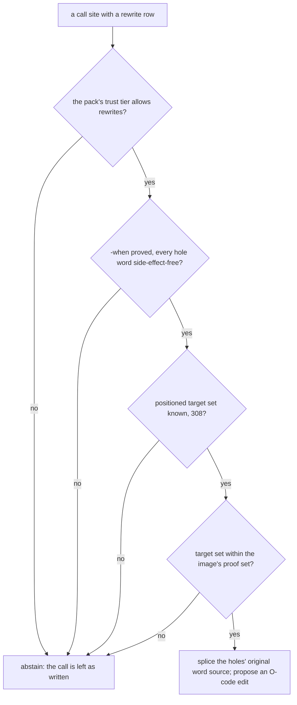
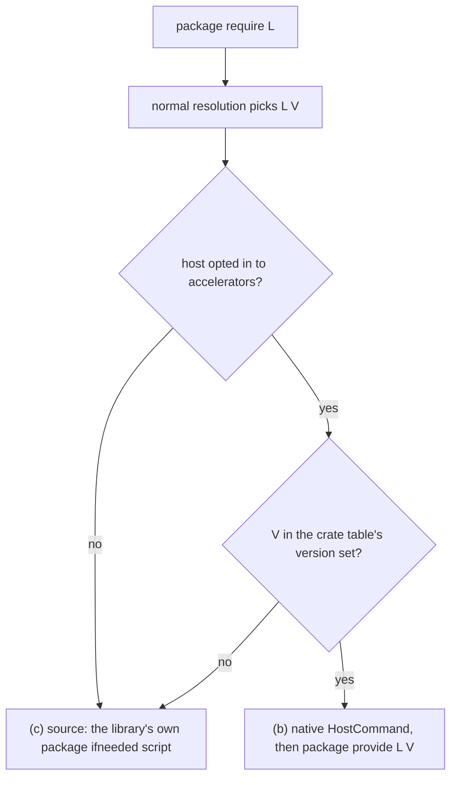
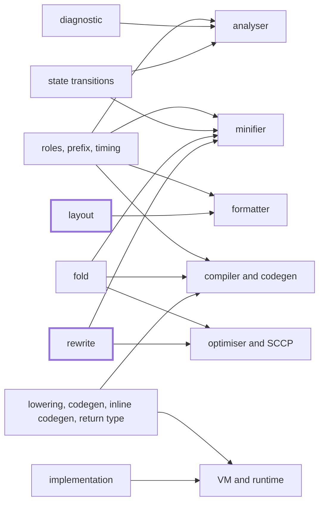

# Step 313 (proposed): SpecTcl facts and hooks for every consumer

Status: proposed 26 November 2026, as a new plan item 313. It builds on
[305](305-spectcl-3.md) (rungs, hook context, images), [306](306-expect-spike.md)
(the image format), [307](307-libraries-as-data.md) (library crates),
[308](308-positioned-context.md) (positioned versions) and item 311
([`TbcxUnit`](../../compiler/bytecode-image.md), tbcx format). The codegen rungs it extends are
[registry-consumer-contracts.md § Four rungs of codegen meeting
`.tclspec`](../../compiler/registry-consumer-contracts.md#four-rungs-of-codegen-meeting-tclspec).
Built on by the optimiser and formatter crate steps (items 284 and the
formatter's split) and by the owner's interactive examples page.

## Problem

A pack today speaks mostly to the analyser. The other consumers read the
registry in their own ways, and a pack cannot say what each needs.

| Consumer | How it reads the registry today | What a pack cannot say |
|---|---|---|
| Analyser | 13 pack hook families (`HookFamily`, `tcl-registry/src/pack_hooks.rs:96`), 32 `AnalyserHookId`s (`hooks.rs:374`) | — |
| Optimiser (`tcl-compiler/src/optimiser`, 9 `PassId`s, `mod.rs:641`) | static GVN needs `is_effect_free()` **and** `Traits::CSE_CANDIDATE` (`gvn.rs:753`); folds go through `const_subst.rs` (an `EvalRoute`, else `const_fold`/`const_fold_versioned`) | a rewrite; a fold proved per release; withholding hoisting from a pure but costly command |
| Minifier (`tcl-lsp-core/src/minify*`, 7,888 lines) | roles from the resolved invocation (`command_rendering.rs:81`), `case_list`, ten traits in `name_compaction.rs`; 12 typed `MinifyRefusal`s (`original.rs:64`) | that an option's value is a global variable name; that a literal is frozen; that a body's variables are bound by data |
| Formatter (`tcl-lsp-core/src/formatting`, 8,757 lines) | `ArgRole::{Body, Keyword, Expr}` (`engine/argument_roles.rs`), `ArgPresentation::{BlockScript, InlineScript}` (`presentation.rs:52`) | option/value pairs; preferred breaks; alignment. Long lines split greedily by nesting depth (`engine/line_wrapping.rs:178`) and may break between `-text` and its value |
| VM (`tcl-vm`) and `runtime/rust` | `CodegenHookId` (21), `InlineCodegenHookId` (32), `LoweringHookId` (26) are closed native sets; `RuntimeBacking` (`runtime_backing.rs:45`: shipped builtin, Tcl body, host native, none) behind the tier gate (`model/capability.rs:82`); `register_spec_builtin` attests intrinsic ids (`runtime/rust/src/interp/commands/registration.rs:180`) | a library's executable form; the library version a specialised site assumed |

`CSE_CANDIDATE` means two things. It gates reuse (`gvn.rs:753`) and it
asks for a redundancy diagnostic (`gvn.rs:555`, `is_worth_reporting`). The
mathop specs leave it off for the second reason (`mathop_generated.rs:114`),
which also turns off the first.

## Design

Every consumer reads the **same** argument-role, effect and binding facts
through `ResolvedInvocation`. Each consumer adds only the facts and hooks
that are specific to it. Everything below uses 305's grammar; new rows are
marked.

### 1. Optimiser

**Permissions derive from effects.** 2.x rows carry over: `side_effects`
and `effects -complete RANGE` (README "How completely the effects are
known"), now over a `LIB-RANGE`. A complete, empty effect list gives
`pure`. `effect-free` reads the world, and anything else is `impure`. The
permissions follow from that:

| Class | CSE | Hoist | Dead-call removal | Fold |
|---|---|---|---|---|
| pure | yes | yes | yes | if a fold route exists |
| effect-free | within a world-stable region | no | yes | no |
| impure | no | no | no | no |

A new `optimise -no {cse|hoist|dead-call}` row can only *withdraw* a
permission, for example from a pure call that is too costly to hoist out
of a cold branch. A pack cannot grant beyond its effects, so the effect
facts stay the single source of truth. `report redundant` (new) takes over
the diagnostic half of `CSE_CANDIDATE`, and the trait is retired.

**Folds.** `const_fold` takes the `dialect` key from 305's `ctx`, which
absorbs `const_fold_versioned`. It is literal-only
(`HookFamily::requires_all_literal`). The rungs are 3 (`-native`) and 4
(Tcl body), or the `evaluate` routes (value-evaluation.md). A body runs on
an engine pinned to each release in the target set (308). It folds only if
every release gives the same value, and otherwise it abstains.

**Rewrites (new family).** `rewrite ID -when PRED -to TEMPLATE` is rung 1:
the template is data, and its holes are `{arg N}`. A rewrite whose
replacement must be computed is `-native ID` (rung 3) or `-body` (rung 4,
tabulated when it reads only shape). The result protocol is `{replace
TEMPLATE}` or nothing. The optimiser splices each hole's *original word
source*, and it proposes the replacement as an O-code edit, as
`closed_consumer` proposals are proposed (`closed_consumer.rs:18`).

The path from a rewrite row to an applied edit, where every "no" is an
abstention:



**Safety: proof sets.** Every rewrite, and every fold body, carries
`-proof {RELEASES}`. `tcl spec prove` runs the pack's differential corpus
(the left side, the right side, and error cases) under each release's real
`tclsh`, and the image records the release set that passed. A consumer
applies the rewrite only when 308's positioned target set is a subset of
the proof set. An unknown target set abstains. The holes reorder
evaluation, so `-when` must prove every hole word side-effect-free (`kind …
var` or `literal`).

```tcl
speclib tcllib-opt 3 {
command math::max {                       ;# tcllib math 1.2.6, misc.tcl:165
    available math 1.2-
    arity 1..
    side_effects none ; effects -complete {math 1.2-}
    const_fold -proof {core 8.5-9.1} -body {words ctx} {
        set m [lindex $words 0]
        foreach w $words {
            # decimal only: `08` is a string on 8.x and 8 on 9.x
            if {![regexp {^-?(0|[1-9][0-9]*)$} $w]} return
            if {$w > $m} { set m $w }
        }
        fold $m
    }
}
command {struct::set contains} {          ;# sets_tcl.tcl:78: expr {[lsearch -exact $set $item] >= 0}
    available struct::set 2.2-
    arity 2
    side_effects none ; effects -complete {struct::set 2.2-}
    rewrite set-contains-in -proof {core 8.5-9.1} \
        -when {all {kind {arg 0} var} {kind {arg 1} var}} \
        -to {expr {{arg 1} in {arg 0}}}
}
}
```

With that pack, over the target set `core 8.6-9.0`:

**Before:**

```tcl
set limit [math::max 3 7 5]
set odd   [math::max 08 3]
set hit   [struct::set contains $seen $k]
```

**After:**

```tcl
set limit 7
set odd   [math::max 08 3]
set hit   [expr {$k in $seen}]
```

The second line does not fold: `math::max 08 3` is 3 on 8.6 and 08 on 9.0
(tclsh 8.6.18 and 9.0.4, tcllib's math 1.2.6), so the body abstains on the
non-decimal word.

`struct::set contains` and `in` agree on members, on non-members, on `01`
against `1`, and on the error for a malformed list (`unmatched open brace
in list`). Both were checked on 8.6.18 and 9.0.4.

### 2. Minifier

**Name facts on roles.** The minifier reuses the analyser's roles. 313
adds three flags to `arg` and `option`:

| Flag | Meaning for renaming |
|---|---|
| `-scope local\|caller\|global\|namespace` on a `VarRead`/`VarWrite`/`VarCell`/`CommandName`/`NamespaceName` role | where the name resolves; a `global` or `caller` name is renamed only if the whole program is (`isolated`) |
| `-frozen` | the literal's bytes are data (SQL, a regexp, a key). Never rewritten, unquoted or re-escaped |
| `-binds-vars data` on a `Body` | the body's free variables are bound by run-time data (sqlite3 column names), so no variable read in the body is renamed |

An option's value takes `-value-role ROLE ?-scope S?` (Tk's `-textvariable`
names a global variable). A command whose name roles depend on other
words uses the `roles` family (`arg_role_resolver`). It is shared with the
analyser and tabulated when it reads only shape.

**Abstention is per name, not per file.** The minifier abstains for a name
when an unknown command, an expansion or a dynamic word in its scope could
spell that name, and it renames every other name in the scope. A pack is
*minifier-safe* when each of its commands declares complete roles for
every word (no `Value` that is secretly a name), every name role has a
`-scope`, and every hook it uses declares `-inputs`. `tcl spec check
--consumer minifier` reports the gaps. A missing fact costs a rename,
never correctness.

```tcl
speclib tcllib-cmdline 3 {
command cmdline::getopt {                 ;# cmdline 1.5.3: upvar 1 on words 0, 2, 3
    available cmdline 1.5-
    arity 4
    arg 0 -role VarCell -scope caller ; arg 1 -role Value -frozen
    arg 2 -role VarWrite -scope caller ; arg 3 -role VarWrite -scope caller
}
}
```

```tcl
proc parse {args} {
    set flags {}
    while {[cmdline::getopt args {v o.arg} opt val] > 0} {
        lappend flags $opt $val
    }
    return [list $flags $args]
}
```

With the pack, the compact tier gives:

**Before:**

```tcl
proc parse {args} {
    set flags {}
    while {[cmdline::getopt args {v o.arg} opt val] > 0} {
        lappend flags $opt $val
    }
    return [list $flags $args]
}
```

**After:**

```tcl
proc parse {args} {set a {};while {[cmdline::getopt args {v o.arg} b c]>0} {lappend a $b $c};return [list $a $args]}
```

Without the pack, `opt` and `val` are literals of an unknown command, so
those two names keep their spelling and only `flags` becomes `a`. Renaming
them blindly gives `can't read "b": no such variable`. All three forms were
run on 8.6 and 9.0: the safe forms print `{v 1 o out.txt} input.tcl`. `args`
is never renamed.

### 3. Formatter

**Layout facts (new `layout` block).** `clause_grammar`, `Body` roles and
`-layout BlockScript|InlineScript` stay as they are. The new rows are:

```text
layout-row := 'lead' N                        ; words that stay on the command line
            | 'pairs' ('options'|FROM)        ; never break inside a pair
            | 'break' ('fit'|'each'|'never')  ; once the line exceeds max_line_length
            | 'align' ('options'|FROM)        ; pad the first word of each pair to one width
            | 'clause' ROW '-break' ('before'|'never')   ; per clause_grammar row
```

**Layout hook (new family).** `layout -body {words ctx}` emits `break-before
I`, `keep I` and `group FROM TO`. It may only choose among separator
positions (`source_layout::separator_spaces`), so it cannot touch word text.
A hook that reads only shape is tabulated. One that reads `values` is
memoised by content.

**Meaning and idempotence.** Every edit replaces separator whitespace
between two words with whitespace or with `\`-newline plus indent, which
Tcl reads as one separator. The formatter checks that the word sequence is
unchanged and that `format(format(x)) == format(x)`. If a layout answer
would fail either check, the formatter falls back to today's greedy split.

```tcl
speclib tk-layout 3 {
command ttk::button {
    available Tk 8.5-
    layout { lead 1 ; pairs options ; break each ; align options }
}
command exec {
    layout -inputs {kinds values} -body {words ctx} {
        set i 0
        foreach w $words {
            if {[lindex [dict get $ctx kinds] $i] eq "literal" && $w in {| |&}} { break-before $i }
            incr i
        }
    }
}
}
```

With `max_line_length` 60, the formatter gives:

**Before:**

```tcl
ttk::button .b -text "Save file" -command [list save $path] -width 12 -style Accent.TButton
exec grep -v {^#} config.txt | sort -u | awk {{print $1}} > out.txt
```

**After:**

```tcl
ttk::button .b \
    -text    "Save file" \
    -command [list save $path] \
    -width   12 \
    -style   Accent.TButton
exec grep -v {^#} config.txt \
    | sort -u \
    | awk {{print $1}} > out.txt
```

The `exec` words are identical before and after (`[list …] eq [list …]` is
1 on 8.6 and 9.0).

### 4. The VM and the runtime

**Decision: (c) by default, (b) for trusted accelerators, and not (a).**

- **(c) Execution stays with the library's own source.** The VM resolves
  `package require` through its own `package ifneeded` and `auto_path`
  (`tcl-vm/src/cmd_package.rs`), and it runs tcllib as tcllib ships. This
  is the only option with no second source of truth. It also keeps
  `info body`, `info procs` and the library's own bugs, which is what
  scripts observe. The existing `runtime_backing tcl-body {-package-source
  PATH}` already points the codegen rung 3 at that source.
- **(b) Native accelerators by ID.** A library crate may ship Rust
  implementations behind a `runtime` feature. Each is a `HostCommand`
  defined through `tcl_engine_api::Engine::define_command`, the interface
  the C shim uses, so tclvm, `runtime/rust` (`RuntimeEngine`) and WASM all
  get it. The pack writes `implementation -native ID -versions {L RANGE}`.
  The crate's table keys each ID to its command name and the upstream
  versions it reproduces, and a mismatch is refused at load. An
  accelerator **never wins version selection**. After normal resolution
  picks `L V`, the host replaces that version's load script only when V is
  in the table's set. It is opt-in by host configuration, because
  `info procs` differs from C Tcl, as tcllib's own critcl accelerators also
  make it differ.
- **(a) is rejected as an implementation source.** A Tcl body in the pack is
  a copy of the library that drifts from it silently. `BodySource::PackText`
  already says so (`runtime_backing.rs:152`), and its use stays limited to
  the workspace's own package as a reference body (`capability.rs:84`). What
  survives of (a) is a **cache**: an image may carry a `TbcxUnit` (item 311,
  tbcx format) for the library's real source, keyed by that source's
  hash. A stale hash falls back to source, the way 306's images do.

How a host picks a library's executable form:



**Facts the VM uses.** These are pure and effect classes (folding at
compile time and dead-call removal), `alias_of` (rung 2),
`semantic_operation {Intrinsic …}` (guards and specialisation) and
`runtime_backing` (identity kind). `PackFactStamp` (`tcl-runtime-api`)
gains `library_versions`, the set the site's facet was selected for. At
admission the VM checks `package present L` against that set, and a
mismatch takes the generic path.

```tcl
speclib tcllib-run 3 {
library md5 { versions 2.0.7 2.0.8 2.0.9 }
command md5::md5 {
    available md5 2-
    arity 1..
    option -hex ; option -file -takes filename ; option -channel -takes channel
    ;# no `side_effects none`: -file and -channel read the world
    runtime_backing tcl-body {-package-source md5x.tcl}
    implementation -native tcllib.md5.v2 -versions {md5 2.0.9}
}
}
```

```tcl
package require md5            ;# 2.0.9 from tcllib's pkgIndex, in every mode
puts [md5::md5 -hex abc]       ;# 900150983CD24FB0D6963F7D28E17F72 (tclsh 8.6 and 9.0)
puts [math::max 3 7 5]         ;# compiled to `push 7` with a PackFacts claim; prints 7
```

With accelerators off (the default), `package ifneeded md5 2.0.9` is
tcllib's `source …/md5x.tcl`. With them on, the host's load script defines
the native command and runs `package provide md5 2.0.9`. If the disk
holds 2.0.10, it loads from source, because 2.0.10 is not in the table.

**Trust tiers** (provenance from `tcl-dialect/src/model/environment.rs:259`;
the `DependencyTier` gate in `capability.rs` still applies on top):

| Provenance | Facts, `check` | `-native` refs | Tcl hook bodies | `rewrite` | Native implementations |
|---|---|---|---|---|---|
| BuiltIn, BundledPack | yes | yes | yes | yes | yes, if the host opts in |
| User, WorkspaceTrusted | yes | yes, to compiled-in IDs | sandboxed | templates and native only | no |
| WorkspaceUntrusted, inline stub | yes | dormant | dormant | no | no |

A StudioOverride takes the row of the workspace it edits.

### 5. One hook model

| Family | Consumers | Inputs (305 `ctx`) | Result protocol | Rungs | Tabulated | Crates |
|---|---|---|---|---|---|---|
| roles (`arg_role_resolver`), prefix, timing | analyser, minifier, formatter, codegen | kinds, argc, options | `role I R` / `prefix` / `timing` | 1, 3, 4 | when shape-only | `tcl-registry`, `tcl-spec-hooks` |
| diagnostic (`check`, validators, `constraints`, `context_gate`) | analyser | full ctx | 305's diagnostic list | 1, 2, 3, 4 | `check` is data | registry core |
| state transitions | analyser, minifier | words, kinds | `alias`, `namespace-variable` | 1, 3, 4 | when shape-only | registry core |
| fold (`const_fold`, `evaluate`) | optimiser, SCCP, codegen, aggressive minify | literal words, dialect | `fold V` | 3, 4, evaluate routes | no; memoised by content | `tcl-registry::value_transfer`, `const_subst` |
| rewrite (new) | optimiser, aggressive minify | kinds, argc, options, target set | `replace TEMPLATE` | 1, 3, 4 | when shape-only | `tcl-optimiser` (item 284) |
| layout (new) | formatter | kinds, argc, options, values | `break-before`, `keep`, `group` | 1, 3, 4 | when shape-only | formatting crate |
| lowering, codegen, inline codegen, return type | compiler, VM | native | Rust | 3 only (closed sets) | n/a | `tcl-codegen`, registry |
| implementation | VM, runtime | `&[Value]` | Tcl completion | (c) source, (b) native | n/a | library crate `runtime` feature, `tcl-engine-api` |

The same table as a graph, from family to consumer. The two new families
are marked:



All families share one convention: `{words ctx}`, fuel, isolation per pack,
and quarantine (spec-packs.md). An error, a blown budget, no answer or an
uncovered proof set is an **abstention**. Abstention means no fold, no
rewrite, no rename and no reflow. Only `taint_sink_gate` keeps its
non-neutral silence ("the sink applies").

**Images** (306, extended):

| Section | Contents |
|---|---|
| `SPECS`/`FACETS` | facts, including the new flags and `optimise -no` |
| `RULES` | `check` trees, rewrite templates, `layout` rows |
| `TABLES` (was `ROLE_TABLES`) | tabulated answers, tagged by family |
| `HOOKS` | `(family u16, native_id u32 \| body_id u32, inputs)` |
| `BODIES` (new) | Tcl hook bodies as `TbcxUnit` (311, tbcx format), with source kept for the hash and the fallback |
| `IMPLEMENTATIONS` (new) | `(command, backing kind, native id or package path, version set)` |
| `PROOFS` (new) | per rewrite and fold body: the release set that passed, and the corpus hash |

### Decisions

1. **One role source.** The minifier, formatter and optimiser take roles
   only from `ResolvedInvocation`, the analyser's answer. That rules out
   any consumer-local role table.
2. **Permissions only narrow.** Effects grant; `optimise -no` withdraws.
3. **Rewrites are templates over original words,** proved per release.
   They are not raw text.
4. **Layout chooses breaks, never words.**
5. **(c), then (b), never (a)** for execution, for the reasons above.
6. **`CSE_CANDIDATE` splits** into the derived permission and
   `report redundant`.

### Open questions

All three are now settled by the owner decisions at the end of this
document.

- **Do rewrites from User packs ship on by default?** Yes, when the proof set
  covers the target set. The false-rewrite rate is still measured.
- **One `hook_abi` or one per consumer table?** One for all consumers.
- **Do accelerators go in the editor binaries, or only `tclvm`?** They may
  ship in the editor binaries, opt-in per host.

## Work list

1. Registry core: the `optimise`, `report`, `-scope`, `-frozen`,
   `-binds-vars`, `-value-role`, `layout`, `rewrite` and `implementation`
   rows. Add `HookFamily::{Rewrite, Layout}`, and merge `ConstFoldVersioned`
   into `ConstFold`.
2. `tcl-spectcl` reader3 and image: `RULES`, `TABLES`, `BODIES`,
   `IMPLEMENTATIONS` and `PROOFS`; add `tcl spec prove` and `tcl spec check
   --consumer`.
3. Optimiser: permissions from effects (`gvn.rs:753`), proof-set gating
   with 308, and the rewrite O-code (`docs/generated/optimisation_codes.md`).
4. Minifier: per-name abstention, and the scope and frozen facts in
   `name_compaction.rs`.
5. Formatter: layout rows and the hook, as an alternative to `greedy_split`
   (`line_wrapping.rs:117`), with the word-sequence and idempotence checks.
6. VM and runtime: `PackFactStamp::library_versions`, the accelerator load
   script, and the opt-in flag on `tclvm` and the hosts.
7. Packs: the examples above as conformance fixtures.

## Verification

- **Done when:** each example in this document is a green conformance row
  on 8.6 and 9.0 (the fold, the abstaining fold, the rewrite, both minify
  outputs, both formats, md5 in both accelerator modes). Further:
  - A rewrite whose proof set misses the target set abstains (a row).
  - `rg 'arg_roles|ArgRole::' rust/tcl-lsp-core/src/{minify,formatting}` finds
    reads only through the resolved invocation.
  - The formatter is idempotent over the conformance corpus.
  - Minified and original corpus scripts print the same output under
    `tclsh` 8.6 and 9.0.
  - `CSE_CANDIDATE` is gone from `traits.rs`.
- **Measurements:**
  - image size growth from `BODIES` and `PROOFS`;
  - formatter latency with layout hooks on a 2,000-line file;
  - VM time for md5 with the accelerator against source;
  - the build cone of a library crate with and without its `runtime` feature.

## Risks

- **Proof corpora are thin.** A passing corpus is evidence, not proof.
  Mitigation: proofs include error cases, a rewrite applies only where its
  proof set covers the positioned target set, and the harness's
  false-rewrite rate is measured and reported.
- **Accelerators diverge.** Mitigation: they are pinned to exact versions,
  opt-in, and run through the fuzzer's differential mode (`tcl-fuzz`)
  against the source library.
- **Layout hooks slow formatting.** Mitigation: tabulation, and a per-call
  budget that falls back to the greedy split.

## Corrections to 305, 306 and 307

- **305** said "Only the hook runner (rung 3) links `tcl-vm`". Tcl bodies
  are rung 4, and rung 3 is native. 305 now says rung 4.
- **305's `kinds` words** (`literal var command script expand`) differ from
  the shipped vocabulary (`literal known-bytes dynamic expanded opaque`,
  `pack_hooks/hook_inputs.rs:194`). 3 needs one set. The rewrite `-when`
  needs to tell `var` from `command`.
- **305's protocol table** needs `rewrite` and `layout`. Its shim table
  should list `runtime_backing`, `alias_of`, `semantic_operation`, `traits`,
  `side_effects` and `effects` as unchanged rows. `const_fold_versioned`
  folds into `const_fold`.
- **306's `HOOKS` section** stores source for lack of a serialiser, but item
  311 now supplies `TbcxUnit` (tbcx format). Add `BODIES`, `IMPLEMENTATIONS` and `PROOFS`,
  and rename `ROLE_TABLES` to `TABLES` with a family tag.
- **307** says a library crate holds an image and hooks "and nothing else".
  It may also hold native accelerators behind a `runtime` feature, which
  adds `tcl-engine-api` to that feature's cone only.

## Owner decisions (26 November 2026)

- **Proved rewrites from user packs are on by default.** A rewrite from any trust tier that allows rewrites applies when its proof set covers the positioned target set. The proof harness's false-rewrite rate is still measured and reported.

- **Native accelerators can ship,** including in the editor binaries. They
  stay opt-in per host configuration, and still never win version selection.
- **One hook ABI version for all consumers.** Every native hook table in an
  image carries the same `hook_abi` number, so a change to any consumer's
  calling convention bumps it once and the images regenerate. That costs one
  image rebuild, and images rebuild on every build anyway.
