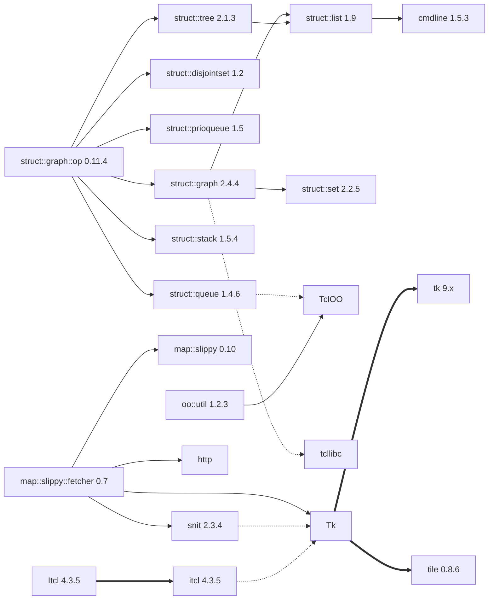
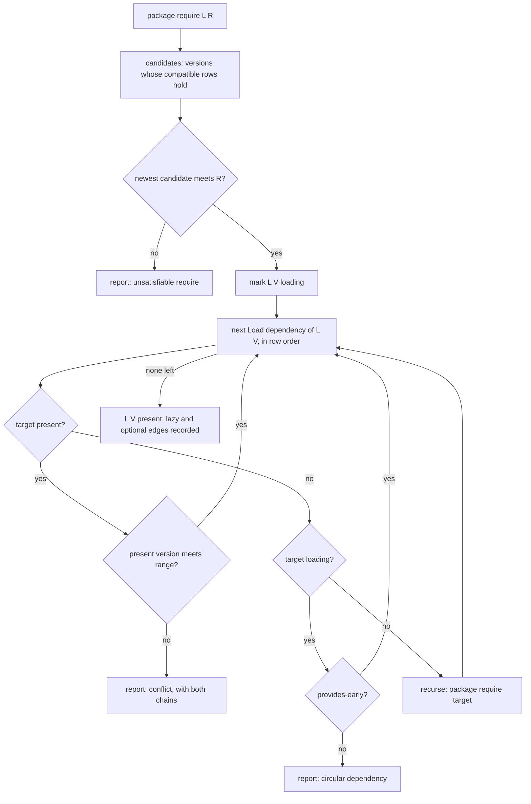

# Step 331 (proposed): library-to-library dependencies

Status: proposed 26 November 2026, as new plan items 331a–331d. It replaces
[302](302-libraries.md)'s `Requirement` and extends its resolution, adds rows
to [305](305-spectcl-3.md)'s `library` block, and feeds
[308](308-positioned-context.md)'s positioned query. [332](332-rust-spectcl-parity.md)
lists its new productions in the parity gate.

## Problem

302 has `Requirement { library, needs, range }`, AND'd, and pulls a required
library in as present. 305 spells it `requires LIB-RANGE {LIBRARY RANGE}`.
Neither exists in Rust: `TcllibModule` (`tcl-registry/src/model/tcllib.rs:69`)
holds trains and one `core_floor`, and no registry type holds an edge between
two libraries. `tcl-pkg`'s resolver (`tcl-pkg/src/resolver.rs:231`) is minimum
version selection for `tclpkg.tcl` manifests, which is not what tclsh does.

Real metadata needs more than one AND'd edge kind. All of these were read
from `tmp/` and run under `tclsh8.5`–`tclsh9.1`:

| Shape | Real case | Evidence |
|---|---|---|
| load edge | `struct::graph::op` needs six `struct::*` packages | `struct/graphops.tcl:18-23` |
| edge below the index guard | the index offers `struct::graph::op` on 8.5; its source refuses | `struct/pkgIndex.tcl` guard `8.5 9`; `graphops.tcl:16` `Tcl 8.6 9`; tclsh 8.5.19: `have 8.5.19, need 8.6 9` |
| lazy edge | Itcl needs Tk only for `itcl::widget`; snit only when a widget is created | `itclWidget.tcl:15` (Itcl 4.3.5); `snit/main2.tcl:1960` |
| optional edge | `catch {package require tcllibc}`; `struct::queue` tries `TclOO 0.6.1-` | `struct/graph.tcl:36`, `queue.tcl:43` |
| identity chain | `Itcl` is `package require -exact itcl V`; Tk 9 loads as `tk`, and `Tk` chains to it | Itcl 4.3.5 `pkgIndex.tcl:14`; `tk9.0.4/unix/Makefile.in:812`, `tkWindow.c:3461-3465` |
| virtual package | Tk 8.5+ provides `tile 0.8.6`; tcllib's index provides `file::home 1` on Tcl 9 with no code | `ttk/ttk.tcl:49`; `try/pkgIndex.tcl` |
| extension | `file::home` adds `home` and `tildeexpand` to core `file` on 8.x; `oo::util` adds `classmethod` to `oo::define` and three helpers to `oo::Helpers` on 8.6 | `try/fhome.tcl`; `ooutil/ooutil.tcl:18-172` |
| conflict | a dependency already present at the wrong train | `struct.tcl:2` needs `struct::graph 2.0` |

Two more facts shape the design. tclsh never backtracks: it picks the newest
version an index offers, runs its script, and fails on the first
unsatisfied require inside it. And today's registry models extension by
copying specs: `classvariable` exists twice, once for core 9.0 and once as
`spec_ooutil_86` (`commands/tcl/oo_classvariable.rs:120`), and `file home`
is core-9.0-only (`commands/tcl/file_.rs:350`), so `package require
file::home` on 8.6 is not modelled.

The real graph of a handful of packages, from the files above (solid: load,
dotted: lazy or optional, thick: identity or provided name):



`tclsh8.6` and `tclsh9.0` both load exactly the nine `struct::*` and `cmdline` packages above
for `package require struct::graph::op` (plus `TclOO`, through the queue's
optional edge). A scan of the 437 packages tcllib 2.0's indexes source
directly finds 709 load edges and no cycle.

## Design

### Types (registry core, replacing 302's `Requirement`)

```rust
// design sketch: these types are proposed here
pub struct Dependency {
    pub from: VersionSet,              // the depending library's versions this row covers
    pub need: Need,
    pub mode: DepMode,
    pub when: Option<Condition>,       // a 305 check predicate: dialect, build, capability
    pub evidence: &'static str,        // "struct/graphops.tcl:22"
}
pub enum Need {
    One(Target, VersionSet),           // Target::Library(id) or Target::Core
    AnyOf(&'static [(Target, VersionSet)]),  // tried in order, as a catch chain does
}
pub enum DepMode { Load, Lazy { trigger: &'static [ItemPath] }, Optional }
pub struct ProvidedName {
    pub from: VersionSet, pub name: &'static str,
    pub version: ProvidedVersion,      // Same | Fixed(Version)
    pub via: ProvideVia,               // Direct | ExactChain
    pub when: Option<Condition>,
}
pub struct Conflict { pub from: VersionSet, pub with: Target, pub range: VersionSet, pub why: &'static str }
pub struct Library {                   // 302's, with three fields replaced or added
    /* id, axis, trains, distribution as in 302 */
    pub compatible: &'static [CompatibilityRow],  // the index guards only
    pub requires: &'static [Dependency],          // replaces Requirement; includes `package require Tcl`
    pub provides: &'static [ProvidedName],        // replaces `aliases`
    pub conflicts: &'static [Conflict],
    pub provides_early: VersionSet,               // `package provide` precedes its requires
}
```

302's `Availability` changes too. An item can have several providers, so
`library: Option<LibraryId>` becomes `providers: &'static [ProviderRow]`,
OR'd, each row `{ library: Option<LibraryId>, window, dialect }`. `file
home` is then one item with two rows: core 9.0-, and `file::home 1-` on
tcl 8.5–8.6 (its index guard is `8.5 9`).

**Guards and requires stay apart.** A `compatible` row is the index's guard:
a train it rejects is never offered, so tclsh considers the next. A
`requires … {core R}` row is the source's `package require Tcl R`: the train
is chosen first and then fails. 302 folds both into compatibility rows
(snit's row cites both); this design keeps them separate because tclsh
answers differently.

### SpecTcl 3 syntax (additions to 305)

```text
lib-row += 'requires' LIB-RANGE NEED ?'-mode' ('load'|'lazy'|'optional')?
              ?'-trigger' '{' ITEM+ '}'? ?'-when' PRED? ?'-evidence' TEXT?
         | 'provides' LIB-RANGE NAME ('same'|VERSION) ?'-via' ('direct'|'exact-chain')? ?'-when' PRED?
         | 'conflicts' LIB-RANGE '{' TARGET RANGE '}' '-message' TEXT
         | 'provides-early' LIB-RANGE
NEED     := '{' TARGET RANGE '}' | '-any' '{' ('{' TARGET RANGE '}')+ '}'
TARGET   := LIBRARY | 'core'
item     += 'extend' ('command'|'namespace') NAME '{' cmd-row* '}'
ATOM     += '{' 'capability' CAP '}'
```

`alias NAME` stays as sugar for `provides LIB-RANGE NAME same -via
exact-chain`. In `extend`, `cmd-row` is 305's, so `subcommand`, `option`,
`arg … -values+` and `command` (inside a namespace) all work, each with its
own `available` naming the extending library.

**Source:**

```spectcl
speclib tcllib-struct 3 {
library struct::graph::op {
    versions 0.11.4
    compatible struct::graph::op 0- {tcl 8.5-9.2}         ;# struct/pkgIndex.tcl guard
    requires struct::graph::op 0- {core 8.6-9.2}          ;# graphops.tcl:16
    requires struct::graph::op 0- {struct::graph 0-}      ;# graphops.tcl:22, bare
    requires struct::graph::op 0- {struct::tree 0-}       ;# :23; four more rows like it
}
library Tk {
    versions 8.4.20 8.5.19 8.6.18 9.0.4 9.1.0
    provides Tk 9- tk same -via direct                    ;# tkWindow.c:3465
    provides Tk 9- Tk same -via exact-chain -when {capability tk-deprecated}
    provides Tk 8.5- tile 0.8.6 -via direct               ;# ttk.tcl:49
}
library itcl {
    versions 4.3.5
    alias Itcl                                            ;# pkgIndex.tcl:14
    requires itcl 4- {Tk 8.6-9} -mode lazy -trigger {itcl::widget itcl::widgetadaptor}
}
library file::home {
    versions 1
    provides file::home 1 file::home same -when {dialect tcl 9.0-}  ;# index only, no code
}
extend command file {
    subcommand home { available file::home 1- -dialect {tcl 8.5-8.6} ; arity 0..1 }
    subcommand tildeexpand { available file::home 1- -dialect {tcl 8.5-8.6} ; arity 1 }
}
extend namespace oo::define {
    command classmethod { available oo::util 1.2- -dialect {tcl 8.5-8.6} }
}
}
```

**In memory:**

```rust
// design sketch: these types are proposed in 331
Library { id: "struct::graph::op", trains: [Train { name: "0", versions: {0.11.4} }],
  compatible: [CompatibilityRow { library: 0-, dialect: tcl 8.5-9.2 }],
  requires: [
    Dependency { from: 0-, need: One(Core, 8.6-9.2), mode: Load, when: None, evidence: "graphops.tcl:16" },
    Dependency { from: 0-, need: One(Library("struct::graph"), 0-), mode: Load, .. },
    Dependency { from: 0-, need: One(Library("struct::tree"), 0-), mode: Load, .. } ],
  provides: [], conflicts: [], provides_early: ∅ }
ItemPath::Subcommand("file", "home") => Availability { providers: [
    ProviderRow { library: None, window: 9.0-, dialect: None },                    // core, file_.rs:350
    ProviderRow { library: Some("file::home"), window: 1-, dialect: Some(tcl 8.5-8.6) } ] }
```

### Resolution (302's steps 1, 2 and 4 change)

**At a point** (one release, one require sequence), the resolver replays
tclsh, so its answer is tclsh's:

1. The require's candidates are the versions whose `compatible` rows hold.
   An unguarded require on `core` is not a candidate filter.
2. Pick the newest candidate meeting the require (302 step 3). Mark it
   *loading*.
3. Run its `Load` dependencies in row order. A target already present must
   meet the range, or the answer is a conflict. A target on the *loading*
   stack is a cycle: an error unless it is `provides-early`. Otherwise
   recurse from step 1.
4. Never retry a lower version after a failure.

Step 4 is real behaviour. With a stub index whose `itk` requires `Tk 8.6 9`
and offers Tk 8.6.18 and a Tk 9.0.4 that requires `Tcl 9.0`, tclsh 8.6.18
picks Tk 9.0.4 and fails with `version conflict for package "Tcl": have
8.6.18, need 9.0`; it does not fall back to 8.6.18. Real Tk avoids this
with its index guard (`Makefile.in:812`: `if {![package vsatisfies
[package provide Tcl] 9.0]} return`). That is why guards and requires stay
apart. The cycle rule is tclsh's too: on 8.4–9.0, two `ifneeded` scripts
that require each other before providing give `circular package
dependency: attempt to provide a 1.0 requires a`, and the same pair with
`package provide` first loads both.

**Over a set** (a target range, or 308's `May` cases), candidate sets
shrink to a fixpoint (arc consistency): a version of A leaves when one of
its `Load` rows has no candidate of B left in its range, and B keeps only
versions some remaining A needs. Sets only shrink and are finite, so the
worklist terminates, cycles included. The set answer is a superset of every
point answer, and a property test checks that per point.



**Lazy and optional edges.** A lazy edge makes nothing present at the
require. Its trigger item's call site is a 308 transition, after which the
target is `Must` with `Why::Requirement { of }`. An optional edge never
makes its target present and never reports; it only records that the
library has a variant. **Conditional edges** carry `-when`, evaluated
three-valued over the dialect set as 305's `check` atoms are.

### Position (308)

A `package require` transition now expands to its closure. `Why` gains
`Lazy { of, trigger }`. For the itk example below, the transition gives
`itk Must`, `Itcl Must {Requirement { of: itk }}` and `Tk Must {Requirement
{ of: itk }}`, each with the intersected version set. An extension is
visible where its provider row's library is `Must` or `May` at the
position, with the same `May` annotation completion already uses.

### Diagnostics

Codes are assigned with item 331c. Each message quotes the chain.

| Diagnostic | When | Message shape (tclsh's own words where it has them) |
|---|---|---|
| unsatisfiable require | empty candidate set | `can't find package L R`, plus which guard or row emptied it |
| dependency conflict | a present version misses a `Load` range | `version conflict for package "B": have V, need R`, plus `L requires B R (evidence)` and the line that made B present |
| circular dependency | a cycle without `provides-early` | `circular package dependency: attempt to provide L V requires L` |
| guard below source | a guard admits a release the source's `requires core` rejects | catalogue lint at generation (struct::graph::op on 8.5) |
| lazy target unavailable | a trigger is used where the environment cannot place the target | `itcl::widget needs Tk 8.6-9, which this environment cannot load` |
| declared conflict | a `conflicts` row holds | the row's `-message` |
| stale train (hint) | a bare dependency is met by an older train | `struct::graph::op loaded with struct::graph 1.2.2; tcllib ships 2.4.4` |

### Example: `package require itk`

itk's sources are not in `tmp/`, so its requires below are a stub that
copies Itcl's own `Tk 8.6 9` pattern. Itcl 4.3.5 is the real package
(found under `/opt/google-cloud-sdk/platform/bundledpythonunix/lib`).

**Source:**

```tcl
package require itk
```

**In memory:**

```rust
// design sketch: PositionedContext after the require (308 types, 331 Why)
libraries: {
  "itk":  Must { versions: {4.1.0}, why: Require { exact: false } },
  "itcl": Must { versions: {4.3.5}, why: Requirement { of: "itk" } },  // also named Itcl
  "Tk":   Must { versions: {9.0.4}, why: Requirement { of: "itk" } },  // also named tk
}
```

**Bytecode (tclsh 9.1.0):**

```text
  Command 1: "package require itk"
    (0) push 0 	# "package"
    (5) push 1 	# "require"
    (10) push 2 	# "itk"
    (15) invokeStk 3
    (20) done
```

**Result:**

```text
$ ITCL_LIBRARY=… tclsh9.0 itkchain.tcl     (stub itk and Tk, real Itcl)
9.0.4: itk 4.1.0
  Itcl 4.3.5   itcl 4.3.5   Tk 9.0.4   tk 9.0.4
$ ITCL_LIBRARY=… tclsh9.1 itkchain.tcl
9.1.0: itk 4.1.0
  Itcl 4.3.5   itcl 4.3.5   Tk 9.0.4   tk 9.0.4
```

### Example: a conflict through a dependency

**Source:**

```tcl
lappend auto_path tcllib-2.0/modules
puts [package require struct::graph 1]
puts [package require struct::graph::op]
puts [package require struct 2.2]
```

**Result:**

```text
$ tclsh8.6 conflict.tcl            (and tclsh9.1, and ./target/debug/tclvm: the same)
1.2.2
0.11.4
version conflict for package "struct::graph": have 1.2.2, need 2.0
```

The second line is the stale-train hint: `struct::graph::op`'s bare require
accepts 1.2.2. The third is the conflict, `struct 2.2 requires
struct::graph 2.0 (struct.tcl:2)`, with line 2 named as the source of 1.2.2.

### Example: one library extending a core command

**Source:**

```tcl
lappend auto_path tcllib-2.0/modules
puts [catch {file home} msg]
puts [package require file::home]
puts [file home]
```

**Bytecode (tclsh 9.1.0):**

```text
  Command 2: "file home"
    (21) startCommand +19 1 	# next cmd at pc 40, 1 cmds start here
    (30) push 3 	# "::tcl::file::home"
    (35) invokeStk 1
    (40) done
```

**Result:**

```text
$ HOME=/home/u tclsh8.6 home.tcl
1
1
~
$ HOME=/home/u tclsh9.1 home.tcl      (./target/debug/tclvm: the same)
0
1
/home/u
```

On 8.6 the extension rewrites `file`'s ensemble map; on 9.1 the core
provides `home` and the package is an index-only name. The two providers
answer differently (`~` against the expanded path), which hover shows as a
`Differs` line (308).

### Decisions

1. **Point resolution replays tclsh, with no backtracking.** A smarter
   solver would answer questions tclsh never asks.
2. **Guards filter; requires fail.** This matches tclsh and fixes 302's
   merged rows.
3. **Extension is a provider row on the target item**, not a copied spec.
   One item, one set of facts, several providers.
4. **Names are `provides` rows,** so `Itcl`/`itcl`, `Tk`/`tk` and `tile`
   are data with predicates, and `alias` is sugar.

### Open questions

- **itk, BWidget and tklib requires.** Settled by fetching their sources
  (extend `fetch-tcl-source` with `pkgs/` and these three) and generating
  their rows.
- **Extensions that differ by provider.** Should hover lead with the core
  answer or the library's? Settled by the `positioned-versions` rows for
  `file home` on 8.6 and 9.1.

## Work list

1. Item 331a: the types above in the registry core; `resolve_libraries`
   gains point replay and set fixpoint; unit tests from the examples.
2. Item 331b: the generator reads `pkgIndex.tcl` guards, `ifneeded` chains
   and each source's top-level and `catch`-wrapped requires into rows, with
   `--check`; it replaces `TcllibModule.core_floor`.
3. Item 331c: 308's transitions expand closures; the diagnostics above.
4. Item 331d: `extend` and `ProviderRow`; fold `spec_ooutil_86` and the
   other duplicated specs into provider rows.

## Verification

- **Done when:** the three examples above are `positioned-versions` rows,
  green against tclsh 8.6 and 9.1; the struct::graph::op closure equals
  tclsh's on 8.6 and 9.0; the 8.5 guard-below-source lint fires; `rg
  'fn spec_ooutil_86|mymethod_spec_ooutil_86' rust` is empty.
- **Measurements:** `resolve_libraries` per document stays under 302's 20
  µs with closures; the set fixpoint over all of tcllib under 1 ms.

## Risks

- **Generated rows miss dynamic requires** (`package require
  ttk::theme::$theme`, `ttk.tcl:92`). Mitigation: they become `Unknown`,
  as 308 already does.
- **Lazy triggers are guesses** when a library loads code on demand from C
  (Itcl). Mitigation: triggers are evidence-cited rows, checked by a
  conformance run per row.

## Corrections to other designs

- **302:** `Requirement` is replaced by `Dependency`; step 4 ("a train whose
  requirement fails leaves the set") is wrong at a point, where tclsh fails
  instead; `Availability.library` becomes a provider list; snit's rows split
  into a guard and a `requires core` row.
- **305:** `alias` is sugar for `provides … -via exact-chain`; the `check`
  atoms gain `capability`.
- **Rust comment:** `tcl-registry/src/model/tcllib.rs:968` says
  `struct::graph::op` "requires the 2.x train specifically". Its require is
  bare (`graphops.tcl:22`), and tclsh loads it with 1.2.2.
