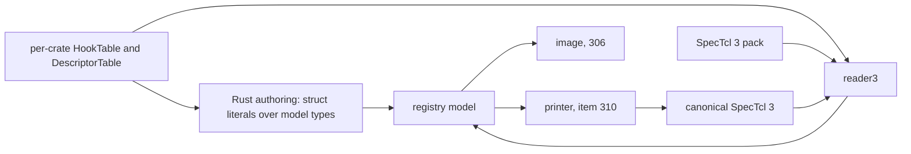
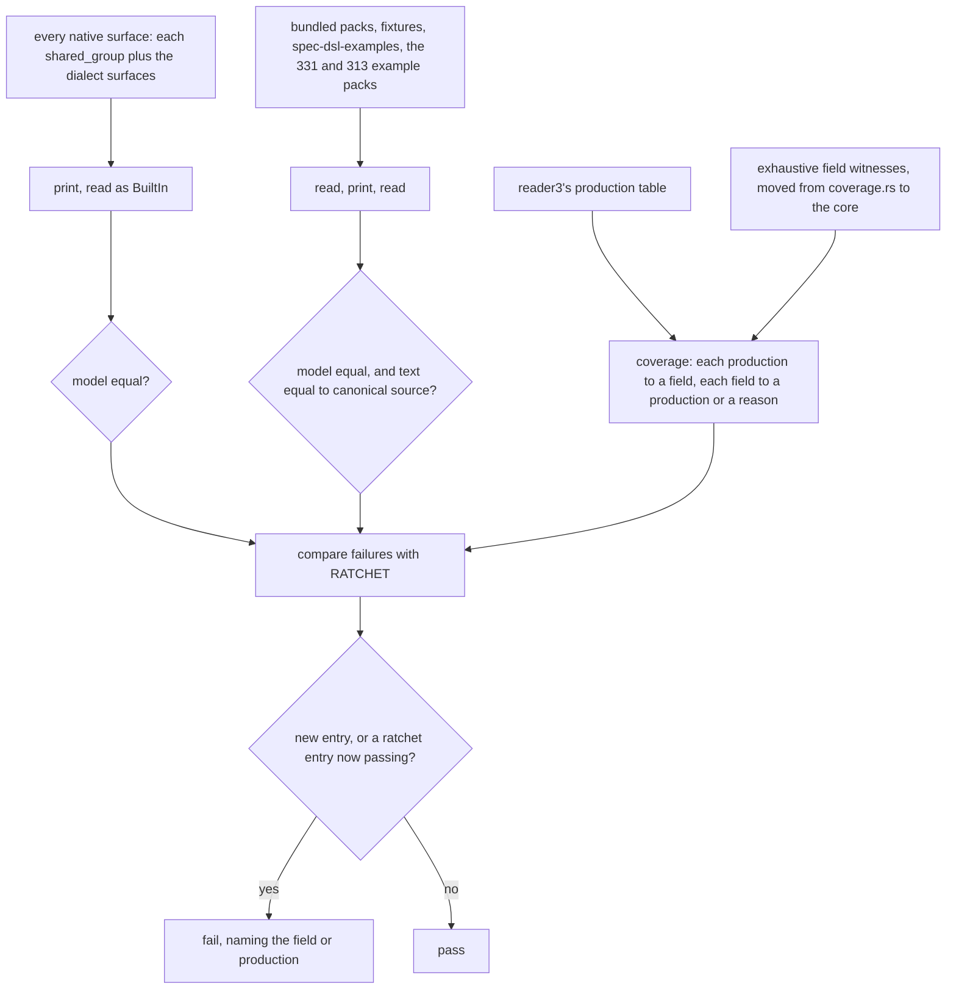

# Step 332 (proposed): one registry model, Rust and SpecTcl 3 at parity

Status: proposed 26 November 2026, with proposed items 332a–332e (now plan items 400 and 402–405). It builds
on [302](302-libraries.md) (the model types), [305](305-spectcl-3.md) (the
grammar), [307](307-libraries-as-data.md) (the Tcl core stays native),
[309–310](309-310-migration-and-authoring.md) (the printer),
[313](313-consumer-hooks.md) (consumer rows) and
[331](331-library-dependencies.md) (dependency rows). 307's per-surface
moves to images depend on its gate.

**Plan numbers** (26 November 2026): 332a → 402, 332b → 403 (merged with 333's 340 gap 4), 332c → 400 (merged with 333's 336), 332d → 404, 332e → 405. The [consolidated SpecTcl 3 specification](../spectcl-3/README.md) supersedes this design in detail, and its [crosswalk](../spectcl-3/12-plan-crosswalk.md) maps every proposed number.

## Problem

The owner's rule: Rust-authored surfaces can say everything SpecTcl 3 can,
and every SpecTcl 3 construct compiles into registry structures with no
loss. Today neither direction holds.

| Fact | Number | Where |
|---|--:|---|
| `CommandSpec` fields | 148 | `tcl-registry/src/spec.rs:327` |
| `SubCommand` fields (17 not on `CommandSpec`) | 99 | `spec/subcommand.rs:65` |
| `OptionSpec`, `OptionArg`, `ArgValue`, `HoverSnippet`, `FormSpec`, `Lifecycle` fields | 8, 14, 5, 6, 4, 4 | `hover.rs:601,272,1010,31,1082`; `lifecycle.rs:119` |
| words the 2.x loader reads in a command body | 147 | `tcl-spectcl/src/loader/eval.rs:227` (`ROW_WORDS`) |
| `TODO(spectcl)` losses when the native surfaces are printed | 2,889 (1,799 tcl8.6, 1,090 iRules; `grep -c 'TODO(spectcl)'`, 26 November 2026) | `rust/tcl-spectcl/equivalence/*.tclspec` |
| Rust literal sites | 1,911 `..CommandSpec::DEFAULT`, 1,137 `..SubCommand::DEFAULT` | `tcl-registry/src/commands/` |

Some parity machinery already exists, in the studio:

- an exhaustive-destructuring **field witness** per registry type, so a new
  field fails to compile until it is mapped (`tcl-spec-studio/src/coverage.rs:162`
  onwards, 335 field entries);
- a **gap register**, `GAPS`, with four kinds: `DraftOpaque`, `LoaderGap`,
  `Excluded`, `PackLevel` (`render_spectcl/gaps.rs`);
- a **round-trip gate** that drafts every shipped spec, prints it, reloads
  it and compares field by field, allowing only `GAPS` keys to differ
  (`tests/it_4/spectcl_roundtrip.rs`).

It goes through the studio's JSON draft, not the registry model, and it
allows losses instead of driving them to zero. The losses, by field, from
the equivalence packs:

| Losses | Field | Kind |
|--:|---|---|
| 501, 127, 103, 76 | `native_compilation`, `successful_handler`, `native_result`, nested `native_compilation` | excluded, or no reader |
| 449, 331, 293, 277, 227 | `event_requires`, `state_transitions`, `world_effects`, `completion`, `result_stability` | the draft holds no value; the DSL has a spelling |
| 211 | `dispatch_dependencies` | excluded, no spelling |
| 119, 19, 5 | `evaluation_contexts`, `completion_body_boundary`, `deferred_execution` | spelling documented, no reader |
| 37 | `hover` | prose no Tcl word carries verbatim |
| 112 | 21 other fields, 1–32 each | mixed |

## Design

### One model, two front ends, one printer

The model is 302's types (`Library`, `Availability`, `Facet<T>`), 331's
dependency rows, 305's `CompiledRule`, 313's rows, and the command types
under them. Both front ends produce it, and the printer (item 310) prints
any value of it.



Three changes make that true:

1. **Native hooks by ID, never by pointer.** Every function-pointer field
   becomes a `NativeHookId` resolved through the owning crate's
   `HookTable`. Today the `-native` tables hold 48 `const_fold` rows, 13
   `const_fold_versioned` rows and one state-transition resolver; the
   other ten families' tables, and the `semantics` and `facts` tables, are
   empty (`pack_hooks/native_catalogues.rs:50-314`).
   Count and layout resolvers resolve by looking up the shipped spec's own
   field (`native_argument_role_hook.rs:44`, 7 IDs), which cannot survive
   307 deleting that spec. Rust then writes `hook!(file::home::native_compilation)`
   where it wrote a `fn` today, and the printer writes the same ID.
2. **Named descriptors by ID.** `state_transitions`, `world_effects`,
   `case_list`, `body_scope`, `frame_effect`, `event_requires` and the
   others that today hold a `&'static` descriptor hold a `DescriptorId` in
   a `DescriptorTable`, or an inline value. The printer writes `NAME` or
   the block. This removes the studio's `DraftOpaque` class.
3. **Tier-gated vocabulary.** A field that "a pack may not author" gets a
   spelling, accepted only from `Provenance::BuiltIn` or `BundledPack`
   (`tcl-dialect/src/model/environment.rs:259`), 313's trust table. A user
   pack writing it gets today's semantic exclusion notice
   (`loader/command/body_statements.rs:243-258`). Excluded means untrusted
   source, not unspellable.

**Canonicalisation** for comparisons: rows in grammar order; defaults
omitted; sets sorted; `alias` printed as `provides … -via exact-chain`;
facet rows merged where adjacent windows hold equal values; versions in
their shortest exact form; quoted prose re-quoted by one rule.

### Example: a native spec, printed and read back

**Source:**

```rust
// today: tcl-registry/src/commands/tcl/file_.rs:350
SubCommand {
    name: "home",
    native_compilation: Some(named_file_compiler!("home", Arity::new(0, 1), TclVersion::V9_0)),
    arity: Arity::new(0, 1),
    detail: "Returns the home directory of the current user, or of username if given. …",
    synopsis: "file home ?username?",
    return_type: Some(TclType::String),
    surface: Some(SpecSurface::TCL90_PLUS),
    returns_path: true,
    ..SubCommand::DEFAULT
}
```

**Printed:**

```spectcl
speclib tcl-core 3 {
command file {
    subcommand home {
        available core 9.0-
        arity 0..1
        detail {Returns the home directory of the current user, or of username if given. …}
        synopsis {file home ?username?}
        return_type String
        returns_path
        native_compilation -native file::home::native_compilation
    }
}
}
```

**In memory:**

```rust
// design sketch: the same value from both front ends (302, 332 types)
SubCommand { name: "home",
  availability: Availability { providers: [ProviderRow { library: None, window: 9.0-, dialect: None }] },
  arity: Facet { rows: [(FacetKey::ANY, Arity { min: 0, max: Some(1) })] },
  native_compilation: Some(NativeHookId("file::home::native_compilation")),  // tier: BuiltIn only
  return_type: Some(String), returns_path: true, .. }
```

**Bytecode (tclsh 9.1.0):**

```text
  Command 1: "file home"
    (0) push 0 	# "::tcl::file::home"
    (5) invokeStk 1
    (10) done
```

**Bytecode (tcl dis):**

```text
    (0) push1 0	# "file"
    (2) push1 1	# "home"
    (4) invokeStk1 2	# file
    (6) done
```

**Result:**

```text
$ HOME=/home/u tclsh8.6 h2.tcl
unknown or ambiguous subcommand "home": must be atime, attributes, …
$ HOME=/home/u tclsh9.1 h2.tcl        (./target/debug/tclvm: the same)
/home/u
```

The printed `native_compilation` row reads back only under BuiltIn
provenance. The gate reads the printed native surfaces as BuiltIn, so the
value is equal; a user pack copying the row is refused, as today.

### Construct map: grammar production → model

Status: **E** exists in Rust today, **D** designed (301–313, 331), **M**
missing from every design.

| Production | Today | After | Status |
|---|---|---|---|
| `speclib NAME 3 ?MINOR?` | `Pack.name`, `dsl_version` (`tcl-spectcl/src/loader.rs:482`), loader only | pack id and provenance in the image header (306) | E/D |
| `dialect` `release`, `-patch` | `Release` (`tcl-dialect/src/model/family.rs:323`) | 301 `Dialect` | E |
| `dialect` `build`, `capability` | `BuildProfileId` (`family.rs:701`), `CapabilitySet` (`:760`) | 301 | E |
| `dialect` `axis … -from` | `KeyedAxis` (`environment.rs:155`) | 301 | E |
| `library NAME` | `PackageId` (`tcl-registry/src/model/surface.rs:54`), `TcllibModule` (`model/tcllib.rs:69`) | `Library` | D |
| `alias` | none (item 32) | 331 `ProvidedName` | D |
| `versions`, `train` | `TcllibModule.trains` (`tcllib.rs:78`) | `Train` | D |
| `compatible` | `core_floor` (`tcllib.rs:81`), one per module | `CompatibilityRow` (index guard, 331) | D |
| `requires` and 331's flags, `-any` | none | `Dependency`, `Need`, `DepMode` | D |
| `provides`, `conflicts`, `provides-early` (331) | `CoProvides` parsed and unused (`loader/pack_scope.rs:642`) | 331 | D |
| `tracks-host` | `Placement::Keyed` (`environment.rs:179`), `LibraryPin` (`tcl-dialect/src/library.rs:133`) | `LibraryAxis::TracksHost` | D |
| `provided-by-core` | `provided_packages` (`tcl-dialect/src/release_facts.rs:46`) | bundled placement (302) | E |
| `environment` rows: `dialect`, `library -placement`, `policy` | `EnvironmentDefinition` (`environment.rs:448`), `Placement` (`:170`), `EnvironmentPolicy` (`:216`) | 303 | E |
| `environment` identity and detection rows | `EditorLanguageIdentityId` (`:90`), `FileExtensionClaim` (`:233`), `DetectionFacts` (`:243`) | 303 | E |
| `command NAME` | `CommandSpec` (`spec.rs:327`) | the same, over 302's facets | E |
| `available LIB-RANGE -dialect -requires` | `SpecSurface` (`tcl-dialect/src/model/authored_surface.rs:62`), `Lifecycle` (`lifecycle.rs:119`) | `Availability` with 331's `ProviderRow`s | D |
| `versions KEY {…}` | `ArityWindow` (`arity.rs:200`), `VersionedArgValue` (`spec/arguments.rs:191`), `StampWindow` | `Facet<T>` | D |
| `-values+`, `-values-` | none | facet row deltas | D |
| `HOOK-KIND -native ID` | `HookFamily` (`pack_hooks.rs:96`), tables mostly empty | `HookTable` per crate | D (332a) |
| `HOOK-KIND -body ARGS BODY -inputs` | pack hook slots (`pack_hooks.rs`), `hook_inputs.rs:194` | 305 rung 4, 311 `TbcxUnit` | E |
| `check` (`on`, `when`, atoms, `emit`, `-fix`) | none | `CompiledRule` (305) | D |
| `default {…}` | pack-scope defaults (`loader/pack_scope.rs`) | applied at read; nothing stored | E |
| `hook` (top-level item) | — | undefined in 305 | M |
| 2.3 rows inside `cmd-row` | the 147 `ROW_WORDS` | field map below | E, with gaps |
| 313 `optimise -no`, `report redundant` | `Traits::CSE_CANDIDATE` (`traits.rs`) | permission and report fields | D |
| 313 `-scope`, `-value-role` | `OptionArg.variable_scope`, `.role` (`hover.rs:272`) | role flags | E/D |
| 313 `-frozen`, `-binds-vars` | none | role flags | D |
| 313 `rewrite`, `-proof`, `layout`, `implementation` | `RuntimeBacking` (`runtime_backing.rs:45`) for the last only | image `RULES`, `PROOFS`, `IMPLEMENTATIONS` | D |
| 331 `extend command`, `extend namespace` | duplicated specs (`oo_classvariable.rs:120`) | `ProviderRow` on the target item | D |
| 331 `capability` atom | none | `check` atom | D |
| `special_var`, `include from tcl into jim`, surface rosters, `dynamic_surface`, `unknown_members` | 2.x loader (`eval.rs:227`, `surface_roster.rs`) | not in 305's grammar | M |

### Field map: model field → SpecTcl 3

Legend: **S** spelled and read by the 2.x loader, carried to 3 unchanged;
**R** retired by 302, spelled `available`/`deprecated`; **G** spelling
documented, no reader; **X** read but refused, or excluded (tier-gated in
3); **F** function pointer, spelled `-native ID`, table empty; **N** no
spelling anywhere. Every `CommandSpec` field is in exactly one row.

| `CommandSpec` fields | SpecTcl 3 | |
|---|---|---|
| `name`, `alias_of`, `safe_on_uninit`, `xc_translatable`, `unsafe_command`, `excluded_events`, `warn_missing_import`, `is_namespace_exported`, `implementation_namespace`, `deprecated_replacement`, `deprecated_replacement_drop_in`, `source_deprecation_advice` | `command NAME`, then the same word | S |
| `surface`, `lifecycle`, `required_package`, `tcllib_package` | `available`, `deprecated` | R |
| `traits`, `arity`, `arity_windows`, `repeated_args`, `reserved_trailing_words`, `option_prefix_words`, `options`, `option_relations`, `option_effect_families`, `option_placement`, `arg_values`, `versioned_arg_values`, `arg_values_accept_prefix`, `closed_value_args`, `subcommands`, `prefix_matching`, `allow_unknown_subcommands`, `default_form_first_word`, `forms`, `command_forms`, `clause_grammar`, `case_list`, `definition_body`, `manufacturer_methods`, `object_class`, `self_receiver_words`, `oo_context_facts` | `traits`, `arity`, `versions`, `repeat`, `option`, `option_conflict`…, `arg N -values`, `subcommand`, `form`, `refine`, `clause_grammar`, `case_list`, `definition_body`, `manufacturer`, `object_class`, `oo_context_fact` | S |
| `arg_roles`, `arg_role_resolver_roles`, `arg_presentation`, `arg_domains`, `arg_types`, `command_prefixes`, `script_lookup_scope`, `callback_taint_inputs`, `body_kind`, `body_arg_implicit_args`, `body_scope`, `variable_receivers`, `assigns_variable_at`, `creates_instance_at`, `defines_command_at`, `defines_symbol`, `binds_handle`, `tk_geometry`, `frame_effect` | `arg N -role …`, the same words | S |
| `return_type`, `return_type_hook`, `var_write_typing`, `return_elements`, `var_elements_effect`, `representation_effect`, `inferred_storage_type`, `byte_array_payload`, `byte_array_effect`, `pattern_type`, `format_string_type`, `setter_constraints`, `source_index_bounds`, `semantic_operation`, `semantic_operation_windows` | the same words (`setter_constraint`) | S |
| `side_effects`, `world_effects`, `state_transitions`, `result_stability`, `command_table_effect`, `semantics`, `runtime_backing`, `taint` | `side_effect`/`pure`, the same words | S |
| `lowering_hook`, `codegen_hook`, `inline_codegen_hook`, `analyser_hook`, `codegen_hook_windows`, `inline_codegen_hook_windows` | `FIELD -native ID` over closed catalogues (`hooks.rs:57-558`) | S |
| `taint_source`, `taint_transform`, `taint_transform_when`, `taint_double_encode_colour`, `taint_sink_safe_colour`, `taint_output_sink`, `taint_log_sink`, `taint_output_sink_subcommands`, `taint_interp_eval_subcommands`, `taint_network_sink_args`, `taint_code_sink_args`, `taint_numeric_coercion`, `credential_options`, `sensitive_headers`, `channel_configuration` | the same words | S |
| `event_requires`, `event_requirement_forms`, `event_handler_priority`, `data_collection`, `irules_source_flow`, `side_switch_target`, `hover`, `documentation_examples` | the same words (`event_requirement_form`; examples inside `hover`) | S |
| `evaluation_contexts`, `callback_protocols`, `body_interpreter`, `variable_write_min_args`, `native_result`, `bpf_op`, `event_emits`, `event_emission_forms`, `irules_top_level_effect` | `evaluation_context`, `callback_protocol`, …, as `GAPS` spells them | G |
| `completion`, `body_execution`, `native_compilation`, `successful_handler`, `procedure_definition` | the same words, BuiltIn only | X |
| `const_fold`, `const_fold_versioned` | `-native ID` (61 table rows) | F, filled |
| `arg_role_resolver` (24 specs), `script_timing_resolver` (28), `command_prefix_resolver` (11), `literal_argument_validator` (13), `clause_shape_check` (1), `context_gate` (1), `constraints` (0), `arg_role_count_resolver` (9), `arg_role_layout_resolver` (22), `pattern_arg_resolver` (a function pointer, `patterns.rs:92`) | `FIELD -native ID` | F |
| `taint_sink_gate` (1) | none: deleted for 393's `SinkWhen` predicate | deleted |
| `dispatch_dependencies`, `native_lowering`, `native_lowering_windows` | none: `Derived`, Rust-only tables in `tcl-dialect-tcl` keyed by command (D8) | N |
| `teardown_argument_layout`, `source_arity_with_option`, `pack_source_sandbox_helper`, `remote_method` | tier-gated spellings (403), each a ratchet entry until spelled | N |

Specs per fn field count `FIELD: Some(` under `commands/`. The other
types:

| Type: fields | SpecTcl 3 | |
|---|---|---|
| `SubCommand`: `detail`, `synopsis`, `mutator`, `destructive`, `returns_path`, `is_unescape`, `loop_list_header`, `creates_scope_alias`, `cfg_rewrite_name`, `credential_arg`, `min_abbrev`, `max_leading_option_words`, `source_path_operation`, `source_configuration_reference`, `sub_subcommands`, `subcommand_forms` | the same words (`sub_subcommand`, `refine`) | S |
| `SubCommand`: `source_package_query`; `SubSubCommand`: `native_compilation` | none, excluded | X |
| `OptionSpec`: `name`, `value`, `detail`, `aliases`, `min_abbrev`, `effect`; `surface`, `lifecycle` | `option NAME -takes …`; `available` | S; R |
| `OptionArg`: 13 fields; `callback_protocol` | `option` flags (`-also`, `-closed`, `-integer`, …); `-callback-protocol` | S; G |
| `ArgValue`: `value`, `detail`, `code`; `min_tcl`, `lifecycle` | `arg N -values`; `available` | S; R |
| `HoverSnippet` (6), `FormSpec` `kind`, `synopsis` | `hover {…}`, `form` | S |
| `Lifecycle`: `introduced`, `deprecated`, `retired`, `deprecation_fix` | `available`, `deprecated -from`, `deprecation_fix` | R |
| 302–313 and 331 types | their 305, 313 and 331 rows | D |

Language-level losses beyond fields: an `arg` row names one role, so a
position with two roles has no spelling (2 losses); `arg N -appends`
implies `-role CommandPrefix`, so a prefix position with no role cannot be
said (531 command/dialect pairs); a quoted word is not verbatim, so prose
with an unbalanced brace or a backslash-newline is dropped (37 `hover`
losses). The studio's register also misfiles five: `native_result`,
`bpf_op`, `event_emits`, `event_emission_forms` and
`irules_top_level_effect` are `DraftOpaque` there, but no loader word reads
them (none is in `ROW_WORDS`), so they are loader gaps.

### The parity gate

`cargo xtask spectcl-parity` runs three checks, in `xtask-check` and in
CI, on the model's `PartialEq` (hook and descriptor values compare by ID):



- **The ratchet** is a `const RATCHET: &[(&str, Reason)]` in the xtask, as
  `registry-axes` keeps its own (`xtask/src/registry_axes.rs:251`). It
  starts as the gap list below. A new unmapped field or production fails;
  an entry that now passes also fails until it is deleted, so the list only
  shrinks. Each entry names its plan item.
- **The studio's gate becomes a client.** `GAPS` and
  `spectcl_roundtrip.rs`' allowance are deleted once the ratchet is empty;
  the studio's round trip then asserts zero losses.
- **The equivalence packs** carry no `TODO(spectcl)` lines once the ratchet
  is empty, which is 307's entry condition per surface.

### The gaps, with plan items

| Gap | Fields or productions | Item |
|---|---|---|
| hook tables | the ten **F** fields; count and layout lookups | 332a |
| tier-gated spellings | the five **X** fields, `source_package_query`, nested `native_compilation`, and the eight **N** fields | 332b |
| reader coverage | the nine **G** fields, `callback_protocol`, `completion_body_boundary`, `deferred_execution`, `definition_body` profile | 332c |
| grammar gaps in 305 | `hook`, `special_var`, `include`, surface rosters, `dynamic_surface`, `unknown_members`; multi-role `arg`; a role-less prefix; verbatim prose | 332c |
| printer over the model | named descriptors printed by ID; replaces the draft path | 332d |
| the gate | xtask, ratchet, witnesses in the core | 332e |
| model types | 302's library and facet types, 305's rules, 313's rows, 331's rows | 302, 305, 313, 331 |

### Decisions

1. **Excluded means tier-gated, not unspellable.** The trust question is
   who wrote the row, which provenance already answers.
2. **IDs everywhere a pointer was.** A pointer cannot be printed, compared
   across builds or put in an image.
3. **The gate compares models, not drafts.** The draft is a UI model and
   loses what the registry holds.
4. **The ratchet only shrinks.** Parity is reached by deleting entries.

### Open questions

- **Do `native_lowering` and `dispatch_dependencies` get spellings, or a
  `Derived` mark?** Settled: `Derived`. 307 now moves the Tcl core's facts to
  an image, and these compiler-owned proofs stay Rust-only tables in
  `tcl-dialect-tcl`, keyed by command (chapter 7, *The N fields*).
- **Verbatim prose.** Should reader3 decode backslash escapes in quoted
  words, so any prose has a spelling? Settled by the 37 `hover` losses
  printing and reading back equal under that rule.

## Work list

1. 332a: `NativeHookId`, `HookTable` per crate, `hook!`; convert the
   function-pointer fields; delete the shipped-spec lookup.
2. 332b: spellings for X and N fields, gated on provenance.
3. 332c: reader3 words for the G fields and the grammar gaps; amend 305.
4. 332d: the item 310 printer over model types; `DescriptorId`.
5. 332e: `cargo xtask spectcl-parity` with its ratchet; move the witnesses.

## Verification

- **Done when:** `cargo xtask spectcl-parity` passes with an empty ratchet;
  `rg -c 'TODO\(spectcl\)' rust/tcl-spectcl/equivalence` finds none;
  `render_spectcl/gaps.rs` is deleted.
- **Measurements:** the gate's run time (budget 60 s on the native
  surfaces), and the build cone of a `HookTable` edit (the owning crate,
  `tcl-catalogue` and the binaries).

## Risks

- **Tier-gating hides a bug in provenance.** Mitigation: a conformance row
  per X field loads it from a user pack and expects the exclusion notice.
- **Canonicalisation masks a real difference.** Mitigation: every rule is
  listed in the gate's source with a test that it is semantics-preserving.

## Corrections to other designs

- **305** lists `hook` as a top-level item without a production, and omits
  `special_var`, `include`, surface rosters, `dynamic_surface` and
  `unknown_members`, which its shim table keeps.
- **307** says each library crate holds hooks only (its image is in
  `tcl-catalogue`); a crate with native descriptors also holds its
  `DescriptorTable` for them.
- **The studio's `GAPS`** files five loader gaps as `DraftOpaque`, and
  treats `native_compilation`, `procedure_definition` and `body_execution`
  as readable, where the loader refuses them.

## Review fixes (26 November 2026)

- **R11:** the field map files `pattern_arg_resolver` as F, deletes `taint_sink_gate`, and settles the N fields (`Derived` or tier-gated spellings); the gate's decoded-image leg and the pointer mapping are in chapter 7.
- **R14:** lines 363–364: a library crate holds hooks only; its image is in `tcl-catalogue`.
- **R15:** 2,889 `TODO(spectcl)` markers (1,799 + 1,090), measured.
