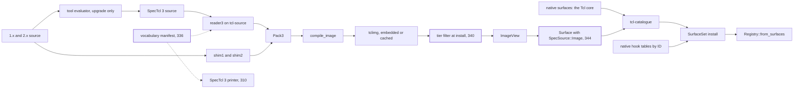
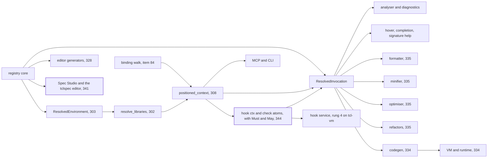

# Step 333: SpecTcl 3, an independent gap analysis

Status: analysis, 26 November 2026. Design 333; its closures are plan items 400–416 (spec chapter 12). It reviews the SpecTcl 3
stack as designed in [305](305-spectcl-3.md), [302](302-libraries.md),
[303](303-environments.md), [306](306-expect-spike.md), [307](307-libraries-as-data.md),
[308](308-positioned-context.md), [309–310](309-310-migration-and-authoring.md),
[313](313-consumer-hooks.md), [319](319-consumer-migration.md), the
[registry split](../registry-split-design.md) and
[`bytecode-image.md`](../../compiler/bytecode-image.md), against the code. It
proposed items 336–344 (now plan items 400–416; see Plan numbers). The consolidated SpecTcl specification builds on it,
with [331](331-library-dependencies.md) and [332](332-rust-spectcl-parity.md).
Codegen and VM gaps belong to 334, and formatter and refactor gaps to 335.

**Plan numbers** (26 November 2026): 336 → 400, 337 → 413, 338 → 415 (its `event` and `flow` part → 442; `channel-driver` → 391c; `class` → 391a), 339 → 408 and 409, 340 → 407 (gap 4 → 403), 341 → 401, 342 → 414, 343 → 416, 344 → 406. The bold numbers in the register below are these proposals, not plan items. The [consolidated SpecTcl 3 specification](../spectcl-3/README.md) supersedes this design in detail, and its [crosswalk](../spectcl-3/12-plan-crosswalk.md) maps every proposed number.

## Problem

The designs describe what SpecTcl 3 adds, not what it must still say. Measured
against the code, the shortfall is large:

| Fact | Evidence |
|---|---|
| 305's command grammar ends in `… (2.3's rows)` | the 2.x loader dispatches 164 distinct command-body words (`loader/command/*.rs`, `subcommand.rs`, `body_rows.rs`) and 14 pack-scope words (`loader/pack_scope.rs:171-266`) |
| `CommandSpec` fields no pack can set | 16 of 148 (`tcl-registry/src/spec.rs:327`), among them `evaluation_contexts`, `dispatch_dependencies`, `event_emits`, `remote_method`, `body_interpreter`, `teardown_argument_layout`, `native_lowering` |
| Fields `tcl spec export` cannot print | 2,889 `TODO(spectcl)` markers in the two equivalence packs, over 59 field kinds: `native_compilation` 501, `event_requires` 449, `state_transitions` 331, `world_effects` 293, `completion` 277, `result_stability` 227 |
| Rows refused from every tier | `successful_handler`, `native_compilation`, `procedure_definition` exclude the pack from strong analysis (`loader/command/body_statements.rs:243-252`); iRules uses `successful_handler` in 8 files |
| Registry facts with no pack form at all | the iRules events (176 `EventProps` rows, `events/event_props_table.rs`), channel drivers (`ChannelKind`, 27 `CHANNEL_OPTIONS`), definer families (a closed enum of 7, `definer.rs:768`) |
| Consumer API | `resolve_spec` returns `Option<&'static CommandSpec>` (`model/context.rs:875`); 271 files outside the registry name `CommandSpec` |

## Design

### Grading

- **B, blocks a consumer:** a designed step or consumer cannot proceed.
- **W, wrong answers:** the design as written gives a wrong or insecure answer.
- **P, polish:** missing quality, speed or convenience.

### The gap register

| # | Gap | Sev | Evidence | Closure | Owner |
|---|---|---|---|---|---|
| 1 | No closed schema for the 3 grammar; four hand-kept descriptions of it | B | 305's `cmd-row … (2.3's rows)`; `commands/spectcl/` (9 files), `definer/spectcl.rs`, Studio `schema.rs:444`, the reader | one vocabulary manifest generates reader tables, printer, LSP surface, Studio schema, docs | **336** |
| 2 | Pack-scope forms missing from 305's grammar | B | 2.x has `special_var`, `include`, `values`, `descriptor`, `display_name`; 306 hashes "the pack source and its includes" | add `variable`, `include FILE`, `roster from F into G`, `values`, `descriptor` | **336** |
| 3 | Fields no pack can write | B | gap list above; Tk `teardown_argument_layout` and `evaluation_contexts`, Thread `body_interpreter`, iRules `event_emits`, `remote_method`, `irules_top_level_effect` | spell each, or mark it Rust-only in the manifest and block that library's 307 move | **336** |
| 4 | Native-contract rows refused from every tier | B | `body_statements.rs:243-252`; iRules 8 files, stdlib 1 `native_compilation` | accept as `-native ID` from BuiltIn and BundledPack images; keep the refusal below | **340** |
| 5 | The printer is not total | B | 2,889 markers; 319 plans to make `equivalent_f5_irules.tclspec` the iRules source, and it has 1,090 | printer over the manifest; gate: export, read, compare equal | 310, 332 |
| 6 | iRules events, flows and event order have no form | B | `EventProps` 176 rows, `events/flow_chains.rs`, `event_order.rs`; 307 step 6 moves them | `event` and `flow` forms (below) | **338** |
| 7 | Channel drivers are closed | W | `ChannelKind` (`channel_options.rs:36`); a library such as `tls`, or Expect's spawn channels, cannot add a driver or option | `channel-driver NAME { option … }` as library content | **338** |
| 8 | Classes as library content are partial | W | `ObjectClassSpec` (`spec/object_class.rs:112`) has instance methods and superclasses, and no mixins, filters, class methods, visibility, constructor or variables | `class` form lowering to an extended `ObjectClassSpec`; definer families stay closed (a new one is rung 3) | **338** |
| 9 | Ensembles `-map`/`-parameters`/`-unknown`, `interp alias`, `rename` as library content | W | only `implementation_namespace`, `allow_unknown_subcommands` and stamp-gated `alias_of` exist | `ensemble` rows and an `alias NAME TARGET ?PREFIX?` row distinct from `alias_of` | **338** |
| 10 | `unknown`, `auto_load`, `auto_path`, `tclIndex` | P | no environment or library row names them; interactive `unknown` runs programs | env rows `unknown`, `auto_path`; library placement `autoload` | **338** |
| 11 | `package ifneeded` scripts | P | `library` has no load facts; 313's path (c) and `-package-source` rely on files the pack cannot name | informational `ifneeded V {source F…}` on `library`, never executed | **338** |
| 12 | `bpf_op` unread, codegen windows not facets | B | redesign §11 D3; `codegen_hook_windows`, `native_lowering_windows` (16 Tcl files) | see 334 | 334 |
| 13 | Which facts are facetable | W | 305: `versions` restates "any facts"; 302's `VersionedSpec` has 10 facets | the manifest marks facetable words; the reader refuses the rest inside `versions` | **336** |
| 14 | Hook `kinds` spelled two ways | W | 305 `literal var command script expand`; `pack_hooks/hook_inputs.rs:197` `known-bytes`; flagged by 313, unresolved | one set: `literal known-bytes var command script expand opaque` | **336** |
| 15 | The dialect a hook body runs in | W | 311 stores bodies as 9.1 tbcx units; 313 runs folds "on an engine pinned to each release" | bodies are Tcl 9.1; the target release reaches them only as `ctx dialect` and the `evaluate` route | 313, 334 |
| 16 | Two range readings | W | worked example 1 | one reading, decided by the owner | **336** |
| 17 | No `deprecated` or `retired` rows | W | the grammar has none; the shim table emits `deprecated -from V`; retirement is a range bound | rows with `-message` and `-fix`, lowered to `ItemHistory` | **336** |
| 18 | Facet precedence | W | first match wins, `-values+` amends the base, not the previous block; no shadow check; no cross-pack rule | reader rejects unreachable blocks; an override's rows go first | **336**, **339** |
| 19 | Facet keys cannot name a build or capability | W | `KEY := LIB-RANGE ?-dialect {F R}?`; `DialectRange` has no build | `KEY` gains `-build B` and `-requires CAPS` | **336** |
| 20 | Release matrix misses row boundaries | W | f5-tcl {15.0, 16.1, 17.1, 21.1}; rows key 9.x–17.5 | matrix = fixed points ∪ every bound a row names ∪ the line before it | 332 |
| 21 | Pack codes do not exist | B | `check` emits W160/W161; `DiagCode` is a closed enum (`tcl-core-types/src/diag_code.rs:287`) | a pack code namespace (below) | **337** |
| 22 | Severity and category chosen per row | W | `emit CODE SEVERITY`; item 108 wants one policy | rows declare a default; 108's policy and user settings decide | **337**, 108 |
| 23 | No localisation | P | no locale support anywhere in the tree | English required; optional `message LOCALE` rows; owner decides scope | **337** |
| 24 | `check` too weak | W | no numeric compare, no word-to-word compare, no option count or order, no enclosing context (proc, event), fixes only `replace`/`delete` | five atoms and `insert` (below) | **337** |
| 25 | Pack errors have no code or span | P | `Notice { context, line, message }` (`loader/notices.rs:34`); 305 `read_pack -> Result<Pack3, Notices>` | `SpecCode`, a byte span, recovery per top-level item | **341** |
| 26 | Links and per-version examples | P | hover `source` is free text; `example` is not in 305's grammar | library `docs` URL template, `manual PAGE`, facetable `example` | 121 |
| 27 | No pack identity | W | `speclib NAME 3` has no pack version; `PackFactStamp` holds name and file hash only (`tcl-runtime-api/src/site_claim.rs:41`) | `pack { version; describes; license; source; generated-by }` and an image `META` section | **339** |
| 28 | Vocabulary minors after 3.0 | W | 305's `'3' ?'3.' MINOR?` accepts `3 3.1`; 2.x's `VocabularyClass` rules are not restated | `speclib NAME 3.N`; each word carries `since` and class in the manifest | **336** |
| 29 | Composition and overrides | W | no `include`, `-override`, `-extend` or cross-pack `refine` in the grammar; two packs may both declare `library Tk` | `extend library` and `extend command`, a merge table per fact kind | **339** |
| 30 | Image trust | W | 306's cache key `<source_hash>-<format>-<vocabulary>` drops the tier and trust that `EvalSnapshotKey` carries; a `.tclimg` beside a workspace pack asserts its own hash | tier-neutral images, filtered at install; only bundled images trusted from disk | **340** |
| 31 | No signing | P | only `spec_integrity` in `tclpkg.lock` | none in 3.0; owner decision | **340** |
| 32 | Reader resource limits | P | no evaluation, so no fuel, and no size or depth bound | caps on bytes, nesting, rows and `RULES` depth | **340** |
| 33 | The `.tclspec` editor is the 2.x DSL | P | the `spectcl` surface describes 2.x commands to the analyser | `.tclspec` documents read by reader3; features from the manifest | **341** |
| 34 | No tests in packs | W | `tcl spec` has `import`, `upgrade`, `export`, `test` (`tcl-cli/src/cli.rs:709-753`); 313's proof corpus has no syntax | `test` form, `tcl spec test` and `--prove` | **342** |
| 35 | Equivalence compares four answers | W | 305: visibility, arity, roles, deprecation only | 332 widens it to every manifest word | 332 |
| 36 | Load budgets for many packs | P | 306 budgets the bundled set; one crate per package gives tcllib 214 images "loaded at install" | open an image when its library is present; a name index for W002 | **343** |
| 37 | Images not shared between processes | P | the user cache is read per process (LSP, MCP, CLI) | read-only `mmap` of cached images | **343** |
| 38 | Registry API shape | B | `&'static CommandSpec`; `SpecSource` has `Built` and `Registered`, no image (`registry-split/01-surface-input.md`) | `SpecSource::Image`, and one decision on views (below) | **344** |
| 39 | Hook `ctx` loses 308's certainty | W | 305 `libraries` is `{versions placement provenance}`; 308 has `Must`, `May`, `Unknown` | `ctx` carries the state; atoms answer unknown on `May` (example 2) | **344** |
| 40 | Two lowering paths | W | 305 lowers `Pack3` directly and through `compile_image` | one path: every pack becomes an image, in memory if not cached | **344** |

### Worked example 1: the two range readings (gap 16)

302 and 305 write `compatible Itcl 3.4 {tcl 8.4-8.6}`, `train 3 {3.4-4}`,
`train 4 {4-5}`, the shim `tcl8.x → core 8.4-9.0`, and the check atom
`{value {arg 2} version-in 3-4}`. 305 says RANGE has §5.4's reading, where
`MIN-MAX` runs through MAX's whole line. Tcl's algebra excludes MAX.

**Source:**

```tcl
foreach {v r} {8.6.18 8.4-8.6  4.2.4 3-4  4.0 3.4-4  9.0.4 8.4-9.0} {
    puts "$v in $r: [package vsatisfies $v $r]"
}
```

**In memory:**

```rust
// design sketch: VersionSet is real (tcl-dialect/src/model/version_set.rs);
// the two readings of `tcl 8.4-8.6` are this doc's
TargetsReading { set: [8.4, 8.7) }   // 302's Itcl 3.4 holds on 8.6
TclAlgebra     { set: [8.4, 8.6) }   // Itcl 3.4 not on 8.6; trains 3.4-4 and 4-5 disjoint
```

**Bytecode (tclsh 9.1.0):**

```text
  Command 1: "package vsatisfies 8.6.18 8.4-8.6"
    (0) push 0 	# "package"
    (5) push 1 	# "vsatisfies"
    (10) push 2 	# "8.6.18"
    (15) push 3 	# "8.4-8.6"
    (20) invokeStk 4
    (25) done
```

**Result:**

```text
$ tclsh9.1 ranges.tcl
8.6.18 in 8.4-8.6: 0
4.2.4 in 3-4: 0
4.0 in 3.4-4: 0
9.0.4 in 8.4-9.0: 0
$ ./target/debug/tclvm ranges.tcl
(the same four lines)
$ tclsh8.4 ranges.tcl
expected version number but got "8.4-8.6"
```

Under the targets reading, 302's worked examples hold but trains 3 and 4
overlap at 4, `tcl8.x` admits 9.0, and `version-in 3-4` fires on Itcl 4.2.4.
Under Tcl's, `tcl8.x` and the trains are right and 302's Itcl row drops 8.6.
Either choice is consistent only if every row is rewritten to it. The
recommendation is the targets reading everywhere in packs, with trains
written as lines (`train 3 {3.4-3}`), and `version-in` comparing the set the
code's own requirement denotes under `tclPkg.c`'s algebra. `-21.1` (305's
`versions {iRules -21.1}`) is not valid in either; it is `0-21.1` (R24: `0-21.0` would drop 21.0.x).

### Worked example 2: retirement and certainty (gaps 17 and 39)

A retired subcommand must stay known, so the analyser says "removed in 9.0"
(W139) rather than "unknown subcommand". 305 has no row for it.

**Source:**

```spectcl
command trace {
    subcommand variable {
        available core tcl 8.4-
        deprecated core tcl 8.4- -message {use trace add variable} -fix {replace subcommand {add variable}}
        retired core tcl 9.0                     ;# a LIB-POINT: gone from 9.0 on
    }
}
```

**In memory:**

```rust
// ItemHistory and its fields are real (tcl-dialect/src/model/version_set.rs:699); versions shown by their text
ItemHistory { introduced: Some(8.4), deprecated: Some(8.4), retired: Some(9.0) } // exclusive
```

**Bytecode (tclsh 9.1.0):**

```text
  Command 1: "trace variable x w cb"
    (0) push 0 	# "trace"
    (5) push 1 	# "variable"
    (10) push 2 	# "x"
    (15) push 3 	# "w"
    (20) push 4 	# "cb"
    (25) invokeStk 5
    (30) done
```

**Result:**

```text
$ tclsh8.6 retired.tcl        # proc cb {args} {puts "write: $args"}; trace variable x w cb; set x 1
write: x {} w
$ tclsh9.0 retired.tcl
error: bad option "variable": must be add, info, or remove
$ ./target/debug/tclvm retired.tcl
error: bad option "variable": must be add, info, or remove
```

The certainty gap is the same kind. In `if {[llength $argv]} {package require
msgcat 1.6}`, 308 gives msgcat `May {1.6-2}` after the `if`, but 305's `ctx`
dictionary has no slot for `May`, so a `check` with `{library msgcat 1.6-}`
cannot tell "required on every path" from "required on one". Run under
tclsh 8.6 and 9.1, the script prints `msgcat absent` without an argument and
`msgcat 1.6.1` or `msgcat 1.7.1` with one. Under `./target/debug/tclvm` the
require path exits 1 with no message, a VM finding outside this document.

### Worked example 3: an iRules event as library content (gap 6)

**Source:**

```spectcl
library iRules { tracks-host f5-tcl -build tmm }
event HTTP_REQUEST {
    available iRules 9.0-
    side client ; transport tcp ; profiles {any HTTP}
    hover { summary {Triggered when the system fully parses an HTTP request header.} }
}
flow tcp_http -profiles {TCP HTTP} {
    step CLIENT_ACCEPTED l4_client
    step HTTP_REQUEST http_request
}
```

**In memory:**

```rust
// EventProps and its fields are real (tcl-registry/src/events.rs:158)
EventProps { client_side: true, server_side: false, transport: &["tcp"],
             implied_profiles: &["http"], flow: true, lifecycle: Lifecycle { introduced: Some("9.0"), .. }, .. }
```

### Closures as new plan items

- **336, the vocabulary manifest and the grammar's completion.** One data
  file lists every SpecTcl 3 word: level, argument shape, `VocabularyClass`,
  facetable, minimum tier, `since 3.N`, and its registry field or "Rust-only".
  The reader, printer, LSP surface, Studio schema, docs and `registry-axes`
  vocabulary are generated from it. It adds the missing pack-scope forms,
  `deprecated` and `retired`, build and capability facet keys, the one `kinds`
  set and the chosen range reading. **Done when** `rg 'TODO\(spectcl\)'` over a
  fresh export of every native surface is empty or names only manifest words
  marked Rust-only, and a test fails if any `CommandSpec` field lacks a row.
- **337, pack diagnostics.** A code is `PACK/ID` (`bench/mode-value`),
  registered at install as `DiagCode::Pack(PackCodeId)` with a default
  severity and an item-108 category. The policy, user settings and suppression
  directives treat it as any code. `check` gains `{value WORD OP N}`,
  `{same WORD WORD}`, `{count OPT OP N}`, `{before WORD WORD}`, `{within
  proc|event NAME|namespace PATTERN}` and `-fix {insert-after WORD TEXT}`.
  Locales are optional `message LOCALE TEXT` rows. **Done when** 305's four
  examples load with pack codes, a user setting changes one's severity, and
  the editor catalogues list pack codes at run time.
- **338, library content forms.** `event`, `flow`, `channel-driver`,
  `class` (mixins, filters, class methods, visibility, constructor),
  `ensemble` rows, `alias`, environment `unknown` and `auto_path`, library
  `autoload` placement, and informational `ifneeded`. **Done when** the iRules
  events, Tk's widget classes, the `tls` channel options and one tcllib TclOO
  module round-trip from native to pack to image with no difference.
- **339, pack identity and composition.** A `pack` block (version,
  `describes LIB RANGE`, licence, upstream, `generated-by`); `include FILE`;
  `extend library` and `extend command`; a merge table per fact kind: library
  rows from the owner only, prose by precedence, security facts by the
  floor, facets prepended. **Done when** two packs that extend `Tk` merge the
  same in either load order, and hover names the pack and version that won.
- **340, trust in images.** Images are compiled tier-neutral and filtered at
  install. Only BuiltIn and BundledPack images are opened from beside a
  source; others come only from the user cache, keyed also by reader build.
  Native-contract rows are accepted from bundled images. Reader caps. **Done
  when** an untrusted workspace's planted `.tclimg` is ignored (a test), and
  `successful_handler -native` loads from a bundled image.
- **341, errors and the `.tclspec` editor.** Notices carry a `SpecCode` and a
  span; the reader recovers per top-level item. `.tclspec` documents get
  diagnostics, hover (the resolved facet per version), completion and
  go-to-definition from `check on CMD` to the command. **Done when** each
  notice has a code and span, and the lsp-client skill shows hover on a
  `versions` block.
- **342, tests in packs.** `test ID { source {…} -on KEY expect {diagnostic
  CODE at L:C | hover CONTAINS | result TEXT} }`. Tests stay in the source, not
  the image. `tcl spec test` runs them; `--prove` runs the differential under
  each real tclsh and writes 313's `PROOFS`. **Done when** every bundled pack
  ships tests and CI runs them.
- **343, load at scale.** Images open when their library is present; a
  per-image name index serves W002's universe; cached images are mapped
  read-only. Budgets: server start with 300 images within 10% of today; 50
  user packs under 50 ms warm. **Done when** both are measured green.
- **344, the registry seam.** `SpecSource::Image(&'static ImageView)`; one
  lowering path; `ctx` carries `must|may|unknown`. The view decision: a
  `SpecRef<'r>` view type for consumers, or a per-surface arena that
  materialises a `CommandSpec` on first lookup. **Done when** Expect serves
  `resolve_spec` from its image with no `CommandSpec` literal, and 308's
  conformance rows include a `May` `check` row.

### Integration

From source to the registry, with this document's proposals marked:



From the registry to every consumer:



### Decisions for the consolidated specification

1. **The range reading** (gap 16). *Owner.*
2. **The registry's consumer API:** a view type or a materialised arena (gap 38). *Owner.*
3. **Bundled native-contract rows** (`successful_handler`, `native_compilation`, `procedure_definition`) from images (gap 4). *Owner.*
4. **iRules events as pack content or Rust** in `tcl-lib-irules` (gap 6). *Owner.*
5. **Localisation in scope or not** (gap 23). *Owner.*
6. **Pack signing**: none in 3.0, or a key scheme (gap 31). *Owner.*
7. The facetable field set (gap 13).
8. Which fields stay Rust-only, and so which libraries stay native under 307 (gap 3).
9. The pack code spelling and its registration (gap 21).
10. The `check` atom set, closed after 337's additions (gap 24).
11. The merge table per fact kind, and library ownership (gap 29).
12. Image tier-neutrality and which images are trusted from disk (gap 30).
13. One lowering path through images (gap 40).
14. The hook-body dialect (gap 15).
15. The minor-version policy and forward reading (gap 28).
16. The equivalence and parity scope (gap 35, with 332).

## Work list

1. 336 first: the manifest, then regenerate the reader tables, printer and
   `spectcl` surface from it.
2. 344 with 306's spike: `SpecSource::Image` and the view decision.
3. 340 before any user image is cached.
4. 337 and 342 with 305's `check`.
5. 338 per library, in 307's order (events before iRules, classes before Tk).
6. 339, 341 and 343 alongside 309–310.

## Verification

- **Done when** each new item's own line holds, the register's B rows are
  closed or owned by a scheduled item, and the decisions are recorded in the
  consolidated specification.
- **Measurements:** the `TODO(spectcl)` count per export (target zero
  outside Rust-only words); load time and RSS with 300 images (343); the
  build cone of a manifest edit (the reader crate, `tcl-spectcl` and the
  binaries).

## Risks

- **The manifest becomes a second registry.** Mitigation: it is generated
  from or checked against `CommandSpec`'s fields by a test, never hand-kept.
- **`check` grows.** Mitigation: 337's atoms are the last before a design note.
- **Rust-only fields stall 307.** Mitigation: 307 moves only libraries whose
  fields are all spelled; the manifest makes that a query.

## Corrections to the overview

- 305's shim `tcl8.x → core 8.4-9.0` admits 9.0 under the reading 305 names.
- 305's header grammar `'3' ?'3.' MINOR?` accepts `speclib x 3 3.1`.
- 305's `versions {iRules -21.1}` is not a valid requirement.
- 305's checks emit W160 and W161, which are not in `DiagCode`.
- `spec-packs.md` says the loader does not read `world_effects`; it does
  (`body_statements.rs:428`, `subcommand.rs:585`, `refinements.rs:268`).
- 307 says every non-core hook "is already a native ID". iRules also needs
  `successful_handler`, `event_emits` and `remote_method`, and Thread needs
  `body_interpreter` and `evaluation_contexts`, which no pack can write.
- 306's cache key drops the tier and trust state that today's
  `EvalSnapshotKey` carries.

## Owner decisions (26 November 2026)

- **Version ranges use Tcl's own algebra everywhere.** A pack range means exactly what `package vsatisfies` means. `8.4-8.6` does not include 8.6.18; authors write `8.4-8.7` or `8.4-9` to include every 8.6 patch. There is one rule for packs, trains and a script's `package require`. The printer, the `tcl spec check` lint and the upgrade tool (item 309) flag ranges that probably meant the whole line, and the 1.x/2.x shims translate the old "whole line" reading into the equivalent algebraic range.
- **iRules events become pack content:** `event` and `flow` forms in the iRules library's SpecTcl source, compiled into its image. That gives one source for the analyser, the LSP, the flow graph and the iRule test framework (gap 6; items 338 and 360).
- **Localisation is prepared for, not shipped.** The 3.0 grammar reserves `message LOCALE` and `doc LOCALE` rows and the reader accepts them. Only English ships, and the editors select by locale once translations exist.
- **No signing in 3.0.** Trust comes from provenance tiers, and untrusted workspace images are ignored and recompiled from source (gap 31; item 340).

## Review fixes (26 November 2026)

These worked examples now parse under chapter 2 of the [consolidated specification](../spectcl-3/02-grammar.md).

- **G15, R8.** `retired` takes a `LIB-POINT` (`retired core tcl 9.0`); `core` names its family.
- **G2.** The iRules event example uses `profiles {any HTTP}` and a `flow` with `-profiles` and `step` rows (360's form); the bare `flow` row is gone.
- **R24.** "Before 21.1" is `0-21.1`.

## Review fixes (26 November 2026, deep review)

- **C2 (D-H).** Images are embedded or cached, never checked in.
