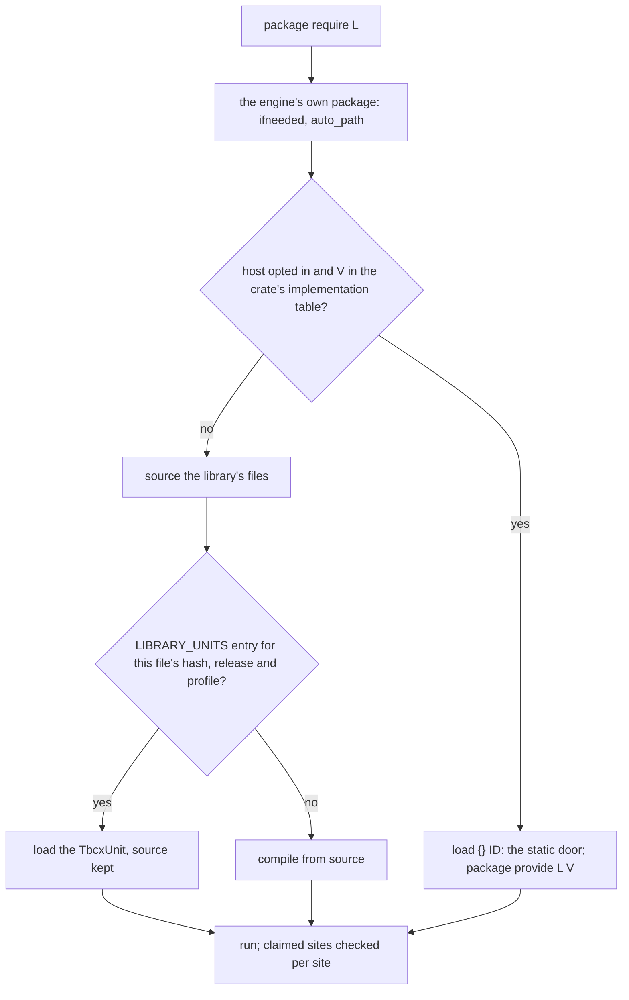

# Step 334 (proposed): SpecTcl 3 for codegen, the VM and the runtime

Status: proposed 26 November 2026, with proposed items 340–346 (retired; see Plan numbers). It builds on
[305](305-spectcl-3.md) (SpecTcl 3, rungs), [306](306-expect-spike.md)
(images), [313](313-consumer-hooks.md) (section 4: execution stays with the
library's source, native accelerators by ID), [332](332-rust-spectcl-parity.md)
(one model, the parity gate), item 311 ([`TbcxUnit`](../../compiler/bytecode-image.md))
and item 312 ([the 9.1 opcode table](../../compiler/vm-tcl-9-1.md)). Owner
goal: SpecTcl 3 and the Rust registry, always at parity, fully support codegen,
the VM and the runtime, not only the analyser.

**Plan numbers** (26 November 2026): the proposed 340–346 are retired. Work items 2, 4, 5 and 6 → 436; work items 1 and 3 stay in item 313. The [consolidated SpecTcl 3 specification](../spectcl-3/README.md) supersedes this design in detail, and its [crosswalk](../spectcl-3/12-plan-crosswalk.md) maps every proposed number.

Every bytecode, timing and result below is a real run, 26 November 2026:
`tclsh9.1` (9.1.0) with `::tcl::unsupported::disassemble` (header lines
dropped); `./target/debug/tcl dis --dialect tcl9.1` from
`tcl 0.1.0+gbb898626.dirty` (HEAD `1e3b4b17`); `./target/debug/tclvm -c`
(a debug build of 26 November, no `--version`); tcllib from
`tmp/tcllib-2.0/modules` on `auto_path`. The eight worked examples are also
in the atlas file `examples-334.json`.

## Does codegen need SpecTcl hooks?

**No. Codegen needs facts from packs, not hooks or templates.** The
evidence follows.

### What codegen reads from the registry today

The compiler's specialisations are four closed families in
`tcl-registry/src/hooks.rs`. Every variant is used, and every use is a
core or dialect-structural command written in Rust (`rg` over
`tcl-registry/src/commands/`):

| Family | Variants | Specs that set it | Surfaces |
|---|--:|---|---|
| `LoweringHookId` (`:57`) | 26 | 27 files in `commands/tcl/`; `irules/proc.rs:47`, `irules/when.rs:93` | Tcl core; iRules `proc`/`when` |
| `CodegenHookId` (`:193`) | 21 | 18 files in `commands/tcl/` | Tcl core only |
| `InlineCodegenHookId` (`:268`) | 32 | 22 files in `commands/tcl/` | Tcl core only |
| `ReturnTypeHookId` (`:558`) | 5 | 5 files in `commands/tcl/` | Tcl core only |
| `native_lowering` (`spec.rs:682`) | 7 shapes | 16 files in `commands/tcl/` | Tcl core only |

No library surface sets one: not tcllib, Tk, Expect, Itcl, Thread or the
EDA packs. In packs, the only `-native` codegen rows are restatements of
the core: the generated equivalence packs (84 rows in `equivalent_tcl8_6`,
68 in `equivalent_f5_irules`), Jim's `lowering_hook -native Proc`
(`core-surfaces/jim-own-surface.tclspec:230`) and the `spec-dsl-examples`.
The stamp rejection rule (`tcl-spectcl/src/stamps.rs:19-40`) already admits
a pack stamp only as an `alias_of` builtin's own and only from `BuiltIn` or
`BundledPack`. Each family names emitters that match C Tcl's compile procs
(`native_compilation_hooks.tsv`, 103 commands × 8.4.20…9.1.0); C Tcl itself
compiles no library command inline.

### The alternatives

- **(a) Facts only.** Codegen reads declarative facts: purity and effects
  (folding, dead-call removal, admission), arity, `semantic_operation`,
  `alias_of`, `runtime_backing` and the existing admission stamps. Every
  emitter stays native Rust in the core crates (`tcl-lowering`,
  `tcl-codegen`) for the core surface. Library commands are plain invokes,
  and a pure-Tcl library's procs compile from its own source like any proc.
- **(b) Declarative inline templates** in packs: `{arg 0} {arg 1} pop` for
  tcllib's `K`, proved equivalent with `tcl spec prove`.
- **(c) Native hook IDs referenced from packs** for library commands.

### What (b) and (c) would buy

`proc ::struct::list::K { x y } { set x }` (`struct/list.tcl:90`) is the
best case for a template: tiny, frequent in hot loops, unable to fail.

**Source:**

```tcl
proc take {} {
    set x {a b c}
    set r [::struct::list::K $x [set x {}]]
    list $r $x
}
```

**Bytecode before (tclsh 9.1.0; tcl dis gives the same 85 bytes):**

```text
    (20) push 1 	# "::struct::list::K"
    (25) loadScalar %v0 	# var "x"
    (30) startCommand +19 1 	# next cmd at pc 49, 1 cmds start here
    (39) push 2 	# ""
    (44) storeScalar %v0 	# var "x"
    (49) invokeStk 3
    (54) storeScalar %v1 	# var "r"
```

**Bytecode after (tclsh 9.1.0, the template written with `::tcl::unsupported::assemble`; rejected design):**

```text
    (11) loadScalar %v0 	# var "x"
    (16) push 1 	# ""
    (21) storeScalar %v0 	# var "x"
    (26) pop
    (27) storeScalar %v1 	# var "r"
```

**Result:**

```text
$ tclsh9.1 e2.tcl ; tclsh9.1 e2b.tcl      (proc call; assembled template)
{a b c} {}
{a b c} {}
$ tclvm -c "$(cat e2.tcl)"
{a b c} {}
```

The cost of the call, per iteration of a loop of 10⁶ (`bench.tcl`,
`time {…} 1`; three runs on a busy machine, the middle run discarded as
noisy):

| Loop body | tclsh 9.1.0 ns/iter | tclvm (debug) ns/iter, 2×10⁴ |
|---|--:|--:|
| empty loop | 20–51 | 3,349–3,397 |
| `set x [K $x [set x {}]]`, a proc call | 128–147 | 23,644–25,595 |
| the same, assembled template | 31–33 | (no assembler) |
| `incr c [lempty $l]`, a proc call | 149–160 | 30,525–33,043 |
| `incr c [expr {[llength $l] == 0}]`, written inline | 56–68 | 11,122–11,148 |

So a template saves about 100 ns per call in C Tcl 9.1. The debug `tclvm`
numbers show the same direction, but no release build exists to measure.

The best case for (c) is a library command that *is* a builtin: on 8.5 and
later tcllib does `interp alias {} ::struct::list::Lassign {} lassign`
(`list.tcl:576-600`). The existing `alias_of` route already compiles it
with the `Lassign` emitter. It needs nothing new, and only callers of that
private name benefit.

**The costs.**

- **Proof.** Equivalence must include `-errorinfo`, and an inlined body has
  no proc frame. A template for `lempty` (`expr {[llength $l] == 0}`) as
  `{arg 0} isEmpty` differs on `" "` and `"{"`. As `{arg 0} listLength push 0
  eq` it agrees on values and `-errorcode`, but the proc's trace has
  `(procedure "lempty" line 1)` and the template's does not (`e2c.tcl`,
  `e2e.tcl`). So templates fit only callees that cannot raise. Among
  tcllib's helpers that is `K`, and few others.
- **Invalidation.** Every template site needs a per-site binding guard and a
  new `SiteClaim` variant. A `proc` over the library name must drop it.
- **Machinery and parity.** A template grammar, a proof runner over five
  releases, a `PROOFS` section, a Rust spelling and a printer row, all for
  a handful of commands.
- **It duplicates the inliner.** `tcl-codegen` already inlines procedure
  bodies, with an exact-definition claim (`SiteClaim::ReferenceBody`,
  `claim_reference_bodies`, `codegen/emitter/mod.rs:224`). A library proc
  whose source the compiler can read (`runtime_backing tcl-body
  {-package-source …}`) reaches the same code with no new vocabulary. Its
  `-errorinfo` question is the inliner's, already owned.

A "compile as a call to proc X" recipe fails the same way. tcllib's
`struct::list` dispatcher (`uplevel 1 [linsert $args 0 ::struct::list::$sub]`,
`list.tcl:84`) costs 1,633–1,668 ns per `struct::list reverse` call against
411–415 ns for `::struct::list::Lreverse` and 128–131 ns for core
`lreverse` (`bench2.tcl`). But an error inside `Lreverse` shows the
dispatcher's `uplevel` frames in `-errorinfo` only on the original path, so
a proved rewrite cannot remove them.

### Recommendation: (a), facts only

- **Inline templates (b) and "call" recipes: rejected for now.** Reopen
  only if a profile of a real tcllib-heavy program on a release `tclvm`
  shows at least 10% of its time in calls to procs that the reference-body
  inliner cannot inline. Both measurements are recorded above.
- **New hook IDs referenced from packs for library commands (c): rejected.**
  The existing `-native` stamp rows stay only as 332's parity spelling of
  the core's Rust fields, tier-gated as today. `alias_of` covers the
  aliasing libraries.
- **What codegen reads from packs** is the fact list in Design section 1.
  The VM and runtime sections stand.

## Problem

The runtime side, as the code stands:

- `RuntimeBacking` has four doors (`runtime_backing.rs:45`: shipped builtin,
  Tcl body, host native, none).
- `SiteClaim` has three variants (`tcl-runtime-api/src/site_claim.rs:63`:
  `PackFacts`, `BuiltinAlias`, `ReferenceBody`), and `PackFactStamp` has
  five fields (`:41`). It has no library version.
- The VM runs `package ifneeded` itself (`tcl-vm/src/cmd_package.rs:695`).
  Its `load` accepts only statically linked packages, and only `Thread`
  today (`cmd_thread.rs:324-352`).
- No code reads or writes tbcx (311 is designed, not built).
- `runtime/rust` attests builtins from their specs (`register_spec_builtin`,
  `interp/commands/registration.rs:180`) and has its own `package`
  (`cmd_package.rs`).

A pack cannot say which library versions a compiled site assumed, how a
library's commands may run natively, or that a library file has a
precompiled form.

## Design

### 1. What codegen and the VM read from a pack

| Fact | Spelling (305/313) | Codegen use | VM use | Claim |
|---|---|---|---|---|
| arity, roles | `arity`, `arg N -role` | shape guards | none | none |
| effects | `side_effects`, `effects -complete`, `frame_effect` | fold, dead-call removal, CSE (313) | keep compiled locals across a frame-safe call (below) | `PackFacts` |
| fold | `const_fold -native ID` / `-body` | `math::max 3 7 5` → `push 7` | none | `PackFacts` |
| builtin identity | `alias_of NAME` + the builtin's own stamp | the builtin's Rust emitter | alias hop | `BuiltinAlias` |
| reference body | `runtime_backing tcl-body {-package-source P}` | inline the library's own body | exact definition match | `ReferenceBody` |
| implementation | `implementation -native ID -versions {L V}` (313) | none: still an invoke | accelerated load script | none |
| library versions | from 308's positioned context | stamped on every claim | `package present L` check | `PackFactStamp::library_versions` (313) |

A plain library command compiles exactly as C does. Our compiler matches it
byte for byte:

**Source:**

```tcl
package require math
proc top {a b} { math::max $a $b 5 }
puts [top 3 9]
```

**Bytecode (tclsh 9.1.0):**

```text
    (0) push 0 	# "math::max"
    (5) loadScalar %v0 	# var "a"
    (10) loadScalar %v1 	# var "b"
    (15) push 1 	# "5"
    (20) invokeStk 4
    (25) done
```

**Bytecode (tcl dis):**

```text
    (0) push 0
    (5) loadScalar %v0
    (10) loadScalar %v1
    (15) push 1	# "5"
    (20) invokeStk 4	# math::max
    (25) done
```

**Result:**

```text
$ tclsh9.1 e1.tcl          (math 1.2.6)
9
$ tclvm -c "$(cat e1.tcl)"
9
```

**Dynamic redefinition.** Every claimed site is checked against the live
command table: `command_binding_matches` follows aliases and refuses traced
commands (`tcl-vm/src/interp/compilation/binding_freshness.rs:77-82`), and
table mutations bump the deopt epoch (`invalidation.rs:56-68`). Claims use
the per-site guard `CommandBindingGuard::BeforeArguments`
(`tcl-runtime-api/src/binding_identity.rs:34`). So a `rename`, a `proc` over
a library name, or a library not loaded yet all give the plain invoke. C
Tcl does the same for its compiled builtins:

**Source:**

```tcl
proc take {} { set x {a b}; set r [::struct::list::K $x [set x {}]]; list $r $x }
proc grow {} { set l {}; lappend l a; set l }
puts "1: [take] / [grow]"
proc ::struct::list::K {x y} { set y }
rename lappend ::tcl_lappend
proc lappend {v args} { upvar 1 $v l; set l [concat X $args] }
puts "2: [take] / [grow]"
```

**Bytecode before (tclsh 9.1.0, `grow` on first call; tcl dis identical):**

```text
    (11) push 1 	# "a"
    (16) lappendScalar %v0 	# var "l"
```

**Bytecode after (tclsh 9.1.0, `grow` recompiled after the rename):**

```text
    (11) push 1 	# "lappend"
    (16) push 2 	# "l"
    (21) push 3 	# "a"
    (26) invokeStk 3
```

**Result:**

```text
$ tclsh9.1 e4.tcl
1: {a b} {} / a
2: {} {} / X a
$ tclvm -c "$(cat e4.tcl)"
1: {a b} {} / a
2: {} {} / X a
```

### 2. The runtime path

How a host gets from `package require` to running code:



**`package ifneeded` and lazy loading.** Execution stays with the library's
source (313's (c)). `package require` is a plain invoke in both compilers,
and both engines run tcllib's own `pkgIndex.tcl`:

**Source:**

```tcl
puts "before: [llength [info commands ::struct::list::*]] commands"
puts "version: [package require struct::list 1.9]"
puts "after: [llength [info commands ::struct::list::*]] commands"
```

**Bytecode (tclsh 9.1.0; tcl dis identical):**

```text
    (0) push 0 	# "package"
    (5) push 1 	# "require"
    (10) push 2 	# "struct::list"
    (15) push 3 	# "1.9"
    (20) invokeStk 4
    (25) done
```

**Result:**

```text
$ tclsh9.1 e5.tcl
before: 0 commands
version: 1.9
after: 49 commands
$ tclvm -c "$(cat e5.tcl)"
before: 0 commands
version: 1.9
after: 49 commands
```

Because claims are checked per site, code compiled before the `require` is
still admitted once the library is in. A site reached before it fails its
guard and invokes, which gives C's `invalid command name` or its `unknown`
and auto-load behaviour.

**Native accelerators** (313's (b), unchanged in policy). An
`implementation -native ID -versions {L V…}` row keys a `HostCommand`
(`tcl-engine-api/src/lib.rs:660`, registered with `Engine::define_command`,
`:1255`) in the library crate's `runtime` feature. Opted in, the host
replaces only that version's load script with `load {} ID; package provide
L V`. That is the VM's existing static `load` door, generalised from its
`Thread` special case (`cmd_thread.rs:346`) to a table, and
`runtime/rust` gets the same table through `tcl-engine-api`. Bytecode does
not change: `md5::md5 -hex abc` is three `push` and `invokeStk 3` in both
compilers. Both engines today run tcllib's `md5x.tcl` (md5 2.0.9) and print
`900150983CD24FB0D6963F7D28E17F72`.

**Effect facts at execution.** A complete, empty effect list plus
`frame_effect none` says that a call reads and writes no caller frame. The
VM may then keep compiled locals live across that `invokeStk`, rather than
assume the callee may `upvar` into them. The fact rides on a
`ReferenceBody` or `BuiltinAlias` binding, so a redefinition drops it.

**Precompiled bodies.** Two kinds of `TbcxUnit` (311) ride in images:

| Section | Contents | Key | Fallback |
|---|---|---|---|
| `BODIES` (313) | rung 4 Tcl hook bodies | body source hash, `hook_abi` | compile the kept source |
| `LIBRARY_UNITS` (new) | a library file's procs, e.g. tcllib `list.tcl` | file source hash, target release, profile | `source` compiles as now |

A `source` of a file whose hash matches an entry loads the unit at policy 2
(source kept), so `info body` still answers. 9.1 units are interop units.
Other releases and profiles are extended units (311, decision 6). A hook
body such as 313's `math::max` fold compiles to the same 167 bytes in
`tclsh9.1` and `tcl dis`. That is the payload a `BODIES` entry would carry
for an extended unit (`examples-334.json`, `tbcx-hook-body`).

**iRules on the extended unit.** An iRules site may use a private opcode
(`IRULE_STARTS_WITH`, `tcl-bytecode/src/op.rs:311`). It is admitted only
for the `f5-irules` profile, so the unit is extended (`0x8001005D`), and C
Tcl refuses it at the format word, as intended. Today's `tcl dis --dialect
f5-irules` dispatches every iRules command plain (`invokeStk1` of `if`,
`expr`, `when`). The opcode appears only in codegen unit tests
(`codegen/expressions.rs:1079`). `tclsh9.1` compiles the operator to a
`syntax` instruction and raises `invalid bareword "starts_with"`.

### 3. Parity: the Rust spelling

Every row is one model value, so 332's gate covers it.

| SpecTcl 3 | Rust (`CommandSpec`) | Today |
|---|---|---|
| `side_effects none ; effects -complete {L R}` | `side_effects`, `world_effects` | exists |
| `frame_effect none` | `frame_effect` | exists |
| `const_fold -native ID` | `const_fold: hook!(…)` (332's `NativeHookId`) | exists, as a fn pointer |
| `alias_of lassign` | `alias_of: Some("lassign")` | exists |
| `versions {core 8.5-} { alias_of lassign ; codegen_hook -native Lassign }` | `codegen_hook_windows: &[StampWindow { lifecycle: Lifecycle::introduced_in("8.5"), value: CodegenHookId::Lassign }]` | exists (`commands/tcl/string_.rs:545` is the pattern) |
| `runtime_backing tcl-body {-package-source list.tcl}` | `runtime_backing: RuntimeBacking::package_source("list.tcl")` | exists |
| `implementation -native ID -versions {L V}` | `implementations: &[Implementation { id: NativeImplId("ID"), versions }]` | new |
| precompiled units | derived at image build; never authored in either | new |

### Decisions

1. **Facts, not recipes.** Codegen reads effects, identity and backing
   facts. Emitters stay closed Rust families for the core surface.
2. **No new hook vocabulary for libraries.** No library uses one, and
   `alias_of` covers the libraries that alias builtins.
3. **Per-site guards.** Lazy loading and redefinition both fall back to the
   plain invoke at the site.
4. **Accelerators change no bytecode.** They swap the load script through
   the static `load` door and never win version selection (313).
5. **Precompiled library files are a cache** keyed by source hash, never a
   second source of truth.

### Open questions

- **Effect-specialised calls: worth it?** Settled by the VM benchmark set on
  a tcllib-heavy script, on a release build, with and without keeping
  locals across frame-safe invokes.
- **`LIBRARY_UNITS` placement:** in the library crate's image, or only in
  the user cache. Settled by the size of tcllib 2.0 as units (311's
  measurement).
- **Reopening (b).** Settled by the profile named in the recommendation.

## Work list

1. `tcl-runtime-api`: `PackFactStamp::library_versions`. Codegen stamps it
   from 308's context on every claim.
2. `tcl-vm`: the per-site `package present` check in
   `binding_freshness.rs`. Add the static `load` table for accelerators,
   with the same table in `runtime/rust`.
3. Registry core and reader3: the `implementation` row and its Rust field
   (313 work item 1), in 332's gate.
4. Images: `IMPLEMENTATIONS` (313) and `LIBRARY_UNITS`. The VM's `source`
   loads a matching unit after 311.
5. Frame-safe calls: read `frame_effect` and complete effects at `invokeStk`
   sites in the VM's native compile, under a claim.
6. Conformance rows for the examples, under `tclsh9.1` and `tclvm`.

## Verification

- **Done when:**
  - a site compiled against struct::list 1.9 runs plain under a different
    `package present` version;
  - md5 prints the same digest with accelerators on and off, in `tclvm` and
    `runtime/rust`;
  - a tcllib file loads from `LIBRARY_UNITS` with `info body` intact, and
    with the same results as from source;
  - the rename example prints the same in `tclvm` with claims admitted;
  - 332's gate passes with the parity table's rows;
  - `rg 'CodegenHookId|InlineCodegenHookId|LoweringHookId' rust/tcl-lib-*`
    is empty.
- **Measurements:**
  - the template and dispatcher numbers above, re-run on a release `tclvm`;
  - VM time for md5 with the accelerator against source;
  - image growth from `IMPLEMENTATIONS` and `LIBRARY_UNITS`.

## Risks

- **A real need for templates appears.** Mitigation: the reopen criterion is
  a measurement, and the reference-body inliner is the first answer.
- **Accelerators diverge.** Mitigation: exact versions, opt-in, and
  `tcl-fuzz`'s differential mode against the source library (313).
- **Per-site version checks cost.** Mitigation: they extend today's binding
  check; measure them.

## Corrections to other designs

- `registry-consumer-contracts.md` (§ "What the artefact records per rung")
  shows a fourth `SiteClaim::ShippedImplementation`. The code has three
  variants (`site_claim.rs:63-93`), and rung 4 records no claim.
- 313 calls `CodegenHookId`, `InlineCodegenHookId` and `LoweringHookId`
  "closed native sets" that a pack cannot extend. That stays true by
  decision: this design adds no pack-defined codegen and no library hooks.
- 313's work list "Packs: the examples above as conformance fixtures"
  should not grow a template or recipe row.
- 332 asks whether `native_lowering` needs a spelling. Under (a) it stays
  core-only Rust. A spelling is needed only if 307 moves a surface that sets
  it, and none outside the Tcl core does (16 files, all in
  `commands/tcl/`).
- Found while running the examples:
  - `tclvm` names a fully qualified proc by its tail in `wrong # args`
    messages (`::a::b` gives `"b x"`, where C gives `"::a::b x"`);
  - a proc whose `expr` has a syntax error stops `tclvm -c` with `native
    compiler preflight provider required` (exit 1), where C raises a
    catchable `invalid bareword` error.
