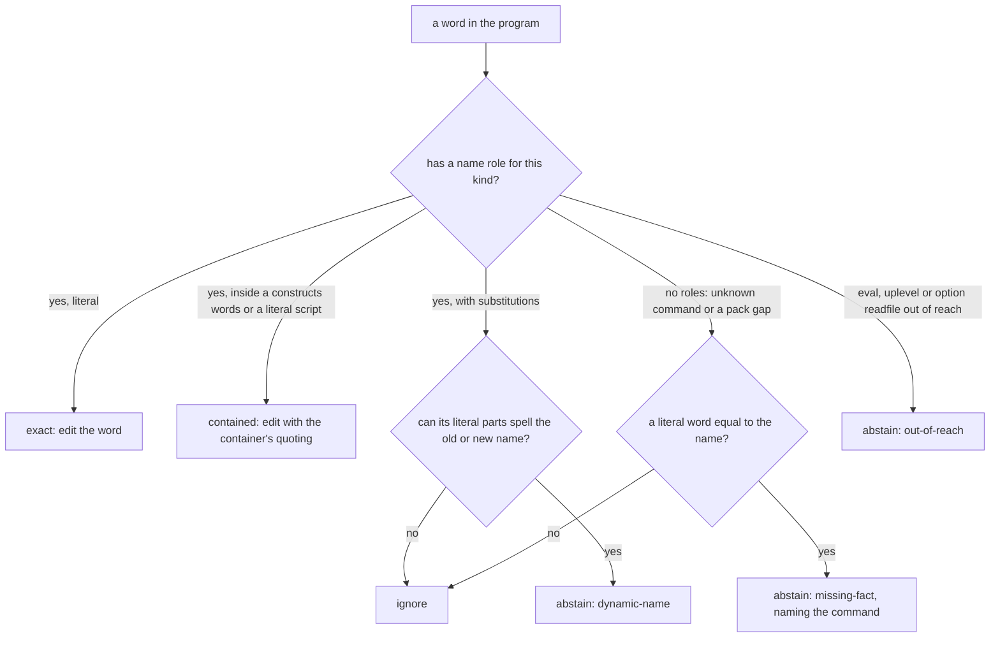
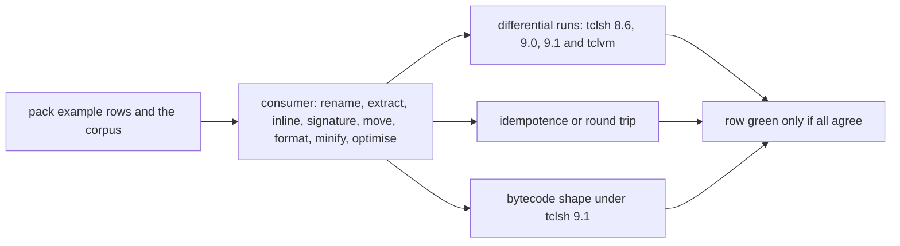

# Step 335 (proposed): SpecTcl facts for the source-transforming tools

Status: proposed 26 November 2026, with proposed items 345–355 (retired; see Plan numbers). It builds on
[305](305-spectcl-3.md) (grammar, rungs, `ctx`), [308](308-positioned-context.md)
(the positioned query), [313](313-consumer-hooks.md) (optimiser, minifier and
formatter at overview depth) and [319](319-consumer-migration.md) (consumer
migration). It adds the refactors, which 313 and 319 do not cover, and takes
the formatter, minifier and optimiser to the depth of every argument role and
edge case. Built on by the refactor crate (item 289's `tcl-ide-*` split) and the
conformance areas `refactor-*` and `source-tools`.

**Plan numbers** (26 November 2026): the proposed 345–355 are retired. Work items 1–2 → 437, 3 → 438, 4 → 439, 5 → 440, 6 → 441, 7 → 414 (merged with 333's 342); `-appends` → 390f. The [consolidated SpecTcl 3 specification](../spectcl-3/README.md) supersedes this design in detail, and its [crosswalk](../spectcl-3/12-plan-crosswalk.md) maps every proposed number.

## Problem

Four consumers rewrite source: the refactors, the formatter, the minifier and
the optimiser. Each needs to know which words **name** things and in which
scope, which words are **code** and in which frame, and which words are
**data** whose bytes must not change. Today each reads part of that from the
registry and guesses or refuses on the rest.

| Consumer | Code today | What it reads | What it cannot learn from a pack |
|---|---|---|---|
| Rename | `rename.rs` (1,107 lines), `rename/` (2,231, top level), `original_command_rename.rs` (1,942), `namespace_rename.rs` (1,564), `variable_symbol/rename.rs` (876), `rename_safety.rs` (1,278) | `ArgRole` name roles, `command_prefixes`, ensemble transitions (`original_command_rename.rs:1101`), `Traits::TCLOO_SELF_DISPATCH` | the scope of a library word that names a variable; that `[list H …]` builds a prefix whose head is H; a Tk option-database value; whether a window path is a name |
| Extract procedure | `refactor/extract_proc.rs` (1,459) | `VarWrite`/`VarRead`/`LoopVarList`, `is_frame_sensitive` (`traits.rs:170`), `DECLARES_NAMESPACE` | that `struct::set add seen …` writes `seen` in its caller |
| Inline procedure | `refactor/inline_proc.rs` (1,262) | `is_frame_sensitive`, `ArgRole::Expr` | whether a library call in the body writes a variable |
| Change signature, move to namespace | none | — | callback arity through `trace`, `-command`, `bind`, `after` |
| Minifier | `minify.rs` + `minify/` (5,713 production lines) | roles, `case_list`, ten traits in `name_compaction.rs:159-169,718-737` | per-name scope; iRules connection scope (`minify.rs:579` reads `is_irules()` for a lexical rule) |
| Formatter | `formatting/` (8,757) | `ArgRole::{Body, Keyword, Expr}`, `separator_spaces` | option pairs; that a line continuation ends inside a comment |
| Optimiser | `tcl-compiler/src/optimiser` (35,451 lines with tests, 9 `PassId`s) | effects, folds | rewrites over library calls (313 adds them) |

Three measured gaps on the current tree (`target/debug/tcl`, built 26
November):

- `tcl minify --compact` refuses a whole file because one name is
  namespace-scoped: "Name compaction requires exact source coverage and
  independent observer closure". It renames nothing (`minify-namespace-variable` in the examples).
- `tcl format --max-line-length 60` leaves a 90-column `dict create` line,
  because it only breaks at nesting depth 0. Reformatting an aligned layout
  rejoins the continuations but keeps the alignment padding.
- The editor-actions probe
  (`docs/work/name-handling/handover/oo-dispatch-probe/editor-actions/results.txt`)
  records `prepareRename -> null (no reason)`, while MCP `rename`
  (`tcl-mcp/src/tools/editor_queries.rs:216`) returns a refusal with a reason.

## Design

All four consumers read **one** set of word facts through
`ResolvedInvocation` (313 decision 1). This step adds the facts that name
things, place code in frames, and say how names are built. It also adds a
shared abstention record and a proof harness. Every construct has a SpecTcl 3
row and a Rust type.

### 1. Name facts

A word that names something carries a name role (today's `ArgRole` name
variants) plus four flags. 313 introduced `-scope`. This step widens it and
adds the rest:

```text
arg-row   += 'arg' N '-role' ROLE ?'-scope' SCOPE? ?'-resolve' RESOLVE?
                              ?('-defines'|'-probes'|'-links')? ?'-in' CONTAINER?
SCOPE      := local | caller ?LEVEL? | global | namespace | object | connection
RESOLVE    := current | global | ensemble | receiver {arg N} | self
CONTAINER  := word | list | script | percent-script | dict-value
ROLE      += MethodName | WindowPath | OptionName
option-row += '-value-role' ROLE … ?'-db' '{' DBNAME DBCLASS '}'?
```

- **Scope** says where the name lives. `caller 1` is what `upvar 1` reaches;
  `object` is a TclOO instance's namespace (`my variable`); `connection` is
  the iRules per-connection frame shared by every `when` body.
- **Resolve** says where lookup starts. An ensemble `-map` target resolves in
  the ensemble's namespace; a `my NAME` method resolves on the current object.
- **Access**: `-defines` creates the name, `-probes` asks about it without
  needing it (`CommandNameProbe`), `-links` aliases it (`VarCell`).
- **Container** says how the name sits inside the word, which decides how an
  edit must quote it. In a `percent-script` (a `bind` script) a new name
  containing `%` must be written `%%`.
- **`-db`** gives a Tk option's resource name and class (`tkButton.c:171`:
  `"-command", "command", "Command"`), so `option add *Button.command save`
  is found as a command prefix.

**Name construction** is a separate row on the command that builds a name or
a script from words:

```text
cmd-row   += 'constructs' ('words' | 'script' | 'current-namespace' | 'qualified'
                          | 'method-prefix' ?'-receiver' 'self'? | 'which') ?'-from' WORDS?
cmd-row   += 'transition' 'alias' '-name' WORD '-target' WORD
                          ?'-name-interp' WORD? ?'-target-interp' WORD?
```

| Construction | Row | What the refactor learns |
|---|---|---|
| `[list save $path]` as a callback | `command list { constructs words }` | element 0 is the callback's head; edit it in place |
| `[namespace current]::f` | `command {namespace current} { constructs current-namespace }` | the value is the enclosing namespace, known per position |
| `${ns}::$x` | none: word syntax | the literal parts bound the names it can spell |
| `[namespace code {f}]`, `[namespace which f]` | `constructs script` / `constructs which` | a script or a qualified name resolved here |
| `interp alias {} new {} target a` | `transition alias -name {arg 1} -target {arg 3} -name-interp {arg 0} -target-interp {arg 2}` | both names, if both interps are `{}` |
| ensemble `-map {show ::app::Show}` | `option -map -value-role CommandPrefix -in dict-value -resolve ensemble` | keys are subcommands; values are prefixes |
| `.f.b` | `arg 0 -role WindowPath -defines` on widget commands | the path is a name and a command; `.f` is its parent |
| `my save`, `[self] save`, `[callback save]` | `MethodName -resolve self`; `command callback { available core 9.0- ; constructs method-prefix -receiver self }` | a method of the current class |

`callback` and `mymethod` exist only from 9.0 (`info commands
::oo::Helpers::*` lists them on 9.0.4, not on 8.6.18), so that row is read
through 308's dialect set. A `[list my save c]` passed to `after` fails on
9.0 and 9.1 with `invalid command name "my"`, because `after` runs it in the
global frame. That is why every callback body needs a frame.

### 2. Frame facts

```text
body-flags := '-frame' ('same' | 'global' | 'new' | 'shifted' LEVEL
                       | 'namespace' WORD | 'connection')
              ?'-appends' N? ?'-percent-subst'? ?'-concat'?
```

`-frame` replaces the pair today's types split across `BodyKind`
(`body_kind.rs:50`) and `ScriptLookupScope` (`script_lookup_scope.rs:25`:
`InvokingFrame`, `GlobalFrame`, `TriggerFrame`). `-appends` is today's
`AppendedArity`, stated on the body or option. `-concat` marks `after 0 a b`,
which joins its words into one script.

### 3. Refactors

Every refactor classifies each word it might touch into one of five cases.
Only the first two produce edits:



The bound for `bounded` is today's per-site rule (`rename_safety.rs`,
`namespace_variable_rename_hazard`): substitutions can produce anything, but
the literal characters around them cannot change.

**Rename.** For command, variable, namespace, method and option names:

- Occurrences come from the classification above over every word whose role
  has the same name kind and whose `-scope`/`-resolve` reaches the target.
- `-command`, `after`, `bind`, `trace`, `-validatecommand`, `fileevent`:
  callback bodies and prefixes are `contained` occurrences. The edit uses
  the container's quoting: list quoting inside `[list …]`, script quoting in
  a braced body, `%%` in a `percent-script`.
- Ensemble `-map`: the value's head is edited and the key stays. Today's
  `ensemble_word_requests` (`original_command_rename.rs:1101`) does this for
  the core command; the row makes it data.
- Window paths: renaming `.f` edits every path with prefix `.f.`. A path
  built as `$w.b` is `bounded`.
- Option database: a `*Button.command` or `*command` value is a `contained`
  prefix occurrence when every option whose `-db` name matches has a role. If
  any of them lacks one, the rename abstains.
- `interp alias`, `[namespace current]::f`, `namespace code`, and TclOO
  `my`, `[self]`, `callback` and `mymethod`: through section 1's
  construction rows. An alias whose interp words are not `{}` is
  `out-of-reach`. `[namespace current]` inside a procedure is the
  procedure's namespace, so it is known wherever the definition is.
- Collisions: today's `Collision`/`UnknownWorld` refusals stay.

**Extract procedure** moves code one frame deeper. A name with `-scope
caller 1` in the selection becomes a variable the selection touches, so it
gets today's protocol: read-only names are value parameters; names written
and read later are passed by name and rebound with `upvar 1`. Other cases
abstain:

- `caller 2` or deeper;
- a body with `-frame shifted`;
- any `is_frame_sensitive` command;
- a library call whose roles are incomplete, when one of its literal words
  equals a variable of the selection.

The last is the `missing-fact` case (`extract-upvar-library` in the examples file).

**Inline procedure** moves code one frame up. A body with a library call
inlines only if that call's roles are complete (no unknown `VarWrite` leaks
into the caller) and every argument it duplicates is `pure` (313's effect
classes).

**Change signature** (new) edits every call. Callback prefixes carry
`-appends N`, so a prefix with K leading words calls the procedure with K+N
arguments. A new required parameter goes at position K, before the appended
ones. An optional parameter needs no prefix edit. A prefix whose host
command has no `-appends` fact abstains. `trace add variable` appends 3:
adding a parameter to the callback without editing the prefix gives `can't
set "::w": wrong # args` on 8.6.18, 9.0.4 and 9.1.0.

**Move to namespace** (new) renames a procedure's qualifier and re-resolves
its body. It abstains when the body:

- reads `namespace current`, `info level` or `uplevel`;
- uses an unqualified command that resolves differently from the new
  namespace (its `namespace path` and imports);
- names a `-scope namespace` variable the destination does not declare.

`namespace export` patterns that match the old name become `bounded`
occurrences.

**One abstention record.** All five refactors return:

**Source:**

```rust
// design sketch: 335
pub struct Abstain {
    pub code: AbstainCode,          // Lookup(UnknownReason) | missing-fact | out-of-reach | frame | collision | …
    pub at: Span,
    pub reason: String,             // the LSP `disabled.reason` / prepareRename error message
    pub missing: Option<MissingFact>, // { command: CommandKey, fact: FactKind } for `tcl spec check --consumer`
}
pub enum AbstainCode {
    Lookup(UnknownReason),          // every `Answer::Unknown(reason)` abstains with its own reason
    MissingFact, OutOfReach, Frame, Collision, /* … */
}
```

`AbstainCode` is a superset of item 78's `UnknownReason`
(`tcl-core-types/src/answer.rs:49`): a refactor that abstains because a
lookup answered `Unknown(reason)` carries that reason as
`AbstainCode::Lookup(reason)`, so `DynamicName`, `IncompleteLookup` and the
rest are spelled once. `MissingFact` names the command by the registry's
generation-independent `CommandKey` (`LibraryId`, interned command path), not
the engine's `CommandId(u32)`. `Abstain` amends item 78's
`EditorOutcome = Result<T, Refusal<R>>`: item 439 makes it the shared editor
outcome, so item 78 is marked amended by 439 (a plan handoff).

Renaming `::app::on_save` where `dispatch` calls `::app::on_$action`: the
word's literal prefix `::app::on_` can spell both the old name and
`::app::on_store`, so the rename abstains. Renaming `::app::helper` would not.

**In memory:**

```rust
// design sketch: 335
Abstain {
    code: AbstainCode::Lookup(UnknownReason::DynamicName),
    at: Span { start: 156, end: 173 },     // `::app::on_$action`, dyn-before.tcl
    reason: "`::app::on_$action` can name ::app::on_save; no edit keeps it consistent".into(),
    missing: None,
}
```

**Bytecode (tclsh 9.1.0):**

```text
  Command 2: "::app::on_$action..."
    (0) push 0 	# "::app::on_"
    (5) loadScalar %v0 	# var "action"
    (10) strcat 2 
    (12) invokeStk 1 
```

**Result:**

```text
$ tclsh9.1 dyn-before.tcl          # 8.6.18 and 9.0.4 print the same
saving
quitting
$ tclsh9.1 dyn-naive.tcl           # only the declaration renamed
invalid command name "::app::on_save"
    while executing
"::app::on_$action"
```

It replaces `RenameRefusal` (`rename_safety.rs:131`, a
`tcl_core_types::Refusal<LspRange>`) and `OriginalCommandRenameRefusal`'s
codes map into it. `prepareRename` returns it as an error with the reason, as
MCP already does.

A pack can withdraw a refactor (`refactor -no {rename extract}`), as 313's
`optimise -no` withdraws a permission. It cannot grant one.

#### Worked example: a Tk `-command` callback

The pack (Tk rows; `list` and `after` are core rows of the same shape):

**Source:**

```spectcl
speclib tk-names 3 {
command button {
    available Tk 8.4-
    arg 0 -role WindowPath -defines
    option -command -value-role Body -frame global -db {command Command}
}
command bind {
    available Tk 8.4-
    arg 2 -role Body -frame global -in percent-script
}
}
```

**In memory:**

```rust
// design sketch: 335. OptionSpec and OptionArg exist today (hover.rs:272,
// commands/tk/button.rs:50, OptionValue::deferred_script); `frame` and `db` are new.
OptionSpec {
    name: "-command",
    value: OptionValue::Takes(OptionArg {
        role: ArgRole::Body,
        body_kind: BodyKind::Structural,
        script_timing: ScriptTiming::Deferred,
        frame: Some(BodyFrame { frame: FrameSel::Global, appends: None,
                                percent_subst: false, concat: false }),
        db: Some(OptionDbName { name: "command", class: "Command" }),
        ..OptionArg::DEFAULT
    }),
    ..
}
// core: CommandSpec { name: "list", constructs: Some(Construct::Words), .. }
```

Renaming `save` to `store`:

**Before:**

```tcl
proc save {path} { puts "saved $path" }
button .b -text Save -command [list save $path]
bind . <Control-s> {save %W}
option add *Button.command save
after 0 {save third.txt}
```

**After:**

```tcl
proc store {path} { puts "saved $path" }
button .b -text Save -command [list store $path]
bind . <Control-s> {store %W}
option add *Button.command store
after 0 {store third.txt}
```

The compiled change is one literal (`push 1 # "save"` becomes `push 1 #
"store"`); the instruction stream is identical:

**Bytecode (tclsh 9.1.0):**

```text
ByteCode, refCt 1, epoch 24
  Source "set cb [list store $path]"
  Cmds 2, src 25, inst 23, litObjs 3, aux 0, stkDepth 3, code/src 0.00
  Commands 2:
      1: pc 0-21, src 0-24        2: pc 5-20, src 8-23
  Command 1: "set cb [list store $path]"
    (0) push 0 	# "cb"
  Command 2: "list store $path..."
    (5) push 1 	# "store"
    (10) push 2 	# "path"
    (15) loadStk 
    (16) list 2 
    (21) storeStk 
    (22) done 
```

No `wish` is installed here, so the Tk lines are text. The `after` and
`[list …]` paths were run (`tk-before.tcl` and `tk-after.tcl` in the examples
file):

**Result:**

```text
$ tclsh8.6 tk-after.tcl; tclsh9.0 tk-after.tcl; tclsh9.1 tk-after.tcl; tclvm tk-after.tcl
saved out.txt
saved other.txt
saved third.txt            (identical on all four, and identical to tk-before.tcl)
$ tclsh9.1 tk-naive.tcl    # declaration renamed, callbacks left
invalid command name "save"
    while executing
"save out.txt"
    ("after" script)
```

`tk-before.tcl` is the non-Tk core of the example: `proc save`, then `after
0 $cb` with `cb` built by `[list save $path]`, `after 0 [list save
other.txt]`, `after 0 {save third.txt}`, and a `vwait`. `tclvm` is
`target/debug/tclvm`.

### 4. Formatter, minifier and optimiser: every role

Each role's answer when the fact is present, and what happens without it:

| Roles (`arg_role.rs:54`, 28 variants) | Formatter | Minifier | Optimiser |
|---|---|---|---|
| `Body`, `LambdaLiteral` | reindent by `-frame`; recurse | recurse; names by the body's frame | analyse the body in its frame |
| `OpaqueScript` | fold as a block; bytes verbatim | verbatim | none |
| `Expr` | break at `&&`/`\|\|` | compact; fold | simplify and fold |
| `VarWrite`, `VarRead`, `VarCell`, `LoopVarList` | verbatim | rename by `-scope` | dataflow |
| `ParamList`, `StaticVarList` | verbatim | rename formals | arity |
| `Name`, `CommandName`, `CommandNameProbe`, `CommandPrefix`, `NamespaceName` | verbatim | rename only under `isolated` | call graph, dead procedures |
| `Pattern`, `FormatString`, `ScanFormat` | verbatim | never re-escaped (`-frozen` implied) | fold if literal |
| `Option`, `Subcommand`, `OptionTerminator`, `Keyword` | `layout pairs` | expand or keep abbreviations | `option_effects` |
| `Value`, `Index`, `Channel`, `Boolean`, `NumericOrBoolean`, `Result` | pairs | dequote when safe | constant propagation |
| **no role** (unknown command, pack gap) | greedy split at depth 0 | names in reach abstain (per name) | `impure`: no CSE, hoist, rewrite or dead-call removal |

And each edge case:

| Edge case | Facts it needs | Formatter | Minifier | Optimiser | Without the fact |
|---|---|---|---|---|---|
| `{*}` expansion | arity, `-appends` | break before `{*}` only | keep the `{*}` word; names in it stay | argc unknown: no fold of the call | as the "no role" row |
| Dynamic heads (`$cmd …`, `[f] …`) | none: the head has no spec | words are `Value` | the scope's names abstain | `impure` | — |
| `subst` and `eval` bodies | `subst`: `arg N -role Body -in script` with `-nocommands`/`-novariables` options as `option_effects`; `eval` of a literal: `Body` | never reflow inside `subst` (its whitespace is data) | `$name` inside a `subst` body is a read; a dynamic `eval` blocks the scope (`CREATES_DYNAMIC_BARRIER`) | literal `eval` folds into its body | the word is `Value`: no edits inside |
| Tk option database | `-db` on options; `option add` arg 1 `-role OptionDbValue` | data | a `*command` value is a prefix occurrence; procedures are renamed under `isolated` only if every matching option has a role | widget creation reads the database: `effect-free`, not `pure` | `option add`/`readfile` present: no procedure renaming |
| iRules events | `when` body `-frame connection`; `priority` option | indent the body; `priority N` stays on the `when` line | locals are `connection` scope: one rename across every `when` body | each event is an entry point; no dead-code across events | treat every local as `global` |
| Comments inside bodies | `Body` vs `case_list` vs `OpaqueScript` | a comment ending in `\` continues to the next line, so never join a line onto a comment | strip comments only in `Body`; `#` in a `case_list` is a pattern | none | the word is data: comments kept as bytes |
| Line continuations | separator positions (`source_layout::separator_spaces`) | `\`-newline plus indent is one separator; rejoin only outside comments and quotes | collapse to one space | none | keep the bytes |

Two of these were checked on 8.6.18, 9.0.4 and 9.1.0 (`edge.tcl` in the
examples file). A `# { … }` arm in a `switch` body is a pattern: subject `#`
runs it. `# note \` on one line makes the next line, `return early`, part of
the comment, so `p` returns `late`.

`minify.rs:579` decides that `}{` is a word boundary from `is_irules()`. That
is a lexical property of the TMM interpreter. It becomes a dialect capability
on f5-tcl's `tmm` build (301), and the minifier reads it through 308.

#### Worked example: formatter with comments and continuations

**Source:**

```spectcl
speclib core-layout 3 {
command {dict create} { layout { lead 0 ; pairs options ; break each ; align options } }
}
```

**In memory:**

```rust
// design sketch: 313's layout rows, as 335 lowers them
LayoutRows { lead: 0, pairs: PairsFrom::Options, break_: BreakPolicy::Each,
             align: Some(PairsFrom::Options), clauses: vec![] }
// the dict-create words carry ArgRole::Option / ArgRole::Value pairs (today's roles)
```

**Before:**

```tcl
proc serve {host port} {
    # open the listener \
    puts "this line is still the comment"
    set opts [dict create -host $host -port $port -backlog 128 -reuseaddr 1 -timeout 30000]
    set argv [list -verbose \
        -log /var/log/serve.log]
    puts [dict get $opts -port]   ;# trailing comment
    puts [llength $argv]
}
```

**After:**

```tcl
proc serve {host port} {
    # open the listener \
    puts "this line is still the comment"
    set opts [dict create \
        -host      $host \
        -port      $port \
        -backlog   128 \
        -reuseaddr 1 \
        -timeout   30000]
    set argv [list -verbose -log /var/log/serve.log]
    puts [dict get $opts -port]
    # trailing comment
    puts [llength $argv]
}
```

The comment-continuation pair is kept as two lines; the `;#` comment moves to
its own line, as today's formatter already does. `tcl format
--max-line-length 60` today gives `set opts \` and then the whole 90-column
`[dict create …]` on one line.

The `dict create` of the formatted body compiles as before; the
continuations leave no trace in the instructions.

**Bytecode (tclsh 9.1.0):**

```text
  Command 2: "dict create  -host      $host  -port      $port  -backl..."
    (0) push 0 	# ""
    (5) push 1 	# "-host"
    (10) loadScalar %v0 	# var "host"
    (15) dictPut 
    (16) push 2 	# "-port"
    (21) loadScalar %v1 	# var "port"
    (26) dictPut 
    (27) push 3 	# "-backlog"
    (32) push 4 	# "128"
    (37) dictPut 
    (38) push 5 	# "-reuseaddr"
    (43) push 6 	# "1"
    (48) dictPut 
    (49) push 7 	# "-timeout"
    (54) push 8 	# "30000"
    (59) dictPut 
    (60) storeScalar %v2 	# var "opts"
```

**Result:**

```text
$ for v in 8.6 9.0 9.1; do tclsh$v fmt-before.tcl; tclsh$v fmt-after.tcl; done
8080
3                      (all six runs; target/debug/tclvm prints the same)
$ ./dis.sh fmt-before.tcl proc serve | grep '^ *(' > b; ./dis.sh fmt-after.tcl proc serve | grep '^ *(' > a
$ diff b a && wc -l < a      # dis.sh: tclsh9.1 ::tcl::unsupported::disassemble, addresses trimmed
35
```

### 5. Parity: the Rust spelling

Every SpecTcl construct above lowers into registry-core types. Where a type
exists, it is extended, not duplicated.

| SpecTcl 3 | Rust (design sketch unless marked) |
|---|---|
| `-role ROLE` | `ArgRole` (exists), plus `MethodName`, `WindowPath`, `OptionName`, `OptionDbValue` |
| `-scope`, `-resolve`, `-defines`/`-probes`/`-links`, `-in` | `NameFacts { kind: NameKind, scope: NameScope, resolve: Resolve, access: NameAccess, container: Container }` on each role slot; `NameScope` supersedes `VariableScope` (`hover.rs:197`) |
| `-frame`, `-appends`, `-percent-subst`, `-concat` | `BodyFrame { frame: FrameSel, appends: Option<AppendedArity>, percent_subst: bool, concat: bool }`; `FrameSel` supersedes `ScriptLookupScope` plus `BodyKind` |
| `constructs …` | `Construct::{Words, Script, CurrentNamespace, Qualified, MethodPrefix { receiver }, Which }` on `CommandSpec` |
| `transition alias …` | `StateTransition::Alias(AliasTransition { name, target, name_interp, target_interp })`, beside the existing `NamespaceTransition::Ensemble` |
| `option … -db {N C}` | `OptionDbName { name, class }` on `OptionArg` |
| `refactor -no {…}` | `RefactorPermissions` (a bit set that only withdraws) |
| `example …` (section 6) | `ConformanceExample`, tool-time only; `compile_image` drops it |
| abstention | `Abstain { code, at, reason, missing }` in `tcl-core-types` |

The image (306, 313) stores `NameFacts` and `BodyFrame` in `FACETS`, and
`Construct` and `AliasTransition` in `SPECS`. No new section is needed.

### 6. Proof and test

Each consumer proves it preserves behaviour in four ways.



1. **Differential runs.** `tcl spec prove --consumer C` (313's verb,
   widened) runs the before and after scripts under `tclsh8.6`, `tclsh9.0`,
   `tclsh9.1` and `target/debug/tclvm`. It compares exit status, stdout and
   stderr. For the minifier, stderr goes through `unminify_error` first.
   Callbacks only count if they fire, so a refactor row ends with `after 10
   {set done 1}; vwait done`. Tk rows run under `wish` with Xvfb, and are
   skipped (and reported) where `wish` is missing.
2. **Bytecode shape**, from `::tcl::unsupported::disassemble` on 9.1:
   - formatter: the instruction streams must be identical (example above);
   - rename and minifier: the same opcodes and operands, with literals and
     local names mapped through the rename or the `SymbolMap`. In
     `minify-namespace-variable`, the two `::cfg::check` bodies both have 116 instruction bytes;
   - extract, inline and the optimiser change code, so they have no shape
     check. They rely on differential runs and, for rewrites, 313's proof
     sets.
3. **Idempotence and round trips:**
   - `format(format(x)) == format(x)`, with layout rows on;
   - `minify(minify(x)) == minify(x)`;
   - rename A to B, then B to A, gives the original bytes;
   - `optimise` reaches a fixed point within `optimise_source_multipass`'s
     bound;
   - extract then inline, where inline admits, is differential-equal.
4. **Conformance rows a pack ships:**

```text
example    := 'example' ID '{' 'consumer' CONSUMER
                 'source' TEXT ?'at' LINE COL? ?'new' NAME?
                 'expect' ('edits' TEXT | 'abstain' CODE | 'output' TEXT)
                 ?'run' RELEASES? '}'
```

`tcl spec check --consumer C` runs them statically, and `tcl spec prove`
runs them under each release in `run`. They are tool-time data:
`compile_image` drops them, so they cost no image bytes. A pack is
*source-tool-safe* for consumer C when `tcl spec check --consumer C` reports
no `missing-fact` on its own commands.

## Work list

1. Registry core: `NameFacts`, `BodyFrame`, `Construct`, `AliasTransition`,
   `OptionDbName`, `RefactorPermissions`, `Abstain`, and the four new roles.
2. reader3: the rows of sections 1, 2 and 6. Shims: `-variable-scope` (1.2)
   becomes `-scope`; `appended_arity` becomes `-appends`.
3. The core and Tk surfaces: rows for `list`, `namespace current/code/which`,
   `interp alias`, `namespace ensemble`, `after`, `bind`, `trace`, `option`,
   every widget's `-command`/`-db`, and TclOO `my`/`self`/`callback`/`mymethod`.
4. Rename on the classifier; `prepareRename` returns `Abstain`.
5. Extract and inline on `-scope caller` and `-frame`; then change signature
   and move to namespace.
6. Formatter, minifier and optimiser: the edge-case table, row by row.
7. `tcl spec prove --consumer`, `example` rows, and the corpus run.

## Verification

- **Done when:** every example in `examples-335.json` is a green conformance
  row on 8.6, 9.0, 9.1 and tclvm (Tk rows under `wish` where present).
  Further:
  - `rg 'is_irules\(\)' rust/tcl-lsp-core/src/minify*` finds nothing;
  - `prepareRename` and MCP `rename` give the same reason for each refusal
    over the editor-actions workspaces;
  - the formatter is idempotent with layout rows on over the corpus.
- **Measurements:**
  - rename latency on the editor-actions workspace C (2–12 ms today), which
    must not regress beyond 10%;
  - abstention counts per code, over tcllib 2.0, before and after the Tk and
    tcllib rows;
  - the differential harness's runtime per row.

## Risks

- **Roles claimed complete but wrong.** A pack that says a word is `Value`
  when it names a variable makes a rename edit too little. Mitigation: the
  differential rows, and `complete` is a claim `tcl spec check` can only
  report, never prove.
- **Option database and `source` reach.** A resource file read at run time
  is invisible. Mitigation: `option readfile` and `source` of a
  non-workspace file are `out-of-reach`.
- **iRules scope.** The `connection` scope across rules on one virtual
  server is not verified here (open question 1).

## Corrections to 313 and 319

- **313, minifier.** "Abstention is per name, not per file" is the target.
  Today `tcl minify --compact` refuses `minify-namespace-variable`'s whole file. 313's
  `-scope` lacks `object`, `connection` and caller levels.
- **313, formatter.** Today's split breaks at depth 0 only (a 90-column line
  stays at `--max-line-length 60`). Reformatting an aligned layout keeps the
  padding but rejoins the lines, so the `align` row needs the whitespace
  normaliser to leave pair padding alone, or idempotence fails.
- **319, the minifier's size.** 313's 7,888 is `minify.rs` plus
  `minify/*.rs`, tests included and `minify/original/tests.rs` excluded. It
  is reproducible; production is 5,713 and the whole tree 9,470.
- **319, consumers.** The 13 consumers omit the refactors. They read
  `Traits` and name roles in `refactor/` and `rename*`. They need a row like
  3–5's, which is this step.
- **319, axes.** `minify.rs:579`'s `is_irules()` belongs in the `dialect`
  axis count.

## Open questions

1. **iRules local scope.** Are locals shared across rules on one virtual
   server, or only across one rule's events? A BIG-IP run settles it, which
   decides whether `connection` is per rule or per virtual.
2. **Shadowed `list`.** A `contained` edit through `[list …]` needs the
   resolved `list` to be core's. This decision takes the resolved command.
   Is a user `list` proc rare enough to abstain on, rather than resolve?
3. **Where `example` rows live.** In the pack, or in a sibling test file
   that the pack names? Settled by the size of tcllib's rows.
4. **Tk in CI.** Tk rows need `wish` and Xvfb. This machine has no `wish`.

## Review fixes (26 November 2026, deep review)

- **M5.** `AbstainCode` is a superset of `UnknownReason` (`Lookup(reason)`); `Abstain` amends item 78's editor outcome through item 439 (plan handoff).
- **M6 (this doc's part).** `MissingFact` names a `CommandKey`, not the engine's `CommandId`.
