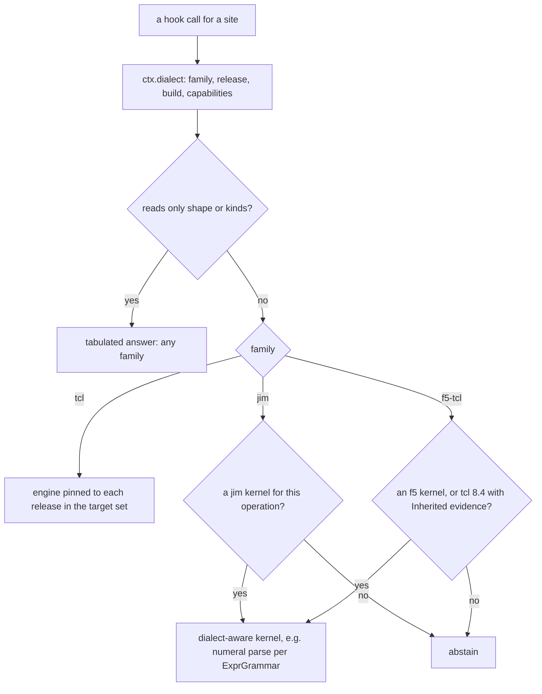

# Step 350 (proposed): SpecTcl 3 and the registry across dialects

Status: proposed 26 November 2026, with proposed items 356–365 (retired; see Plan numbers).
It reviews [301](301-dialects.md)–[308](308-positioned-context.md) and
[313](313-consumer-hooks.md) dialect by dialect: tcl 8.4–9.1; jim 0.76–0.84
under `full`, `minimal` and its extensions; f5-tcl on the BIG-IP lines under
`tmm` and `scriptd`. f5-tcl is covered here only at dialect level. Events,
profiles, the flow graph and `tcl-irule-test` are in
[360](360-spectcl-f5-integration.md).

**Plan numbers** (26 November 2026): the proposed 356–365 are retired: 356 → 427, 357 → 428, 358 → 429, 359 → 426 (its `{*}` axis and character model → 417), 360 → 431, 361 → 432, 362 → 430, 363 → 433, 364 → 434, 365 → 435. The table under "Plan items" and the "item 3NN" references below use the proposed numbers. The [consolidated SpecTcl 3 specification](../spectcl-3/README.md) supersedes this design in detail, and its [crosswalk](../spectcl-3/12-plan-crosswalk.md) maps every proposed number.

## Problem

The model is written for C Tcl. The other two families are attached to it
by inheritance, and several of the facts they inherit are wrong.

- **Jim is pinned to one release.** The `jim` environment spans 0.76–0.84 with
  build `Canonical` (`model/environment.rs:1309-1320`). Native recipes exist
  only for 0.84 under `Canonical` or `JimFull`
  (`tcl-syntax/src/naming/native.rs:730-740`). `Jim084` is named 1,026 times
  in 320 files. Any other release or build gets no recipe and abstains.
- **Jim's core surface is Tcl's, wholesale.** `jim.tclspec` (76 lines) copies
  82 Tcl 8.6 heads with their Tcl facts. `jim-own-surface.tclspec` (977
  lines, 60 commands) adds Jim's own. Nothing records where an inherited
  command behaves differently. The analyser is silent on `lsort -indices` and
  `string is entier`, which Jim rejects.
- **Jim's extensions are five flags.** 301's `Extension` has `Binary`,
  `Ensemble`, `Json`, `Tclprefix` and `Zlib`. Jim's `auto.def:64-102` lists
  31 extensions. Each is static or a module, and on by default, optional
  (off under `--minimal`) or off.
- **f5-tcl's character model is 8.6's.** `family.rs:918` gives F5
  `Utf16CodeUnits`, with a comment saying no appliance evidence exists. The
  fork point is 8.4.6, and 8.4 has no `\U` escape.
- **The iRules surface is almost unversioned.** The 1,018 files under
  `commands/irules/` carry five version keys: four `21.1.0` (`persist.rs`,
  `ssl__c3d.rs`) and one `16.1.0` (`http2__header.rs`). The events add 13
  `introduced` and 3 `deprecated` keys. `proc` and `call` carry
  `Lifecycle::UNSPECIFIED` (`commands/irules/call.rs:59`), so nothing in the
  repository records the owner's "no `proc` in older releases". The
  tracks-host library therefore answers the same command surface on 9.0 and
  on 21.1.
- **Hooks run on C Tcl.** `engine_for_hook_release`
  (`tcl-spec-hooks/src/lib.rs:86-99`) pins an engine only where the profile
  has an execution point. Otherwise it runs `TclVmEngine::new()`, which has
  9.0 semantics. `TclVmEngine::for_native_release`
  (`tcl-engine-tclvm/src/lib.rs:517`) builds a Tcl VM in every case. No path
  evaluates as Jim or as F5.

Our tools under each dialect, measured with `target/debug/tcl` (built 26
November 2026, 08:36) and the oracles:

| Input | Real interpreter | Our tools |
|---|---|---|
| `list {*}$l` in an iRule | F5: `* {a b c}`, silently (measurements §1) | no diagnostic |
| `namespace eval ::x {}`, `rename a b` in `when` | load error `command is disabled` (§5) | no diagnostic |
| `exec ls`, `dict create a 1` in `when` | load error: disabled, or `undefined procedure` (§4a) | W123 hint |
| `proc late {} {}` inside `when` | load error `not valid in the current scope` (§4c) | IRULE5006 warning |
| `[clamp 12]`, a top-level proc called directly | load error `undefined procedure` | IRULE5005 error |
| `set m [list a $l]` under any f5-tcl environment | — | `tcl dis` emits `push1 ""` for `$l` (a bug) |
| `lsort -indices`, `string is entier` under `jim` | jimsh: bad option, bad class | no diagnostic |
| `namespace exists`, `package present`, `encoding` under `jim` | jimsh: unknown subcommand or command | W001, W001, W002 |

## Design

### 1. Language differences the registry models per dialect

Each row says where the fact lives and what 350 adds. Rows marked **axis**
need a Rust lexer, parser or binding change: a new axis is Rust, and a pack
only sets its values (redesign §3.1).

| Area | tcl 8.4 → 9.1 | jim 0.76–0.84 | f5-tcl (both builds) | 350 adds |
|---|---|---|---|---|
| Numerals | `010` is 8 to 8.6, 10 from 9.0; `0o`, `0b` from 8.5; `1_000` from 9.0 | `010` is 10; `0o`, `0b` yes; `1_000` no | 8.4: `0b101` fails (§4b) | nothing; `ExprGrammar.numbers` holds it (301) |
| Escapes and characters | `\U` from 8.6; 8.6.18 maps `\U0001F600` to U+FFFD; 9.x counts scalars | `\U` yes; UTF-8 under `utf8`, bytes under `--minimal`; no `encoding` command | 8.4 rules, unmeasured | F5 character model `BmpCharsElseUtf8Bytes` with `Inherited` evidence, or `None` until measured |
| `expr` | 8.5 adds `**`, `in`, `ni` | own precedence ladder, `=*`, `=~`, `<<<`; `expr 1 + 2` refused from 0.81 | 8.4 plus `starts_with`, `contains`, `matches_*`, word `and`/`or`/`not` | nothing new; `IRULE_*` opcodes become f5-tcl opcodes (§3) |
| Word rules | `{*}` from 8.5 | `{*}` in words, as 8.5 | `}{` splits (R2); `{*}` is inert; a `{` line continues (N1) | **axis** `expansion {word inert}` so an inert `{*}` is a diagnostic |
| Namespaces | `namespace eval` runs in the namespace; 8.x writes an existing global (creative writing), 9.x does not | runs in a new call frame: `set v 1` makes a frame local; no `exists`, `children` | 8.4; `namespace` refused by the iRules compiler | **axis** `namespace-eval-frame {namespace new-frame}` and `creative-writing {yes no}` for binding |
| `proc` and lambdas | 3 words; defaults only after required parameters | 3 or 4 words (statics, `&name` statics from 0.83); defaults and `args` anywhere; `&name` reference parameters; no `{*}` parameter: `{a {*}rest}` is the three names `a`, `*`, `rest`; `local`, `lambda` | 8.4 `proc`; iRules reaches top-level procs only through `call` | **axis** `proc-params {tcl jim}`; the statics refinement stays in the pack |
| References and GC | none | `ref`, `getref`, `collect`, finalizers; any string holding the reference text keeps it alive | none | effect `ref-liveness` (§4, optimiser) |
| Lists and dicts | `lsort -stride` from 8.6; `dict getdef` from 9.0 | `lsearch` defaults to `-exact`; no `lsort -indices`; `string is` has 15 classes | no `dict`, `lassign`, `lmap` (§4) | Jim deltas as facets on inherited commands (§2) |
| Errors and codes | 0–4; `try` from 8.6 | `info returncodes`: 5 `signal`, 6 `exit`, 7 `eval`; `catch -signal` | 8.4 `catch`; no `try`; TMM handlers suspend with code 5 | **axis** `return-codes`; CFG continuation for code 5 under `tmm` |
| `package`, `load` | `pkgIndex.tcl`, `ifneeded`, ranges | `forget names provide require` only; `require name ?version?`; finds `name.tcl` or `name.so` on `auto_path` | `package`, `load` absent or refused in `tmm`; `scriptd` iApps ship packages (below) | Jim `package` as a binding-transition descriptor with no `ifneeded` |
| `info` | 9.1 adds `cmdtype`, `consts`, … | adds `statics`, `alias`, `references`, `returncodes`, `source`, `version`; no `class`, `object` | 8.4 set; tmsh adds `info vartype` (§4) | subcommand-set facets keyed by family |
| `unknown` | default `unknown` auto-loads | no default `unknown`; a user `unknown` is honoured | `unknown` absent from TMM's interpreter | world policy: Jim open, `tmm` closed at load |
| Restrictions | — | — | `tmm`: 16 absent commands, 15 refused by the rule compiler, top level declaration-only, `proc` banned lexically in `when`, `call`, `static::`, `::` globals demote CMP, `table`, `session`, `after` suspend | a `build tmm` core property (absent) and the iRules policy (refused, 304) |
| Releases | 8.4–9.1 | 0.76–0.84 | BIG-IP lines 9.0–21.1; only 21.1.0.1 measured | iRules lifecycle rows from evidence (item 361) |
| Command surfaces | Tcl core | own core | `tmm`: iRules; `scriptd`: iApps, tmsh (304) | nothing; tmsh's build is Q11 |

### 2. What SpecTcl 3 needs

**Name the family in `core`.** 305's `available core 0.78-` means the pack's
family, which is ambiguous in a pack that declares two. Write `LIB-RANGE :=
LIBRARY RANGE | 'core' FAMILY RANGE`. Keep `core RANGE` only in a pack whose
rows all name one family.

**Inherited commands carry deltas.** `include from tcl into jim` becomes a
generated Jim core surface (item 357). It copies the Tcl rows where a jimsh
conformance row agrees, and restates the rest as facets keyed by
`-dialect {jim …}`:

**Source:**

```spectcl
speclib jim-core 3 {
    command lsearch {
        available core jim 0.76-
        mode-default -exact            ;# new: the match mode when none is written
    }
    command lsort {
        available core jim 0.76-
        option -indices { available core tcl 8.5- }
    }
    command {string is} {
        versions {core jim 0.76-} { arg class -values- {false true wordchar} }
    }
}
```

**In memory:**

```rust
// design sketch: types from 302; the delta table is proposed here (item 357)
VersionedSpec {
    availability: Availability { library: None, window: ItemHistory::from("0.76"),
                                 dialect: Some(DialectConstraint { ranges: &[jim(0.76..)], caps: &[] }) },
    value_sets: Facet { rows: &[(FacetKey { library: ALL, dialect: Some(jim(0.76..)) },
                                 &[Alnum, Alpha, Ascii, Boolean, Control, Digit, Double,
                                   Graph, Integer, Lower, Print, Punct, Space, Upper, Xdigit])] },
    ..
}
```

The 15 classes are jimsh's `bad class` list. `mode-default` is a new row:
it names the option a command behaves as when no mode option is written, so
the optimiser and hover can read it. **Jim extensions are
libraries.** Each `auto.def` extension becomes a tracks-host library on
`jim`. The build's capability predicate decides whether it exists. A static
extension is placed `ambient`, and one built as a module is `hosted`, because
`package require` loads its `.so`:

```spectcl
library json  { tracks-host jim ; compatible json 0- {jim 0.79- -requires json} }
library oo    { tracks-host jim ; compatible oo 0- {jim 0.76- -requires oo} }
library tree  { tracks-host jim ; compatible tree 0- {jim 0.76- -requires {oo tree}} }
environment jim-minimal {
    dialect jim 0.82-0.84 -build JimMinimal -capabilities {+json}
    library json 0- -placement ambient
}
```

`Extension` grows to the 31 names in `auto.def`. `JimFull` turns on the
default and `optional` ones, and `JimMinimal` the default ones only. `off`
extensions (`sqlite3`, `redis`, `jsonencode`, …) need an explicit
capability.

**`check` atoms.** `{dialect F R}` and `{build B}` exist. Add `{capability
CAP}`, three-valued like the others.

### 3. Libraries across dialects

| Library | tcl | jim | f5-tcl `tmm` | f5-tcl `scriptd` |
|---|---|---|---|---|
| Tk, Itcl, Thread, Expect | rows per 302 | no row | no row | no row |
| tcllib 2.0 modules | rows `tcl 8.5-` (most), per train | no row | no row | no row |
| Jim extensions (`oo`, `tree`, `json`, …) | no row | tracks host, with a capability predicate | no row | no row |
| iRules | — | — | tracks host, ambient | no row |
| iApps, tmsh | — | — | no row | tracks host, ambient |
| F5-shipped iApp packages | — | — | — | `bundled` in `f5-iapps`, versions unknown |

**How tcllib is refused.** It is refused three ways:

1. **No row.** A tcllib module's compatibility rows name only `tcl`, so on
   `jim` or `f5-tcl` its candidate set is ∅. 302 reports that rather than
   falling back.
2. **The real interpreters agree.** jimsh has no `package ifneeded`, so it
   cannot read a `pkgIndex.tcl`. With tcllib 2.0 on `auto_path`, jimsh 0.84
   answers `Can't load package struct::set`. `package require Tcl 8.5` itself
   fails on jimsh with `Can't load package Tcl`. f5-tcl is 8.4.6, and tcllib
   2.0's indexes require 8.5.
3. **The catalogue rejects it at load.** Item 365 adds a check that refuses an
   environment placing a library with no row for the environment's family.

One premise needs correcting. "tcllib never on f5-tcl" holds for tcllib 2.0
only. The iApp context's `package names` lists `tclparser`, `xml::tcl`,
`http`, `uri`, `uuencode`, `xslt::libxslt`, `sha256` and more (the list is
truncated in `results/10-context-parity.txt:88`). Some of those names are
tcllib modules, at F5's own versions on 8.4.6. They become F5-bundled
libraries in `f5-iapps` with unknown versions until a probe records them. They
are not tcllib 2.0 placed on f5-tcl.

### 4. Consumers per dialect

| Consumer | tcl | jim | f5-tcl |
|---|---|---|---|
| Analyser, LSP | as today | deltas (§2); `namespace eval` frame; statics are not W210 (item 197) | `{*}` inert is an error under f5-tcl. Under `tmm` an unknown, absent or refused head is an **error**, because it fails at load even inside `catch` (§4a). `proc` in `when` is an error. `static::` keeps today's checks (IRULE4002, a generic name shared across rules; `irules_checks/generic_static_names.rs`), and a `::` global keeps IRULE6001 (CMP demotion). Event validity: [360](360-spectcl-f5-integration.md) |
| Formatter | as today | statics proc: arg 3 is `Body` | merge `}` newline `else` into `} else` (N5); never put `{` at the start of a line where N1 would join it; `}{` → `} {` is safe both ways |
| Minifier | 313 | statics names are visible through `info statics`, so `-frozen`; `local` | `static::*`, data-group and pool names are `-frozen` (today's `tcl minify` leaves them, and every other name, unchanged). It joins `when` blocks as `};when`. Whether the loader accepts that at the declaration-only top level is unmeasured, so newlines stay until a probe says so |
| Optimiser | 313's proof sets on tclsh | rewrites proved on jimsh. `ref-liveness`: a value holding a reference's text keeps it alive, so dead-store removal moves finalizers | `table`, `session`, `after`, `call` and the other suspending handlers (§14) are barriers. Rewrites are proved only against 21.1 evidence, else abstain |
| Refactors | as today | `local`, `upcall`, `alias` (item 197) | a top-level proc is renamed with every `call NAME` and `call RULE::NAME` in the workspace; cross-rule partitions are [360](360-spectcl-f5-integration.md)'s |
| VM, runtime | executes | analysis only (item 196): `tclvm` has no Jim mode | analysis only; `tcl-irule-test` simulates ([360](360-spectcl-f5-integration.md)) |
| Codegen | C Tcl bytecode, tbcx interop on 9.1 | **Jim has no bytecode.** A unit is an analysis artefact | TMM compiles its own 8.4-era bytecode, which is never exported. An extended tbcx unit holds **our** lowering under the f5-tcl grammar, not TMM's code |

`tcl dis --dialect jim` emits a unit today (`push1 "list a $l"; evalStk`),
and `--dialect f5-irules` emits 8.4-width code. Both must say what they are
(item 364).

### 5. Hooks per dialect

A rung 4 body runs on `tcl-vm`, under C Tcl semantics. It reasons about a Jim
or iRules call correctly only through what it is given, never through what
its engine does.



- **The context carries the point.** 305's `dialect` key replaces today's
  `tcl-version` and the string `dialect` (`tcl-spec-hooks/src/host.rs:539-548`).
  `in-event-body` stays for iRules.
- **Kernels are dialect-aware.** The registry's value kernels (numeral parse,
  list parse, glob match and `string is`) take the `DialectPoint`, as the
  native recipes already do for 0.84. A hook calls them as `ctx` verbs
  (`kernel::is-integer $w`). The sandbox's own `expr` and `lsort` are never
  used to answer for another family.
- **Release-pinned hooks abstain where no engine exists.** That covers every
  jim release and every f5-tcl line. For f5-tcl, a fold whose operations are
  all in a measured-equal set (8.4 numerals, string ops with no `{*}`) may run
  on the tcl 8.4 engine. Its answer is labelled `Inherited`.

### Worked example: the same snippet on four interpreters

**Source:**

```tcl
puts [catch {lsort -integer {10 9 08}} r]:$r
puts [catch {dict getdef {a 1} z 0} r]:$r
set g global
namespace eval n { set v 1; set g inner }
puts [list [info exists ::n::v] $g]
puts [lsearch {ab cd} a*]
```

**In memory:**

```rust
// design sketch: 301 and 350's proposed axes
DialectPoint { release: jim(0.84), build: JimFull, capabilities: CapabilitySet::canonical(jim(0.84)), .. }
CoreProfile  { expr: ExprGrammar { numbers: NumberSyntax::DECIMAL_LEADING_ZERO, .. },
               namespace_eval_frame: NewFrame, creative_writing: No, .. }
```

**Bytecode (tclsh 9.1.0):**

```text
  Command 1: "namespace eval n { set v 1; set g inner }..."
    (0) push 0 	# "namespace"
    (5) push 1 	# "eval"
    (10) push 2 	# "n"
    (15) push 3 	# " set v 1; set g inner "
    (20) push 4 	# "::tcl::namespace::eval"
    (25) invokeReplace 4 2 
    (31) pop 
  Command 2: "lsearch {ab cd} a*"
    (32) push 5 	# "lsearch"
    (37) push 6 	# "ab cd"
    (42) push 7 	# "a*"
    (47) invokeStk 3 
    (52) done 
```

Jim has no disassembly: jimsh has no bytecode compiler and no
`::tcl::unsupported`.

**Result:**

```text
$ tclsh8.6 same.tcl
1:expected integer but got "08"
1:unknown or ambiguous subcommand "getdef": must be append, create, …
1 inner
0
$ tclsh9.0 same.tcl          (tclsh9.1 and ./target/debug/tclvm identical)
0:08 9 10
0:0
1 global
0
$ jimsh same.tcl             (0.84-15-g2f8e155, tmp/jimtcl-oracle)
0:08 9 10
0:0
0 global
-1
```

There are three family differences. Jim's `namespace eval` frame keeps `v`
out of `::n`. 8.6 writes the existing global `g`. Jim's `lsearch` is exact.
So `[lsearch $l $x] >= 0` → `$x in $l` is a valid rewrite on jim and not on
tcl: on `{ab cd}` and `a*`, every tclsh prints `1 0`, and jimsh prints `0 0`.

### Worked example: an iRule

**Source:**

```tcl
proc clamp {v} { return $v }
when CLIENT_ACCEPTED {
    set l {a b c}
    set m [list {*}$l]
    set n [clamp 12]
    namespace eval ::x {}
    proc late {} { return 1 }
}
```

**In memory:**

```rust
// design sketch: 301, 302, 304 and 350
ResolvedEnvironment { point: DialectPoint { release: f5(16.1), build: Tmm, .. },
    libraries: LibraryWorld { versions: { "iRules": {16.1} }, .. } }
CoreProfile { expansion: Inert, brace_separator: true, brace_line_continuation: Continues, .. }
IrulesPolicy.admits("namespace", RuleLoader) == Admit::Refused  // one of the 15
```

**Bytecode (tclsh 9.1.0):** the same `list {*}$l` compiles to expansion,
which F5 does not have:

```text
  Command 2: "list {*}$l"
    (12) push 0 	# "l"
    (17) loadStk 
    (18) listRangeImm 0 end 
```

**Result:**

```text
F5 21.1.0.1 (measurements §1, §4c, §5): list {*}$l → "* {a b c}"; [clamp 12] → undefined
  procedure; namespace → command is disabled; proc in when → not valid in the current scope
$ ./target/debug/tcl diag --dialect f5-irules ex3.irul
5:12: error   IRULE5005 iRules procs must be invoked with 'call': call clamp 12
7:5: warning IRULE5006 'proc' is only valid at the top level of an iRule.
```

With 350, line 4 is an error (inert `{*}`), line 6 is an error (refused),
and line 7's severity becomes an error.

## Plan items

| Item | Step |
|---|---|
| 356 | Jim environments per release and build (`jim-minimal` with 303), with native recipes per release or an explicit abstention outside 0.84 |
| 357 | The Jim core surface generated from jimsh probes at each tag, as inherited rows plus measured deltas |
| 358 | Jim extensions as tracks-host libraries, with the 31-name `Extension` and capability predicates |
| 359 | The dialect semantic axes in §1, and the f5-tcl character-model correction |
| 360 | f5-tcl dialect diagnostics: inert `{*}`, and load-time severities under `tmm` |
| 361 | Versioned iRules command rows (tracks host), starting with `proc` and `call`, from evidence |
| 362 | Dialect-aware hooks: `ctx.dialect`, dialect kernels, and abstention with no engine |
| 363 | Consumer rules per dialect: barriers, `ref-liveness`, family-keyed proofs, the F5 `else` merge, F5 `-frozen` names |
| 364 | Codegen per dialect: labelled analysis units for jim and f5-tcl, and the f5-tcl variable-read fix |
| 365 | The catalogue refusal gate, and the F5-bundled iApp packages as libraries |

## Work list

1. 301: add the axes in §1 and the F5 character-model correction.
2. 302 and 305: `core FAMILY RANGE`, Jim extension libraries, the
   `capability` atom, and the 31-name `Extension`.
3. Item 357: generate the Jim core deltas from jimsh probes at each tag.
4. 304 and item 360: iRules severities and the inert-`{*}` diagnostic.
5. 313: barriers, `ref-liveness`, family-keyed proof sets, and the F5
   formatter merge.
6. `tcl-spec-hooks`: `ctx.dialect`, dialect kernels, and abstention
   (item 362).
7. Codegen labels and the F5 variable-read bug (item 364).

## Verification

- **Done when:** both worked examples are conformance rows, with jimsh as
  the oracle column for jim (item 196), and the measured 21.1 transcripts for
  f5-tcl. Under `jim`, `lsort -indices` and `string is entier` report. Under
  `f5-irules`, the four rows in the Problem table report at the appliance's
  severity. `rg 'TclVmEngine::new' rust/tcl-spec-hooks` finds no fallback
  for a non-tcl family.
- **Measurements:**
  - the hook abstention rate under `jim` and `f5-irules` over the corpora;
  - `resolve_spec` latency under `jim-minimal` against `jim`.

## Risks

- **One jimsh build.** The oracle is 0.84-15-g2f8e155 only. Rows for other
  releases need builds at each tag (§11 V8, V11), as the redesign did for
  five.
- **Severity flips.** Turning W123 into an error under `tmm` will surface new
  errors in user corpora. They match the appliance, and they ship behind
  `fp_sweep`.

## Corrections to other designs

- **301:** `Extension` has five flags, against 31 in `auto.def`. The F5
  character model should not be 8.6's. "minimal compiles out … `json`" is
  right, but `oo` and `tree` are default extensions, not optional.
- **302 and 304:** "tcllib never on f5-tcl" needs the iApp-bundled
  exception. The iRules worked row ("`HTTP2::header` … 15.1 → not visible")
  rests on one of the five command version keys.
- **305:** `available core 0.78-` is ambiguous across families. Its shim row
  "`available {jim 0.78-}` → `available core 0.78-`" should become `core jim
  0.78-`.
- **313:** the fold "on an engine pinned to each release" has no Jim or F5
  engine (`lib.rs:86-99`). It must abstain there, or use a kernel.
- **bytecode-image.md:** extended units for "Jim, iRules" must be labelled as
  analysis lowerings. A Jim unit cannot exist as Jim bytecode, and TMM's
  bytecode is not ours. `IRULE_*` names opcodes that tmsh and iApps also
  have (measurements §4b).

## Owner decisions (26 November 2026)

1. **iRules load-time failures match the appliance.** Under f5-tcl `tmm`, an unknown, absent or refused command head, `proc` inside `when`, and the inert `{*}` trap report at the severity the appliance's rule loader gives them: an error where the rule fails to load. That holds even though it adds errors across existing user corpora (item 360's proposal is adopted).
2. **Only F5-supported BIG-IP releases are modelled.** iRules `proc` and `call` arrived in v10, which is older than any release we support. The f5-tcl release ladder covers only the BIG-IP versions still in public support according to F5's K5902 article. Its lower bound moves with that article, and nothing older needs dating. Command history before the oldest supported release is irrelevant, and rows start at that release.
3. **F5-bundled iApp packages are modelled now, with unknown versions.** `http`, `uri`, `sha256` and the other packages listed in the iApp context become F5-bundled libraries on f5-tcl `scriptd` whose versions are unknown until probed. The question is F5 question Q12 in the plan.
4. **Jim: the latest release only, for now.** Only the latest Jim release (0.84) is supported. A Jim version range can come later. As a principle, a dialect gets release boundaries only where a release makes big changes to the language, as C Tcl's do. Jim's minor releases don't, so `jim` is one point until a release changes the language. The 0.76–0.84 span in today's environment narrows to 0.84 (item 356 becomes "jim 0.84 full and minimal").
