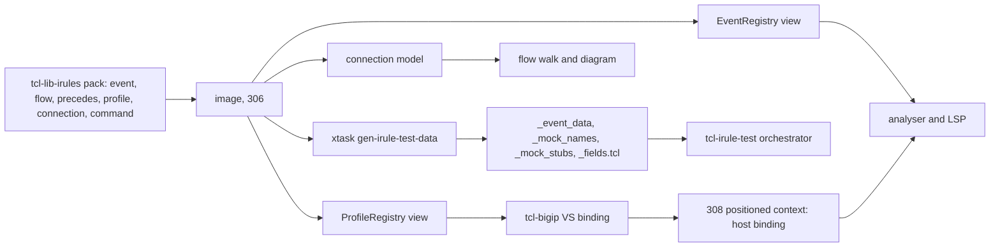
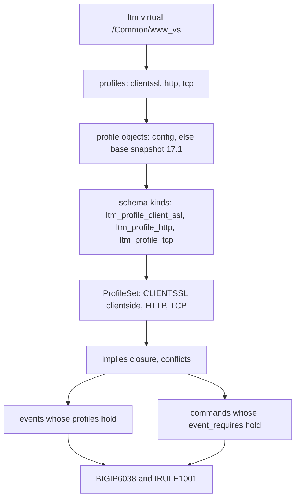

# Step 360 (proposed): iRules events, profiles, connections and tests from SpecTcl facts

Status: proposed 26 November 2026, with proposed items 360a–360f (now plan items 442–447). It builds on
[304](304-f5-libraries.md) (the iRules library on f5-tcl's `tmm` build),
[305](305-spectcl-3.md) (grammar), [308](308-positioned-context.md)
(positioned context), [313](313-consumer-hooks.md) (consumer rows),
[319](319-consumer-migration.md) item 326, [332](332-rust-spectcl-parity.md)
(Rust parity) and [333](333-spectcl-3-gap-analysis.md) items 338 and 342.
350 covers SpecTcl across dialects and defers F5 here. iApps and tmsh are in
the sibling [361](361-spectcl-f5-iapps-tmsh.md).

**Plan numbers** (26 November 2026): 360a → 442 (merged with 333's 338 `event` and `flow`), 360b → 443, 360c → 444, 360d → 445, 360e → 446, 360f → 447. References to "333 items 338 and 342" mean plan items 442 and 414. The [consolidated SpecTcl 3 specification](../spectcl-3/README.md) supersedes this design in detail, and its [crosswalk](../spectcl-3/12-plan-crosswalk.md) maps every proposed number.

## Problem

The iRules knowledge that is not about one command lives in Rust tables
with no pack form, and its consumers keep their own copies. Counts from
26 November 2026:

| Fact | Today | Copies elsewhere |
|---|---|---|
| Event props | 176 `EventProps` rows (`tcl-registry/src/events/event_props_table.rs`), 16 with a lifecycle | MCP `HTTP_EVENTS`, `DNS_EVENTS`, `UDP_EVENTS`, `HOT_EVENTS` (`tcl-mcp/src/irule_gen.rs:50-74`) |
| Event categories | 158 rows in `event_facts/generated.rs`, which has no generator (Q2); 18 events in the props table have no row (`XML_*`, `SIP_*_DONE`, `*_GTM`, …) | — |
| Order | 74 `OrderEntry` rows (`events/event_order.rs`), 7 flow chains (`flow_chains.rs`) | `_event_data.tcl` (generated), `explain_flow.rs:353` event filter |
| Profiles | 66 `ProfileSpec`, 113 `ProtocolNamespaceSpec`, 4 `StackModification` (`profiles.rs:537`) | `tcl-bigip` `classify_profile` (`parser/bespoke.rs:390`, 22 arms), `registry_profile_name` (`validator.rs:684`), `tcl-irule-test` `infer_profile_type` (`topology.rs:364`, name substrings) |
| Command event validity | `event_requires` and `excluded_events` on 1,018 specs; 449 lost when printed (`equivalent_f5_irules.tclspec` `TODO(spectcl)`) | — |
| Connection effects | 37-value `SideEffectTarget` (`side_effects.rs:32`), no field-level detail | 21 getters in `explain_flow.rs:405` `hud_value_for`; `TAINTED_REFS` (`tcl-mcp/src/irule_test.rs:53`); 95 mock procs in `command_mocks.tcl` (1,695 lines) |
| Drop, reject, discard | all three `IrulesSourceFlowSpec::DropsConnection` | the simulator closes the connection for `drop` and `reject` but not `discard` (`command_mocks.tcl:1315-1330`) |
| Releases | 5 `introduced_in` rows over 1,018 command specs (16.1 and 21.1), 56 `deprecated_replacement` rows with no version | — |
| Object names | `tcl-irules/data/irules_ref_specs.json`: 51 base specs, 17 pool templates, plus `class` and `persist` resolvers (`lib.rs:310`) | `tcl-diagram/src/attach.rs`, `tcl-bigip` graph |

The connection graph has no model at all. `tcl dataflow --json` on a rule
that inserts a header and picks a pool reports each `when` body as
`reads UNKNOWN_STATE, writes UNKNOWN_STATE` (run below). The simulator knows
the state (`::state::http::request::uri`, `::state::lb::pool`) only through
hand-written mocks.

## Design

### One pack, five kinds of fact

`tcl-lib-irules` (304) is authored as one SpecTcl 3 pack, upgraded once from
`equivalent_f5_irules.tclspec` (319). It adds four forms to 305 and 333's
`event` and `flow`: `profile`, `connection`, `precedes`, and the command rows
below. Every Rust table above becomes a view over the compiled image.



### 1. Events as library content

```spectcl
library iRules { tracks-host f5-tcl -build tmm }
event HTTP_REQUEST {
    available iRules 9.0-
    side client ; transport tcp
    profiles {any FASTHTTP HTTP}           ;# alternatives, as implied_profiles
    phase http_request ; message request   ;# message picks request or response fields
    multiplicity per-request ; frame connection
    establishes {http.request.method http.request.uri http.request.headers}
    hot ; common ; category HTTP
    hover { summary {Triggered when the system fully parses an HTTP request header.} }
}
event HTTP_REQUEST_DATA {
    available iRules 9.0- ; side client ; transport tcp ; profiles {any HTTP}
    setup HTTP_REQUEST ; collect HTTP -side client
    establishes {http.request.payload}
}
flow tcp_clientssl_http -profiles {TCP CLIENTSSL HTTP} {
    step CLIENT_ACCEPTED l4_client
    step CLIENTSSL_CLIENTHELLO tls_client
    step CLIENTSSL_SERVERHELLO_SEND tls_client -conditional {not delivered on the 21.1 trace}
    step CLIENTSSL_HANDSHAKE tls_client
    step HTTP_REQUEST http_request
}
precedes CLIENTSSL_CLIENTHELLO CLIENTSSL_HANDSHAKE -evidence {bigip-name-handling-tls-http 21.1.0.1}
precedes SERVERSSL_CLIENTHELLO_SEND SERVERSSL_SERVERHELLO -evidence {bigip-name-handling-tls-http 21.1.0.1}
```

- **Declaration and side.** `side client|server|both` and `-command-side`
  carry today's `client_side`, `server_side` and `command_side`.
- **Profiles.** `profiles {any …}` is the alternative set (Q5:
  `CLIENTSSL_CLIENTHELLO` admits CLIENTSSL or PERSIST). `{all …}` is a
  conjunction.
- **Order.** A `flow` is a measured or documented linear trace for one
  profile set. `precedes` records a measured pair. The master order is
  **derived**: a topological sort of all flows and `precedes` rows, ties
  broken by flow position. A cycle is a pack error. Q5 said one trace gives
  a partial order, so the 74-row hand order goes.
- **Availability per release.** `available iRules 9.0-`, `deprecated -from
  9.4.0` (today's `Lifecycle`), on the BIG-IP axis. An event with no row
  inherits the axis baseline, 15.0, as today (`EventProps::lifecycle`).
- **Valid commands.** Stay on the command, where Q5 put them:
  `event_requires {…}` and `excluded_events {…}` (2.x rows, unchanged), plus
  `rule_init warn` for the four `HTTP::` commands the compiler loads in
  `RULE_INIT` with a warning (measurements §8, §12). The event-to-commands view
  (`valid_irules_commands_for_event`) is derived.
- **Parameters and state.** `establishes` names the connection fields
  (section 3) that are readable from this event on. `message request` lets a
  side-neutral command like `HTTP::header` resolve to `http.request.headers`
  in `HTTP_REQUEST` and `http.response.headers` in `HTTP_RESPONSE`, which
  replaces the three-event test in `command_mocks.tcl:448`.
- **Event control.** `event`, `drop`, `discard` and `reject` say what they
  end:

  ```spectcl
  command reject  { ends connection -reset ; decision connection reject }
  command drop    { ends connection -silent ; decision connection drop }
  command discard { ends message -silent ; decision connection discard }
  command event {
      form {event disable all} { disables events -all -this-connection }
      form {event EVENT disable} { disables events -arg 0 }
  }
  ```

  `ends message` versus `ends connection` is the simulator's split today. The
  registry says the opposite for `discard`; Q16 settles it on the lab.

**Generation.** `event_facts/generated.rs` is deleted: `category` is a row,
so the 18 missing events get one. `event_props_table.rs`, `event_order.rs`,
`flow_chains.rs` and `profile_table.rs` become `EventRegistry::from_image`
and `ProfileRegistry::from_image`, with today's methods kept as the view's
API. Under 332's parity rule the Rust spelling stays available (below), so
the choice in 333's owner decision 4 is which front end `tcl-lib-irules`
uses, not what the model can say. This design recommends the pack.

### 2. Profiles and the virtual server

```spectcl
profile HTTP {
    available iRules 9.0- ; layer application ; side both
    implies TCP
    schema-kind ltm_profile_http
    namespace HTTP -also {FASTHTTP HTTP_PROXY_CONNECT}
}
profile CLIENTSSL { layer tls ; side client ; implies TCP ; schema-kind ltm_profile_client_ssl }
profile PERSIST   { schema-kind {ltm_persistence_source_addr ltm_persistence_ssl …} -via persist }
transport-default TCP -unless {ip-protocol udp}
command HTTP::disable { profile_effect remove HTTP }
```

- `implies`, `forbids` and `conflict` are today's `ProfileRelation` modes.
- `namespace` replaces `ProtocolNamespaceSpec`: commands in `HTTP::` need one
  of the listed profiles unless their own `event_requires` says otherwise.
- `schema-kind` joins a profile type to item 118's schema kinds. It is a
  string the pack does not resolve. 304 decided `tcl-lib-irules` has no edge
  to the schema crate, so `tcl-bigip`, which depends on both, does the join
  and a test checks every named kind exists.
- `transport-default` is the rule `validator.rs:715` hard-codes: a TCP VS
  with no listed transport profile still has TCP. Q19 checks it.

**Selecting events for a VS.** `tcl-bigip` resolves each `profiles` entry of
`ltm virtual` through the schema's references to an object, from the config
or the 17.1 base snapshot (`base_objects`, which names `ltm profile
client-ssl clientssl`), reads its kind, and maps the kind through
`schema-kind`. `context clientside|serverside` is kept. The result replaces
the three hand mappings above.



**308 carries the binding.** `PositionedContext` gains one field:

```rust
// design sketch (308 + this doc)
pub struct HostBinding {
    pub virtual_server: BigIpName,          // tcl-bigip::object_names
    pub profiles: ProfileSet,               // closed: a VS names every profile
    pub release: VersionSet,                // BIG-IP axis, from config or tclLsp.targets
}
pub struct PositionedContext { /* 308's fields */ pub hosts: HostChoice }
pub enum HostChoice { Unbound, Bound(SmallVec<[HostBinding; 2]>), Unknown }
```

The bindings come from a salsa input, `rule_attachments(file)`, built by
`tcl-bigip` from workspace config (`ltm virtual … rules`). A rule on two
virtual servers is checked against each and reports per server, as
BIGIP6038 does today. `Unbound` keeps today's file-level behaviour
(`# tcl-lsp: profiles` directives, `compute_file_profiles`).

### 3. The connection graph

```spectcl
connection {
    field http.request.uri     -side client -lifetime request -origin client -target HttpUri
    field http.request.headers -side client -lifetime request -origin client -target HttpHeader
    field http.response.status -side server -lifetime request -origin server -target HttpStatus
    field lb.pool              -side server -lifetime connection -origin rule -target PoolSelection
    field lb.node              -side server -lifetime connection -origin rule -target NodeSelection
    field persist.record       -side both   -lifetime table -origin rule -target PersistenceTable
    field snat.selection       -side server -lifetime connection -origin rule -target SnatSelection
    field tcp.client.collect   -side client -lifetime event -origin rule -target TcpState
    field mr.route             -side both   -lifetime message -origin rule -target MessageState
}
command HTTP::uri {
    form getter {HTTP::uri ?-normalized?} { reads connection http.request.uri }
    form setter {HTTP::uri URI} { writes connection http.request.uri ; decision http uri_set }
}
command HTTP::header {
    subcommand insert { writes connection http.$message.headers ; decision http header_insert }
    subcommand value  { reads connection http.$message.headers }
}
command pool   { writes connection lb.pool ; writes connection lb.node ; decision lb pool_select }
command persist { writes connection persist.record ; decision persist mode }
command TCP::collect { writes connection tcp.client.collect ; emits CLIENT_DATA -certainty definite }
```

- **Fields refine targets.** Each field names its `SideEffectTarget`, so the
  coarse `side_effect` rows are derived and existing consumers keep working.
  `http__uri.rs` today declares only the read; the setter form adds the
  write the spec is missing.
- **Lifetimes** are `event`, `request`, `connection`, `message` (MR) and
  `table` (shared across connections and TMMs). The simulator resets by
  lifetime, which is what `reset_request_state` and
  `reset_connection_state` do by hand.
- **LB decision, pools and nodes, persistence, SNAT** are fields with
  `-origin rule`; `LB_SELECTED` `establishes {lb.pool lb.node}`. MR routing
  is `mr.route`.
- **Taint.** A field's `-origin client` is the taint source, so every getter
  that reads it is a source without its own `taint_source` row, and
  `TAINTED_REFS` goes. Sinks and credential operands stay on the form (Q9,
  item 226), with the shared sensitive-header class.
- **The flow analyser** (`tcl-compiler/src/irules_checks/*`, 5,958 lines)
  already reads registry data (`data_collection`, `irules_source_flow`,
  `event_emits`). It gains a field state per event body: established by the
  event, written by forms, read by forms. "Read before established" and
  "written after the request was sent" become checks over facts.
- **The diagram** (`tcl-diagram`) labels action nodes from `decision` rows
  and draws a field edge for each write. `DIAGRAM_ACTION` is derived: a form
  with a `decision` is an action.
- **`explain_flow`** fills its HUD from fields: a capture's parsed request
  fills `http.request.*`, and `hud_value_for`'s 21 name arms go.

### 4. The iRule testing framework from facts

| Simulator part | Today | From facts |
|---|---|---|
| Event sequencing | `_event_data.tcl`: `MASTER_ORDER`, `FLOW_CHAINS` from `EventRegistry` | the derived order and the `flow` rows; conditional steps fire only when their condition is set |
| State layers | `state_layers.tcl` (981 lines), hand-written | `_fields.tcl`: one variable per field, `http.request.uri` → `::state::http::request::uri`, reset by lifetime |
| Getters and setters | 95 procs in `command_mocks.tcl` | a generated mock per form with `reads`/`writes` and a `decision`; the name from `_mock_names.tcl` |
| Complex mocks | the same file | `mock -tcl PROC` keeps a hand proc, keyed by the generated name; `mock -native ID` binds a `tcl-cmd-core` kernel (item 326), as `pure_functions.rs` does for the 22 `tcl_cmd_core::irules::COMMANDS` |
| Topology | `topology.rs` infers profile types from name substrings | the `HostBinding` profile set (section 2) |
| fakeCMP | `orchestrator.tcl` multi-TMM: `static::` and namespaces per TMM, `table` and data groups shared | `-lifetime table` fields are shared, others per TMM; `static::` per TMM, from the `tmm` build's storage facts (`f5/storage.rs`) |

**Test rows in the pack.** 342's `test` form, with an iRules key:

```spectcl
test http-uri-in-response {
    source {when HTTP_RESPONSE { log local0. [HTTP::uri] }}
    -on {iRules 21.1} expect {diagnostic IRULE1001 at 1:42}
}
test pool-selects {
    source {when HTTP_REQUEST { pool web_pool }}
    -profiles {TCP HTTP} -setup {pool web_pool {10.0.2.1:80}}
    expect {run {http_request -host a.example} decision {lb pool_select web_pool}}
}
```

`tcl spec test` runs the first through the analyser and the second through
the orchestrator. `generate-test` (the MCP `generate_irule_test` tool) reads
the same facts: profiles from the binding or the events' `profiles`, the
`decision` rows for its assertions, `ends` rows for security paths (replacing
`SECURITY_ACTIONS`, `ROUTING_ACTIONS` in `irule_test.rs:40-42`), and
`-lifetime table` writes or `static::` writes outside `RULE_INIT` for the
fakeCMP scenario.

**A user's own library.** Procs called across rules (`call /Common/lib::f`)
are loaded as unattached libraries (`RuleSource::library`, `session.rs:74`).
Their mocks are their own bodies, run in the simulator. A user pack can still
declare `mock -tcl` for a proc that reaches outside (a sideband call). A proc
whose body writes a field is summarised by the analyser into the same
`reads`/`writes` vocabulary, so the caller's flow walk sees it.

### 5. Releases and builds

Facts face by `versions {iRules RANGE}` (305, 302 `Facet`): an event's
`available`, a command's arity, subcommands and value sets, and a profile.
`persist mcp` (`persist.rs:186`, 21.1) is `subcommand mcp { available
iRules 21.1- }`. Ranges use the reading 333 recommends; `-21.1` is written
`0-21.0`.

| Fact | Owner |
|---|---|
| events, flows, `precedes`, profiles, connection fields, `decision`, iRules commands | `iRules` library, `-build tmm` |
| interpreter-absent commands (16), `tcl_platform` `wordSize 8` | f5-tcl core, `tmm` build (304) |
| compiler-refused commands (15), `when` grammar, priority 0–1000, default 500 | `IrulesPolicy` (304) |
| R and N rules (`}{`, brace-line continuation) | f5-tcl core, both builds (measurements §4) |
| BIG-IP schema, profile objects | `f5-bigip`, no build (118) |

Only 21.1.0.1 is appliance-measured. A row from a manual is labelled by its
source, as Q1 requires, and stays unmeasured until a lab probe.

### 6. Consumers

| Consumer | Reads |
|---|---|
| Analyser, LSP diagnostics | event `available` at 308's release; `event_requires` against the `HostBinding` profile set; `establishes` for read-before-established |
| Hover | the event's facet at the release; the VS and its profiles when bound |
| Formatter | `when` from `IrulesPolicy::top_level`; event names from the event list for semantic tokens |
| Minifier | names the rule must not rename: `static::` cells, role `-object-kind` operands (pools, data groups, profiles), event names |
| Optimiser | effects from fields: a getter of a `-lifetime request` field is effect-free within one event, so CSE within an event body is safe; no hoisting across `when` bodies |
| Refactors | `-object-kind` operands join the BIG-IP rename (361); `if` to `switch` on getters is safe when the getter is effect-free |
| `explain_flow`, diagram, MCP | derived order, `flow` rows, fields, `decision`, `ends` |

### 7. Parity: the Rust spelling

| SpecTcl 3 | Rust (`tcl-lib-irules`) | Today |
|---|---|---|
| `event N {…}` | `EventSpec { name, availability, side: Side::Client, transport: &[Tcp], profiles: ProfileReq::Any(&[..]), phase, message: Some(Message::Request), multiplicity, establishes: &[FieldId], .. }` | `EventProps` |
| `flow ID -profiles P {step …}` | `FlowSpec { id, profiles, steps: &[FlowStep] }` | `FlowChain` |
| `precedes A B -evidence E` | `Precedence { before, after, evidence: EvidenceId }` | none |
| `profile N {…}` | `ProfileSpec { .., schema_kinds: &[&str], namespaces: &[NamespaceId] }` | `ProfileSpec`, `ProtocolNamespaceSpec` |
| `connection { field … }` | `ConnectionField { id: FieldId, side, lifetime, origin, target: SideEffectTarget }` | none |
| `reads`/`writes connection F` | `FormSpec.connection: &[FieldEffect]` | none |
| `ends connection -reset`, `disables events` | `EventControl::{EndsConnection(Reset), DisablesEvents(..)}` | `IrulesSourceFlowSpec` |
| `emits E -certainty C` | `EventEmissionForm` | exists, no pack spelling (333 gap 3) |
| `profile_effect remove P` | `StackModification` | exists |
| `decision C A`, `mock -tcl P` | `SimDecision { category, action }`, `MockSpec` | none |

### Decisions

1. **Events, profiles and fields are pack content** in `tcl-lib-irules`,
   with a Rust spelling for parity. The equivalence pack already becomes the
   library's source (319), and 307 moves libraries to data.
2. **Order is derived from flows and measured `precedes` rows.** Q5 showed a
   trace gives a partial order; a hand total order hides that.
3. **Compile validity and runtime state stay separate.** `event_requires`
   says where the compiler admits a command; `establishes` and fields say
   what holds at run time. `HTTP::uri` in `HTTP_RESPONSE` is refused although
   the request was parsed, so neither derives the other.
4. **Fields refine `SideEffectTarget`**, so today's effect consumers keep
   working while new ones read fields.
5. **The profile-to-schema join lives in `tcl-bigip`**, keeping 304's rule
   that `tcl-lib-irules` has no edge to the schema crate.

### Open questions (lab probes, plan questions Q13–Q19)

- **Q13** both-leg order with `HTTP::collect` and OneConnect (settles the
  derived order beyond TLS);
- **Q14** the event set per release (17.1, 17.5, 21.1): compile `when E {}`
  for all 176 names;
- **Q15** the command × event compile matrix per release, generated from the
  facts (extends §8's 120 pairs);
- **Q16** what `drop`, `discard`, `reject` and `event disable all` end;
- **Q17** field lifetimes across keep-alive requests, with and without
  OneConnect;
- **Q18** which profile kinds admit `HTTP_REQUEST` (`http2`,
  `http-compression`, `web-acceleration`, which `tcl-bigip` maps to HTTP);
- **Q19** whether a TCP virtual with no transport profile gets `tcp`.

## Worked example: one rule, its facts and its run

**Source:**

```tcl
when HTTP_REQUEST {
    HTTP::header insert X-Forwarded-For [IP::client_addr]
    HTTP::uri /v2[HTTP::uri]
    pool web_pool
    persist source_addr 300
    TCP::collect 10
}
```

**In memory:**

```rust
// design sketch: types proposed above
ConnectionWrites { event: "HTTP_REQUEST", writes: [
  ("HTTP::header insert", "http.request.headers"), ("HTTP::uri", "http.request.uri"),
  ("pool", "lb.pool"), ("pool", "lb.node"), ("persist", "persist.record"),
  ("TCP::collect", "tcp.client.collect") ] }
```

**Bytecode (tclsh 9.1.0)**, first two commands; the rest are `push`, `invokeStk`:

```text
  Command 1: "HTTP::header insert X-Forwarded-For [IP::client_addr]..."
    (0) push 0 	# "HTTP::header"
    (5) push 1 	# "insert"
    (10) push 2 	# "X-Forwarded-For"
  Command 2: "IP::client_addr..."
    (15) push 3 	# "IP::client_addr"
    (20) invokeStk 1
    (25) invokeStk 4
```

**Result:**

```text
$ tclsh9.1 effects.tcl        (also ./target/debug/tclvm effects.tcl, tclsh8.6)
decision: http header_insert {{X-Forwarded-For 10.0.0.50}}
decision: http uri_set /v2/index.html
decision: lb pool_select web_pool
decision: persist mode source_addr
decision: tcp collect 10
state: uri=/v2/index.html pool=web_pool member=10.0.2.1:80
$ tcl dataflow --json --dialect f5-irules route.irul
"reads": "UNKNOWN_STATE", "writes": "UNKNOWN_STATE"     (per when body)
```

The simulator already records the field effects the facts would declare;
the analyser cannot see them. `effects.tcl` sources the orchestrator with
`::tmm::init` first. The harness refuses tclsh 8.4 (`iRules simulation
requires a host with native completion options (Tcl 8.5+)`), so the
simulator itself cannot run on the 8.4 line f5-tcl forks. Event order and
`connection` behaviour above are from evidence, not a live BIG-IP.

## Work list

1. **360a.** Pack forms `event`, `flow`, `precedes`, `profile`,
   `transport-default`, `connection` in the reader and the 336 manifest.
2. **360b.** Upgrade `equivalent_f5_irules.tclspec`; author the 176 events,
   7 flows, 66 profiles and 113 namespaces from today's tables; delete
   `event_facts/generated.rs`; `EventRegistry` and `ProfileRegistry` become
   image views.
3. **360c.** `tcl-bigip` profile resolution through `schema-kind`; delete
   `classify_profile`, `registry_profile_name`, `infer_profile_type`;
   `HostBinding` in 308.
4. **360d.** Connection fields and form effects; the flow walk, diagram,
   `explain_flow` and MCP read them.
5. **360e.** `gen-irule-test-data` emits `_fields.tcl` and generated mocks;
   `command_mocks.tcl` keeps only `mock -tcl` procs; `test` rows.
6. **360f.** Release facets from the Q6 audit, one probe batch at a time.

## Verification

- **Done when:** `rg 'HTTP_EVENTS|TAINTED_REFS|SECURITY_ACTIONS|fn classify_profile|fn infer_profile_type|fn registry_profile_name' rust` finds nothing;
  `hud_value_for` has no name arms; `event_facts/generated.rs` is gone; the
  printed iRules pack has no `TODO(spectcl)` for `event_requires`; the
  simulator's state layer and stub mocks are generated with `--check`.
- **Unchanged answers:** 304's conformance set, plus every
  `tcl-irule-test` Tcl test and the BIGIP6038/6039 tests.
- **Measurements:** rebuild set after an event edit (the image and the
  binaries only); `EventRegistry` lookups within ±5% of today's.

## Risks

- **A derived order that differs from today's 74 rows.** Mitigation: the
  first image must reproduce today's order exactly; changes come with probes.
- **Fields too coarse for real TMM.** `HTTP::header value Host Extra` writes
  (evidence). Mitigation: effects sit on resolved forms (Q9), so a measured
  write is a form row, not a field change.

## Corrections to the overview

- **The brief's `tcl-irules` flow, topology and event-order modules do not
  exist.** `tcl-irules/src` holds `walker`, `when_block`, `event_handlers`,
  `source_context`, `source_object`, `executable` and `ilx`. Flow checks are
  `tcl-compiler/src/irules_checks/`; topology is `tcl-irule-test/src/topology.rs`.
- **319 item 326:** `tcl-cmd-core/src/irules.rs` holds pure functions
  (`b64encode`, `crc32`, `findstr`, …), not connection getters; and
  `explain_flow.rs` maps 21 getters, not 7.
- **Q5's `explain_flow` order fault is fixed:** it now orders through
  `EventRegistry::order_events` (`explain_flow.rs:399`).
- **`example_test.tcl` fails as shipped** on tclsh 8.4, 8.6 and 9.1:
  `::orch::test` calls `::itest::clear_irule`, which calls
  `::tmm::_orig_info` before `::tmm::init` creates it. The multi-TMM example
  runs, but fails `init-3.2` as well as the intended `rate-1.0` (9.1).
  The `generate-test` skill's "run it with `tclsh`" needs an 8.5+ host.

## Owner decisions (26 November 2026)

- **Load-time failures match the appliance.** An unknown, absent or refused head under `tmm`, and `proc` inside `when`, are errors, as the rule loader reports them.
- **Supported releases only.** Release facets (360f) start at the oldest BIG-IP release still in public support per F5's K5902 article, so rows older than that are not dated.
- **Question numbers.** F5 question Q12 is the iApp-bundled package versions; this doc's probes are Q13–Q19, and 361's are Q20–Q25.
