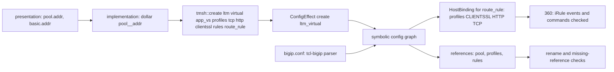

# Step 361 (proposed): iApps and tmsh scripts from SpecTcl facts

Status: proposed 26 November 2026, with proposed items 361a–361d (now plan items 448–451). It is the
`scriptd` sibling of [360](360-spectcl-f5-integration.md), which covers
iRules on `tmm`. It builds on [304](304-f5-libraries.md) (iApps and tmsh as
libraries on f5-tcl's `scriptd` build), [305](305-spectcl-3.md),
[308](308-positioned-context.md) and item 118's schema crate
([118](../registry-split/118-bigip-schema.md)). Whether a tmsh `cli script`
runs on `scriptd` or a third build is plan question Q11; nothing below
depends on the answer except the `-build` key.

**Plan numbers** (26 November 2026): 361a → 448, 361b → 449, 361c → 450, 361d → 451. The [consolidated SpecTcl 3 specification](../spectcl-3/README.md) supersedes this design in detail, and its [crosswalk](../spectcl-3/12-plan-crosswalk.md) maps every proposed number.

## Problem

| Fact | Today |
|---|---|
| Command specs | 50 files in `tcl-registry/src/commands/iapps/`: 30 `tmsh::` (surface `package("iapps")` and `package("tmsh")`), 15 `iapp::`, 4 `script::`, plus `mod.rs` |
| Signatures | every `iapp::` spec is `iapp::X ?arg ...?` with `Arity::at_least(0)`; `tmsh::create` is `<component> <name> ?options?`, `Arity::at_least(2)`, with no roles and no effects |
| Effects | no iApps or tmsh spec declares a side effect; `SideEffectTarget::BigipConfig` exists (`side_effects.rs:104`) and no spec uses it |
| Missing commands | no `tmsh::run` spec |
| Template structure | `sys application template` in the schema (`bigip/data/sys/application.rs:253`): `actions { definition { implementation presentation html-help role-acl run-as } }`, `requires-bigip-version-min/max`, `requires-modules` |
| Action metadata | `IAppActionOverlay` (`tcl-registry/src/f5/iapp_metadata.rs`): the BIG-IP range, `role-acl`, `run-as` |
| APL | `tcl-bigip/src/apl/` (2,017 lines): parser, `AplModel { sections, tables, defines, includes, all_fields }`, the `section__field` convention (`variable_names.rs`), IAPP7001–7003 |
| tmsh syntax version | its own axis with an in-script transition, `tmsh::modify cli version active V` (`f5/tmsh_syntax.rs`) |
| Config writes | nothing reads a `tmsh::create` argument as a config path; `tcl-bigip` parses SCF stanzas, not tmsh command lines |

So an iApp that creates a virtual server with `profiles { tcp http
clientssl }` and attaches an iRule tells the iRule side nothing, and renaming
a pool cannot follow it into iApp implementations.

## Design

### 1. Libraries and sections

```spectcl
library iApps { tracks-host f5-tcl -build scriptd }
library tmsh  { tracks-host f5-tcl -build scriptd }
library f5.iapp {                                ;# the helper procs iapp::*
    versions 1.0.0 1.1.0 1.3.0
    requires {f5.iapp 0-} {tmsh 0-}
    loaded-by {tmsh::include f5.iapp.$version.cli}
}
template-section implementation -language tcl -environment f5-iapps
template-section presentation   -language apl
template-section html-help      -language html
apl-variable -root :: -separator __              ;# pool.addr -> $::pool__addr
```

- **`iApps` and `tmsh`** are 304's libraries. The `iapp::` helpers are a
  third, `f5.iapp`, because F5's own templates load them from a `cli script`
  with `tmsh::include`. The version list and the include spelling are from
  F5's template convention, not measured (Q22).
- **Sections.** `template-section` maps a schema property of `sys
  application template … definition` to a language. The schema has no
  `macro` property; if older templates have one, Q22 finds it.
- **APL to Tcl.** `apl-variable` states today's convention
  (`apl_name_to_tcl_var`), so `iapp_vars.rs` and IAPP7001 read the fact
  instead of hard-coding `__`. A presentation table becomes a list variable;
  its row shape is Q22's.
- **Template versions.** `requires-bigip-version-min/max` already narrows
  the BIG-IP range per action (`IAppActionOverlay::bigip_range`). It becomes
  the file's `targets` in 308, so a `tmsh::` facet or an `iapp::` version is
  checked against the template's own range.

### 2. tmsh commands over the configuration schema

```spectcl
command tmsh::create {
    available tmsh 0-
    arity 2..
    role 0.. tmsh-command -verb create          ;# the words are one tmsh command line
    writes config -verb create
    hover { summary {Mirrors the tmsh create command.} }
}
command tmsh::modify { role 0.. tmsh-command -verb modify ; writes config -verb modify }
command tmsh::delete { role 0.. tmsh-command -verb delete ; writes config -verb delete }
command tmsh::get_config { role 0.. tmsh-command -verb list ; reads config ; returns config-objects }
command tmsh::get_field_value { arity 2 ; role 0 config-object ; role 1 property-name ; reads config }
command tmsh::get_name { arity 1 ; role 0 config-object }
command tmsh::begin_transaction  { transaction begin }
command tmsh::commit_transaction { transaction commit }
command tmsh::cancel_transaction { transaction cancel }
command tmsh::include { role 0 cli-script-name ; loads library }
command tmsh::stateless { arity 0..1 ; role 0 -values {enabled} }  ;# from the spec's synopsis
```

- **`tmsh-command`** is a role over a run of words: `MODULE TYPE… NAME
  PROPERTY VALUE…`. Its reader is the schema's own: the longest
  `BigipRegistry::kind_for_header(module, object_type)` match gives the kind,
  the next word is the name, and each `BigipPropertySpec` (value kind,
  `list_operators`, `references`) reads the rest. A property's `references`
  makes its value an object name with a kind.
- **Where the reader runs.** 304 decided the library crates have no edge to
  the schema crate, and this keeps it. The role is data in
  `tcl-lib-iapps`. Its resolution is a rung 5 contribution from `tcl-bigip`,
  which already depends on both, registered by the entry points that link
  BIG-IP support (LSP, CLI, MCP). Without it, a `tmsh-command` word is an
  opaque string, as today.
- **Effects on the config graph.** `writes config -verb create` with the
  resolved shape is a `ConfigEffect { verb, kind, name, properties,
  references }`. The simulator and the cross-domain checks below read it.
  The coarse `side_effect BigipConfig -writes` is derived.
- **Transactions.** `transaction begin|commit|cancel` are 305 binding
  transitions, like `tmsh::modify cli version active`. Which commands are
  refused inside a transaction, and whether an iApp implementation is
  already one, is not measured (Q21). Until then the analyser reports
  nothing about transactions.
- **`cli script` objects.** `script::run`, `script::init`, `script::help`
  and `script::tabc` are definitions, not calls: `definition_body` rows with
  the `f5-tmsh` environment. `tmsh::argv` is an ambient variable of
  `script::run`. The `tmsh::` I/O helpers (`display`, `log`, `log_dest`,
  `log_level`, `clear_screen`) declare `writes LogIo`.
- **Missing commands.** `tmsh::run` and any other helper found by Q20 are
  added from the probe's `info commands` inventory.

### 3. One config graph across iRules, iApps and config



- **The symbolic graph** holds the objects in parsed config plus the
  `ConfigEffect`s of every iApp implementation in the workspace. A name built
  from `$tmsh::app_name` or an APL variable is a pattern (`*_vs`), as
  `tcl-diagram`'s `attach_reach` already builds for dynamic `pool` names.
- **Validation chain.** When an implementation creates a virtual server
  with literal profiles and an iRule, the iRule gets a `HostBinding` (360)
  with those profiles, marked `Why::IApp { template, action }`. A profile
  list from a variable gives `HostChoice::Unknown`.
- **Missing references.** A `references` property naming an object that is
  neither in config, nor created earlier in the same implementation, nor in
  the 17.1 base snapshot, is a warning. iApp objects land under
  `/Common/APP.app/` (F5's convention; Q25 confirms the folder and
  `strict-updates`).

### 4. Test and simulate

The iRule framework gains a config mode rather than a sibling crate:

| Part | From facts |
|---|---|
| `::cfg::` mock graph | kinds, properties and references from the schema crate; seeded from SCF through `tcl-bigip`, as `topology.rs` does for pools and data groups |
| `tmsh::create/modify/delete` | generated mocks that apply the `ConfigEffect` and refuse an unknown kind, property or reference with tmsh's message shape |
| `tmsh::get_config`, `get_field_value`, `get_name` | generated readers over `::cfg::`; return shapes from Q23 |
| transactions | buffer effects until `commit_transaction`; `cancel` drops them |
| an iApp run | set `$::section__field` from a `sys application service` `variables` block or a test row, set `tmsh::app_name`, run `implementation` |
| a `cli script` run | set `tmsh::argv`, call `script::run` |
| chaining | the resulting `ltm virtual` goes through `Topology::generate_tcl_setup`, so its iRules run under 360's simulator |

scriptd is 8.4.6, so these mocks run on `tclsh8.4` as well as 8.5+, unlike
the TMM shim, which needs an 8.5+ host.

### 5. Consumers

| Consumer | Reads |
|---|---|
| Analyser, LSP | facets at the template's BIG-IP range; IAPP7001 from `apl-variable`; unknown kind or property in a `tmsh-command`; missing references; iRule bindings from created virtual servers |
| Hover | the schema property's description and default on a `tmsh-command` word |
| Formatter | `template-section` languages: format `implementation` as Tcl and leave APL and HTML regions alone (`apl/tokens.rs` `embedded_tcl_regions`) |
| Minifier | `tmsh-command` words and `-object-kind` operands are protected; APL-bound `::section__field` variables are not renamed |
| Refactors | rename `ltm_pool /Common/web_pool` across SCF (`tcl-bigip/src/refs.rs`), iRules (`pool web_pool`, 360's `-object-kind`) and iApp implementations (literal `tmsh-command` names); a pattern name is reported, not rewritten |
| `explain`, diagram | iApp effects as config edges in the object graph; `cli script` effects as a list of config changes |
| MCP | the same graph; `command_info` for `tmsh::` shows the resolved kind |

### 6. Parity: the Rust spelling

| SpecTcl 3 | Rust | Today |
|---|---|---|
| `template-section N -language L` | `TemplateSection { property, language: SectionLanguage::Tcl }` | none |
| `apl-variable -root :: -separator __` | `AplVariableConvention { root: Absolute, separator: "__" }` | private struct in `apl/variable_names.rs` |
| `role 0.. tmsh-command -verb V` | `ArgRole::TmshCommand(TmshVerb::Create)` over `RoleRange::From(0)` | none |
| `writes config -verb V` | `ConfigEffect { verb, shape: ResolvedBy(TMSH_COMMAND_HOOK) }` | `SideEffectTarget::BigipConfig`, unused |
| `transaction begin` | `StateTransition::TmshTransaction(Begin)` | none |
| `loaded-by {tmsh::include …}` | `LibraryLoad::Include { command, pattern }` | none |
| `returns config-objects` | `ReturnType::Opaque(ConfigObjectList)` | none |

### Open questions (lab probes, plan questions Q20–Q25)

- **Q20** `info commands tmsh::*`, `iapp::*`, `script::*` in an iApp
  implementation, a `cli script` and iCall, on 17.1, 17.5 and 21.1;
- **Q21** transactions: is an implementation already one, and what is
  refused inside `begin_transaction`;
- **Q22** the `f5.iapp` helper versions, a presentation table's variable
  shape, and any `macro` section;
- **Q23** return shapes of `get_config`, `get_field_value`, `get_name`, and
  `$tmsh::argv` lookup from `script::run`;
- **Q24** whether `tmsh mv` renames a pool and what references it updates;
- **Q25** the `.app` folder and `strict-updates` for iApp-created objects.

## Worked example: a `cli script` on the 8.4 line

**Source:**

```tcl
proc script::run {} {
    set pool [lindex $tmsh::argv 1]
    tmsh::begin_transaction
    foreach obj [tmsh::get_config ltm pool $pool members] {
        foreach m [tmsh::get_field_value $obj members] {
            tmsh::modify ltm pool $pool members modify \{ [tmsh::get_name $m] \{ session user-disabled \} \}
        }
    }
    tmsh::commit_transaction
}
```

**In memory:**

```rust
// design sketch: types proposed above
[ ConfigEffect { verb: Modify, kind: "ltm_pool", name: Var("pool"),
                 properties: [("members", ListOp::Modify)], in_transaction: true } ]
```

**Bytecode (tclsh 9.1.0)**, `::script::run`, first command:

```text
  Command 2: "lindex $tmsh::argv 1..."
    (0) push 0 	# "tmsh::argv"
    (5) loadStk
    (6) listIndexImm 1
    (11) storeScalar %v0 	# var "pool"
```

**Result** (a recording mock of `tmsh::`, `mock_cli.tcl`):

```text
$ tclsh8.4 mock_cli.tcl                 (tclsh8.6: the same)
txn: get_config ltm pool /Common/web_pool members
txn: modify ltm pool /Common/web_pool members modify { 10.0.2.1:80 { session user-disabled } }
txn: modify ltm pool /Common/web_pool members modify { 10.0.2.2:80 { session user-disabled } }
now: commit
$ tclsh9.1 mock_cli.tcl                 (./target/debug/tclvm: the same)
can't read "tmsh::argv": no such variable
```

`$tmsh::argv` inside `::script` resolves through the global namespace on
8.4 and 8.6 and not on 9.x. f5-tcl is 8.4.6, so the analyser must resolve
it as 8.4 does, and a simulator on a 9.x host must define `::script::tmsh`
or rewrite the lookup. The return shapes of `tmsh::get_config` and
`get_field_value` are the mock's guesses; Q23 measures them.

## Work list

1. **361a.** `template-section`, `apl-variable`, the `f5.iapp` library and
   real signatures for the 15 `iapp::` and 30 `tmsh::` specs, from Q20's
   inventory.
2. **361b.** The `tmsh-command` role, `ConfigEffect`, transactions; the
   rung 5 resolver in `tcl-bigip`.
3. **361c.** The symbolic config graph; iApp-created `HostBinding`s; the
   missing-reference check; the cross-domain rename.
4. **361d.** The simulator's config mode, iApp and `cli script` runners,
   chained to 360's.

## Verification

- **Done when:** every `tmsh::` and `iapp::` spec has a signature and roles;
  `tmsh::create ltm pool p members …` in an iApp yields a `ConfigEffect`
  test; a rename of a pool in a workspace with SCF, an iRule and an iApp
  edits all three; IAPP7001 reads `apl-variable`; the config-mode mocks pass
  under `tclsh8.4` and `tclsh9.1`.
- **Unchanged answers:** the iApps `version_gate` and W108 tests,
  IAPP7001–7003, the APL parser tests, `f5/tmsh_syntax.rs` tests.

## Risks

- **tmsh grammar beyond the schema.** Commands like `run`, `save` or `show`
  are not object kinds. Mitigation: `tmsh-command -verb V` accepts only verbs
  whose shape the schema gives; other verbs stay opaque.
- **Generated mocks that accept what tmsh refuses.** Mitigation: the mocks
  cite Q21 and Q23 and stay labelled unmeasured until probed.

## Corrections to the overview

- **304** says no command spec reads the BIG-IP schema. True of iRules; tmsh
  commands are schema paths. This design keeps the crate edge out by
  resolving them in `tcl-bigip`.
- **The brief's `macro` section** is not in the registry schema's
  `sys application template` definition (`bigip/data/sys/application.rs`).
