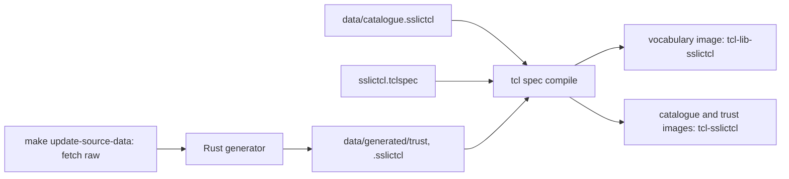

# Step 365 (proposed): SslicTcl from one SpecTcl 3 source

Status: proposed 26 November 2026, with proposed items 365a–365f (now plan items 452–457). Builds on
[302](302-libraries.md), [303](303-environments.md), [305](305-spectcl-3.md),
[306](306-expect-spike.md), [308](308-positioned-context.md),
[313](313-consumer-hooks.md) and [332](332-rust-spectcl-parity.md). It covers
SslicTcl as [360](360-spectcl-f5-integration.md) and
[361](361-spectcl-f5-iapps-tmsh.md) cover F5; grammar needs go to 370. Owner
ruling: SslicTcl is internal and changes with its consumers, with no shims.

**Plan numbers** (26 November 2026): 365a → 452, 365b → 453, 365c → 454, 365d → 455, 365e → 456, 365f → 457. The [consolidated SpecTcl 3 specification](../spectcl-3/README.md) supersedes this design in detail, and its [crosswalk](../spectcl-3/12-plan-crosswalk.md) maps every proposed number.

## Problem

SslicTcl is a never-evaluated TLS declaration language in Tcl syntax
([vocabulary](../../f5/sslictcl-vocabulary.md)), loaded into `SslicModel` for
`estimate`, `evaluate_policy` and `to_sslictcl` (`tcl-sslictcl/src/lib.rs:27`).
Its consumers are the LSP, `tcl diag`, MCP `analyze`, `tcl-bigip`'s TLS
import and `bigip-report-gen`. Every fact is written several times, by hand:

| Copy of the vocabulary | Where | Lines |
|---|---|--:|
| `DECLARATIONS` table | `tcl-sslictcl/src/vocabulary.rs:173` | 401 |
| the loader's `match` per declaration and member | `tcl-sslictcl/src/dsl.rs:465`, `parse_*` | 1,534 |
| emitter order | `tcl-sslictcl/src/emit.rs` | 504 |
| registry specs, hover, value sets | `tcl-registry/src/commands/sslictcl/` | 1,046 |
| block grammars | `tcl-registry/src/definer/sslictcl.rs` | 255 |
| drift test holding the copies together | `tcl-sslictcl/tests/registry_pack_drift.rs` | 445 |
| header signature, profile, environment | `tcl-registry/src/dialects.rs:845`; `tcl-dialect/src/profile/catalog.rs:794`; `model/environment.rs:1547` | — |

The estimator's judgements are hand tables in code: protocol scores
(`estimate.rs:319`), cipher strength by substring (`:424`), forward secrecy
by name (`:355`), the RC4, 3DES, NULL, MD5 and SHA-1 caps (`:471-630`), and
bands and weights (`:443-458`). Two are wrong. `starts_with("TLS_")` makes
every IANA name forward-secret, `TLS_RSA_WITH_AES_128_CBC_SHA` included. The
tests are case-insensitive while policy `forbid-ciphers` globs are
case-sensitive `string match`, so the phases disagree on `rc4-md5`.

`registry-axes` pins 24 vocabulary-word comparisons in `dsl.rs`
(`xtask/src/registry_axes.rs:211`), against the registry rule.

The trust data is 703 KB of JSON parsed at first use (`trust.rs:453`): 629
anchors, none with DER; memberships microsoft 549, open-jdk 239, apple 156,
android 145, mozilla 121, chrome 104. The JSON spells `open-jdk`, the
vocabulary `openjdk` (`trust.rs:51`). `chrome-root-store.json` (EV OIDs, SCT
limits) is generated and drift-checked, but no Rust code reads it.

Eleven members are loaded and emitted but read by no phase: `groups`,
`signature-schemes`, `include-subdomains`, `preload`, `reference`, and
`cipher`'s `iana-name`, `openssl-name`, `key-exchange`, `authentication`,
`encryption` and `aead`. Tests: 91 in `tcl-sslictcl`, 9 in `tcl-registry`,
15 LSP end-to-end, 10 in `tcl-lsp-core`, one VS Code suite.

## Design

### 1. Placement: a namespaced pack dialect, a library and an environment

SslicTcl is the library `sslictcl` on the namespaced pack dialect
`sslictcl/decl`, placed by the environment `sslictcl`. **The dialect:** a
dialect owns how source is read, and `DialectPoint::grammars(&self)` takes
only the point, so the one lexical difference, rejecting substitution, can
only be set by a dialect. `sslictcl/decl` is `tcl` 9.0's profile with one
changed axis, `grammar script { substitution reject }`; it adds no family
and no lexer, and the BundledPack tier may define it (370's trust table).
SslicTcl is internal, so the dialect lives in its own pack, with no shims.
A library: it
provides words on its own version axis, which the `sslictcl N` header pins
as a require would (308: `Why::Header`). The environment carries extension,
editor identity, header signature, closed world, a new policy `evaluation
never`, and the library's document grammar as its root. Base Tcl stays
visible, so completion resumes inside `predicate`. **Crates**, one per
package: `tcl-lib-sslictcl` holds the vocabulary image and one hook;
`tcl-sslictcl` keeps the model, engines, importers and the data images.

### 2. The surface as SpecTcl 3

One pack, `tcl-lib-sslictcl/sslictcl.tclspec`, states the vocabulary once:
words are `member-only` commands, blocks are `definition_body` grammars, and
value domains are named once. The excerpt shows each new form once:

```spectcl
speclib sslictcl 3 {
    library sslictcl { train 2 {2-3} ; compatible sslictcl 2- {tcl 9.0-} }
    dialect sslictcl/decl -base {tcl 9.0} {
        grammar script { substitution reject }
    }
    environment sslictcl {
        dialect sslictcl/decl ; library sslictcl 2 -placement ambient
        policy closed -evaluation never ; alias sslic-tcl tls-sslictcl
        file_extension sslictcl {SslicTcl TLS Declaration}
        signature -header sslictcl -arg integer ; document sslictcl-document
    }
    default { available sslictcl 2 ; member-only ; implementation none }
    domain BOOL    { values {true false yes no on off 1 0} -nocase -closed }
    domain VERSION { values {ssl2 ssl3 tls1.0 tls1.1 tls1.2 tls1.3} -nocase -closed
                     aliases {sslv3 ssl3 tlsv1 tls1.0 tlsv1.2 tls1.2 tls13 tls1.3} }
    document sslictcl-document {
        header sslictcl -version 2 -newer SSLIC1102 -missing SSLIC1003 -duplicate SSLIC1004
        open -unknown SSLIC1101 ; substitution reject -code SSLIC1002
        members {certificate endpoint testssl-import trust-program protocol cipher chain policy}
        codes {arity SSLIC1005 domain SSLIC1009 unknown-member SSLIC1007 required SSLIC1010
               duplicate SSLIC1008 unresolved SSLIC1011 exclusive SSLIC1012}
    }
    command endpoint {
        arity 2 ; arg 0 -role Name -declares endpoint ; arg 1 -role Body
        definition_body {
            family SslicTcl ; open
            member protocols -value {list VERSION} -read-by {estimate policy}
            member groups    -value LIST -read-by {}
            member chain     -references chain
            member hsts      -block hsts
            exclusive {chain certificate-chain}
        }
    }
    command testssl-import { definition_body { family SslicTcl ; closed
        member raw-json-hex -value HEX -frozen -validate -native sslictcl::testssl_payload } }
    data catalogue -source data/catalogue.sslictcl
    data trust     -source data/generated/trust -provenance data/provenance.json
}
```

`-declares`/`-references` replace the loader's private `RefKind` (`dsl.rs:955`)
and give the LSP definition, references and rename. `-read-by {}` makes
"carried, not assessed" a hover fact. `-frozen` (313) keeps formatter and
minifier off a word. `-validate -native` is the one rung 3 hook. `-nocase
-closed` lets W127 close BOOL, STATUS and VERSION (today only `schema` is).

**Data.** `data NAME -source` attaches documents in the pack's own vocabulary,
compiled into the image's `DATA` section. Vocabulary 2 replaces the tables:

| Today (`estimate.rs`) | Vocabulary 2, in `data/catalogue.sslictcl` |
|---|---|
| protocol scores `:319`; SSL 2/3 and TLS 1.0/1.1 caps `:471` | `protocol ssl3 { score 20 ; cap C ; finding SSLICTL1102 error {SSL 3.0 is enabled} }` |
| cipher substrings `:424`, caps `:528`, forward secrecy `:355` | `cipher-pattern *RC4* { match nocase ; bits 128 ; cap B ; finding SSLICTL1202 error … }`, ordered, first match wins; `TLS_RSA_* { forward-secrecy false }` before `TLS_* { forward-secrecy true }` |
| signature OIDs `:583` | `signature-algorithm 1.2.840.113549.1.1.4 { cap F ; finding SSLICTL1301 critical … }` |
| key scores `:366` | `key-algorithm 1.2.840.113549.1.1.1 { score {4096 100 2048 90 1024 60 0 20} }` |
| weights and bands `:443` | `methodology sslictcl-offline-estimate-v2 { weights {protocol 30 key-exchange 30 cipher 40} ; band A 80 … }` |

A cipher key takes `iana-name` and `openssl-name` as aliases. The trust store
becomes one generated document per program snapshot (`trust-program
mozilla-2026-07-19 { client mozilla ; snapshot-date … ; anchor SHA256 {…} }`),
Chrome metadata joined to its anchors, grouped by fingerprint into `Anchor {
memberships }`. Snapshots stay data, not an axis: the
[source-data contract](../../contracts/sslictcl-source-data.md) forbids
reading them as product ranges.

**The update path.** `make update-source-data` keeps its network fetch; a Rust
generator replaces the awk and jq of `generate-source-data.sh` and writes
`.sslictcl` documents; `tcl spec compile` (owner decision 5) builds the images. `make
check-source-data` runs the compile with `--check` (306, item 119) and
verifies `provenance.json`, which now hashes raw files, generated documents
and images. The editor links only the vocabulary image.



### 3. Context: phases, attachments and the declaration graph

| 360 (F5) | SslicTcl | Stated by |
|---|---|---|
| events: when code runs | phases `load`, `estimate`, `evaluate`, `emit` | `-read-by` |
| profiles on a virtual server | `chain` and `policy` attached to an `endpoint`; a trust program chosen by `client` | `-references` |
| connection graph | endpoint → chain → certificate → `key`; endpoint → policy → check; anchor ↔ certificate fingerprints | the declaration graph from `-declares`/`-references`, drawn by `tcl diagram` |
| positioned context (308) | the grammar path: the enclosing block and whether it is open | the document grammar |

BIG-IP release defaults stay with 360/361; SslicTcl gets projected endpoints.

### 4. Grammar needs (sent to 370)

No new compiled family or lexer. Three profile axes: (1) **substitution** in
bare and quoted words: `evaluate` (Tcl), `literal` (SpecTcl 3's reader) or
`reject` (SslicTcl, selected by `sslictcl/decl`; the document's
`substitution reject -code SSLIC1002` row only maps the finding to a code);
(2) an **opaque embedded region**, a `predicate` that is Tcl for
editing but never analysed; (3) **no evaluation**, replacing
`SUPERSEDED_ANALYSER_CODES = [W123]` (`sslictcl_diagnostics.rs`).

### 5. Consumers

| Consumer | After 365 |
|---|---|
| Analyser and LSP | One generic **declaration reader** checks any document grammar from an image: domains, arity, openness, `required`, `exclusive`, references, header. It emits the codes the pack maps. Completion, hover, tokens, folding, outline, definition, references and rename read the same grammar. No `tcl-ide-sslictcl` is needed |
| Formatter | Indents as now. Adds `layout { lead 1 }`, and `-frozen` on `raw-json-hex`, `der-base64` and `pem`. W111 no longer fires on frozen words; the shipped sample reports it at line 71 |
| Minifier | Today it joins top-level statements only. After, it compacts separators inside bodies by the grammar. Frozen and opaque words are untouched. The check is that the minified and original documents load to equal `SslicModel`s (`model.rs:451`) |
| Optimiser | Never runs (`evaluation never`). Today `tcl opt` echoes the input |
| Refactors | Rename a declared name with all its references, abstaining on a mention in a `predicate`; extract a `chain` from a `certificate-chain` |
| Test framework | Goldens stay. `expect ENDPOINT { grade A ; finding SSLICTL1103 }` rows in a data document, checked by `tcl spec test`, as 360 does for iRules |
| Codegen, VM, runtime | Today `tcl dis` and `tclvm` treat the document as Tcl calls (below). After, they refuse an `evaluation never` environment. `implementation none` satisfies `command-backing` |
| MCP and CLI | `analyze` and `tcl diag` keep the reader's findings. `tcl symbols` prints the outline; today it prints "no symbols". `command-info` reads the image |

What codegen does with a document today:

**Source:**
```tcl
sslictcl 1
endpoint /Common/www {
    hostname www.example.test
    hsts { enabld true }
}
```

**In memory:**
```rust
// design sketch: DeclDocument is proposed in 365; spans are byte offsets
DeclDocument { header: Some(DocHeader { version: 1 }), items: [Decl { word: "endpoint",
  key: Some("/Common/www"), members: [Member { word: "hostname", value: Text(..) },
  Member { word: "hsts", block: Some(Decl { members: [] }) }] }],
  findings: [DocFinding { check: UnknownMember, code: Sslic1007, span: 75..86 }] }
```

**Bytecode (tclsh 9.1.0):**
```text
  Command 1: "sslictcl 1..."
    (0) push 0 	# "sslictcl"
    (5) push 1 	# "1"
    (10) invokeStk 2 
    (15) pop 
  Command 2: "endpoint /Common/www {\n    hostname www.example.test\n..."
    (16) push 2 	# "endpoint"
    (21) push 3 	# "/Common/www"
    (26) push 4 	# "\n    hostname www.example.test\n    hst..."
    (31) invokeStk 3 
    (36) done 
```

**Result:**
```text
$ ./target/debug/tcl diag m.sslictcl
m.sslictcl:4:12: error   SSLIC1007 unknown `hsts` member `enabld`
$ tclsh9.1 m.sslictcl          (./target/debug/tclvm: the same)
invalid command name "sslictcl"
$ ./target/debug/tcl dis m.sslictcl   # the same two calls
    (4) invokeStk1 2	# sslictcl
    (13) invokeStk1 3	# endpoint
```

### 6. Parity (332's rule)

| SpecTcl 3 | Rust |
|---|---|
| `library sslictcl {…}`; `policy closed -evaluation never` | `Library { id: lib!("sslictcl"), axis: LibraryAxis::Own, .. }`; `EnvironmentPolicy { closed_world: Closed, evaluation: Evaluation::Never, .. }` |
| `signature -header W -arg integer` | `Signature::Header { head, arg: HeaderArg::Integer }` in `DetectionFacts`, moved from `dialects.rs:781` |
| `domain N { values … -nocase -closed }` | `ValueDomain { id, values: &[ArgValue], aliases, case: Case::Insensitive, closed: true }` |
| `document N {…}` | `DocumentGrammar { header: Some(DocHeader {..}), root, codes: &[(DocCheck, DiagCode)] }` |
| `member W -value D -read-by P -required -frozen`; `open`, `exclusive {a b}` | `MemberSpec { value: Some(DomainId), read_by: PhaseSet, required, frozen, .. }`; `DefinitionBodyGrammar { openness, exclusive, .. }` |
| `-declares K`, `-references K`, `-references-each K` | `DeclRef::{Declares, References, ReferencesEach}(DeclKind)` beside `ArgRole::Name` |
| `-validate -native ID`; `data N -source P` | `hook!(sslictcl::testssl_payload)` in the crate's `HookTable`; `DataDoc { id, document, source }` in the image's `DATA` |

### 7. Migration, with no shims

1. Write the pack and the catalogue row for row against today's heuristics
   (`*RC4*` with `match nocase` equals `contains("RC4")`), fixing and
   listing the two Problem bugs.
2. Vocabulary 2 replaces 1: a lower header is an error (new `SSLIC1013`), a
   higher one stays `SSLIC1102`. Samples, fixtures, KCS how-to, VS Code test
   and e2e sources move in the same PR. The client is spelt `openjdk`.
3. Delete `vocabulary.rs`, `commands/sslictcl/`, `definer/sslictcl.rs`, the
   drift test, `dsl.rs`'s member arms, the `CONTENT_SIGNATURES` row, the
   catalog and environment rows, and both generated JSON files.
   `tcl-sslictcl` builds `SslicModel` from `DeclDocument` by grammar ids.

### Decisions

1. A namespaced pack dialect (`sslictcl/decl`, one changed axis), a library
   and an environment. The one thing it changes, how substitution is read, is
   a dialect's.
2. Data in its own vocabulary: no JSON schema or Rust table remains.
3. A generic declaration reader: every loader check is a grammar fact.
4. Its own crate (one crate per package); old versions rejected, not shimmed.

### Open questions

- **One reader for SpecTcl 3 and SslicTcl?** Settled by comparing 333's
  productions with the reader's checks.
- **Owner:** `SSLICTL` codes into `DiagCode` (strings today,
  `estimate.rs:698`)? Keep Oracle Java folded into `openjdk`?

## Work list

**365a** §2's grammar rows, into 305 and 332c. **365b** The generic
declaration reader in `tcl-spectcl`, on `tcl-source`. **365c**
`tcl-lib-sslictcl`: pack, image, hook; registry rows removed. **365d**
Vocabulary 2 data, the Rust trust generator, the compile step in `make
update-source-data`/`check-source-data`. **365e** `tcl-sslictcl` on
`DeclDocument` and the images; documents migrated. **365f** §5's consumers.

## Verification

- **Done when:** `rg -l 'testssl-import|trust-program|certificate-chain'
  rust/tcl-registry/src rust/tcl-dialect/src` finds only the image's crate;
  `registry-axes` has no `tcl-sslictcl` pin and lists its files in
  `CLEAN_FILES` (vocabulary comparisons, not messages); `make
  check-source-data` passes offline and the images regenerate byte-identical;
  the sample gives the same `tcl diag` codes, allowing for the version bump;
  `bigip-report-gen`'s JSON is unchanged but for the listed fixes; and
  `cargo tree -p tcl-lsp-server -e normal` has no `tcl-sslictcl`.
- **Record:** first `embedded_dataset()` time against an image load; rebuild
  set after a catalogue edit (target: `tcl-sslictcl` and binaries); sizes.

## Risks

- **A range shifts**: the e2e suite pins ranges; codes are the contract.
- **A catalogue row drifts from a heuristic**: a one-off test runs old and new
  `estimate` over the fixtures and the BIG-IP report corpus.
- **SpecTcl 3 grows for one DSL**: each row also serves `SPECTCL_DOCUMENT_GRAMMAR`.

## Corrections to other designs

- **Registry split `03-extract-crates.md`** places sslictcl in `tcl-lib-dsl`,
  and **307** order item 8 groups it with spectcl and bpf. The owner's
  one-crate-per-package rule gives it `tcl-lib-sslictcl`.
- **289**'s `tcl-ide-sslictcl` has nothing left to hold. **305**'s
  `signature` row takes only TEXT; a header needs `-header W -arg integer`.
- **The vocabulary doc** says `hostname a b c` gives `E003`; the built
  `tcl diag` and `tcl lint` give only `SSLIC1005`. The header's hover
  (`commands/sslictcl/blocks.rs:130`) says an unknown version is
  "rejected"; the loader accepts it with `SSLIC1102` (`dsl.rs:571`).
  `values.rs` calls BOOL Tcl's eight spellings, but Tcl accepts prefixes:
  `string is boolean -strict tr` is 1 on 8.4 and 9.1, where the loader
  reports `SSLIC1009`.
- **Numbering:** 350 claimed items 356–365 and this doc 365a–365f; both are now mapped to plan items (see Plan numbers).

## Review fixes (26 November 2026)

- **D7:** SslicTcl's `substitution reject` is set by the namespaced pack dialect `sslictcl/decl` (`tcl` 9.0 with one changed axis), which the trust table allows a BundledPack to define. "Not a dialect" is withdrawn; the environment no longer changes an axis. The `-base` spelling is chapter 2's.
- **D15:** today `tcl dis samples/sslictcl/example.sslictcl` compiles 68 instructions with exit 0; the refusal is item 457's.
