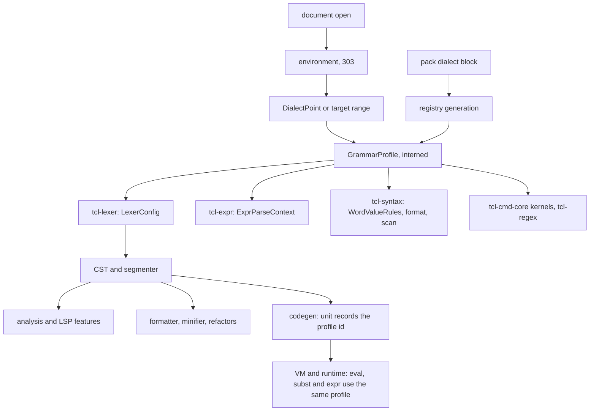

# Step 370 (proposed): dialect grammars

Status: proposed 26 November 2026, as new plan items 370–378. It builds on
[301](301-dialects.md) (`DialectPoint`, families, builds), [305](305-spectcl-3.md)
(the `dialect` form) and [332](332-rust-spectcl-parity.md) (the parity rule),
and closes the redesign's §11 D5. It feeds items 27, 39, 40, 41, 70, 79 and
202, and item 88 for the engines. 308's positioned context and every
grammar-level consumer build on it.

## Problem

**Owner requirement.** A SpecTcl `dialect` block configures every parser
and lexer the dialect uses. Today only the script lexer has a dialect record,
packs cannot reach it, and the other grammars are selected by release
numbers, family matches and proxies.

### The grammars today

| Grammar | Owner | Axes today | Selected from | Hard-coded without an axis |
|---|---|---|---|---|
| script lexer | `tcl-lexer/src/lexer.rs`, `lexer/delimited_words.rs`, `lexer/substitutions.rs` | `LexerGrammar`'s 15 fields (`tcl-dialect/src/grammar.rs:277`); values in `model/family.rs:478-651`, copied in `profile/catalog.rs:85-183` | `LexerConfig::from_grammar`, `for_profile`, `for_dialect`, `for_file_*` (`lexer/config.rs:234-328`) | Jim comment-to-NUL and its other rules under `TokenProtocol::JimNative` (`lexer.rs:165`, `:599`), set only by the Jim roster (`lexer/jim_rosters.rs:37`) |
| CST and segmenter | `tcl-compiler/src/parsing/syntax/`, `segmenter.rs` | reads `LexerConfig` | the caller's config | F5 `else` merge (`segmenter.rs:1213`), gated on `brace_line_continuation` (`:419`, `:519`, `:1170`) and the command name `if` |
| expr | `tcl-expr/src/expr/parser.rs`; 8.4's own parser `syntax_84.rs:45` | `ExprGrammar`'s 8 fields (`model/expr_grammar.rs:228`), 5 Tcl + 1 F5 + 5 Jim values (`:500-645`) | `ExprParseContext::for_profile` (`checked.rs:139`) | precedence: `binary_bp` (`parser.rs:56`) ignores `ExprGrammar::precedence`; the 8.4 parser by `parses_expressions_as_8_4` (`release_behaviour.rs:516`) |
| numerals | `tcl-numeric` `ParseFlags::for_syntax` | `NumberSyntax`, 5 values (`grammar.rs:511`) | the grammar | used as a release proxy by format, scan and `binary` (below) |
| escapes | `tcl-lexer::backslash_subst_bytes_in`, `tcl-syntax/src/backslash.rs` | `EscapeSyntax`, 4 values (`grammar.rs:367`) | the grammar | `decode_bytes` defaults to Tcl 9 (`backslash.rs:45`); 39 non-test lines name `EscapeSyntax::default()` or `::Tcl90` outside `tcl-dialect` |
| list | `tcl-value-syntax::list` | `ListParse` | `WordValueRules` (`tcl-syntax/src/word_rules.rs:77`) | `case_list.rs:232` fixes `Strict`; `list_element` (`list.rs:1073`, 158 callers) has no dialect |
| subst | `tcl_lexer::word_parts::decompose` | the script axes | the caller's config | none found |
| format | spec: `tcl-syntax/src/format.rs`; render: `tcl-cmd-core/src/format.rs` | none | `TclVersion`, `Family::Jim` and `NumberSyntax` (`format.rs:187-295`, `:384`); engines: `release.number_syntax()` (`cmd-core format.rs:102`) | everything |
| scan | `tcl-syntax/src/scan.rs`, `tcl-cmd-core/src/scan.rs` | none | `DialectProfile` plus `TclVersion` (`scan.rs:127`, `:152`, `:234`) | everything |
| regex | `tcl-regex` (ARE, `jim.rs`) | `regex_z_anchor` in the release policy (`release_behaviour.rs:84`) | `Family` match (`tcl-lsp-core/src/pattern_components.rs:80`) | the flavour |
| glob, `string match` | `tcl-syntax/src/glob.rs` (Unicode) and `native_glob.rs` (C units) | none | `native_glob` by `TclVersion` (`native_glob.rs:141`) | two matchers in one crate |
| `binary` | `tcl-cmd-core/src/binary.rs` | none | `TclVersion` and `Family::Jim` (`:493`, `:525`, `:559`) | everything |
| `clock` | `tcl-cmd-core/src/clock.rs` | none | `TclVersion` (`unit_under`, `:460`) | everything |
| character model | `version/character_model.rs:65` | `StringCharacterModel`, 4 values | the release policy | none |
| Jim references | `tcl-syntax/src/naming/jim_enumeration.rs:43` | none | a byte search for `<reference.<` | everything |

`LexerConfig::default()` (the Tcl 9 grammar) appears on non-test lines 94
times in `tcl-lexer`, 226 in `tcl-compiler`, 40 in `tcl-lsp-core`, 19 in
`tcl-codegen`, 18 in `tcl-syntax`, 7 in `runtime/rust` and 4 in `tcl-vm`
(the four in `interp/closed_native_execution/owned_application.rs:405-496`).
These counts include in-file test modules. Each site is a candidate to read
the document's grammar instead.

### D5 and the pack path

The 2.x loader parses `dialect NAME { release …; axis NAME VALUE }` against a
closed list of 15 axes (`tcl-spectcl/src/loader/dialect_block.rs:81-166`) and
registers a `DynamicFamily`. Its grammar is answered only by
`dynamic_core_grammar` (`model/dynamic.rs:486`), which has no production
caller. `grammar_of_dialect_name` (`grammar.rs:167`) resolves compiled
environments and the catalogue, never the dynamic store. So a pack's grammar
never reaches the lexer, the expr parser or any other parser.

### Engines

Both engines share the lexer (`runtime/rust/src/parse.rs:73`,
`tcl-vm/src/value_script.rs:445`), the expr parser
(`runtime/rust/src/value_ops/interp_impl.rs:290`), `tcl-regex` and the
`tcl-cmd-core` kernels. The drift is inside the shared kernels, where the
analysis path and the execution path select differently:

- `format %b 5` under `tclvm --tcl-version 8.4` prints `101`. tclsh 8.4.20
  and 8.5.19 fail with `bad field specifier "b"`. The analysis gate
  (`tcl_syntax::format::is_available`) knows this, but the engine renderer
  selects by `NumberSyntax`, which has one value for 8.5 and 8.6.
- Jim 0.84 accepts `{expand}$l` as expansion (`jim.c:3499`). The Jim token
  roster knows it (`jim_script_tokens.rs:319`), but the main lexer does not,
  so `tcl diag --dialect jim` reports a false E204 on it.

## Design

### A grammar profile per grammar

Each grammar gets a closed set of typed axes. Each value is an enum variant
implemented natively. A dialect selects one value per axis per release line
and build. A pack only selects. A new value is a Rust change in the owning
crate, reviewed like any trusted-tier contribution.

```rust
// tcl-dialect::grammar (design sketch)
pub struct GrammarProfile {
    pub script: ScriptGrammar,  // today's LexerGrammar, minus numbers
    pub number: NumberGrammar,  // NumberSyntax
    pub expr: ExprGrammarSel,   // today's ExprGrammar, every table named
    pub list: ListGrammar,
    pub format: FormatGrammar,
    pub scan: ScanGrammar,
    pub regex: RegexGrammar,
    pub glob: GlobGrammar,
    pub binary: BinaryGrammar,
    pub clock: ClockGrammar,
    pub chars: StringCharacterModel,
    pub values: ValueGrammar,
}
pub struct GrammarProfileId(u32);            // interned; equal profiles share an id
impl DialectPoint { pub fn grammars(&self) -> &'static GrammarProfile; }
```

`subst` and `string match` have no axes of their own: `subst` is the
script's word-part grammar, and `string match` is the glob grammar. Lookup
tables (operators, precedence rows, math functions) are values too, each named
by the release that introduced it and generated by item 202. A pack cannot
supply a table.

### The axes and their release windows

Values are SpecTcl spellings. Windows come from the code's per-release
constants and from runs recorded in the examples below (marked ✓).

| Grammar | Axis | Values | tcl 8.4 · 8.5 · 8.6 · 9.0 · 9.1 | jim 0.76–0.84 | f5-tcl |
|---|---|---|---|---|---|
| script | `expand` | `off`, `star`, `star-or-word` | off · star · star · star · star ✓ | `star-or-word` (0.84 ✓) | off ✓ |
| script | `brace_separator` | `required`, `optional` | required ✓ | required ✓ | optional (§1 R1–R7) |
| script | `quote_termination` | `strict`, `concatenating` | strict ✓ | concatenating ✓ | strict |
| script | `line_continuation` | `backslash`, `brace-line` | backslash ✓ | backslash | brace-line (§2 N1–N4) |
| script | `else_lookahead` | `none`, `single-newline` | none ✓ | none | single-newline (§2 N5) |
| script | `braced_var` | `first-close`, `nesting` | first-close to 8.6, nesting from 9.0 ✓ | first-close ✓ | first-close |
| script | `array_index` | `tcl8`, `tcl9` | tcl8 to 8.6, tcl9 from 9.0 | tcl8 | tcl8 |
| script | `word_separators` | `tcl`, `jim` | tcl ✓ | jim (`\v` is a word byte) ✓ | tcl |
| script | `brace_backslash_newline` | `folds`, `literal` | folds ✓ | literal ✓ | folds |
| script | `var_syntax` | `tcl`, `jim` | tcl ✓ | jim (`$(…)`, nested index parens) ✓ | tcl |
| script | `comment_end` | `newline`, `newline-or-nul` | newline ✓ | newline-or-nul (0.84 ✓) | newline |
| script | `bom_skip` | `off`, `on` | off to 8.6, on from 9.0 ✓ | off | off |
| script | `source_line_endings` | `translate-auto`, `preserve` | translate-auto | preserve | translate-auto |
| script | `escapes` | `tcl84`, `tcl86`, `tcl90`, `jim` | tcl84 · tcl84 · tcl86 · tcl90 · tcl90 ✓ | jim ✓ | tcl84 |
| number | `syntax` | `tcl84`, `tcl85`, `tcl90`, `jim`, `jim080` | tcl84 · tcl85 · tcl85 · tcl90 · tcl90 ✓ | jim, jim080 from 0.80 | tcl84 (§4a) |
| expr | `comments` | `none`, `hash` | none to 8.6, hash from 9.0 ✓ | hash from 0.81 ✓ | none |
| expr | `operators` | `tcl84`, `tcl85`, `tcl90`, `f5`, `jim076`, `jim080` | tcl84 · tcl85 · tcl85 · tcl90 · tcl90 | jim076, jim080 from 0.80 | f5 (ten word operators) |
| expr | `precedence` | one table per row of `expr_grammar.rs:500-645` | tcl84 · tcl85 · tcl86 · tcl90 · tcl90 | jim076, jim077, jim080, jim084 | f5 |
| expr | `arity` | `concatenating`, `exactly-one` | concatenating | exactly-one from 0.81 (0.84 ✓) | concatenating |
| expr | `parser` | `tcl84`, `tcl85`, `jim-eager` | tcl84 · tcl85 from 8.5 | jim-eager | tcl84 |
| list | `parse` | `strict`, `lenient` | strict | lenient | strict |
| format | `conversions` | `tcl84`, `tcl85`, `tcl86`, `tcl90`, `jim` | each release its own ✓ (`%b` 8.6, `ll` 8.5) | jim ✓ | tcl84 |
| format | `alternate` | `c`, `tcl90`, `jim` | c to 8.6, tcl90 from 9.0 ✓ | jim (`%#b` is `101`) ✓ | c |
| scan | `conversions` | as format | per release (`scan.rs:234-268`) | jim | tcl84 |
| scan | `int_width` | `truncate32`, `full` | truncate32 · full · full · truncate32 · truncate32 (`scan.rs:116`) | full | truncate32 |
| regex | `flavour` | `are`, `jim` | are ✓ | jim ✓ | are |
| regex | `z_anchor` | `off`, `on` | off to 9.0, on in 9.1 ✓ | off | off |
| glob | (none) | | identical on the rows tried | identical | |
| binary | `formats` | `tcl84`, `tcl85`, `jim` | tcl84 · tcl85 from 8.5 (`m`) ✓ | jim (signedness) | tcl84 |
| clock | `units` | `tcl8`, `tcl9` | tcl8 to 8.6, tcl9 from 9.0 ✓ | none (no `clock add`) | tcl8 |
| chars | `model` | `bmp-else-bytes`, `utf16`, `scalars`, `jim084-utf8` | bmp · bmp · utf16 · scalars · scalars | jim084-utf8 (UTF8 build) | unmeasured |
| values | `references` | `none`, `jim` | none | jim (`<reference.<TAG____>.N20>`) | none |

Only two values separate 9.0 from 9.1: `regex z_anchor` and the
math-function table (9.1 adds 23 functions, `acosh` to `trunc`, by `info
functions` on both). The generated precedence rows for 9.0 and 9.1 are
identical, so they share one table. f5-tcl has one profile for every BIG-IP
line, because only 21.1 is measured and nothing shows a line-to-line change
(301). Each build may override a value (`-build`); none does today.

### SpecTcl 3 syntax

A `grammar` block replaces 305's `axis` row inside `dialect`:

```text
dialect    := 'dialect' FAMILY '{' ( release-row | build-row | 'grammar' GRAMMAR '{' grow* '}' )* '}'
GRAMMAR    := script | number | expr | list | format | scan | regex | glob | binary | clock | chars | values
grow       := AXIS VALUE ?'-from' LINE? ?'-build' BUILD?
```

A row without `-from` holds from the first release line. A later `-from`
row for the same axis takes over from that line. `-build` restricts a row to
one build. The reader checks every axis and value against the closed tables
and rejects the whole block, naming the axis, on any unknown word. 305's
`axis NAME VALUE` reads as `grammar script { NAME VALUE }`, with the old
`irules_brace_separator on` read as `brace_separator optional` and
`brace_line_continuation on` as `line_continuation brace-line`.

```spectcl
dialect f5-tcl {
    release 15.0 ; release 16.1 ; release 17.1 ; release 21.1
    build tmm ; build scriptd -capabilities {wordSize 4}
    grammar script {
        expand off
        brace_separator optional
        line_continuation brace-line
        else_lookahead single-newline
        escapes tcl84
    }
    grammar number { syntax tcl84 }
    grammar expr { comments none ; operators f5 ; precedence f5 ; parser tcl84 }
    grammar format { conversions tcl84 ; alternate c }
    grammar regex { flavour are }
}
```

Release windows use `-from`:

```spectcl
dialect tcl {
    grammar script {
        expand off ; expand star -from 8.5
        braced_var first-close ; braced_var nesting -from 9.0
        escapes tcl84 ; escapes tcl86 -from 8.6 ; escapes tcl90 -from 9.0
    }
    grammar regex { flavour are ; z_anchor off ; z_anchor on -from 9.1 }
}
```

**Trust rules.** A grammar decides what every word of a document is, so a
wrong selection can hide a taint sink as easily as a wrong command spec.
Selecting implemented values runs no code, so the rule is about which
dialects a tier may define.

| Tier (§6.4) | Define a new, namespaced dialect | Change `tcl`, `jim` or `f5-tcl` |
|---|---|---|
| `BuiltIn` (Rust), `BundledPack` | yes | yes, with conformance rows for every changed axis |
| `User`, `WorkspaceTrusted` | yes | no |
| `WorkspaceUntrusted`, `StudioOverride`, `Document` | no | no |

**Rust spelling.** Per 332, the shipped families are Rust constants with the
same rows, and the printer (item 310) prints them as the blocks above:

```rust
pub const F5_TCL_GRAMMAR: &[GrammarRow] = &[
    GrammarRow::script(ScriptAxis::Expand(Expand::Off)),
    GrammarRow::script(ScriptAxis::BraceSeparator(BraceSeparator::Optional)),
    GrammarRow::script(ScriptAxis::LineContinuation(LineContinuation::BraceLine)),
    GrammarRow::script(ScriptAxis::ElseLookahead(ElseLookahead::SingleNewline)),
    GrammarRow::regex(RegexAxis::Flavour(RegexFlavour::Are)),
    // …
];
pub struct GrammarRow { pub axis: GrammarAxis, pub from: Option<LineId>, pub build: Option<Build> }
```

The round-trip gate compares the Rust rows with the printed and re-read
pack, row for row, as 332 does for command specs. The rows are generated
with the release facts (items 79, 202) where an oracle decides them.

### Reaching every parser: fixing D5

The dialect, not a name, selects the grammar. `DialectPoint` names either a
compiled family or a pack family, and the profile is resolved once, at
environment resolution, then carried as data.

```rust
pub enum DialectId { Compiled(Family), Pack(DynamicFamilyId) }
impl DialectPoint {
    pub fn dialect(&self) -> DialectId;
    pub fn grammars(&self) -> &'static GrammarProfile;   // interned table, no name lookup
}
impl LexerConfig { pub fn new(g: &ScriptGrammar, entry: Entry) -> Self; } // Entry::File | Nested
impl ExprParseContext { pub fn new(p: &GrammarProfile) -> Self; }
impl WordValueRules { pub fn new(p: &GrammarProfile) -> Self; }
```

Pack profiles are published in the registry generation (item 47's salsa
input), not the process-global store in `dynamic.rs`. `grammar_of_dialect_name`,
`for_profile`, `for_dialect`, `for_file_dialect` and `dynamic_core_grammar` are
deleted. The flow from document open:



A target range resolves to the set of distinct profiles in the range. The
analysis lexes once per distinct profile, as W151 does today for numerals,
and item 378 turns any difference into a portability diagnostic.

**The tools.** A tool that writes Tcl writes through the writer owner (item
39), which takes the profile and re-lexes its own output under it. An edit
whose words differ from the intended words is refused with a reason. The
per-axis rules:

| Axis value | The writer must not | Measured today |
|---|---|---|
| `brace_separator optional` | emit `}{`; it emits `} {`, which every profile reads alike | the formatter rewrites `if {$x}{…}` to `if {$x} {` under f5-irules |
| `line_continuation brace-line` | start a new command's line with `{`, which would join it to the line before; it may still read K&R input | the formatter rewrites `while {…}` ⏎ `{` to `while {…} {` under f5-tmsh |
| `line_continuation backslash` | move a `{` word to its own line | the minifier keeps 8.4's reading: `while {$a < 3};{…}` |
| `else_lookahead single-newline` | put a blank line between `}` and `else` | |
| `expand off` | emit `{*}` | |
| `quote_termination concatenating` | rely on concatenation | |
| `brace_backslash_newline literal` | quote a value as `{…\⏎…}` expecting it to fold | |

The minifier today returns F5 sources unchanged (measured on a three-line
proc under `--dialect f5-tmsh`). With the rules above it can minify them.

**Codegen and the engines.** A compiled unit records its `GrammarProfileId`.
The VM's runtime `eval`, `subst` and `expr` of a string read the interp's
profile, which today comes from `source_profile().grammar`
(`tcl-vm/src/interp/configuration.rs:318`). The four `LexerConfig::default()`
sites in `owned_application.rs` take it too. The runtime resolves its point
from `environment::profile_for_dialect` and reads the same profile. Engine
execution of Jim and F5 stays a distant goal (plan scope), but an engine
that refuses a profile it cannot run must say so, not run it as Tcl 9.

### One implementation per grammar

| Grammar | The one owner | Today's second reading | Plan |
|---|---|---|---|
| script lexer | `tcl-lexer` | Jim roster (`jim_script_tokens.rs`) knows `{expand}`; the main lexer does not | 374: one Jim path; `TokenProtocol` becomes the `comment_end` and `expand` axes |
| segmentation | `tcl_lexer::script` grouping | the compiler segmenter's `else` merge | 374 with item 41: move the merge into the grouping, on `else_lookahead` |
| expr | `tcl-expr` | `binary_bp` against `ExprGrammar::precedence`; `syntax_84.rs` | item 27; 8.4's parser stays as the `parser tcl84` value |
| format, scan | `tcl-syntax` spec parsers plus `tcl-cmd-core` renderers | the analysis gate and the engine renderer select differently | 373: both take `FormatGrammar`, so the `%b` drift closes |
| regex | `tcl-regex` | the flavour chosen by `Family` at each consumer | 373: `RegexGrammar` selects the engine |
| glob | `tcl-syntax` | `glob.rs` (Unicode) beside `native_glob.rs` | 373: a parity row set across both, then one matcher per purpose |
| binary, clock | `tcl-cmd-core` | none (one implementation, release-selected) | 373: take their grammar |
| Jim references | none | a byte search | 373: `ValueGrammar` owns the reader |

Engine convergence beyond the grammars (frames, namespaces, command
identity) stays with [item 88](../../../work/name-handling/plan.md).

### Verification: the grammar conformance area

The rows join item 75's harness (`rust/tcl-lsp-core/tests/conformance/`,
probe root `docs/work/name-handling/handover/oo-dispatch-probe/`) as
`grammar/<grammar>/<axis>/NN-name.tcl`. Each fixture's header names the axis
and value it discriminates. The columns are tclsh 8.4–9.1 (on PATH), jimsh
(`TCL_LSP_JIMSH`, then `jimsh` on PATH, per `tcl-test-support/src/jim.rs:221`;
the build in `tmp/jimtcl-oracle/` is the one on hand), the VM per release, and the
analysis readings: the token words, the CST, the folder and the writer
round-trip. The f5-tcl column is read from the evidence: the 34 cases of
`scripts/dev/bigip-probes/suites/10-context-parity.cases` and the word lists
in measurements §1–§3, each row citing its result file.

A gate, `cargo xtask grammar-axes --check`, fails when an axis value has no
row whose expected output differs from a neighbouring value's. So every value
is discriminated by at least one real run.

### Worked examples

Each example was run on tclsh 8.4.20, 8.5.19, 8.6.18, 9.0.4 and 9.1.0, jimsh
0.84 (`tmp/jimtcl-oracle/jimsh`), and `./target/debug/tclvm` and `tcl dis` as
built. Token spans are computed from the source by the lexer rules; they are
not a dump.

**1. The brace separator.** The same line under tcl 8.4, tcl 9.1 and f5-tcl:

**Source:**

```tcl
set x 1
if {$x}{puts a}
```

**In memory:**

```rust
// tcl_lexer::Token exists today; the profile type is a design sketch (370)
ScriptGrammar { expand: Off, brace_separator: Optional, line_continuation: BraceLine, .. } // f5-tcl
[Token { kind: Esc, span: 0..2 }, Token { kind: Sep, span: 2..3 },
 Token { kind: Str, span: 3..7, content_offset: 1 },
 Token { kind: Sep, span: 7..7 },              // zero-width: R2's word break
 Token { kind: Str, span: 7..15, content_offset: 1 }]
// tcl 8.4 and 9.1, brace_separator: Required -> LexError at 7, E204
```

**Bytecode (tclsh 9.1.0):**

```text
ByteCode
  Source "if {$x}{puts a}"
  Cmds 0, src 15, inst 20, litObjs 2, aux 0, stkDepth 2, code/src 0.00
    (0) push 0 	# "extra characters after close-brace"
    (5) push 1 	# "-code 1 -level 0 -errorcode NONE -errori..."
    (10) syntax +1 0 
    (19) done 
```

**Bytecode (tcl dis):**

```text
$ tcl dis --dialect f5-irules --source 'when RULE_INIT { set x 1; if {$x}{log local0. a} }'
ByteCode ::when::RULE_INIT, 11 instructions, 27 bytes, 6 literals, 0 variables
    (18) push1 3	# "if"
    (20) push1 4	# "$x"
    (22) push1 5	# "log local0. a"
    (24) invokeStk1 3	# if
```

**Result:**

```text
$ tclsh8.4 ex1.tcl
extra characters after close-brace
$ tclsh9.1 ex1.tcl
extra characters after close-brace
$ jimsh ex1.tcl
ex1.tcl:2: Error: extra characters after close-brace
f5-tcl (measurements §4a, TMM, tmsh and iApp on 21.1.0.1): if {1}{…} -> 43
$ tcl diag --dialect tcl9.1 d1.tcl
d1.tcl:2:8: error   E204     extra characters after close-brace
$ tcl diag --dialect f5-tmsh d1.tcl
d1.tcl:2:4: info    I230     Condition '$x' is always true; the alternate branch is unreachable
```

**2. Numerals.** `017 + 0o17` divides the releases three ways:

**Source:**

```tcl
puts [list [catch {expr {017 + 0o17}} m] $m]
```

**In memory:**

```rust
// design sketch (370); NumberSyntax exists today
NumberGrammar { syntax: Tcl84 }   // tcl 8.4: 0o17 is not a numeral
NumberGrammar { syntax: Tcl85 }   // 8.5, 8.6: 017 is octal 15
NumberGrammar { syntax: Tcl90 }   // 9.x: 017 is decimal 17
NumberGrammar { syntax: Jim080 }  // jim 0.84: decimal 17, no `_`
```

**Bytecode (tclsh 9.1.0):**

```text
  Command 1: "expr {017 + 0o17}"
    (0) push 0 	# "32"
    (5) done 
```

**Bytecode (tcl dis):**

```text
$ tcl dis --dialect tcl8.6 --source 'expr {017 + 0o17}'
    (0) push1 0	# "30"
$ tcl dis --dialect tcl9.0 --source 'expr {017 + 0o17}'
    (0) push1 0	# "32"
```

**Result:**

```text
tclsh8.4: 1 {syntax error in expression "017 + 0o17": extra tokens at end of expression}
tclsh8.5: 0 30
tclsh8.6: 0 30
tclsh9.0: 0 32
tclsh9.1: 0 32
jimsh:    0 32
```

With a variable operand, `1_000` is 1000 on 9.0 and 9.1 and an error on 8.x
and Jim (`expected floating-point number but got "1_000"`).

**3. Escapes.** `\x4142`, `\U0001F600` and Jim's `\u{1F600}`:

**Source:**

```tcl
foreach s [list "\x4142" "\U0001F600" "\u{1F600}"] {
    set cps {}
    foreach c [split $s ""] { lappend cps [format %X [scan $c %c]] }
    puts "[string length $s] {$cps}"
}
```

**In memory:**

```rust
// design sketch (370); EscapeSyntax exists today
ScriptGrammar { escapes: Tcl84, .. }  // 8.4, 8.5: \x eats every hex digit; no \U
ScriptGrammar { escapes: Tcl86, .. }  // 8.6: \x takes two; \U decodes, BMP only
ScriptGrammar { escapes: Tcl90, .. }  // 9.x: \U is a full scalar
ScriptGrammar { escapes: Jim, .. }    // jim: also \u{…}
```

**Bytecode (tclsh 9.1.0):**

```text
  Command 1: "string length \"\x4142\U0001F600\u{1F600}..."
    (0) push 0 	# "12"
```

**Result:**

```text
$ tclsh8.4 ex3.tcl
1 {42}
9 {55 30 30 30 31 46 36 30 30}
8 {75 7B 31 46 36 30 30 7D}
$ tclsh8.6 ex3.tcl
3 {41 34 32}
1 {FFFD}
8 {75 7B 31 46 36 30 30 7D}
$ tclsh9.1 ex3.tcl
3 {41 34 32}
1 {1F600}
8 {75 7B 31 46 36 30 30 7D}
$ jimsh ex3.tcl
3 {41 34 32}
1 {1F600}
1 {1F600}
```

tclsh 8.5 prints what 8.4 prints, and 9.0 what 9.1 prints. `tclvm
--tcl-version 8.4` prints the 8.4 lines.

**4. Continuation.** A `{` line, and a backslash-newline inside braces:

**Source:**

```tcl
puts [string length {a\
    b}]
set r [list a b
{c}]
puts $r
```

**In memory:**

```rust
// design sketch (370)
ScriptGrammar { line_continuation: Backslash, brace_backslash_newline: Folds, .. }   // tcl
ScriptGrammar { line_continuation: Backslash, brace_backslash_newline: Literal, .. } // jim
ScriptGrammar { line_continuation: BraceLine, brace_backslash_newline: Folds, .. }   // f5-tcl
```

**Bytecode (tclsh 9.1.0):**

```text
  Source "list a b\n{c..."
  Command 1: "list a b..."
    (0) nop … (5) nop
  Command 2: "{c}"
    (6) push 1 	# "c"
    (11) invokeStk 1 
```

**Bytecode (tcl dis):**

```text
$ tcl dis --dialect f5-irules ex4.irul      # the same lines inside when RULE_INIT
    (13) push1 2	# "a b c"
    (15) invokeStk1 3	# set
```

**Result:**

```text
$ tclsh8.4 ex4.tcl    (8.6, 9.1 the same)
3
invalid command name "c"
$ jimsh ex4.tcl       (first line alone)
8
f5-tcl (measurements §2, §4a): list a b ⏎ {c} -> a b c
```

**5. `format` conversions.** The grammar moves at 8.5, 8.6 and 9.0:

**Source:**

```tcl
foreach {f v} {%#o 8 %b 5 %#b 5 %#d 9 %lld 7} {
    if {[catch {format $f $v} r]} { set r "error: $r" }
    puts "$f -> $r"
}
```

**In memory:**

```rust
// design sketch (370)
FormatGrammar { conversions: Tcl84, alternate: C }      // no %b, no ll
FormatGrammar { conversions: Tcl86, alternate: C }      // %b; %#o is 010
FormatGrammar { conversions: Tcl90, alternate: Tcl90 }  // %#o is 0o10, %#d is 0d9
FormatGrammar { conversions: Jim, alternate: Jim }      // %#b is 101
```

**Bytecode (tclsh 9.1.0):**

```text
  Command 1: "format %#o%b 8 5"
    (0) push 0 	# "0o10101"
```

**Result:**

```text
           %#o    %b        %#b      %#d   %lld
tclsh8.4   010    bad "b"   bad "b"  9     bad "l"
tclsh8.5   010    bad "b"   bad "b"  9     7
tclsh8.6   010    101       0b101    9     7
tclsh9.0   0o10   101       0b101    0d9   7     (9.1 the same)
jimsh      010    101       101      9     7
tclvm --tcl-version 8.4   010  101  0b101  9  bad "l"     <- drift on %b
```

**6. Regex flavour.** ARE across releases, and Jim's engine:

**Source:**

```tcl
foreach re {{a\z} {(?i)A\y} {***=a.}} {
    if {[catch {regexp $re "xa"} r]} { set r "error: $r" }
    puts "$re -> $r"
}
```

**In memory:**

```rust
// design sketch (370)
RegexGrammar { flavour: Are, z_anchor: false }  // tcl 8.4-9.0
RegexGrammar { flavour: Are, z_anchor: true }   // tcl 9.1
RegexGrammar { flavour: Jim, z_anchor: false }  // jim: no (?i), no ***=, \y and \z are letters
```

**Bytecode (tclsh 9.1.0):**

```text
$ proc p s {list [regexp {a\z} $s] [regexp {(?i)A\y} $s]}
    (0) push 0 	# "a\z"
    (5) loadScalar %v0 	# var "s"
    (10) regexp +3 
```

**Result:**

```text
$ tclsh8.4 ex6.tcl / tclsh9.0 ex6.tcl
a\z -> error: couldn't (9.0: cannot) compile regular expression pattern: invalid escape \ sequence
(?i)A\y -> 1
***=a. -> 0
$ tclsh9.1 ex6.tcl
a\z -> 1
$ jimsh ex6.tcl
a\z -> 0
(?i)A\y -> error: couldn't compile regular expression pattern: count follows nothing
***=a. -> error: couldn't compile regular expression pattern: count follows nothing
$ tclvm --tcl-version 9.1 ex6.tcl
a\z -> 1
```

**7. Jim's `$(…)`.** Expression sugar against a C Tcl array read:

**Source:**

```tcl
set a 5
puts $($a * 2)
```

**In memory:**

```rust
// TokenType::ExprSugar exists today, emitted only under VarSyntax::Jim
ScriptGrammar { var_syntax: Jim, .. }  // [Esc "puts", Sep, ExprSugar "$a * 2"]
ScriptGrammar { var_syntax: Tcl, .. }  // [Esc "puts", Sep, Var "$(…)"]: array "" element "5 * 2"
```

**Bytecode (tclsh 9.1.0):**

```text
    (5) push 1 	# ""
    (10) push 2 	# "a"
    (15) loadStk 
    (16) push 3 	# " * 2"
    (21) strcat 2 
    (23) loadArrayStk 
```

**Bytecode (tcl dis):**

```text
$ tcl dis --dialect jim --source 'set a 5; puts $($a * 2)'
    (11) push1 4	# "$($a * 2)"
    (13) invokeStk1 2	# puts
```

**Result:**

```text
$ tclsh8.4 ex7.tcl    (9.1 the same)
can't read "(5 * 2)": no such variable
$ jimsh ex7.tcl
10
```

Our codegen pushes the Jim word as a literal. With `var_syntax jim` in the
unit's profile, an engine that cannot run it refuses instead.

## Work list

1. **370** `tcl-dialect`: `GrammarProfile` and the axis enums; move
   `numbers` out of `ScriptGrammar`; generate the per-line rows with the
   release facts and delete `catalog.rs`'s `GRAMMAR_*` copies.
2. **371** `tcl-spectcl` reader3: `grammar` blocks, the `axis` shim, the trust
   table, and the Rust rows with the round-trip gate.
3. **372** D5: `DialectId::Pack`; profiles in the registry generation; the
   new constructors; delete the name-based ones and `dynamic_core_grammar`.
4. **373** Kernels take their grammar: format, scan, `binary`, `clock`, regex,
   glob, Jim references.
5. **374** Lexer and segmentation: the `else` lookahead axis in
   `tcl_lexer::script`; `{expand}` and `comment_end` in the main lexer.
6. **375** The writer takes the profile; formatter, minifier and refactors
   re-lex their output.
7. **376** Engines read the profile; compiled units record its id.
8. **377** The conformance area and `xtask grammar-axes --check`.
9. **378** Portability diagnostics over any axis across a target range.

## Verification

- **Done when:** every row of the axis table is a typed value with a
  conformance row that a real interpreter or the F5 evidence decides; a pack
  dialect with `brace_separator optional` changes the words in diagnostics,
  hover and semantic tokens; `rg 'grammar_of_dialect_name|for_profile|for_dialect|dynamic_core_grammar' rust`
  finds nothing; `format %b 5` fails under `tclvm --tcl-version 8.4`.
- **Measurements:** lexing time on the corpus within ±2% (the profile is a
  `&'static` read); the build cone of `tcl-dialect` unchanged; the number of
  `LexerConfig::default()` lines outside tests, which may only shrink.

## Risks

- **Axis explosion.** Mitigation: an axis exists only when two oracles
  disagree on a row; the `--check` gate rejects a value with no
  discriminating row.
- **Unmeasured windows.** Only jimsh 0.84 is on hand, so Jim's `expand
  star-or-word` and `comment_end` are measured at 0.84 only, and the f5-tcl
  column is 21.1 only. Rows say which point measured them (301's
  `EvaluationEvidence`).
- **Tools that refuse more.** A writer that re-lexes may refuse edits it
  makes today. Each refusal carries a reason (item 78's outcome type).

## Corrections to other designs

- **The task brief and 301** place `LexerGrammar` in `profile/catalog.rs`.
  The type is in `tcl-dialect/src/grammar.rs:277`; `catalog.rs:85-183` and
  `model/family.rs:478-651` hold the values.
- **The redesign §1** says exactly five `LexerGrammar` constants exist, in
  `profile.rs`. There are five in `catalog.rs` and nine in `family.rs`
  (including the `GRAMMAR_IRULES` alias and three Jim rungs).
- **301's "What leaves the family"** moves two F5 axes. There are three
  measured F5 rules: the segmenter's `else` merge (N5) rides
  `brace_line_continuation` today and gets its own axis here.
- **305's `dialect` production** (`'axis' AXIS VALUE ?'-from' LINE?`) is
  replaced by `grammar` blocks; `axis` remains as a shim.
- **dialects-and-libraries.md** says "the lexer receives the dialect core
  profile only". Every grammar consumer receives the `GrammarProfile`.
- **Plan item 41** places the F5 `else` merge in the compiler segmenter only.
  The runtime groups commands through `tcl_lexer::script::group_commands`
  (`runtime/rust/src/parse.rs:73`), so the merge moves there, not into a
  second segmenter.
- **Analyser bug:** `tcl diag --dialect jim` reports E204 on `list
  {expand}$l`, which jimsh 0.84 expands.
- **Engine bug:** `tclvm --tcl-version 8.4` and `8.5` accept `format %b`.

## Owner decisions (26 November 2026)

- **Jim: latest only.** Jim is supported at 0.84 only for now, so open question 4 is settled: `{expand}` and comment-to-NUL are facts of the single `jim` point, with no window to measure. A dialect gets release boundaries only where a release changes the language significantly, as C Tcl's do.
