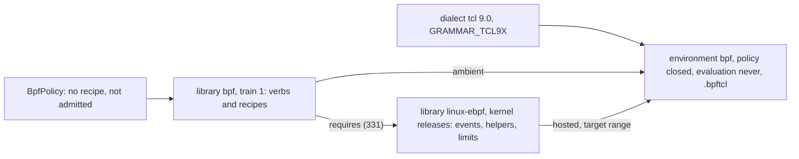
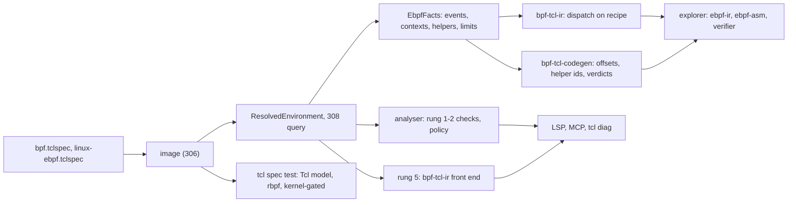

# Step 380 (proposed): SpecTcl 3 for the eBPF backend

Status: proposed 26 November 2026, with proposed items 380–386 (retired; see Plan numbers). Builds on
[302](302-libraries.md), [303](303-environments.md), [304](304-f5-libraries.md)
(a library owns its policy), [305](305-spectcl-3.md), [308](308-positioned-context.md),
[313](313-consumer-hooks.md), [332](332-rust-spectcl-parity.md) (parity) and
[334](334-spectcl-codegen-vm-runtime.md) (compile recipes). It closes the
redesign's D3 and 333's gap 12, and uses 333's planned forms: 336 (manifest),
337 (pack codes, `within`), 338 (`event`) and 342 (`test`). 360 (iRules
events) and 370 (grammars) are written beside it.

**Plan numbers** (26 November 2026): the proposed 380–386 are retired: 380 → 458, 381 → 459, 382 → 460, 383 → 461, 384 → 462, 385 → 463, 386 → 464. References to 333's 336, 337, 338 and 342 mean plan items 400, 413, 442 and 414. The [consolidated SpecTcl 3 specification](../spectcl-3/README.md) supersedes this design in detail, and its [crosswalk](../spectcl-3/12-plan-crosswalk.md) maps every proposed number.

## Problem

BPF-Tcl ([ebpf-backend.md](../../compiler/ebpf-backend.md)) is a closed,
typed packet language with Tcl syntax. `bpf-tcl-ir` lowers it to BPF-IR and
`bpf-tcl-codegen` emits eBPF for `rbpf` and four kernel ABIs. Its facts sit
in five places, and SpecTcl can say none of them:

| Fact | Where today | Status |
|---|---|---|
| per-command lowering (`BpfOpSpec`: 12 `BpfOpKind`s, effects, program types) | 26 specs in `tcl-registry/src/commands/bpf/`, plus `if` (`commands/tcl/if_.rs:247`) | Rust only; `bpf_op -native ID` unread (D3, `definer/spectcl.rs:182`) |
| events: program type, `SEC`, context fields, capabilities, verdicts, default, kernel floor | `BPF_EVENTS`, 6 rows (`tcl-registry/src/bpf_op.rs:643`) | Rust only |
| verdict wire values (`XDP_DROP` 1, `TC_ACT_SHOT` 2, `XDP_TX` 3), per-type hints | `bpf-tcl-ir/src/lower.rs:519-526,557,590` | hand table |
| `data`/`data_end` offsets (0/4, 76/80) | `bpf-tcl-codegen/src/ebpf/emit.rs:123` | hand table; absent from the registry's field lists |
| helper ids (`FN_MAP_LOOKUP` 1, `FN_MAP_UPDATE` 2); rbpf ids | `ebpf/insn.rs:79-83`; `emit.rs:66-70` | hand table |
| limits: 64 slots / 512 bytes, unroll 64 | `alloc.rs:43`, `emit.rs:73`, `unroll.rs:40` | constants |
| closed words: map kinds, concurrency, byte order, 6 built-in profiles, operators | `ir.rs:344,379`, `profile.rs:100-135`, `lower.rs:1215-1245` | hand tables |
| concurrency refusal | `lower.rs:830`, `commands::thread::is_thread_command` | name list |

A verdict's program types are said twice: `tx` carries `XDP_ONLY` and the
`XDP` event lists `Tx`.

**Only `bpf-tcl` and `tcl-fuzz` depend on `bpf-tcl-ir`**, so no editor
consumer sees any of it. Runs of the built `target/debug/tcl` (26 November):

- `tcl diag --dialect bpf` is silent on `loop 1000 i {…}`, `accept` in an
  XDP handler and `while {1}`; `bpf-tcl` rejects all three (BPF007, BPF001,
  BPF007: `tests/loops.rs`, `tests/xdp.rs:76`).
- `tcl command-info --dialect bpf --json load16` gives `"summary": ""`.
- `tcl diag x.bpftcl` fails with "unsupported source file": the environment
  claims no extension (`model/environment.rs:1577`).
- `tcl dis --dialect bpf` emits TclVM bytecode (`invokeStk1 5 # when`), and
  `tcl explore --show ebpf` prints "no matching views".

**The analysis edge is unused.** `bpf-tcl-ir` names `executable_ir`,
`world_state_ssa`, `registry_invocation`, `semantic_analysis` and
`target_contract` only in `semantic_bridge.rs`, and nothing outside that
file's tests calls `EbpfSemanticBridge::assess`. `dispatch_proof` appears
only in those tests (`:530` on). Production uses `lowering` and `cfg_builder`
(`build_cfg_function_in_bpf_selected_scope`, `source/phase.rs:223`).

## Design

### 1. Placement: two libraries and an environment, not a dialect

**Decision.** Library `bpf` is the BPF-Tcl vocabulary (train 1). Library
`linux-ebpf` is the kernel's eBPF ABI, versioned by kernel release.
Environment `bpf` places core tcl 9.0, `bpf` ambient, `linux-ebpf` hosted at
the target range, and policy `closed -evaluation never`. As in 304, `bpf` owns its
`LibraryPolicy`. Reasons:

1. **The lexer is Tcl 9.0's** (`GRAMMAR_TCL9X`, `profile/catalog.rs:218`).
   With no axis value of its own, it is not a family.
2. **The subset is availability.** "Only these commands" is closed-world
   policy (redesign §2), like iRules' 15 refused commands.
3. **The one semantic difference is the target's.** `/` and `%` truncate,
   and integers wrap at 64 bits (`emit.rs:722-734`). No Tcl engine runs a
   `bpf` document: the environment is `evaluation never`, so `tcl dis`,
   `tclvm` and the runtime refuse it (item 457). The expression is an
   argument of `setint` or `if`, which makes it an argument sublanguage,
   declared per role.
4. **Kernel versions are a library axis.** Event floors (XDP 4.8, TC 6.6),
   helpers, map types and limits vary by kernel. As `available linux-ebpf
   RANGE` rows they use 302's facets, 308's query and `tclLsp.targets`.
5. **A Tcl model can run it, as a test runner.** A 38-line model defines
   each verb as a proc. It runs the backend's `block-ssh` test under
   `tclsh9.0` and `tclsh9.1` with the verdicts `rbpf` asserts (example 1).
   The model is its own script in a plain `tcl` 9.0 interpreter, not the
   `bpf` environment, and is exact only without truncating division or
   64-bit wrap (Risks).

The environment and what it places:



`rbpf` is not a kernel. Its helper ids and 64-bit `data` words stay in Rust
in `bpf-tcl`, the harness that defines them.

### 2. The surface as SpecTcl 3

**Recipes: `bpf_op` made real.** 334's `RECIPE` gains a target form. The
eBPF target has no plain invoke, so a missing recipe means "not in the
subset". That one rule replaces the policy list, the declaration-only top
level and `is_thread_command`.

```text
RECIPE += 'ebpf' OP ( '-' KEY VALUE )*     ; OP from bpf-tcl-ir's closed catalogue
OP     := conditional | scalar | bind-packet | packet-load | packet-len | map-declare
        | map-get | map-set | map-has | verdict | loop | declare
```

| Today (`BpfOpSpec`) | SpecTcl 3 |
|---|---|
| `ScalarSet(I32SignExtended)` | `compile ebpf scalar -width i32` |
| `PacketLoad { width_bits: 16 }`, `PKT_READ` | `compile ebpf packet-load -width 16` and `effect reads packet` |
| `MapGet`, `MAP_READ` | `compile ebpf map-get` and `effect reads map` |
| `verdict(Tx, XDP_ONLY)` | `compile ebpf verdict -name tx`; validity comes from each event's `verdict` rows |
| `framework(When)` | `compile ebpf declare -kind when -top-level` |

Effects become ordinary `effect` rows. The capability check becomes "the
command's effects are within the event's capabilities, narrowed by
`allow`/`deny`", and no command is named.

**Kernel facts as library content:** 338's `event` plus `context`, `helper`,
`map-type` and `limit` rows (336's manifest).

**Source:**

```spectcl
speclib linux-ebpf 3 {
library linux-ebpf { versions 3.19 4.8 4.17 5.2 5.3 6.6 }
context xdp_md {
    field data 0 32 host -role packet-start ; field data_end 4 32 host -role packet-end
    field ingress_ifindex 12 32 host
}
event XDP {
    available linux-ebpf 4.8-
    program-type xdp -section xdp -context xdp_md -link
    capabilities {packet-read map-read map-write context-read}
    verdict pass 2 ; verdict drop 1 ; verdict tx 3 ; default pass ; out-of-bounds drop
    attach interface -kind interface -required
}
helper bpf_map_lookup_elem {
    available linux-ebpf 3.19- ; id 1 ; args {map key} ; returns map-value-or-null
    hover { summary {Look up a key; null-check the result before use.} }
}
map-type array { id 2 ; key-size 4 ; preallocated }
limit stack-bytes 512
versions {linux-ebpf 5.3-} { limit back-edges bounded }
}
```

**In memory:**

```rust
// design sketch: types proposed here, over 302's Facet and Availability
EbpfEvent { name: "XDP", availability: Availability { library: Some(LibraryId("linux-ebpf")), window: ItemHistory("4.8-"), .. },
  program_type: ProgTypeId("xdp"), section: "xdp", context: ContextId("xdp_md"), link: true,
  capabilities: PACKET_READ | MAP_READ | MAP_WRITE | CONTEXT_READ,
  verdicts: [("pass", 2), ("drop", 1), ("tx", 3)], default: "pass", oob: "drop", .. }
EbpfContext { name: "xdp_md", fields: [CtxField { name: "data", offset: 0, width: 32, order: Host, role: Some(PacketStart) }, ..] }
Limits { stack_bytes: Facet { rows: [(ANY, 512)] }, back_edges: Facet { rows: [(linux-ebpf 5.3-, Bounded), (ANY, None)] } }
```

Today's `BpfEventSpec`, `BpfContext` and `BpfCtxField` hold every field
shown except the verdict values, `data`/`data_end` and the limits, which
come out of `lower.rs`, `emit.rs` and `alloc.rs`.

**Program types and attach points as context,** as 360 does for iRules: a
`when` body is positioned in its event (308) and 337's `{within event E}`
reads it. Kprobe, tracepoint and LSM become rows marked `codegen described`
(the existing `BpfCodegen::Described`), with `pt_regs` as a `-build` facet
(333, gap 19). They resolve, hover and get diagnostics; compiling them is
refused with BPF008, as `frontend.rs:952-983` tests for described events.

**Verifier constraints as facts and rules:**

| Constraint | Rung | Spelling |
|---|---|---|
| map kind, concurrency, byte order, `setbuf … ctx` | 1 | closed `arg N -values {…}` |
| `loop` count at most the unroll limit | 2 | `check` with 337's `{value WORD OP N}`, against `limit unroll 64` on `bpf` |
| verdict valid in this event | 2 | derived from the event's `verdict` rows, via `{within event}` |
| array key below `max_entries` | 2 | `check` over two literal words (337) |
| missing verdict, back edges, stack after slot reuse, map before declaration, equal priorities | 5 | `bpf-tcl-ir`'s front end as an analyser contribution, reading `limit` facts |
| `/`, `%` on an operand of unknown sign | 1 | `-role expr -expr-profile ebpf-int64`; a hint |

`ebpf-int64` is a Rust value of 370's expr `arithmetic` axis, implemented in
`tcl-expr` beside `tcl`: the binary operators `+ - * / % & | ^ << >> == !=
< <= > >=` and unary `- ! ~ +` (the list the withdrawn form carried), `/`
and `%` truncating, integers wrapping at 64 bits. It replaces `map_bin`, `map_cmp` and `map_un`
(`lower.rs:1215-1245`). The pack only selects it, with `-role expr
-expr-profile ebpf-int64`; no pack form defines an operator list or a
division rule (owner decision: packs select lookup tables but never supply
them).

### 3. Grammar needs (370)

There is **no lexer axis** to add. 370 should list `bpf` beside `sslictcl`
as a negative control: an environment over `GRAMMAR_TCL9X`. The expression
profile is not an axis either: it attaches to a role, not to a document,
and it only *selects* 370's Rust value `expr arithmetic ebpf-int64` (370: a
pack cannot supply a table). Unlike SslicTcl's `substitution reject` (365), BPF-Tcl
reads every word as Tcl 9.0 does. The new words (`compile ebpf`, `context`, `helper`, `map-type`,
`limit`, the `-expr-profile` role option and `event`'s eBPF rows) belong to
336 and 338; the `expr-profile ID {…}` definition form is withdrawn.
`.bpftcl` is a `file_extension` row on the environment (303).

### 4. Consumers

One image drives every consumer:



| Consumer | What it reads and does |
|---|---|
| Analyser, LSP | The policy refuses a command with no recipe (`while`, `proc`, `thread::send`), worded by effect class. `BPF001`–`BPF017` become 337 pack codes (`bpf/unbounded-loop`), old numbers as aliases. Hover shows recipe, effects, valid events and, for `map_get`, the helper and its kernel floor. In `when XDP`, completion offers XDP's verdicts only |
| Formatter | Roles: `body` on `when`, `loop`, `template`, `if`; `expr` on scalar arguments. Today the specs carry no roles, so bodies are opaque |
| Minifier | Map names are `.maps` ELF symbols a loader looks up: `-role symbol-def -observable`, never compacted. Handler variables are slots and may be renamed |
| Optimiser | A folder abstains under any profile but Tcl's: `{-7 / 2}` folds to -4 as Tcl, -3 on eBPF. A rewrite must leave a command with a recipe |
| Refactors | Extract-procedure is refused (`proc` has no recipe); extract-to-`template`, BPF-Tcl's macro, is offered. Renaming a map warns about its symbol |
| Codegen | `bpf-tcl-ir` matches its closed `EbpfOp` catalogue by recipe ID. `bpf-tcl-codegen` takes a `KernelAbi` built from facts in place of `ctx_layout`, `FN_MAP_*` and the verdict values. A drift test holds the manifest's recipe IDs equal to the catalogue |
| Explorer | Views `ebpf-ir` (after slot allocation), `ebpf-asm`, `verifier` (the in-repo model) and `chain` (composition) |
| Tests | Without a kernel: the Tcl model (exact only with no truncating division or 64-bit wrap), `rbpf`, the verifier model with ELF/BTF structure, and `ModelKernel`. A pack ships 342 `test` rows (source, packet, verdict, runners); `-privileged` rows stay behind the `#[ignore]` gate |
| MCP, CLI | `tcl diag`, `lint`, `explore`, `command-info` accept `.bpftcl`; MCP gets the same views, no BPF-only tool. `bpf-tcl` keeps `run`, `plan` and loading, over the same image |

```rust
// design sketch: public interfaces
impl EbpfFacts { pub fn resolve(env: &ResolvedEnvironment) -> Arc<EbpfFacts>; }        // tcl-lib-bpf
pub fn compile_module(src: &SourceImage, env: &ResolvedEnvironment, facts: &EbpfFacts)
    -> Result<BpfModule, Vec<BpfError>>;                                                // bpf-tcl-ir
pub fn emit_program(p: &BpfProgram, abi: &KernelAbi) -> Result<EbpfObject, EmitError>;  // bpf-tcl-codegen
pub fn ebpf_contribution(env: &ResolvedEnvironment) -> Box<dyn AnalyserContribution>;  // bpf-tcl-ir, rung 5
```

`tcl-lib-bpf` (the image, `BpfPolicy` and `EbpfFacts`) depends on the
registry core and `tcl-dialect`. `bpf-tcl-ir` depends on it, `tcl-ir` and
`tcl-lowering`, and no longer on `tcl-analysis` (item 464). The entry points
register the contribution.

### 5. Parity (332's rule)

| SpecTcl 3 | Rust |
|---|---|
| `compile ebpf packet-load -width 16` | `CompileRecipe::Target(TargetRecipe { target: TargetId::EBPF, op: RecipeOpId("packet-load"), params: &[("width", 16)] })` in the `compile` facet |
| `effect reads packet` | a `world_effects` row (exists); replaces `BpfEffects::PKT_READ` |
| `event XDP {…}`, `context`, `field … -role` | `EbpfEvent`, `EbpfContext`, `CtxField { role }`: today's `BpfEventSpec`/`BpfCtxField` reshaped, in `tcl-lib-bpf`'s `DescriptorTable` |
| `helper`, `map-type`, `limit` | `Helper`, `MapType`, `Limits` facets |
| `-expr-profile ebpf-int64` on a role | `ExprArithmetic::EbpfInt64` selected on `ArgRole::Expr` |
| `extend command if { compile ebpf conditional }` | 331's `ProviderRow` on core `if` (replaces `if_.rs:247`) |
| `policy closed`, `BpfPolicy` | 304's `LibraryPolicy` |
| `test bpf/…` (342) | `PackTest` rows |

### 6. Migration

1. **Print** the 26 specs, `if`'s descriptor and `BPF_EVENTS` with 332's
   printer, using a one-off `BpfOpKind` → recipe table in the xtask.
2. **Lift** the hand tables into `linux-ebpf.tclspec`, deleting each
   constant in the same change.
3. **Read**: `bpf-tcl-ir` takes recipes and `EbpfFacts`; `lower.rs:830`
   becomes the policy's effect message (item 263).
4. **Analyse**: the contribution, the `check` rules, hover, `.bpftcl`.
5. **Delete** `commands/bpf/`, `bpf_op.rs`, `CommandSpec::bpf_op`, its
   `setting_word`, `SpecSurface::BPF` and the catalogue row (301). Wire
   `semantic_bridge.rs` into `compile_module`, or delete it.

The DSL libraries move last (307 step 8).

**Example 1: the backend's own test program.**

**Source:**

```spectcl
speclib bpf 3 {
library bpf { versions 1 ; requires 1 {linux-ebpf 3.19-} }
command load16 {
    available bpf 1- ; arity 3..4
    arg 0 -role var-write ; arg 1 -role var-read ; arg 3 -values {be le native}
    effect reads packet
    compile ebpf packet-load -width 16
    hover { summary {Read a 16-bit packet field at a constant offset, bounds-checked.} }
}
}
```

**In memory:**

```rust
// exists today (commands/bpf/load16.rs), the value the recipe replaces:
BpfOpSpec { kind: PacketLoad { width_bits: 16 }, effects: BpfEffects::PKT_READ, prog_types: BpfProgTypeSet::ALL }
// design sketch:
compile: Facet { rows: [(ANY, CompileRecipe::Target(TargetRecipe { target: EBPF, op: RecipeOpId("packet-load"), params: [("width", 16)] }))] }
```

**Bytecode (tclsh 9.1.0):**

```text
  Command 5: "load16 dport pkt 36..."
    (88) push 8 	# "load16"
    (93) push 9 	# "dport"
    (98) push 1 	# "pkt"
    (103) push 10 	# "36"
    (108) invokeStk 4
```

Tcl compiles it to a plain invoke. On eBPF the recipe is the only choice.

**eBPF** (`bpf-tcl compile block-ssh.bpftcl --target kernel-socket --emit asm`,
the `load16` instructions of 50):

```text
  22: r2 = r6
  23: r2 += 38
  24: if r2 <= r7 goto +2
  25: r0 = 0
  26: exit
  27: r2 = *(u16 *)(r6 +36)
```

`r6` and `r7` are `data` and `data_end` from `__sk_buff` (instructions 0 and
1). The bounds proof the verifier needs comes before the load.

**Result:**

```text
$ tclsh9.0 block-ssh.tcl        (tclsh9.1: the same)
port 22: drop
port 80: 40
short:   drop
rbpf, asserted in tests/socket_filter.rs:95-116: 0, 40, 0
$ bpf-tcl run block-ssh.bpftcl --packet <port 22 at 36>   drop (r0=0)
```

## Work list

Each plan item has its own entry here; the plan links to it.

### 458: tcl-lib-bpf, the packs and the policy

`tcl-lib-bpf`, the two packs, the environment rows (`closed -evaluation
never`), `BpfPolicy`; with item 457, `tcl dis`, `tclvm` and the runtime refuse
a `bpf` document. Design: [placement](#1-placement-two-libraries-and-an-environment-not-a-dialect),
[the surface](#2-the-surface-as-spectcl-3).

### 459: compile ebpf rows

`CompileRecipe::Target`, the reader and printer, `bpf-tcl-ir` dispatch.
Design: [the surface](#2-the-surface-as-spectcl-3), [parity](#5-parity-332s-rule),
[migration](#6-migration) steps 1 and 3.

### 460: EbpfFacts and KernelAbi

`EbpfFacts` and `KernelAbi`; lift the hand tables. Design:
[consumers](#4-consumers) (the codegen row and the interfaces), [migration](#6-migration) step 2.

### 461: eBPF analysis

The analyser contribution, `check` rules, hover, completion. Design:
[consumers](#4-consumers) (the analyser, formatter, minifier, optimiser and
refactor rows), [grammar needs](#3-grammar-needs-370), [migration](#6-migration) step 4.

### 462: eBPF test rows

342 `test` rows; the Tcl model as a runner. Design: [consumers](#4-consumers)
(the tests row), [verification](#verification).

### 463: explorer, CLI and MCP

Explorer views (`ebpf-ir`, `ebpf-asm`, `verifier`, `chain`); CLI and MCP
routing. Design: [consumers](#4-consumers) (the explorer and MCP, CLI rows).

### 464: bpf-tcl-ir's edges

Drop `bpf-tcl-ir`'s `tcl-analysis` and `tcl-native-plan` edges, and finish
[migration](#6-migration) step 5. Design: [consumers](#4-consumers) (the
dependency paragraph after the interfaces).

## Verification

- **Done when:** `rg 'BpfOpSpec|bpf_op' rust/tcl-registry` is empty;
  `rg 'FN_MAP_|fn drop_verdict|fn ctx_layout|MAX_UNROLL' rust/bpf-tcl*` is
  empty; the non-ignored tests of `bpf-tcl` (112, 11 ignored) and
  `bpf-tcl-ir` (82, 1 ignored) pass; `tcl diag x.bpftcl` reports the three
  rejections from Problem; `cargo tree -p bpf-tcl-ir -e normal` shows no
  `tcl-analysis`.
- **Measurements:** the `bpf-tcl-ir` build cone before and after, analyser
  latency on `samples/bpf-tcl/` with the contribution on, and the two
  images' size.

## Risks

- **The Tcl model hides a divergence.** Its runner skips any test row with
  `/`, `%` or a value that can overflow.
- **Kernel facts drift from the UAPI.** `linux-ebpf.tclspec` is generated
  from the headers' enums, and the privileged tests stay the oracle.
- **The contribution runs the front end twice.** It runs only in `bpf`
  environments, and it is the same code `bpf-tcl` runs.

## Corrections to other designs

- **ebpf-backend.md** says "Adding a verb is a registry edit". Verdict
  values, `data` offsets, helper ids and limits are hand tables. It also
  counts 26 descriptors; there are 27, because `if` carries one.
- **333, gap 12** sends `bpf_op` to 334, which never mentions eBPF. 380
  takes it.
- **Plan numbers collided:** 333 proposed 336–344, 334 340–346 and 335
  345–355. The consolidated specification's crosswalk retires them.
- **CSD, 09, 10, 11:** `bpf-tcl-ir` needs `tcl-analysis` and
  `target_contract` only for `semantic_bridge.rs`, which no production path
  calls.

## Open questions

- **`linux-ebpf` as its own library, or a build axis on `bpf`?** Settled by
  whether a second front end will share the kernel facts.
- **Wire the semantic bridge, or delete it?** Settled by whether its audit
  catches anything the recipe policy does not, measured over `tcl-fuzz`'s
  `bpf_diff` corpus.

## Review fixes (26 November 2026)

- **D8:** `ebpf-int64` is a Rust value of the expr `arithmetic` axis that the role selects; the `expr-profile ID {ops … div … wrap …}` definition is withdrawn.
- **D15:** the `bpf` environment is `closed -evaluation never`, and item 457's refusal covers it; reason 3's "no interpreter" and reason 5's Tcl model are reconciled (the model is a test runner outside the environment). Today `tcl dis --dialect bpf` emits a plain `invokeStk1 3 # when`; "no plain invoke" holds inside `bpf-tcl-ir` only until item 457.
