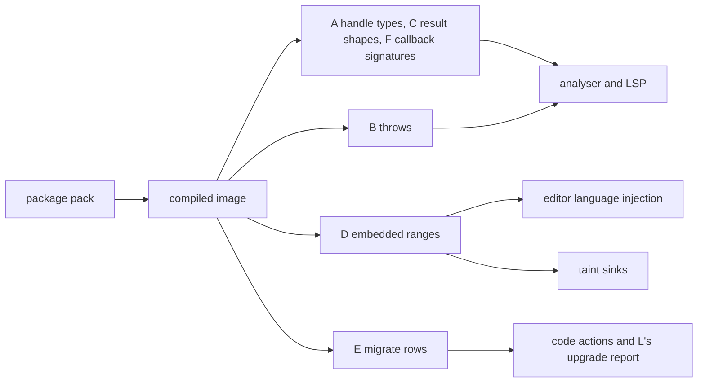

# SpecTcl 3 for package users: handles, errors, results, callbacks and more

**Status:** designed 26 November 2026. Plan item 390, steps 390a–390m.

**Builds on:**
- [SpecTcl 3](305-spectcl-3.md), for the grammar and `check` rules;
- [library dependencies](331-library-dependencies.md);
- [the gap analysis](333-spectcl-3-gap-analysis.md), for gaps 8 (classes), 17 (`deprecated`), 26 (examples) and 28 (vocabulary minors);
- [positioned context](308-positioned-context.md);
- [source tools](335-spectcl-source-tools.md), for proved rewrites and `bind` substitutions;
- [F5 integration](360-spectcl-f5-integration.md), for `mock` rows and taint origins.

## Problem

SpecTcl 3 describes a command's words well: arity, options, subcommands, roles, versioned facets and effects. What a package's *users* run into is mostly outside that:
- a command that makes another command (`sqlite3 db`, `zlib stream`, widget paths);
- the error codes a command throws;
- the shape of the dict a command returns;
- the arguments a callback receives;
- the SQL or XPath inside a string argument;
- what changes when they move to the next major version.

None of these can be written in a pack today, so the analyser and the editor know nothing about them.

The owner agreed all thirteen areas below on 26 November 2026. Areas A–F change the image format, so they ship in vocabulary 3.0. Areas G–M are additive and may come in a later 3.x minor, under gap 28's rules.

## The areas

| | Area | Form | Ships in | Main consumers |
|---|---|---|---|---|
| A | Handle types: commands that create commands or tokens | `handle`, `-creates`, `-releases` | 3.0 | analyser, completion, hover, leak check |
| B | Error codes a command raises | `throws` | 3.0 | `try … trap` check and completion |
| C | Structured results | `result -dict`/`-list`/`-array` | 3.0 | `dict get` completion, key typos |
| D | Embedded-language ranges | `-embedded LANG` | 3.0 | editor injection; taint sinks |
| E | API migration between versions | `migrate` | 3.0 | code actions on `package require` bumps |
| F | Callback signatures | `-callback -appends` | 3.0 | arity check of the user's callback proc |
| G | msgcat catalogues | `catalogue` | 3.x | key completion, missing translations |
| H | Project policy packs | `policy` scope | 3.x | team lint rules |
| I | Tk names beyond commands | `virtual-event`, `style`, `option-class` | 3.x | `bind`, `ttk::style`, `option add` |
| J | More importers | tooling | 3.x | `spec_import` |
| K | Test doubles for packages | `mock` (360's, made generic) | 3.x | `tcltest` users |
| L | Upgrade report | tooling over E | 3.x | CLI, MCP |
| M | Token categories and snippets | `token`, `snippet` | 3.x | semantic tokens, completion |



## A. Handle types

[Typed handles](391-handle-types.md) gives the full design: any handle type, producers and consumers by type, children, lifetimes and the analyser engine. This section is the summary.

A handle type names something a command creates: a new command (`zlib stream`, `sqlite3 db`, `image create`, a Tk widget, a `snit` instance) or a token that other commands accept (a channel, an `http::geturl` token, an `after` id). The type has its own subcommands, written with the ordinary `subcommand` rows. `-creates` says which word names it or which result carries it, and `-releases` says which call ends it. Gap 8 (classes) becomes the special case where the handle is a TclOO object.

**Source:**
```spectcl
handle zlib-stream {
    kind command
    subcommand put   { arity 1..2 ; option -flush ; option -fullflush ; option -finalize }
    subcommand get   { arity 0..1 }
    subcommand eof   { arity 0 }
    subcommand close { arity 0 ; releases self }
}
command {zlib stream} {
    arg mode -values {compress decompress deflate inflate gzip gunzip}
    result -handle zlib-stream
}
```

**In memory:**
```rust
// design sketch: types proposed here
HandleType {
    id: HandleId("zlib-stream"),
    kind: HandleKind::Command,            // the handle is itself a command
    subcommands: &[SubId("put"), SubId("get"), SubId("eof"), SubId("close")],
    releases: &[SubId("close")],
}
CommandSpec { name: "zlib stream", creates: Some(Creates::Result(HandleId("zlib-stream"))), .. }
```

The analyser tracks the handle through variables, as it already tracks channels:
- `$s put` gets arity and option checks, plus completion;
- `$s get` after `$s close` on every path reports a use after release;
- a handle that leaves a proc unreleased and unreturned reports a leak, at information level.

**Source:**
```tcl
set s [zlib stream deflate]
puts [info commands $s]
$s put -finalize hello
puts [string length [$s get]]
$s close
puts [info commands $s]
catch {$s get} m
puts $m
```

**Result:**
```text
$ tclsh9.1 handle.tcl            (tclsh8.6 prints the same)
::tcl::zlib::streamcmd_1
7

invalid command name "::tcl::zlib::streamcmd_1"
$ ./target/debug/tclvm handle.tcl
invalid command name "zlib"
```

The VM has no `zlib` yet; that is engine work already tracked under the channel kernel (item 213), not this design.

## B. Error codes

[Typed error codes](392-error-codes.md) gives the full design: error classes and fields, what each command and proc raises, and what `catch` and `try` hold. This section is the summary.

`throws` lists the `-errorcode` prefixes a command can raise, with an optional condition. It is versioned like any facet.

**Source:**
```spectcl
command open {
    throws {POSIX ENOENT} {POSIX EACCES} {POSIX EISDIR} -detail {Any POSIX error from the OS.}
    throws {POSIX}                       ;# a pattern is already a prefix (R33)
}
```

Uses:
- the analyser warns on a `trap` pattern that nothing in the `try` body can raise, only when every call in the body claims `throws -complete` (a `throws` row lists what a command may raise, not all of it: `open` also raises `TCL OPENMODE INVALID` on 9.1, 392);
- completion inside `trap {…}` offers the codes of the body's calls;
- hover shows a command's codes.

**Source:**
```tcl
proc load {path} {
    try {
        set f [open $path]
    } trap {POSIX ENOENT} {msg} {
        return missing
    } trap {POSIX EACCES} {msg} {
        return denied
    }
    close $f
    return ok
}
puts [load /nonexistent/x]
catch {open /nonexistent/x} m o
puts [dict get $o -errorcode]
```

**Bytecode (tclsh 9.1.0):**
```text
  Command 3: "open $path..."
    (14) push 0 	# "open"
    (19) loadScalar %v0 	# var "path"
    (24) invokeStk 2 
    ...
    (68) loadScalar %v3 	# temp var 3
    (73) push 2 	# "-errorcode"
    (78) dictGet 1 
    (83) push 3 	# "POSIX ENOENT"
    (88) errorPrefixEq 2 
    (93) jumpFalse +89 	# pc 182
```

`errorPrefixEq` compares against the declared codes, so `throws` rows also tell the optimiser which `trap` arms are dead.

**Result:**
```text
$ tclsh9.1 trap.tcl              (tclsh8.6 prints the same)
missing
POSIX ENOENT {no such file or directory}
$ ./target/debug/tclvm trap.tcl
couldn't open "/nonexistent/x": no such file or directory
    while executing
"open $path"
```

That run found a VM bug: `open` sets `-errorcode NONE` instead of `POSIX ENOENT`, so the `trap` arm never matches. `try … trap` itself works (`error x {} {A B}` is trapped). With `throws` rows, the conformance area can test every declared code against every engine.

## C. Structured results

`result` gains a shape: `-dict {KEY TYPE …}`, `-list TYPE`, `-pairs`, or `-array VAR {KEY …}` for commands that fill an array (`file stat`). Keys can be versioned, and `-open` allows keys beyond the listed ones.

**Source:**
```spectcl
command {http::meta} { result -dict -open {Content-Type string Content-Length integer} }
command {file stat}  { arg varName -array-of {dev ino mode nlink uid gid size atime mtime ctime type} }
```

The analyser follows the value into `dict get`, `dict exists` and `$arr(key)`. Completion offers the keys, and a key outside a closed shape is a warning.

## D. Embedded-language ranges

An argument role can say that its text is in another language. **We embed no parsers for these languages** (owner decision, 26 November 2026). The pack names the language, and the editor applies its own language support to that range.

**Source:**
```spectcl
handle sqlite3-db {
    kind command
    subcommand eval { arg sql -embedded sql -dialect sqlite ; arg script -role Body -optional }
}
command {dom parse} { arg xml -embedded xml }
handle dom-node { kind command ; subcommand selectNodes { arg xpath -embedded xpath } }
```

A static grammar sees syntax, not values, so it can follow only a command whose name is fixed. Two of the three rows above are handle subcommands, and a handle's command name is the user's (`sqlite3 db file` gives `db eval`). So delivery splits by row kind (D-N):

- **Fixed-name `command` rows** (`dom parse`): static injection. VS Code gets a TextMate injection grammar and an `embeddedLanguages` map; JetBrains a language-injection configuration. Both are generated from the image by item 328.
- **Handle rows** (`db eval`, `$node selectNodes`): the server's custom `tcl/embeddedRanges` request returns each range with its language ID, and per-client code applies it: VS Code middleware opens a virtual document so the editor's SQL or XPath support serves the range; a JetBrains injector does the same.
- **Zed, Helix, Neovim and Emacs:** the `embedded` semantic-token modifier on the range, and nothing more. Zed uses upstream `tree-sitter-tcl` at a pinned revision, and `editors/helix`, `editors/emacs` and `editors/neovim` ship no queries, so a generated `injections.scm` would have no way to reach users.
- **Every LSP client:** the `embedded` modifier and `tcl/embeddedRanges`, for clients that want them.

Literal text is injected as written. A braced word is injected whole. A quoted word with substitutions is injected with each `$var` or `[cmd]` shown as a placeholder, because only the editor's own language server sees the inner text.

Embedded ranges also drive one check that needs no parser: **taint into a sink.** `-embedded sql` with `-sink sql` makes a substitution inside the string a sink. `db eval "SELECT * FROM t WHERE id = $id"` warns when `$id` is tainted. `db eval {SELECT * FROM t WHERE id = :id}` does not, because SQLite binds `:id` itself. Sinks and sanitisers are ordinary roles, the same mechanism 360 uses for iRules origins.

## E. API migration between versions

A `migrate` row says how a call changes from one library version to the next. The rewrite language is 335's proved rewrite templates. `migrate` differs from an optimiser rewrite in two ways: it may change behaviour across the version boundary, and it applies only when the user's positioned context (308) moves across that boundary.

**Source:**
```spectcl
migrate trace-variable {
    library core tcl 8.4-9
    on {trace variable}
    when {value {arg 1} in {w}}
    rewrite {trace variable $name w $cmd} {trace add variable $name write $cmd}
    note {trace variable is gone in 9.0; the callback's op argument changes from w to write}
}
```

When a `package require` range, or the environment's dialect range, moves past a `migrate` row's window, the LSP offers one code action that applies every matching rewrite in the workspace through a `WorkspaceEdit`. A `note` that the rewrite cannot prove becomes a review comment at the site, not an edit.

**Result:**
```text
$ echo 'proc p {a b op} {puts "op=$op"}; set v 1; catch {trace variable v w p} m; puts $m; set v 2' | tclsh8.6

op=w
$ (the same) | tclsh9.0              (tclsh9.1 prints the same)
bad option "variable": must be add, info, or remove
```

The example's note is real: the callback still runs after the rewrite, but its third argument changes from `w` to `write`. That is why a migration can be proved for the call while still flagging the callback.

## F. Callback signatures

A command-prefix argument declares what the caller appends: `-callback -appends {name1 name2 op}`. The analyser resolves the prefix to a proc when it can and checks the proc's arity against the prefix's words plus the appended ones. 335's `bind` substitutions are the `%`-script case of the same row.

**Source:**
```tcl
proc tracer {name1 name2 op} { puts "trace $name1 $op" }
proc bad {name} { puts $name }
set v 1
trace add variable v write tracer
set v 2
trace remove variable v write tracer
trace add variable v write bad
catch {set v 3} m
puts $m
```

**Result:**
```text
$ tclsh9.1 cb.tcl                (tclsh8.6 and tclvm print the same)
trace v write
can't set "v": wrong # args: should be "bad name"
```

With `trace add variable … -callback -appends {name1 name2 op}`, the analyser reports at line 7 that `bad` takes 1 argument and is called with 3. That turns this run-time error into a diagnostic.

## G–M, the additive areas

- **G. msgcat catalogues.** A `catalogue` row names a package's `.msg` directory, and the reader indexes `mcset` keys per locale. `mc "key"` gets completion, hover with each locale's text, and a warning when the key is missing from a locale the project lists. Packages without a pack get the same from a project setting.
- **H. Project policy packs.** A pack with `scope project`, placed by `tclpkg.tcl`, holds `check` rules that belong to no library, for example "no `exit` in library code" or "always `-nocase` on `lsearch`". It uses the existing `check` form; the new part is the scope and its placement.
- **I. Tk names beyond commands.** Rows for virtual events (`virtual-event <<TreeviewSelect>> -widget ttk::treeview`), ttk styles, elements and theme names, and option-database classes. `bind`, `event generate`, `ttk::style` and `option add` get completion and an unknown-name warning.
- **J. More importers.** `spec_import` gains:
  - doctools `.man` files: `[call …]` lines are formal signatures, and all of tcllib has them;
  - C extensions: scan `Tcl_CreateObjCommand` and `Tcl_WrongNumArgs`;
  - run-time introspection of a loaded package: `info args`, `info default` and ensemble configuration.

  Each importer emits SpecTcl 3 through 310's printer, with guessed rows marked `version-gate:`.
- **K. Test doubles for packages.** 360's generated `mock -tcl` and `mock -native` rows become generic, so a package can ship fakes for `tcltest` (a fake `http::geturl`, an in-memory `db`) that users load in their own tests.
- **L. Upgrade report.** `tcl pkg upgrade-report foo 1.4 2.0` (and the same in MCP) lists every call site that a `migrate`, `deprecated`, facet or `throws` row changes between the two versions, before the user bumps the requirement.
- **M. Token categories and snippets.** A package may name a semantic-token category for its commands (for example, Tk widget constructors), and may give completion snippets. A snippet is checked against the command's arity at pack compile time.

## Consumers

| Consumer | A | B | C | D | E | F |
|---|---|---|---|---|---|---|
| Analyser and diagnostics | release and leak checks | dead `trap` arms | key typos | taint sinks | — | callback arity |
| LSP completion and hover | handle subcommands | trap codes | keys | — | — | — |
| Code actions | — | — | — | — | migrations | — |
| Editor packaging | — | — | — | injection grammars | — | — |
| Optimiser | — | prunes dead arms | — | — | — | — |
| Conformance | handle lifecycles | codes per engine | shapes | — | before and after runs | appended args |
| Rust registry (332) | `HandleType` | `Throws` | `ResultShape` | `Embedded` | `Migration` | `CallbackSig` |

Each form has a Rust spelling and a round-trip gate, as 332 requires.

## Plan steps

- **390a. Handle types.** The `handle` form, `-creates` and `-releases`, and `HandleType` in the registry core. Gap 8's classes are re-expressed as handles of kind `object`. Done when `$s put` on a `zlib stream` handle gets arity checks and completion, a use after `close` is reported, and the Tk widget-path and channel trackers read handle rows instead of their own tables.
- **390b. `throws`.** The form, `Throws`, a dead-`trap` warning, and trap-code completion. Done when the example above warns on a `trap {POSIX EBADF}` arm, and the conformance area runs every declared code of `open`, `file` and `socket` on tclsh 8.4–9.1 and the VM.
- **390c. Result shapes.** `-dict`, `-list`, `-pairs`, `-array-of`, and following values into `dict get` and array reads. Done when `dict get [http::meta $t] Content-Typo` warns, and `file stat`'s keys complete.
- **390d. Embedded ranges.** The `-embedded` role, the `embedded` token modifier and the `tcl/embeddedRanges` request. Generating the static injection grammars and configurations is item 328's work (Now 8), and the SQL taint check is item 473's (after 445 and 391). Done when, per editor:
  - **VS Code:** SQL in `db eval` (a handle row) is served by VS Code's own SQL support through the virtual-document middleware, and `dom parse`'s XML through the generated TextMate injection;
  - **JetBrains:** the injector applies `tcl/embeddedRanges` to `db eval`, and the generated injection configuration covers `dom parse`;
  - **Zed, Helix, Neovim and Emacs:** the range carries the `embedded` token modifier;
  - **every client:** `tcl/embeddedRanges` returns `db eval`'s range with language `sql`, and no SQL or XPath parser is linked by any crate.
- **390e. `migrate`.** The form, the code action and the workspace action. Done when moving a file's range from 8.6 to 9.0 offers one action that rewrites every `trace variable` call and flags each callback whose op argument changes.
- **390f. Callback signatures.** `-callback -appends` on the core commands (`trace`, `after`, `fileevent`, `chan event`, scrollbar and `-command` options), with 335's `bind` substitutions as the `%` case. Item 211 folds in here (D32): a handler protocol is `-callback -protocol T`, with the methods as `subcommand` rows of `handle T` and the required set as `required` (refchan, transchan); `socket -server` and `fcopy -command` are plain `-appends` callbacks; the parity row is `CallbackSig { protocol }` beside `HandleType { required }`, and the measured call order (`c06`–`c09`) is a conformance row. Done when the `bad` example above is reported at analysis time.
- **390g–390m.** One step each for areas G to M as described above. Each is done when its consumer has a test driven only by pack rows.

## Bugs found while writing the examples

- `tclvm`: `open` on a missing file sets `-errorcode NONE`, where C Tcl sets `POSIX ENOENT {no such file or directory}`, so `try … trap {POSIX ENOENT}` does not match.
- `tclvm`: `zlib` is not implemented. This is known engine scope, under item 213.

## Owner decisions (26 November 2026)

- All thirteen areas are planned in.
- **Embedded languages:** the editor supplies the language support for the range. We generate injection metadata and report ranges, and we embed no parsers for other languages.

## Review fixes (26 November 2026)

These examples now parse under chapter 2 of the [consolidated specification](../spectcl-3/02-grammar.md).

- **G6, A2.** A dead-`trap` warning needs `throws -complete` on every call in the body, not merely `throws` rows.
- **G12.** The migration's ops word is `{arg 1}` (0-based after `trace variable`).
- **R13, R33.** `handle T { kind … }`, `result -handle`, `releases self`; handle methods are `subcommand` rows; `throws-prefix` is `throws`; `-script` is `-role Body`.
- **R8, R28.** `library core tcl 8.4-9`: the family is named, and the 8.x line is spelt as R28 spells it (`8.4-9.0` is the same set).

## Review fixes (26 November 2026, deep review)

- **C5 (D-N).** Area D and 390d split by row kind and per editor; generation is 328's and the SQL taint check 473's.
- **W10 (D32).** Item 211 folds into 390f with `-callback -protocol` and `required`.
