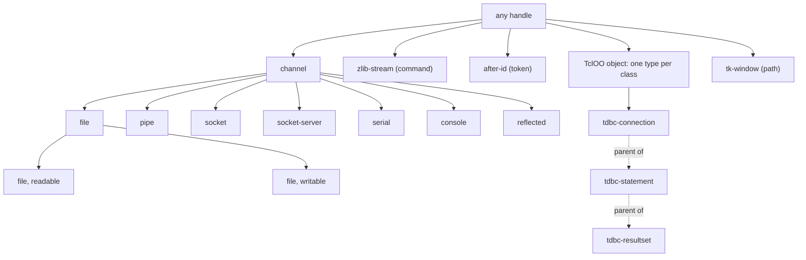
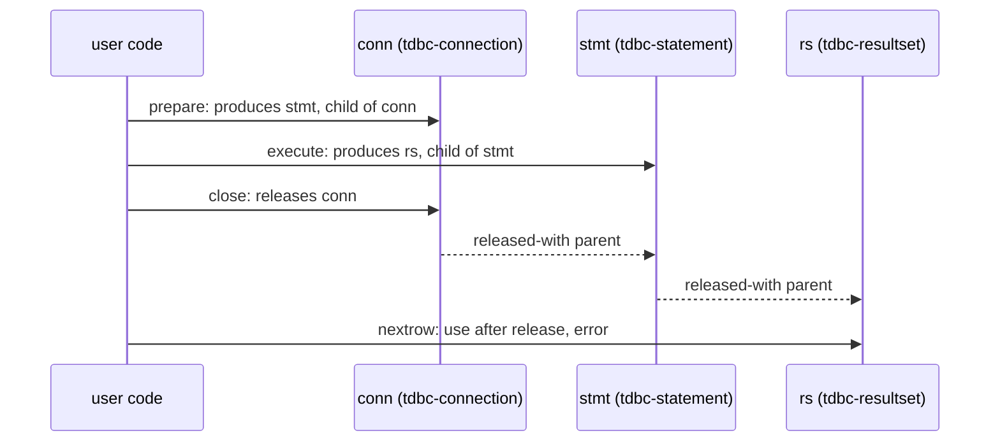
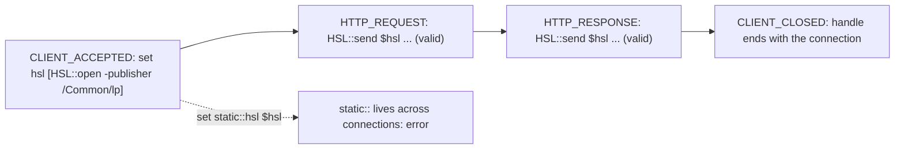
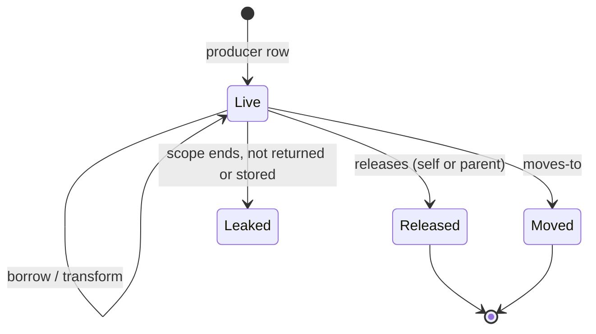

# Typed handles: declaring, producing, consuming and tracking any handle

**Status:** designed 26 November 2026. Plan item 391, which deepens 390a.

**Builds on:**
- [package surfaces](390-package-surfaces.md), area A;
- [SpecTcl 3](305-spectcl-3.md);
- [positioned context](308-positioned-context.md);
- [F5 integration](360-spectcl-f5-integration.md), for connection lifetimes;
- [Rust parity](332-rust-spectcl-parity.md).

## Problem

A handle is a value that names a live thing: a file, a socket, a SQL connection, a prepared statement, a Redis client, a Tk window, an iRules HSL connection, a `zlib` stream or a TclOO object. Commands that take a handle care which *sort* it is:
- `puts` takes a writable channel;
- `HSL::send` takes an HSL handle;
- `$stmt execute` needs a statement whose connection is still open.

Today the analyser knows only two narrow cases:
- **Channels are one taint colour.** `TaintColour::CHANNEL` (`tcl-registry/src/taint.rs:83`) marks "some channel" with no sort, and `HSL::open` gets the same colour as `open`. `ChannelKind` (`channel_options.rs:36`) has six driver families, but it is used only to validate options, not to track values.
- **TclOO objects are tracked properly.** `ObjectHandleFacts` (`tcl-compiler/src/object_types.rs:248`) maps variables to classes with scoped propagation through aliases, proc parameters, returns and instance variables, plus `proven_reads` for edits.

The object machinery is the right engine. It is limited to classes and fed by Rust. This design makes "handle type" a general, pack-declared concept, and runs every handle through that one engine.

These are the confusions it should catch. Each one is a run-time error today and should become an analysis-time diagnostic:

**Source:**
```tcl
set f [open /tmp/e390-x w]
set z [zlib stream gzip]
set p [open |cat r+]
puts "$f $z $p"
puts [catch {close $z} m]:$m
close $f
puts [catch {puts $f x} m]:$m
puts [catch {$p put x} m]:$m
close $p
$z close
```

**Result:**
```text
$ tclsh9.1 htypes.tcl            (tclsh8.6 prints the same; fileN stands for the channel number, which varies)
fileN ::tcl::zlib::streamcmd_1 fileN
1:can not find channel named "::tcl::zlib::streamcmd_1"
1:can not find channel named "fileN"
1:invalid command name "fileN"
$ ./target/debug/tclvm htypes.tcl
invalid command name "zlib"
```

The three failures are:
- a command handle passed where a channel is wanted;
- a channel used after `close`;
- a channel used as if it were a command handle.

**Bytecode (tclsh 9.1.0)** of `proc w {} {set f [open /tmp/e390-x w]; puts $f hi; close $f}`:
```text
  Command 2: "open /tmp/e390-x w..."
    (0) push 0 	# "open"
    (5) push 1 	# "/tmp/e390-x"
    (10) push 2 	# "w"
    (15) invokeStk 3 
    (20) storeScalar %v0 	# var "f"
  Command 3: "puts $f hi..."
    (26) push 3 	# "puts"
    (31) loadScalar %v0 	# var "f"
    (36) push 4 	# "hi"
    (41) invokeStk 3 
  Command 4: "close $f"
    (47) push 5 	# "close"
    (52) loadScalar %v0 	# var "f"
    (57) invokeStk 2 
```

To the engine a handle is only a string in a slot. Its type exists only in the analyser, so the facts must come from the packs.

## The model

### Handle types

A pack declares each handle type. The rows a `handle` block takes (a schema with `|` for alternatives, not a pack; chapter 2's `handle` production is the grammar):

```text
handle TYPE {
    kind token | command | object | path      ;# how the handle is spelt and used
    is SUPERTYPE …                            ;# subtyping: a file is a channel
    parent TYPE ?-released-with?              ;# a statement belongs to a connection
    lifetime scope | interp | thread | connection | event | static
    spelling PATTERN                          ;# the runtime form, e.g. {file[0-9a-f]+}
    instances NAME …                          ;# well-known handles: stdin stdout stderr
    capability NAME …                         ;# readable, writable, seekable, …
    subcommand …                              ;# kind command or object: the handle's own subcommands
    option …                                  ;# per-type configure options (replaces ChannelKind rows)
    hover { summary {…} }
}
```

The four kinds:
- `token`: a string that other commands accept as an argument (`file3`, an `after` ID, an `http::geturl` token, an iRules HSL handle).
- `command`: the handle is a command name with its own subcommands (`sqlite3 db`, a `zlib stream`, a Redis client built from an ensemble).
- `object`: a TclOO object. Its subcommands are methods, and its type is the class. User classes become handle types automatically from source, as `ObjectHandleFacts` builds them today.
- `path`: a hierarchical name (Tk windows `.a.b`). The parent is implied by the name, and `destroy .a` releases `.a.b`.

Types form a lattice. `is` gives subtyping, so `file`, `pipe` and `socket` are all `channel`, and a command that takes `channel` accepts any of them. `capability` narrows a type: `open … r` gives a `file` that is `readable` but not `writable`, so `puts` on it is a warning.

The core channel family as a lattice, with capabilities narrowing a type below it. An argument that accepts `channel` accepts every node under it. An argument that needs `writable` rejects a `file` opened with mode `r`.



### Producing handles

A command declares what it produces. The handle type can depend on the arguments, using the `check` predicate language:

```spectcl
command open {
    result -handle file  -capability {from-mode {arg 1}}   ;# open name ?access? …: the access word
    result -handle pipe  -when {value {arg 0} prefix |}
}
command socket {
    result -handle socket-server -when {present -server}
    result -handle socket
}
command {zlib stream} { result -handle zlib-stream }
command sqlite3 { arg name -creates sqlite3-db }     ;# the name word becomes the command
command toplevel { arg pathName -creates tk-window }
```

### Consuming handles

An argument says which handle type it accepts and what the call does to the handle:

```spectcl
command puts  { arg channelId -handle channel -needs writable -optional-first }
command close { arg channelId -handle channel -releases }
command {chan push} { arg channelId -handle channel -transforms }
command {HSL::send} { arg handle -handle hsl ; arg data }
command {thread::transfer} { arg id ; arg channel -handle channel -moves-to {arg id} }
```

The effects are:

| Effect | Meaning |
|---|---|
| (none) | borrows: the handle must be live and of the declared type |
| `-releases` | ends the handle, and its children with `-released-with` |
| `-moves-to` | the handle leaves this interpreter or thread |
| `-transforms` | the handle stays live and its capabilities change (a stacked transform) |
| `-stores` | the handle escapes into a long-lived place, such as a callback or a table |

### Children

Many APIs hand out child handles: a connection gives statements, and a statement gives result sets.

```spectcl
handle tdbc-connection {
    kind object ; lifetime scope
    subcommand prepare { result -handle tdbc-statement -child-of self }
    subcommand close   { releases self }
}
handle tdbc-statement {
    kind object ; parent tdbc-connection -released-with
    subcommand execute { result -handle tdbc-resultset -child-of self }
}
handle tdbc-resultset { kind object ; parent tdbc-statement -released-with }
```

`$conn close` releases every statement and result set made from it, so a later `$rs nextrow` is a use after release. This holds even though the code never closed `$rs` itself.

**Release cascades.** Closing a connection releases every handle made from it:




### Lifetimes

`lifetime` says how long a handle can be expected to live, and so what a leak means:
- `scope`: should be released before the proc that made it returns, unless it is returned or stored;
- `interp`, `thread`: long-lived, and never a leak;
- `connection` (iRules): lives for the client connection, so it is valid in any later event on the same connection;
- `event`: valid only in the event that made it;
- `static`: an iRules `static::` value. Storing a `connection` or `event` handle in one is an error, because it would outlive its connection.

For iRules, the lifetimes follow the connection. An `HSL::open` handle made in `CLIENT_ACCEPTED` is valid in every later event on that connection. Stored in `static::`, it would outlive the connection that owns it:



### Examples across the families

| Family | Types (kind) | Producer | Consumers | Release | Notes |
|---|---|---|---|---|---|
| Core channels | `channel` › `file`, `pipe`, `socket`, `socket-server`, `serial`, `console`, `reflected` (token) | `open`, `socket`, `chan create`, `chan pipe` | `puts`, `gets`, `read`, `chan configure`, `fileevent`… | `close`, `chan close` | `stdin`, `stdout` and `stderr` are instances; options per subtype replace `ChannelKind` |
| zlib | `zlib-stream` (command) | `zlib stream` | its own `put`, `get`, `eof` | `$z close` | |
| SQLite | `sqlite3-db` (command) | `sqlite3 NAME FILE` | `db eval`, `db transaction`… | `db close` | the name is chosen by the caller |
| TDBC | connection › statement › resultset (object) | `tdbc::sqlite3::connection create` | `prepare`, `execute`, `nextrow` | `close`, cascading | |
| Redis client (user library) | `redis-client` (command or object) | the library's constructor | `$r get`, `$r set` | `$r close` | declared in the user's own pack |
| HTTP | `http-token` (token) | `http::geturl` | `http::data`, `http::status`, `http::meta` | `http::cleanup` | leak check: a token never cleaned up |
| Timers | `after-id` (token) | `after ms script` | `after cancel`, `after info` | firing, or `after cancel` | |
| Tk | `tk-window` (path) › widget classes | `toplevel`, `button`… | `pack`, `grid`, `bind`, `$w configure` | `destroy`, cascading to children | the class decides options and subcommands |
| Threads | `thread-id` (token), `tsv` | `thread::create` | `thread::send`, `thread::transfer` | `thread::release` | a moved channel is dead in the sender |
| iRules HSL | `hsl` (token, lifetime `connection`) | `HSL::open` | `HSL::send` | none: it ends with the connection | storing it in `static::` is an error |
| iRules SIDEBAND | `sideband` (token, lifetime `connection`) | `connect` | `send`, `recv` | `close` | |
| TclOO | one type per class (object) | `CLASS new`, `CLASS create` | its methods | `destroy` | already tracked; moves into this engine |

## In memory

```rust
// design sketch: types proposed here; ObjectHandleFacts exists today
HandleType {
    id: HandleTypeId("file"),
    kind: HandleKind::Token,
    supertypes: &[HandleTypeId("channel")],
    parent: None,
    lifetime: Lifetime::Scope,
    spelling: Some(Pattern("file[0-9a-f]+")),
    capabilities: CapabilitySet::of(&["readable", "writable", "seekable"]),
    subcommands: &[],
    options: OptionTableId("channel-file"),
}
ProducerRow { command: "open", handle: HandleTypeId("file"),
              when: None, capabilities: CapFrom::ModeArg(1) }
ConsumerRow { command: "puts", arg: ArgSlot::Positional(-2),
              accepts: HandleTypeId("channel"), needs: Cap("writable"),
              effect: HandleEffect::Borrow }
// analyser output, keyed by scope as ObjectHandleFacts keys today
HandleFacts {
    bindings: { (::w, "f") => HandleValue { ty: "file", caps: {writable},
                                            state: Live, certainty: Must, origin: Span(7..24) } },
    proven_reads: …,
}
```

## The analyser

`ObjectHandleFacts` becomes `HandleFacts`. The engine stays: scoped propagation, proc-parameter and return edges, instance variables, the union across contents versions, and `proven_reads`. These are the changes:

1. **The value is a `HandleValue`, not a class set.** It holds a type (a lattice element, so a join of `file` and `socket` is `channel`), capabilities, a state (`Live`, `Released`, `Moved` or `Unknown`), certainty (`Must`/`May`, as in 308), and its origin.
2. **Producers and consumers come from rows.** The analyser has no handle-specific code. A command row's producer or consumer facts drive it, so a user's pack for their Redis library gets the same tracking as `open`.
3. **The state is a flow fact.** Release and move change state along the CFG. A use when the state is `Released` on every path is an error; on some paths it is a warning.
4. **Interprocedural.** A proc's summary records the type it returns and the type each parameter needs. The needed type is inferred from how the body uses the parameter: `proc log {ch msg} {puts $ch $msg}` needs a writable channel. Callers are checked against the summary, and hover shows `ch: channel (writable)`.
5. **Containers, kept bounded.** A handle stored in an array element, a dict value or a namespace variable is tracked by that key when the key is a literal, and otherwise widens to the type with `May` certainty. A write through a computed key (`set h($k) …`) demotes every key of that array to `May`, because it may have overwritten any of them. Handles built into callbacks (`chan event $ch readable [list h $ch]`) flow into the callback's parameters through 390f's callback signatures.
6. **Frame effects demote.** Only summary edges cross bodies, so a summary also records the body's frame effects: writes through `upvar`, `global`, `uplevel` and `namespace upvar`, writes to namespace variables, and command-table changes (`rename`, `proc` over an existing name, `interp alias`). A call whose summary has a frame effect that may reach a variable in scope demotes that variable's handle fact from `Must` to `May`, and a command-table change demotes every fact whose release came from the renamed command. An unknown callee (`unknown_callee`) is "may write any variable it can reach, may release, may store", so it demotes every handle fact in scope. `Must Released` therefore needs no such call between the release and the use (worked example 6).
7. **Literal spellings.** A literal that matches a type's `spelling` (`puts file3 x`) is reported as a hard-coded handle, which is almost always a bug. The well-known `instances` are exempt.
8. **Unknown stays quiet.** A value of unknown type passed where a handle is wanted produces no diagnostic. Only a proven wrong type, a proven dead handle or a proven leak is reported, so code the analyser can't see through stays clean. A wrong type is proven only when the value's producer row declares a handle type outside the accepted set; a command with no `result -handle` row proves nothing, so its result is of unknown handle type.



### Diagnostics

| Condition | Severity | When |
|---|---|---|
| Wrong handle type (`close $z` where `$z` is a `zlib-stream`) | error | the binding is `Must`, and its producer row proves a type outside the accepted set |
| Missing capability (`puts` on a read-only file) | warning | |
| Use after release or move | error on every path, warning on some paths | `Must Released`: no frame effect or unknown callee between the release and the use |
| Double release | warning | |
| Leak (lifetime `scope` or `event`) | information | not returned, stored or released |
| Handle outlives its lifetime (iRules `static::` holding `hsl`) | error | |
| Hard-coded handle literal | warning | |

The codes are pack codes per 337. Core rows get stable built-in codes.

## Consumers beyond diagnostics

- **Completion and hover.**
  - After `$db`, complete the `sqlite3-db` subcommands.
  - After `chan configure $f`, complete only the options of `$f`'s type.
  - Hover on a variable shows its handle type and state.
- **Rename and references.** For `command` and `path` handles with literal names (`sqlite3 db`, `.top.ok`), references find every use of the name.
- **Optimiser.** It never moves a handle use across a release.
- **Minifier.** It never renames a `command`-kind handle name, because the name is visible at run time.
- **Explorer and MCP.** A `handles` view lists each handle's producer, uses, state and release.
- **iRules.** 360's connection graph shows handle lifetimes per event.
- **Test framework.** 360's simulator and 390k's test doubles generate fake handles of the right type.
- **Taint.** `TaintColour::CHANNEL` is derived as "has a handle type under `channel`", and stays only as long as taint consumers need it.

## Worked examples

Every Tcl result below is a real run. The iRules example is a design sketch, because there is no appliance run behind it.

### 1. A parameter's need, inferred from the body

**Source:**
```tcl
proc log {ch msg} { puts $ch $msg }
set f [open /tmp/e39x-in w]; close $f
set in [open /tmp/e39x-in r]
log stdout "to stdout"
puts [catch {log $in "to a read-only file"} m]:$m
close $in
```

**In memory:**
```rust
// design sketch
ProcSummary { name: "::log",
    params: &[ParamNeed { name: "ch", accepts: HandleTypeId("channel"), needs: Cap("writable"),
                          effect: HandleEffect::Borrow },
              ParamNeed { name: "msg", accepts: NotAHandle, .. }] }
HandleValue { var: (Global, "in"), ty: "file", caps: {readable}, state: Live, certainty: Must }
// call site check: caps {readable} lacks "writable"; warning at line 5
```

**Bytecode (tclsh 9.1.0)** of `log`. The channel is only a loaded scalar, so the need comes from `puts`'s consumer row:
```text
  Command 1: "puts $ch $msg "
    (0) push 0 	# "puts"
    (5) loadScalar %v0 	# var "ch"
    (10) loadScalar %v1 	# var "msg"
    (15) invokeStk 3 
    (20) done 
```

**Result:**
```text
$ tclsh9.1 h1.tcl                (tclsh8.6 and tclvm print the same)
to stdout
1:channel "fileN" wasn't opened for writing
```

The analyser reports at line 5: "`log` needs a writable channel for `ch`; `$in` was opened read-only at line 3". Hover on `ch` shows `channel (writable)`.

### 2. A handle carried into a callback

**Source:**
```tcl
set f [open "|echo hello" r]
proc reader {ch} {
    if {[gets $ch line] < 0} { close $ch; set ::done 1; return }
    puts "read: $line"
}
fileevent $f readable [list reader $f]
vwait ::done
puts [catch {gets $f} m]:$m
```

**Result:**
```text
$ tclsh9.1 h2.tcl                (tclsh8.6 prints the same)
read: hello
1:can not find channel named "fileN"
$ ./target/debug/tclvm h2.tcl
command pipelines are not supported
```

`fileevent`'s script argument is a callback (390f), and `[list reader $f]` passes the `pipe` into `reader`'s `ch`. `reader` releases `ch` on end of file, so `$f` may be released after `vwait`. The analyser reports a warning on the final `gets` ("`$f` may have been closed by `reader`, line 3"), not an error, because the release happens on only one path of the callback.

### 3. A silent no-op on the wrong token

**Source:**
```tcl
set id [after 1000 {puts fired}]
after cancel after#999
puts [after info]
after cancel $id
puts [llength [after info]]
```

**Result:**
```text
$ tclsh9.1 h3.tcl                (tclsh8.6 and tclvm print the same)
after#0
0
```

`after cancel after#999` does nothing and raises nothing: the timer is still pending until the second cancel. `after#999` matches the `after-id` type's `spelling`, but it was never produced, so the analyser reports the hard-coded handle literal. Without types, this bug has no symptom at all.

### 4. A cascade through child handles

The example models a TDBC-style connection with TclOO, so it runs without TDBC installed.

**Source:**
```tcl
oo::class create Conn {
    variable stmts
    constructor {} { set stmts {} }
    method prepare {sql} { set s [Stmt new $sql]; lappend stmts $s; return $s }
    method close {} { foreach s $stmts { $s destroy }; my destroy }
}
oo::class create Stmt {
    variable sql
    constructor {q} { set sql $q }
    method execute {} { return "rows for: $sql" }
}
set c [Conn new]
set s [$c prepare {SELECT 1}]
puts [$s execute]
$c close
puts [catch {$s execute} m]:$m
```

**In memory:**
```rust
// design sketch; a user pack declares the parent link the code implements
HandleType { id: "Stmt", kind: HandleKind::Object, parent: Some(("Conn", ReleasedWith)), .. }
HandleValue { var: (Global, "s"), ty: "Stmt", state: Released /* by $c close */, certainty: Must }
```

**Result:**
```text
$ tclsh9.1 h4.tcl                (tclsh8.6 prints the same)
rows for: SELECT 1
1:invalid command name "::oo::Obj25"
$ ./target/debug/tclvm h4.tcl
rows for: SELECT 1
1:invalid command name "::oo::Obj14::oo::Obj16"
```

The analyser reports `$s execute` after `$c close` as a use after release. The VM's message shows a separate bug: an object created by `new` inside a method gets the calling object's namespace prefixed to its name.

### 5. iRules HSL (design sketch)

**Source:**
```spectcl
handle hsl { kind token ; lifetime connection ; hover { summary {A High Speed Logging connection.} } }
command {HSL::open} { result -handle hsl }
command {HSL::send} { arg handle -handle hsl ; arg data }
```

```tcl
when CLIENT_ACCEPTED {
    set hsl [HSL::open -publisher /Common/lpAll]
    set static::hsl $hsl
}
when HTTP_REQUEST {
    HSL::send $hsl "[IP::client_addr] [HTTP::uri]"
    HSL::send [HTTP::host] "oops"
}
```

**Output:**
```text
line 3: error: an hsl handle lives for one connection; static::hsl outlives it
```

The `HSL::send $hsl` in `HTTP_REQUEST` is clean: the handle came from an earlier event on the same connection. `HSL::send [HTTP::host]` is not reported either: `HTTP::host` has no `result -handle` row, so its value is of unknown handle type, and unknown stays quiet. Reporting it would need a fact that a value is *not* a handle, which no form provides.

### 6. A closed handle reopened through `upvar`, and a renamed `close`

**Source:**
```tcl
proc reopen {n} { upvar 1 $n v; set v [open /tmp/e39x-a w] }
proc swap {} { rename close _close; proc ::close {ch} { flush $ch } }
set f [open /tmp/e39x-b w]
close $f
reopen f
puts $f "after upvar"
swap
close $f
puts $f "after rename"
puts ok
```

**In memory:**
```rust
// design sketch: types proposed here
ProcSummary { name: "::reopen", frame_effects: &[FrameEffect::UpvarWrite { level: 1, name: Param(0) }], .. }
ProcSummary { name: "::swap",   frame_effects: &[FrameEffect::CommandTable { name: "close" }], .. }
HandleValue { var: (Global, "f"), ty: "file", state: Released, certainty: Must }   // after line 4
HandleValue { var: (Global, "f"), ty: "file", state: Live,     certainty: May  }   // after line 5: reopen writes f
HandleValue { var: (Global, "f"), ty: "file", state: Released, certainty: May  }   // after line 8: close was renamed at line 7
```

**Bytecode (tclsh 9.1.0):** `reopen`'s write reaches the caller's slot through `upvar`, which no parameter or return edge shows:
```text
  Command 1: "upvar 1 $n v..."
    (0) push 0 	# "1"
    (5) loadScalar %v0 	# var "n"
    (10) upvar %v1 	# var "v"
    (15) pop 
  Command 3: "open /tmp/e39x-a w..."
    (31) push 2 	# "open"
    (36) push 3 	# "/tmp/e39x-a"
    (41) push 4 	# "w"
    (46) invokeStk 3 
    (51) storeScalar %v1 	# var "v"
```

**Result:**
```text
$ tclsh8.4 h6.tcl      (tclsh8.5, 8.6, 9.1, jimsh and tclvm print the same)
ok
```

Both `puts $f` lines run. Without the frame-effect rule the analyser would report line 6 as a use after release on every path (an error) and line 9 the same; with it, neither is reported. The same holds for `global`, `uplevel 1 {set f [open …]}`, `namespace upvar` and `interp alias {} close {} myclose`, each run on tclsh 8.6 and 9.1 (Jim has no `interp alias`).

## Rust parity

`HandleType`, `ProducerRow`, `ConsumerRow` and `HandleEffect` live in the registry core. The core command families declare their rows in Rust or in their packs, and round-trip under 332's gate. `ChannelKind` and its option tables become per-type option tables. User packs and user classes add types at run time through the same structs, not a parallel path.

## Plan steps

- **391a. The model.** Add `HandleType`, producer and consumer rows, and effects to the registry core and the SpecTcl 3 reader and printer, with the lattice and capabilities. Done when the core channel family, `zlib stream`, `after` and TclOO classes are expressed as rows, and they print and re-read equal.
- **391b. The engine.** Generalise `ObjectHandleFacts` into `HandleFacts`, with state as a flow fact, interprocedural parameter and return summaries, and frame effects in the summaries. Done when every existing object-type test passes unchanged, and the example above reports all three confusions at analysis time.
- **391c. Channels on rows.** `ChannelKind` and `channel_options` become per-type tables, and `TaintColour::CHANNEL` is derived from them. Done when `rg 'enum ChannelKind' rust` is empty, and the `chan configure` validation tests pass.
- **391d. Children and cascades.** `parent`, `-released-with`, `-child-of`, and Tk path cascades. Done when `$rs nextrow` after `$conn close` and `.a.b configure` after `destroy .a` are reported.
- **391e. Lifetimes for iRules.** `connection`, `event` and `static` lifetimes, and the HSL, SIDEBAND and table handles as rows. Done when storing an `HSL::open` handle in `static::` is an error, and using it in a later event on the same connection is not.
- **391f. Editor surfaces.** Completion, hover, references, the explorer view and MCP. Done when hover on `$db` after `sqlite3 db x.db` shows `sqlite3-db (live)`, and completion offers its subcommands from the user's pack alone.
- **391g. User libraries.** Write a worked pack for a Redis client library and for TDBC as fixtures. Done when a user pack alone gives a third-party handle family the same diagnostics as `open`.

## Owner decisions (26 November 2026)

- Any handle type must be declarable, and commands must say *which* handle type they produce and accept, so the analyser can track handles by type across commands.

## Review fixes (26 November 2026)

- **A6.** Summaries record frame effects; a call with one, or an unknown callee, demotes handle facts to `May`; a computed-key write demotes every key; worked example 6 is a real run.
- **G4.** `-handle channel -needs writable -optional-first` and `-handle channel -reads` are legal: flags are order-free (chapter 2).
- **G12.** `open`'s access word is `{arg 1}` and its name `{arg 0}`; `thread::transfer` names its target `{arg id}`.
- **G13.** Wrong type needs a producer row proving it; the HSL example no longer reports `[HTTP::host]`.
- **R13.** Handle methods are `subcommand` rows in the `handle` block, not `command {$type method}`.
