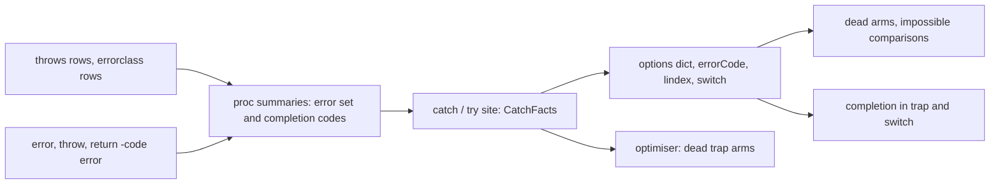

# Typed error codes: what a command raises, and what `catch` and `try` are holding

**Status:** designed 26 November 2026. Plan item 392, which deepens 390b.

**Builds on:**
- [package surfaces](390-package-surfaces.md), area B;
- [typed handles](391-handle-types.md), whose model this one mirrors;
- [SpecTcl 3](305-spectcl-3.md);
- [positioned context](308-positioned-context.md);
- [SpecTcl across dialects](350-spectcl-across-dialects.md).

## Problem

A script that catches an error usually wants to know which error it caught. Tcl answers with `-errorcode`, a list whose first word is a class: `POSIX`, `ARITH`, `CHILDSTATUS`, `TCL` or an application's own. Today the analyser knows nothing about what a body can raise:
- the IR records a `trap` prefix (`ir/statement.rs:55`), but nothing compares it with anything;
- the codes themselves live in engine-side enums, one per subsystem (`NativePackageErrorCode`, `NativeExpressionErrorCodeUpdate`, `NativeScalarGetterErrorCode` and others), which the analyser never sees.

So after `catch {…} m o`, the analyser can't say what `$o`'s `-errorcode` can be. It can't tell that a `trap` arm or an `if` on `[lindex $::errorCode 1]` can never match. And completion inside `trap {…}` has nothing to offer.

The codes also vary by release and dialect, more than most facts. Every result below is from a real run:

**Source:**
```tcl
proc show {script} {
    set rc [catch $script m]
    puts [format "%-28s rc=%s ec=%s" $script $rc $::errorCode]
}
show {expr {1/0}}
show {nosuchcmd}
show {set nosuchvar}
show {string repeat}
show {open /nonexistent/x}
show {exec false}
show {dict get {a 1} b}
show {error boom {} {MY APP E1}}
show {expr {"x"+1}}
show {lindex {a b} x}
```

**Result:**

| Script | tclsh 8.4 | tclsh 8.5 | tclsh 8.6 and 9.1 | tclvm |
|---|---|---|---|---|
| `expr {1/0}` | `ARITH DIVZERO {divide by zero}` | same | same | same |
| `nosuchcmd` | `NONE` | `NONE` | `TCL LOOKUP COMMAND nosuchcmd` | as 8.6 |
| `set nosuchvar` | `NONE` | `NONE` | `TCL LOOKUP VARNAME nosuchvar` | as 8.6 |
| `string repeat` | `NONE` | `NONE` | `TCL WRONGARGS` | as 8.6 |
| `open /nonexistent/x` | `POSIX ENOENT {no such file or directory}` | same | same | **`NONE`** |
| `exec false` | `CHILDSTATUS <pid> 1` | same | same | **rc=0, no error** |
| `dict get {a 1} b` | `NONE` (8.4 has no `dict`) | `NONE` | `TCL LOOKUP DICT b` | as 8.6 |
| `error boom {} {MY APP E1}` | `MY APP E1` | same | same | same |
| `expr {"x"+1}` | `NONE` | `ARITH DOMAIN {non-numeric string}` | same as 8.5 | as 8.6 |
| `lindex {a b} x` | `NONE` | `NONE` | `TCL VALUE INDEX` | as 8.6 |

The options dictionary also changes by release:
- 8.4: `catch` takes only `?varName?` (`wrong # args: should be "catch command ?varName?"`);
- 8.5: the keys are `-code -errorcode -errorinfo -errorline -level`;
- 8.6 and 9.1 add `-errorstack`.

Jim 0.84 is different again:
- every built-in error has `-errorcode NONE` (`open`, `expr {1/0}` and an unknown command alike);
- `error` takes only `message ?stacktrace?`, so `error boom {} {MY APP}` is itself a wrong-args error;
- a custom code still travels through `return -code error -errorcode {A B}` in a proc, and `try … on error {m o}` sees it.

## The model

### Error-code types

An error code is a list pattern with typed fields. Patterns form a lattice by prefix: `{POSIX}` covers `{POSIX ENOENT …}`, and `trap` matches by prefix in the same way.

```spectcl
errorclass POSIX {
    code ENOENT -fields {message} -message {no such file or directory}
    code EACCES -fields {message} -message {permission denied}
    code EISDIR -fields {message} -message {illegal operation on a directory}
    …                                     ;# generated from the errno table, per platform
}
errorclass TCL {
    code {LOOKUP COMMAND} -fields {name:command}      ;# available core 8.6-
    code {LOOKUP VARNAME} -fields {name:variable}     ;# available core 8.6-
    code {LOOKUP DICT}    -fields {key}               ;# available core 8.6-
    code WRONGARGS                                    ;# available core 8.6-
    code {VALUE INDEX}                                ;# available core 8.6-
}
errorclass ARITH { code DIVZERO -fields {message} ; code DOMAIN -fields {message} ; code IOVERFLOW -fields {message} }
errorclass CHILDSTATUS { -fields {pid:integer status:integer} }
errorclass CHILDKILLED { -fields {pid:integer signal message} }
errorclass NONE {}
```

Classes and codes are versioned facets like any other fact. Jim's dialect point declares that built-ins raise only `NONE`.

A library declares its own classes: `TDBC`, `HTTP`, a user application's `MYAPP`. Field roles let the analyser carry meaning through. For example, `TCL LOOKUP COMMAND`'s third word is a command name, so hover and go-to-definition work on it when it is matched.

### What raises what

Commands declare what they can raise with `throws`, which can depend on arguments and releases:

```spectcl
command open   { throws {POSIX} }
command exec   { throws {CHILDSTATUS} {CHILDKILLED} {CHILDSUSP} {POSIX} }
command {dict get} { throws {TCL LOOKUP DICT} -when {argc >= 3} }
command expr   { throws {ARITH} }
default        { throws {TCL WRONGARGS} -on wrong-args ; throws {TCL LOOKUP COMMAND} -on unknown-command }
command error  { throws {arg 3} -default NONE }     ;# the code is the third argument
command throw  { throws {arg 1} }                    ;# available core 8.6-
```

Handle operations (391) declare theirs on the handle type's subcommands, so `$stmt execute` raises `TDBC …`.

User code raises through `error`, `throw`, and `return -code error -errorcode …`. A literal code is a known pattern; a computed one is `Any`. Each proc's summary records the set it can raise, the same way 391 records the handle types a proc returns. A call to a proc raises its summary's set; a call to an unknown command raises `Any`.

The same summary records the **completion codes** a body can produce, beside the error set:
- 0 (ok), 1 (error), 2 (return), 3 (break) and 4 (continue);
- any custom `return -code N`.

`catch`'s result is one of those codes.

### The value at a `catch` or `try`

At `catch BODY ?m? ?o?` the analyser knows:
- **the completion codes,** so the result of `catch` has a value domain (`{0 1}` for most bodies, `{0 1 3}` for a body that can `break`);
- **the error set,** a set of code patterns with `Must`/`May` certainty, plus `Other` when any call raises `Any`;
- **the options dict's shape,** whose keys depend on the release (above), with `-errorcode` typed by the error set;
- **`$::errorCode`,** which after the `catch` holds the same type as `-errorcode`.

The analyser follows those values the usual way: `dict get $o -errorcode`, then `lindex … 0` or `lindex … 1`, then `switch`, `string equal`, `eq`, `string match` and `lsearch`. Each comparison is checked against the domain.

**Source:**
```tcl
proc r {p} {
    if {[catch {open $p} m o]} {
        return [lindex [dict get $o -errorcode] 1]
    }
    return ok
}
puts [r /nonexistent/x]
```

**In memory:**
```rust
// design sketch: types proposed here
CatchFacts {
    site: Span(17..39),
    completion: CodeSet::of(&[0, 1]),
    errors: ErrorSet { patterns: &[ErrorPattern(&["POSIX"])], other: false, certainty: Must },
    options_keys: OptionKeys::since(Release::Tcl(8, 6)),   // includes -errorstack
}
// the flow from $o
ValueFact { at: "lindex [dict get $o -errorcode] 1", domain: Domain::FieldOf("POSIX", 1) }  // an errno name
```

**Bytecode (tclsh 9.1.0):**
```text
  Command 2: "catch {open $p} m o..."
    (0) beginCatch 0 
  Command 3: "open $p..."
    (5) push 0 	# "open"
    (10) loadScalar %v0 	# var "p"
    (15) invokeStk 2 
    (20) push 1 	# "0"
    (25) swap 
    (26) jump +7 	# pc 33
    (31) pushReturnCode 
    (32) pushResult 
    (33) pushReturnOpts 
    (34) endCatch 
    (35) storeScalar %v2 	# var "o"
    (40) pop 
    (41) storeScalar %v1 	# var "m"
  Command 6: "dict get $o -errorcode..."
    (62) loadScalar %v2 	# var "o"
    (67) push 2 	# "-errorcode"
    (72) dictGet 1 
    (77) listIndexImm 1 
```

**Result:**
```text
$ tclsh9.1 r.tcl
ENOENT
```

The bytecode shows why the type must come from facts. `pushReturnOpts` builds a plain dict, and `listIndexImm 1` reads a plain list, so nothing at run time says "errno name". The analyser can say it, because `open` declares `throws {POSIX}` and `POSIX`'s second field is an errno.



## Diagnostics

| Condition | Severity | Example |
|---|---|---|
| A `trap` arm, `switch` arm or comparison that cannot match | warning | `trap {TDBC}` around a body that raises only `POSIX`; `if {[lindex $::errorCode 0] eq "ARITH"}` after `open` |
| A code that this release never raises | warning | `trap {TCL LOOKUP COMMAND}` with a target range that includes 8.4 or 8.5, where an unknown command raises `NONE` |
| An options key that this release lacks | warning | `dict get $o -errorstack` on 8.5 |
| A form this dialect lacks | error | `catch BODY m o` on 8.4; `try`/`throw` before 8.6; `error m i CODE` on Jim |
| Re-raising loses the code | information | `error $m` inside a handler, where `return -options $o $m` keeps the code |
| Matching the message instead of the code | information, with a fix | `string match "*no such file*" $m` when the body's set has `POSIX ENOENT`; the code action rewrites to a code test (or `try … trap` on 8.6+) |
| `catch` result never read, and the body can raise a declared non-`NONE` code | information, off by default | a project policy (390h) can raise it |

As in 391, `Other` (anything unknown) never produces a "cannot match" warning. Only a fully known error set does.

## Other consumers

- **Completion.**
  - Inside `trap {…}`, offer the body's error patterns, one word at a time.
  - In a `switch` or `eq` on an error code, offer the domain of that word.
  - Inside `dict get $o`, offer this release's options keys.
- **Hover.** On `catch` or `try`, show the completion codes and the error set, each pattern with the command that raises it. On a matched field, show its role.
- **Code actions.** Rewrite a `catch` plus an `if`/`switch` on `-errorcode` into `try … trap … on error` when the target range is 8.6 or later.
- **Optimiser.**
  - Drop `trap` arms that are proven dead.
  - Where the body's completion codes are only `{0}`, `catch` is the constant `0` and its handler is dead. That needs a proof that the body cannot fail; the proof includes wrong-args, so it holds only when every call is fully known.
- **Engines and conformance.** The `errorclass` rows are the single table the VM and the runtime raise from, replacing the per-subsystem `Native*ErrorCode` enums. The conformance area runs every declared code of every command on tclsh 8.4–9.1, jimsh and both engines. The table above already found two VM bugs: `open` raises `NONE`, and `exec false` succeeds.
- **iRules.** f5-tcl uses the 8.4 forms: `catch` with `?varName?` only, and no `try`. A failed iRules command aborts the rule. Which error codes the appliance sets, and whether `$::errorCode` is readable in a rule, are new F5 question Q26.
- **Explorer and MCP.** A `raises` view per proc and per `catch` site.

## Rust parity

`ErrorClass`, `ErrorCodeId`, `ErrorPattern`, `Throws` and `CompletionCodes` live in the registry core and round-trip under 332's gate. The engine enums become views of that table, migrated one subsystem at a time. Each migration is checked by the conformance rows for that subsystem.

## Plan steps

- **392a. The model.** Add `errorclass`, `code`, field roles and `throws` (with `-when` and `-on`) to the registry core and the SpecTcl reader and printer. Generate the `POSIX` table from the errno names. Done when the core codes in the table above are rows with their release windows, and the rows print and re-read equal.
- **392b. Summaries.** Every proc's summary gets an error set and completion codes from `throws` rows, `error`, `throw` and `return -code`. Done when hover on a proc shows its raises, and a proc that calls `open` and `expr` reports `{POSIX} {ARITH}`.
- **392c. Catch and try facts.** Add `CatchFacts`, the options-dict shape per release, `$::errorCode`, and the flow into `lindex`, `switch` and comparisons. Done when every row of the diagnostics table has a test, and the `r` example reports the domain of its `lindex`.
- **392d. Dialect forms.** 8.4's one-variable `catch`, `try`/`throw` from 8.6, Jim's `NONE`-only built-ins and its two-argument `error`, and f5-tcl's 8.4 forms. Done when each form gives the dialect error at the right release, and Jim's `return -code error -errorcode` keeps its code in the analysis.
- **392e. Editor surfaces.** Completion, hover, the `catch`-to-`try` code action and the message-matching fix. Done when the code action's output runs identically on tclsh 8.6 and 9.1 for the corpus examples.
- **392f. One table for the engines.** The VM and runtime raise from the `errorclass` rows. Done when the `Native*ErrorCode` enums are views of the table, and the conformance area runs every declared code on every engine. That run includes the two VM bugs above, which are fixed by then.
- **392g. Optimiser.** Drop proven-dead `trap` arms, and fold `catch` over a body that is proven not to fail. Done when both are proved rewrites under 335's gate.

## Owner decisions (26 November 2026)

- Error codes get the same treatment as handles: declared types, producers that say what they raise, and analyser tracking through `catch` and `try`, so code that handles errors knows what it is working with.
