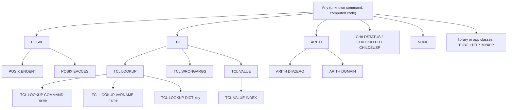
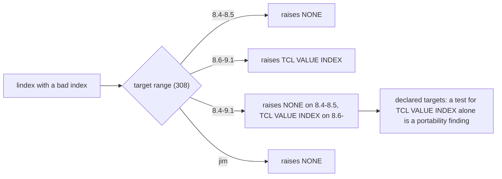
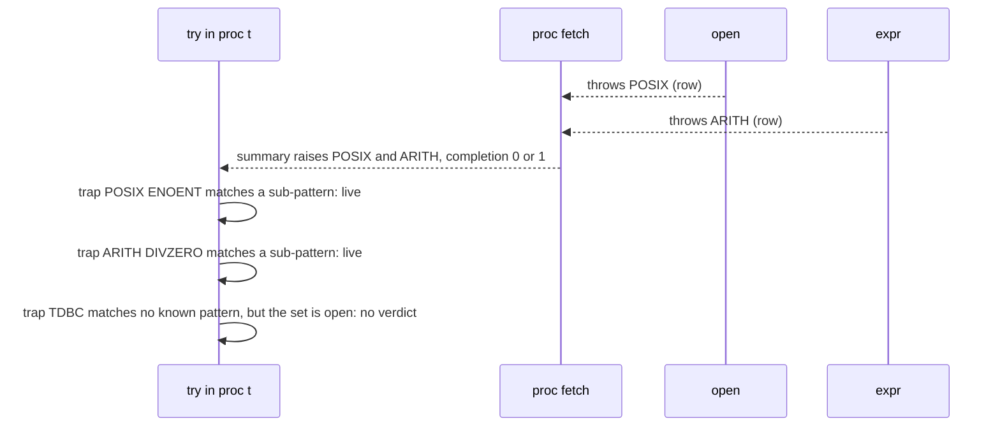
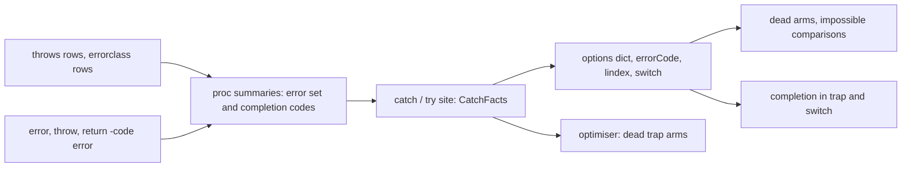

# Typed error codes: what a command raises, and what `catch` and `try` are holding

**Status:** designed 26 November 2026. Plan item 392, which deepens 390b.

**Builds on:**
- [package surfaces](390-package-surfaces.md), area B;
- [typed handles](391-handle-types.md), whose model this one mirrors;
- [SpecTcl 3](305-spectcl-3.md);
- [positioned context](308-positioned-context.md);
- [SpecTcl across dialects](350-spectcl-across-dialects.md).

## Problem

A script that catches an error usually wants to know which error it caught. Tcl answers with `-errorcode`, a list whose first word is a class: `POSIX`, `ARITH`, `CHILDSTATUS`, `TCL` or an application's own. Today the analyser knows nothing about what a body can raise:
- the IR records a `trap` prefix (`ir/statement.rs:55`), but nothing compares it with anything;
- the codes themselves live in engine-side enums, one per subsystem (`NativePackageErrorCode`, `NativeExpressionErrorCodeUpdate`, `NativeScalarGetterErrorCode` and others), which the analyser never sees.

So after `catch {…} m o`, the analyser can't say what `$o`'s `-errorcode` can be. It can't tell that a `trap` arm or an `if` on `[lindex $::errorCode 1]` can never match. And completion inside `trap {…}` has nothing to offer.

The codes also vary by release and dialect, more than most facts. Every result below is from a real run:

**Source:**
```tcl
proc show {script} {
    set rc [catch $script m]
    puts [format "%-28s rc=%s ec=%s" $script $rc $::errorCode]
}
show {expr {1/0}}
show {nosuchcmd}
show {set nosuchvar}
show {string repeat}
show {open /nonexistent/x}
show {exec false}
show {dict get {a 1} b}
show {error boom {} {MY APP E1}}
show {expr {"x"+1}}
show {lindex {a b} x}
```

**Result:**

| Script | tclsh 8.4 | tclsh 8.5 | tclsh 8.6 and 9.1 | tclvm |
|---|---|---|---|---|
| `expr {1/0}` | `ARITH DIVZERO {divide by zero}` | same | same | same |
| `nosuchcmd` | `NONE` | `NONE` | `TCL LOOKUP COMMAND nosuchcmd` | as 8.6 |
| `set nosuchvar` | `NONE` | `NONE` | `TCL LOOKUP VARNAME nosuchvar` | as 8.6 |
| `string repeat` | `NONE` | `NONE` | `TCL WRONGARGS` | as 8.6 |
| `open /nonexistent/x` | `POSIX ENOENT {no such file or directory}` | same | same | **`NONE`** |
| `exec false` | `CHILDSTATUS <pid> 1` | same | same | **rc=0, no error** |
| `dict get {a 1} b` | `NONE` (8.4 has no `dict`) | `NONE` | `TCL LOOKUP DICT b` | as 8.6 |
| `error boom {} {MY APP E1}` | `MY APP E1` | same | same | same |
| `expr {"x"+1}` | `NONE` | `ARITH DOMAIN {non-numeric string}` | same as 8.5 | as 8.6 |
| `lindex {a b} x` | `NONE` | `NONE` | `TCL VALUE INDEX` | as 8.6 |

The options dictionary also changes by release:
- 8.4: `catch` takes only `?varName?` (`wrong # args: should be "catch command ?varName?"`);
- 8.5: the keys are `-code -errorcode -errorinfo -errorline -level`;
- 8.6 and 9.1 add `-errorstack`.

Jim 0.84 is different again:
- every built-in error has `-errorcode NONE` (`open`, `expr {1/0}` and an unknown command alike);
- `error` takes only `message ?stacktrace?`, so `error boom {} {MY APP}` is itself a wrong-args error;
- a custom code still travels through `return -code error -errorcode {A B}` in a proc, and `try … on error {m o}` sees it.

## The model

### Error-code types

An error code is a list pattern with typed fields. Patterns form a lattice by prefix: `{POSIX}` covers `{POSIX ENOENT …}`, and `trap` matches by prefix in the same way.

```spectcl
errorclass POSIX {
    code ENOENT -fields {message} -message {no such file or directory}
    code EACCES -fields {message} -message {permission denied}
    code EISDIR -fields {message} -message {illegal operation on a directory}
    # the rest is generated from the errno table, per platform
}
errorclass TCL {
    code {LOOKUP COMMAND} -fields {name:command}      ;# available core 8.6-
    code {LOOKUP VARNAME} -fields {name:variable}     ;# available core 8.6-
    code {LOOKUP DICT}    -fields {key}               ;# available core 8.6-
    code WRONGARGS                                    ;# available core 8.6-
    code {VALUE INDEX}                                ;# available core 8.6-
    code {LIMIT STACK}                                ;# implicit at every call, 8.6-
    code {LIMIT COMMANDS}                             ;# implicit at every call, 8.6-
    code {READ VARNAME}                               ;# implicit at every read, 8.6-
    code {WRITE VARNAME}                              ;# implicit at every write, 8.6-
    code {OPENMODE INVALID}                           ;# open on 9.1; NONE on 8.6
}
errorclass ARITH { code DIVZERO -fields {message} ; code DOMAIN -fields {message} ; code IOVERFLOW -fields {message} }
errorclass CHILDSTATUS { -fields {pid:integer status:integer} }
errorclass CHILDKILLED { -fields {pid:integer signal message} }
errorclass NONE {}
```

Classes and codes are versioned facets like any other fact. Jim's dialect point declares that built-ins raise only `NONE`.

A library declares its own classes: `TDBC`, `HTTP`, a user application's `MYAPP`. Field roles let the analyser carry meaning through. For example, `TCL LOOKUP COMMAND`'s third word is a command name, so hover and go-to-definition work on it when it is matched.

The classes form a prefix lattice. `Any` is the top, used for an unknown command or a computed code, and each level down narrows the pattern. A `trap` pattern names a node, and it matches that node and everything below it.



Each node carries release windows, so the lattice depends on the positioned context. Under a target range of 8.4–9.1, `lindex` with a bad index raises `NONE` on 8.4 and 8.5 and `TCL VALUE INDEX` on 8.6 and later, and the analyser keeps both:



An unknown command is different: it raises `Any`, because an `unknown` proc decides the code (worked example 2).

### What raises what

Commands declare what they can raise with `throws`, which can depend on arguments and releases:

```spectcl
command open   { throws {POSIX} }
command exec   { throws {CHILDSTATUS} {CHILDKILLED} {CHILDSUSP} {POSIX} }
command {dict get} { throws {TCL LOOKUP DICT} -when {argc >= 2} }
command expr   { throws {ARITH} }
default        { throws {TCL WRONGARGS} -on wrong-args }     ;# unioned into every command
command error  { throws {arg 2} -default {NONE} }   ;# the code is the third argument word
command throw  { throws {arg 0} }                    ;# available core 8.6-
command {string length} { throws -complete core tcl 8.6- }
```

Argument references count from 0 after the command path (chapter 2's `ARGREF`): `error message info code` has the code at `{arg 2}`.

**Sets are open unless claimed complete.** A `throws` row lists what a command may raise; it does not say that is all. `open` declares `{POSIX}`, but tclsh 9.1 raises `TCL OPENMODE INVALID` for a bad mode and `TCL VALUE NUMBER` for a bad permission word (8.6: `NONE` and `TCL VALUE INTEGER`). So a command's set is closed only when it says `throws -complete RANGE`, and a body's set is closed only when every call in it is. Every set also carries the implicit codes, whatever the rows say:
- `TCL LIMIT` at any call: `proc r {n} {r [incr n]}; catch {r 0}` gives `TCL LIMIT STACK`, and an `interp limit` gives `TCL LIMIT COMMANDS`, which a `catch` inside the limited interpreter cannot stop;
- `TCL WRITE VARNAME` at a variable write: `array set a {k 1}; catch {set a 1}`, or a write trace that fails (its own code is replaced);
- `TCL READ VARNAME` at a read (an array read as a scalar, a failing read trace) and `TCL LOOKUP VARNAME` at a read not proved set.

On 8.4 and 8.5 these are all `NONE`, except that on 8.5 a failing read or write trace passes its own code through (`TDBC X` in the run below); Jim 0.84 raises `NONE`.

**Source:**
```tcl
array set a {k 1}
puts "write: [catch {set a 1} m] [lrange $::errorCode 0 2]"
puts "read:  [catch {set nosuch} m] [lrange $::errorCode 0 2]"
proc r {n} {r [incr n]}
puts "limit: [catch {r 0} m] [lrange $::errorCode 0 2]"
set v 1
proc tr {args} {error boom {} {TDBC X}}
trace add variable v read tr
puts "read trace: [catch {set v} m] [lrange $::errorCode 0 2]"
```

**Result:**
```text
$ tclsh8.6 implicit.tcl          (tclsh9.0 and tclsh9.1 print the same)
write: 1 TCL WRITE VARNAME
read:  1 TCL LOOKUP VARNAME
limit: 1 TCL LIMIT STACK
read trace: 1 TCL READ VARNAME
$ tclsh8.5 implicit.tcl
write: 1 NONE
read:  1 NONE
limit: 1 NONE
read trace: 1 TDBC X
$ tclsh8.4 implicit.tcl
write: 1 NONE
read:  1 NONE
limit: 1 NONE
read trace: 1 NONE
$ ./target/debug/tclvm implicit.tcl
write: 1 TCL WRITE VARNAME
read:  1 TCL LOOKUP VARNAME
limit: 1 NONE
read trace: 1 TCL READ VARNAME
```

The VM's `limit: 1 NONE` is a third VM bug beside the two in the table above: its stack-depth error carries no `TCL LIMIT STACK`.

Handle operations (391) declare theirs on the handle type's subcommands, so `$stmt execute` raises `TDBC …`.

User code raises through `error`, `throw`, and `return -code error -errorcode …`. A literal code is a known pattern; a computed one is `Any`. There is no default row for an unknown command: a user `unknown` proc raises whatever it likes (`MYAPP NOCMD` in worked example 2, on every tclsh, Jim and tclvm), so such a call raises `Any`. Each proc's summary records the set it can raise, the same way 391 records the handle types a proc returns. A call to a proc raises its summary's set; a call to an unknown command raises `Any`.

The same summary records the **completion codes** a body can produce, beside the error set:
- 0 (ok), 1 (error), 2 (return), 3 (break) and 4 (continue);
- any custom `return -code N`.

`catch`'s result is one of those codes. Two constructs move codes between frames, and the summary follows both:
- **`return -level N`.** `return -level 2 -code error` completes the proc's call with code 2 (return), and the error appears one frame further up: `catch {r}` in the caller gives 2, and the caller's own caller sees the error. A summary records a `(level, code)` pair for each such return, and a call site lowers the level by one.
- **`finally`.** An error in a `finally` clause replaces the body's outcome: the error set of `try … finally` is the body's and handlers' set (when the `finally` can complete normally) joined with the `finally`'s own set, and the replaced code survives only in `-during` (worked example 6).

Summaries carry error sets across calls. Here `t` calls `fetch`, which calls `open` and `expr`:




### The value at a `catch` or `try`

At `catch BODY ?m? ?o?` the analyser knows:
- **the completion codes,** so the result of `catch` has a value domain (`{0 1}` for most bodies, `{0 1 3}` for a body that can `break`);
- **the error set,** the code patterns the body may raise, with the implicit codes, plus `Other` unless every call claims `throws -complete` (there is no `Must` pattern: the body may succeed);
- **the options dict's shape,** whose keys depend on the release (above), with `-errorcode` typed by the error set;
- **`$::errorCode`,** which after the `catch` holds the same type as `-errorcode`.

The analyser follows those values the usual way: `dict get $o -errorcode`, then `lindex … 0` or `lindex … 1`, then `switch`, `string equal`, `eq`, `string match` and `lsearch`. Each comparison is checked against the domain.

**Source:**
```tcl
proc r {p} {
    if {[catch {open $p} m o]} {
        return [lindex [dict get $o -errorcode] 1]
    }
    return ok
}
puts [r /nonexistent/x]
```

**In memory:**
```rust
// design sketch: types proposed here
CatchFacts {
    site: Span(17..39),
    completion: CodeSet::of(&[0, 1]),
    errors: ErrorSet { patterns: &[ErrorPattern(&["POSIX"]), ErrorPattern(&["TCL", "WRONGARGS"]),
                                   ErrorPattern(&["TCL", "LIMIT"]), ErrorPattern(&["TCL", "READ", "VARNAME"]),
                                   ErrorPattern(&["TCL", "LOOKUP", "VARNAME"])],
                       other: true },   // open has no throws -complete
    options_keys: OptionKeys::since(Release::Tcl(8, 6)),   // includes -errorstack
}
// the flow from $o
ValueFact { at: "lindex [dict get $o -errorcode] 1",
            domain: Domain::FieldOf("POSIX", 1).or_unknown() }  // an errno name when the class is POSIX
```

**Bytecode (tclsh 9.1.0):**
```text
  Command 2: "catch {open $p} m o..."
    (0) beginCatch 0 
  Command 3: "open $p..."
    (5) push 0 	# "open"
    (10) loadScalar %v0 	# var "p"
    (15) invokeStk 2 
    (20) push 1 	# "0"
    (25) swap 
    (26) jump +7 	# pc 33
    (31) pushReturnCode 
    (32) pushResult 
    (33) pushReturnOpts 
    (34) endCatch 
    (35) storeScalar %v2 	# var "o"
    (40) pop 
    (41) storeScalar %v1 	# var "m"
  Command 6: "dict get $o -errorcode..."
    (62) loadScalar %v2 	# var "o"
    (67) push 2 	# "-errorcode"
    (72) dictGet 1 
    (77) listIndexImm 1 
```

**Result:**
```text
$ tclsh9.1 r.tcl
ENOENT
```

The bytecode shows why the type must come from facts. `pushReturnOpts` builds a plain dict, and `listIndexImm 1` reads a plain list, so nothing at run time says "errno name". The analyser can say it for the `POSIX` member, because `open` declares `throws {POSIX}` and `POSIX`'s second field is an errno; the set is open, so the domain also admits unknown values, and a comparison against a non-errno word is never "cannot match".



## Diagnostics

| Condition | Severity | Example |
|---|---|---|
| A `trap` arm, `switch` arm or comparison that cannot match | warning | `trap {TDBC}` around a body that raises only `POSIX`; `if {[lindex $::errorCode 0] eq "ARITH"}` after `open` |
| A code that a declared target never raises | portability (chapter 3) | `trap {TCL VALUE INDEX}` with declared targets that include 8.4 or 8.5, where `lindex` raises `NONE` |
| An options key that the resolved release lacks | warning; portability when only some declared targets lack it | `dict get $o -errorstack` on 8.5 |
| A form the resolved dialect lacks | error; portability when only some declared targets lack it | `catch BODY m o` on 8.4; `try`/`throw` before 8.6; `error m i CODE` on Jim |
| Re-raising loses the code | information | `error $m` inside a handler whose body may raise a known code other than `NONE`, where `return -options $o $m` keeps the code; never when the only member is `Other` |
| Matching the message instead of the code | information, with a fix | `string match "*no such file*" $m` when the body's set has `POSIX ENOENT`; the code action rewrites to a code test (or `try … trap` on 8.6+) |
| `catch` result never read, and the body can raise a declared non-`NONE` code | information, off by default | a project policy (390h) can raise it |

As in 391, `Other` (anything unknown) never produces a "cannot match" warning. Only a complete error set does: every call claims `throws -complete` for the context. Warnings over uncertainty need every case to fail; a failure on some declared target is the opt-in portability class (chapter 3).

## Other consumers

- **Completion.**
  - Inside `trap {…}`, offer the body's error patterns, one word at a time.
  - In a `switch` or `eq` on an error code, offer the domain of that word.
  - Inside `dict get $o`, offer this release's options keys.
- **Hover.** On `catch` or `try`, show the completion codes and the error set, each pattern with the command that raises it. On a matched field, show its role.
- **Code actions.** Rewrite a `catch` plus an `if`/`switch` on `-errorcode` into `try … trap … on error` when the target range is 8.6 or later.
- **Optimiser.**
  - Drop `trap` arms that are proven dead.
  - Where the body's completion codes are only `{0}`, `catch` is the constant `0` and its handler is dead. That needs a proof that the body cannot fail. Every call can raise `TCL LIMIT` and every variable access its implicit codes, so the fold applies only to a body with no calls and no variable access.
- **Engines and conformance.** The `errorclass` rows are the single table the VM and the runtime raise from, replacing the per-subsystem `Native*ErrorCode` enums. The conformance area runs every declared code of every command on tclsh 8.4–9.1, jimsh and both engines. The table above already found two VM bugs: `open` raises `NONE`, and `exec false` succeeds.
- **iRules.** f5-tcl uses the 8.4 forms: `catch` with `?varName?` only, and no `try`. A failed iRules command aborts the rule. Which error codes the appliance sets, and whether `$::errorCode` is readable in a rule, are new F5 question Q26.
- **Explorer and MCP.** A `raises` view per proc and per `catch` site.

## Worked examples

Every result below is a real run. The scripts are short enough to paste into `tclsh`.

### 1. A dead `trap` arm, found through a summary

**Source:**
```tcl
proc fetch {path} {
    set f [open $path]
    set n [expr {[string length [read $f]] / [file size $path]}]
    close $f
    return $n
}
foreach p {/nonexistent/x /tmp/e39x-empty} {
    close [open /tmp/e39x-empty w]
    try {
        puts "$p -> [fetch $p]"
    } trap {POSIX ENOENT} {} {
        puts "$p -> missing"
    } trap {ARITH DIVZERO} {} {
        puts "$p -> empty file"
    } trap {TDBC} {} {
        puts "never: fetch raises no TDBC code"
    }
}
```

**In memory:**
```rust
// design sketch
ProcSummary { name: "::fetch",
    raises: ErrorSet { patterns: &[ErrorPattern(&["POSIX"]), ErrorPattern(&["ARITH"]),
                                   ErrorPattern(&["TCL", "WRONGARGS"]),   // from the default rows
                                   ErrorPattern(&["TCL", "LIMIT"]),       // implicit, every call
                                   ErrorPattern(&["TCL", "WRITE", "VARNAME"])],  // set f, set n
                       other: true },          // open, read, file size and close claim no throws -complete
    completion: CodeSet::of(&[0, 1]) }
TrapArm { pattern: &["TDBC"], live: Unknown }  // not reported: the set is open
```

**Bytecode (tclsh 9.1.0)**, for the same `try` in a proc. Each arm is a `dictGet` of `-errorcode` and then an `errorPrefixEq`:
```text
    (54) loadScalar %v1 	# temp var 1
    (59) push 3 	# "-errorcode"
    (64) dictGet 1 
    (69) push 4 	# "POSIX ENOENT"
    (74) errorPrefixEq 2 
    (79) jumpFalse +78 	# pc 157
    ...
    (169) loadScalar %v1 	# temp var 1
    (174) push 3 	# "-errorcode"
    (179) dictGet 1 
    (184) push 10 	# "ARITH DIVZERO"
    (189) errorPrefixEq 2 
```

**Result:**
```text
$ tclsh9.1 e1.tcl                (tclsh8.6 prints the same)
/nonexistent/x -> missing
/tmp/e39x-empty -> empty file
$ tclsh8.5 e1.tcl
invalid command name "try"
$ ./target/debug/tclvm e1.tcl
couldn't open "/nonexistent/x": no such file or directory
```

The analyser does **not** report the `TDBC` arm. It is dead in this run, but `open` raises codes beyond its `{POSIX}` row, so `fetch`'s set is open, and an open set never makes an arm dead. Hover on the `try` lists the known patterns and "others". A dead-arm warning needs `throws -complete` on every call in the body: `try {string length $s} trap {POSIX} {} {…}` is reported, because `string length` claims a complete set and `$s` adds only the implicit variable codes. With declared targets that include 8.5, `try` itself is a portability finding. The VM's failure is the `open` error-code bug: `open` raises `NONE`, so the `POSIX ENOENT` arm never matches.

### 2. A code test that misses older releases

**Source:**
```tcl
proc pick {l i} {
    if {[catch {lindex $l $i} m]} {
        if {[lrange $::errorCode 0 2] eq {TCL VALUE INDEX}} { return "bad index" }
        return "other: $::errorCode"
    }
    return $m
}
puts [pick {a b} x]
```

**Bytecode (tclsh 9.1.0):**
```text
  Command 5: "lrange $::errorCode 0 2..."
    (42) push 1 	# "::errorCode"
    (47) loadStk 
    (48) listRangeImm 0 2 
    (57) push 2 	# "TCL VALUE INDEX"
    (62) streq 
    (63) jumpFalse +16 	# pc 79
```

**Result:**
```text
$ tclsh8.4 e2.tcl                (tclsh8.5 and jimsh 0.84 print the same)
other: NONE
$ tclsh8.6 e2.tcl                (tclsh9.1 and tclvm print the same)
bad index
```

The analyser follows `$::errorCode` from the `catch` into `lrange … 0 2` and the `streq`. The comparison can be true only on 8.6 and later. With declared targets of 8.4–9.1 the portability class reports "the error code is `NONE` on 8.4–8.5 and Jim; this test misses those releases". Without declared targets nothing is reported, because some case succeeds.

The same test after an unknown command is never reported, on any range. An unknown command raises `Any`, because an `unknown` proc decides the code:

```tcl
proc unknown {args} { return -code error -errorcode {MYAPP NOCMD} "no $args" }
catch {nosuchcmd} m
puts $::errorCode
```

```text
$ tclsh8.4 e_unk.tcl             (tclsh8.5, 8.6, 9.1, jimsh and tclvm print the same)
MYAPP NOCMD
```

### 3. Re-raising loses the code

**Before:**
```tcl
proc wrap {p} {
    if {[catch {open $p} m]} { error "wrap: $m" }
}
catch {wrap /nonexistent/x} m o
puts [dict get $o -errorcode]
```

**After:**
```tcl
proc wrap {p} {
    if {[catch {open $p} m o]} { return -options $o "wrap: $m" }
}
catch {wrap /nonexistent/x} m o
puts [dict get $o -errorcode]
```

**Result:**
```text
$ tclsh8.6 before.tcl            (8.5, 9.1, tclvm and jimsh print the same)
NONE
$ tclsh8.6 after.tcl             (8.5 and 9.1 print the same)
POSIX ENOENT {no such file or directory}
$ ./target/debug/tclvm after.tcl
NONE                             (the open error-code bug again)
$ tclsh8.4 after.tcl
wrong # args: should be "catch command ?varName?"
```

`wrap`'s summary before the fix raises `NONE`; after it, `POSIX`. The analyser's information diagnostic on `error "wrap: $m"` offers this rewrite. It doesn't offer it under 8.4, which has no options variable.

### 4. Matching the message instead of the code

**Before:**
```tcl
if {[catch {open /nonexistent/x} m]} {
    if {[string match "*no such file*" $m]} { puts missing } else { puts other }
}
```

**After:**
```tcl
try {
    open /nonexistent/x
} trap {POSIX ENOENT} {} {
    puts missing
} on error {} {
    puts other
}
```

**Result:**
```text
$ tclsh8.4 before.tcl            (8.5, 8.6, 9.1 and tclvm print the same)
missing
$ jimsh before.tcl
other
$ tclsh8.6 after.tcl             (tclsh9.1 prints the same)
missing
```

The message test is fragile. Jim spells the message `/nonexistent/x: No such file or directory`, so the "before" script takes the wrong branch there. The fix is offered only under a target range of 8.6 or later, where `try` exists. Under a range that includes 8.4 or 8.5, the fix keeps `catch` and tests `[lrange $::errorCode 0 1] eq {POSIX ENOENT}` instead.

### 5. Custom codes on every dialect

**Source:**
```tcl
proc f {} { return -code error -errorcode {MYAPP E1} "boom" }
catch f m o
puts [dict get $o -errorcode]
puts [catch {error boom {} {MYAPP E1}} m]:$m
```

**Result:**
```text
$ tclsh8.6 e5.tcl                (8.5, 9.1 and tclvm print the same)
MYAPP E1
1:boom
$ jimsh e5.tcl
MYAPP E1
1:wrong # args: should be "error message ?stacktrace?"
$ tclsh8.4 e5.tcl
wrong # args: should be "catch command ?varName?"
```

`return -code error -errorcode` is the portable spelling for 8.5 and later, including Jim. On Jim, the analyser reports `error`'s third argument as a wrong-args error, and the summary of `f` raises `MYAPP E1` on every dialect.

### 6. `return -level` and `finally` move codes

**Source:**
```tcl
proc r {} { return -level 2 -code error -errorcode {DEEP} deep }
proc mid {} { set rc [catch {r} m o]; return "mid: rc=$rc -code=[dict get $o -code] ec=[dict get $o -errorcode]" }
proc mid2 {} { r; return notreached }
puts [mid]
puts "top: rc=[catch {mid2} m o] ec=[dict get $o -errorcode]"
```

```tcl
set rc [catch {
    try { error a {} {ORIG X} } finally { error f {} {FIN X} }
} m o]
puts "rc=$rc ec=[dict get $o -errorcode] during=[dict get $o -during -errorcode]"
```

**Bytecode (tclsh 9.1.0):** `r` compiles to one instruction carrying the level:
```text
  Command 1: "return -level 2 -code error -errorcode {DEEP} deep "
    (0) push 0 	# "deep"
    (5) push 1 	# "-errorcode DEEP"
    (10) returnImm +1 2 
    (19) done 
```

**Result:**
```text
$ tclsh8.6 lvl.tcl               (tclsh8.5, tclsh9.1 and tclvm print the same)
mid: rc=2 -code=1 ec=DEEP
top: rc=1 ec=DEEP
$ tclsh8.6 fin.tcl               (tclsh9.1 and tclvm print the same)
rc=1 ec=FIN X during=ORIG X
```

`r`'s summary records `(level 2, error {DEEP})`. At `catch {r}` in `mid` the completion set is `{2}`, not `{1}`, so a `catch` that tests for 1 misses it; at `mid2`'s call the level is spent and the caller sees `error {DEEP}`. The `try … finally` raises `FIN X`, and `ORIG X` survives only under `-during`. Jim keeps no `-errorcode` in `mid`'s options and has no `-during`, and 8.5 has no `try`; their summaries follow their own facets.

## Rust parity

`ErrorClass`, `ErrorCodeId`, `ErrorPattern`, `Throws` and `CompletionCodes` live in the registry core and round-trip under 332's gate. The engine enums become views of that table, migrated one subsystem at a time. Each migration is checked by the conformance rows for that subsystem.

## Plan steps

- **392a. The model.** Add `errorclass`, `code`, field roles and `throws` (with `-when` and `-on`) to the registry core and the SpecTcl reader and printer. Generate the `POSIX` table from the errno names. Done when the core codes in the table above are rows with their release windows, and the rows print and re-read equal.
- **392b. Summaries.** Every proc's summary gets an error set (open unless every call claims `throws -complete`, with the implicit codes) and completion codes from `throws` rows, `error`, `throw`, `return -code`, `return -level` and `finally`. Done when hover on a proc shows its raises, and a proc that calls `open` and `expr` reports `{POSIX} {ARITH}`.
- **392c. Catch and try facts.** Add `CatchFacts`, the options-dict shape per release, `$::errorCode`, and the flow into `lindex`, `switch` and comparisons. Done when every row of the diagnostics table has a test, and the `r` example reports the domain of its `lindex`.
- **392d. Dialect forms.** 8.4's one-variable `catch`, `try`/`throw` from 8.6, Jim's `NONE`-only built-ins and its two-argument `error`, and f5-tcl's 8.4 forms. Done when each form gives the dialect error at the right release, and Jim's `return -code error -errorcode` keeps its code in the analysis.
- **392e. Editor surfaces.** Completion, hover, the `catch`-to-`try` code action and the message-matching fix. Done when the code action's output runs identically on tclsh 8.6 and 9.1 for the corpus examples.
- **392f. One table for the engines.** The VM and runtime raise from the `errorclass` rows. Done when the `Native*ErrorCode` enums are views of the table, and the conformance area runs every declared code on every engine. That run includes the two VM bugs above, which are fixed by then.
- **392g. Optimiser.** Drop `trap` arms proven dead against a complete set, and fold `catch` over a body with no calls and no variable access. Done when both are proved rewrites under 335's gate.

## Owner decisions (26 November 2026)

- Error codes get the same treatment as handles: declared types, producers that say what they raise, and analyser tracking through `catch` and `try`, so code that handles errors knows what it is working with.

## Review fixes (26 November 2026)

- **A2.** Error sets are open unless every call claims `throws -complete`; `TCL LIMIT`, `TCL READ VARNAME`, `TCL WRITE VARNAME` and `TCL LOOKUP VARNAME` are implicit (real run in *What raises what*); `open`'s extra codes shown; the `catch` fold needs a body with no calls and no variable access; example 1 no longer reports the `TDBC` arm.
- **A11.** No `-on unknown-command` default row; an unknown command raises `Any`; example 2 rewritten on `lindex`, with the `unknown`-proc run.
- **A12 (this doc's part).** "Re-raising loses the code" fires only when the body may raise a known non-`NONE` code.
- **A14.** `return -level` and `finally` in summaries; worked example 6 is a real run.
- **G6.** `default` rows union; `throws -complete` shown.
- **G11.** Codes a target never raises, and forms some targets lack, are the portability class.
- **G12.** `error` is `{arg 2}`, `throw` `{arg 0}`, `{dict get}` `argc >= 2`.
- **G13.** `ErrorSet` has no certainty field: patterns are "may raise", and `other` marks an open set.
